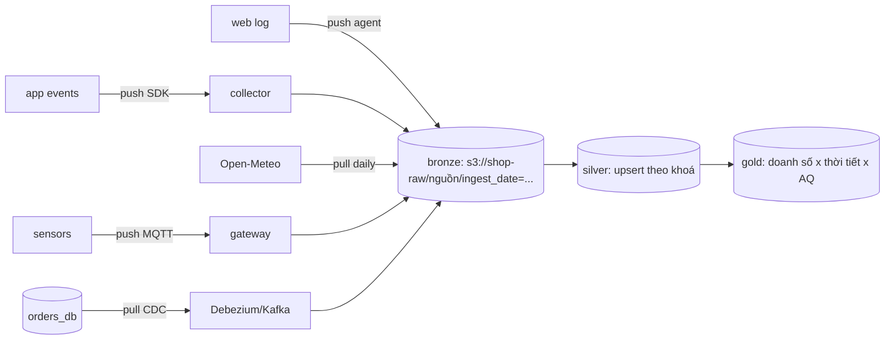

# Hướng dẫn chấm: thiết kế thu thập đa nguồn

Bài advanced không có một đáp án duy nhất. Dưới đây là một thiết kế tham khảo, các quyết định cần cân nhắc và rubric.

## `sources.yaml` tham khảo

```yaml
sources:
  - name: orders_db
    type: database
    direction: pull
    mode: cdc
    frequency: realtime
    incremental_key: postgres_wal_lsn
    dedup_key: [order_id]
    dedup_note: null
    late_data_window: 30d
    raw_path: s3://shop-raw/orders_db/
    pii: [customer_id, customer_zip_code_prefix, customer_city]
    quality_checks: ["order_id không null và duy nhất sau upsert", "order_status thuộc 8 giá trị", "order_purchase_timestamp <= now()"]
    source_limits: "Đọc WAL qua logical replication slot, không query DB primary; theo dõi replication lag"
    owner: đội backend đơn hàng
  - name: web_access_log
    type: log
    direction: push
    mode: stream
    frequency: hourly
    incremental_key: file_name_and_offset
    dedup_key: []
    dedup_note: "Log không có khoá; hai request giống hệt là hai request thật (bài basic 02: 835 dòng)"
    late_data_window: 2h
    raw_path: s3://shop-raw/web_access_log/
    pii: [client_ip]
    quality_checks: ["tỉ lệ dòng không parse được < 0,1%", "không có khoảng lặng > 10 phút giờ hành chính", "status trong 100..599"]
    source_limits: "Agent Vector trên web server đẩy tệp đã xoay vòng mỗi giờ; không đọc tệp đang ghi"
    owner: đội hạ tầng
  - name: app_events
    type: mobile
    direction: push
    mode: stream
    frequency: hourly
    incremental_key: ingested_at
    dedup_key: [event_id]
    dedup_note: null
    late_data_window: 3d
    raw_path: s3://shop-raw/app_events/
    pii: [user_id, device_id, geo_lat, geo_lon]
    quality_checks: ["event_id duy nhất trong cửa sổ 3 ngày", "schema theo app_version hợp lệ", "event_time không lệch ingested_at quá 3 ngày"]
    source_limits: "SDK gửi theo lô; collector trả 429 khi quá tải, SDK tự retry"
    owner: đội mobile
  - name: weather_api
    type: api
    direction: pull
    mode: incremental
    frequency: daily
    incremental_key: date
    dedup_key: [city, date]
    dedup_note: null
    late_data_window: 7d
    raw_path: s3://shop-raw/weather_api/
    pii: []
    quality_checks: ["đủ 1 dòng mỗi thành phố mỗi ngày", "tmin <= tmean <= tmax", "precip_mm >= 0"]
    source_limits: "Open-Meteo miễn phí giới hạn lời gọi/phút và /ngày; 1 request mỗi thành phố mỗi ngày, backoff khi 429"
    owner: đội dữ liệu (nguồn bên ngoài)
  - name: store_air_sensors
    type: iot
    direction: push
    mode: stream
    frequency: minutely
    incremental_key: received_at
    dedup_key: [sensor_id, ts]
    dedup_note: null
    late_data_window: 1d
    raw_path: s3://shop-raw/store_air_sensors/
    pii: []
    quality_checks: ["-200 và giá trị ngoài dải vật lý thành null, đếm tỉ lệ", "cảnh báo sensor im lặng > 15 phút", "ts không ở tương lai"]
    source_limits: "MQTT QoS 1 qua gateway mỗi cửa hàng; gateway đệm khi mất mạng rồi gửi bù"
    owner: đội vận hành cửa hàng
```

Điểm cần thấy trong bản của người học: mỗi nguồn một lựa chọn **khác nhau và có lý do**:

| Nguồn | Lựa chọn | Lý do từ đặc tính nguồn |
| --- | --- | --- |
| `orders_db` | CDC (WAL), cửa sổ 30 ngày | Bản ghi bị **update** (trạng thái đơn đổi nhiều ngày sau) và có thể bị xoá; incremental theo `updated_at` bỏ sót delete; không query nặng DB primary |
| `web_access_log` | Push, stream tệp theo giờ, không dedup | Append-only, không khoá; 835 dòng trùng ở log NASA là request thật |
| `app_events` | Push, dedup theo `event_id`, cửa sổ 3 ngày | SDK retry gây trùng; máy offline gửi bù nhiều ngày sau; client clock không tin được |
| `weather_api` | Pull hằng ngày, incremental theo ngày, lấy lại 7 ngày gần nhất | Tái phân tích có thể được sửa vài ngày đầu; rate limit; 1 request mỗi thành phố |
| `store_air_sensors` | Push MQTT, upsert `(sensor_id, ts)`, sentinel → null | Gateway gửi bù khi mất mạng (trùng); `-200` như bộ UCI; cần phát hiện sensor im lặng |

## `design.md` tham khảo (rút gọn)

### Kiến trúc



### Lịch chạy và phụ thuộc

Bronze nhận liên tục hoặc theo giờ; job silver mỗi giờ cho log/app/sensor, hằng ngày 02:00 cho weather; mart hằng ngày
05:00 **chờ** sensor ở silver của ngày hôm trước đủ 95% số phút và weather của ngày hôm trước có mặt; thiếu thì vẫn chạy và
đánh dấu "chưa đủ dữ liệu" thay vì chặn cả báo cáo.

### Idempotency và chạy lại

Bronze ghi theo `nguồn/ingest_date=` (ghi đè nguyên partition khi chạy lại); silver upsert theo `dedup_key`; log không có
khoá nên silver của log ghi đè theo partition giờ. Backfill một ngày = chạy lại job silver cho partition đó.

### Dữ liệu đến trễ

Partition silver theo **event time**; mỗi lần chạy mở lại các partition trong `late_data_window` của nguồn (30 ngày đơn hàng,
3 ngày app, 1 ngày sensor). Bản ghi trễ hơn cửa sổ vào bảng `late_arrivals` và cảnh báo nếu vượt 0,1%.

### Bảo mật và PII

Hash `customer_id`, `user_id`, `device_id` bằng HMAC có khoá khi vào silver; `client_ip` cắt về /24; toạ độ app làm tròn
2 chữ số thập phân. Bronze chỉ đội DE đọc được, retention 90 ngày; silver/gold không còn PII thô. Cơ sở pháp lý: Nghị định
13/2023/NĐ-CP và Luật Bảo vệ dữ liệu cá nhân.

### Giám sát

Mỗi nguồn: độ tươi (thời điểm bản ghi mới nhất), số bản ghi so với cùng giờ tuần trước (±50%), tỉ lệ reject; riêng sensor:
số sensor im lặng > 15 phút, tỉ lệ `-200`; riêng CDC: replication lag.

### Chi phí và dung lượng

| Nguồn | Ước lượng | Thô/ngày |
| --- | --- | --- |
| web log | ~70 nghìn request × 108 byte | ~7,6 MB |
| app events | 20 nghìn người dùng × 50 event × ~400 byte | ~400 MB |
| sensors | 40 × 1 440 × 84 byte | ~4,8 MB |
| orders CDC | ~200 đơn × vài thay đổi × ~1 KB | < 1 MB |
| weather | 2 request | ~30 KB |

Tổng ~0,4 GB/ngày thô, ~150 GB/năm; Parquet nhỏ hơn 3–14 lần (số đo bài intermediate 02). App events chiếm phần lớn: đó
là nơi đáng tối ưu (sampling event ít giá trị, retention ngắn hơn).

## Các quyết định cần cân nhắc

- **CDC hay incremental theo `updated_at` cho `orders_db`**: CDC bắt được delete và không tải lên DB nhưng phải vận hành
  Debezium + Kafka. Với đội nhỏ, incremental theo `updated_at` + snapshot đầy đủ hằng tuần để bắt delete là phương án
  chấp nhận được, miễn là nói rõ đánh đổi.
- **Event time hay ingestion time để partition**: event time cho phân tích đúng, ingestion time cho chạy lại đơn giản.
  Thiết kế tốt giữ cả hai cột và nói rõ partition nào theo cái nào.
- **Không phải nguồn nào cũng cần streaming**: weather và orders cho báo cáo hằng ngày; chỉ cảnh báo sensor cần độ trễ phút.

## Rubric

| Tiêu chí | Chưa đạt | Đạt | Tốt |
| --- | --- | --- | --- |
| `sources.yaml` | Test fail | Test pass | Lựa chọn khác nhau theo nguồn, có lý do (bảng trên) |
| Kiến trúc | Không sơ đồ | Sơ đồ nguồn → bronze → silver → gold | Ghi pull/push, nơi PII được xử lý |
| Idempotency | Không nói chạy lại | Có khoá upsert từng nguồn | Partition xác định + ghi đè; xử lý riêng nguồn không khoá |
| Late data | Bỏ qua | Có cửa sổ mỗi nguồn | Mở lại partition theo event time, bảng đến quá trễ, cảnh báo |
| PII | Không liệt kê | Liệt kê cột PII | Kỹ thuật cụ thể (HMAC, cắt IP, làm tròn toạ độ), phân quyền, retention, cơ sở pháp lý |
| Giám sát | Chung chung | Chỉ số mỗi nguồn | Ngưỡng bằng số, phân biệt sensor chết vs cả trạm mất kết nối |
| Chi phí | Không có số | GB/ngày mỗi nguồn | Chỉ ra nguồn chiếm phần lớn và đề xuất tối ưu |
