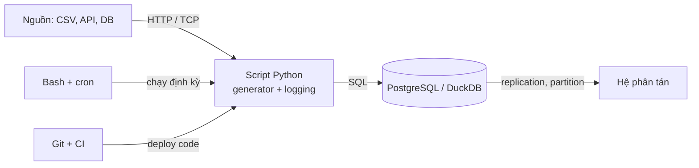
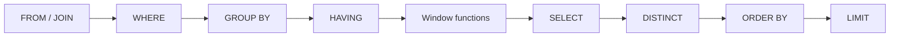
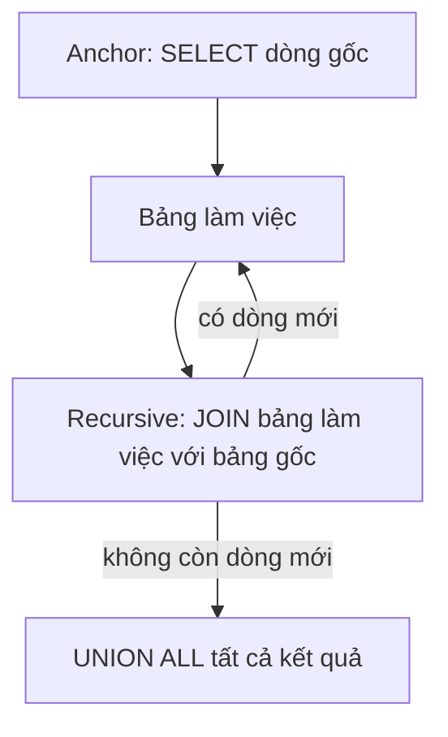
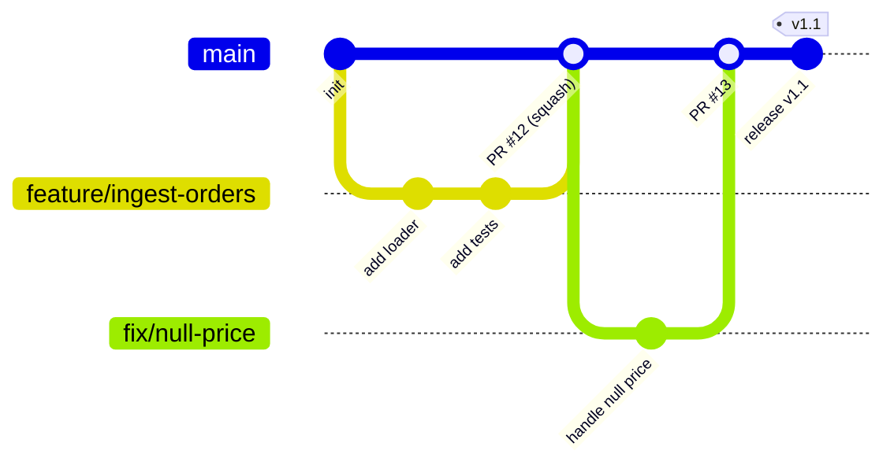
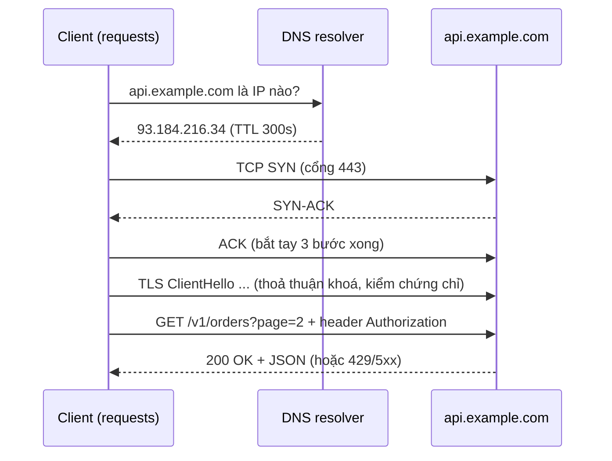
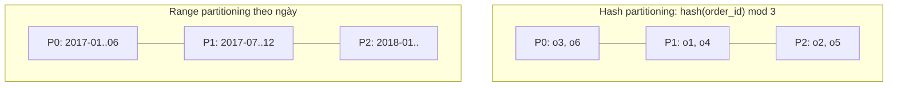
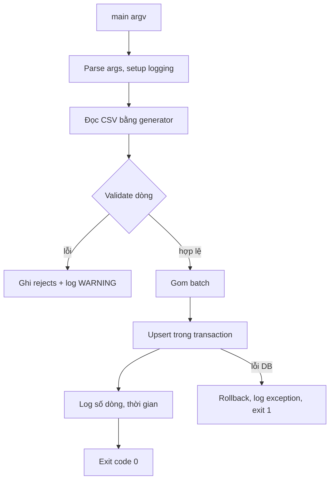

# Nền tảng kỹ thuật

Data Engineer khác Data Analyst ở chỗ: bạn không chỉ *đọc* dữ liệu mà còn phải *vận chuyển* nó một
cách đáng tin cậy, lặp lại được, chạy được lúc 3 giờ sáng mà không ai ngồi canh. Module này gom
những kỹ năng nền mà mọi module sau dùng lại: viết Python như code production (generator, typing,
logging, CLI), SQL nâng cao (window function, CTE, đệ quy), làm việc trên Linux bằng Bash, Git
workflow theo nhóm, hiểu mạng (HTTP, DNS, TCP) đủ để debug khi pipeline gọi API lỗi, và các khái
niệm distributed systems (replication, partitioning, consistency) mà Kafka, Spark, Cassandra đều
xây trên đó.

Bạn đã quen pandas và SQL, nên module này tập trung vào **chỗ khác biệt**: dữ liệu không vừa RAM,
code chạy không người giám sát, và hệ thống gồm nhiều máy.



## 0. Bắt đầu từ đâu nếu bạn chưa biết Python và SQL?

Phần này dành cho người mới hoàn toàn. Nếu đã tự viết được một hàm Python và truy vấn `JOIN`,
bạn có thể dùng bài kiểm tra cuối phần để quyết định có cần học lại hay không.

**Pipeline** là chuỗi bước đưa dữ liệu từ nguồn tới nơi sử dụng. Ví dụ: đọc CSV đơn hàng → đổi
chuỗi giá thành số → loại dòng lỗi → tính tiền hàng theo ngày → lưu bảng cho dashboard.
Data Engineer phải làm cho chuỗi này chạy đúng, chạy lại được và báo rõ khi có lỗi.

| Thứ tự | Học gì | Tự kiểm tra bằng việc gì? |
| --- | --- | --- |
| 1 | Terminal, đường dẫn tương đối/tuyệt đối, thư mục làm việc | Từ gốc repo chạy `uv run python --version` và tìm `data/README.md` |
| 2 | Python: biến, chuỗi, số, `list`, `dict`, `None` | Biểu diễn một đơn hàng bằng `dict` và đọc trường `order_id` |
| 3 | `if`, `for`, hàm, `return`, exception | Viết hàm tính tiền hàng; dữ liệu không hợp lệ báo `ValueError` |
| 4 | Đọc CSV và chuyển kiểu | Đọc `"100.50"` thành `Decimal`, giữ mã zip `"01000"` là chuỗi |
| 5 | SQL: `SELECT`, `WHERE`, `GROUP BY`, `JOIN`, `NULL` | Đếm đơn và tính tiền hàng theo khách, giữ cả khách chưa có đơn |
| 6 | Test và sửa lỗi | Chạy bài [làm sạch đơn hàng nhập môn](exercises/basic/00-order-basics/README.md), đọc assertion khi test fail |

Ví dụ Python chạy được:

```python
from decimal import Decimal

def item_total(row: dict) -> Decimal:
    price = Decimal(row["price"])
    quantity = int(row["quantity"])
    if price < 0 or quantity <= 0:
        raise ValueError("Giá không được âm, số lượng phải dương")
    return price * quantity

assert item_total({"price": "10.50", "quantity": "2"}) == Decimal("21.00")
```

Ví dụ này có trường `quantity` để luyện Python. Trong CSV `order_items` Olist, mỗi dòng đã là
một đơn vị sản phẩm: mua 2 cái tương ứng 2 dòng, không có cột `quantity` sẵn.

Ví dụ SQL chạy trong Python, không cần Docker:

```python
import sqlite3

con = sqlite3.connect(":memory:")
con.executescript("""
CREATE TABLE customers (customer_id TEXT PRIMARY KEY);
CREATE TABLE orders (order_id TEXT PRIMARY KEY, customer_id TEXT, amount INTEGER);
INSERT INTO customers VALUES ('c1'), ('c2');
INSERT INTO orders VALUES ('o1', 'c1', 100), ('o2', 'c1', 50);
""")
rows = con.execute("""
SELECT c.customer_id, COUNT(o.order_id), COALESCE(SUM(o.amount), 0)
FROM customers c LEFT JOIN orders o USING (customer_id)
GROUP BY c.customer_id ORDER BY c.customer_id
""").fetchall()
assert rows == [('c1', 2, 150), ('c2', 0, 0)]
con.close()
```

`LEFT JOIN` giữ khách c2 dù chưa có đơn. `COUNT(o.order_id)` chỉ đếm đơn có thật;
`COUNT(*)` lại đếm cả dòng khách c2 sau join. `COALESCE` đổi tổng `NULL` thành 0 theo quy ước
“chưa có đơn thì chưa có tiền hàng”. Điều kiện `IS NULL` dùng kiểm tra thiếu giá trị; `= NULL` không làm việc đó.

**Điều kiện chuyển tiếp**: giải thích được vì sao một đơn nhiều item tạo nhiều dòng sau join,
tự viết hai ví dụ trên và qua bài nhập môn. Sau đó học generator và window function ở phần tiếp theo.
Tài liệu gốc: [Python Tutorial](https://docs.python.org/3/tutorial/),
[PostgreSQL Tutorial](https://www.postgresql.org/docs/16/tutorial.html).

## 1. Python cho Data Engineering

### 1.1. Từ notebook sang code production

Notebook tốt cho khám phá, nhưng pipeline cần: chạy được từ dòng lệnh, có tham số, ghi log, trả mã
thoát (exit code) đúng, xử lý dữ liệu lớn hơn RAM, và có test. Bảng dưới tóm tắt thói quen cần đổi:

| Thói quen Data Analyst | Cách làm Data Engineer | Vì sao |
| --- | --- | --- |
| `pd.read_csv("file.csv")` cả file | Đọc theo chunk / generator | File 50 GB không vừa RAM |
| `print()` để xem | `logging` có level, timestamp | Log được thu thập, lọc, cảnh báo |
| Sửa biến trong cell | `argparse` / biến môi trường | Scheduler truyền tham số |
| Chạy lại cả notebook | Hàm thuần, idempotent | Chạy lại không nhân đôi dữ liệu |
| Không kiểu dữ liệu | Type hints + `mypy` | Bắt lỗi trước khi chạy prod |
| Exception làm dừng cell | `try/except` có chủ đích, exit code ≠ 0 | Airflow biết task fail để retry |

### 1.2. Iterator và generator

Generator là hàm có `yield`: nó trả từng phần tử khi được hỏi, không tạo cả list trong bộ nhớ.
Đây là nền của mọi xử lý streaming.

```python
import csv
from collections.abc import Iterator
from itertools import islice


def read_rows(path: str) -> Iterator[dict[str, str]]:
    """Đọc CSV từng dòng; bộ nhớ O(1) bất kể file lớn cỡ nào."""
    with open(path, newline="", encoding="utf-8") as f:
        yield from csv.DictReader(f)


def batched(rows: Iterator[dict], size: int) -> Iterator[list[dict]]:
    """Gom thành lô để insert nhiều dòng một lần (giảm round-trip tới DB)."""
    it = iter(rows)
    while batch := list(islice(it, size)):
        yield batch


# Pipeline lười (lazy): không dòng nào được đọc cho tới khi vòng for chạy
delivered = (r for r in read_rows("olist_orders_dataset.csv") if r["order_status"] == "delivered")
for batch in batched(delivered, 10_000):
    ...  # insert batch vào DB
```

Python 3.12 có sẵn `itertools.batched`. Với pandas, `pd.read_csv(path, chunksize=100_000)` trả về
iterator các DataFrame, còn polars có `scan_csv` (lazy) và DuckDB đọc CSV trực tiếp bằng SQL mà
không nạp hết vào RAM.

| Cách đọc file lớn | Bộ nhớ | Tốc độ | Khi nào dùng |
| --- | --- | --- | --- |
| `csv` + generator | Rất thấp | Trung bình | Logic từng dòng, validate, không cần thư viện |
| `pandas.read_csv(chunksize=)` | Theo chunk | Khá | Biến đổi kiểu DataFrame từng lô |
| `polars.scan_csv` | Thấp (lazy, streaming) | Nhanh | Biến đổi cột, group by trên file lớn |
| `duckdb.sql("SELECT ... FROM 'f.csv'")` | Thấp | Rất nhanh | Tổng hợp bằng SQL, ghi Parquet |

### 1.3. Type hints và dataclass

Type hints không làm Python chạy nhanh hơn, nhưng giúp IDE và `mypy` bắt lỗi, và là tài liệu sống.

```python
from dataclasses import dataclass
from datetime import datetime
from decimal import Decimal


@dataclass(frozen=True, slots=True)
class OrderItem:
    order_id: str
    order_item_id: int
    price: Decimal
    shipping_limit_date: datetime

    @classmethod
    def from_row(cls, row: dict[str, str]) -> "OrderItem":
        return cls(
            order_id=row["order_id"],
            order_item_id=int(row["order_item_id"]),
            price=Decimal(row["price"]),
            shipping_limit_date=datetime.fromisoformat(row["shipping_limit_date"]),
        )
```

Dùng `Decimal` cho tiền (tránh `0.1 + 0.2 != 0.3`). Khi cần validate phức tạp, thư viện
`pydantic` hoặc `pandera` (cho DataFrame) là lựa chọn phổ biến.

### 1.4. Logging

`print` ghi ra stdout, không có mức độ, không timestamp, không tắt được. `logging` thì có:

```python
import logging

logger = logging.getLogger(__name__)  # mỗi module một logger, tên theo module


def setup_logging(level: str = "INFO") -> None:
    logging.basicConfig(
        level=level,
        format="%(asctime)s %(levelname)s %(name)s %(message)s",
    )


def load(path: str) -> int:
    logger.info("Bắt đầu nạp %s", path)          # dùng %s, không f-string: chỉ format khi cần
    try:
        n = ...
    except ValueError:
        logger.exception("Dòng lỗi trong %s", path)  # tự kèm traceback
        raise
    logger.info("Nạp xong %d dòng", n)
    return n
```

Quy tắc: thư viện chỉ gọi `logging.getLogger(__name__)`, **không** gọi `basicConfig`; chỉ entrypoint
(hàm `main`) cấu hình logging. Log ra stderr, dữ liệu ra stdout, để `script.py > out.csv` không lẫn
log. Ở production thường log dạng JSON để Loki/Elasticsearch/CloudWatch parse được.

### 1.5. CLI với argparse và exit code

```python
import argparse
import sys


def main(argv: list[str] | None = None) -> int:
    parser = argparse.ArgumentParser(description="Nạp orders CSV vào SQLite")
    parser.add_argument("csv_path")
    parser.add_argument("--db", default="olist.db")
    parser.add_argument("--batch-size", type=int, default=10_000)
    parser.add_argument("--log-level", default="INFO")
    args = parser.parse_args(argv)
    setup_logging(args.log_level)
    try:
        load(args.csv_path)
    except Exception:
        return 1      # scheduler thấy exit code 1 => task fail => retry/cảnh báo
    return 0


if __name__ == "__main__":
    sys.exit(main())
```

Nhận `argv` làm tham số giúp test gọi `main(["data.csv", "--db", tmp])` mà không cần subprocess.

### 1.6. Idempotency, ngay từ script đầu tiên

**Idempotent** nghĩa là chạy một lần hay mười lần cho cùng kết quả. Pipeline sẽ bị chạy lại (retry,
backfill), nên mọi bước ghi phải idempotent: dùng `INSERT ... ON CONFLICT DO UPDATE` (upsert),
hoặc xoá-rồi-ghi theo partition (`DELETE WHERE date = :d; INSERT ...`) trong một transaction, hoặc
ghi ra file tạm rồi `rename` (atomic trên cùng filesystem).

### 1.7. Tổ chức mã, cấu hình và đóng tài nguyên

Một script ngắn có thể ở một file. Khi có nhiều bước, tách theo trách nhiệm: `extract.py` đọc nguồn,
`transform.py` làm sạch, `load.py` ghi đích, `cli.py` nhận tham số. Đặt chúng trong package có
`__init__.py`; chạy từ gốc bằng `uv run python -m ten_package.cli` để tránh phụ thuộc thư mục hiện tại.
`pyproject.toml` khai báo dependency; lockfile giữ phiên bản để máy khác dựng lại môi trường.

Tham số ngày chạy truyền qua CLI; endpoint và secret đọc từ môi trường. Nếu thiếu biến bắt buộc,
dừng sớm với thông báo rõ; không dùng mật khẩu production làm giá trị mặc định.
Chỉ bắt lỗi mà bạn có cách xử lý. Gặp CSV sai schema thì báo lỗi dữ liệu, không retry vô hạn như lỗi mạng.

```python
from contextlib import closing
import sqlite3

with closing(sqlite3.connect(":memory:")) as con:
    with con:  # commit khi thành công, rollback khi có exception
        con.execute("CREATE TABLE orders (order_id TEXT PRIMARY KEY)")
        con.execute("INSERT INTO orders VALUES (?)", ("o1",))
# closing đóng connection; `with con` của sqlite3 riêng lẻ không đóng nó.
```

**Ngày giờ và tiền**: dùng `Decimal` cho tính tiền cần chính xác; phân biệt chuỗi ngày với thời điểm.
`2026-01-01 00:30` ở Việt Nam là `2025-12-31 17:30 UTC`, nên nhóm theo ngày phải chọn múi giờ nghiệp vụ.
CSV Olist có timestamp không kèm offset; cần xác nhận múi giờ nguồn trước khi chuyển đổi.
Không gắn UTC vào giờ địa phương chỉ để làm hết lỗi kiểu dữ liệu.

```python
from datetime import datetime, timezone
from zoneinfo import ZoneInfo

local = datetime(2026, 1, 1, 0, 30, tzinfo=ZoneInfo("Asia/Ho_Chi_Minh"))
assert local.astimezone(timezone.utc).isoformat() == "2025-12-31T17:30:00+00:00"
```

## 2. SQL nâng cao: window function, CTE, đệ quy

### 2.1. Thứ tự thực thi logic

Hiểu thứ tự này giải thích vì sao không dùng được alias của `SELECT` trong `WHERE`, và vì sao window
function không đặt được trong `WHERE`:



Muốn lọc theo kết quả window function, bọc trong CTE/subquery hoặc dùng `QUALIFY` (DuckDB,
Snowflake, BigQuery hỗ trợ; PostgreSQL thì không).

### 2.2. Window function

Window function tính trên một "cửa sổ" các dòng liên quan **mà không gộp dòng** như `GROUP BY`.

```sql
function(...) OVER (
    PARTITION BY ...      -- chia nhóm (như group by nhưng giữ dòng)
    ORDER BY ...          -- thứ tự trong nhóm
    ROWS BETWEEN ...      -- khung (frame): dòng nào được tính
)
```

| Nhóm | Hàm | Ví dụ dùng |
| --- | --- | --- |
| Xếp hạng | `ROW_NUMBER`, `RANK`, `DENSE_RANK`, `NTILE` | Top-N mỗi nhóm, khử trùng lặp |
| Dịch dòng | `LAG`, `LEAD`, `FIRST_VALUE`, `LAST_VALUE` | So với kỳ trước, khoảng cách giữa 2 đơn |
| Tổng hợp | `SUM`, `AVG`, `COUNT`, `MIN`, `MAX` + `OVER` | Running total, moving average, tỉ trọng |

Khác biệt `ROW_NUMBER` / `RANK` / `DENSE_RANK` khi có giá trị bằng nhau (100, 100, 90):

| giá trị | ROW_NUMBER | RANK | DENSE_RANK |
| --- | --- | --- | --- |
| 100 | 1 | 1 | 1 |
| 100 | 2 | 1 | 1 |
| 90 | 3 | 3 | 2 |

Ví dụ trên Olist (chạy được trên DuckDB và PostgreSQL):

```sql
-- Top 3 seller theo doanh thu trong mỗi bang
WITH seller_revenue AS (
    SELECT s.seller_state, oi.seller_id, SUM(oi.price) AS revenue
    FROM order_items oi JOIN sellers s USING (seller_id)
    GROUP BY 1, 2
)
SELECT *
FROM (
    SELECT *, DENSE_RANK() OVER (PARTITION BY seller_state ORDER BY revenue DESC) AS rnk
    FROM seller_revenue
) t
WHERE rnk <= 3;

-- daily_revenue: một dòng cho mỗi ngày có dữ liệu
-- Luỹ kế tháng + trung bình của tối đa 7 dòng gần nhất
SELECT
    order_date,
    revenue,
    SUM(revenue) OVER (PARTITION BY date_trunc('month', order_date) ORDER BY order_date) AS mtd,
    AVG(revenue) OVER (ORDER BY order_date ROWS BETWEEN 6 PRECEDING AND CURRENT ROW) AS ma7
FROM daily_revenue
ORDER BY order_date;

-- Số ngày giữa hai đơn liên tiếp của cùng khách
SELECT customer_unique_id, order_purchase_timestamp,
       order_purchase_timestamp
         - LAG(order_purchase_timestamp) OVER (PARTITION BY customer_unique_id
                                               ORDER BY order_purchase_timestamp) AS gap
FROM orders JOIN customers USING (customer_id);
```

**Phân biệt 7 dòng với 7 ngày**: `ROWS BETWEEN 6 PRECEDING AND CURRENT ROW` lấy dòng hiện tại
và tối đa 6 dòng đứng trước. SQL đếm dòng, không kiểm tra các ngày có liền nhau không.
Nếu bảng chỉ có ngày 01/01 và 20/01, phép tính ở ngày 20/01 vẫn lấy cả hai dòng dù chúng cách nhau 19 ngày.

Để `ma7` là trung bình theo **7 ngày lịch**, bảng đầu vào cần đúng một dòng cho mỗi ngày liên tục.
Nếu ngày không có đơn nghĩa là doanh thu bằng 0, hãy tạo đủ dãy ngày (date spine, xem phần CTE đệ quy),
`LEFT JOIN` doanh thu vào dãy đó và điền 0 cho ngày không có đơn, rồi mới tính window.
Không tự điền 0 nếu thiếu ngày do pipeline chưa nạp dữ liệu: “chưa biết doanh thu” khác “không có doanh thu”.
Ở đầu dãy, chưa đủ 7 ngày thì `AVG` chỉ tính trên số dòng hiện có; muốn cửa sổ đầu tiên đủ 7 ngày,
cần nạp thêm 6 ngày trước khoảng báo cáo và chỉ lọc ngày báo cáo **sau khi** tính window.

**Hiểu `LAST_VALUE` qua khung tính toán (frame)**: hàm lấy giá trị ở dòng cuối **trong frame**,
không tự lấy dòng cuối của toàn bộ nhóm. Khi có `ORDER BY` mà không ghi frame, mặc định là
`RANGE BETWEEN UNBOUNDED PRECEDING AND CURRENT ROW`: từ đầu nhóm tới hết các dòng đồng hạng
(cùng giá trị sắp xếp) với dòng đang xét.

Ví dụ dưới có hai dòng cùng `t = 1`. Thêm `id` vào thứ tự sắp xếp giúp xác định rõ dòng nào đứng sau:

```sql
WITH sample(id, t, x) AS (
    VALUES (1, 1, 'A'), (2, 1, 'B'), (3, 2, 'C')
)
SELECT id, t, x,
       LAST_VALUE(x) OVER (ORDER BY t) AS last_default,
       LAST_VALUE(x) OVER (
           ORDER BY t, id
           ROWS BETWEEN UNBOUNDED PRECEDING AND UNBOUNDED FOLLOWING
       ) AS last_whole_group
FROM sample
ORDER BY t, id;
```

`last_default` ở hai dòng `t = 1` lấy cùng một giá trị trong nhóm đồng hạng,
nhưng không xác định chắc là A hay B vì `ORDER BY t` chưa phân biệt thứ tự hai dòng.
`last_whole_group` luôn là C: frame bao trùm cả nhóm và `(t, id)` xác định rõ thứ tự.
Nếu có `PARTITION BY`, frame áp dụng riêng trong từng nhóm đó.

Nếu `t` không trùng, `LAST_VALUE(x) OVER (ORDER BY t)` mới trả về `x` của chính dòng đang xét.
Tương tự, running total dùng `RANGE` mặc định cho các dòng đồng hạng cùng một tổng;
dùng `ROWS` và thứ tự đủ để phân biệt các dòng khi muốn cộng lần lượt từng dòng.
Xem [tài liệu PostgreSQL về window function](https://www.postgresql.org/docs/current/functions-window.html).

**Khử trùng lặp** là ứng dụng kinh điển trong pipeline (bản ghi CDC đến nhiều lần):

```sql
SELECT * FROM (
    SELECT *, ROW_NUMBER() OVER (PARTITION BY order_id ORDER BY updated_at DESC) AS rn
    FROM raw_orders
) WHERE rn = 1;          -- giữ phiên bản mới nhất của mỗi order
```

### 2.3. CTE

CTE (`WITH ... AS`) đặt tên cho bước trung gian, giúp đọc từ trên xuống như pipeline. Trong
PostgreSQL ≥ 12, CTE không đệ quy thường được inline (tối ưu như subquery); dùng
`AS MATERIALIZED` nếu muốn ép tính một lần.

### 2.4. CTE đệ quy

Dùng cho dữ liệu phân cấp (cây danh mục, sơ đồ tổ chức), đồ thị nhỏ, hoặc sinh dãy (date spine).



```sql
-- Cây danh mục: mỗi danh mục kèm đường dẫn và độ sâu
WITH RECURSIVE tree AS (
    SELECT category_id, parent_id, name, name AS path, 0 AS depth
    FROM categories WHERE parent_id IS NULL          -- anchor
    UNION ALL
    SELECT c.category_id, c.parent_id, c.name,
           t.path || ' > ' || c.name, t.depth + 1
    FROM categories c JOIN tree t ON c.parent_id = t.category_id   -- recursive
)
SELECT * FROM tree ORDER BY path;

-- Date spine: mọi ngày trong khoảng, để LEFT JOIN và lộ ra ngày không có đơn
WITH RECURSIVE days(d) AS (
    SELECT DATE '2018-01-01'
    UNION ALL
    SELECT d + 1 FROM days WHERE d < DATE '2018-01-31'
)
SELECT d, COALESCE(r.revenue, 0) AS revenue
FROM days LEFT JOIN daily_revenue r ON r.order_date = d;
```

Luôn có điều kiện dừng (`WHERE d < ...`, hoặc `depth < 20` khi dữ liệu có thể có chu trình). Trên
DuckDB/PostgreSQL có thể dùng `generate_series` thay đệ quy cho date spine.

### 2.5. Gaps and islands

Bài toán "chuỗi liên tiếp" (khách mua liên tục bao nhiêu tháng, sensor tắt bao lâu) giải bằng mẹo:
`giá_trị - ROW_NUMBER()` là hằng số trong một chuỗi liên tiếp.

```sql
WITH m AS (
    SELECT DISTINCT customer_id, date_trunc('month', ts)::DATE AS month FROM orders
), g AS (
    SELECT *, month - INTERVAL (ROW_NUMBER() OVER (PARTITION BY customer_id ORDER BY month)) MONTH AS grp
    FROM m
)
SELECT customer_id, MIN(month) AS start_month, COUNT(*) AS streak
FROM g GROUP BY customer_id, grp;
```

Sessionization (gom click thành phiên khi cách nhau > 30 phút) là biến thể: đánh dấu
`is_new = (ts - LAG(ts) > 30 phút)`, rồi `SUM(is_new) OVER (ORDER BY ts)` ra số phiên.

## 3. Linux và Bash

Server chạy pipeline gần như luôn là Linux. Bạn cần đi lại, xem log, xử lý file text và viết script
nhỏ để tự động hoá.

### 3.1. Lệnh thường dùng

| Việc | Lệnh |
| --- | --- |
| Xem file lớn | `head -n 5 f.csv`, `tail -f app.log`, `less f.csv`, `wc -l f.csv` |
| Tìm | `grep -c ERROR app.log`, `find /data -name '*.csv' -mtime -1` |
| Cắt cột | `cut -d, -f2,3 f.csv`, `awk -F, '{print $2}' f.csv` |
| Đếm nhóm | `cut -d, -f3 f.csv \| sort \| uniq -c \| sort -rn \| head` |
| Dung lượng | `du -sh /data/*`, `df -h` |
| Tiến trình | `ps aux \| grep python`, `top`/`htop`, `kill <pid>` |
| Quyền | `chmod +x run.sh`, `chown de:de f.csv` |
| Mạng | `curl -sS -o /dev/null -w '%{http_code}' URL`, `ss -tlnp`, `dig example.com` |
| Nén | `gzip -k f.csv`, `zcat f.csv.gz \| head`, `tar czf a.tgz dir/` |

Triết lý Unix: mỗi chương trình làm một việc, nối nhau qua **pipe** (`|`). stdin (0), stdout (1),
stderr (2) là ba luồng; `>` ghi đè, `>>` nối thêm, `2>&1` gộp stderr vào stdout, `2>/dev/null` bỏ lỗi.

### 3.2. Viết script an toàn

```bash
#!/usr/bin/env bash
set -euo pipefail          # dừng khi lỗi, biến chưa định nghĩa là lỗi, lỗi giữa pipe cũng tính
IFS=$'\n\t'

usage() { echo "Cách dùng: $0 <input.csv> [output_dir]" >&2; exit 2; }
[[ $# -ge 1 ]] || usage

input="$1"
out_dir="${2:-./out}"      # giá trị mặc định
[[ -f "$input" ]] || { echo "Không thấy $input" >&2; exit 1; }
mkdir -p "$out_dir"

tmp="$(mktemp)"
trap 'rm -f "$tmp"' EXIT   # luôn dọn file tạm, kể cả khi lỗi

# Đếm đơn theo trạng thái (bỏ header), ghi ra file tạm rồi mv để atomic
tail -n +2 "$input" | awk -F, '{print $3}' | sort | uniq -c | awk '{print $2","$1}' > "$tmp"
mv "$tmp" "$out_dir/status_counts.csv"
echo "Xong: $out_dir/status_counts.csv"
```

Những lỗi hay gặp: quên quote biến (`"$file"`) nên tên file có dấu cách bị tách; thiếu
`pipefail` nên `false | sort` vẫn trả 0; `awk -F,` sai với CSV có dấu phẩy trong ngoặc kép (khi đó
dùng Python `csv`, `csvkit`, hoặc DuckDB).

### 3.3. cron và biến môi trường

```cron
# phút giờ ngày tháng thứ  lệnh
15 2 * * *  cd /opt/pipeline && ./run.sh >> /var/log/pipeline.log 2>&1
```

cron chạy với môi trường tối giản (PATH ngắn, không có biến trong `.bashrc`), nên dùng đường dẫn
tuyệt đối. cron không có retry, phụ thuộc, backfill hay giao diện, đó là lý do module 05 dùng
Airflow. Bí mật (mật khẩu DB) để trong biến môi trường hoặc secret manager, **không** viết trong
script hay commit lên Git.

## 4. Git workflow cho nhóm data

### 4.1. Mô hình làm việc



**Trunk-based / GitHub flow** (phổ biến nhất cho team data): `main` luôn deploy được, mỗi thay
đổi là một nhánh ngắn + Pull Request + review + CI xanh rồi merge. **Git flow** (develop, release,
hotfix) nặng hơn, hợp với phần mềm phát hành theo phiên bản.

### 4.2. Lệnh cốt lõi

```bash
git switch -c feature/ingest-orders     # tạo và chuyển nhánh
git add -p                              # chọn từng đoạn thay đổi để stage
git commit -m "feat(ingest): load olist orders in batches"
git fetch origin && git rebase origin/main   # cập nhật nhánh theo main, lịch sử thẳng
git push -u origin feature/ingest-orders
git log --oneline --graph --decorate -20
git diff main...HEAD                    # thay đổi của nhánh so với điểm rẽ
git restore --staged file.py            # bỏ stage
git revert <sha>                        # đảo một commit đã push (an toàn)
git stash push -m "wip"                 # cất tạm thay đổi
```

| | `merge` | `rebase` |
| --- | --- | --- |
| Lịch sử | Giữ nguyên, có merge commit | Thẳng, viết lại commit |
| An toàn trên nhánh đã chia sẻ | Có | Không (đừng rebase nhánh người khác đang dùng) |
| Dùng khi | Gộp PR vào main | Cập nhật nhánh cá nhân theo main |

### 4.3. Riêng cho data

- `.gitignore` dữ liệu (`data/`, `*.parquet`, `*.db`), file `.env`, notebook output. Git không dành
  cho file lớn; dùng object storage, DVC hoặc Git LFS.
- Lỡ commit bí mật: coi như đã lộ, **đổi mật khẩu ngay**; xoá khỏi lịch sử (`git filter-repo`) chỉ
  là bước phụ.
- Commit nhỏ, thông điệp theo Conventional Commits (`feat:`, `fix:`, `refactor:`), giúp sinh
  changelog và review dễ.
- SQL, DAG Airflow, model dbt, Terraform đều là code: review qua PR, CI chạy test và lint (`ruff`,
  `sqlfluff`) trước khi merge.

## 5. Networking cho Data Engineer

Pipeline gọi API, kết nối DB qua mạng, đọc S3. Khi "không kết nối được", bạn cần biết lỗi nằm ở tầng
nào.

### 5.1. Các tầng và giao thức

| Tầng (TCP/IP) | Giao thức | Bạn gặp ở đâu |
| --- | --- | --- |
| Application | HTTP(S), DNS, PostgreSQL wire protocol, Kafka protocol | API, DB driver |
| Transport | TCP (tin cậy, có thứ tự), UDP (nhanh, không đảm bảo) | Cổng 5432, 9092, 443 |
| Internet | IP, ICMP (`ping`) | Địa chỉ, routing, subnet/VPC |
| Link | Ethernet, Wi-Fi | Hiếm khi phải lo |

### 5.2. Một request HTTPS đi qua những gì



- **DNS** dịch tên thành IP, có cache theo TTL. Lỗi `Name or service not known` = DNS; kiểm tra bằng
  `dig`/`nslookup`.
- **TCP** thiết lập kết nối tin cậy. `Connection refused` = tới được máy nhưng không có tiến trình
  nghe cổng đó; `timeout` = gói tin bị chặn (firewall, security group) hoặc máy không tồn tại.
- **TLS** mã hoá; lỗi chứng chỉ (`CERTIFICATE_VERIFY_FAILED`) thường do proxy công ty hoặc CA cũ.
  Đừng tắt `verify=False` ở production.
- **Connection pooling**: bắt tay TCP + TLS tốn vài chục ms. `requests.Session()` và pool của
  SQLAlchemy giữ kết nối để tái dùng.

### 5.3. HTTP cho người viết pipeline

| Mã | Nghĩa | Pipeline nên làm gì |
| --- | --- | --- |
| 200/201/204 | Thành công | Xử lý tiếp |
| 301/302/304 | Chuyển hướng / không đổi | Theo redirect; 304 dùng cache |
| 400/422 | Request sai | Không retry, sửa code/tham số |
| 401/403 | Chưa xác thực / không có quyền | Không retry, kiểm tra token |
| 404 | Không có | Thường không retry |
| 429 | Quá giới hạn tốc độ | Retry sau `Retry-After` |
| 500/502/503/504 | Lỗi phía server/gateway | Retry với exponential backoff + jitter |

Phương thức: `GET` (đọc, idempotent), `POST` (tạo, **không** idempotent trừ khi có idempotency
key), `PUT` (thay thế, idempotent), `PATCH` (sửa một phần), `DELETE` (idempotent). Phân trang hay
gặp: offset/limit (đơn giản nhưng lệch khi dữ liệu đổi), cursor/next token (ổn định, nên dùng).

```python
import random
import time

import requests

RETRYABLE = {429, 500, 502, 503, 504}


def get_json(session: requests.Session, url: str, max_retries: int = 5) -> dict:
    for attempt in range(max_retries + 1):
        try:
            resp = session.get(url, timeout=(3.05, 30))   # (connect, read) timeout: LUÔN đặt
        except (requests.ConnectionError, requests.Timeout):
            if attempt == max_retries:
                raise
        else:
            if resp.status_code not in RETRYABLE:
                resp.raise_for_status()                   # 4xx khác: lỗi thật, không retry
                return resp.json()
            if attempt == max_retries:
                resp.raise_for_status()
        time.sleep(min(60, 2 ** attempt) * random.uniform(0.5, 1.0))   # backoff + jitter
    raise AssertionError("unreachable")
```

**Jitter** (ngẫu nhiên hoá thời gian chờ) tránh hàng nghìn client cùng retry đúng một lúc
(thundering herd).

## 6. Distributed systems căn bản

Khi dữ liệu hoặc tải vượt một máy, ta chia ra nhiều máy. Mọi hệ thống bạn sẽ học (Kafka, Spark,
Cassandra, BigQuery) đều trả lời hai câu: **chia dữ liệu thế nào** (partitioning) và **sao chép thế
nào** (replication), rồi chịu hệ quả về **consistency**.

### 6.1. Replication

Mục đích: chịu lỗi (máy chết vẫn còn bản sao), đọc nhanh hơn (đọc từ replica gần), gần người dùng.

| Mô hình | Cách ghi | Ví dụ | Đánh đổi |
| --- | --- | --- | --- |
| Single-leader | Ghi vào leader, leader đẩy sang follower | PostgreSQL streaming replication, Kafka partition leader | Đơn giản; leader là nút cổ chai, failover phức tạp |
| Multi-leader | Ghi ở nhiều leader (mỗi DC một) | Multi-region active-active | Ghi gần người dùng; phải giải xung đột |
| Leaderless | Client ghi vào W nút, đọc từ R nút | Cassandra, DynamoDB | Sẵn sàng cao; consistency điều chỉnh bằng quorum |

**Đồng bộ vs bất đồng bộ**: replication đồng bộ chờ follower xác nhận (không mất dữ liệu, ghi chậm
hơn, follower chết thì ghi bị chặn); bất đồng bộ trả lời ngay (nhanh, nhưng leader chết có thể mất
các ghi chưa kịp chép và follower bị **replication lag**: đọc từ replica thấy dữ liệu cũ).

**Quorum**: với N bản sao, ghi thành công khi W nút xác nhận, đọc hỏi R nút. Nếu `R + W > N` thì tập
đọc và tập ghi chắc chắn giao nhau, nên đọc luôn gặp ít nhất một bản mới nhất. Ví dụ phổ biến:
N=3, W=2, R=2.

### 6.2. Partitioning (sharding)



| | Hash | Range |
| --- | --- | --- |
| Phân bố | Đều (nếu key đa dạng) | Có thể lệch (ngày gần nhất nóng) |
| Truy vấn khoảng (`BETWEEN`) | Phải quét mọi partition | Chỉ quét partition liên quan (pruning) |
| Ví dụ | Kafka key → partition, Cassandra, Spark shuffle | Partition theo ngày trong warehouse/Hive, HBase |

**Hot partition / data skew**: một key chiếm phần lớn dữ liệu (một seller lớn, giá trị `NULL`) làm
một máy quá tải trong khi máy khác rảnh. Cách xử lý: thêm "salt" vào key, tách key nóng riêng.

**Rebalancing**: `hash mod N` có nhược điểm lớn: đổi N thì gần như mọi key đổi chỗ.
**Consistent hashing** đặt nút và key trên một vòng tròn băm; key thuộc nút đầu tiên theo chiều kim
đồng hồ. Thêm/bớt một nút chỉ di chuyển khoảng `1/N` số key. Virtual node (mỗi máy nhiều điểm trên
vòng) giúp phân bố đều hơn. Cassandra, DynamoDB dùng ý tưởng này (bài tập advanced 01).

### 6.3. Consistency và CAP

- **Strong consistency (linearizability)**: mọi đọc thấy ghi mới nhất, như chỉ có một bản.
- **Eventual consistency**: nếu ngừng ghi, các bản sao rốt cuộc sẽ giống nhau; trong lúc đó có thể
  đọc dữ liệu cũ.
- Mức giữa: **read-your-writes** (tôi luôn thấy ghi của mình), **monotonic reads** (không đọc lùi
  về quá khứ).

**CAP**: khi có **P**artition mạng (luôn có thể xảy ra), hệ thống phải chọn giữa **C**onsistency
(từ chối phục vụ để không trả dữ liệu sai) và **A**vailability (vẫn trả lời, có thể dữ liệu cũ).
**PACELC** bổ sung: khi không có partition (**E**lse), vẫn phải chọn giữa **L**atency và
**C**onsistency. Module 03 đi sâu vào CAP cho từng NoSQL.

### 6.4. Những điều luôn đúng trong hệ phân tán

- Mạng không tin cậy: message có thể mất, trễ, **lặp**. Vì vậy consumer phải idempotent và hệ thống
  thực tế thường là **at-least-once** + khử trùng lặp, thay vì exactly-once "thật".
- Đồng hồ các máy lệch nhau: đừng dựa vào timestamp máy để xếp thứ tự sự kiện tuyệt đối; dùng
  version, sequence number, hoặc logical clock.
- Lỗi một phần (partial failure) là bình thường: thiết kế với timeout, retry, và chấp nhận nút chết.

## 7. Ghép lại: một script ingest đạt chuẩn

Gộp mọi phần trên thành checklist cho script ingest đầu tiên (chính là milestone m01 của capstone:
nạp Olist vào PostgreSQL):



- [ ] Chạy từ CLI, tham số qua `argparse`/biến môi trường, không hard-code đường dẫn hay mật khẩu.
- [ ] Đọc streaming, bộ nhớ không tăng theo kích thước file.
- [ ] Validate kiểu dữ liệu, dòng lỗi đi vào file reject thay vì làm sập cả job.
- [ ] Ghi idempotent (upsert hoặc delete-insert theo partition), có transaction.
- [ ] Logging có level; exit code ≠ 0 khi thất bại.
- [ ] Gọi API thì có timeout, retry có backoff, xử lý phân trang.
- [ ] Code trong Git, có test, review qua PR.

## 8. Tài liệu tham khảo

- roadmap.sh, Data Engineer Roadmap: https://roadmap.sh/data-engineer
- Python docs, `itertools`, `csv`, `logging`, `argparse`, `typing`: https://docs.python.org/3/library/
- Python Logging HOWTO: https://docs.python.org/3/howto/logging.html
- PostgreSQL docs, Window Functions: https://www.postgresql.org/docs/current/tutorial-window.html
- PostgreSQL docs, WITH Queries (CTE, đệ quy): https://www.postgresql.org/docs/current/queries-with.html
- DuckDB docs, Window Functions và QUALIFY: https://duckdb.org/docs/sql/functions/window_functions
- Mode SQL Tutorial (window functions): https://mode.com/sql-tutorial/sql-window-functions/
- The Linux Command Line (William Shotts), miễn phí: https://linuxcommand.org/tlcl.php
- Bash Pitfalls: https://mywiki.wooledge.org/BashPitfalls
- Pro Git (Scott Chacon), miễn phí: https://git-scm.com/book
- Conventional Commits: https://www.conventionalcommits.org
- MDN, HTTP overview và status codes: https://developer.mozilla.org/en-US/docs/Web/HTTP
- AWS Architecture Blog, Exponential Backoff and Jitter: https://aws.amazon.com/blogs/architecture/exponential-backoff-and-jitter/
- Martin Kleppmann, *Designing Data-Intensive Applications* (chương 5 Replication, 6 Partitioning, 8–9)
- Amazon Dynamo paper (consistent hashing, quorum): https://www.allthingsdistributed.com/files/amazon-dynamo-sosp2007.pdf
- Kaggle, Brazilian E-Commerce Public Dataset by Olist: https://www.kaggle.com/datasets/olistbr/brazilian-ecommerce
