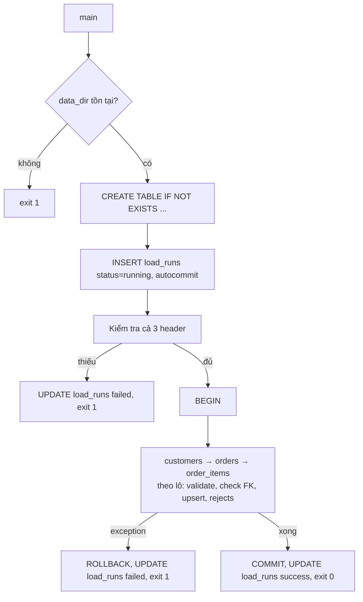

# Hướng dẫn chấm: Pipeline nạp Olist

Bài advanced không có một đáp án duy nhất. Dưới đây là hướng làm tham khảo, các quyết định thiết kế
và rubric.

## Hướng làm



Khung tham khảo:

```python
COLUMNS = {"customers": [...], "orders": [...], "order_items": [...]}
KEYS = {"customers": ["customer_id"], "orders": ["order_id"], "order_items": ["order_id", "order_item_id"]}
FK = {"orders": ("customer_id", "customers"), "order_items": ("order_id", "orders")}

def load_table(conn, run_id, table, path, batch_size) -> tuple[int, int]:
    upsert = (f"INSERT INTO {table} (...) VALUES (...) "
              f"ON CONFLICT({', '.join(KEYS[table])}) DO UPDATE SET col = excluded.col, ...")
    loaded = rejected = 0
    for batch in batched(read_rows(path), batch_size):
        good, bad = split_valid(table, batch)               # validate từng dòng
        if table in FK:
            col, parent = FK[table]
            existing = lookup_keys(conn, parent, {r[col] for r in good})   # một truy vấn IN (...) cho cả lô
            bad += [(r, f"{col} không tồn tại") for r in good if r[col] not in existing]
            good = [r for r in good if r[col] in existing]
        conn.executemany(upsert, good)
        conn.executemany("INSERT INTO rejects VALUES (?, ?, ?, ?)", [(run_id, table, json.dumps(r), why) for r, why in bad])
        loaded += len(good); rejected += len(bad)
    return loaded, rejected

def main(argv=None) -> int:
    ...
    conn = sqlite3.connect(args.db, isolation_level=None)   # tự quản lý transaction
    conn.execute("PRAGMA foreign_keys = ON")
    conn.executescript(DDL)
    run_id = conn.execute("INSERT INTO load_runs (started_at, status) VALUES (?, 'running')", (now(),)).lastrowid
    try:
        check_headers(args.data_dir)                         # trước khi ghi bất cứ gì
        conn.execute("BEGIN")
        for table in ("customers", "orders", "order_items"): # cha trước con
            ...
        conn.execute("COMMIT")
    except Exception as exc:
        if conn.in_transaction:
            conn.execute("ROLLBACK")
        logger.exception("run %d thất bại", run_id)
        conn.execute("UPDATE load_runs SET status='failed', finished_at=?, error=? WHERE run_id=?", ...)
        return 1
    conn.execute("UPDATE load_runs SET status='success', ... WHERE run_id=?", ...)
    return 0
```

Trên dữ liệu test: `customers` 4 (một dòng thiếu id bị reject), `orders` 3 (`o3` sai khoá ngoại,
`o4` sai trạng thái), `order_items` 3 (`o3` vì đơn bị reject, `o5` giá `abc`, `o9` không có đơn).
`rows_loaded = 10`, `rows_rejected = 6`.

## Quyết định thiết kế cần cân nhắc

- **Kiểm tra khoá ngoại ở đâu.** Bật `PRAGMA foreign_keys` để DB là lưới an toàn cuối, nhưng nếu
  chỉ dựa vào DB thì một dòng sai làm hỏng cả `executemany`. Kiểm tra trước theo lô (một truy vấn
  `IN (...)` mỗi lô) cho phép tách dòng sai vào rejects. Đánh đổi: hai bước đọc-rồi-ghi không an toàn
  khi có tiến trình khác xoá cha cùng lúc; với ingest đơn luồng thì chấp nhận được.
- **Đơn vị atomic.** All-or-nothing theo *cả lần chạy* đơn giản và dễ suy luận, nhưng với 100 triệu
  dòng thì transaction quá lớn (lock lâu, WAL phình, chết ở 99% phải làm lại từ đầu). Phương án lớn:
  nạp vào bảng staging (hoặc schema `staging_<run_id>`), validate trên staging bằng SQL, rồi một
  transaction ngắn `INSERT ... SELECT ... ON CONFLICT` hoặc đổi tên bảng (swap) sang production.
- **Audit ngoài transaction.** Dòng `load_runs` phải commit riêng, nếu không `ROLLBACK` sẽ xoá luôn
  dấu vết lần chạy lỗi.
- **Rejects nằm trong transaction dữ liệu**: lần chạy thất bại không để lại rejects "ma". Có thể
  tranh luận ngược lại (muốn giữ rejects để debug); quan trọng là nêu được lựa chọn và lý do.
- **Idempotency** đến từ upsert theo khoá tự nhiên. Một lựa chọn khác là delete-insert theo phạm vi
  (ví dụ theo ngày mua), phù hợp khi nguồn có thể *xoá* bản ghi.
- **Chuyển sang PostgreSQL**: `COPY` vào staging thay vì `executemany` (nhanh hơn 10–100 lần), dùng
  `psycopg` với `ON CONFLICT` giống hệt; khoá ngoại có thể `DEFERRABLE INITIALLY DEFERRED`; thêm
  index cho cột FK; `rows_loaded` lấy từ `cursor.rowcount`; thông tin kết nối qua biến môi trường.
- **Quan sát**: log mỗi bảng (`loaded`, `rejected`, thời gian), ngưỡng tỉ lệ reject để fail sớm khi
  nguồn hỏng hàng loạt.

## Rubric (100 điểm)

| Tiêu chí | Điểm |
| --- | --- |
| Toàn bộ test pass | 30 |
| Đọc streaming theo lô, không nạp cả tệp vào RAM; kiểm tra khoá ngoại theo lô, không truy vấn từng dòng | 10 |
| All-or-nothing đúng: kiểm tra header trước khi ghi, rollback khi lỗi giữa chừng, audit vẫn ghi `failed` | 15 |
| Rejects có lý do rõ ràng, giữ dòng gốc để sửa và nạp lại | 5 |
| Code tổ chức tốt: hàm nhỏ, cấu hình bảng dạng dữ liệu (không copy-paste ba lần), type hints, logging có level | 15 |
| Phần giải thích thiết kế: thứ tự nạp, cách đảm bảo atomic, đánh đổi transaction lớn | 15 |
| Kế hoạch cho PostgreSQL / dữ liệu lớn (staging, `COPY`, index FK, chia nhỏ transaction) hợp lý | 10 |

Mức đạt: ≥ 70 điểm và toàn bộ test pass.
