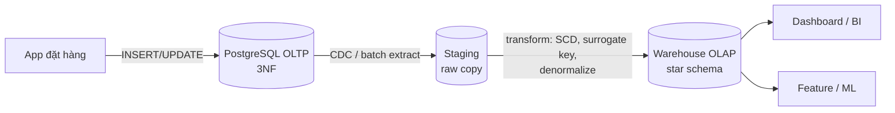
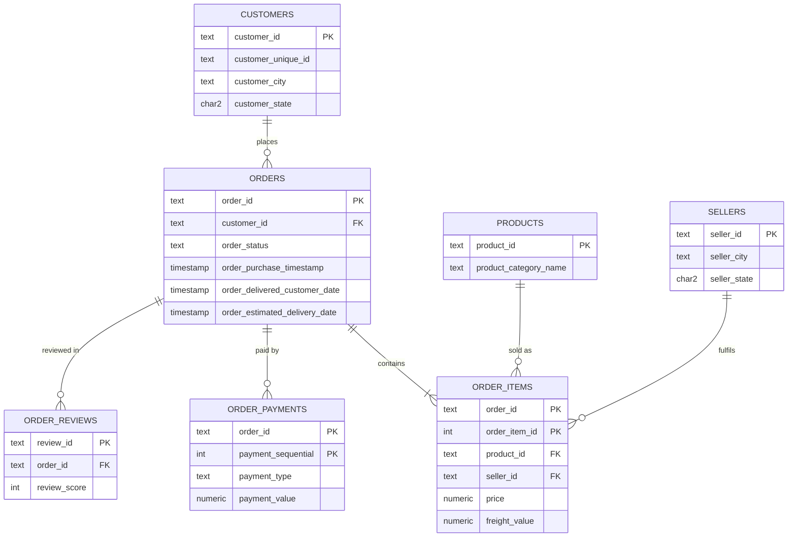
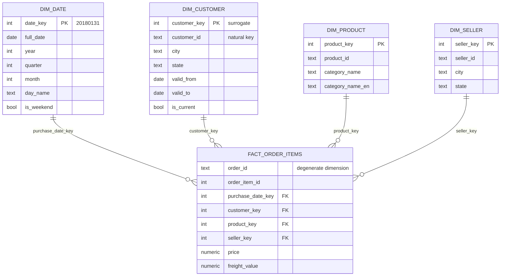
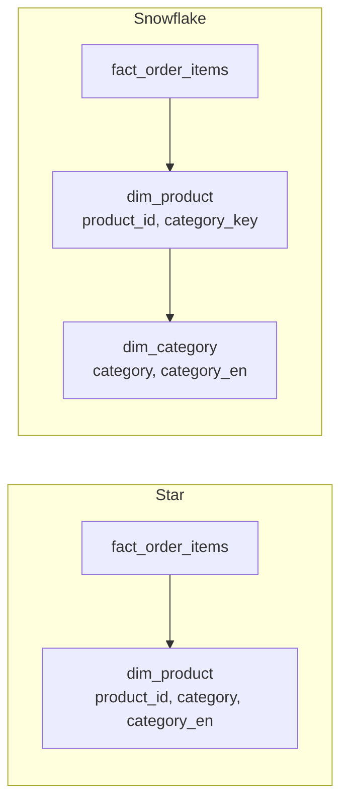
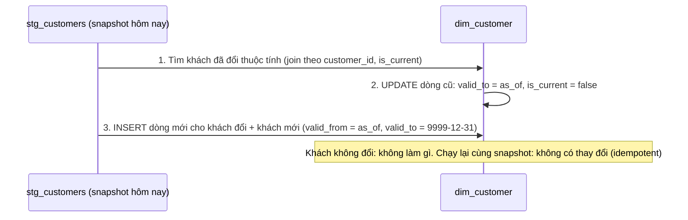
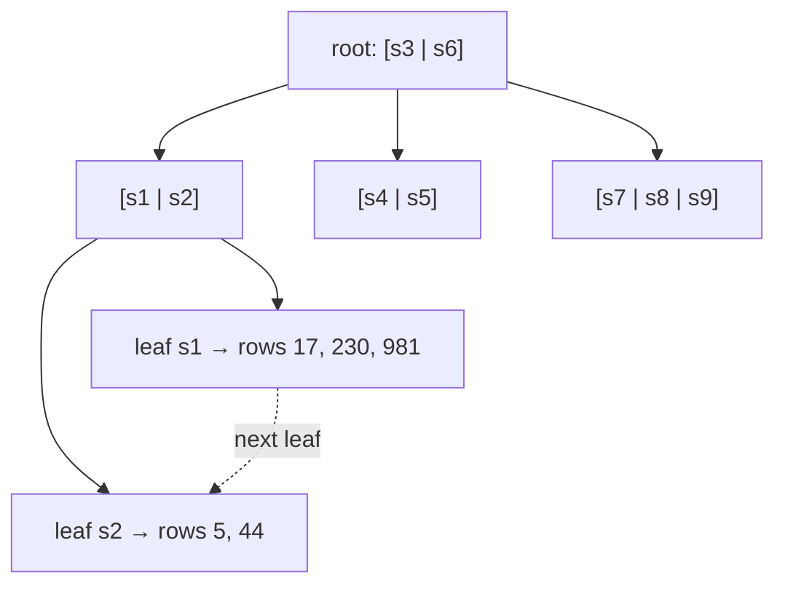

# Data Modeling & Relational DB

Pipeline tốt đến đâu cũng không cứu được một schema tồi. Module này dạy bạn cách nghĩ về dữ liệu
trước khi viết dòng code nạp nào: chuẩn hoá cho hệ thống giao dịch (OLTP), mô hình chiều
(dimensional modeling) cho phân tích (OLAP), cách lưu lịch sử thay đổi bằng Slowly Changing
Dimension, cách làm truy vấn nhanh bằng index, và cách giữ dữ liệu đúng khi nhiều người cùng ghi
bằng transaction. Mọi ví dụ dùng PostgreSQL (cú pháp chuẩn) hoặc DuckDB/SQLite để bạn chạy ngay
trên máy, với dữ liệu thương mại điện tử Olist.

Sau module này bạn sẽ:

- Đọc một bảng phẳng và tách được về 3NF/BCNF, vẽ ERD.
- Chọn grain, thiết kế fact/dimension, quyết định star hay snowflake.
- Viết được SCD type 1, 2, 3 bằng SQL.
- Đọc `EXPLAIN`, chọn composite index và covering index đúng thứ tự cột.
- Giải thích các isolation level và chọn cách chống lost update.

## 1. OLTP và OLAP: hai cách dùng một database

Hầu hết công ty có hai loại workload rất khác nhau trên cùng một dữ liệu:

- **OLTP (Online Transaction Processing)**: ứng dụng đặt hàng của Olist. Mỗi request đọc/ghi vài
  dòng theo khoá (`order_id = ?`), rất nhiều request đồng thời, cần độ trễ mili-giây và tính đúng
  tuyệt đối (không bán quá tồn kho, không trừ tiền hai lần).
- **OLAP (Online Analytical Processing)**: analyst hỏi "doanh thu theo bang theo tháng trong 2 năm".
  Mỗi truy vấn quét hàng triệu dòng nhưng chỉ vài cột, ít truy vấn đồng thời, chấp nhận vài giây.

| Tiêu chí | OLTP | OLAP |
| --- | --- | --- |
| Người dùng | Ứng dụng, khách hàng | Analyst, BI, data scientist, ML |
| Kiểu truy vấn | Point lookup, insert/update vài dòng | Scan + aggregate trên nhiều dòng |
| Mô hình dữ liệu | Chuẩn hoá (3NF) | Dimensional (star/snowflake), denormalized |
| Lưu trữ | Row-oriented (PostgreSQL, MySQL) | Column-oriented (BigQuery, Snowflake, DuckDB, ClickHouse) |
| Dữ liệu | Trạng thái hiện tại | Lịch sử, thường append-only |
| Tối ưu cho | Ghi đúng, ghi nhanh, đồng thời cao | Đọc nhanh, nén tốt |
| Kích thước | GB – vài TB | TB – PB |
| Ví dụ Olist | Bảng `orders`, `order_items` của app | `fact_order_items` + `dim_customer`, `dim_date` |

Vì sao không dùng một database cho cả hai? Một truy vấn phân tích quét cả bảng `order_items` sẽ
chiếm I/O, buffer cache và có thể giữ snapshot lâu, làm chậm request đặt hàng. Row store phải đọc
cả dòng (mọi cột) dù chỉ cần `price`; column store chỉ đọc cột `price` và nén rất tốt vì giá trị
cùng kiểu đứng cạnh nhau. Vì vậy Data Engineer xây pipeline chép dữ liệu từ OLTP sang kho phân tích
và **đổi mô hình** trên đường đi.



Row store và column store trên đĩa:

```text
Row store (PostgreSQL heap):    [o1,c1,delivered,2018-01-02][o2,c7,shipped,2018-01-03]...
Column store (Parquet/DuckDB):  order_id: [o1,o2,...]  status: [delivered,shipped,...] (nén RLE/dict)
```

Một số hệ thống HTAP (TiDB, SingleStore, AlloyDB) cố làm cả hai, nhưng ở mức junior–mid bạn cứ
giả định: OLTP và OLAP tách nhau, nối bằng pipeline.

## 2. Normalization và ERD

**Normalization** là quá trình tách bảng để mỗi sự thật (fact) chỉ được lưu một chỗ. Mục tiêu là
tránh ba loại **anomaly**:

- **Update anomaly**: thành phố của khách lưu ở 50 dòng đơn hàng; sửa 49 dòng, sót 1, dữ liệu mâu thuẫn.
- **Insert anomaly**: không thể lưu một seller mới nếu họ chưa có đơn hàng nào (vì seller chỉ nằm trong bảng đơn).
- **Delete anomaly**: xoá đơn hàng cuối cùng của một sản phẩm thì mất luôn thông tin danh mục sản phẩm.

### Functional dependency

`A → B` (A xác định B) nghĩa là: hai dòng có cùng A thì chắc chắn cùng B. Ví dụ trong Olist:
`customer_id → customer_city, customer_state`, `product_id → product_category`,
`(order_id, order_item_id) → product_id, seller_id, price`. Chuẩn hoá thực chất là "mỗi
functional dependency có một bảng mà vế trái là khoá".

### Bảng phẳng xuất phát

| order_id | order_item_id | customer_id | customer_city | product_id | product_category | seller_id | price | payment_types |
| --- | --- | --- | --- | --- | --- | --- | --- | --- |
| o1 | 1 | c1 | sao paulo | p1 | perfumaria | s1 | 50.0 | credit_card, voucher |
| o1 | 2 | c1 | sao paulo | p2 | esporte_lazer | s2 | 30.0 | credit_card, voucher |
| o2 | 1 | c2 | rio de janeiro | p1 | perfumaria | s1 | 52.0 | boleto |

### Các dạng chuẩn

| Dạng chuẩn | Điều kiện | Vi phạm trong ví dụ | Cách sửa |
| --- | --- | --- | --- |
| **1NF** | Mỗi ô một giá trị nguyên tử, không có nhóm lặp, có khoá | `payment_types` chứa danh sách | Tách bảng `order_payments(order_id, payment_sequential, payment_type, value)` |
| **2NF** | 1NF + không có cột phụ thuộc vào **một phần** của khoá ghép | Khoá `(order_id, order_item_id)` nhưng `customer_id` chỉ phụ thuộc `order_id` | Tách `orders(order_id, customer_id, ...)` |
| **3NF** | 2NF + không có phụ thuộc bắc cầu (non-key → non-key) | `order_id → customer_id → customer_city` | Tách `customers(customer_id, city, state)` |
| **BCNF** | Mọi vế trái của functional dependency đều là superkey | Hiếm; xem ví dụ dưới | Tách tiếp theo dependency vi phạm |

Câu thần chú cho 3NF: *"Mỗi cột không phải khoá phụ thuộc vào khoá, cả khoá, và không gì khác
ngoài khoá"* (the key, the whole key, and nothing but the key).

**BCNF khác 3NF khi nào?** Khi bảng có nhiều candidate key chồng nhau. Ví dụ bảng
`seller_zone(seller_id, zip_prefix, carrier)`: mỗi seller dùng một carrier cho mỗi zip,
và mỗi carrier chỉ phục vụ một zip (`carrier → zip_prefix`). Khoá là `(seller_id, zip_prefix)`
hoặc `(seller_id, carrier)`. `zip_prefix` là cột "prime" nên 3NF vẫn thoả, nhưng `carrier` không
phải superkey nên vi phạm BCNF. Sửa: tách `carrier_zone(carrier, zip_prefix)` và
`seller_carrier(seller_id, carrier)`. Đánh đổi: BCNF đôi khi làm mất khả năng kiểm tra một
dependency bằng constraint đơn giản, nên thực tế nhiều hệ thống dừng ở 3NF.

### Kết quả: ERD của Olist (3NF)



Ký hiệu crow's foot: `||` đúng một, `o{` không hoặc nhiều, `|{` một hoặc nhiều. Cardinality là
thông tin thiết kế quan trọng: `ORDERS ||--|{ ORDER_ITEMS` nói rằng đơn hàng phải có ít nhất một item.

### Tách bảng bằng SQL (chạy được trên DuckDB)

```sql
CREATE TABLE customers AS
SELECT DISTINCT customer_id, customer_city, customer_state FROM orders_flat;

CREATE TABLE orders AS
SELECT DISTINCT order_id, customer_id, order_status, order_purchase_timestamp FROM orders_flat;

CREATE TABLE order_items AS
SELECT order_id, order_item_id, product_id, seller_id, price FROM orders_flat;

-- Kiểm tra dependency có thật sự đúng không: mỗi customer_id chỉ một city
SELECT customer_id, COUNT(DISTINCT customer_city) AS n
FROM orders_flat GROUP BY customer_id HAVING n > 1;   -- phải rỗng
```

Câu truy vấn cuối rất quan trọng trong thực tế: dữ liệu bẩn thường **vi phạm** dependency bạn
tưởng là đúng. Nếu không rỗng, `SELECT DISTINCT` sẽ sinh hai dòng cùng `customer_id` và khoá chính
bị phá.

### Khi nào denormalize?

Chuẩn hoá tối ưu cho **ghi**; mỗi truy vấn đọc phải join nhiều bảng. Denormalize (gộp lại) có chủ
đích khi: đọc chiếm áp đảo, join quá đắt, cần snapshot lịch sử (giá tại thời điểm mua phải lưu
trong `order_items.price`, không join sang giá hiện tại của sản phẩm), hoặc ở tầng OLAP. Quy tắc:
nguồn sự thật chuẩn hoá, bản đọc denormalize được sinh ra từ nó.

## 3. Dimensional modeling: fact, dimension, star và snowflake

Dimensional modeling (Ralph Kimball) tổ chức dữ liệu phân tích quanh **quy trình nghiệp vụ**
(business process): đặt hàng, thanh toán, giao hàng, đánh giá. Mỗi quy trình sinh ra một bảng
**fact**, được mô tả bằng các **dimension**.

- **Fact**: các con số đo lường (measure) của một sự kiện: `price`, `freight_value`, `quantity`,
  `delivery_days`. Fact cao (nhiều dòng), hẹp (ít cột, phần lớn là khoá và số).
- **Dimension**: ngữ cảnh "ai, cái gì, ở đâu, khi nào": khách hàng, sản phẩm, seller, ngày.
  Dimension thấp (ít dòng hơn), rộng (nhiều cột mô tả để lọc/nhóm).

### Bốn bước của Kimball

1. **Chọn business process**: ví dụ "bán hàng theo item".
2. **Khai báo grain**: *một dòng fact là gì?* "Một dòng = một item trong một đơn hàng". Đây là
   quyết định quan trọng nhất; mọi sai lầm (double counting) đều bắt đầu từ grain mơ hồ.
3. **Chọn dimension**: customer, product, seller, date (ngày mua), có thể thêm date ngày giao.
4. **Chọn fact (measure)**: price, freight_value. Measure phải đúng grain: `payment_value` là ở
   grain đơn hàng/thanh toán, đặt vào fact item sẽ bị nhân bản khi đơn có nhiều item.

### Star schema cho Olist



```sql
-- Câu hỏi phân tích điển hình: chỉ cần join fact với các dimension một bước
SELECT d.year, d.month, c.state, SUM(f.price) AS revenue
FROM fact_order_items f
JOIN dim_date d     ON f.purchase_date_key = d.date_key
JOIN dim_customer c ON f.customer_key = c.customer_key
GROUP BY d.year, d.month, c.state
ORDER BY d.year, d.month, revenue DESC;
```

### Surrogate key và natural key

- **Natural key** (business key): `customer_id` từ hệ thống nguồn.
- **Surrogate key**: số nguyên do warehouse sinh (`customer_key`). Cần vì: (1) SCD type 2 có
  nhiều phiên bản cùng một natural key; (2) gộp nhiều nguồn có key trùng nhau; (3) key nguyên nhỏ,
  join nhanh; (4) có dòng đặc biệt "Unknown" (`-1`) cho fact thiếu dimension thay vì NULL.

`dim_date` dùng key "thông minh" `YYYYMMDD` là ngoại lệ được chấp nhận vì ngày không bao giờ đổi.

### Các loại fact table

| Loại | Grain | Ví dụ Olist | Đặc điểm |
| --- | --- | --- | --- |
| Transaction fact | Một sự kiện | `fact_order_items` | Phổ biến nhất, chỉ insert |
| Periodic snapshot | Một thực thể mỗi kỳ | `fact_seller_daily_stock` | Đều đặn, có semi-additive measure |
| Accumulating snapshot | Một quy trình có nhiều mốc | `fact_order_fulfillment` (purchase → approved → shipped → delivered) | Dòng được **update** khi qua từng mốc |
| Factless fact | Sự kiện không có số đo | `fact_product_view` | Đếm số dòng |

Measure có ba loại: **additive** (cộng theo mọi dimension: `price`), **semi-additive** (không cộng
theo thời gian: số dư tồn kho), **non-additive** (không cộng được: tỷ lệ, trung bình; hãy lưu tử
số và mẫu số riêng).

### Star vs snowflake

Snowflake chuẩn hoá tiếp dimension: `dim_product → dim_category`, `dim_customer → dim_geography`.



| Tiêu chí | Star | Snowflake |
| --- | --- | --- |
| Dimension | Denormalized (một bảng phẳng) | Chuẩn hoá thành nhiều bảng |
| Số join khi truy vấn | Ít (fact + n dim) | Nhiều hơn |
| Dễ hiểu cho analyst/BI | Rất dễ | Khó hơn |
| Dung lượng | Lặp chuỗi mô tả (column store nén tốt nên ít vấn đề) | Tiết kiệm hơn |
| Bảo trì dimension | Cập nhật một thuộc tính cha phải sửa nhiều dòng | Sửa một chỗ |
| Khi nên dùng | Mặc định cho warehouse hiện đại | Dimension rất lớn, hierarchy dùng chung nhiều nơi |

Trên column store hiện đại (BigQuery, Snowflake, DuckDB), lợi ích tiết kiệm của snowflake gần như
không đáng kể, nên **star là mặc định**. Một biến thể thường gặp nữa là **One Big Table (OBT)**:
join sẵn fact với mọi dimension thành một bảng rất rộng, đổi dung lượng lấy tốc độ và đơn giản cho BI.

### Một vài pattern dimension khác

- **Conformed dimension**: `dim_customer` dùng chung cho fact bán hàng, fact review, fact thanh toán,
  giúp so sánh chéo (drill-across).
- **Degenerate dimension**: `order_id` nằm thẳng trong fact, không có bảng dimension riêng.
- **Junk dimension**: gom các cờ nhỏ (payment_type, is_gift…) vào một dimension.
- **Role-playing dimension**: `dim_date` đóng vai purchase date, delivered date, estimated date.
- **Bridge table**: quan hệ nhiều-nhiều, ví dụ một đơn hàng trả bằng nhiều phương thức.

## 4. Slowly Changing Dimension (SCD)

Thuộc tính dimension thay đổi chậm theo thời gian: khách chuyển từ São Paulo sang Rio, sản phẩm
đổi danh mục. Câu hỏi: báo cáo doanh thu theo bang của **năm ngoái** nên tính đơn cũ của khách đó
vào São Paulo (nơi họ ở lúc mua) hay Rio (nơi ở hiện tại)? Câu trả lời quyết định loại SCD.

| Type | Cách xử lý | Lịch sử | Ví dụ dùng |
| --- | --- | --- | --- |
| 0 | Không bao giờ đổi (giữ giá trị gốc) | Giá trị ban đầu | Ngày sinh, ngày đăng ký |
| 1 | Ghi đè | Mất | Sửa lỗi chính tả tên thành phố |
| 2 | Thêm dòng mới, đóng dòng cũ (`valid_from`, `valid_to`, `is_current`) | Đầy đủ | Địa chỉ khách, phân khúc khách |
| 3 | Thêm cột `previous_*` | Chỉ một bước trước | Đổi cơ cấu vùng bán hàng, cần so sánh cũ/mới |
| 4 | Bảng hiện tại + bảng history riêng | Đầy đủ (bảng riêng) | Dimension rất lớn, đổi thường xuyên |
| 6 | 1 + 2 + 3: dòng SCD2 kèm cột `current_*` ghi đè | Đầy đủ + giá trị hiện tại trên mọi dòng | Cần cả "lúc đó" lẫn "bây giờ" |

### SCD type 1: upsert

```sql
INSERT INTO dim_seller (seller_id, city, state)
SELECT seller_id, city, state FROM stg_sellers
ON CONFLICT (seller_id) DO UPDATE
SET city = excluded.city, state = excluded.state;
```

### SCD type 2: đóng phiên bản cũ, mở phiên bản mới



```sql
-- as_of = ngày hiệu lực của snapshot, ví dụ DATE '2018-03-01'
BEGIN;

UPDATE dim_customer d
SET valid_to = DATE '2018-03-01', is_current = FALSE
FROM stg_customers s
WHERE d.customer_id = s.customer_id
  AND d.is_current
  AND (d.city IS DISTINCT FROM s.city OR d.state IS DISTINCT FROM s.state);

INSERT INTO dim_customer (customer_key, customer_id, city, state, valid_from, valid_to, is_current)
SELECT nextval('customer_key_seq'), s.customer_id, s.city, s.state,
       DATE '2018-03-01', DATE '9999-12-31', TRUE
FROM stg_customers s
LEFT JOIN dim_customer d ON d.customer_id = s.customer_id AND d.is_current
WHERE d.customer_id IS NULL;   -- khách mới, hoặc khách vừa bị đóng dòng ở bước trên

COMMIT;
```

Chi tiết cần chú ý:

- Dùng `IS DISTINCT FROM` thay vì `<>` để so sánh đúng khi có NULL (`NULL <> 'x'` là NULL, không phải true).
- Nhiều cột thì so sánh **hash** của các cột theo dõi (`md5(concat_ws('|', city, state))`).
- `valid_to` dùng `9999-12-31` thay vì NULL để `BETWEEN` và index dễ dùng; quy ước khoảng
  **nửa mở** `[valid_from, valid_to)` để không có ngày thuộc hai phiên bản.
- Bọc trong một transaction: nếu INSERT lỗi sau khi UPDATE xong, khách sẽ không còn dòng current.
- Xoá ở nguồn (hard delete): thường không xoá ở dimension mà đóng dòng và gắn cờ `is_deleted`.

Fact nối với dimension SCD2 thế nào? Lúc nạp fact, tra surrogate key theo **thời điểm sự kiện**:

```sql
SELECT o.order_id, c.customer_key
FROM stg_orders o
JOIN dim_customer c
  ON c.customer_id = o.customer_id
 AND o.purchase_date >= c.valid_from AND o.purchase_date < c.valid_to;
```

Nhờ vậy doanh thu năm ngoái vẫn nằm ở São Paulo. Muốn "theo nơi ở hiện tại" thì join thêm dòng
`is_current` qua natural key (đây chính là ý tưởng của type 6). Trong dbt, SCD2 được làm sẵn bằng
**snapshots** (module 05).

## 5. Index: B-tree, composite, covering

Không có index, tìm `WHERE seller_id = 's1'` phải đọc cả bảng (**sequential scan**, O(n)). Index
là một cấu trúc phụ, được sắp xếp, trỏ về dòng trong bảng, cho phép tìm trong O(log n).

### B-tree

Loại index mặc định của PostgreSQL, MySQL, SQLite. Là cây cân bằng, nút lá chứa khoá đã sắp
xếp + con trỏ tới dòng (PostgreSQL: `ctid`; SQLite/MySQL InnoDB: rowid/primary key), các nút lá
nối với nhau nên quét theo khoảng (`BETWEEN`, `>`, `ORDER BY`) rất hiệu quả.



B-tree hỗ trợ: `=`, `<`, `>`, `BETWEEN`, `IN`, `LIKE 'abc%'` (prefix), `ORDER BY`, `IS NULL`.
Không hỗ trợ: `LIKE '%abc'`, hàm bọc cột (`WHERE lower(email) = ...` cần **expression index**
`CREATE INDEX ON customers (lower(email))`).

### Các loại index của PostgreSQL

| Loại | Dùng cho | Ví dụ |
| --- | --- | --- |
| B-tree | So sánh, khoảng, sắp xếp; mặc định | `CREATE INDEX ON orders (customer_id)` |
| Hash | Chỉ `=` | Hiếm khi tốt hơn B-tree |
| GIN | Giá trị đa phần tử: JSONB, array, full-text | `CREATE INDEX ON events USING gin (payload jsonb_path_ops)` |
| GiST / SP-GiST | Dữ liệu hình học, khoảng, nearest neighbor | PostGIS, `tsrange` |
| BRIN | Bảng rất lớn mà giá trị tương quan với vị trí vật lý (timestamp append-only) | `CREATE INDEX ON events USING brin (created_at)` — vài KB thay vì vài GB |
| Partial | Chỉ một phần dòng | `CREATE INDEX ON orders (order_purchase_timestamp) WHERE order_status = 'processing'` |

### Composite index và quy tắc leftmost prefix

Index `(seller_id, shipping_limit_date)` được sắp theo `seller_id` trước, rồi trong cùng seller
mới sắp theo ngày (như danh bạ sắp theo họ rồi tên). Hệ quả:

| Truy vấn | Dùng được index `(seller_id, shipping_limit_date)`? |
| --- | --- |
| `WHERE seller_id = ?` | Có |
| `WHERE seller_id = ? AND shipping_limit_date > ?` | Có, tốt nhất |
| `WHERE seller_id = ? ORDER BY shipping_limit_date` | Có, không cần sort |
| `WHERE shipping_limit_date > ?` | Không (thiếu cột đầu) |
| `WHERE seller_id > ? AND shipping_limit_date = ?` | Chỉ dùng cột đầu; cột sau phải lọc lại |

Quy tắc thứ tự cột: **cột so sánh bằng (`=`) trước, cột khoảng/sắp xếp sau**. Giữa các cột `=`,
đặt cột hay được lọc một mình lên đầu để index dùng được cho nhiều truy vấn hơn.

### Covering index (index-only scan)

Nếu mọi cột truy vấn cần đều nằm trong index, database không phải quay về bảng (heap) để đọc dòng:

```sql
-- PostgreSQL: INCLUDE thêm cột vào lá, không tham gia sắp xếp
CREATE INDEX idx_items_seller_date ON order_items (seller_id, shipping_limit_date) INCLUDE (price);

EXPLAIN ANALYZE
SELECT shipping_limit_date, price FROM order_items
WHERE seller_id = 's1' ORDER BY shipping_limit_date;
-- Index Only Scan using idx_items_seller_date on order_items ...
```

PostgreSQL chỉ thật sự làm index-only khi visibility map của trang đã được đánh dấu "all visible"
(sau `VACUUM`), nên với bảng vừa ghi nhiều bạn sẽ thấy `Heap Fetches` lớn.

### Đọc EXPLAIN (SQLite, chạy được ngay bằng Python)

```python
import sqlite3

con = sqlite3.connect(":memory:")
con.execute("CREATE TABLE order_items (order_id TEXT, seller_id TEXT, shipping_limit_date TEXT, price REAL)")
con.executemany(
    "INSERT INTO order_items VALUES (?, ?, ?, ?)",
    [(f"o{i}", f"s{i % 50}", f"2018-01-{i % 28 + 1:02d}", i * 1.5) for i in range(5000)],
)
q = "SELECT shipping_limit_date, price FROM order_items WHERE seller_id = 's7' ORDER BY shipping_limit_date"

def plan(sql):
    return [row[3] for row in con.execute("EXPLAIN QUERY PLAN " + sql)]

print(plan(q))  # ['SCAN order_items', 'USE TEMP B-TREE FOR ORDER BY']
con.execute("CREATE INDEX idx ON order_items (seller_id, shipping_limit_date, price)")
print(plan(q))  # ['SEARCH order_items USING COVERING INDEX idx (seller_id=?)']
```

Đọc plan PostgreSQL: `Seq Scan` (đọc cả bảng), `Index Scan` (index + heap), `Index Only Scan`,
`Bitmap Heap Scan` (gom nhiều con trỏ rồi đọc heap theo thứ tự trang, tốt cho selectivity trung
bình). `EXPLAIN ANALYZE` thực sự chạy truy vấn và cho thời gian thật, `rows` ước lượng vs thực tế
(chênh nhiều → chạy `ANALYZE` để cập nhật thống kê), `BUFFERS` cho số trang đọc.

### Cái giá của index

- Mỗi INSERT/UPDATE/DELETE phải cập nhật mọi index → ghi chậm hơn, tăng WAL.
- Tốn dung lượng và bộ nhớ cache.
- Planner có thể **không** dùng index khi truy vấn trả về phần lớn bảng (selectivity thấp): seq
  scan đọc tuần tự rẻ hơn hàng nghìn lần nhảy ngẫu nhiên.
- Với bảng warehouse/columnar (BigQuery, Snowflake, DuckDB), gần như không có B-tree index; thay
  vào đó là partitioning, clustering/sort key và min/max zone map để bỏ qua block.

Khi nạp hàng loạt (bulk load) vào PostgreSQL: drop index không cần thiết → `COPY` → tạo lại index,
nhanh hơn nhiều so với cập nhật index từng dòng.

## 6. Transaction, ACID và isolation level

Transaction là nhóm thao tác được đối xử như một đơn vị. Đặt hàng = trừ tồn kho + tạo `orders` +
tạo `order_items` + ghi `order_payments`; hoặc tất cả thành công, hoặc không có gì xảy ra.

| Tính chất | Ý nghĩa | Cơ chế trong PostgreSQL |
| --- | --- | --- |
| **Atomicity** | Tất cả hoặc không gì cả | Rollback huỷ mọi thay đổi chưa commit |
| **Consistency** | Từ trạng thái hợp lệ sang trạng thái hợp lệ (constraint luôn đúng) | `PRIMARY KEY`, `FOREIGN KEY`, `CHECK`, `UNIQUE` |
| **Isolation** | Các transaction đồng thời không thấy trạng thái dở dang của nhau (ở mức đã chọn) | MVCC + lock |
| **Durability** | Đã commit thì không mất dù sập điện | WAL (write-ahead log) fsync trước khi báo commit |

```python
import sqlite3

con = sqlite3.connect(":memory:")
con.executescript("""
CREATE TABLE stock (product_id TEXT PRIMARY KEY, qty INTEGER NOT NULL CHECK (qty >= 0));
CREATE TABLE orders (order_id TEXT PRIMARY KEY);
INSERT INTO stock VALUES ('p1', 1);
""")
try:
    with con:  # tự BEGIN, COMMIT khi xong, ROLLBACK khi có exception
        con.execute("INSERT INTO orders VALUES ('o1')")
        con.execute("UPDATE stock SET qty = qty - 2 WHERE product_id = 'p1'")  # vi phạm CHECK
except sqlite3.IntegrityError as e:
    print("rollback:", e)
print(con.execute("SELECT COUNT(*) FROM orders").fetchone())  # (0,) – đơn hàng cũng bị huỷ
```

### Các hiện tượng (anomaly) khi chạy đồng thời

- **Dirty read**: đọc dữ liệu transaction khác chưa commit (và có thể rollback).
- **Non-repeatable read**: đọc cùng dòng hai lần trong một transaction, ra giá trị khác vì người khác vừa commit.
- **Phantom read**: chạy cùng điều kiện `WHERE` hai lần, tập dòng khác vì có dòng mới được insert.
- **Lost update**: hai transaction cùng đọc `qty = 5`, cùng ghi `qty = 4`; một lần bán bị mất.
- **Write skew**: hai transaction đọc cùng dữ liệu, mỗi bên ghi vào dòng **khác nhau** dựa trên
  điều kiện đã đọc, kết quả chung vi phạm ràng buộc (hai bác sĩ cùng xin nghỉ khi thấy còn 2 người trực).

### Isolation level (chuẩn SQL và PostgreSQL)

| Level | Dirty read | Non-repeatable read | Phantom | Ghi chú PostgreSQL |
| --- | --- | --- | --- | --- |
| Read Uncommitted | Có thể | Có thể | Có thể | PG xử lý như Read Committed |
| **Read Committed** | Không | Có thể | Có thể | **Mặc định**. Mỗi câu lệnh thấy snapshot mới |
| Repeatable Read | Không | Không | Có thể (chuẩn) / **Không** trong PG | Snapshot cố định cho cả transaction; ghi đè dòng người khác vừa sửa → lỗi serialization |
| Serializable | Không | Không | Không | SSI: phát hiện cả write skew, transaction có thể bị abort, ứng dụng phải **retry** |

PostgreSQL dùng **MVCC** (Multi-Version Concurrency Control): UPDATE không ghi đè mà tạo phiên bản
dòng mới, mỗi transaction đọc phiên bản phù hợp với snapshot của nó. Hệ quả: **người đọc không chặn
người ghi và ngược lại**; phiên bản cũ được dọn bởi `VACUUM` (autovacuum). Transaction mở quá lâu
(ví dụ một notebook quên commit) giữ snapshot cũ, làm bảng phình to (bloat).

```mermaid
sequenceDiagram
    participant T1 as Tx A (bán 1 cái)
    participant DB as stock p1 = 5
    participant T2 as Tx B (bán 1 cái)
    T1->>DB: SELECT qty → 5
    T2->>DB: SELECT qty → 5
    T1->>DB: UPDATE qty = 4 ; COMMIT
    T2->>DB: UPDATE qty = 4 ; COMMIT
    Note over DB: Kết quả 4, đáng lẽ 3 → lost update
```

### Ba cách chống lost update

```sql
-- 1. Atomic update: để database tự tính, có điều kiện bảo vệ (đơn giản và tốt nhất)
UPDATE stock SET qty = qty - 1 WHERE product_id = 'p1' AND qty >= 1;
-- kiểm tra rowcount: 0 nghĩa là hết hàng

-- 2. Pessimistic locking: khoá dòng khi đọc
BEGIN;
SELECT qty FROM stock WHERE product_id = 'p1' FOR UPDATE;  -- Tx khác phải chờ
UPDATE stock SET qty = 4 WHERE product_id = 'p1';
COMMIT;

-- 3. Optimistic locking: cột version, retry khi xung đột
UPDATE stock SET qty = 4, version = version + 1
WHERE product_id = 'p1' AND version = 7;   -- rowcount 0 → có người sửa trước, đọc lại và thử lại
```

Đặt `SET TRANSACTION ISOLATION LEVEL SERIALIZABLE` cũng chống được, nhưng phải viết vòng retry khi
gặp lỗi `40001 serialization_failure`. **Deadlock** xảy ra khi hai transaction khoá tài nguyên theo
thứ tự ngược nhau; PostgreSQL phát hiện và huỷ một bên. Phòng tránh: luôn khoá theo thứ tự cố định
(ví dụ sắp xếp `product_id` trước khi `FOR UPDATE`), giữ transaction ngắn.

Với Data Engineer, transaction quan trọng ở chỗ: **nạp dữ liệu idempotent và nguyên tử**. Ví dụ
`BEGIN; DELETE FROM fact WHERE load_date = '2018-03-01'; INSERT ... ; COMMIT;` đảm bảo chạy lại
không nhân đôi dữ liệu và người đọc không bao giờ thấy ngày đó trống một nửa.

## 7. PostgreSQL cho Data Engineer

PostgreSQL là database quan hệ mã nguồn mở phổ biến nhất, thường là nguồn OLTP mà bạn trích xuất,
và cũng đủ tốt làm warehouse nhỏ (vài trăm GB). Những thứ cần nắm:

### Kiểu dữ liệu và constraint

```sql
CREATE TABLE orders (
    order_id                  TEXT PRIMARY KEY,
    customer_id               TEXT NOT NULL REFERENCES customers (customer_id),
    order_status              TEXT NOT NULL CHECK (order_status IN
                                ('created','approved','processing','invoiced','shipped','delivered','canceled','unavailable')),
    order_purchase_timestamp  TIMESTAMPTZ NOT NULL,
    order_delivered_customer_date TIMESTAMPTZ,
    total_value               NUMERIC(12, 2),          -- tiền: NUMERIC, không dùng FLOAT
    attributes                JSONB DEFAULT '{}'::jsonb
);
CREATE INDEX ON orders (customer_id);   -- PG KHÔNG tự tạo index cho foreign key
```

- `TIMESTAMPTZ` lưu thời điểm tuyệt đối (UTC), hiển thị theo time zone phiên; dùng nó thay vì `TIMESTAMP`.
- `NUMERIC` cho tiền, `BIGINT`/`IDENTITY` cho khoá tự tăng (`GENERATED ALWAYS AS IDENTITY`).
- `TEXT` và `VARCHAR(n)` hiệu năng như nhau trong PG; dùng `CHECK` nếu cần giới hạn.
- Constraint là tài liệu sống và là tuyến phòng thủ chất lượng dữ liệu đầu tiên.

### Nạp dữ liệu nhanh: COPY và upsert

```python
import psycopg

with psycopg.connect("postgresql://de:de@localhost:5432/de") as conn, conn.cursor() as cur:
    with open("olist_orders_dataset.csv", "rb") as f, cur.copy(
        "COPY stg_orders FROM STDIN WITH (FORMAT csv, HEADER true)"
    ) as copy:
        while chunk := f.read(1 << 20):
            copy.write(chunk)
    cur.execute("""
        INSERT INTO orders SELECT * FROM stg_orders
        ON CONFLICT (order_id) DO UPDATE SET order_status = excluded.order_status
    """)
# rời khối with: commit
```

`COPY` nhanh hơn `INSERT` từng dòng hàng chục lần. Mẫu thường dùng: COPY vào bảng staging
(`UNLOGGED` để nhanh hơn), rồi `INSERT ... ON CONFLICT` hoặc `MERGE` (PG 15+) sang bảng đích.

### Partitioning khai báo (declarative partitioning)

```sql
CREATE TABLE order_events (
    order_id   TEXT,
    event_type TEXT,
    event_ts   TIMESTAMPTZ NOT NULL
) PARTITION BY RANGE (event_ts);

CREATE TABLE order_events_2018_01 PARTITION OF order_events
    FOR VALUES FROM ('2018-01-01') TO ('2018-02-01');
```

Lợi ích: **partition pruning** (truy vấn có `WHERE event_ts >= '2018-01-15'` chỉ đọc partition
liên quan), xoá dữ liệu cũ bằng `DROP TABLE`/`DETACH PARTITION` thay vì `DELETE` hàng triệu dòng,
`VACUUM` từng phần nhỏ. Đánh đổi: khoá chính/unique phải chứa cột partition, quá nhiều partition
nhỏ làm planner chậm.

### Vận hành tối thiểu

| Việc | Lệnh / công cụ | Vì sao |
| --- | --- | --- |
| Cập nhật thống kê cho planner | `ANALYZE table` | Ước lượng sai → chọn plan sai |
| Dọn phiên bản dòng chết | `VACUUM` / autovacuum | Chống bloat, cập nhật visibility map |
| Tìm truy vấn chậm | extension `pg_stat_statements` | Top truy vấn theo tổng thời gian |
| Xem ai đang chạy/khoá | `pg_stat_activity`, `pg_locks` | Tìm transaction treo |
| Index không dùng | `pg_stat_user_indexes` (`idx_scan = 0`) | Xoá bớt để ghi nhanh hơn |
| Replication / CDC | WAL, logical replication, Debezium | Nguồn cho pipeline gần thời gian thực |

```sql
-- Top 5 truy vấn tốn thời gian nhất
SELECT query, calls, round(total_exec_time) AS total_ms, round(mean_exec_time, 1) AS mean_ms
FROM pg_stat_statements ORDER BY total_exec_time DESC LIMIT 5;
```

### Scale một RDBMS: vertical, read replica, sharding

Khi một PostgreSQL không theo kịp tải, có hai hướng (khái niệm chung ở module 06, cơ chế replication/partitioning
ở module 01 phần 6):

- **Vertical scaling (scale up)**: máy to hơn (CPU, RAM, disk IOPS). Rẻ nhất về công sức, không đổi code, nên làm
  trước; trần là cỡ máy lớn nhất của cloud và chi phí tăng phi tuyến, vẫn là một điểm hỏng.
- **Horizontal scaling (scale out)**: thêm máy. Với RDBMS có hai bậc:
  1. **Read replica**: primary nhận ghi, stream WAL sang các replica chỉ đọc. Giải quyết tải **đọc** (dashboard,
     API đọc, và đặc biệt là **job extract của DE**: luôn kéo dữ liệu từ replica để không làm nặng primary). Đánh
     đổi: replication lag, đọc có thể cũ vài giây; ghi vẫn dồn vào một máy.
  2. **Sharding**: chia dữ liệu theo shard key (vd. `customer_id`) ra nhiều primary. Giải quyết tải **ghi** và kích
     thước dữ liệu, nhưng JOIN/transaction xuyên shard khó, đổi shard key rất đắt. Làm bằng code ứng dụng hoặc
     công cụ (Citus cho PostgreSQL, Vitess cho MySQL), hoặc chuyển sang distributed SQL (CockroachDB, YugabyteDB,
     Spanner).

Thứ tự thực tế: tối ưu truy vấn/index → scale up → read replica (+ cache) → partitioning trong một máy → sharding.
Phần lớn workload OLTP không cần tới bước cuối; workload phân tích thì nên chuyển sang warehouse (module 04).

### PostgreSQL và các RDBMS khác

Track dùng PostgreSQL, nhưng ở công ty bạn sẽ gặp các hệ sau làm **nguồn** cho pipeline. Mô hình quan hệ, SQL
chuẩn, index B-tree, ACID là như nhau; khác biệt nằm ở dialect, cơ chế CDC và giấy phép.

| RDBMS | Thường gặp ở | Khác biệt đáng chú ý cho DE |
| --- | --- | --- |
| **MySQL** (Oracle sở hữu, GPL + bản thương mại) | Web/startup, LAMP, nhiều hệ e-commerce | Engine InnoDB; dialect: `AUTO_INCREMENT`, backtick, `ON DUPLICATE KEY UPDATE` thay cho `ON CONFLICT`, `utf8` cũ chỉ 3 byte (dùng `utf8mb4`); CDC đọc **binlog** (cần `binlog_format=ROW`) |
| **MariaDB** | Fork của MySQL (2009), mặc định trên nhiều distro Linux | Gần tương thích MySQL nhưng đã tách dần (GTID khác, JSON là alias của LONGTEXT); GPL thuần; connector CDC phải ghi rõ là MariaDB |
| **Amazon Aurora** | Hệ trên AWS cần HA | Không phải engine mới mà là MySQL/PostgreSQL **tương thích** chạy trên storage phân tán (6 bản qua 3 AZ); tới 15 replica lag thấp, Aurora Serverless; zero-ETL sang Redshift; chỉ có trên AWS |
| **Oracle Database** | Ngân hàng, viễn thông, ERP lớn | Licensing đắt theo core, nhiều tính năng (partitioning, RAC) là option trả thêm; dialect PL/SQL, `NUMBER`, `VARCHAR2`, chuỗi rỗng = NULL, `DATE` có cả giờ; CDC qua LogMiner/GoldenGate |
| **Microsoft SQL Server** | Doanh nghiệp dùng hệ Microsoft, .NET, Azure | Dialect T-SQL: `TOP`, `IDENTITY`, `[tên]`, `MERGE`; CDC/Change Tracking có sẵn (bật theo bảng); license theo core/edition, Azure SQL là bản managed |
| **PostgreSQL** (giấy phép PostgreSQL, tự do) | Mặc định cho dự án mới, nhiều extension | Kiểu dữ liệu phong phú (JSONB, array, range), `ON CONFLICT`, logical replication; nhiều hệ "tương thích PG" (Aurora, AlloyDB, Neon, Redshift dựa trên PG cũ) |

Hệ quả cho DE: (1) không copy SQL nguyên xi giữa các hệ, đặc biệt upsert, phân trang, hàm ngày giờ và cách xử lý
NULL/chuỗi rỗng; (2) kiểm tra kiểu dữ liệu khi map sang warehouse (`NUMBER` không precision của Oracle,
`DATETIME` không timezone của MySQL/SQL Server); (3) CDC cần quyền và cấu hình riêng từng hệ (binlog, LogMiner,
SQL Server CDC), thường phải xin DBA bật; (4) licensing ảnh hưởng kiến trúc: tránh chạy truy vấn phân tích nặng
trên Oracle/SQL Server vì tốn core license, hãy extract ra lakehouse.

### Quy trình thiết kế schema gọn

1. Liệt kê truy vấn/quy trình nghiệp vụ chính (OLTP: các màn hình, API; OLAP: các câu hỏi KPI).
2. Xác định thực thể, khoá tự nhiên, functional dependency → schema 3NF + ERD.
3. Thêm constraint, chọn kiểu dữ liệu, index cho foreign key và truy vấn nóng.
4. Cho phân tích: chọn grain, xây star schema, quyết định SCD cho từng thuộc tính.
5. Đo bằng `EXPLAIN ANALYZE` trên dữ liệu có kích thước thật, rồi mới tối ưu.

## 8. Tài liệu tham khảo

- Ralph Kimball, Margy Ross — *The Data Warehouse Toolkit*, 3rd ed. (Wiley, 2013). Kinh điển về dimensional modeling.
- Kimball Group — Dimensional Modeling Techniques: https://www.kimballgroup.com/data-warehouse-business-intelligence-resources/kimball-techniques/dimensional-modeling-techniques/
- Martin Kleppmann — *Designing Data-Intensive Applications* (O'Reilly, 2017), chương 2, 3, 7 (data model, storage & index, transactions).
- PostgreSQL Documentation — Indexes: https://www.postgresql.org/docs/current/indexes.html
- PostgreSQL Documentation — Transaction Isolation: https://www.postgresql.org/docs/current/transaction-iso.html
- PostgreSQL Documentation — Using EXPLAIN: https://www.postgresql.org/docs/current/using-explain.html
- PostgreSQL Documentation — Table Partitioning: https://www.postgresql.org/docs/current/ddl-partitioning.html
- PostgreSQL Documentation — High Availability, Load Balancing, and Replication: https://www.postgresql.org/docs/current/high-availability.html
- MySQL Reference Manual — The Binary Log: https://dev.mysql.com/doc/refman/8.4/en/binary-log.html
- MariaDB — Incompatibilities and feature differences with MySQL: https://mariadb.com/kb/en/mariadb-vs-mysql-compatibility/
- Amazon Aurora User Guide: https://docs.aws.amazon.com/AmazonRDS/latest/AuroraUserGuide/CHAP_AuroraOverview.html
- Oracle Database SQL Language Reference: https://docs.oracle.com/en/database/oracle/oracle-database/23/sqlrf/
- Microsoft — Change data capture (SQL Server): https://learn.microsoft.com/en-us/sql/relational-databases/track-changes/about-change-data-capture-sql-server
- Markus Winand — *Use The Index, Luke!*: https://use-the-index-luke.com/
- SQLite — EXPLAIN QUERY PLAN: https://www.sqlite.org/eqp.html và Query Planner: https://www.sqlite.org/queryplanner.html
- DuckDB Documentation — Indexes và constraints: https://duckdb.org/docs/stable/sql/indexes
- E. F. Codd — *A Relational Model of Data for Large Shared Data Banks* (1970); William Kent — *A Simple Guide to Five Normal Forms in Relational Database Theory* (1983): https://www.bkent.net/Doc/simple5.htm
- dbt Documentation — Snapshots (SCD2): https://docs.getdbt.com/docs/build/snapshots
- Olist Brazilian E-Commerce Public Dataset: https://www.kaggle.com/datasets/olistbr/brazilian-ecommerce
- roadmap.sh — Data Engineer: https://roadmap.sh/data-engineer
