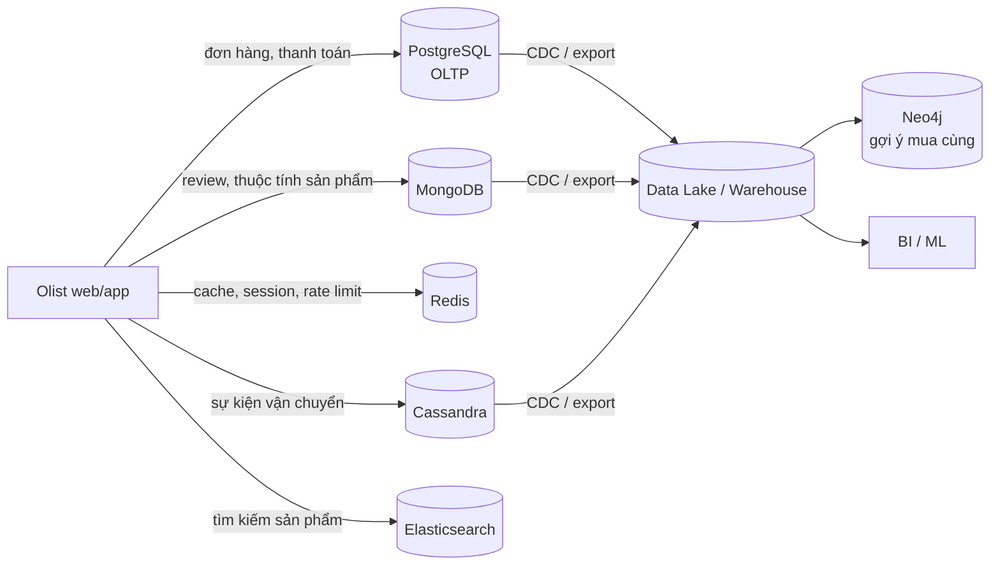
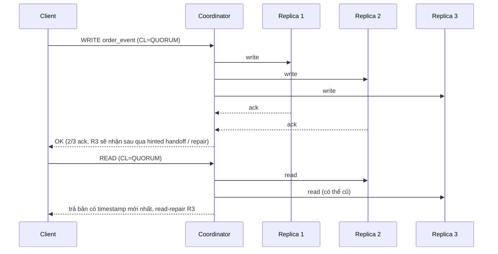
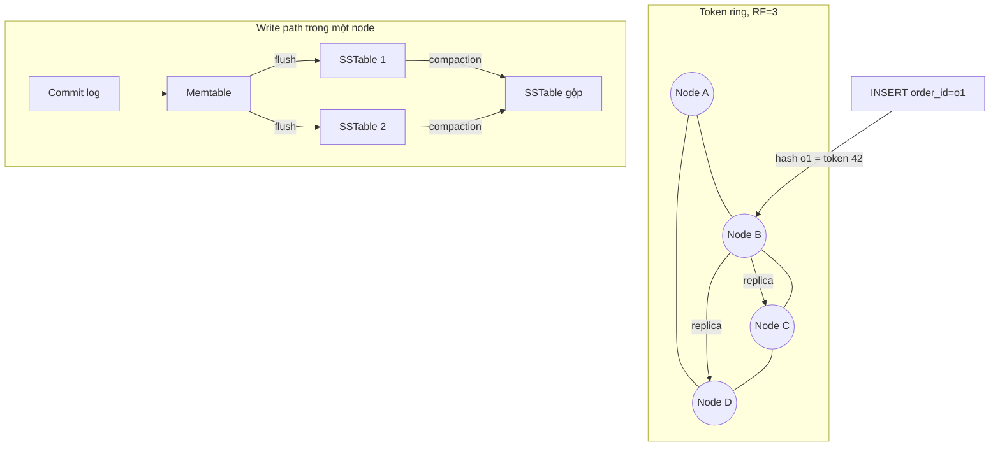
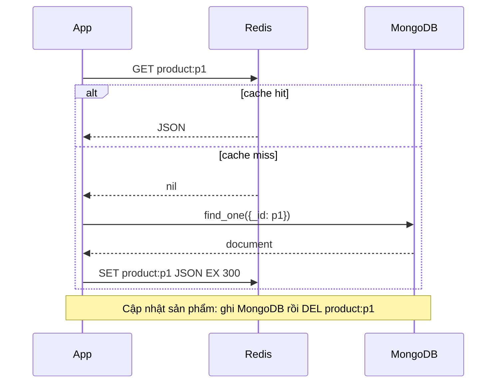
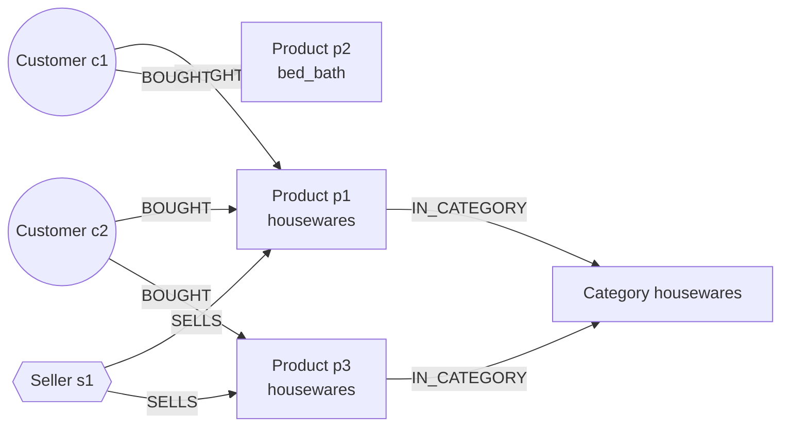
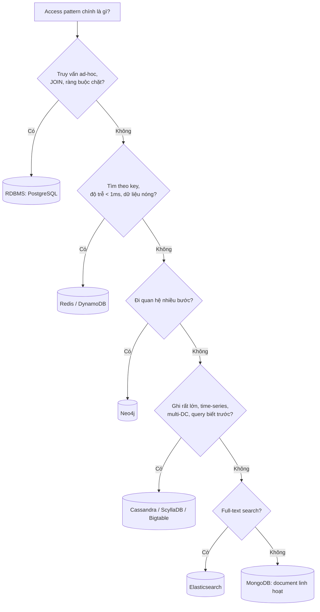

# NoSQL

PostgreSQL giải được phần lớn bài toán, nhưng không phải tất cả. Khi cần ghi hàng trăm nghìn sự kiện mỗi giây
trên nhiều data center, trả lời truy vấn trong vài mili giây, lưu document có cấu trúc thay đổi liên tục hay đi
qua quan hệ nhiều tầng, thì các họ cơ sở dữ liệu NoSQL thường làm tốt hơn. Module này giúp bạn trả lời ba câu:
**khi nào** bỏ bảng quan hệ, **chọn họ NoSQL nào**, và **mô hình hoá dữ liệu ra sao** cho từng họ. Ví dụ xuyên
suốt dùng dữ liệu Olist: review vào MongoDB, timeline đơn hàng vào Cassandra, cache sản phẩm vào Redis, gợi ý
"mua cùng" bằng Neo4j.

## 1. Khi nào cần NoSQL

"NoSQL" (Not only SQL) là tên gọi chung cho các database không dùng mô hình bảng quan hệ làm trung tâm. Chúng
ra đời từ áp lực của các hệ thống web quy mô lớn (Google BigTable 2006, Amazon Dynamo 2007): dữ liệu quá lớn
cho một máy, cần **scale out** (thêm máy) thay vì **scale up** (máy mạnh hơn), và chấp nhận nới lỏng một số đảm
bảo của RDBMS để đổi lấy throughput và availability.

### Bốn họ chính

| Họ | Mô hình dữ liệu | Đại diện | Mạnh ở | Yếu ở |
| --- | --- | --- | --- | --- |
| Document | Document JSON/BSON lồng nhau, gom theo collection | MongoDB, Couchbase, Firestore | Schema linh hoạt, đọc cả aggregate một lần | JOIN nhiều collection, transaction đa document (có nhưng đắt) |
| Wide-column | Bảng với partition key + clustering key, mỗi partition là một dãy hàng có thứ tự | Cassandra, ScyllaDB, HBase, Bigtable | Ghi cực nhanh, scale tuyến tính, multi-DC | Truy vấn phải biết trước, không JOIN, không aggregate tự do |
| Key-value | Map `key -> value` (value có thể là cấu trúc) | Redis, DynamoDB, Memcached, etcd | Độ trễ dưới mili giây, cache, counter, session | Không truy vấn theo giá trị, dữ liệu thường nằm trong RAM |
| Graph | Node, relationship, property | Neo4j, Amazon Neptune, TigerGraph | Đi quan hệ nhiều bước (friends-of-friends, gợi ý, fraud) | Aggregate trên toàn tập dữ liệu, scale ngang khó |

Ngoài ra có **search engine** (Elasticsearch/OpenSearch: inverted index, full-text, log analytics),
**time-series** (InfluxDB, TimescaleDB) và **vector database** (pgvector, Milvus) — thường được xếp gần NoSQL.

### Dấu hiệu nên cân nhắc NoSQL

- **Access pattern đơn giản, lặp lại, khối lượng rất lớn**: "lấy 50 sự kiện mới nhất của đơn X" hàng chục nghìn
  lần/giây. Wide-column hoặc key-value làm việc này với độ trễ ổn định ở mọi quy mô.
- **Dữ liệu có cấu trúc đa dạng, thay đổi theo thời gian**: thuộc tính sản phẩm khác nhau theo category (sách
  có ISBN, điện thoại có RAM). Document model tránh được bảng EAV hay hàng trăm cột NULL.
- **Cần ghi ở nhiều region và luôn sẵn sàng**: Cassandra/DynamoDB Global Tables cho phép ghi ở mọi node.
- **Quan hệ là dữ liệu chính**: mạng lưới khách hàng, seller, sản phẩm; truy vấn kiểu "đường đi ngắn nhất".
- **Độ trễ cực thấp cho dữ liệu nóng**: cache, session, rate limiting, leaderboard → Redis.

### Dấu hiệu nên ở lại với RDBMS

- Truy vấn ad-hoc, báo cáo, JOIN nhiều bảng, chưa biết trước access pattern.
- Ràng buộc toàn vẹn chặt (khóa ngoại, transaction nhiều bảng, số dư tài khoản).
- Dữ liệu vừa một máy (vài trăm GB tới vài TB vẫn ổn với PostgreSQL được tối ưu).

Thực tế, hệ thống hiện đại là **polyglot persistence**: mỗi loại dữ liệu nằm ở store phù hợp nhất, và Data
Engineer phải đưa dữ liệu từ tất cả các nơi đó về warehouse/lakehouse để phân tích (CDC, export, stream).



## 2. CAP, PACELC và consistency models

### CAP theorem

Trong một hệ phân tán, khi có **network Partition** (một nhóm node không liên lạc được với nhóm còn lại), hệ
thống chỉ có thể chọn một trong hai:

- **Consistency (C)**: mọi lần đọc đều thấy lần ghi mới nhất (linearizability), hoặc trả lỗi.
- **Availability (A)**: mọi request tới node còn sống đều nhận được câu trả lời (có thể là dữ liệu cũ).

Partition tolerance không phải lựa chọn: mạng *sẽ* đứt. Nên CAP thực chất là: **khi partition xảy ra, bạn hy
sinh C hay A?** Một hệ "CA" chỉ tồn tại khi chạy trên một máy.

- **CP**: MongoDB (mặc định, ghi vào primary, primary bị cô lập sẽ step down), HBase, etcd/ZooKeeper.
- **AP**: Cassandra, DynamoDB, Riak (mặc định): mọi replica vẫn nhận ghi, hoà giải sau.

### PACELC

CAP chỉ nói về lúc có sự cố. PACELC (Daniel Abadi, 2010) bổ sung trường hợp bình thường:
**if Partition → chọn A hoặc C; Else → chọn Latency hoặc Consistency.** Ngay cả khi mạng ổn, muốn đọc chắc chắn
mới nhất thì phải hỏi nhiều replica hoặc chờ đồng bộ, tức là chậm hơn.

| Hệ thống | P: A hay C | E: L hay C | Ghi chú |
| --- | --- | --- | --- |
| Cassandra, DynamoDB | PA | EL | Tunable: QUORUM đẩy về phía C |
| MongoDB | PC | EC | Đọc từ primary; đọc secondary thì thành EL |
| HBase, Bigtable | PC | EC | Mỗi region do một server phục vụ |
| PostgreSQL + async replica | PC (primary) | EL nếu đọc replica | Replica lag |
| Redis Cluster | PA (gần đúng) | EL | Replication bất đồng bộ, có thể mất ghi khi failover |

### Consistency models (từ mạnh tới yếu)

| Model | Đảm bảo | Ví dụ |
| --- | --- | --- |
| Linearizable (strong) | Như thể chỉ có một bản dữ liệu, mọi thao tác có thứ tự thời gian thực | etcd, MongoDB `readConcern: linearizable` |
| Sequential / Causal | Thao tác có quan hệ nhân quả được mọi node thấy cùng thứ tự | MongoDB causal sessions |
| Read-your-writes | Client luôn thấy chính lần ghi của nó | Sticky session, đọc từ primary |
| Monotonic reads | Không bao giờ đọc lùi về phiên bản cũ hơn | |
| Eventual | Nếu ngừng ghi, cuối cùng mọi replica giống nhau | Cassandra `ONE`, DNS, S3 trước 2020 |

### Tunable consistency và quorum

Với replication factor `RF = N`, ghi cần `W` replica xác nhận, đọc hỏi `R` replica. Nếu **`R + W > N`** thì tập
đọc và tập ghi luôn giao nhau ít nhất một node, nên đọc chắc chắn thấy bản ghi mới nhất (với điều kiện không có
ghi đồng thời mâu thuẫn). Với `N = 3`: `QUORUM` = 2, nên `W = QUORUM, R = QUORUM` cho 2 + 2 > 3.



### BASE vs ACID

NoSQL kiểu AP thường được mô tả là **BASE**: Basically Available, Soft state, Eventually consistent. Đối lập
với ACID của RDBMS. Ranh giới ngày càng mờ: MongoDB có transaction đa document (từ 4.0), DynamoDB có
`TransactWriteItems`, Cassandra có lightweight transaction (`IF NOT EXISTS`, dùng Paxos, đắt).

## 3. Document store: MongoDB

### Mô hình

Một **document** là object BSON (JSON nhị phân, thêm kiểu `ObjectId`, `Date`, `Decimal128`), tối đa 16 MB. Các
document gom thành **collection**; không bắt buộc schema (nhưng nên dùng `$jsonSchema` validator ở production).
Mỗi document có `_id` duy nhất.

### Schema design: embedding vs referencing

Nguyên tắc vàng: **dữ liệu được đọc cùng nhau thì lưu cùng nhau**. Thiết kế theo access pattern, không theo
chuẩn hoá.

| Tiêu chí | Embedding (lồng) | Referencing (tham chiếu) |
| --- | --- | --- |
| Quan hệ | 1-1, 1-few, 1-many có giới hạn | 1-many không giới hạn, many-many |
| Đọc | Một lần đọc lấy đủ | Cần nhiều query hoặc `$lookup` |
| Ghi | Cập nhật nguyên tử trên một document | Cập nhật nhiều document |
| Trùng lặp | Có thể trùng (vd. tên sản phẩm trong đơn) | Không trùng |
| Rủi ro | Document phình to (giới hạn 16 MB, "unbounded array") | JOIN chậm ở ứng dụng |
| Olist | `order.items[]`, `order.payments[]` | `review.order_id`, `product.seller_id` |

Các pattern hay dùng: **Extended reference** (lưu bản sao vài trường hay đọc của document kia, vd. tên seller
trong product), **Subset** (chỉ nhúng 10 review mới nhất vào product, phần còn lại ở collection riêng),
**Bucket** (gom sự kiện theo giờ vào một document cho time-series), **Computed** (lưu sẵn `avg_score`,
`review_count`, cập nhật khi có review mới).

```json
{
  "_id": "e481f51cbdc54678b7cc49136f2d6af7",
  "customer": {"id": "9ef432eb", "state": "SP", "city": "sao paulo"},
  "status": "delivered",
  "purchased_at": {"$date": "2017-10-02T10:56:33Z"},
  "items": [
    {"product_id": "87285b34", "seller_id": "3504c0cb", "category": "housewares", "price": 29.99, "freight": 8.72}
  ],
  "payments": [{"type": "credit_card", "installments": 1, "value": 38.71}]
}
```

### CRUD và aggregation pipeline

```python
from pymongo import MongoClient, ASCENDING, DESCENDING
# Offline: import mongomock; client = mongomock.MongoClient()
client = MongoClient("mongodb://localhost:27017")
db = client.olist

db.reviews.insert_many([
    {"_id": "r1", "order_id": "o1", "product_id": "p1", "score": 5, "comment": "otimo"},
    {"_id": "r2", "order_id": "o2", "product_id": "p1", "score": 2, "comment": "atrasou"},
])
db.reviews.update_one({"_id": "r2"}, {"$set": {"answered": True}})
bad = list(db.reviews.find({"score": {"$lte": 2}}, {"_id": 0, "order_id": 1, "score": 1}))

# Aggregation: điểm trung bình và số review theo sản phẩm, top 10
pipeline = [
    {"$match": {"score": {"$gte": 1}}},
    {"$group": {"_id": "$product_id", "avg_score": {"$avg": "$score"}, "n": {"$sum": 1}}},
    {"$match": {"n": {"$gte": 1}}},
    {"$sort": {"avg_score": DESCENDING, "n": DESCENDING}},
    {"$limit": 10},
]
print(list(db.reviews.aggregate(pipeline)))
```

Các stage hay dùng: `$match` (lọc, đặt sớm để dùng index), `$project`/`$addFields`, `$unwind` (bung mảng),
`$group`, `$sort`, `$limit`, `$lookup` (left join sang collection khác), `$facet` (nhiều pipeline song song),
`$bucket`, `$merge`/`$out` (ghi kết quả ra collection). Tư duy giống SQL: `$match` ≈ `WHERE`, `$group` ≈
`GROUP BY`, `$lookup` ≈ `LEFT JOIN`.

### Index

MongoDB dùng B-tree index. Loại index: single field, **compound** (thứ tự quan trọng, áp dụng quy tắc **ESR:
Equality → Sort → Range**), multikey (trên mảng), text, 2dsphere, TTL index (tự xoá document sau N giây),
partial, unique. Dùng `explain("executionStats")` để xem có `IXSCAN` hay `COLLSCAN`.

```python
db.reviews.create_index([("product_id", ASCENDING), ("created_at", DESCENDING)])
db.sessions.create_index("created_at", expireAfterSeconds=3600)  # TTL index
```

### Scale: replica set và sharding

- **Replica set**: 1 primary nhận ghi + các secondary sao chép oplog. Primary chết → bầu primary mới (vài giây).
  `writeConcern: majority` đảm bảo ghi không bị rollback.
- **Sharding**: chia collection theo **shard key** qua nhiều shard. Chọn shard key có cardinality cao, phân bố
  đều, và có mặt trong phần lớn truy vấn (nếu không, query phải scatter-gather tới mọi shard). Tránh key tăng
  dần đơn điệu (ObjectId, timestamp) với range sharding vì mọi ghi dồn vào một shard ("hot shard"); dùng
  hashed sharding hoặc compound key.

## 4. Wide-column store: Cassandra

### Kiến trúc

Cassandra là hệ **masterless**: mọi node ngang hàng, xếp trên một **token ring**. Partition key được hash
(Murmur3) thành token, quyết định node nào giữ partition. Mỗi partition được nhân bản ra `RF` node. Ghi đi vào
**commit log** + **memtable** (RAM), sau đó flush thành **SSTable** bất biến trên đĩa; compaction gộp SSTable
định kỳ. Vì ghi chỉ là append, Cassandra ghi cực nhanh (LSM-tree).



### Query-first modeling

Trong Cassandra, **bạn thiết kế bảng cho từng truy vấn**, không phải cho thực thể. Không có JOIN, `WHERE` chỉ
được lọc trên partition key (bắt buộc đủ, so sánh bằng) và clustering key (theo thứ tự khai báo). Một truy vấn
tốt **đọc đúng một partition**. Dữ liệu trùng lặp giữa các bảng là bình thường (denormalization).

Quy trình: liệt kê access pattern → mỗi pattern một bảng → chọn partition key (cái bạn biết khi truy vấn) →
chọn clustering key (thứ tự bạn muốn nhận) → kiểm tra kích thước partition.

```sql
-- Q1: Lấy lịch sử trạng thái của một đơn, mới nhất trước
CREATE TABLE IF NOT EXISTS olist.order_events_by_order (
    order_id    text,
    event_time  timestamp,
    event_type  text,
    location    text,
    PRIMARY KEY ((order_id), event_time, event_type)
) WITH CLUSTERING ORDER BY (event_time DESC, event_type ASC);

-- Q2: Các đơn của một seller trong một ngày, theo thời gian
CREATE TABLE IF NOT EXISTS olist.orders_by_seller_day (
    seller_id   text,
    order_date  date,
    purchased_at timestamp,
    order_id    text,
    order_value decimal,
    PRIMARY KEY ((seller_id, order_date), purchased_at, order_id)
) WITH CLUSTERING ORDER BY (purchased_at DESC, order_id ASC);

SELECT * FROM olist.orders_by_seller_day
WHERE seller_id = 's1' AND order_date = '2018-05-01' LIMIT 20;
```

### Partition key, clustering key và kích thước partition

- **Partition key** (trong ngoặc đơn bên trong `PRIMARY KEY`): quyết định phân tán. Cardinality phải cao, phân
  bố đều. `PRIMARY KEY ((seller_id, order_date), ...)` là **composite partition key**: thêm `order_date` để
  **bucket** theo ngày, tránh partition của seller lớn phình vô hạn.
- **Clustering key**: xác định thứ tự lưu trong partition và tính duy nhất của hàng. Cho phép range query
  (`event_time > ...`) và `ORDER BY` theo đúng thứ tự khai báo.
- Hướng dẫn chung: partition dưới ~100 MB và dưới ~100 nghìn hàng. Partition quá lớn gây **hot partition**,
  GC pause, repair chậm.

### Tombstone

Cassandra không xoá tại chỗ (SSTable bất biến). `DELETE`, ghi `null`, hay TTL hết hạn đều tạo ra một
**tombstone**: một dấu "đã xoá" có timestamp. Tombstone chỉ bị dọn sau `gc_grace_seconds` (mặc định 10 ngày) và
khi compaction chạy. Đọc một partition nhiều tombstone buộc Cassandra quét qua chúng → chậm, vượt
`tombstone_failure_threshold` (100 nghìn) thì query lỗi. Hệ quả thiết kế:

- Tránh mô hình hàng đợi (queue) "insert rồi delete" trên Cassandra.
- Không `INSERT` giá trị `null` cho cột (driver hãy bỏ cột đó thay vì gửi null).
- Dùng TTL theo bảng và **TimeWindowCompactionStrategy** cho dữ liệu time-series, để cả SSTable hết hạn bị bỏ
  một lần.

### Các khái niệm khác

`ALLOW FILTERING` (quét nhiều partition, gần như luôn là dấu hiệu thiết kế sai), secondary index / SAI (chỉ dùng
khi lọc trong partition hoặc cardinality phù hợp), materialized view (thử nghiệm, nên tự ghi nhiều bảng), batch
(`LOGGED BATCH` để giữ nhất quán giữa các bảng denormalized, không phải để tăng tốc), counter column,
lightweight transaction.

### Gia đình wide-column / BigTable

- **Google Bigtable** (2006): sorted map `(row key, column family:qualifier, timestamp) -> value`. Thiết kế
  row key là tất cả (tránh hotspot bằng cách đảo hoặc salt prefix).
- **Apache HBase**: bản mã nguồn mở của Bigtable trên HDFS, cần ZooKeeper, CP.
- **ScyllaDB**: tương thích Cassandra, viết bằng C++, độ trễ thấp hơn.
- **Amazon DynamoDB**: key-value/document managed, mô hình gần Cassandra: **partition key + sort key**, GSI/LSI,
  single-table design, on-demand capacity, DynamoDB Streams cho CDC.

## 5. Key-value store: Redis

### Mô hình

Redis là in-memory data structure server, đơn luồng cho lệnh (I/O đa luồng từ 6.0), mỗi lệnh là nguyên tử.
Độ trễ thường dưới 1 ms. Persistence tuỳ chọn: **RDB** (snapshot định kỳ) và/hoặc **AOF** (append-only log).
Scale: replica + Sentinel (failover), hoặc **Redis Cluster** (16384 hash slot).

### Cấu trúc dữ liệu và use case

| Kiểu | Lệnh chính | Use case Olist |
| --- | --- | --- |
| String | `SET k v EX 60`, `GET`, `INCR`, `SETNX` | Cache JSON sản phẩm, counter lượt xem, distributed lock |
| Hash | `HSET`, `HGETALL`, `HINCRBY` | Profile seller, giỏ hàng (field = product_id) |
| List | `LPUSH`, `RPOP`, `LRANGE`, `LTRIM` | 20 sản phẩm xem gần nhất của user, queue đơn giản |
| Set | `SADD`, `SISMEMBER`, `SINTER` | Tập sản phẩm user đã mua, dedup |
| Sorted set | `ZADD`, `ZINCRBY`, `ZREVRANGE`, `ZRANGEBYSCORE` | Leaderboard sản phẩm bán chạy, sliding window rate limit |
| Stream | `XADD`, `XREADGROUP`, `XACK` | Event log nhẹ, consumer group |
| HyperLogLog | `PFADD`, `PFCOUNT` | Đếm xấp xỉ số khách unique (12 KB/key) |
| Bitmap, Geo, JSON, Bloom | `SETBIT`, `GEOADD`... | Điểm danh, khoảng cách tới kho |

### Cache patterns

- **Cache-aside (lazy loading)**: ứng dụng đọc cache; miss thì đọc DB rồi ghi cache kèm TTL. Ghi DB thì
  **xoá** key cache (không cập nhật, để tránh race). Phổ biến nhất.
- **Read-through / write-through**: cache tự đọc/ghi DB (thường do thư viện hoặc proxy làm).
- **Write-behind**: ghi cache trước, flush DB bất đồng bộ; nhanh nhưng có rủi ro mất dữ liệu.



```python
import json
import redis  # offline: import fakeredis; r = fakeredis.FakeRedis(decode_responses=True)

r = redis.Redis.from_url("redis://localhost:6379/0", decode_responses=True)

def get_product(product_id: str, load_from_db, ttl: int = 300) -> dict | None:
    key = f"product:{product_id}"
    cached = r.get(key)
    if cached is not None:
        return json.loads(cached)
    doc = load_from_db(product_id)
    if doc is not None:
        r.set(key, json.dumps(doc), ex=ttl)
    return doc
```

Vấn đề cần biết: **cache stampede** (key nóng hết hạn, nghìn request cùng đánh DB → dùng lock `SET NX`, hoặc
làm mới sớm có xác suất), **cache penetration** (truy vấn key không tồn tại liên tục → cache cả kết quả rỗng với
TTL ngắn, hoặc Bloom filter), **TTL jitter** (cộng ngẫu nhiên vài giây để key không cùng hết hạn), eviction
policy (`allkeys-lru`, `volatile-ttl`...) khi đầy `maxmemory`.

### Rate limiting

- **Fixed window**: `INCR rate:{client}:{minute}` + `EXPIRE`; đơn giản, nhưng có thể vượt gấp đôi ở ranh giới
  cửa sổ.
- **Sliding window log**: sorted set với score là timestamp; `ZREMRANGEBYSCORE` bỏ request cũ, `ZCARD` đếm,
  `ZADD` thêm. Chính xác, tốn bộ nhớ hơn.
- **Token bucket**: lưu `tokens` + `last_refill` trong hash, nên viết bằng Lua script để nguyên tử.

```python
import time

def allow(r, client_id: str, limit: int = 10, window: int = 60) -> bool:
    key = f"rl:{client_id}:{int(time.time() // window)}"
    pipe = r.pipeline()
    pipe.incr(key)
    pipe.expire(key, window)
    count, _ = pipe.execute()
    return count <= limit
```

## 6. Graph database: Neo4j

### Property graph

Dữ liệu là **node** (có label, vd. `:Customer`, `:Product`) và **relationship** có hướng, có type (vd.
`:BOUGHT`) — cả hai đều mang property. Điểm mạnh là **index-free adjacency**: mỗi node trỏ thẳng tới các quan
hệ của nó, nên đi một bước quan hệ có chi phí hằng số, không phụ thuộc kích thước toàn đồ thị. Trong SQL, mỗi
bước là một JOIN; đi 4–5 bước trên bảng lớn rất chậm.



### Cypher

Cypher mô tả pattern bằng "ASCII art": `(node)-[:REL]->(node)`.

```cypher
// Nạp dữ liệu idempotent: MERGE = tạo nếu chưa có
UNWIND $rows AS row
MERGE (c:Customer {id: row.customer_id})
MERGE (p:Product {id: row.product_id})
  ON CREATE SET p.category = row.category
MERGE (c)-[b:BOUGHT {order_id: row.order_id}]->(p);

// Khách mua p1 cũng mua gì? (co-purchase, 2 bước)
MATCH (:Product {id: $pid})<-[:BOUGHT]-(c:Customer)-[:BOUGHT]->(other:Product)
WHERE other.id <> $pid
RETURN other.id AS product_id, count(DISTINCT c) AS customers
ORDER BY customers DESC, product_id
LIMIT 5;

// Đường đi ngắn nhất giữa hai khách qua sản phẩm chung
MATCH p = shortestPath((a:Customer {id: 'c1'})-[:BOUGHT*..6]-(b:Customer {id: 'c9'}))
RETURN length(p);
```

```python
from neo4j import GraphDatabase

driver = GraphDatabase.driver("bolt://localhost:7687", auth=("neo4j", "password123"))
records, _, _ = driver.execute_query(
    "MATCH (p:Product {id: $pid})<-[:BOUGHT]-(c) RETURN count(c) AS n", pid="p1"
)
print(records[0]["n"])
driver.close()
```

Nên tạo constraint/index trước khi nạp: `CREATE CONSTRAINT customer_id IF NOT EXISTS FOR (c:Customer) REQUIRE
c.id IS UNIQUE`. Use case: recommendation, fraud detection (vòng giao dịch, thiết bị dùng chung), knowledge
graph, network/IT dependency, lineage dữ liệu. Thư viện **Graph Data Science** có PageRank, Louvain, node
similarity. Hạn chế: aggregate toàn cục và scale ghi ngang kém hơn; với analytics lớn, thường xuất dữ liệu ra
Spark GraphFrames hoặc dùng warehouse.

## 7. Chọn database theo bài toán

### Search engine: Elasticsearch / OpenSearch

Elasticsearch xây trên Lucene, lưu document JSON và tạo **inverted index** (term → danh sách document), hỗ trợ
full-text (analyzer, stemming, fuzzy), relevance scoring (BM25), aggregation, phân tán qua shard/replica. Dùng
cho: tìm kiếm sản phẩm, log/observability (ELK stack), autocomplete. Không nên làm system of record: không có
transaction, cập nhật là re-index, near-real-time (refresh ~1 giây). Mô hình phổ biến: DB chính → CDC → ES.

### Khung quyết định



### Ví dụ chọn cho Olist

| Bài toán | Lựa chọn | Lý do |
| --- | --- | --- |
| Đơn hàng, thanh toán | PostgreSQL | Transaction, ràng buộc, báo cáo |
| Review khách hàng (text, ảnh, trả lời) | MongoDB | Cấu trúc linh hoạt, đọc theo sản phẩm, aggregation |
| Catalog sản phẩm, thuộc tính khác nhau theo category | MongoDB | Schema-on-read, attribute pattern |
| Trang chi tiết sản phẩm 50k req/s | Redis cache trước MongoDB | Độ trễ, giảm tải DB |
| Tracking vận chuyển, hàng tỉ sự kiện | Cassandra | Ghi lớn, truy vấn theo order_id, TTL |
| Gợi ý mua cùng, phát hiện seller gian lận | Neo4j | Quan hệ nhiều bước |
| Ô tìm kiếm sản phẩm | Elasticsearch | Full-text, relevance, facet |
| Session, giỏ hàng, rate limit API | Redis | TTL, cấu trúc dữ liệu, nguyên tử |

### Góc nhìn Data Engineer

Data Engineer hiếm khi thiết kế DB vận hành một mình, nhưng phải:

1. **Trích xuất** dữ liệu ra: MongoDB change streams / Debezium, Cassandra CDC hoặc export `COPY`/Spark
   connector, DynamoDB Streams, Redis thường không cần (là dữ liệu tạm).
2. **Làm phẳng** document lồng vào bảng phân tích (`$unwind` hoặc `pandas.json_normalize`, schema drift).
3. **Dùng NoSQL như serving layer**: đẩy feature/gợi ý đã tính sẵn vào Redis/Cassandra/DynamoDB cho ứng dụng
   đọc (một phần của Reverse ETL, module 09).
4. Hiểu trade-off để không biến NoSQL thành nơi chạy báo cáo ad-hoc.

## 8. Tài liệu tham khảo

- roadmap.sh, Data Engineer roadmap: https://roadmap.sh/data-engineer
- Martin Kleppmann, *Designing Data-Intensive Applications* (O'Reilly, 2017), chương 2, 5, 9.
- Daniel Abadi, *Consistency Tradeoffs in Modern Distributed Database System Design* (PACELC, IEEE Computer 2012): https://www.cs.umd.edu/~abadi/papers/abadi-pacelc.pdf
- Jepsen, Consistency models: https://jepsen.io/consistency
- MongoDB Manual, Data Modeling: https://www.mongodb.com/docs/manual/data-modeling/
- MongoDB, Building with Patterns: https://www.mongodb.com/blog/post/building-with-patterns-a-summary
- MongoDB Aggregation Pipeline: https://www.mongodb.com/docs/manual/core/aggregation-pipeline/
- MongoDB ESR rule: https://www.mongodb.com/docs/manual/tutorial/equality-sort-range-guideline/
- Apache Cassandra docs, Data Modeling: https://cassandra.apache.org/doc/latest/cassandra/developing/data-modeling/index.html
- DataStax, About deletes and tombstones: https://docs.datastax.com/en/cassandra-oss/3.x/cassandra/dml/dmlAboutDeletes.html
- Redis docs, Data types: https://redis.io/docs/latest/develop/data-types/
- Redis, Caching patterns: https://redis.io/solutions/caching/
- Neo4j Cypher Manual: https://neo4j.com/docs/cypher-manual/current/
- Google, Bigtable paper: https://research.google/pubs/bigtable-a-distributed-storage-system-for-structured-data/
- Amazon, Dynamo paper: https://www.allthingsdistributed.com/files/amazon-dynamo-sosp2007.pdf
- AWS DynamoDB, Best practices for designing and architecting: https://docs.aws.amazon.com/amazondynamodb/latest/developerguide/best-practices.html
- Elasticsearch Guide: https://www.elastic.co/guide/en/elasticsearch/reference/current/index.html
- mongomock: https://github.com/mongomock/mongomock — fakeredis: https://github.com/cunla/fakeredis-py
