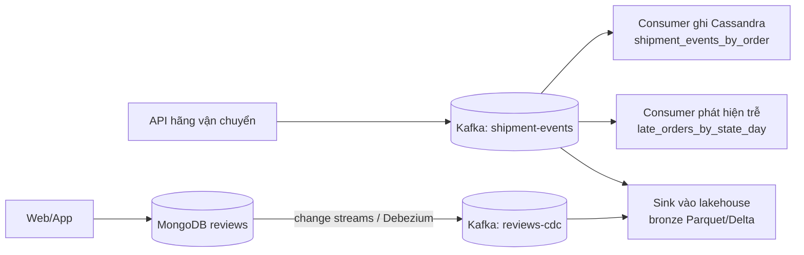

# Hướng làm: thiết kế tầng lưu trữ NoSQL cho tracking và review Olist

Bài thiết kế không có một đáp án duy nhất. Người chấm tìm **lập luận** gắn với con số và access pattern, không tìm
đúng tên công nghệ. Dưới đây là một thiết kế tham khảo, các điểm cần cân nhắc và rubric.

## 1. Ước lượng (phần "Bối cảnh và giả định")

- 3 triệu đơn/tháng × 15 sự kiện ≈ 45 triệu sự kiện/tháng ≈ **1,5 triệu/ngày**, trung bình ~17 ghi/giây, đỉnh
  gấp 10–20 lần (~300 ghi/giây). Mỗi sự kiện ~200 byte → ~300 MB/ngày, ~55 GB/năm trước replication.
- Đọc: 5.000 lượt/giây cao điểm, mỗi lượt đọc **một** partition ~15 hàng (~3 KB).
- Partition `shipment_events_by_order`: ~15 hàng, rất nhỏ. Partition `late_orders_by_state_day`: bang lớn nhất (SP
  ~40% đơn) × tỉ lệ trễ ~8% × ~100k đơn/ngày ≈ 3.000 hàng/partition — ổn.

Kết luận đáng nói: khối lượng **ghi** thật ra vừa sức PostgreSQL có partitioning; lý do chọn Cassandra là độ trễ
đọc ổn định ở 5k req/s, scale tuyến tính, multi-DC và TTL tự dọn. Một bài tốt thừa nhận điều này.

## 2. Schema tham khảo

```sql
CREATE TABLE IF NOT EXISTS shipment_events_by_order (
    order_id   text,
    event_time timestamp,
    event_type text,
    location   text,
    PRIMARY KEY ((order_id), event_time, event_type)
) WITH CLUSTERING ORDER BY (event_time DESC, event_type ASC)
  AND default_time_to_live = 15552000      -- 180 ngày
  AND compaction = {'class': 'TimeWindowCompactionStrategy',
                    'compaction_window_unit': 'DAYS', 'compaction_window_size': 7};

CREATE TABLE IF NOT EXISTS late_orders_by_state_day (
    customer_state text,
    expected_date  date,
    order_id       text,
    seller_id      text,
    last_event     text,
    detected_at    timestamp,
    PRIMARY KEY ((customer_state, expected_date), order_id)
) WITH default_time_to_live = 2592000;   -- 30 ngày
```

- Bảng 2 do một **consumer** ghi: khi tới `expected_date` mà chưa có sự kiện `delivered` → `INSERT`; khi giao xong
  → `DELETE` dòng đó. Tombstone chỉ nằm trong partition của một ngày; ops chủ yếu đọc vài ngày gần đây và
  partition cũ hết hạn theo TTL, nên số tombstone mỗi lần đọc nhỏ. Phương án khác: không xoá mà ghi cột
  `resolved_at` và lọc ở ứng dụng.
- Ghi `LOCAL_QUORUM`, đọc `LOCAL_ONE` cho trang khách (chấp nhận trễ vài trăm ms) hoặc `LOCAL_QUORUM` cho ops.
  RF = 3 mỗi DC, `NetworkTopologyStrategy`.
- Idempotency: primary key `(order_id, event_time, event_type)` khiến sự kiện gửi lại ghi đè chính nó.

MongoDB `reviews` (referencing theo `order_id`, `product_id`; ảnh lưu URL object storage trong mảng `photos` có
giới hạn; câu trả lời của seller **embed** vì 1-1 và luôn đọc cùng review):

```python
REVIEW_VALIDATOR = {"$jsonSchema": {
    "bsonType": "object",
    "required": ["_id", "order_id", "product_id", "score", "created_at"],
    "properties": {
        "score": {"bsonType": "int", "minimum": 1, "maximum": 5},
        "photos": {"bsonType": "array", "maxItems": 5},
        "answered": {"bsonType": "bool"},
        "created_at": {"bsonType": "date"},
    }}}
REVIEW_INDEXES = [
    [("product_id", 1), ("created_at", -1)],          # review mới nhất theo sản phẩm (ESR)
    [("order_id", 1)],                                # CSKH tra theo đơn
    [("answered", 1), ("score", 1), ("created_at", 1)],  # hàng đợi điểm thấp chưa trả lời, cũ nhất trước
]
```

Index thứ ba có thể thay bằng partial index `{"score": 1, "created_at": 1}` với
`partialFilterExpression: {"answered": false}` — nhỏ hơn nhiều vì chỉ chứa review chưa trả lời.

## 3. Luồng dữ liệu



Lakehouse nhận dữ liệu từ **Kafka** (nguồn gốc của sự kiện), không quét Cassandra. Review đi qua CDC để bắt được
cả update/delete; bronze lưu JSON thô, silver ép kiểu và flatten (`photos` → bảng con), xử lý schema drift.

## 4. Phương án thay thế nên bàn

| Phương án | Ưu | Vì sao không chọn (hoặc khi nào chọn) |
| --- | --- | --- |
| DynamoDB | Managed, on-demand, TTL, Streams | Chọn nếu đã ở AWS; khoá vendor, chi phí đọc cao ở 5k req/s liên tục |
| PostgreSQL partition theo tháng | Một hệ, SQL, JOIN | Đủ cho khối lượng ghi; cần read replica + cache để giữ p99 20 ms; multi-region khó |
| ScyllaDB | Tương thích CQL, p99 thấp hơn | Ít người vận hành quen; chọn khi đội đã có |
| Elasticsearch cho review | Full-text tìm review | Bổ sung (search), không thay MongoDB làm nguồn sự thật |

## Rubric (100 điểm)

| Tiêu chí | Điểm |
| --- | --- |
| Test tĩnh offline pass | 20 |
| Schema chạy được trên Cassandra, validator chặn đúng trên MongoDB | 10 |
| Ước lượng khối lượng có con số và dùng con số đó để ra quyết định | 10 |
| Access pattern đầy đủ (ai, input, output, tần suất, SLA) và mỗi bảng/index map về một pattern | 15 |
| Partition key/clustering key hợp lý; bàn kích thước partition, hot partition, TTL, compaction, tombstone | 15 |
| Consistency level, replication, hỏng hóc node/DC, idempotency được nêu rõ | 10 |
| Đường dữ liệu về lakehouse: CDC/Kafka, schema drift, delete | 10 |
| Phương án thay thế và đánh đổi trung thực (kể cả "PostgreSQL có thể đủ") | 10 |

Mức đạt: từ 70 điểm. Trừ điểm nặng nếu: dùng `ALLOW FILTERING`, partition theo cột cardinality thấp, đọc Cassandra
để làm analytics, hoặc tài liệu chỉ liệt kê công nghệ mà không có lý do.
