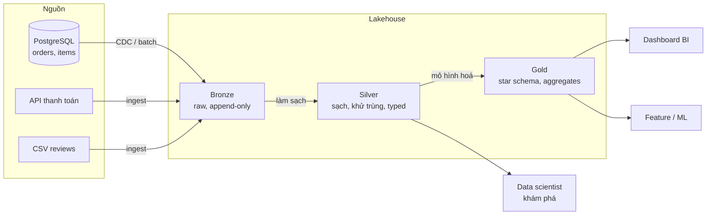
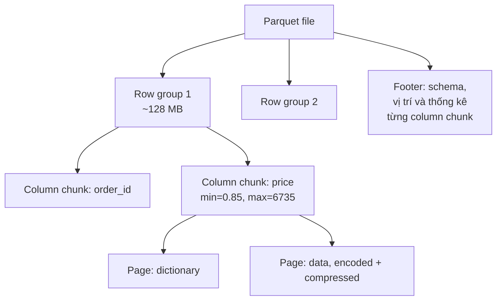
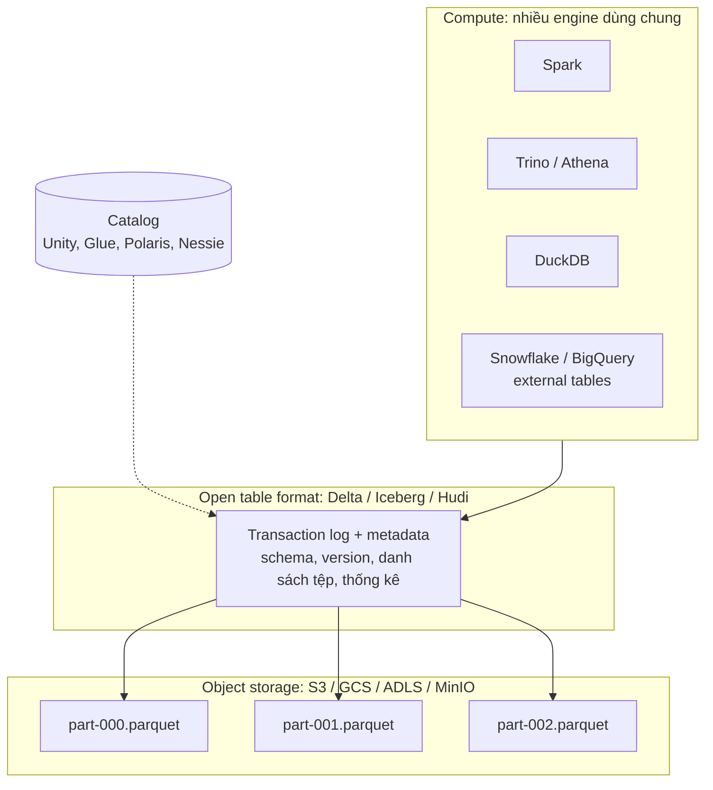
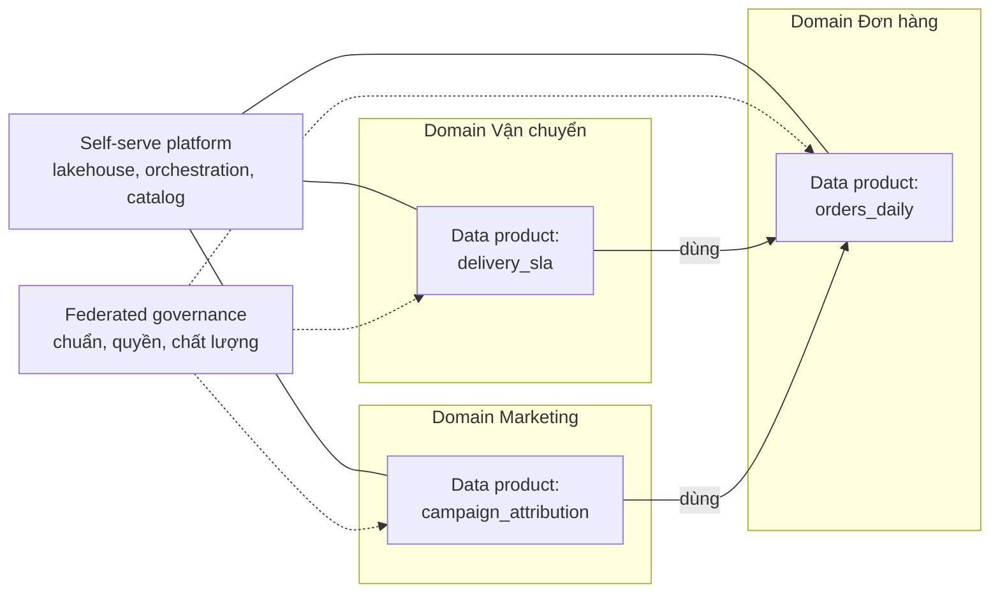

# Data Warehouse & Lakehouse

Module 02 dạy bạn mô hình hoá dữ liệu trong một database quan hệ. Module này trả lời câu hỏi lớn hơn: dữ liệu
phân tích của cả công ty nên **nằm ở đâu, bố trí thế nào, và ai truy vấn nó bằng gì**. Bạn sẽ đi từ data warehouse
truyền thống (OLAP, Kimball, Inmon), xuống tầng lưu trữ (columnar, Parquet, partitioning), sang data lake và lakehouse
(Delta Lake, Iceberg, Hudi), rồi tới các warehouse serverless trên cloud và cách tổ chức ở quy mô tổ chức (data mart,
data mesh, data fabric). Mọi ví dụ chạy được trên máy cá nhân bằng DuckDB, PyArrow và `deltalake`, dùng dữ liệu Olist.

Với người đã quen pandas và SQL: phần lớn "phép thuật" của warehouse hiện đại nằm ở **cách bố trí byte trên đĩa**
(cột, nén, thống kê min/max, partition) và ở **transaction log** đặt trên các tệp bất biến. Hiểu hai thứ này là hiểu
vì sao truy vấn 1 TB vẫn chạy trong vài giây và vì sao Parquet trần chưa đủ để làm bảng.

## 1. Data warehouse và OLAP

### Vì sao không phân tích thẳng trên database ứng dụng

Database của ứng dụng Olist (PostgreSQL chẳng hạn) được tối ưu cho **OLTP**: hàng nghìn giao dịch nhỏ mỗi giây, mỗi
giao dịch đọc/ghi vài dòng theo khoá chính. Câu hỏi phân tích thì ngược lại: "doanh thu theo bang theo tháng trong 2
năm" quét hàng triệu dòng nhưng chỉ cần 3 cột. Chạy loại truy vấn đó trên OLTP thì vừa chậm vừa làm chậm ứng dụng.
Ngoài ra dữ liệu phân tích thường đến từ **nhiều nguồn** (đơn hàng, thanh toán, marketing, CRM) cần được gộp và làm sạch.

**Data warehouse** là hệ thống lưu dữ liệu đã tích hợp, phục vụ phân tích. Định nghĩa kinh điển của Bill Inmon:
warehouse là *subject-oriented* (theo chủ đề: bán hàng, khách hàng), *integrated* (thống nhất mã, đơn vị, định nghĩa
từ nhiều nguồn), *time-variant* (giữ lịch sử) và *non-volatile* (dữ liệu nạp vào để đọc, không bị sửa tuỳ tiện).

| Tiêu chí | OLTP | OLAP |
| --- | --- | --- |
| Mục đích | Chạy nghiệp vụ (đặt hàng, thanh toán) | Phân tích, báo cáo, ML |
| Truy vấn điển hình | Đọc/ghi vài dòng theo khoá | Quét, lọc, tổng hợp hàng triệu dòng |
| Mô hình | Chuẩn hoá (3NF) | Denormalized: star schema, bảng rộng |
| Lưu trữ | Theo dòng (row-oriented) | Theo cột (column-oriented) |
| Độ trễ dữ liệu | Thời gian thực | Phút tới ngày (batch), giây (streaming) |
| Ví dụ | PostgreSQL, MySQL, Oracle | BigQuery, Snowflake, Redshift, ClickHouse, DuckDB |

### OLAP và khối dữ liệu (cube)

OLAP (Online Analytical Processing) nhìn dữ liệu như một **khối nhiều chiều**: measure (doanh thu) được cắt theo các
dimension (thời gian, địa lý, danh mục). Các thao tác cơ bản:

- **Roll-up**: gộp lên cấp cao hơn (ngày → tháng → năm).
- **Drill-down**: ngược lại, đi xuống chi tiết.
- **Slice / dice**: cố định một hoặc vài dimension (chỉ bang SP, chỉ năm 2018).
- **Pivot**: xoay chiều để xem dưới dạng bảng chéo.

Ngày trước, OLAP server (MOLAP) tính sẵn cube và lưu riêng. Ngày nay các engine cột đủ nhanh để tính trực tiếp từ
bảng (ROLAP), nên "cube" chủ yếu còn lại dưới dạng cú pháp SQL `GROUPING SETS`, `ROLLUP`, `CUBE`:

```python
import duckdb

con = duckdb.connect()
con.execute("""
    CREATE TABLE sales AS SELECT * FROM (VALUES
        ('SP', 'toys',  '2018-01', 120.0), ('SP', 'books', '2018-01', 80.0),
        ('RJ', 'toys',  '2018-01',  60.0), ('SP', 'toys',  '2018-02', 90.0)
    ) t(customer_state, category, order_month, revenue)
""")
print(con.sql("""
    SELECT customer_state, category, SUM(revenue) AS revenue,
           GROUPING(customer_state) AS g_state, GROUPING(category) AS g_cat
    FROM sales
    GROUP BY CUBE (customer_state, category)       -- mọi tổ hợp: (s,c), (s), (c), ()
    ORDER BY g_state, g_cat, customer_state, category
"""))
```

`ROLLUP (a, b)` cho các nhóm `(a, b)`, `(a)`, `()`, hợp với phân cấp (năm → tháng). `CUBE (a, b)` cho mọi tổ hợp.
`GROUPING(col) = 1` nghĩa là NULL ở dòng đó do tổng hợp sinh ra, không phải NULL thật.

### Vì sao warehouse nhanh: MPP và columnar

Hai ý tưởng cốt lõi:

1. **Columnar storage** (phần 3): chỉ đọc cột cần, nén rất tốt, xử lý theo vector.
2. **MPP (Massively Parallel Processing)**: dữ liệu chia thành nhiều phần trên nhiều node, mỗi node xử lý phần của
   mình rồi gộp kết quả. Redshift, Synapse, Teradata là MPP kiểu shared-nothing; BigQuery và Snowflake tách hẳn
   storage và compute (phần 6).

## 2. Kiến trúc warehouse: Kimball, Inmon, layered và medallion

### Inmon: Corporate Information Factory (top-down)

Inmon xây một **enterprise data warehouse (EDW)** chuẩn hoá (3NF) cho toàn công ty trước, làm "single source of truth".
Từ đó sinh ra các **data mart** phòng ban (thường là star schema) để phục vụ báo cáo.

- Ưu: nhất quán toàn công ty, ít trùng lặp, chịu thay đổi nguồn tốt.
- Nhược: tốn công thiết kế ban đầu, lâu mới có giá trị; cần đội ngũ mạnh.

### Kimball: Dimensional modeling (bottom-up)

Kimball xây trực tiếp các **star schema** theo từng quy trình nghiệp vụ (bán hàng, vận chuyển, thanh toán). Các mart
được nối với nhau qua **conformed dimension** (cùng một `dim_customer`, `dim_date` dùng chung) theo **bus matrix**.
Tập các mart liên kết đó chính là warehouse.

Quy trình thiết kế 4 bước của Kimball:

1. Chọn quy trình nghiệp vụ (vd. đặt hàng).
2. **Khai báo grain**: một dòng fact nghĩa là gì ("một item trong một đơn"). Đây là quyết định quan trọng nhất.
3. Chọn dimension (khách hàng, sản phẩm, ngày, người bán).
4. Chọn fact/measure (`price`, `freight_value`), ưu tiên measure cộng được (additive).

- Ưu: nhanh có giá trị, dễ hiểu với người dùng BI, truy vấn đơn giản.
- Nhược: dễ phân mảnh nếu không quản lý conformed dimension; đổi grain về sau rất đắt.

### Data Vault (nhắc qua)

Data Vault 2.0 mô hình hoá lớp lõi bằng **hub** (khoá nghiệp vụ), **link** (quan hệ) và **satellite** (thuộc tính có
lịch sử). Rất linh hoạt khi nguồn thay đổi thường xuyên và yêu cầu audit cao, nhưng phải có lớp mart (thường Kimball)
phía trên để người dùng truy vấn được.

| Tiêu chí | Inmon | Kimball | Data Vault |
| --- | --- | --- | --- |
| Hướng tiếp cận | Top-down | Bottom-up | Lớp lõi linh hoạt + mart |
| Lớp lõi | 3NF | Star schema (conformed dims) | Hub / Link / Satellite |
| Thời gian ra giá trị | Chậm | Nhanh | Trung bình |
| Thích hợp | Doanh nghiệp lớn, nhiều nguồn, ổn định | Đa số công ty, đội nhỏ, BI-first | Nguồn thay đổi nhiều, cần audit |

### Kiến trúc nhiều lớp (layered) và medallion

Dù theo trường phái nào, warehouse/lakehouse hiện đại gần như luôn chia lớp. Tên gọi khác nhau nhưng ý giống nhau:

| Medallion (Databricks) | Tên khác hay gặp | Nội dung |
| --- | --- | --- |
| Bronze | raw, landing, staging | Dữ liệu thô từ nguồn, gần như nguyên vẹn, append-only, thêm metadata nạp |
| Silver | cleansed, core, intermediate | Đã ép kiểu, làm sạch, khử trùng, chuẩn hoá, nối các nguồn |
| Gold | mart, presentation, serving | Star schema, bảng tổng hợp, metric cho BI và ML |



Vì sao tách lớp thay vì một bước ETL từ nguồn thẳng ra mart?

- **Replay**: bronze giữ bản gốc, sửa logic silver/gold thì chạy lại mà không cần lấy lại từ nguồn (nguồn có thể đã
  xoá hoặc ghi đè dữ liệu cũ).
- **Tách trách nhiệm**: lỗi kiểu dữ liệu xử lý ở silver, logic nghiệp vụ ở gold; dễ test và debug từng bước.
- **Nhiều người dùng**: data scientist cần silver chi tiết, BI cần gold gọn.

### Data mart

**Data mart** là tập con của warehouse phục vụ một phòng ban hoặc một chủ đề (mart bán hàng, mart logistics). Trong
kiến trúc Kimball, mart chính là các star schema; trong Inmon, mart được sinh từ EDW. Một mart tốt có: grain rõ ràng,
surrogate key, conformed dimension, unknown member cho khoá không khớp, và các kiểm tra đối soát (số dòng, tổng tiền)
với nguồn. Bài tập `intermediate/03-kimball-data-mart` làm đúng những việc này.

## 3. Columnar storage và Parquet

### Row-oriented vs column-oriented

Cùng bảng `order_items`, hai cách xếp byte trên đĩa:

```
Row-oriented:    [o1, p1, 100.0, 10.0] [o1, p2, 50.0, 5.0] [o2, p3, 30.0, 3.0] ...
Column-oriented: [o1, o1, o2, ...] [p1, p2, p3, ...] [100.0, 50.0, 30.0, ...] [10.0, 5.0, 3.0, ...]
```

`SELECT SUM(price) FROM order_items` trên bảng 20 cột: kiểu dòng phải đọc cả 20 cột, kiểu cột chỉ đọc 1 cột
(**column pruning**, giảm I/O ~20 lần). Các giá trị cùng kiểu, thường lặp lại, đứng cạnh nhau nên **nén cực tốt**
(dictionary, run-length, delta encoding). Engine còn xử lý cả khối giá trị một lúc bằng lệnh SIMD (**vectorized execution**).
Đánh đổi: ghi/sửa một dòng lẻ thì đắt, vì phải chạm vào nhiều nơi. Vì vậy OLTP dùng dòng, OLAP dùng cột.

### Cấu trúc tệp Parquet



- **Row group**: một lát ngang của bảng (thường 64 MB – 1 GB). Đơn vị song song hoá và đơn vị bỏ qua dữ liệu.
- **Column chunk**: dữ liệu một cột trong một row group, chia thành **page**.
- **Footer**: schema + vị trí + **statistics** (min, max, null_count) cho mỗi column chunk. Reader đọc footer trước,
  so điều kiện `WHERE price > 1000` với min/max để bỏ qua cả row group (**predicate pushdown**). Pushdown hiệu quả nhất
  khi dữ liệu được **sắp xếp** theo cột hay lọc.
- Kiểu dữ liệu phong phú (decimal, timestamp, list, struct, map) và schema đi kèm tệp, không phải đoán như CSV.

```python
import pyarrow as pa
import pyarrow.parquet as pq

items = pa.table({
    "order_id": ["o1", "o1", "o2", "o3"] * 25_000,
    "product_id": ["p1", "p2", "p3", "p1"] * 25_000,
    "price": [100.0, 50.0, 30.0, 999.0] * 25_000,
}).sort_by("price")                                    # sắp xếp để min/max của row group ít chồng nhau

pq.write_table(items, "order_items.parquet", compression="zstd", row_group_size=20_000)

meta = pq.ParquetFile("order_items.parquet").metadata
print(meta.num_row_groups, meta.row_group(0).column(2).statistics)   # min/max của cột price
t = pq.read_table("order_items.parquet", columns=["price"], filters=[("price", ">", 500)])
print(t.num_rows)                                                     # chỉ đọc row group có max > 500
```

### So sánh định dạng

| Định dạng | Kiểu | Schema | Nén | Hợp với |
| --- | --- | --- | --- | --- |
| CSV / JSON | Dòng, text | Không / lỏng | Kém | Trao đổi, nạp thô |
| Avro | Dòng, nhị phân | Có, hỗ trợ schema evolution | Tốt | Streaming (Kafka), ghi nhiều |
| Parquet | Cột | Có | Rất tốt | Phân tích, lake, lakehouse (chuẩn de facto) |
| ORC | Cột | Có | Rất tốt | Hệ sinh thái Hive |
| Arrow | Cột, **trong bộ nhớ** | Có | Không (chủ yếu) | Trao đổi giữa engine không cần copy (DuckDB ↔ pandas ↔ Polars) |

## 4. Partitioning, clustering và bố trí dữ liệu

Column pruning và min/max giúp bỏ qua cột và row group. **Partitioning** giúp bỏ qua cả **tệp và thư mục**.

### Hive-style partitioning

Dữ liệu được chia vào các thư mục theo giá trị cột: `orders/year=2018/month=3/part-0.parquet`. Truy vấn có
`WHERE year = 2018 AND month = 3` chỉ liệt kê và đọc đúng thư mục đó (**partition pruning**). Giá trị partition nằm ở
đường dẫn nên thường không lưu lại trong tệp.

```python
import os

import duckdb

os.makedirs("lake", exist_ok=True)
con = duckdb.connect()
con.execute("""
    CREATE TABLE orders AS
    SELECT 'o' || i AS order_id,
           TIMESTAMP '2017-01-01' + INTERVAL (i * 7) HOUR AS order_purchase_timestamp,
           round(random() * 300, 2) AS payment_value
    FROM range(10000) t(i)
""")
con.execute("""
    COPY (SELECT *, year(order_purchase_timestamp) AS year, month(order_purchase_timestamp) AS month FROM orders)
    TO 'lake/orders' (FORMAT parquet, PARTITION_BY (year, month), OVERWRITE_OR_IGNORE)
""")
print(con.sql("""
    SELECT count(*), sum(payment_value)
    FROM read_parquet('lake/orders/**/*.parquet', hive_partitioning = true)
    WHERE year = 2017 AND month = 6          -- chỉ đọc lake/orders/year=2017/month=6/
"""))
```

### Chọn cột partition

| Nên | Không nên |
| --- | --- |
| Cột hay xuất hiện trong `WHERE` (ngày, tháng, region) | Cột cardinality cao (`customer_id`, `order_id`) |
| Mỗi partition đủ lớn (hàng trăm MB trở lên) | Partition theo giờ cho bảng vài GB/ngày |
| Phân bố tương đối đều | Cột lệch nặng (99% dữ liệu vào một giá trị) |

Partition quá mịn sinh ra **small files problem**: hàng chục nghìn tệp vài KB, chi phí liệt kê tệp và mở tệp lấn át
việc đọc dữ liệu, đặc biệt trên object storage (S3 tính tiền theo request). Cách xử lý: partition thô hơn, **compaction**
định kỳ (gộp tệp nhỏ), và dùng clustering cho các cột còn lại.

### Clustering, sort key, Z-order

Trong mỗi partition, **sắp xếp** dữ liệu theo cột hay lọc làm min/max của từng tệp/row group hẹp lại, pruning tốt hơn.
Mỗi hệ có tên riêng:

- BigQuery: `PARTITION BY DATE(ts) CLUSTER BY customer_state, seller_id`.
- Snowflake: tự chia micro-partition, có thể khai báo `CLUSTER BY`.
- Redshift: `SORTKEY` và `DISTKEY` (cột phân phối dữ liệu giữa các node, quan trọng cho join).
- Delta Lake: `OPTIMIZE ... ZORDER BY (col1, col2)` hoặc **liquid clustering**; Iceberg: sort order.

**Z-order** đan xen bit của nhiều cột để sắp xếp đồng thời theo nhiều chiều, giúp lọc tốt trên bất kỳ cột nào trong
nhóm (đổi lại mỗi cột lọc kém hơn một chút so với sort riêng theo cột đó).

## 5. Data lake, lakehouse và open table formats

### Data lake

**Data lake** lưu mọi loại dữ liệu (CSV, JSON, Parquet, ảnh, log) trên object storage rẻ (S3, GCS, ADLS, HDFS) với
**schema-on-read**: ghi gì cũng được, schema áp vào lúc đọc. Rẻ, linh hoạt, dùng được cho ML và dữ liệu phi cấu trúc,
và nhiều engine (Spark, Trino, DuckDB) cùng đọc được. Nhưng một thư mục Parquet trần thiếu những thứ database cho sẵn:

- **Không có ACID**: job ghi giữa chừng thì chết, reader thấy nửa dữ liệu; hai job ghi cùng lúc giẫm lên nhau.
- **Không update/delete theo dòng**: sửa một đơn (hoặc xoá dữ liệu khách theo GDPR) phải ghi lại cả tệp/partition.
- **Không enforce schema**: ai đó thả một tệp sai schema là reader hỏng.
- **Liệt kê tệp chậm** trên object storage, không có thống kê tập trung.

Thiếu quản trị, lake biến thành **data swamp**. Kiến trúc "two-tier" phổ biến một thời: lake cho dữ liệu thô + copy sang
warehouse cho BI, tức là hai bản dữ liệu, hai lần chi phí, và luôn lệch nhau.

### Lakehouse

**Lakehouse** = lưu dữ liệu trong định dạng mở (Parquet) trên object storage như lake, nhưng thêm một **lớp metadata
có giao dịch** (table format) để có tính năng của warehouse: ACID, update/delete/MERGE, schema enforcement, time travel,
thống kê để tối ưu truy vấn. Nhiều engine dùng chung một bản dữ liệu.



### Transaction log hoạt động thế nào (Delta Lake)

Thư mục bảng Delta gồm các tệp Parquet và thư mục `_delta_log/` chứa commit `00000000000000000000.json`,
`00000000000000000001.json`, ... Mỗi commit ghi các action: `add` tệp, `remove` tệp, đổi `metaData` (schema).

- **Đọc**: áp lần lượt các commit (hoặc bắt đầu từ checkpoint Parquet mỗi 10 commit) để biết tập tệp hiện hành.
- **Ghi**: viết tệp Parquet mới trước, rồi **nguyên tử** tạo tệp commit version kế tiếp. Ai tạo được tệp đó trước thì thắng;
  writer còn lại kiểm tra xung đột và thử lại (**optimistic concurrency control**). Reader không bao giờ thấy nửa commit.
- **Update/Delete/MERGE**: Parquet bất biến, nên tệp chứa dòng bị sửa được ghi lại thành tệp mới (copy-on-write) và
  tệp cũ được đánh dấu `remove`. Tệp cũ vẫn trên đĩa nên đọc lại version cũ được (**time travel**) cho đến khi `VACUUM`.
  Delta mới hơn có thêm **deletion vectors** (đánh dấu dòng xoá thay vì ghi lại tệp), gần với merge-on-read.

```python
import pyarrow as pa
from deltalake import DeltaTable, write_deltalake

path = "lake/silver/orders"
v0 = pa.table({"order_id": ["o1", "o2"], "order_status": ["processing", "shipped"]})
write_deltalake(path, v0, mode="overwrite")

updates = pa.table({"order_id": ["o1", "o3"], "order_status": ["delivered", "created"]})
(DeltaTable(path)
    .merge(updates, predicate="t.order_id = s.order_id", source_alias="s", target_alias="t")
    .when_matched_update_all()
    .when_not_matched_insert_all()
    .execute())

dt = DeltaTable(path)
print(dt.version(), [h["operation"] for h in dt.history()])          # 1, ['MERGE', 'WRITE']
print(DeltaTable(path, version=0).to_pyarrow_table().to_pylist())     # time travel về version 0

import duckdb                                                          # truy vấn bằng SQL qua Arrow
orders = dt.to_pyarrow_table()
print(duckdb.sql("SELECT order_status, count(*) FROM orders GROUP BY 1"))
```

### Delta Lake vs Apache Iceberg vs Apache Hudi

| Tiêu chí | Delta Lake | Apache Iceberg | Apache Hudi |
| --- | --- | --- | --- |
| Xuất phát | Databricks (2019) | Netflix (2018) | Uber (2016) |
| Metadata | Log JSON + checkpoint Parquet | Cây metadata: metadata.json → manifest list → manifest | Timeline trong `.hoodie/` |
| Điểm mạnh | Gắn chặt Spark/Databricks, đơn giản, `delta-rs` không cần JVM | Trung lập engine, **hidden partitioning**, partition evolution, REST catalog | Upsert/CDC tần suất cao, incremental query, record index |
| Copy-on-write / Merge-on-read | Cả hai (deletion vectors) | Cả hai (delete files) | Cả hai (COW, MOR) |
| Hệ sinh thái | Databricks, Spark, Trino, DuckDB, Polars | Snowflake, BigQuery, Athena, Trino, Spark, Flink, DuckDB | Spark, Flink, Trino, Athena |

Xu hướng hiện nay là hội tụ: Iceberg được hầu hết cloud warehouse hỗ trợ native, Databricks mua Tabular (công ty của
những người tạo Iceberg), Delta UniForm ghi kèm metadata Iceberg, Apache XTable chuyển đổi giữa ba định dạng.
Phía Hudi, **Onehouse** (công ty của những người tạo Hudi) bán lakehouse managed: ingest liên tục từ CDC/Kafka vào
bảng Hudi trên bucket của khách, tự chạy compaction/clustering/cleaning, và nhờ XTable (do Onehouse khởi xướng)
xuất cùng bảng dưới dạng Delta và Iceberg để Databricks, Snowflake, BigQuery cùng đọc.
Với người mới: hiểu một định dạng thật kỹ (bài tập dùng Delta qua `deltalake`) là chuyển sang định dạng khác rất nhanh.

### Warehouse vs lake vs lakehouse

| Tiêu chí | Data warehouse | Data lake | Lakehouse |
| --- | --- | --- | --- |
| Dữ liệu | Có cấu trúc | Mọi loại | Mọi loại, bảng có cấu trúc là trung tâm |
| Schema | On-write | On-read | On-write cho bảng, linh hoạt cho tệp |
| Định dạng | Độc quyền | Mở (Parquet, JSON...) | Mở + table format |
| ACID, update/delete | Có | Không | Có |
| Chi phí lưu trữ | Cao hơn | Rẻ | Rẻ |
| BI hiệu năng cao | Rất tốt | Kém | Tốt |
| ML / dữ liệu phi cấu trúc | Kém | Tốt | Tốt |

## 6. Cloud và serverless warehouse

Warehouse hiện đại trên cloud đều **tách storage khỏi compute**: dữ liệu nằm trên object storage (dạng cột, nén),
compute là các cụm có thể bật/tắt/co giãn độc lập. Hệ quả: nhiều nhóm truy vấn cùng dữ liệu mà không tranh tài nguyên,
và chỉ trả tiền compute khi chạy.

| Tiêu chí | BigQuery | Snowflake | Amazon Redshift | Databricks SQL |
| --- | --- | --- | --- | --- |
| Mô hình | Serverless hoàn toàn | Virtual warehouse (cụm compute đặt tên, auto-suspend) | Cluster provisioned (RA3) hoặc Redshift Serverless | SQL warehouse trên lakehouse (Delta) |
| Tính tiền compute | Theo TB quét (on-demand) hoặc slot (capacity) | Credit theo giây cụm chạy | Theo giờ node hoặc RPU | DBU theo giờ |
| Tối ưu chính | Partition + cluster, chỉ chọn cột cần | Micro-partition tự động, clustering key, result cache | Sort key, dist key, vacuum/analyze | Z-order / liquid clustering, Photon |
| Định dạng mở | BigLake, Iceberg tables | Iceberg tables | Spectrum đọc Parquet trên S3 | Delta native, Iceberg qua UniForm |
| Điểm nổi bật | Không quản lý hạ tầng, BigQuery ML | Data sharing, time travel, zero-copy clone | Tích hợp sâu AWS | Một nền tảng cho ETL, BI, ML |

Lưu ý thực tế về chi phí:

- **BigQuery on-demand tính theo byte quét**: `SELECT *` trên bảng lớn có thể tốn tiền thật. Luôn chọn cột, lọc theo
  cột partition, dùng `--dry_run` để xem trước số byte.
- **Snowflake**: chọn kích thước warehouse phù hợp, bật auto-suspend ngắn; truy vấn lặp lại trúng result cache thì miễn phí.
- **Redshift**: chọn dist key sai thì mỗi join phải shuffle dữ liệu giữa các node.

**DuckDB** (dùng trong bài tập) là "SQLite cho phân tích": engine cột, vectorized, chạy trong tiến trình Python, đọc
thẳng Parquet/CSV/Arrow, rất hợp để học, test pipeline và xử lý dữ liệu cỡ vài chục GB trên một máy. **MotherDuck**
là phiên bản serverless của DuckDB. **ClickHouse** là lựa chọn mã nguồn mở cho analytics thời gian thực.

```sql
-- BigQuery: bảng partition + cluster cho Olist
CREATE TABLE olist.fact_order_items
PARTITION BY DATE(order_purchase_timestamp)
CLUSTER BY customer_state, product_category
AS SELECT * FROM olist_staging.order_items_enriched;

-- Truy vấn này chỉ quét partition tháng 1/2018 và block có customer_state = 'SP'
SELECT product_category, SUM(price) AS revenue
FROM olist.fact_order_items
WHERE order_purchase_timestamp >= '2018-01-01' AND order_purchase_timestamp < '2018-02-01'
  AND customer_state = 'SP'
GROUP BY 1;
```

## 7. Data mesh, data fabric, data hub và chọn kiến trúc

Các phần trên nói về **công nghệ**. Khi công ty lớn, nút thắt thường là **tổ chức**: một đội data trung tâm nhận yêu cầu
từ 20 phòng ban, không hiểu hết nghiệp vụ của ai, và trở thành cổ chai.

### Data mesh

Data mesh (Zhamak Dehghani, 2019) là cách tổ chức phi tập trung, dựa trên 4 nguyên tắc:

1. **Domain ownership**: mỗi domain nghiệp vụ (đơn hàng, logistics, marketing) sở hữu dữ liệu phân tích của mình.
2. **Data as a product**: dữ liệu được phát hành như sản phẩm, có chủ, có SLA, tài liệu, chất lượng, dễ tìm.
3. **Self-serve data platform**: đội platform cung cấp hạ tầng chung (storage, pipeline, catalog) để domain tự làm.
4. **Federated computational governance**: chuẩn chung (bảo mật, định danh, định dạng) được tự động hoá và áp cho mọi domain.



Data mesh không phải công nghệ để mua. Nó cần nhiều đội có năng lực data trong từng domain; với công ty nhỏ (vài người
làm data) thì một lakehouse tập trung đơn giản hơn nhiều.

### Data fabric và data hub

- **Data fabric**: hướng **công nghệ**, một lớp tích hợp và metadata thông minh phủ lên các nguồn dữ liệu phân tán
  (catalog, lineage, virtualization, tự động gợi ý tích hợp), để truy cập dữ liệu thống nhất mà không nhất thiết phải di
  chuyển. Thường gắn với sản phẩm của vendor (Informatica, IBM, Microsoft Fabric).
- **Data hub**: một điểm trung tâm nơi dữ liệu được **gom, chuẩn hoá và phân phối** giữa các hệ thống (cả vận hành lẫn
  phân tích), theo mô hình hub-and-spoke. Gần với MDM (master data management) và integration hơn là phân tích.

| Tiêu chí | Data warehouse / lakehouse tập trung | Data mesh | Data fabric | Data hub |
| --- | --- | --- | --- | --- |
| Bản chất | Kiến trúc lưu trữ | Mô hình tổ chức + nguyên tắc | Lớp công nghệ tích hợp | Điểm trung chuyển dữ liệu |
| Ai sở hữu dữ liệu | Đội data trung tâm | Từng domain | Không đổi (metadata tập trung) | Đội trung tâm |
| Di chuyển dữ liệu | Copy về một nơi | Mỗi domain tự lưu, chia sẻ qua platform | Hạn chế, ưu tiên ảo hoá | Gom về hub rồi phân phối |
| Hợp với | Công ty nhỏ–vừa | Tổ chức lớn, nhiều domain trưởng thành | Môi trường hybrid, nhiều hệ legacy | Đồng bộ master data giữa hệ thống |

Data mart (phần 2) cũng thuộc nhóm "Other Data Architectures" trên roadmap.sh, cùng hai mục dưới đây.

### Metadata-first architecture

**Metadata-first** nghĩa là thiết kế nền tảng quanh **lớp metadata** (catalog, schema, lineage, quyền, thống kê
bảng) thay vì quanh một engine cụ thể. Storage chỉ là tệp mở trên object storage; mọi thứ "biết" về dữ liệu nằm
trong catalog, và engine nào cũng hỏi catalog trước khi đọc/ghi. Ví dụ: Iceberg REST catalog / Polaris, Unity
Catalog, AWS Glue Data Catalog; open table format chính là metadata (snapshot, manifest, thống kê cột) đi kèm dữ
liệu. Hệ quả: đổi engine (Spark → Trino → Snowflake) không phải di chuyển dữ liệu; quyền và lineage định nghĩa một
lần ở catalog; pipeline có thể sinh tự động từ metadata (bảng cấu hình nguồn → job ingest, contract → test). Đây
cũng là nền của data fabric (metadata chủ động) và của "federated governance" trong data mesh. Đánh đổi: catalog
thành thành phần trọng yếu (hỏng catalog là hỏng cả nền tảng) và cần kỷ luật giữ metadata đúng (module 10).

### Serverless options

Kiến trúc **serverless** ghép các dịch vụ không phải quản lý máy, tính tiền theo lượng dùng và tự co về 0:
query engine (BigQuery, Athena, Redshift Serverless, Snowflake với auto-suspend, MotherDuck), xử lý (AWS Lambda,
Cloud Functions/Cloud Run, Glue, Dataproc Serverless, Databricks serverless), stream (Kinesis, Pub/Sub), điều phối
(Step Functions, Cloud Workflows, MWAA). Một pipeline nhỏ điển hình: file rơi vào S3 → event kích hoạt Lambda
chuyển thành Parquet → Glue Catalog → truy vấn bằng Athena. Hợp với tải **thất thường hoặc nhỏ**, đội ít người,
cần lên nhanh. Đánh đổi: chi phí khó dự đoán khi tải lớn và đều (lúc đó capacity/reserved rẻ hơn), giới hạn thời
gian chạy và bộ nhớ (Lambda tối đa 15 phút), cold start, lock-in vào API của từng cloud, khó chạy thử cục bộ.

| Kiến trúc | Trọng tâm | Khi nào nghĩ tới |
| --- | --- | --- |
| Data mart | Tập con theo phòng ban/chủ đề | Luôn có, là lớp phục vụ BI |
| Metadata-first | Catalog là trung tâm, engine thay được | Nhiều engine trên cùng dữ liệu, cần governance thống nhất |
| Serverless | Không quản lý hạ tầng, trả theo dùng | Tải nhỏ/thất thường, đội nhỏ |

### Chọn kiến trúc: ví dụ Olist

Một sàn thương mại điện tử cỡ Olist (vài trăm nghìn đơn/năm, đội data 3–5 người) nên bắt đầu đơn giản:

1. Nạp OLTP (PostgreSQL) vào **bronze** trên object storage (MinIO/S3) theo batch hoặc CDC.
2. **Silver/gold là bảng Delta hoặc Iceberg**, transform bằng SQL (dbt, module 05) hoặc Spark (module 06) khi dữ liệu lớn.
3. **Gold theo Kimball**: `fact_order_items`, `dim_customer`, `dim_product`, `dim_seller`, `dim_date`.
4. BI truy vấn qua DuckDB/Trino, hoặc nạp gold lên BigQuery/Snowflake nếu cần đồng thời cao và nhiều người dùng.
5. Chỉ nghĩ tới data mesh khi số domain và số đội data tăng tới mức đội trung tâm thành cổ chai.

Capstone milestone m04 dựng chính kiến trúc này trên MinIO + DuckDB.

## 8. Bảo trì lakehouse và thay đổi schema an toàn

### Schema thay đổi không phải lúc nào cũng được tự chấp nhận

| Thay đổi nguồn | Ví dụ | Xử lý trước khi cho dữ liệu vào silver |
| --- | --- | --- |
| Thêm cột tùy chọn | `coupon_code` | Thống nhất default/NULL, cập nhật contract và test |
| Đổi tên cột | `price` thành `item_price` | Map tường minh; đổi tên có thể trông như xóa + thêm cột |
| Đổi kiểu | `price` từ số sang `"R$ 10,50"` | Parse có quy tắc, quarantine giá trị không hiểu được |
| Bỏ cột bắt buộc | Mất `order_id` | Chặn xuất bản, giữ raw để sửa và chạy lại |

Schema enforcement là kiểm kiểu/cột, chưa chứng minh ý nghĩa nghiệp vụ đúng. Giá từ BRL đổi sang
USD vẫn là số; cần contract ghi đơn vị và test đối chiếu. Chỉ bật schema merge cho thay đổi đã phê duyệt.

### Nhiều file nhỏ, ghi đồng thời và time travel

Mỗi phút ghi một file vài KB sẽ tạo quá nhiều lần mở file. **Compaction** gộp file nhỏ thành file lớn
hơn mà giữ nguyên nội dung logic. Đo số file, kích thước và thời gian query trước/sau; không suy ra cứ
file càng lớn càng tốt. Partition quá chi tiết có thể tạo rất nhiều partition chỉ có vài dòng.

Hai writer cùng sửa một vùng dữ liệu có thể xung đột. Table format giúp phát hiện và kiểm soát commit;
ứng dụng vẫn phải xử lý lỗi và retry từ snapshot mới. Không chỉnh file Parquet trực tiếp bên dưới bảng Delta.

Time travel phụ thuộc việc giữ file và metadata cũ. **VACUUM/expire snapshots** có thể loại bỏ khả năng
đọc phiên bản cũ; retention phải xét cả reader lâu, job chạy chậm và yêu cầu khôi phục.
Time travel cùng một bucket không thay thế backup độc lập khi cả bucket hoặc quyền truy cập bị mất.

### Bài thực hành mở rộng M04

1. Tạo Delta version 0 có hai đơn; version 1 thêm `coupon_code` nullable bằng schema merge có chủ đích.
2. Thử nạp `price = "không biết"` vào cột số: lưu lỗi, giữ raw và đưa dòng sai vào quarantine.
3. Ghi một lô bằng nhiều file nhỏ; dùng công cụ compaction tương ứng phiên bản đang cài, so số file
   và đối chiếu `COUNT(*)`, tổng tiền, tập khóa trước/sau.
4. Mở hai writer trên bản lab, cập nhật cùng đơn; ghi kết quả xung đột hoặc thứ tự commit đã quan sát.
5. Đọc lại version 0. Trên bản sao dùng cho thử nghiệm, mô tả phiên bản nào còn đọc được sau khi dọn file.
   Không tắt kiểm tra retention trên dữ liệu đang học chỉ để chạy nhanh.

Đạt khi có bảng số đo và bằng chứng đối chiếu. Phần khác nhau giữa Delta/Iceberg/Hudi phải ghi theo
engine và phiên bản, không dùng chung một lệnh bảo trì cho mọi table format.

## 9. Tài liệu tham khảo

- Ralph Kimball, Margy Ross. *The Data Warehouse Toolkit*, 3rd ed. Wiley, 2013.
- W. H. Inmon. *Building the Data Warehouse*, 4th ed. Wiley, 2005.
- Joe Reis, Matt Housley. *Fundamentals of Data Engineering*. O'Reilly, 2022 (chương 6, 8 về storage và serving).
- Martin Kleppmann. *Designing Data-Intensive Applications*, chương 3 (column-oriented storage). O'Reilly, 2017.
- Armbrust et al. *Lakehouse: A New Generation of Open Platforms that Unify Data Warehousing and Advanced Analytics*. CIDR 2021. https://www.cidrdb.org/cidr2021/papers/cidr2021_paper17.pdf
- Armbrust et al. *Delta Lake: High-Performance ACID Table Storage over Cloud Object Stores*. VLDB 2020. https://www.vldb.org/pvldb/vol13/p3411-armbrust.pdf
- Apache Parquet documentation: https://parquet.apache.org/docs/
- Delta Lake documentation: https://docs.delta.io/ và delta-rs (Python `deltalake`): https://delta-io.github.io/delta-rs/
- Apache Iceberg documentation: https://iceberg.apache.org/docs/latest/
- Apache Hudi documentation: https://hudi.apache.org/docs/overview
- DuckDB documentation (Parquet, partitioning, GROUPING SETS): https://duckdb.org/docs/
- PyArrow Parquet: https://arrow.apache.org/docs/python/parquet.html
- Databricks. *What is a medallion architecture?* https://www.databricks.com/glossary/medallion-architecture
- Google Cloud. *BigQuery: partitioned and clustered tables*. https://cloud.google.com/bigquery/docs/partitioned-tables
- Snowflake. *Micro-partitions & data clustering*. https://docs.snowflake.com/en/user-guide/tables-clustering-micropartitions
- Amazon Redshift. *Working with sort keys / distribution styles*. https://docs.aws.amazon.com/redshift/latest/dg/t_Sorting_data.html
- Zhamak Dehghani. *Data Mesh Principles and Logical Architecture*. https://martinfowler.com/articles/data-mesh-principles.html
- Onehouse: https://www.onehouse.ai/ và Apache XTable: https://xtable.apache.org/
- Apache Iceberg REST catalog spec: https://iceberg.apache.org/rest-catalog-spec/
- AWS. *Serverless data analytics pipeline reference architecture*: https://aws.amazon.com/blogs/big-data/aws-serverless-data-analytics-pipeline-reference-architecture/
- roadmap.sh Data Engineer: https://roadmap.sh/data-engineer
