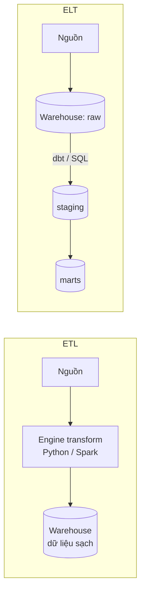
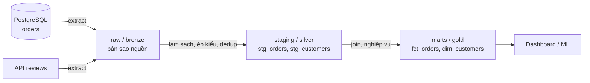
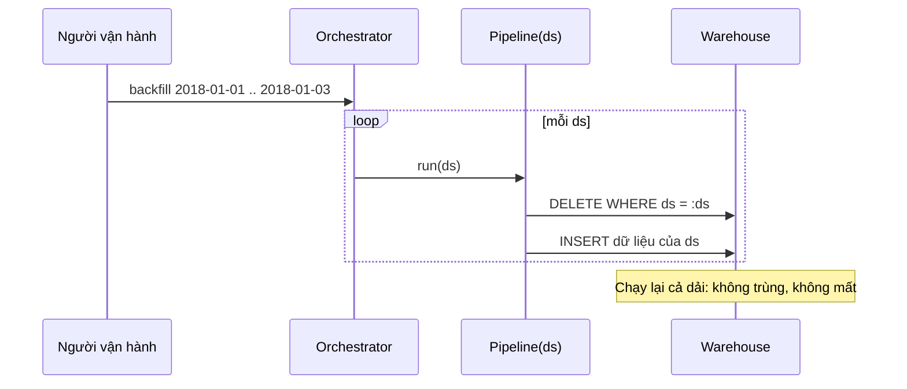
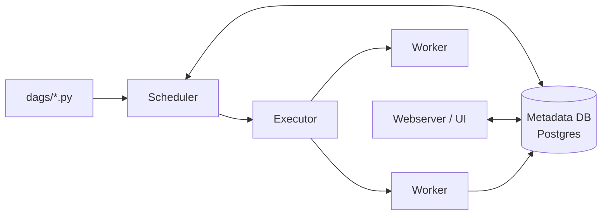
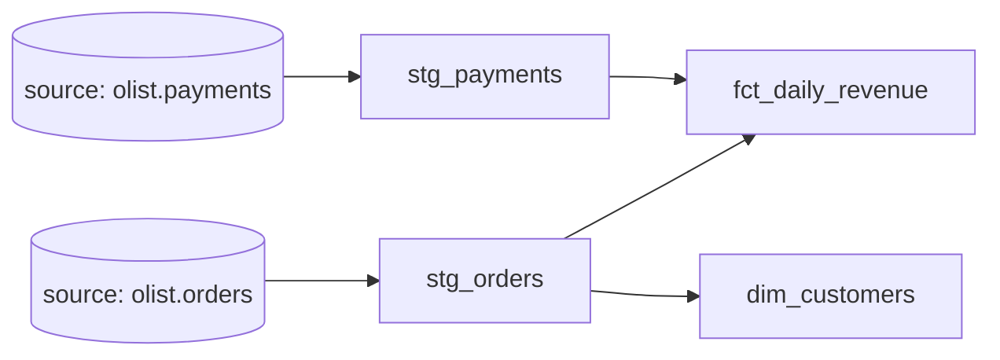

# Batch Pipelines: ETL/ELT với Airflow, dbt và Prefect

Phần lớn dữ liệu phân tích trong doanh nghiệp vẫn chạy theo **batch**: mỗi đêm (hoặc mỗi giờ) một
pipeline lấy dữ liệu mới từ hệ thống nguồn, làm sạch, ghép nối rồi nạp vào warehouse. Với Data
Analyst, pipeline thường là "ai đó đã làm sẵn". Với Data Engineer, bạn là người làm nó, và phải trả
lời những câu hỏi khó hơn: chạy lại có bị nhân đôi dữ liệu không? Hôm qua lỗi thì chạy bù thế nào?
Ai gọi bước nào, theo thứ tự nào, lỗi thì retry ra sao? Bảng nào phụ thuộc bảng nào?

Module này đi từ nguyên lý (ETL vs ELT, idempotency, incremental load, backfill) tới ba công cụ phổ
biến nhất: **Apache Airflow** (orchestration), **dbt** (transform trong warehouse) và **Prefect**
(orchestration kiểu Python thuần). Ví dụ dùng dữ liệu Olist để nối với milestone m05 của capstone.

## 1. ETL, ELT và vòng đời một batch pipeline

### Ba bước kinh điển

| Bước | Việc làm | Ví dụ với Olist |
| --- | --- | --- |
| **Extract** | Lấy dữ liệu từ nguồn: database OLTP, API, file CSV/JSON, SaaS | Đọc bảng `orders` trong PostgreSQL có `updated_at` của hôm qua |
| **Transform** | Làm sạch, chuẩn hoá kiểu, dedup, join, tính chỉ số | Ép `order_purchase_timestamp` về timestamp, bỏ đơn trùng, tính doanh thu |
| **Load** | Ghi vào đích: warehouse, lake, data mart | Ghi vào `fct_orders` trong DuckDB/BigQuery |

### ETL vs ELT

- **ETL** (Extract → Transform → Load): transform *trước khi* nạp, thường bằng một engine riêng
  (Python, Spark, Informatica). Đích chỉ nhận dữ liệu đã sạch.
- **ELT** (Extract → Load → Transform): nạp dữ liệu thô vào warehouse trước (`raw`/`bronze`), rồi
  transform *bên trong* warehouse bằng SQL. Đây là mô hình của "modern data stack": Fivetran/Airbyte
  làm EL, dbt làm T, Snowflake/BigQuery/DuckDB làm compute.



| Tiêu chí | ETL | ELT |
| --- | --- | --- |
| Nơi transform | Ngoài warehouse | Trong warehouse (SQL) |
| Dữ liệu thô | Thường không giữ | Giữ trong `raw`, chạy lại transform bất cứ lúc nào |
| Hợp với | Dữ liệu nhạy cảm cần lọc trước khi nạp (PII), warehouse đắt/yếu, transform phức tạp ngoài SQL | Warehouse cloud co giãn, đội phân tích giỏi SQL |
| Công cụ | Spark, Python, Informatica, SSIS | Airbyte/Fivetran + dbt |
| Điểm yếu | Thay đổi logic phải extract lại | Chi phí compute warehouse, dễ phình bảng raw |

Trong thực tế hầu hết đội làm **lai**: một chút transform nhẹ lúc extract (ép kiểu, mask PII), phần
nghiệp vụ để dbt làm trong warehouse.

### Batch, realtime và hybrid ingestion

| Kiểu | Độ trễ | Cách làm | Khi nào chọn |
| --- | --- | --- | --- |
| **Batch** | Phút tới ngày | Lịch cron/Airflow, đọc theo khoảng thời gian | Báo cáo ngày, BI, ML training |
| **Micro-batch** | Vài giây tới phút | Spark Structured Streaming, chạy batch nhỏ liên tục | Gần realtime nhưng muốn đơn giản |
| **Streaming / realtime** | Mili giây tới giây | Kafka, Flink, CDC (module 07) | Fraud detection, tồn kho, thông báo |
| **Hybrid (Lambda/Kappa)** | Kết hợp | Stream cho số "tạm", batch đêm sửa cho đúng | Cần cả nhanh lẫn chính xác |

Nguyên tắc: **chọn batch nếu người dùng không thật sự cần dữ liệu nhanh hơn**. Batch rẻ hơn, dễ
debug, dễ chạy lại. "Dashboard realtime" mà người ta xem mỗi sáng một lần thì nên là batch.

### Kiến trúc tầng (medallion)



Mỗi tầng có một "hợp đồng" rõ: raw giữ nguyên nguồn (để chạy lại), staging 1-1 với bảng nguồn nhưng
sạch, marts phục vụ câu hỏi nghiệp vụ.

## 2. Idempotency, partition và backfill

### Idempotent là gì

Một pipeline **idempotent** khi chạy nó *n* lần với cùng input cho cùng kết quả như chạy 1 lần. Đây
là tính chất quan trọng nhất của batch pipeline, vì trong đời thật pipeline *sẽ* bị chạy lại: retry
tự động, người vận hành bấm "clear task", backfill, sửa bug rồi chạy lại cả tháng.

Ví dụ **không** idempotent:

```python
# Chạy 2 lần là doanh thu ngày 2018-01-01 bị nhân đôi
con.execute("INSERT INTO fct_daily_revenue SELECT ... WHERE order_date = '2018-01-01'")
```

### Các kỹ thuật làm pipeline idempotent

| Kỹ thuật | Cách làm | Ghi chú |
| --- | --- | --- |
| **Delete-insert theo partition** | Trong 1 transaction: `DELETE WHERE ds = :ds` rồi `INSERT` dữ liệu của `ds` | Đơn giản, phổ biến nhất cho bảng fact theo ngày |
| **Overwrite partition** | `INSERT OVERWRITE ... PARTITION (ds=...)` (Hive/Spark/BigQuery) | Tương đương delete-insert ở mức file |
| **Upsert / MERGE** | `MERGE INTO t USING s ON key WHEN MATCHED UPDATE WHEN NOT MATCHED INSERT` | Cho bảng dimension, bản ghi có khoá |
| **Ghi vào bảng tạm rồi swap** | Build `t__tmp`, kiểm tra, `ALTER TABLE RENAME` | Người đọc không bao giờ thấy bảng dở dang |
| **Khoá tự nhiên + dedup** | `ROW_NUMBER() OVER (PARTITION BY key ORDER BY updated_at DESC) = 1` | Khi nguồn có thể gửi trùng |

Code mẫu delete-insert idempotent với DuckDB:

```python
import duckdb
import pandas as pd


def load_partition(con: duckdb.DuckDBPyConnection, df: pd.DataFrame, ds: str) -> int:
    """Nạp dữ liệu của một ngày. Chạy lại bao nhiêu lần kết quả vẫn như nhau."""
    con.execute("""
        CREATE TABLE IF NOT EXISTS fct_orders (
            order_id VARCHAR, customer_id VARCHAR, amount DOUBLE, ds DATE
        )
    """)
    con.execute("BEGIN")
    try:
        con.execute("DELETE FROM fct_orders WHERE ds = ?", [ds])
        con.register("incoming", df)
        con.execute("INSERT INTO fct_orders SELECT order_id, customer_id, amount, CAST(? AS DATE) FROM incoming", [ds])
        con.execute("COMMIT")
    except Exception:
        con.execute("ROLLBACK")
        raise
    return len(df)


con = duckdb.connect()
df = pd.DataFrame({"order_id": ["o1", "o2"], "customer_id": ["c1", "c2"], "amount": [10.0, 20.0]})
load_partition(con, df, "2018-01-01")
load_partition(con, df, "2018-01-01")  # chạy lại
print(con.execute("SELECT count(*) FROM fct_orders").fetchone())  # (2,)
```

### Logical date: đừng dùng `now()`

Pipeline chạy cho ngày nào phải là **tham số** (Airflow gọi là `logical_date` / `ds`), không phải
`datetime.now()`. Nếu code dùng `now()`, chạy lại job của tuần trước sẽ xử lý dữ liệu *hôm nay* →
sai. Quy tắc: mọi hàm extract/transform/load đều nhận `ds` và chỉ đụng vào dữ liệu của `ds`.

### Backfill

**Backfill** là chạy pipeline cho một dải ngày trong quá khứ: khi mới tạo pipeline, khi sửa logic,
khi nguồn gửi bù dữ liệu. Backfill chỉ an toàn khi pipeline idempotent và tham số hoá theo ngày.



Lưu ý khi backfill: giới hạn số run song song (`max_active_runs`) để không làm sập nguồn; các
partition không phụ thuộc nhau thì chạy song song được, còn bảng tích luỹ (running total, SCD) phải
chạy tuần tự (`depends_on_past=True`).

## 3. Incremental load: watermark, upsert và CDC

Full load (đọc lại toàn bộ bảng mỗi lần) đơn giản và luôn đúng, nhưng không scale: bảng 500 triệu
dòng không thể copy lại mỗi giờ. **Incremental load** chỉ lấy phần thay đổi.

### High-watermark

Lưu lại giá trị lớn nhất của một cột tăng dần (`updated_at`, `id`) đã nạp. Lần sau chỉ lấy dòng
có giá trị lớn hơn.

```sql
-- bảng trạng thái
CREATE TABLE IF NOT EXISTS etl_state (source VARCHAR PRIMARY KEY, watermark TIMESTAMP);

-- extract
SELECT * FROM orders WHERE updated_at > :watermark ORDER BY updated_at;

-- sau khi load thành công (cùng transaction với load nếu được)
UPDATE etl_state SET watermark = :max_updated_at WHERE source = 'orders';
```

Những cái bẫy:

- **Cập nhật watermark trước khi load xong** → lỗi giữa chừng là mất dữ liệu vĩnh viễn. Luôn cập
  nhật watermark *sau* (hoặc trong cùng transaction với) bước load.
- **Late-arriving data / clock skew**: transaction commit chậm có `updated_at` nhỏ hơn watermark
  → bị bỏ qua. Cách chữa: lấy lùi một khoảng (`updated_at > watermark - interval '10 minutes'`) và
  dùng upsert để lần lấy trùng không gây nhân đôi.
- **Dòng bị xoá** ở nguồn không bao giờ xuất hiện trong truy vấn `updated_at >` → cần soft delete
  (`deleted_at`) hoặc CDC.
- So sánh `>` hay `>=`: `>=` an toàn hơn (không mất dòng cùng timestamp) nhưng bắt buộc phải upsert.

### Upsert (MERGE)

DuckDB, PostgreSQL, SQLite đều có `INSERT ... ON CONFLICT`:

```sql
INSERT INTO dim_customers AS t (customer_id, city, state, updated_at)
SELECT customer_id, city, state, updated_at FROM staging_customers
ON CONFLICT (customer_id) DO UPDATE SET
    city = excluded.city, state = excluded.state, updated_at = excluded.updated_at
WHERE excluded.updated_at > t.updated_at;   -- không ghi đè bằng bản cũ hơn
```

### CDC (Change Data Capture)

CDC đọc **transaction log** của database (WAL của PostgreSQL, binlog của MySQL) để lấy mọi
`INSERT/UPDATE/DELETE` theo đúng thứ tự, kể cả delete, không cần cột `updated_at`, không tải nặng
lên bảng nguồn. Công cụ: Debezium (đẩy vào Kafka), Fivetran, AWS DMS. CDC sẽ học kỹ ở module 07.

| Cách | Bắt được delete | Tải lên nguồn | Độ phức tạp | Độ trễ |
| --- | --- | --- | --- | --- |
| Full load | Có (so sánh snapshot) | Cao | Thấp | Theo lịch |
| Watermark `updated_at` | Không (trừ soft delete) | Thấp nếu có index | Thấp | Theo lịch |
| Snapshot diff | Có | Cao | Trung bình | Theo lịch |
| Log-based CDC | Có | Rất thấp | Cao (Kafka, Debezium) | Giây |

## 4. Orchestration với Apache Airflow

Khi có hàng chục pipeline phụ thuộc nhau, cron không còn đủ: cần biết bước nào chạy sau bước nào,
retry, cảnh báo, backfill, xem log. Đó là việc của **orchestrator**. Airflow là orchestrator phổ
biến nhất (mã nguồn mở, Airbnb tạo năm 2014, Apache top-level project).

### Khái niệm

| Khái niệm | Ý nghĩa |
| --- | --- |
| **DAG** | Directed Acyclic Graph: tập task và quan hệ phụ thuộc, định nghĩa bằng Python |
| **Task** | Một nút trong DAG, một đơn vị công việc |
| **Operator** | Khuôn mẫu cho task: `BashOperator`, `PythonOperator`, `SQLExecuteQueryOperator`, `@task` (TaskFlow) |
| **Sensor** | Operator đặc biệt chờ điều kiện (file xuất hiện, partition có, DAG khác xong): `FileSensor`, `ExternalTaskSensor` |
| **DAG run** | Một lần chạy DAG cho một `logical_date` |
| **Task instance** | Một task trong một DAG run, có trạng thái (queued, running, success, failed, up_for_retry…) |
| **XCom** | Kênh nhỏ để task truyền metadata cho nhau (đường dẫn file, số dòng), **không** dùng để truyền dữ liệu lớn |
| **Scheduler / Executor / Worker** | Scheduler quyết định task nào sẵn sàng; executor (Local, Celery, Kubernetes) giao cho worker chạy |



### Một DAG Olist hằng ngày (TaskFlow API, Airflow 2.x)

```python
from datetime import datetime, timedelta

from airflow import DAG
from airflow.decorators import task
from airflow.operators.bash import BashOperator
from airflow.sensors.filesystem import FileSensor

default_args = {
    "owner": "data-eng",
    "retries": 3,
    "retry_delay": timedelta(minutes=5),
    "retry_exponential_backoff": True,
}

with DAG(
    dag_id="olist_daily",
    start_date=datetime(2018, 1, 1),
    schedule="@daily",
    catchup=False,
    max_active_runs=1,
    default_args=default_args,
    tags=["olist"],
) as dag:
    wait_file = FileSensor(
        task_id="wait_orders_file",
        filepath="/data/landing/orders_{{ ds_nodash }}.csv",
        poke_interval=60,
        timeout=60 * 60,
        mode="reschedule",            # nhả worker slot khi chờ
    )

    @task
    def extract(ds=None) -> str:
        path = f"/data/raw/orders/{ds}.parquet"
        # ... đọc CSV, ghi parquet ...
        return path                    # trả về -> tự đẩy vào XCom

    @task
    def load(path: str, ds=None) -> int:
        # ... delete-insert partition ds vào warehouse ...
        return 123

    dbt_build = BashOperator(
        task_id="dbt_build",
        bash_command="cd /opt/dbt && dbt build --select tag:daily --vars '{ds: {{ ds }}}'",
    )

    wait_file >> load(extract()) >> dbt_build
```

### Scheduling, catchup và các tham số hay hỏi

- `start_date` + `schedule` xác định các **data interval**. Run cho interval
  `[2018-01-01, 2018-01-02)` được kích hoạt *sau khi* interval kết thúc, tức lúc 2018-01-02 00:00,
  và có `logical_date = ds = 2018-01-01`. Đây là chỗ người mới hay nhầm nhất.
- `catchup=True` (mặc định cũ): khi bật DAG, scheduler tạo run cho mọi interval từ `start_date`
  tới nay. Đặt `catchup=False` cho DAG mới rồi backfill có chủ đích bằng
  `airflow dags backfill -s 2018-01-01 -e 2018-01-31 olist_daily`.
- `depends_on_past=True`: task chỉ chạy khi chính task đó ở run trước thành công.
- `retries`, `retry_delay`, `retry_exponential_backoff`, `execution_timeout`, `sla`.
- **Jinja template**: `{{ ds }}`, `{{ ds_nodash }}`, `{{ data_interval_start }}`, `{{ params.x }}`
  chỉ được render trong các field có trong `template_fields` của operator.
- **Trigger rule**: mặc định `all_success`; `all_done` cho task dọn dẹp, `one_failed` cho cảnh báo.

### Best practice khi viết DAG

1. **Top-level code nhẹ**: scheduler parse file DAG liên tục (mặc định mỗi 30 giây). Không gọi
   database, API, đọc file lớn ở top-level.
2. **Task idempotent và atomic**: mỗi task làm trọn một việc, chạy lại an toàn.
3. **Airflow là orchestrator, không phải engine xử lý**: việc nặng đẩy sang warehouse, Spark, dbt;
   worker Airflow chỉ ra lệnh.
4. **XCom chỉ chứa metadata nhỏ** (đường dẫn, số dòng). Dữ liệu đi qua storage (S3/MinIO, bảng).
5. Không dùng `datetime.now()` trong task: dùng `ds`/`data_interval_start`.
6. `start_date` cố định, không dùng `datetime.now()` hay `days_ago()` động.

## 5. Transform trong warehouse với dbt

**dbt** (data build tool) biến SQL `SELECT` thành bảng/view, tự suy ra thứ tự build từ các lệnh
`ref()`, kèm test, tài liệu và lineage. dbt không extract hay load; nó là chữ **T** trong ELT.

### Cấu trúc project

```
olist_dbt/
├── dbt_project.yml          # tên project, profile, cấu hình materialization theo thư mục
├── profiles.yml             # kết nối (thường ở ~/.dbt/, ở đây dùng dbt-duckdb)
├── seeds/                   # CSV nhỏ nạp bằng `dbt seed` (bảng tra cứu)
├── models/
│   ├── staging/
│   │   ├── _sources.yml     # khai báo source (bảng raw)
│   │   ├── stg_orders.sql
│   │   └── _stg.yml         # test + mô tả
│   └── marts/
│       └── fct_daily_revenue.sql
├── snapshots/               # SCD Type 2
├── macros/                  # Jinja macro tái dùng
└── tests/                   # singular test (SQL trả về dòng lỗi)
```

### Model, ref, source

```sql
-- models/staging/stg_orders.sql
with src as (
    select * from {{ source('olist', 'orders') }}
)
select
    order_id,
    customer_id,
    lower(order_status)                         as order_status,
    cast(order_purchase_timestamp as timestamp) as purchased_at,
    cast(order_purchase_timestamp as date)      as order_date
from src
where order_id is not null
```

```sql
-- models/marts/fct_daily_revenue.sql
select
    o.order_date,
    count(distinct o.order_id) as orders,
    sum(p.payment_value)       as revenue
from {{ ref('stg_orders') }} o
join {{ ref('stg_payments') }} p using (order_id)
where o.order_status = 'delivered'
group by 1
```

`ref('stg_orders')` vừa trả về tên bảng thật (`main.stg_orders`) vừa khai báo phụ thuộc. Từ các
`ref`/`source`, dbt dựng DAG và build theo đúng thứ tự. Không bao giờ hard-code tên bảng.



### Materialization

| Materialization | dbt tạo ra | Khi nào dùng |
| --- | --- | --- |
| `view` (mặc định) | `CREATE VIEW` | Staging nhẹ, luôn mới, không tốn lưu trữ |
| `table` | `CREATE TABLE AS` (build lại toàn bộ) | Marts được query nhiều, dữ liệu vừa |
| `incremental` | Lần đầu tạo bảng; lần sau chỉ chèn/merge dòng mới | Bảng fact lớn, event log |
| `ephemeral` | Không tạo gì, inline thành CTE | Bước trung gian dùng 1 lần |
| `snapshot` | Bảng SCD Type 2 (`dbt_valid_from`, `dbt_valid_to`) | Theo dõi lịch sử thay đổi của dimension |

### Incremental model

```sql
{{ config(materialized='incremental', unique_key='order_id', incremental_strategy='delete+insert') }}

select order_id, customer_id, order_status, updated_at
from {{ source('olist', 'orders') }}

  -- {{ this }} là bảng đích hiện có
  where updated_at > (select coalesce(max(updated_at), '1900-01-01') from {{ this }})

```

- `is_incremental()` đúng khi bảng đích đã tồn tại và không chạy `--full-refresh`.
- `unique_key` biến insert thành upsert (merge/delete+insert) → idempotent.
- Đổi logic → chạy `dbt build --full-refresh -s model` để dựng lại.

### Test và snapshot

```yaml
# models/staging/_stg.yml
version: 2
models:
  - name: stg_orders
    columns:
      - name: order_id
        data_tests: [unique, not_null]
      - name: order_status
        data_tests:
          - accepted_values:
              arguments:
                values: ['delivered', 'shipped', 'canceled', 'invoiced', 'processing']
      - name: customer_id
        data_tests:
          - relationships:
              arguments:
                to: ref('stg_customers')
                field: customer_id
```

(Ở dbt < 1.10 các tham số viết thẳng dưới tên test, không cần khoá `arguments`.)

```sql
-- snapshots/customers_snapshot.sql

{{ config(target_schema='snapshots', unique_key='customer_id',
          strategy='check', check_cols=['customer_city', 'customer_state']) }}
select * from {{ source('olist', 'customers') }}

```

Lệnh hay dùng: `dbt seed`, `dbt run`, `dbt test`, `dbt snapshot`, và **`dbt build`** (chạy tất cả
theo thứ tự DAG, test lỗi thì dừng các model phía sau). `dbt build -s +fct_daily_revenue` chọn model
và mọi thứ phía trước nó; `dbt docs generate` sinh tài liệu và lineage.

Gọi dbt từ Python (dùng trong bài tập và trong Airflow/Prefect):

```python
from dbt.cli.main import dbtRunner

res = dbtRunner().invoke(["build", "--project-dir", "olist_dbt", "--profiles-dir", "olist_dbt"])
print(res.success)
for r in res.result:
    print(r.node.name, r.status)
```

## 6. Prefect, Luigi và chọn orchestrator

### Prefect

Prefect cho bạn viết pipeline bằng **Python thuần**: hàm gắn `@flow` và `@task`, chạy được ngay như
script, rồi mới deploy lên lịch. Không có khái niệm DAG khai báo trước: luồng điều khiển là code
Python bình thường (if, for, try).

```python
from prefect import flow, task, get_run_logger


@task(retries=3, retry_delay_seconds=10)
def extract(ds: str) -> list[dict]:
    # gọi API có thể lỗi tạm thời -> Prefect tự retry
    return [{"order_id": "o1", "amount": 10.0, "ds": ds}]


@task
def load(rows: list[dict], ds: str) -> int:
    # delete-insert partition ds
    return len(rows)


@flow(name="olist-daily")
def olist_daily(ds: str) -> int:
    logger = get_run_logger()
    n = load(extract(ds), ds)
    logger.info("Đã nạp %s dòng cho %s", n, ds)
    return n


if __name__ == "__main__":
    olist_daily("2018-01-01")
    # lên lịch: olist_daily.serve(name="daily", cron="0 2 * * *")
```

### Luigi

Luigi (Spotify) mô hình hoá pipeline bằng class `Task` với `requires()`, `output()`, `run()`. Task
coi là "xong" khi `output()` (thường là file) đã tồn tại, nên idempotent theo kiểu target-based.
Không có scheduler theo lịch tích hợp (dùng cron gọi), UI đơn giản. Ngày nay ít dự án mới chọn Luigi
nhưng vẫn gặp trong hệ thống cũ.

### So sánh

| Tiêu chí | Airflow | Prefect | Dagster | Luigi |
| --- | --- | --- | --- | --- |
| Mô hình | DAG khai báo tĩnh, task-centric | Flow Python động | Asset-centric (bảng là trung tâm) | Target-based (file output) |
| Lập lịch | Mạnh, data interval, catchup | Deployment + cron/interval | Schedule + sensor | Không có, dùng cron |
| Chạy local | Cần scheduler + DB (Docker) | `python flow.py` là chạy | `dagster dev` | `python -m luigi` |
| Hệ sinh thái | Lớn nhất, hàng trăm provider | Vừa | Đang lớn, tích hợp dbt tốt | Nhỏ |
| Managed | MWAA, Cloud Composer, Astronomer | Prefect Cloud | Dagster+ | Không |
| Điểm yếu | Nặng, truyền dữ liệu giữa task kém | Ít phổ biến trong JD hơn | Khái niệm mới phải học | Ít phát triển |

Chọn Airflow khi cần chuẩn ngành, nhiều tích hợp và đội vận hành; Prefect khi đội Python nhỏ, muốn
nhanh; Dagster khi muốn quản lý theo data asset và lineage. Kỹ năng cốt lõi (idempotent, tham số
hoá theo ngày, retry, tách orchestration khỏi compute) dùng được cho mọi công cụ.

## 7. Độ tin cậy: retry, data contract và data quality

### Retry đúng cách

- Retry chỉ có ích với lỗi **tạm thời** (timeout, 503, deadlock). Lỗi logic (cột không tồn tại) retry
  bao nhiêu cũng vậy: fail nhanh và cảnh báo.
- Dùng **exponential backoff + jitter** để không dội cùng lúc vào nguồn đang yếu.
- Retry chỉ an toàn khi task idempotent. Task gửi email, gọi API thanh toán… cần idempotency key.

```python
import random
import time


def with_retry(fn, retries=3, base=1.0, retry_on=(TimeoutError, ConnectionError)):
    for attempt in range(retries + 1):
        try:
            return fn()
        except retry_on:
            if attempt == retries:
                raise
            time.sleep(base * 2**attempt + random.uniform(0, base))
```

### Data contract

**Data contract** là thoả thuận giữa bên sản xuất dữ liệu (team backend sở hữu bảng `orders`) và bên
tiêu thụ (team data): schema, kiểu, ràng buộc, ý nghĩa cột, SLA về độ tươi, cách báo khi thay đổi.
Contract được viết thành tệp (YAML/JSON Schema), kiểm tra tự động ở biên pipeline:

```yaml
# contracts/orders.yml
dataset: olist.orders
owner: team-checkout
freshness: { max_delay_hours: 6 }
columns:
  order_id:     { type: string, required: true, unique: true }
  customer_id:  { type: string, required: true }
  order_status: { type: string, enum: [created, approved, shipped, delivered, canceled] }
  order_purchase_timestamp: { type: timestamp, required: true }
```

Dòng vi phạm contract không nên làm sập cả pipeline, cũng không nên lặng lẽ đi vào marts: đưa vào
bảng **quarantine** (dead-letter) kèm lý do, và dừng pipeline nếu tỉ lệ lỗi vượt ngưỡng.

### Kiểm tra chất lượng ở đâu

| Vị trí | Kiểm tra gì | Công cụ |
| --- | --- | --- |
| Sau extract | Schema, số dòng > 0, freshness | JSON Schema, pandera, Great Expectations |
| Sau transform | unique, not_null, quan hệ, accepted values | dbt test |
| Trước publish | So sánh số liệu với hôm trước (anomaly), reconciliation với nguồn | dbt test tuỳ biến, Soda, Elementary |

Chiến lược **write-audit-publish**: ghi vào bảng tạm → chạy kiểm tra → chỉ khi đạt mới swap/publish
sang bảng người dùng đọc.

## 8. Tài liệu tham khảo

- roadmap.sh, Data Engineer: <https://roadmap.sh/data-engineer>
- Apache Airflow docs, Core Concepts: <https://airflow.apache.org/docs/apache-airflow/stable/core-concepts/index.html>
- Airflow Best Practices: <https://airflow.apache.org/docs/apache-airflow/stable/best-practices.html>
- Airflow, DAG Runs / catchup / backfill: <https://airflow.apache.org/docs/apache-airflow/stable/core-concepts/dag-run.html>
- dbt docs, About dbt models: <https://docs.getdbt.com/docs/build/models>
- dbt, Incremental models: <https://docs.getdbt.com/docs/build/incremental-models>
- dbt, Snapshots: <https://docs.getdbt.com/docs/build/snapshots>
- dbt, Programmatic invocations: <https://docs.getdbt.com/reference/programmatic-invocations>
- dbt-duckdb adapter: <https://github.com/duckdb/dbt-duckdb>
- Prefect docs: <https://docs.prefect.io/v3/get-started>
- Luigi docs: <https://luigi.readthedocs.io/>
- Maxime Beauchemin, *Functional Data Engineering — a modern paradigm for batch data processing*: <https://maximebeauchemin.medium.com/functional-data-engineering-a-modern-paradigm-for-batch-data-processing-2327ec32c42a>
- Joe Reis & Matt Housley, *Fundamentals of Data Engineering* (O'Reilly, 2022), chương 7–8.
- Debezium, CDC: <https://debezium.io/documentation/reference/stable/>
- Data Contract Specification: <https://datacontract.com/>
