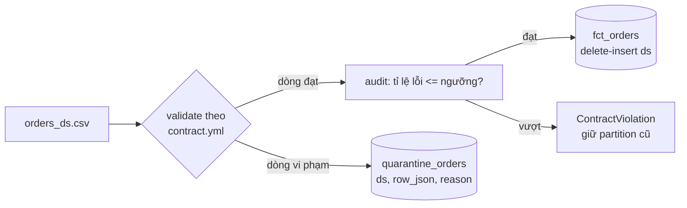

# Hướng làm: Pipeline có data contract, quarantine và backfill

## Kiến trúc



## Phác thảo code

```python
def _check(value, rule):
    value = (value or "").strip()
    if value == "":
        return None, "required" if rule.get("required") else None
    t = rule.get("type", "string")
    try:
        if t == "number":
            value = float(value)
        elif t == "timestamp":
            value = datetime.fromisoformat(value)
    except ValueError:
        return None, f"không phải {t}"
    if "enum" in rule and value not in rule["enum"]:
        return None, f"ngoài enum {rule['enum']}"
    if "min" in rule and value < rule["min"]:
        return None, f"nhỏ hơn {rule['min']}"
    return value, None


def validate(rows, contract):
    good, bad, seen = [], [], {}
    for row in rows:
        out, reason = {}, None
        for col, rule in contract["columns"].items():
            value, err = _check(row.get(col), rule)
            if err is None and rule.get("unique") and value in seen.get(col, set()):
                err = "trùng giá trị unique"
            if err:
                reason = f"{col}: {err}"
                break
            out[col] = value
        if reason:
            bad.append({**row, "_reason": reason})
        else:
            for col, rule in contract["columns"].items():
                if rule.get("unique"):
                    seen.setdefault(col, set()).add(out[col])
            good.append(out)
    return good, bad
```

`run_partition`: đọc file (thiếu file → `FileNotFoundError`), validate, tính `rate = len(bad)/len(rows)`.
Trong một transaction DuckDB: `DELETE` quarantine của `ds`, chèn dòng vi phạm; nếu `rate > ngưỡng`
thì `COMMIT` (giữ quarantine để điều tra) rồi raise `ContractViolation`; nếu không thì
`DELETE fct_orders WHERE ds` + `INSERT` dòng đạt + `COMMIT`. Lỗi khác thì `ROLLBACK`.
`backfill` lặp ngày, bắt `FileNotFoundError` và `ContractViolation` để ghi `{"ds", "error"}`.

## Quyết định thiết kế cần cân nhắc

| Câu hỏi | Lựa chọn | Đánh đổi |
| --- | --- | --- |
| Dòng xấu: bỏ, cách ly hay làm fail cả lô? | Cách ly + ngưỡng | Fail cả lô an toàn nhưng một dòng xấu chặn cả báo cáo; bỏ lặng lẽ thì mất dữ liệu không ai biết |
| Ngưỡng tuyệt đối hay tương đối? | Tương đối (%) | Ngày ít đơn thì 1 dòng lỗi đã là 20%; thực tế nên kết hợp `min_rows` |
| Vượt ngưỡng có ghi quarantine không? | Có | Người vận hành cần thấy dòng lỗi để báo team nguồn |
| Backfill gặp lỗi: dừng hay chạy tiếp? | Chạy tiếp, báo cáo cuối | Các ngày độc lập; nhưng bảng tích luỹ (SCD, running total) phải dừng |
| Contract tự viết hay chuẩn? | Tự viết cho bài | Production: JSON Schema, pandera, Great Expectations, datacontract-cli; contract nên nằm cạnh code của team nguồn và được kiểm tra trong CI của họ |
| Kiểm tra schema (thiếu/thừa cột) | Nên thêm | File thiếu cột nên fail ngay trước khi kiểm từng dòng |

Mở rộng đáng làm: kiểm tra freshness (file phải tới trước giờ X), số dòng lệch bất thường so với
trung bình 7 ngày, gửi cảnh báo kèm link quarantine, versioning contract (`version: 2`) và quy
trình thay đổi có báo trước (breaking vs non-breaking change).

## Rubric (10 điểm)

| Tiêu chí | Điểm |
| --- | --- |
| Test trong `tests/` pass hết | 3 |
| `validate` điều khiển hoàn toàn bằng contract (thêm luật vào YAML không phải sửa code) | 2 |
| Idempotent ở cả `fct_orders` lẫn `quarantine_orders`; dùng transaction đúng chỗ | 2 |
| Thông báo lỗi/`_reason` đủ để người vận hành hiểu ngay (cột, giá trị, luật) | 1 |
| Kiểm tra mức file (thiếu cột, file rỗng) và có `min_rows`/freshness hoặc giải thích vì sao không | 1 |
| Code rõ ràng, hàm nhỏ, có log/metric số dòng đạt/lỗi mỗi ngày | 1 |
