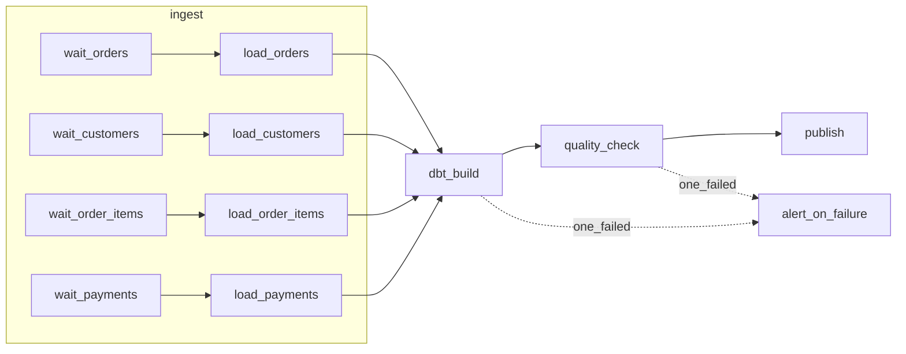

# Hướng làm: DAG ELT Olist với Airflow + dbt

## Đồ thị mong muốn



## Phác thảo

```python
default_args = {
    "owner": "data-eng",
    "retries": 2,
    "retry_delay": timedelta(minutes=5),
    "retry_exponential_backoff": True,
    "execution_timeout": timedelta(hours=1),
    "on_failure_callback": notify_failure,
}

with DAG(dag_id="olist_elt", schedule="0 3 * * *", start_date=datetime(2018, 1, 1),
         catchup=True, max_active_runs=2, default_args=default_args, tags=["olist", "elt"]) as dag:
    with TaskGroup("ingest") as ingest:
        for t in TABLES:
            wait = FileSensor(task_id=f"wait_{t}", filepath=LANDING + "/{{ ds }}/" + f"{t}.csv",
                              mode="reschedule", poke_interval=300, timeout=6 * 3600)
            load = PythonOperator(task_id=f"load_{t}", python_callable=load_table, op_kwargs={"table": t})
            wait >> load

    dbt_build = BashOperator(
        task_id="dbt_build",
        bash_command="cd /opt/airflow/project/dbt && dbt build --vars '{ds: \"{{ ds }}\"}'",
    )
    check = PythonOperator(task_id="quality_check", python_callable=quality_check)
    publish = EmptyOperator(task_id="publish")
    alert = EmptyOperator(task_id="alert_on_failure", trigger_rule=TriggerRule.ONE_FAILED)

    ingest >> dbt_build >> check >> publish
    [dbt_build, check] >> alert
```

`load_table(table, ds)`: import `duckdb` trong hàm, delete-insert `raw.<table>` theo cột `_ds`
trong một transaction (idempotent khi retry/backfill). `quality_check(ds)`: đếm dòng của `ds`
trong mart, kiểm tra không trùng khoá, so với số dòng raw; raise để chặn `publish`.
`notify_failure(context)`: log `task_instance.task_id`, `ds`, `exception`; production gửi
Slack/email qua provider tương ứng, luôn bọc `try/except` để callback không tự lỗi.

## Quyết định thiết kế cần cân nhắc

- **`catchup=True` + `max_active_runs` nhỏ**: tự backfill lịch sử nhưng không làm sập nguồn/warehouse.
  Nếu dbt có model incremental hoặc snapshot thì thứ tự ngày quan trọng → `max_active_runs=1` và
  `depends_on_past=True` cho `dbt_build`.
- **Sensor `mode="reschedule"`** (hoặc deferrable operator) để 4 sensor chờ nhiều giờ không chiếm
  worker slot. Đặt `timeout` để không treo vô hạn, và `soft_fail` nếu bảng là tuỳ chọn.
- **dbt chạy bằng `BashOperator`** đơn giản nhưng cả project là một task: lỗi một model phải chạy
  lại tất cả. Lựa chọn khác: astronomer-cosmos sinh một task Airflow cho mỗi model dbt (retry từng
  model, thấy lineage trong UI), hoặc `dbt build --select state:modified+`/`result:error+` khi chạy lại.
- **Truyền `ds` vào dbt** qua `--vars` để model lọc theo partition, giữ tính idempotent theo ngày.
- **Write-audit-publish**: dbt build vào schema staging, `quality_check` kiểm, `publish` mới swap
  hoặc `dbt run-operation` đổi view sang bản mới. Ở đây `publish` là `EmptyOperator` làm mốc.
- **Cảnh báo**: `on_failure_callback` (mỗi task) và task `alert_on_failure` (một cảnh báo tổng hợp)
  bổ trợ nhau; tránh spam khi task retry (callback chỉ gọi khi hết retry, `on_retry_callback` riêng).
- **Dynamic task mapping** (`load_table.expand(table=TABLES)`) là lựa chọn hiện đại hơn vòng `for`
  khi danh sách bảng chỉ biết lúc chạy; với danh sách cố định, vòng `for` cho task id dễ đọc hơn.
- **Không I/O ở top-level**: scheduler parse tệp DAG mỗi 30 giây; I/O ở đây làm chậm toàn hệ thống.

## Rubric (10 điểm)

| Tiêu chí | Điểm |
| --- | --- |
| Test cấu trúc pass hết | 3 |
| `load_table` idempotent theo `ds` (delete-insert/overwrite partition), import nặng trong hàm | 2 |
| `quality_check` có ít nhất 2 kiểm tra có ý nghĩa và chặn được `publish` | 1 |
| Lý giải lựa chọn `catchup`, `max_active_runs`, `depends_on_past` cho trường hợp có model incremental | 1 |
| Callback cảnh báo an toàn (không raise), thông tin đủ để xử lý (DAG, task, ds, log URL) | 1 |
| DAG chạy được trên Airflow thật (`airflow dags test olist_elt 2018-01-01` hoặc ảnh chụp UI) | 1 |
| Code sạch: hằng số cấu hình tập trung, không lặp code giữa các bảng | 1 |
