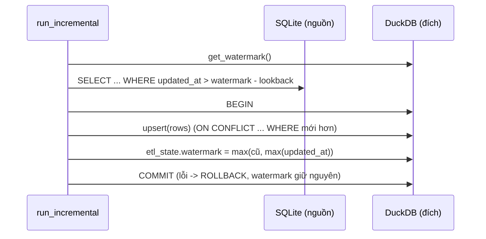

# Lời giải: Incremental load bằng high-watermark

## Luồng một lượt chạy

## Các quyết định

- **Watermark và dữ liệu commit cùng một transaction.** Nếu ghi watermark trước rồi load lỗi, các
  dòng đó bị bỏ qua mãi mãi (mất dữ liệu). Nếu load trước rồi ghi watermark trong transaction khác,
  lỗi giữa hai bước chỉ khiến lần sau lấy lại một ít, nhưng nhờ upsert vẫn đúng. Cùng transaction
  là chặt nhất. Khi đích và nơi lưu state khác hệ thống (vd. S3 + Postgres), chọn thứ tự "load
  trước, state sau" và dựa vào idempotency.
- **Lookback** chấp nhận đọc lại một ít để bắt dòng đến muộn (transaction dài ở nguồn commit sau
  khi ta đã đọc, hoặc lệch đồng hồ giữa các máy). Cái giá: lượt nào cũng đọc lại phần lookback, nên
  bắt buộc phải upsert.
- **`WHERE excluded.updated_at > t.updated_at`**: lookback có thể đưa về một bản cũ hơn bản đang có
  (thứ tự không đảm bảo); điều kiện này ngăn ghi đè ngược.
- **Watermark không lùi**: `max(old, batch_max)`. Lô chỉ toàn dòng trong lookback sẽ có
  `batch_max <= old`.
- Lấy `max(updated_at)` của **dữ liệu đã đọc**, không phải `now()`: đồng hồ máy chạy pipeline không
  liên quan tới đồng hồ của database nguồn.

## Hạn chế của watermark

- Không thấy `DELETE` ở nguồn → cần soft delete hoặc CDC (Debezium đọc WAL).
- Nguồn phải có `updated_at` được cập nhật đúng ở **mọi** đường ghi (kể cả script sửa tay). Nếu
  không chắc, chạy định kỳ một lần full reconcile (so số dòng/checksum theo ngày).
- Cột `updated_at` ở nguồn cần index, không thì mỗi lượt là full scan trên database production.
