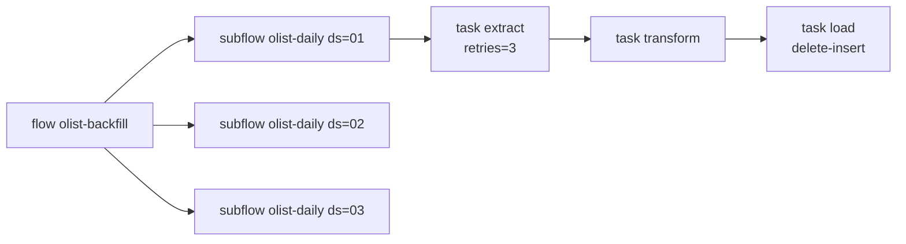

# Lời giải: Flow Prefect

## Cấu trúc

## Giải thích

- **Retry đặt ở task gọi nguồn** (`extract`), không đặt ở `load`: lỗi mạng/API là lỗi tạm thời đáng
  retry; lỗi ở `load` thường là lỗi logic hoặc schema. Thực tế dùng `retry_delay_seconds=[10, 60, 300]`
  (backoff) và `retry_jitter_factor`; bài này để 0 cho test nhanh.
- **Retry chỉ an toàn vì mọi task idempotent**: `extract` chỉ đọc, `load` là delete-insert theo
  `ds` trong transaction.
- **`fetch_rows` gọi qua tên toàn cục** để test thay được bằng bản lỗi (`monkeypatch`). Đây cũng là
  cách tách I/O khỏi logic: logic (`transform`) là hàm thuần, test được bằng `transform.fn(...)`.
- **Backfill bằng subflow**: mỗi ngày là một flow run riêng, xem log và chạy lại từng ngày được.
  Chạy tuần tự để không dồn tải; nếu các ngày độc lập có thể submit song song bằng task runner
  (`ThreadPoolTaskRunner`) hoặc tạo nhiều deployment run.
- **`cache_policy=NO_CACHE`**: Prefect 3 mặc định tính cache key từ input + source của task. Với
  input là đường dẫn file, cache có thể trả kết quả cũ khi nội dung file đổi. Chỉ bật cache khi hiểu
  rõ khoá cache.

## So với Airflow

| | Airflow | Prefect |
| --- | --- | --- |
| Định nghĩa | DAG tĩnh, parse định kỳ | Hàm Python, đồ thị sinh lúc chạy |
| Truyền dữ liệu giữa task | XCom (nhỏ) | Giá trị trả về Python (in-process) |
| Tham số ngày | `ds` từ data interval | Tham số flow tự truyền |
| Lên lịch | Scheduler đọc `schedule` | `flow.serve(cron=...)` / deployment |
