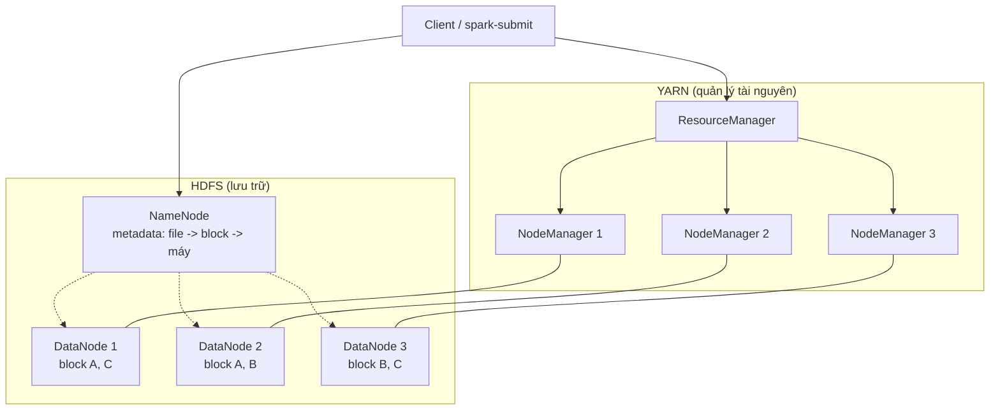
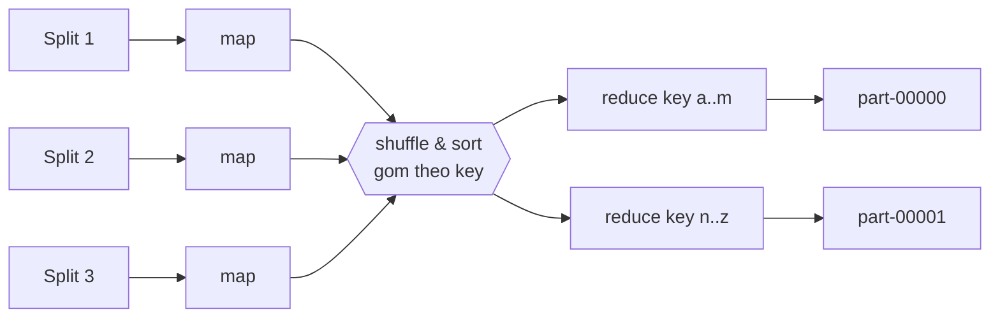
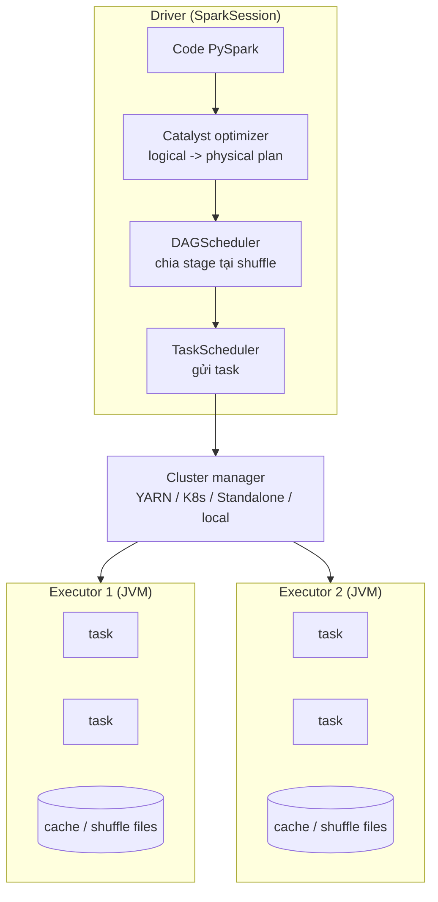

# Spark & Big Data

Khi dữ liệu Olist chỉ vài trăm MB, pandas hay DuckDB trên laptop là đủ. Nhưng khi bảng `order_items`
lên vài tỷ dòng, log click hàng TB mỗi ngày, một máy không còn chứa nổi, cũng không tính kịp. Module
này đi từ ý tưởng **cluster computing** (Hadoop: HDFS, MapReduce, YARN) tới **Apache Spark**: kiến trúc
driver/executor, lazy evaluation, DAG, partition, shuffle, chiến lược join, skew, caching, AQE, Spark
SQL, Parquet và cách tối ưu một job. Mục tiêu: đọc được physical plan, biết vì sao job chậm và sửa được.

Mọi ví dụ chạy được ở **local mode** (`local[2]`) với `pyspark` 3.5 trong venv của repo.

## 1. Vì sao cần cluster computing

### Scale up và scale out

| Cách | Ý tưởng | Ưu | Nhược |
| --- | --- | --- | --- |
| Scale up (vertical) | Mua máy to hơn: nhiều RAM, CPU | Đơn giản, không đổi code (pandas, DuckDB) | Có trần vật lý, giá tăng phi tuyến, một điểm hỏng |
| Scale out (horizontal) | Thêm nhiều máy thường, chia việc | Gần như không giới hạn, chịu lỗi | Phải xử lý phân tán: mạng, đồng bộ, lỗi từng phần |

Nguyên tắc thực tế năm 2026: **dữ liệu dưới vài trăm GB thì thử DuckDB/Polars trên một máy trước**.
Spark đáng dùng khi dữ liệu vượt RAM/đĩa một máy, khi cần chạy song song hàng trăm core, hoặc khi
hệ sinh thái (Databricks, EMR, Dataproc, lakehouse Delta/Iceberg) đã chọn Spark.

### Ba ý tưởng nền tảng

1. **Data locality**: chuyển code tới chỗ dữ liệu nằm, thay vì kéo dữ liệu qua mạng về một chỗ.
   Mạng chậm hơn đọc đĩa cục bộ nhiều lần.
2. **Chia để trị (partitioning)**: tách dữ liệu thành nhiều mảnh độc lập, mỗi mảnh xử lý song song.
3. **Chịu lỗi bằng tính lại (lineage) hoặc sao chép (replication)**: với 1000 máy, ngày nào cũng có
   máy hỏng. Hệ thống phải tự chạy lại phần việc bị mất, không bắt người dùng chạy lại cả job.

### Distributed systems: những điều phải chấp nhận

- **Partial failure**: một executor chết giữa chừng, các executor khác vẫn chạy.
- **Straggler**: một task chậm bất thường làm cả stage chờ. Spark có `spark.speculation` để chạy bản
  sao task chậm trên máy khác.
- **Network là nút cổ chai**: shuffle (trao đổi dữ liệu giữa các máy) thường là phần đắt nhất của job.

## 2. Hadoop ecosystem: HDFS, MapReduce, YARN

Hadoop (2006) là bộ ba đặt nền móng cho big data. Spark ngày nay thường vẫn chạy trên YARN và đọc
HDFS, hoặc chạy trên Kubernetes và đọc object storage (S3, GCS, MinIO).



### HDFS (Hadoop Distributed File System)

- File được cắt thành **block** lớn (mặc định 128 MB), mỗi block **replicate 3 bản** trên các DataNode
  khác nhau (khác rack nếu được).
- **NameNode** giữ metadata (cây thư mục, file nào gồm block nào, block nằm máy nào). NameNode là điểm
  yếu: phải có HA (standby NameNode) và không hợp với hàng triệu file nhỏ (**small files problem**:
  mỗi file tốn metadata trong RAM NameNode, và mỗi file nhỏ là một task riêng).
- Ghi một lần, đọc nhiều lần (write-once): không sửa giữa file, chỉ append/ghi đè.

Ngày nay nhiều nơi thay HDFS bằng **object storage** (S3, GCS, ADLS, MinIO): rẻ, tách compute khỏi
storage, nhưng mất data locality và có đặc tính khác (list chậm, rename không atomic). Đó là lý do có
các table format như Delta Lake, Iceberg.

### MapReduce

Mô hình lập trình: người dùng viết hai hàm `map` và `reduce`, framework lo phần còn lại.



1. **Map**: mỗi bản ghi đầu vào sinh ra 0..n cặp `(key, value)`.
2. **Shuffle & sort**: framework gom mọi value cùng key về một reducer (hash partition theo key),
   sắp xếp theo key. Dữ liệu trung gian **ghi xuống đĩa**.
3. **Reduce**: với mỗi key, gộp danh sách value thành kết quả.
4. **Combiner** (tuỳ chọn): reduce cục bộ ngay sau map để giảm dữ liệu shuffle (vd. cộng dồn count).

Ví dụ đếm số đơn theo trạng thái bằng Python thuần, mô phỏng đúng ba pha:

```python
from collections import defaultdict
from functools import reduce

orders = [("o1", "delivered"), ("o2", "shipped"), ("o3", "delivered"), ("o4", "canceled")]

# Map: (order_id, status) -> (status, 1)
mapped = [(status, 1) for _, status in orders]

# Shuffle: gom value theo key
groups = defaultdict(list)
for key, value in mapped:
    groups[key].append(value)

# Reduce: cộng các value của từng key
result = {key: reduce(lambda a, b: a + b, values) for key, values in sorted(groups.items())}
print(result)  # {'canceled': 1, 'delivered': 2, 'shipped': 1}
```

Hạn chế của MapReduce: mỗi job chỉ một cặp map/reduce, job nhiều bước phải nối chuỗi và **ghi HDFS
giữa mỗi bước**, nên thuật toán lặp (machine learning, graph) cực chậm. Spark sinh ra để giải quyết
đúng điểm này: giữ dữ liệu trung gian trong bộ nhớ và tối ưu cả DAG nhiều bước.

### YARN và job scheduling

**YARN** (Yet Another Resource Negotiator) tách quản lý tài nguyên khỏi engine tính toán:

- **ResourceManager**: một cho cả cluster, cấp phát **container** (gói CPU + RAM) cho ứng dụng.
- **NodeManager**: chạy trên mỗi máy, khởi động và giám sát container.
- **ApplicationMaster**: một cho mỗi ứng dụng (vd. Spark driver ở cluster mode), xin container từ RM.

Scheduler của YARN chia tài nguyên giữa nhiều team:

| Scheduler | Cách chia | Khi nào dùng |
| --- | --- | --- |
| FIFO | Ai tới trước chạy trước | Cluster một người dùng, thử nghiệm |
| Capacity | Mỗi queue được bảo đảm % tài nguyên, dư thì cho mượn | Nhiều team, cần cam kết tối thiểu |
| Fair | Chia đều theo thời gian giữa các job/queue | Nhiều job nhỏ tương tác lẫn job lớn |

Cluster manager khác cho Spark: **Standalone**, **Kubernetes** (phổ biến nhất ở hạ tầng mới), Mesos
(đã deprecated). Bên trong một ứng dụng Spark cũng có scheduler riêng (`spark.scheduler.mode` = FIFO
hoặc FAIR) để chia executor giữa các job chạy song song trong cùng SparkSession.

## 3. Kiến trúc Spark: driver, executor, DAG, stage, task



- **Driver**: tiến trình chạy `main` của bạn, giữ `SparkSession`, lập kế hoạch, chia việc, gom kết
  quả nhỏ (`collect`, `count`). Driver hết RAM khi bạn `collect()` một bảng lớn.
- **Executor**: tiến trình JVM trên worker, chạy **task** song song (mỗi core một task), giữ dữ liệu
  cache và file shuffle.
- **Job**: sinh ra mỗi khi gọi một **action** (`count`, `collect`, `write`, `show`).
- **Stage**: một job được cắt thành các stage tại ranh giới **shuffle** (wide transformation).
- **Task**: đơn vị nhỏ nhất, một task xử lý **một partition** trong một stage.

### Lazy evaluation: transformation và action

| | Transformation | Action |
| --- | --- | --- |
| Ví dụ | `select`, `filter`, `withColumn`, `join`, `groupBy().agg()` | `count`, `collect`, `show`, `write`, `toPandas` |
| Chạy ngay? | Không, chỉ thêm vào plan | Có, kích hoạt job |
| Trả về | DataFrame mới | Giá trị Python hoặc ghi ra ngoài |

Nhờ lazy, Spark thấy **toàn bộ** chuỗi biến đổi trước khi chạy nên tối ưu được: đẩy `filter` xuống
gần nguồn (predicate pushdown), chỉ đọc cột cần (column pruning), gộp nhiều phép `select` thành một.

### Narrow và wide transformation

- **Narrow**: mỗi partition đầu ra chỉ phụ thuộc một partition đầu vào (`filter`, `select`, `map`,
  `withColumn`). Nhiều narrow liền nhau được **pipeline** trong cùng một task.
- **Wide**: partition đầu ra cần dữ liệu từ nhiều partition đầu vào (`groupBy`, `join` không broadcast,
  `distinct`, `orderBy`, `repartition`). Gây **shuffle** và tạo ranh giới stage.

```python
from pyspark.sql import SparkSession, functions as F

spark = (
    SparkSession.builder.master("local[2]")
    .appName("olist-demo")
    .config("spark.ui.enabled", "false")
    .config("spark.driver.host", "127.0.0.1")
    .config("spark.driver.bindAddress", "127.0.0.1")
    .config("spark.sql.shuffle.partitions", "4")
    .getOrCreate()
)

orders = spark.createDataFrame(
    [("o1", "c1", "delivered", "2018-01-03"), ("o2", "c2", "shipped", "2018-01-05"),
     ("o3", "c1", "delivered", "2018-02-10")],
    "order_id string, customer_id string, order_status string, purchase_date string",
)

# Chưa chạy gì: chỉ là plan
delivered_by_customer = (
    orders.filter(F.col("order_status") == "delivered")      # narrow
    .withColumn("month", F.substring("purchase_date", 1, 7))  # narrow
    .groupBy("customer_id").count()                          # wide -> shuffle
)
delivered_by_customer.explain()   # xem physical plan, có Exchange hashpartitioning
delivered_by_customer.show()      # action: chạy 1 job, 2 stage
```

Trong `explain()`, mỗi `Exchange` là một shuffle, tức một ranh giới stage. Đọc plan từ dưới lên.

### Fault tolerance bằng lineage

Spark không replicate dữ liệu trung gian. Mỗi DataFrame/RDD nhớ **lineage** (chuỗi biến đổi từ nguồn).
Khi mất một partition do executor chết, Spark tính lại đúng partition đó từ lineage. File shuffle đã
ghi xuống đĩa giúp không phải tính lại từ đầu nguồn. Với lineage rất dài (vòng lặp), dùng
`checkpoint()` để cắt lineage.

## 4. RDD, DataFrame và Spark SQL

| Tiêu chí | RDD | DataFrame / Dataset | Spark SQL |
| --- | --- | --- | --- |
| Mức trừu tượng | Tập object phân tán, API hàm (`map`, `reduceByKey`) | Bảng có schema, API cột | Câu SQL trên view/bảng |
| Tối ưu | Không (Spark không hiểu lambda của bạn) | Catalyst + Tungsten | Catalyst + Tungsten (cùng engine với DataFrame) |
| Python | Dữ liệu phải serialize qua lại Python worker, chậm | Chạy trong JVM, Python chỉ gửi plan | Như DataFrame |
| Khi nào dùng | Dữ liệu phi cấu trúc, cần kiểm soát partition thủ công, code cũ | Mặc định cho mọi việc | Analyst quen SQL, logic dễ đọc bằng SQL |

Điểm quan trọng nhất: **DataFrame API và Spark SQL sinh ra cùng một plan**, hiệu năng như nhau.
Chọn cái nào dễ đọc hơn. RDD trong PySpark gần như chỉ còn dùng để học hoặc xử lý dữ liệu kỳ dị.

### RDD: đếm theo category kiểu MapReduce

```python
sc = spark.sparkContext
lines = sc.parallelize(["health_beauty,1", "toys,1", "health_beauty,1"], numSlices=2)
counts = (
    lines.map(lambda line: (line.split(",")[0], 1))
    .reduceByKey(lambda a, b: a + b)   # combine cục bộ rồi mới shuffle, như combiner
    .sortByKey()
    .collect()
)
print(counts)  # [('health_beauty', 2), ('toys', 1)]
```

`reduceByKey` tốt hơn `groupByKey().mapValues(sum)` vì nó cộng trước trong từng partition, chỉ shuffle
kết quả cục bộ.

### DataFrame và SQL: doanh thu theo bang

```python
customers = spark.createDataFrame(
    [("c1", "SP"), ("c2", "RJ")], "customer_id string, customer_state string"
)
payments = spark.createDataFrame(
    [("o1", 100.0), ("o2", 50.0), ("o3", 30.0)], "order_id string, payment_value double"
)

revenue = (
    orders.join(customers, "customer_id")
    .join(payments, "order_id")
    .groupBy("customer_state")
    .agg(F.round(F.sum("payment_value"), 2).alias("revenue"))
    .orderBy(F.desc("revenue"))
)

orders.createOrReplaceTempView("orders")
customers.createOrReplaceTempView("customers")
payments.createOrReplaceTempView("payments")
revenue_sql = spark.sql("""
    SELECT c.customer_state, ROUND(SUM(p.payment_value), 2) AS revenue
    FROM orders o
    JOIN customers c USING (customer_id)
    JOIN payments p USING (order_id)
    GROUP BY c.customer_state
    ORDER BY revenue DESC
""")
assert revenue.collect() == revenue_sql.collect()
```

### Catalyst và Tungsten

- **Catalyst**: parse -> analyzed logical plan -> optimized logical plan (rule-based: pushdown,
  constant folding, pruning) -> nhiều physical plan -> chọn một (cost-based một phần).
- **Tungsten**: quản lý bộ nhớ off-heap, định dạng nhị phân gọn, **whole-stage codegen** (gộp nhiều
  operator thành một hàm Java), dấu `*(1)` trong `explain()` cho biết operator đó được codegen.

### Python UDF: cái giá phải trả

Python UDF buộc Spark gửi từng dòng sang tiến trình Python (`BatchEvalPython` trong plan), Catalyst
không tối ưu được bên trong. Thứ tự ưu tiên: **built-in function** (`F.when`, `F.regexp_extract`,
`F.date_trunc`...) > **Pandas UDF** (vector hoá qua Arrow, `ArrowEvalPython`) > Python UDF thường.

```python
from pyspark.sql.types import StringType

@F.udf(StringType())
def size_bucket_udf(value):             # chậm: chạy từng dòng trong Python
    return "big" if value >= 100 else "small"

fast = payments.withColumn(              # nhanh: chạy trong JVM, được codegen
    "bucket", F.when(F.col("payment_value") >= 100, "big").otherwise("small")
)
```

## 5. Partition và shuffle

### Partition là gì

DataFrame được chia thành nhiều **partition**; mỗi task xử lý một partition trên một core. Số partition
quyết định mức song song:

- Quá ít partition: không dùng hết core, mỗi task quá lớn, dễ tràn bộ nhớ (spill ra đĩa, OOM).
- Quá nhiều partition: overhead lập lịch, nhiều file nhỏ khi ghi.
- Kinh nghiệm: mỗi partition **100–200 MB** khi xử lý, số partition khoảng **2–4 lần tổng số core**.

Nguồn số partition:

| Ở đâu | Cấu hình | Mặc định |
| --- | --- | --- |
| Đọc file | `spark.sql.files.maxPartitionBytes` | 128 MB mỗi partition |
| Sau shuffle (join, groupBy) | `spark.sql.shuffle.partitions` | 200 (AQE có thể gộp bớt) |
| RDD `parallelize` | `spark.default.parallelism` | số core |

```python
df = spark.range(0, 1_000_000)
print(df.rdd.getNumPartitions())

# repartition(n, col): full shuffle, chia đều theo hash -> dùng trước join/ghi theo key
by_customer = orders.repartition(8, "customer_id")
# coalesce(n): gộp partition không shuffle, chỉ giảm được -> dùng trước khi ghi ít file
few_files = by_customer.coalesce(2)

# Xem kích thước từng partition
by_customer.groupBy(F.spark_partition_id().alias("pid")).count().show()
```

### Shuffle hoạt động ra sao

1. **Shuffle write**: mỗi task của stage trước tính `hash(key) % numPartitions`, ghi dữ liệu thành các
   file theo partition đích xuống đĩa cục bộ.
2. **Shuffle read**: mỗi task của stage sau kéo (fetch qua mạng) phần dữ liệu của mình từ mọi executor.

Shuffle tốn: serialize, ghi đĩa, mạng, deserialize. Giảm shuffle bằng cách: lọc và chọn cột sớm,
dùng broadcast join cho bảng nhỏ, aggregate trước khi join, tránh `distinct`/`orderBy` không cần,
bucketing bảng hay join theo cùng key.

### Partitioning khi ghi (partitionBy)

Khác với partition trong bộ nhớ, `write.partitionBy("year", "month")` tạo **cây thư mục**
`year=2018/month=1/part-*.parquet`. Truy vấn có `WHERE year = 2018 AND month = 1` chỉ đọc thư mục đó
(**partition pruning**). Chọn cột partition có cardinality thấp, thường là ngày/tháng; partition theo
`customer_id` sẽ sinh hàng triệu thư mục nhỏ.

## 6. Join strategies, skew, caching và AQE

### Các chiến lược join

| Strategy | Điều kiện | Shuffle? | Ghi chú |
| --- | --- | --- | --- |
| Broadcast Hash Join | Một bên nhỏ hơn `spark.sql.autoBroadcastJoinThreshold` (10 MB) hoặc có hint `broadcast` | Không shuffle bên lớn | Nhanh nhất. Bảng nhỏ gửi nguyên tới mọi executor; quá lớn thì OOM driver/executor |
| Shuffle Hash Join | Một bên nhỏ vừa đủ để build hash table mỗi partition | Shuffle cả hai | Ít dùng mặc định, bật bằng hint `shuffle_hash` |
| Sort-Merge Join | Equi-join hai bảng lớn | Shuffle + sort cả hai | Mặc định cho bảng lớn, ổn định, spill được ra đĩa |
| Broadcast Nested Loop / Cartesian | Join không có điều kiện bằng (`<`, `between`) | Tuỳ | Rất đắt, tránh |

```python
from pyspark.sql.functions import broadcast

items = spark.range(0, 100_000).withColumn("product_id", (F.col("id") % 100).cast("string"))
products = spark.createDataFrame(
    [(str(i), f"cat_{i % 5}") for i in range(100)], "product_id string, category string"
)

items.join(broadcast(products), "product_id").explain()   # BroadcastHashJoin

spark.conf.set("spark.sql.autoBroadcastJoinThreshold", "-1")   # tắt broadcast tự động
items.join(products, "product_id").explain()              # SortMergeJoin
spark.conf.unset("spark.sql.autoBroadcastJoinThreshold")
```

### Data skew

Skew: một vài key chiếm phần lớn dữ liệu (vd. seller lớn nhất Olist có hàng nghìn đơn, đa số seller chỉ
vài đơn; hoặc `customer_id` NULL). Khi shuffle, mọi dòng cùng key vào **một** partition, nên một task
chạy 2 giờ trong khi 199 task khác xong trong 1 phút. Dấu hiệu trên Spark UI: thời gian task max lớn
hơn nhiều lần median, shuffle read size lệch.

Cách xử lý:

1. **Lọc/tách key bất thường** (NULL, key "unknown") và xử lý riêng.
2. **Broadcast** bên nhỏ nếu được, khi đó không còn shuffle nên không còn skew.
3. **AQE skew join** (`spark.sql.adaptive.skewJoin.enabled=true`): tự tách partition lệch.
4. **Salting**: thêm cột muối ngẫu nhiên `salt ∈ [0, N)` vào key bên lớn, nhân bản bên nhỏ N lần với
   mọi giá trị salt, join theo `(key, salt)`. Với aggregation: aggregate hai tầng, tầng 1 theo
   `(key, salt)`, tầng 2 theo `key`.

```python
N = 8
big = items.withColumn("salt", (F.rand(seed=42) * N).cast("int"))
small = products.crossJoin(spark.range(N).withColumnRenamed("id", "salt"))
salted = big.join(small, ["product_id", "salt"]).drop("salt")

# Aggregation hai tầng
partial = big.groupBy("product_id", "salt").agg(F.count("*").alias("cnt"))
final = partial.groupBy("product_id").agg(F.sum("cnt").alias("cnt"))
```

### Caching và persistence

`df.cache()` (= `persist(MEMORY_AND_DISK)` cho DataFrame) giữ kết quả sau lần action đầu để các action
sau không tính lại. Chỉ cache khi:

- DataFrame được dùng **nhiều lần** (nhiều action, vòng lặp, nhiều nhánh output).
- Tính lại tốn kém (đọc nguồn chậm, join lớn).

Đừng cache mọi thứ: tốn bộ nhớ executor, đẩy dữ liệu khác ra đĩa. Nhớ `unpersist()` khi xong. Cache là
lazy: phải có action mới thực sự lưu.

| Storage level | Ý nghĩa |
| --- | --- |
| `MEMORY_ONLY` | Mặc định cho RDD; thiếu RAM thì tính lại |
| `MEMORY_AND_DISK` | Mặc định cho DataFrame; tràn xuống đĩa |
| `DISK_ONLY` | Chỉ đĩa |
| `*_2` | Thêm bản sao trên node khác |

### Adaptive Query Execution (AQE)

Bật mặc định từ Spark 3.2 (`spark.sql.adaptive.enabled=true`). AQE tối ưu lại plan **trong lúc chạy**
dựa trên thống kê thật sau mỗi shuffle:

- **Coalesce shuffle partitions**: gộp các partition nhỏ sau shuffle, nên không lo lắm việc chỉnh
  `spark.sql.shuffle.partitions = 200`.
- **Switch join strategy**: nếu sau filter một bên thực tế nhỏ, đổi Sort-Merge thành Broadcast.
- **Skew join**: tách partition lệch thành nhiều task nhỏ.

Trong `explain()` sẽ thấy `AdaptiveSparkPlan isFinalPlan=false` trước khi chạy và `true` sau khi chạy.

## 7. Đọc ghi Parquet và tối ưu job

### Định dạng file

| Định dạng | Kiểu | Schema | Nén | Pushdown | Dùng khi |
| --- | --- | --- | --- | --- | --- |
| CSV | Dòng, text | Không (phải suy luận) | Kém | Không | Trao đổi với hệ thống ngoài |
| JSON | Dòng, text | Lồng nhau, lỏng | Kém | Không | API, log bán cấu trúc |
| Avro | Dòng, nhị phân | Có, schema evolution tốt | Tốt | Không | Kafka, ghi nhiều |
| Parquet | Cột, nhị phân | Có | Rất tốt | Có (min/max theo row group) | Phân tích, mặc định của lakehouse |
| ORC | Cột, nhị phân | Có | Rất tốt | Có | Hệ Hive |

```python
import tempfile

out = tempfile.mkdtemp() + "/orders_parquet"
(
    orders.withColumn("purchase_date", F.to_date("purchase_date"))
    .withColumn("year", F.year("purchase_date"))
    .withColumn("month", F.month("purchase_date"))
    .write.mode("overwrite")
    .partitionBy("year", "month")
    .parquet(out)
)

jan = spark.read.parquet(out).filter("year = 2018 AND month = 1")
jan.explain()   # PartitionFilters: [year = 2018, month = 1] -> chỉ đọc 1 thư mục
```

Luôn **khai báo schema** khi đọc CSV/JSON ở production (`spark.read.schema(...)`): `inferSchema` phải
quét dữ liệu thêm một lần và có thể đoán sai kiểu.

### Ghi idempotent theo partition

`mode("overwrite")` mặc định xoá **toàn bộ** thư mục đích. Khi chạy lại job cho một ngày (backfill),
dùng dynamic partition overwrite để chỉ thay các partition có trong dữ liệu mới:

```python
spark.conf.set("spark.sql.sources.partitionOverwriteMode", "dynamic")
new_jan = jan  # dữ liệu tính lại cho tháng 1
new_jan.write.mode("overwrite").partitionBy("year", "month").parquet(out)  # tháng khác giữ nguyên
```

### Checklist tối ưu job

1. **Đọc ít hơn**: Parquet thay CSV, chọn cột sớm, filter sớm để có predicate/partition pruning.
2. **Shuffle ít hơn**: broadcast bảng nhỏ, aggregate trước join, tránh `distinct`/`orderBy` thừa.
3. **Không kéo dữ liệu về driver**: không `collect()` bảng lớn, không vòng lặp Python gọi action cho
   từng giá trị (mỗi vòng một job). Thay bằng một `groupBy`/`join`.
4. **Tránh Python UDF**: dùng built-in function hoặc Pandas UDF.
5. **Cache đúng chỗ**: DataFrame dùng lại nhiều lần.
6. **Partition hợp lý**: bật AQE, xử lý skew, `coalesce`/`repartition` trước khi ghi để tránh small files.
7. **Đo bằng Spark UI**: tab Jobs/Stages (thời gian task, shuffle read/write, spill), tab SQL (plan
   thật sau AQE). Không đoán, hãy nhìn.

Tài nguyên executor (khi chạy cluster):

| Cấu hình | Ý nghĩa | Gợi ý xuất phát |
| --- | --- | --- |
| `spark.executor.cores` | Số task song song mỗi executor | 4–5 |
| `spark.executor.memory` | Heap mỗi executor | 4–16 GB |
| `spark.executor.memoryOverhead` | Bộ nhớ ngoài heap (Python worker, off-heap) | 10% hoặc hơn với PySpark |
| `spark.dynamicAllocation.enabled` | Tự tăng giảm số executor | true trên cluster dùng chung |

### Ví dụ hoàn chỉnh: job batch Olist

```python
def build_daily_revenue(spark, orders_path, items_path, out_path):
    orders = (
        spark.read.option("header", True)
        .schema("order_id string, customer_id string, order_status string, "
                "order_purchase_timestamp timestamp")
        .csv(orders_path)
        .filter(F.col("order_status") == "delivered")
        .select("order_id", F.to_date("order_purchase_timestamp").alias("order_date"))
    )
    items = (
        spark.read.option("header", True)
        .schema("order_id string, order_item_id int, product_id string, seller_id string, "
                "price double, freight_value double")
        .csv(items_path)
        .select("order_id", "seller_id", "price")
    )
    daily = (
        items.join(orders, "order_id")
        .groupBy("order_date", "seller_id")
        .agg(F.sum("price").alias("gmv"), F.countDistinct("order_id").alias("orders"))
        .withColumn("year", F.year("order_date"))
        .withColumn("month", F.month("order_date"))
    )
    spark.conf.set("spark.sql.sources.partitionOverwriteMode", "dynamic")
    daily.repartition("year", "month").write.mode("overwrite") \
        .partitionBy("year", "month").parquet(out_path)
```

## 8. Điều tra job chậm và phục hồi sau lỗi

### Tách lỗi driver với executor

Driver lập kế hoạch và điều phối; executor chạy task. `collect()` gom toàn bộ dữ liệu về driver:
tăng RAM executor không sửa được lỗi driver hết bộ nhớ. Executor có thể thiếu RAM vì partition quá
lớn, join lệch, cache nhiều hoặc Python worker cần bộ nhớ ngoài JVM.

| Dấu hiệu | Kiểm tra tiếp | Thử thay đổi có đo đạc |
| --- | --- | --- |
| Một vài task lâu hơn hẳn | Key lệch, kích thước partition | Tách hot key, salting hoặc AQE |
| Shuffle/spill lớn | Join, groupBy, sort trong plan | Lọc/chọn cột sớm, đổi join nếu có cơ sở |
| Driver chết khi lấy kết quả | `collect`, `toPandas`, kết quả quá lớn | Ghi ra đích, chỉ lấy mẫu nhỏ |
| Rất nhiều task rất ngắn | Nhiều file nhỏ, quá nhiều partition | Gộp file/điều chỉnh partition |
| Executor bị kill | Log executor, memory overhead, giới hạn container | Giảm dữ liệu/task hoặc điều chỉnh tài nguyên đúng chỗ |

### Lưu bằng chứng để xem sau khi job tắt

Tạo thư mục event log trước khi chạy, ví dụ `mkdir -p /tmp/olist-spark-events`, rồi thêm vào
SparkSession builder, trước `getOrCreate()`:

```python
.config("spark.eventLog.enabled", "true") \
.config("spark.eventLog.dir", "file:///tmp/olist-spark-events")
```

Đây là đoạn cấu hình nối vào builder, không phải script Python độc lập. Spark UI thường ở cổng 4040
khi ứng dụng chạy; event log cho phép History Server xem lại sau đó. Trên cluster, dùng nơi lưu chung
mà driver/History Server có quyền truy cập. Xem [hướng dẫn Spark 3.5](https://spark.apache.org/docs/3.5.7/monitoring.html).

### Bài thực hành mở rộng M06

Chạy bài tối ưu seller trên dữ liệu có một seller chiếm phần lớn item, lưu input seed và cấu hình.
So cùng đầu vào, cùng tài nguyên, cùng hành vi ghi; chạy vài lần và ghi riêng lần đọc lạnh với lần có cache.

Nộp bảng trước/sau gồm: thời gian, số task, thời gian task lớn nhất/trung vị, shuffle read/write,
spill và số dòng/tổng tiền output. Đạt khi kết quả nghiệp vụ không đổi và giải thích được nguyên nhân cải thiện.

Sau đó ngắt job lúc đang ghi **thư mục lab**, chạy lại cùng partition. Reader chỉ được thấy output
đã xuất bản hoàn chỉnh; dùng staging + manifest hoặc giao dịch table format phù hợp. Giải thích
tệp tạm nào có thể dọn, căn cứ nào cho biết writer đã chết. Local nhiều thread chưa chứng minh được
khả năng phục hồi khi mất một máy; phần cluster cần môi trường nhiều worker riêng.

## 9. Tài liệu tham khảo

- Apache Spark, *Spark SQL, DataFrames and Datasets Guide*: https://spark.apache.org/docs/3.5.0/sql-programming-guide.html
- Apache Spark, *Performance Tuning* (AQE, join hints, caching): https://spark.apache.org/docs/3.5.0/sql-performance-tuning.html
- Apache Spark, *RDD Programming Guide*: https://spark.apache.org/docs/3.5.0/rdd-programming-guide.html
- Apache Spark, *Cluster Mode Overview*: https://spark.apache.org/docs/3.5.0/cluster-overview.html
- PySpark API reference: https://spark.apache.org/docs/3.5.0/api/python/reference/index.html
- Apache Hadoop, *HDFS Architecture*: https://hadoop.apache.org/docs/stable/hadoop-project-dist/hadoop-hdfs/HdfsDesign.html
- Apache Hadoop, *YARN Architecture*: https://hadoop.apache.org/docs/stable/hadoop-yarn/hadoop-yarn-site/YARN.html
- Dean & Ghemawat (2004), *MapReduce: Simplified Data Processing on Large Clusters*: https://research.google/pubs/mapreduce-simplified-data-processing-on-large-clusters/
- Zaharia et al. (2012), *Resilient Distributed Datasets*: https://www.usenix.org/conference/nsdi12/technical-sessions/presentation/zaharia
- Chambers & Zaharia, *Spark: The Definitive Guide* (O'Reilly, 2018).
- Damji et al., *Learning Spark, 2nd Edition* (O'Reilly, 2020).
- Martin Kleppmann, *Designing Data-Intensive Applications*, chương 10 (Batch Processing).
- roadmap.sh, *Data Engineer Roadmap*: https://roadmap.sh/data-engineer
