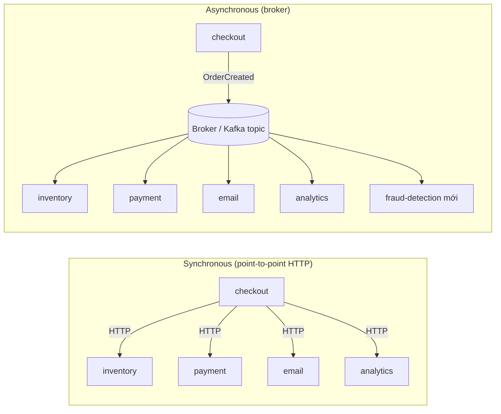
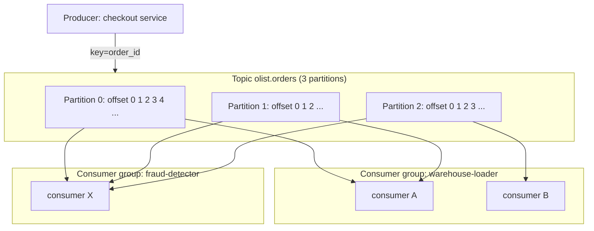
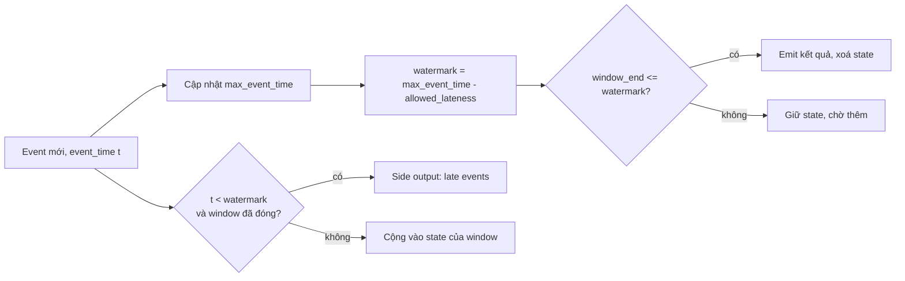

# Streaming với Kafka

Batch pipeline (module 05, 06) trả lời câu hỏi "hôm qua đã xảy ra gì". Streaming trả lời "đang
xảy ra gì ngay lúc này": đơn hàng Olist vừa được đặt, thanh toán vừa thất bại, kho vừa hết hàng.
Module này đi từ khái niệm messaging (sync vs async, message vs stream) tới Apache Kafka chi tiết
(broker, topic, partition, offset, replication, consumer group), delivery semantics, schema,
xử lý stream theo cửa sổ thời gian, rồi so sánh Kafka với RabbitMQ và AWS SQS/SNS. Cuối module
bạn đủ nền để làm milestone m07 của capstone: đẩy order events của Olist qua Kafka theo thời gian thực.

## 1. Messaging systems: sync vs async, message vs stream

### Vì sao cần messaging

Giả sử service `checkout` của Olist, mỗi khi có đơn mới, phải gọi trực tiếp (HTTP) tới
`inventory`, `payment`, `email`, `analytics`. Đây là giao tiếp **synchronous**:

- `checkout` phải chờ mọi service trả lời. Một service chậm làm cả luồng chậm.
- Một service chết thì `checkout` lỗi theo (coupling về **availability**).
- Thêm consumer mới (vd. `fraud-detection`) phải sửa code `checkout` (coupling về **code**).
- Đỉnh tải (Black Friday) đánh thẳng vào mọi service cùng lúc.

Giao tiếp **asynchronous** qua một message broker: `checkout` chỉ ghi một event `OrderCreated`
vào broker rồi trả lời khách. Các service khác tự đọc theo tốc độ của mình.



| Tiêu chí | Synchronous (REST/gRPC) | Asynchronous (broker) |
| --- | --- | --- |
| Độ trễ phản hồi cho caller | Tổng thời gian các bước | Chỉ thời gian ghi vào broker |
| Coupling | Chặt: biết địa chỉ, phải online | Lỏng: chỉ biết topic/queue |
| Hấp thụ đỉnh tải | Kém | Tốt, broker là buffer |
| Nhất quán | Dễ có kết quả ngay | **Eventual consistency** |
| Debug | Dễ theo một request | Khó hơn, cần tracing, correlation id |
| Khi nào dùng | Cần câu trả lời ngay (kiểm tra tồn kho trước khi bán) | Thông báo "đã xảy ra", fan-out, pipeline dữ liệu |

### Message vs stream

Hai mô hình broker hay bị gộp làm một nhưng khác hẳn nhau:

- **Message queue** (RabbitMQ, SQS): message là *việc cần làm*. Một consumer nhận, xử lý, **ack**,
  broker **xoá** message. Không đọc lại được. Thứ tự thường không đảm bảo khi có nhiều consumer.
- **Event stream / log** (Kafka, Kinesis, Pulsar): event là *sự thật đã xảy ra*, được **append**
  vào một log bất biến và **giữ lại** theo retention (vd. 7 ngày) dù đã đọc hay chưa. Mỗi consumer
  tự nhớ vị trí (offset) của mình, nhiều nhóm consumer đọc độc lập, có thể **replay** từ đầu.

| | Message queue | Event stream (log) |
| --- | --- | --- |
| Đơn vị | Command/task | Event (fact) |
| Sau khi đọc | Bị xoá | Vẫn còn tới hết retention |
| Nhiều consumer độc lập | Cần fan-out (exchange, SNS) | Có sẵn: mỗi consumer group một offset |
| Replay | Không | Có (reset offset) |
| Thứ tự | Gần như không đảm bảo | Đảm bảo **trong một partition** |
| Mô hình đọc | Push (broker đẩy) | Pull (consumer kéo) |
| Ví dụ | Gửi email xác nhận, resize ảnh | CDC, clickstream, order events, log |

Với Data Engineer, stream quan trọng hơn: dữ liệu là lịch sử các event, replay được để tính lại,
và cùng một topic phục vụ nhiều đích (warehouse, cache, ML feature store).

### Các khái niệm đi kèm

- **Pub/Sub**: producer publish lên topic, mọi subscriber đều nhận bản sao.
- **Point-to-point**: mỗi message chỉ một consumer xử lý (competing consumers).
- **Backpressure**: consumer chậm hơn producer. Queue/log giúp hấp thụ, nhưng lag sẽ tăng, cần theo dõi.
- **Event-driven architecture**: service phản ứng với event thay vì gọi nhau.

## 2. Kiến trúc Kafka: broker, topic, partition, offset

Apache Kafka là một **distributed, partitioned, replicated commit log**. Các thành phần:

- **Broker**: một server Kafka. Một **cluster** gồm nhiều broker.
- **Topic**: tên một luồng event, vd. `olist.orders`. Giống một bảng nhưng chỉ append.
- **Partition**: topic được chia thành N partition. Mỗi partition là một log có thứ tự, nằm trên
  một broker (leader). Partition là **đơn vị song song** và **đơn vị thứ tự**.
- **Offset**: số thứ tự tăng dần của record trong một partition (0, 1, 2…). Cặp
  `(topic, partition, offset)` định danh duy nhất một record.
- **Record**: gồm `key`, `value` (bytes), `timestamp`, `headers`.
- **Controller / KRaft**: điều phối metadata cluster. Kafka 3.3+ dùng **KRaft** (Raft nội bộ)
  thay cho ZooKeeper; Kafka 4.0 bỏ hẳn ZooKeeper.



### Key quyết định partition

Default partitioner: nếu record có key thì `partition = murmur2(key) % num_partitions`; không có
key thì dùng **sticky partitioner** (gom một batch vào một partition rồi đổi). Hệ quả:

- Mọi event cùng `order_id` vào cùng partition, nên **thứ tự theo order được giữ**
  (`created → approved → shipped → delivered`).
- **Tăng số partition sau này làm đổi ánh xạ key → partition**, phá thứ tự cho các key cũ. Hãy
  chọn số partition dư ra ngay từ đầu.
- **Hot partition**: key lệch (một seller chiếm 30% đơn) làm một partition quá tải. Cân nhắc key
  khác hoặc thêm salt.

### Chọn số partition

- Throughput mục tiêu / throughput một consumer xử lý được. Vd. cần 60 MB/s, một consumer xử lý
  10 MB/s, nên ≥ 6 partition.
- Số consumer tối đa trong một group = số partition (consumer dư sẽ ngồi chơi).
- Quá nhiều partition: tốn file handle, metadata, leader election lâu hơn. Vài chục tới vài trăm
  partition mỗi topic là phổ biến.

### Retention và log compaction

- `cleanup.policy=delete` + `retention.ms` (vd. 7 ngày) hoặc `retention.bytes`: xoá theo
  **segment** cũ. Phù hợp event stream.
- `cleanup.policy=compact`: chỉ giữ **record mới nhất cho mỗi key**. Record có value `null`
  (**tombstone**) nghĩa là xoá key đó. Phù hợp "trạng thái hiện tại": giá sản phẩm, thông tin
  khách hàng, changelog của state store. Topic nội bộ `__consumer_offsets` là topic compacted.

Dùng CLI đi kèm Kafka (trong container `kafka`):

```bash
kafka-topics.sh --bootstrap-server localhost:9092 --create --topic olist.orders \
  --partitions 6 --replication-factor 3 --config retention.ms=604800000
kafka-topics.sh --bootstrap-server localhost:9092 --describe --topic olist.orders
kafka-consumer-groups.sh --bootstrap-server localhost:9092 --describe --group warehouse-loader
```

Lệnh cuối in `CURRENT-OFFSET`, `LOG-END-OFFSET` và `LAG = LOG-END-OFFSET − CURRENT-OFFSET` cho
từng partition, metric quan trọng nhất khi vận hành consumer.

## 3. Replication, ISR và producer: acks, retries, idempotence

### Replication

Mỗi partition có `replication.factor` bản sao (thường 3) trên các broker khác nhau. Một bản là
**leader** (nhận ghi và đọc), còn lại là **follower** (kéo dữ liệu từ leader).

- **ISR (In-Sync Replicas)**: tập replica bắt kịp leader trong khoảng `replica.lag.time.max.ms`.
- **High watermark**: offset cao nhất đã được mọi replica trong ISR ghi. Consumer chỉ đọc tới
  high watermark, nên không đọc phải dữ liệu có thể mất.
- Leader chết thì controller bầu leader mới **từ ISR**. `unclean.leader.election.enable=false`
  (mặc định) để không bầu replica tụt hậu, đổi lại partition có thể tạm không ghi được.

### Producer `acks`

| `acks` | Ý nghĩa | Độ bền | Độ trễ |
| --- | --- | --- | --- |
| `0` | Không chờ broker | Có thể mất | Thấp nhất |
| `1` | Chờ leader ghi | Mất nếu leader chết trước khi follower chép | Trung bình |
| `all` (`-1`) | Chờ mọi replica trong ISR | Không mất nếu ISR ≥ `min.insync.replicas` | Cao nhất |

Cấu hình bền vững chuẩn: `replication.factor=3`, `min.insync.replicas=2`, `acks=all`. Mất một
broker vẫn ghi được; mất hai thì producer nhận lỗi `NotEnoughReplicas` thay vì âm thầm mất dữ liệu.

### Retries và idempotent producer

Producer retry khi lỗi mạng. Nếu broker đã ghi nhưng ack bị mất, retry sẽ ghi **trùng**. Với
`enable.idempotence=true` (mặc định từ Kafka 3.0 trên client Java), broker gán **producer id
(PID)** và **sequence number** cho mỗi partition, tự bỏ bản trùng và giữ đúng thứ tự. Idempotence
chỉ chống trùng **trong một phiên producer, một partition**; chống trùng end-to-end cần thêm
transaction hoặc sink idempotent (phần 4).

Các tham số batching ảnh hưởng throughput: `linger.ms` (chờ gom batch), `batch.size`,
`compression.type` (`lz4`, `zstd`).

### Producer bằng Python (`kafka-python-ng`)

```python
import json
from kafka import KafkaProducer
from testkit import KAFKA_BOOTSTRAP  # "localhost:9094"

producer = KafkaProducer(
    bootstrap_servers=KAFKA_BOOTSTRAP,
    acks="all",
    retries=5,
    linger_ms=20,
    compression_type="gzip",
    key_serializer=lambda k: k.encode("utf-8"),
    value_serializer=lambda v: json.dumps(v, separators=(",", ":")).encode("utf-8"),
)

event = {
    "event_id": "e-0001",
    "order_id": "e481f51cbdc54678b7cc49136f2d6af7",
    "status": "created",
    "customer_state": "SP",
    "amount": 129.9,
    "event_time": "2018-01-02T10:15:00Z",
}
future = producer.send("olist.orders", key=event["order_id"], value=event)
meta = future.get(timeout=10)          # chặn tới khi broker ack, ném lỗi nếu thất bại
print(meta.topic, meta.partition, meta.offset)
producer.flush()
producer.close()
```

`send()` là bất đồng bộ (trả về future). Trong production đừng `.get()` từng record (mất
batching); dùng callback `add_callback`/`add_errback` và `flush()` trước khi tắt.

## 4. Consumer group, rebalance và delivery semantics

### Consumer group

- Mọi consumer cùng `group.id` chia nhau các partition: **mỗi partition chỉ thuộc một consumer
  trong group** tại một thời điểm. Đây là cách scale đọc.
- Nhiều group khác nhau đọc cùng topic độc lập (pub/sub).
- Offset đã xử lý được **commit** vào topic `__consumer_offsets`. Khởi động lại thì đọc tiếp từ
  offset đã commit; group mới thì theo `auto.offset.reset` (`earliest` hoặc `latest`).

### Rebalance

Xảy ra khi consumer vào/ra group, consumer bị coi là chết (không gửi heartbeat trong
`session.timeout.ms`, hoặc không gọi `poll()` trong `max.poll.interval.ms`), hoặc topic thêm partition.

- **Eager rebalance** (cũ): mọi consumer nhả hết partition rồi chia lại, gây "stop-the-world".
- **Cooperative / incremental rebalance** (`CooperativeStickyAssignor`): chỉ chuyển các partition
  cần chuyển.
- **Static membership** (`group.instance.id`): restart nhanh (deploy rolling) không gây rebalance.
- Lỗi kinh điển: xử lý một batch quá lâu vượt `max.poll.interval.ms`, consumer bị đá, partition
  giao cho người khác, batch bị xử lý **hai lần**. Giảm `max.poll.records` hoặc tăng timeout.

### Delivery semantics

Thứ tự "xử lý" và "commit offset" quyết định ngữ nghĩa:

```mermaid
sequenceDiagram
    participant K as Kafka
    participant C as Consumer
    participant DB as Sink (DB)
    Note over C: At-most-once
    C->>K: poll()
    C->>K: commit offset
    C->>DB: write  (crash ở đây => mất)
    Note over C: At-least-once
    C->>K: poll()
    C->>DB: write
    C->>K: commit offset (crash trước bước này => xử lý lại, trùng)
    Note over C: Exactly-once (effectively)
    C->>K: poll()
    C->>DB: BEGIN; upsert theo key; lưu offset; COMMIT (một transaction)
```

| Semantics | Cách làm | Rủi ro | Dùng khi |
| --- | --- | --- | --- |
| At-most-once | Commit trước, xử lý sau | Mất dữ liệu | Metric không quan trọng, log debug |
| At-least-once | Xử lý xong mới commit | Trùng khi retry/rebalance | Mặc định, kèm sink idempotent |
| Exactly-once | Kafka transactions (Kafka→Kafka) hoặc lưu offset cùng transaction với sink, hoặc sink idempotent | Phức tạp, chậm hơn | Tiền, tồn kho, billing |

**Exactly-once trong Kafka** (EOS): producer có `transactional.id`, gọi
`begin_transaction → send(...) → send_offsets_to_transaction → commit_transaction`; consumer
phía sau đặt `isolation.level=read_committed`. Kafka Streams bật bằng
`processing.guarantee=exactly_once_v2`. EOS chỉ bao trọn **Kafka → Kafka**. Ra hệ ngoài (Postgres,
S3) thì cần sink **idempotent** (upsert theo `event_id`/primary key, MERGE) hoặc lưu offset trong
cùng transaction với dữ liệu, rồi khi khởi động `seek()` tới offset đó.

Thực tế: "exactly-once processing" = **at-least-once delivery + idempotent processing**.

### Consumer at-least-once bằng Python

```python
import json
from kafka import KafkaConsumer

consumer = KafkaConsumer(
    "olist.orders",
    bootstrap_servers="localhost:9094",
    group_id="warehouse-loader",
    enable_auto_commit=False,          # tự commit sau khi ghi sink
    auto_offset_reset="earliest",
    max_poll_records=500,
    value_deserializer=lambda b: json.loads(b.decode("utf-8")),
)

def upsert_batch(rows):  # sink idempotent: INSERT ... ON CONFLICT (event_id) DO NOTHING
    ...

try:
    while True:
        batches = consumer.poll(timeout_ms=1000)
        rows = [rec.value for records in batches.values() for rec in records]
        if rows:
            upsert_batch(rows)
            consumer.commit()          # chỉ commit sau khi sink thành công
finally:
    consumer.close()
```

Record lỗi không parse được (poison pill) không nên làm kẹt cả partition: đẩy sang **dead-letter
topic** (`olist.orders.dlq`) kèm header lý do lỗi, commit tiếp.

## 5. Schema và serialization

Kafka chỉ thấy bytes. Producer và consumer phải thống nhất **định dạng** và **schema**, nếu không
một thay đổi nhỏ (đổi `amount` từ số sang chuỗi) sẽ làm gãy mọi consumer phía sau.

| Định dạng | Ưu | Nhược | Schema evolution |
| --- | --- | --- | --- |
| JSON (không schema) | Dễ đọc, dễ debug | To, không kiểu chặt, dễ gãy ngầm | Không có kiểm soát |
| JSON Schema | Vẫn là JSON, validate được | To, validate tốn CPU | Có qua Schema Registry |
| Avro | Nhị phân gọn, schema tách khỏi data, evolution rõ | Cần schema để đọc | Rất tốt (default value) |
| Protobuf | Gọn, nhanh, sinh code đa ngôn ngữ | Cần `.proto`, field number | Tốt (field number) |

### Schema Registry

Confluent Schema Registry (hoặc Apicurio, AWS Glue Schema Registry) lưu schema theo **subject**
(thường `<topic>-value`). Producer đăng ký schema và gửi kèm **schema id** (5 byte đầu: magic byte
+ id) thay vì cả schema. Consumer tra id để giải mã. Registry kiểm tra **compatibility** khi đăng
ký version mới:

- **BACKWARD** (mặc định): consumer dùng schema mới đọc được dữ liệu cũ. Được thêm field **có
  default**, được xoá field.
- **FORWARD**: consumer schema cũ đọc được dữ liệu mới. Được thêm field, xoá field có default.
- **FULL**: cả hai chiều.

Avro schema cho order event:

```json
{
  "type": "record",
  "name": "OrderEvent",
  "namespace": "olist.events",
  "fields": [
    {"name": "event_id", "type": "string"},
    {"name": "order_id", "type": "string"},
    {"name": "status", "type": {"type": "enum", "name": "Status",
      "symbols": ["created", "approved", "shipped", "delivered", "canceled"]}},
    {"name": "amount", "type": "double"},
    {"name": "event_time", "type": {"type": "long", "logicalType": "timestamp-millis"}},
    {"name": "coupon", "type": ["null", "string"], "default": null}
  ]
}
```

Field `coupon` thêm sau với `default: null` nên tương thích BACKWARD.

Validate bằng JSON Schema trong Python (thư viện `jsonschema`):

```python
from jsonschema import Draft202012Validator

ORDER_EVENT_SCHEMA = {
    "type": "object",
    "required": ["event_id", "order_id", "status", "amount", "event_time"],
    "properties": {
        "event_id": {"type": "string", "minLength": 1},
        "order_id": {"type": "string", "minLength": 1},
        "status": {"enum": ["created", "approved", "shipped", "delivered", "canceled"]},
        "amount": {"type": "number", "minimum": 0},
        "event_time": {"type": "string"},
    },
    "additionalProperties": True,
}
validator = Draft202012Validator(ORDER_EVENT_SCHEMA)
errors = [e.message for e in validator.iter_errors({"event_id": "e1", "amount": -1})]
print(errors)
```

Các field nên có trong mọi event: `event_id` (UUID, để dedup), `event_type`, `event_time` (thời
điểm xảy ra), `producer`/`source`, `schema_version`.

## 6. Stream processing: event time, windowing, watermark

### Event time vs processing time

- **Event time**: lúc sự kiện xảy ra (ghi trong payload). Dùng để tính đúng nghiệp vụ.
- **Ingestion / processing time**: lúc Kafka nhận / lúc processor xử lý.

Mạng chập chờn, app mobile offline, consumer restart khiến event **đến trễ** và **lệch thứ tự**.
Tính "doanh thu mỗi phút" theo processing time thì kết quả đổi theo lần chạy; theo event time
thì đúng nhưng phải trả lời: *chờ event trễ bao lâu?*

### Các loại window

| Window | Định nghĩa | Một event thuộc | Ví dụ |
| --- | --- | --- | --- |
| Tumbling | Kích thước cố định, không chồng | Đúng 1 window | GMV mỗi 1 phút |
| Hopping / Sliding | Kích thước `size`, trượt `advance` < size | `size/advance` window | GMV 5 phút gần nhất, cập nhật mỗi phút |
| Session | Gom event cách nhau < `gap`, độ dài thay đổi | 1 session | Phiên duyệt web của khách |
| Global | Không giới hạn, cần trigger | 1 | Đếm tích luỹ |

Tumbling window bắt đầu tại `floor(ts / size) * size`. Hopping window: event ở thời điểm `t`
thuộc các window bắt đầu tại `s` với `s ≤ t < s + size` và `s` chia hết cho `advance`.

```python
def tumbling_start(ts: int, size: int) -> int:
    return ts - ts % size

def hopping_starts(ts: int, size: int, advance: int) -> list[int]:
    last = ts - ts % advance
    first = max(0, last - size + advance)   # bỏ window bắt đầu trước mốc 0
    return [s for s in range(first, last + 1, advance) if s <= ts < s + size]

print(tumbling_start(125, 60))          # 120
print(hopping_starts(725, 300, 60))     # [480, 540, 600, 660, 720]
```

### Watermark và late events

**Watermark** là khẳng định của processor: "không còn event nào có event time < W". Cách tính phổ
biến: `W = max_event_time_đã_thấy − allowed_lateness`. Khi `W ≥ window_end` thì window được
**đóng và phát kết quả**. Event đến với `event_time < W` (window đã đóng) là **late event**: bỏ,
đẩy vào side output/DLQ, hoặc phát kết quả cập nhật (retraction/upsert).



Đánh đổi: `allowed_lateness` lớn thì kết quả đầy đủ hơn nhưng trễ hơn và tốn state; nhỏ thì nhanh
nhưng bỏ nhiều event trễ.

### Stateful processing và các framework

Window, join, dedup đều cần **state**. State phải được checkpoint để chịu lỗi:
Kafka Streams lưu ở RocksDB + changelog topic (compacted), Flink checkpoint snapshot ra S3/HDFS.

| Framework | Mô hình | Điểm mạnh | Ghi chú |
| --- | --- | --- | --- |
| Kafka Streams | Thư viện Java trong app | Không cần cluster riêng, EOS sẵn | Chỉ Kafka → Kafka |
| ksqlDB | SQL trên Kafka Streams | Nhanh cho phép biến đổi đơn giản | Hạn chế khi logic phức tạp |
| Apache Flink | Cluster, true streaming | Event time, watermark, state lớn, EOS | Vận hành phức tạp hơn |
| Spark Structured Streaming | Micro-batch (mặc định) | Dùng chung code DataFrame với batch | Độ trễ cỡ giây |
| Kafka Connect | Connector có sẵn | Source/sink (Debezium CDC, S3, JDBC) không cần viết code | Biến đổi nhẹ bằng SMT |

Spark Structured Streaming (module 06) với watermark:

```python
from pyspark.sql import functions as F

orders = (spark.readStream.format("kafka")
          .option("kafka.bootstrap.servers", "localhost:9094")
          .option("subscribe", "olist.orders").load()
          .select(F.from_json(F.col("value").cast("string"),
                  "order_id STRING, customer_state STRING, amount DOUBLE, event_time TIMESTAMP").alias("e"))
          .select("e.*"))

gmv = (orders.withWatermark("event_time", "10 minutes")
       .groupBy(F.window("event_time", "1 minute"), "customer_state")
       .agg(F.sum("amount").alias("gmv")))

gmv.writeStream.outputMode("append").format("console").start()
```

### Dedup trong stream

At-least-once nghĩa là trùng là chuyện bình thường. Dedup theo `event_id` cần nhớ các id đã thấy,
nhưng không thể nhớ mãi: giữ trong một khoảng TTL (vd. 1 giờ, hoặc tới watermark) rồi xoá.

## 7. RabbitMQ, AWS SQS/SNS, Kinesis: chọn công cụ nào

### RabbitMQ

Broker theo chuẩn AMQP. Producer gửi tới **exchange**, exchange định tuyến tới **queue** theo
**binding**: `direct` (theo routing key), `topic` (wildcard `order.*.created`), `fanout` (tới mọi
queue), `headers`. Consumer nhận push, `ack`/`nack`; message bị nack nhiều lần đi vào dead-letter
exchange. Có **Streams** (từ 3.9) để giữ log kiểu Kafka nhưng không phải thế mạnh chính.

### AWS SQS và SNS

- **SQS**: queue managed. Standard (at-least-once, thứ tự best-effort, throughput gần như vô hạn)
  và FIFO (thứ tự theo `MessageGroupId`, dedup 5 phút theo `MessageDeduplicationId`). Message
  "ẩn" trong `VisibilityTimeout` khi đang xử lý, không xoá kịp thì hiện lại. Có DLQ qua `redrive policy`.
- **SNS**: pub/sub managed, fan-out tới SQS, Lambda, HTTP, email. Mẫu **SNS → nhiều SQS** là fan-out kinh điển.
- **Kinesis Data Streams**: tương đương Kafka của AWS (shard ≈ partition, retention 24h tới 365 ngày).
  Amazon **MSK** là Kafka managed.

| | Kafka | RabbitMQ | SQS | SNS | Kinesis |
| --- | --- | --- | --- | --- | --- |
| Mô hình | Log phân tán | Queue + exchange | Queue | Pub/sub | Log phân tán |
| Giữ sau khi đọc | Có (retention) | Không | Không | Không | Có |
| Replay | Có | Không (trừ Streams) | Không | Không | Có |
| Thứ tự | Theo partition | Theo queue, 1 consumer | FIFO queue | FIFO topic | Theo shard |
| Throughput | Rất cao (MB–GB/s) | Trung bình | Cao, tự scale | Cao | Cao, theo shard |
| Vận hành | Tự quản hoặc MSK/Confluent | Tự quản hoặc CloudAMQP | Serverless | Serverless | Serverless (shard) |
| Hợp với | Data pipeline, CDC, event sourcing | Task queue, routing phức tạp | Job queue, tách service | Fan-out thông báo | Stream trên AWS |

Quy tắc nhanh: cần **replay, nhiều consumer độc lập, throughput cao, pipeline dữ liệu** thì Kafka
(hoặc Kinesis/Pub/Sub nếu muốn serverless). Cần **task queue với routing linh hoạt, priority,
per-message ack** thì RabbitMQ. Đang trên AWS và chỉ cần tách service đơn giản thì SQS (+SNS).

## 8. Best practices khi vận hành streaming pipeline

**Thiết kế topic và event**

- Đặt tên có cấu trúc: `<domain>.<entity>.<version>` (vd. `olist.orders.v1`).
- Chọn key theo nhu cầu thứ tự (`order_id`), kiểm tra độ lệch phân phối key.
- Event tự mô tả: `event_id`, `event_type`, `event_time`, `schema_version`. Event nên là
  **fact bất biến** ("OrderShipped"), không phải lệnh.
- Dùng Schema Registry và compatibility BACKWARD; không đổi kiểu field đang dùng.

**Độ bền và đúng đắn**

- `replication.factor=3`, `min.insync.replicas=2`, `acks=all`, idempotent producer.
- Consumer `enable.auto.commit=false`, commit sau khi ghi sink; sink idempotent (upsert theo key).
- Dead-letter topic cho poison pill; alert khi DLQ có dữ liệu.
- Xử lý event trễ bằng event time + watermark, ghi rõ chính sách late data.

**Vận hành và giám sát**

- Theo dõi **consumer lag** (theo partition và theo thời gian: "đang trễ bao nhiêu giây"),
  under-replicated partitions, request latency, throughput, tỉ lệ lỗi DLQ. Công cụ: Burrow, Kafka
  exporter cho Prometheus, Confluent Control Center, Redpanda Console, Kafka UI.
- Cấp quyền bằng ACL, mã hoá TLS, xác thực SASL; không để topic nào ai cũng ghi được.
- Retention theo nhu cầu replay và chi phí; tiered storage (Kafka 3.6+) đẩy segment cũ ra S3.
- Kiểm thử logic stream bằng hàm thuần (như bài tập module này) trước khi gắn vào Kafka thật;
  kiểm thử tích hợp bằng Kafka trong Docker/Testcontainers.

**Mẫu kiến trúc hay gặp**

- **CDC**: Debezium đọc WAL của PostgreSQL đẩy vào Kafka, sink vào warehouse/lakehouse.
- **Outbox pattern**: service ghi event vào bảng `outbox` cùng transaction với dữ liệu nghiệp vụ,
  Debezium đẩy bảng outbox lên Kafka. Tránh lỗi "ghi DB xong nhưng gửi Kafka thất bại" (dual write).
- **Lambda vs Kappa**: Lambda chạy song song batch + stream rồi gộp; Kappa chỉ dùng stream và
  replay khi cần tính lại. Lakehouse + streaming ngày nay nghiêng về Kappa.

## 9. Tài liệu tham khảo

- Apache Kafka Documentation: https://kafka.apache.org/documentation/
- Confluent Developer, Kafka 101 và các khoá học: https://developer.confluent.io/courses/
- Confluent, "Exactly-once Semantics Are Possible": https://www.confluent.io/blog/exactly-once-semantics-are-possible-heres-how-apache-kafka-does-it/
- Confluent Schema Registry, Schema Evolution and Compatibility: https://docs.confluent.io/platform/current/schema-registry/fundamentals/schema-evolution.html
- kafka-python-ng (API giống kafka-python): https://github.com/wbarnha/kafka-python-ng và https://kafka-python.readthedocs.io/
- Neha Narkhede, Gwen Shapira, Todd Palino, *Kafka: The Definitive Guide*, 2nd ed., O'Reilly.
- Martin Kleppmann, *Designing Data-Intensive Applications*, chương 11 "Stream Processing".
- Tyler Akidau, *Streaming 101* và *Streaming 102*: https://www.oreilly.com/radar/the-world-beyond-batch-streaming-101/
- Apache Flink, Timely Stream Processing (event time, watermark): https://nightlies.apache.org/flink/flink-docs-stable/docs/concepts/time/
- Spark Structured Streaming Programming Guide: https://spark.apache.org/docs/latest/structured-streaming-programming-guide.html
- RabbitMQ Tutorials: https://www.rabbitmq.com/tutorials
- AWS SQS Developer Guide: https://docs.aws.amazon.com/AWSSimpleQueueService/latest/SQSDeveloperGuide/ và SNS: https://docs.aws.amazon.com/sns/latest/dg/
- roadmap.sh Data Engineer: https://roadmap.sh/data-engineer
