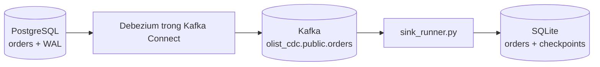

# Lab: PostgreSQL → Debezium → Kafka → bảng trạng thái

Lab nối module 05 với module 07. CDC (Change Data Capture) lấy thay đổi từ database thật;
producer giả lập order events ở bài cũ vẫn hữu ích nhưng không thay thế bước này.

## 1. Chuẩn bị và phạm vi

- Làm [bài CDC sink](exercises/intermediate/04-cdc-sink/README.md) trước; Python dùng dependency của repo.
- Cần Docker Compose và RAM cho ba container PostgreSQL, Kafka, Kafka Connect/Debezium.
- Chạy lệnh từ gốc repo. Lab dùng cổng **55432, 19094, 18083**, volume và network riêng.
- Schema rút gọn `orders(order_id, status, amount_cents)`: 100 cents = 1 BRL. Đây là schema luyện
  CDC, không phải toàn bộ schema CSV Olist. Chưa xử lý đổi primary key, TRUNCATE hoặc nhiều writer sink.
- Tài khoản `de/de` chỉ cho môi trường lab local. Các cổng chỉ publish trên loopback.



**Snapshot** là đọc các dòng đang có khi connector bắt đầu. Sau đó connector tiếp tục lấy thay đổi
từ WAL. WAL là nhật ký giao dịch của PostgreSQL, không phải cột `updated_at` do ứng dụng tự ghi.
Xem cấu hình và hành vi nguồn trong [Debezium PostgreSQL 3.0](https://debezium.io/documentation/reference/3.0/connectors/postgresql.html).

## 2. Bật lab và đăng ký connector

```bash
docker compose -f setup/cdc/docker-compose.yml up -d --wait
curl --fail-with-body --silent --show-error -X PUT \
  -H 'Content-Type: application/json' \
  --data-binary @setup/cdc/connector.json \
  http://localhost:18083/connectors/olist-orders/config
curl --fail-with-body --silent --show-error http://localhost:18083/connectors/olist-orders/status
```

Chờ cả connector và task báo `RUNNING`. Nếu task `FAILED`, đọc lỗi trong status và
`docker compose -f setup/cdc/docker-compose.yml logs --tail 100 connect`; không đăng ký thêm connector
cùng replication slot để thử vận may. `init.sql` chỉ được chạy khi volume PostgreSQL còn mới.

Xem event ở terminal thứ hai (Ctrl+C để dừng lệnh xem):

```bash
docker compose -f setup/cdc/docker-compose.yml exec kafka /opt/kafka/bin/kafka-console-consumer.sh \
  --bootstrap-server kafka:9092 --topic olist_cdc.public.orders --from-beginning \
  --property print.key=true
```

Hai dòng ban đầu `o1/o2` có `op = r` (read snapshot). `c/u/d` là create/update/delete;
`after` là nội dung sau thay đổi. Khi xóa, lấy mã đơn từ Kafka key. Record có value NULL là
tombstone phục vụ compaction; sink không parse nó thành đơn hàng.

## 3. Đồng bộ và kiểm tra INSERT/UPDATE/DELETE

Chạy sink dùng starter bạn đã hoàn thành; tự thoát sau 15 giây không có record:

```bash
uv run python setup/cdc/sink_runner.py
```

Muốn kiểm tra lời giải mẫu, thêm `--solution`. Không cần chép lời giải vào starter.
Lần đầu kết quả mong đợi: `o1/created/15000` và `o2/created/2500`.

```bash
docker compose -f setup/cdc/docker-compose.yml exec postgres psql -U de -d cdc_lab \
  -c "INSERT INTO orders VALUES ('o3', 'approved', 8000); UPDATE orders SET status='delivered' WHERE order_id='o1'; DELETE FROM orders WHERE order_id='o2';"
uv run python setup/cdc/sink_runner.py
docker compose -f setup/cdc/docker-compose.yml exec postgres psql -U de -d cdc_lab \
  -c "SELECT * FROM orders ORDER BY order_id;"
```

Sink và nguồn đều phải còn `o1/delivered/15000`, `o3/approved/8000`.
Nhóm lệnh thay đổi dữ liệu ở trên chỉ chạy **một lần** trong kịch bản này; chạy lại INSERT o3 sẽ
bị lỗi trùng khóa. Nếu sink hết thời gian chờ trước khi connector gửi xong, kiểm status rồi chạy sink lại.

## 4. Crash giữa hai commit

Tạo thay đổi mới trên nguồn:

```bash
docker compose -f setup/cdc/docker-compose.yml exec postgres psql -U de -d cdc_lab \
  -c "UPDATE orders SET status='shipped' WHERE order_id='o3';"
uv run python setup/cdc/sink_runner.py --crash-after-db-commit
uv run python setup/cdc/sink_runner.py
```

Lệnh crash cố ý trả exit code khác 0. Nó ghi SQLite rồi thoát trước Kafka commit.
Lần chạy sau phải có record được nhận lại với `applied: false`, còn o3 vẫn là shipped.
Consumer commit offset kế tiếp riêng cho record đã xử lý, tránh đánh dấu xong cả các record vừa poll
nhưng chưa ghi DB. Đọc `sink_runner.py` và giải thích vì sao thứ tự commit này cần checkpoint.

## 5. Ngắt connector, quan sát WAL và replay

1. `docker compose -f setup/cdc/docker-compose.yml stop connect`.
2. Update o3 sang delivered bằng psql ở trên. Sink chưa thấy thay đổi vì connector đang dừng.
3. `docker compose -f setup/cdc/docker-compose.yml start connect`; chờ task RUNNING rồi chạy lại sink.
4. Đối chiếu o3 đã delivered, không mất thay đổi trong lần gián đoạn ngắn này.

Quan sát slot trong PostgreSQL lab:

```bash
docker compose -f setup/cdc/docker-compose.yml exec postgres psql -U de -d cdc_lab \
  -c "SELECT slot_name, active, restart_lsn, confirmed_flush_lsn FROM pg_replication_slots;"
```

Replication slot có thể giữ WAL khi connector ngừng; cần theo dõi dung lượng giữ lại và lag.
Không xóa slot để giải phóng đĩa mà không có kế hoạch đồng bộ lại.

Replay vào bảng riêng để không ảnh hưởng sink đang phục vụ:

```bash
uv run python setup/cdc/sink_runner.py --group olist-cdc-rebuild-v1 --db /tmp/olist-cdc-rebuild-v1.sqlite
```

Lần đầu dùng group/database mới phải dựng lại cùng trạng thái hiện tại **nếu toàn bộ lịch sử cần thiết
vẫn còn**. Nếu Kafka đã xóa lịch sử, cần bản nền/snapshot mới. Nếu xóa volume Kafka và tạo lại topic,
offset có thể bắt đầu lại: dùng database/group lab mới, không tiếp tục checkpoint của topic cũ.

## 6. Kết quả nộp và giới hạn

- Bảng nguồn/đích sau snapshot, update/delete, crash và ngắt connector.
- Log có một lần phát lại `applied: false`; số dòng và tổng cents khớp nguồn.
- Sơ đồ ba tiến độ: source WAL, connector offset, sink Kafka offset; giải thích cách tránh ghi trùng.
- Runbook cho connector FAILED, nguồn hết đĩa do WAL, event sai schema. Sink mẫu dừng ở schema lỗi;
  thiết kế DLQ là phần mở rộng, không được tự commit bỏ qua event rồi coi dữ liệu đã đầy đủ.

Kafka một broker chưa kiểm được high availability. SQLite một writer không phải warehouse production;
giá trị bài học là kiểm được luồng CDC và phục hồi. Debezium 3.0.8.Final được pin cho lab này;
khi nâng phiên bản cần đọc migration notes và chạy lại kịch bản kiểm chứng.

## 7. Thử backup/restore trên database riêng

Phần này nối với module 08. Sau khi nguồn và sink đã khớp, tạo backup và restore vào **database
mới** trong container lab, không ghi đè nguồn đang chạy:

```bash
docker compose -f setup/cdc/docker-compose.yml exec -T postgres \
  pg_dump -U de -d cdc_lab -Fc > /tmp/olist-cdc-lab.dump
docker compose -f setup/cdc/docker-compose.yml exec -T postgres \
  createdb -U de cdc_restore
docker compose -f setup/cdc/docker-compose.yml exec -T postgres \
  pg_restore -U de -d cdc_restore --exit-on-error < /tmp/olist-cdc-lab.dump
docker compose -f setup/cdc/docker-compose.yml exec -T postgres psql -U de -d cdc_restore \
  -c "SELECT * FROM orders ORDER BY order_id;"
```

`createdb` chỉ chạy lần đầu với tên mới; nếu đã có `cdc_restore`, chọn tên khác thay vì xóa database
đang tồn tại. So toàn bộ đơn, tổng cents và schema/constraint với nguồn ở thời điểm backup.
Ghi thời gian bắt đầu/kết thúc restore; thử dữ liệu không hợp lệ trên **bản restore** để kiểm constraint.
Database restore không tự nhận thay đổi mới phát sinh sau backup: đó là khoảng dữ liệu cần khôi phục
bổ sung nếu mục tiêu RPO đòi hỏi. Bản dump không chứa Kafka offset và checkpoint SQLite;
phục hồi toàn pipeline phải chọn bản nền và lịch sử tiếp nối tương thích.

## 8. Dọn lab

```bash
docker compose -f setup/cdc/docker-compose.yml down
```

Lệnh trên giữ volume để tiếp tục buổi sau. Khi muốn bỏ **toàn bộ dữ liệu riêng của lab CDC**, dùng
`docker compose -f setup/cdc/docker-compose.yml down -v`. File sink trong `/tmp` là riêng; nếu làm lại
từ đầu, chọn tên file/group mới. Không dùng `docker system prune` để dọn bài học.
