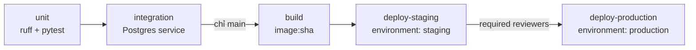

# Hướng giải: CI/CD cho repo dữ liệu

## Hướng làm



1. Tách job theo tầng kiểm thử: lỗi lint/unit báo trong 1–2 phút, không phải chờ Postgres.
2. Integration dùng **service container** Postgres có health check; runner chỉ chạy step khi
   service healthy. DSN truyền qua `env`.
3. Build chỉ trên `main` (`if: github.ref == 'refs/heads/main'`), PR dừng ở integration.
4. Image tag bằng `github.sha`: **bất biến**, biết chính xác commit nào đang chạy, rollback bằng
   cách deploy lại SHA cũ. Có thể thêm tag `latest` hoặc semver, nhưng deploy luôn dùng SHA.
5. Deploy dùng `environment` để có secret riêng từng môi trường và quy tắc duyệt (required
   reviewers, wait timer, chỉ cho nhánh `main`).

## Quyết định thiết kế cần cân nhắc

| Vấn đề | Lựa chọn | Ghi chú |
| --- | --- | --- |
| Quyền | `contents: read` toàn cục, `packages: write` chỉ ở job build | Least privilege; một action bị chiếm quyền ở job unit không đẩy được image |
| Credential cloud | OIDC (`id-token: write` + `aws-actions/configure-aws-credentials`) | Không lưu access key dài hạn trong secrets |
| Concurrency | Cùng group theo ref; huỷ chạy cũ trên PR, **không** huỷ trên main | Huỷ giữa chừng một lần deploy có thể để hệ thống dở dang |
| Pin action | `@v4` vs commit SHA | SHA chống supply-chain attack, cần Dependabot để cập nhật |
| Deploy kiểu push vs GitOps | `kubectl`/`helm` từ CI vs commit tag mới vào repo manifest cho ArgoCD | GitOps không cần cấp quyền cluster cho CI |
| dbt | `dbt build --select state:modified+ --defer --state prod-manifest/` | Slim CI: chỉ chạy model bị đổi |
| Dữ liệu test | Fixture tổng hợp, không dùng dữ liệu production | Tránh rò PII vào log CI |
| Sau deploy | Smoke test (job khởi động, kết nối DB, bảng có dữ liệu mới) | Tự rollback nếu smoke fail |

## Bản tham khảo (qua bộ test)

```yaml
name: pipeline

on:
  push:
    branches: [main]
  pull_request:

permissions:
  contents: read

concurrency:
  group: pipeline-${{ github.ref }}
  cancel-in-progress: ${{ github.ref != 'refs/heads/main' }}

env:
  IMAGE: ghcr.io/${{ github.repository }}

jobs:
  unit:
    runs-on: ubuntu-latest
    timeout-minutes: 10
    steps:
      - uses: actions/checkout@v4
      - uses: actions/setup-python@v5
        with:
          python-version: "3.12"
          cache: pip
      - run: pip install -r requirements.txt ruff
      - run: ruff check .
      - run: pytest tests/unit -q

  integration:
    needs: unit
    runs-on: ubuntu-latest
    timeout-minutes: 20
    services:
      postgres:
        image: postgres:16.4
        env:
          POSTGRES_USER: de
          POSTGRES_PASSWORD: de
          POSTGRES_DB: de
        ports: ["5432:5432"]
        options: >-
          --health-cmd "pg_isready -U de"
          --health-interval 5s
          --health-timeout 3s
          --health-retries 10
    env:
      POSTGRES_DSN: postgresql://de:de@localhost:5432/de
    steps:
      - uses: actions/checkout@v4
      - uses: actions/setup-python@v5
        with:
          python-version: "3.12"
          cache: pip
      - run: pip install -r requirements.txt
      - run: pytest tests/integration -q

  build:
    needs: integration
    if: github.event_name == 'push' && github.ref == 'refs/heads/main'
    runs-on: ubuntu-latest
    timeout-minutes: 20
    permissions:
      contents: read
      packages: write
    steps:
      - uses: actions/checkout@v4
      - uses: docker/setup-buildx-action@v3
      - uses: docker/login-action@v3
        with:
          registry: ghcr.io
          username: ${{ github.actor }}
          password: ${{ secrets.GITHUB_TOKEN }}
      - uses: docker/build-push-action@v6
        with:
          context: .
          push: true
          tags: ${{ env.IMAGE }}:${{ github.sha }}
          cache-from: type=gha
          cache-to: type=gha,mode=max

  deploy-staging:
    needs: build
    runs-on: ubuntu-latest
    timeout-minutes: 15
    environment: staging
    steps:
      - run: echo "kubectl set image cronjob/olist-ingest ingest=${IMAGE}:${{ github.sha }} -n data-staging"
      - run: echo "smoke test staging"

  deploy-production:
    needs: deploy-staging
    runs-on: ubuntu-latest
    timeout-minutes: 15
    environment:
      name: production
    steps:
      - run: echo "kubectl set image cronjob/olist-ingest ingest=${IMAGE}:${{ github.sha }} -n data-prod"
```

## Rubric (100 điểm)

| Tiêu chí | Điểm |
| --- | --- |
| Bộ test pass | 30 |
| Chuỗi phụ thuộc đúng, PR không build/deploy, production sau staging có bước duyệt | 20 |
| Bảo mật: least privilege, không secret trong tệp, giải thích OIDC/secret theo environment | 15 |
| Image bất biến theo SHA, deploy và rollback dùng đúng tag | 15 |
| Hiệu năng CI: cache pip/docker, job song song khi hợp lý, timeout hợp lý | 10 |
| Smoke test sau deploy và chiến lược rollback được mô tả | 10 |
