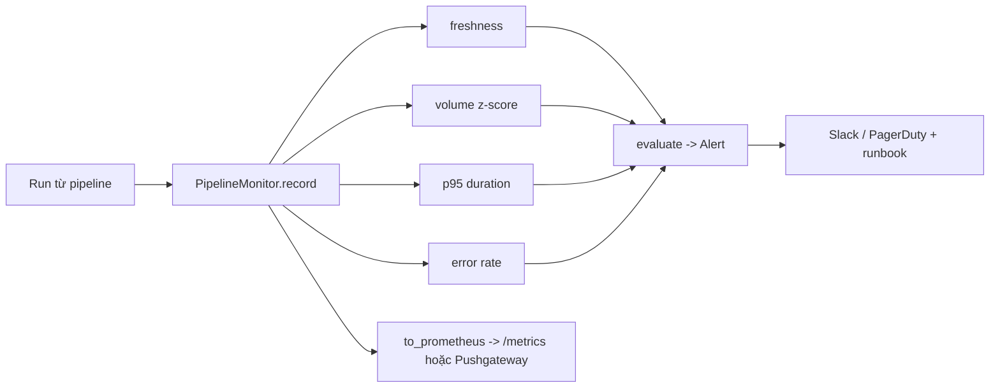

# Hướng giải: bộ giám sát pipeline

## Hướng làm



1. Lưu run theo pipeline (`defaultdict(list)`), sắp theo `started_at` khi tính vì run có thể tới
   lộn thứ tự (retry, backfill).
2. Mỗi metric là một hàm thuần nhỏ, dễ test riêng. `evaluate` chỉ ghép ngưỡng.
3. Xuất Prometheus: một hàm `family()` nội bộ in HELP/TYPE rồi các mẫu; escape label; `+Inf` cho
   freshness khi chưa từng thành công.

## Quyết định thiết kế cần cân nhắc

| Vấn đề | Bài này | Thực tế nên |
| --- | --- | --- |
| Freshness tính từ đâu | Thời điểm kết thúc run thành công | Tốt hơn: `max(updated_at)` của chính dữ liệu trong bảng đích (job thành công nhưng nạp dữ liệu cũ vẫn bị bắt) |
| Volume baseline | Mọi run thành công trước đó, z-score | So với cùng giờ/ngày trong tuần (seasonality: Black Friday, cuối tuần), dùng median/MAD bền với outlier, cửa sổ trượt 4–8 tuần |
| Lịch sử ngắn | `min_history` → không cảnh báo | Cảnh báo cứng khi `rows == 0` bất kể lịch sử |
| p95 | Nearest-rank trên mọi run | Histogram Prometheus + `histogram_quantile`, cửa sổ thời gian |
| Error rate | Cửa sổ N run gần nhất | Cảnh báo cả khi N lần liên tiếp fail; phân biệt lỗi tạm thời đã retry thành công |
| Alert fatigue | Mỗi điều kiện một alert | Gộp theo pipeline, `for: 15m` trong Prometheus rule, mức severity (warning/critical), mỗi alert có runbook, silence khi bảo trì |
| Cardinality | Label `pipeline`, `status` | Không bao giờ đặt label theo id bản ghi |

## Bản tham khảo (qua bộ test)

```python
"""Giám sát pipeline: freshness, volume anomaly, p95 latency, error rate (bản tham khảo)."""

from __future__ import annotations

import math
import statistics
from collections import defaultdict
from dataclasses import dataclass


@dataclass(frozen=True)
class Run:
    pipeline: str
    started_at: float
    duration_seconds: float
    rows: int
    status: str  # "success" | "failed"

    @property
    def finished_at(self) -> float:
        return self.started_at + self.duration_seconds


@dataclass(frozen=True)
class Alert:
    pipeline: str
    kind: str  # "freshness" | "volume" | "error_rate" | "latency"
    message: str


def _escape(value: str) -> str:
    return str(value).replace("\\", "\\\\").replace('"', '\\"').replace("\n", "\\n")


def _fmt(value: float) -> str:
    if isinstance(value, int):
        return str(value)
    if math.isinf(value):
        return "+Inf" if value > 0 else "-Inf"
    return repr(float(value))


class PipelineMonitor:
    def __init__(
        self,
        freshness_sla: dict[str, float],
        z_threshold: float = 3.0,
        min_history: int = 5,
        error_rate_threshold: float = 0.2,
        error_window: int = 20,
        p95_threshold: dict[str, float] | None = None,
    ):
        self.freshness_sla = freshness_sla
        self.z_threshold = z_threshold
        self.min_history = min_history
        self.error_rate_threshold = error_rate_threshold
        self.error_window = error_window
        self.p95_threshold = p95_threshold or {}
        self._runs: dict[str, list[Run]] = defaultdict(list)

    # ---------- lưu trữ ----------
    def record(self, run: Run) -> None:
        self._runs[run.pipeline].append(run)

    def _sorted(self, pipeline: str) -> list[Run]:
        return sorted(self._runs.get(pipeline, []), key=lambda r: r.started_at)

    def _pipelines(self) -> list[str]:
        return sorted(set(self.freshness_sla) | {p for p, runs in self._runs.items() if runs})

    # ---------- metric ----------
    def last_success(self, pipeline: str) -> float | None:
        ends = [r.finished_at for r in self._runs.get(pipeline, []) if r.status == "success"]
        return max(ends) if ends else None

    def freshness(self, pipeline: str, now: float) -> float:
        last = self.last_success(pipeline)
        return math.inf if last is None else max(0.0, now - last)

    def p95_duration(self, pipeline: str) -> float | None:
        durations = sorted(r.duration_seconds for r in self._runs.get(pipeline, []))
        if not durations:
            return None
        return durations[math.ceil(0.95 * len(durations)) - 1]

    def error_rate(self, pipeline: str) -> float:
        recent = self._sorted(pipeline)[-self.error_window:]
        if not recent:
            return 0.0
        return sum(r.status == "failed" for r in recent) / len(recent)

    def volume_zscore(self, pipeline: str) -> float | None:
        ok = [r.rows for r in self._sorted(pipeline) if r.status == "success"]
        if len(ok) - 1 < self.min_history or len(ok) < 2:
            return None
        *history, latest = ok
        mean = statistics.mean(history)
        std = statistics.pstdev(history)
        if std == 0:
            if latest == mean:
                return 0.0
            return math.inf if latest > mean else -math.inf
        return (latest - mean) / std

    # ---------- cảnh báo ----------
    def evaluate(self, now: float) -> list[Alert]:
        alerts: list[Alert] = []
        for p in self._pipelines():
            if p in self.freshness_sla:
                fresh = self.freshness(p, now)
                if fresh > self.freshness_sla[p]:
                    alerts.append(Alert(p, "freshness", f"{p}: dữ liệu cũ {fresh:.0f}s > SLA {self.freshness_sla[p]:.0f}s"))
            z = self.volume_zscore(p)
            if z is not None and abs(z) > self.z_threshold:
                alerts.append(Alert(p, "volume", f"{p}: số dòng bất thường, z-score {z:.2f}"))
            rate = self.error_rate(p)
            if rate > self.error_rate_threshold:
                alerts.append(Alert(p, "error_rate", f"{p}: tỉ lệ lỗi {rate:.0%}"))
            p95 = self.p95_duration(p)
            if p in self.p95_threshold and p95 is not None and p95 > self.p95_threshold[p]:
                alerts.append(Alert(p, "latency", f"{p}: p95 {p95:.0f}s > {self.p95_threshold[p]:.0f}s"))
        return sorted(alerts, key=lambda a: (a.pipeline, a.kind))

    # ---------- xuất Prometheus ----------
    def to_prometheus(self, now: float) -> str:
        pipelines = self._pipelines()
        out: list[str] = []

        def family(name, kind, help_text, samples):
            out.append(f"# HELP {name} {help_text}")
            out.append(f"# TYPE {name} {kind}")
            for labels, value in samples:
                lbl = ",".join(f'{k}="{_escape(v)}"' for k, v in labels)
                out.append(f"{name}{{{lbl}}} {_fmt(value)}")

        family("pipeline_freshness_seconds", "gauge", "Seconds since the last successful run.",
               [((("pipeline", p),), self.freshness(p, now)) for p in pipelines])
        counts = []
        for p in pipelines:
            for status in ("success", "failed"):
                n = sum(r.status == status for r in self._runs.get(p, []))
                if n:
                    counts.append(((("pipeline", p), ("status", status)), n))
        family("pipeline_runs_total", "counter", "Number of runs by status.", counts)
        family("pipeline_duration_p95_seconds", "gauge", "p95 run duration (nearest-rank).",
               [((("pipeline", p),), self.p95_duration(p)) for p in pipelines if self._runs.get(p)])
        family("pipeline_last_run_rows", "gauge", "Rows of the most recent run.",
               [((("pipeline", p),), self._sorted(p)[-1].rows) for p in pipelines if self._runs.get(p)])
        return "\n".join(out) + "\n"
```

Ví dụ rule Prometheus tương ứng khi metric đã được scrape:

```yaml
groups:
  - name: olist-pipelines
    rules:
      - alert: PipelineStale
        expr: pipeline_freshness_seconds{pipeline="orders"} > 7200
        for: 10m
        labels: { severity: critical }
        annotations:
          runbook: https://wiki.example.com/runbooks/olist-orders-stale
```

## Rubric (100 điểm)

| Tiêu chí | Điểm |
| --- | --- |
| Bộ test pass | 40 |
| Xử lý đúng trường hợp biên: chưa có run, run lộn thứ tự, pstdev = 0, pipeline có SLA nhưng chưa chạy | 15 |
| Code rõ ràng: hàm nhỏ, thuần, đặt tên tốt, không lặp | 15 |
| Xuất Prometheus đúng chuẩn (HELP/TYPE, escape, `+Inf`, đặt tên có đơn vị, `_total` cho counter) | 10 |
| Phân tích: giải thích ngưỡng, seasonality, chống alert fatigue, đề xuất runbook | 20 |
