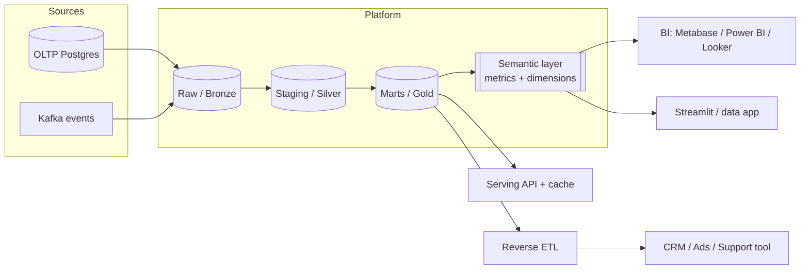
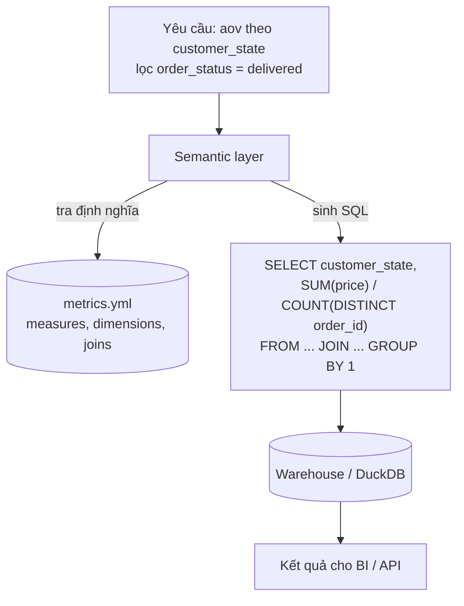
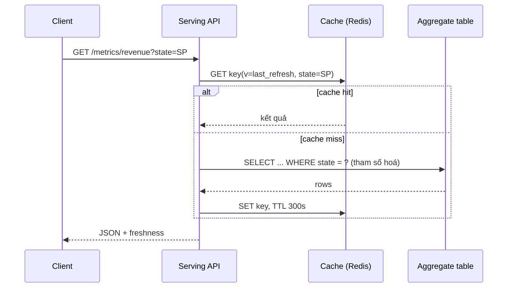
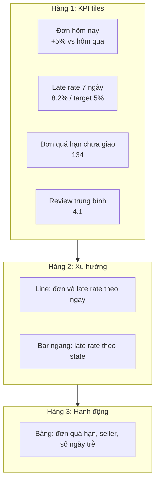
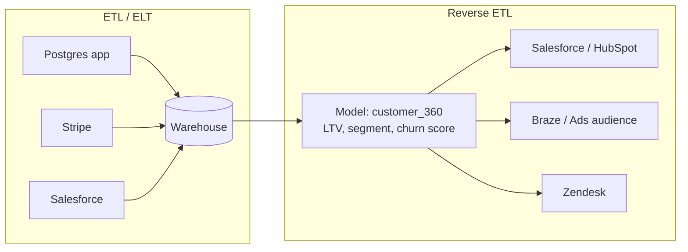

# Data Serving & BI

Pipeline chỉ có giá trị khi dữ liệu đến được tay người dùng: analyst mở dashboard, quản lý vận hành nhận
cảnh báo, app gọi API lấy số liệu, đội CRM có điểm khách hàng ngay trong công cụ họ dùng hằng ngày.
**Serving layer** là tầng cuối của data platform, nơi DE quyết định dữ liệu được tổ chức, tính sẵn, cache và
phân phối thế nào. Module này đi từ semantic layer và thiết kế bảng serving, qua BI tool, dashboard, Streamlit
và API, tới Reverse ETL, với ví dụ trên dữ liệu Olist.

## 1. Serving layer nằm ở đâu trong data platform

Theo *Fundamentals of Data Engineering* (Reis & Housley), vòng đời dữ liệu có năm giai đoạn: generation,
storage, ingestion, transformation và **serving**. Serving không chỉ là "cắm Metabase vào warehouse". Có ba
nhóm người dùng với nhu cầu rất khác nhau:

| Nhóm tiêu thụ | Ví dụ | Yêu cầu chính | Hình thức serving |
| --- | --- | --- | --- |
| Analytics (BI) | Dashboard doanh thu, báo cáo tuần | Số đúng và nhất quán, latency vài giây | Mart, semantic layer, BI tool |
| Operational analytics | Màn hình đơn trễ hạn cho đội vận hành | Dữ liệu mới (phút), cảnh báo | Bảng aggregate refresh thường xuyên, alert |
| Embedded / application | Trang "seller dashboard" trong app, API cho team khác | Latency mili giây, concurrency cao | API + cache, key-value store, OLAP thời gian thực (Druid, Pinot, ClickHouse) |
| ML | Feature cho model | Point-in-time correctness | Feature store (module MLOps) |
| Operational systems | CRM, công cụ marketing, support | Dữ liệu nằm trong tool nghiệp vụ | **Reverse ETL** |



### Nguyên tắc thiết kế serving

1. **Một nguồn sự thật cho metric.** "Doanh thu" phải ra cùng một con số ở dashboard, ở API và ở CRM. Muốn
   vậy thì định nghĩa metric ở một chỗ (semantic layer hoặc mart), không viết lại trong từng dashboard.
2. **Tách lưu trữ phân tích khỏi phục vụ.** Warehouse giỏi scan lớn nhưng không chịu nổi 1.000 request/giây từ
   app. Workload nào dùng store đó.
3. **Đo freshness và nói rõ SLA.** Mỗi bảng serving cần cột `updated_at` và một cam kết ("cập nhật mỗi
   15 phút, trễ tối đa 30 phút").
4. **Hợp đồng với người dùng.** Đổi tên cột trong mart có thể làm hỏng 40 dashboard. Coi bảng serving như
   API: có version, có thông báo khi thay đổi.

## 2. Semantic layer và metrics

Analyst thường gặp cảnh: ba dashboard ra ba con số "doanh thu tháng 3". Một cái tính cả đơn bị huỷ, một cái
cộng `freight_value`, một cái lọc theo `order_purchase_timestamp` thay vì `order_delivered_customer_date`.
**Semantic layer** chữa bệnh này bằng cách định nghĩa một lần các khái niệm nghiệp vụ:

- **Entity**: thực thể và khoá join (order, customer, seller).
- **Dimension**: thuộc tính để group/filter (`customer_state`, `order_date`, `product_category`).
- **Measure**: phép tổng hợp trên cột (`sum(price)`, `count(distinct order_id)`).
- **Metric**: biểu thức nghiệp vụ dựng từ measure: simple (`revenue`), ratio (`aov = revenue / orders`),
  cumulative, derived (`revenue_growth`).

Công cụ: **dbt Semantic Layer (MetricFlow)**, **Cube**, **LookML** (Looker), **AtScale**, model trong
Power BI (DAX measure) hay Metabase (Models + Metrics). Chúng đều nhận câu hỏi dạng *"metric X theo dimension Y,
lọc Z"* và tự sinh SQL.



### Bẫy kinh điển: trung bình của trung bình

Ratio metric phải tính **sau** khi aggregate tử và mẫu ở đúng grain, không được lấy trung bình các ratio đã
tính ở grain nhỏ hơn.

```python
import duckdb

con = duckdb.connect()
con.execute("""
CREATE TABLE daily AS SELECT * FROM (VALUES
    ('2018-01-01', 'SP', 1000.0, 10),
    ('2018-01-02', 'SP',  100.0,  1)
) t(order_date, state, revenue, orders)
""")
# Sai: AVG của AOV từng ngày = (100 + 100) / 2 = 100
print(con.execute("SELECT AVG(revenue / orders) FROM daily").fetchone())
# Đúng: tổng revenue / tổng orders = 1100 / 11 = 100 (ở đây bằng nhau do trùng hợp)
con.execute("UPDATE daily SET revenue = 300 WHERE order_date = '2018-01-02'")
print(con.execute("SELECT AVG(revenue / orders), SUM(revenue) / SUM(orders) FROM daily").fetchone())
# (200.0, 118.18...)  -> hai con số khác nhau, chỉ con số thứ hai đúng
```

Tương tự, `COUNT(DISTINCT customer_id)` **không cộng dồn được** (non-additive): số khách unique của tháng không
bằng tổng số khách unique từng ngày. Khi pre-aggregate, hãy phân loại measure:

| Loại measure | Ví dụ | Cộng dồn qua mọi dimension? | Cách lưu ở bảng aggregate |
| --- | --- | --- | --- |
| Additive | `sum(price)`, `count(*)` | Có | Lưu trực tiếp |
| Semi-additive | Tồn kho, số dư tài khoản | Không cộng theo thời gian | Lưu snapshot, lấy giá trị cuối kỳ |
| Non-additive | `count distinct`, median, ratio | Không | Lưu tử và mẫu riêng, hoặc sketch (HyperLogLog) |

### Semantic layer tối giản bằng Python

Bạn sẽ tự viết một bản ở bài intermediate/01. Ý tưởng cốt lõi:

```python
METRICS = {
    "revenue": {"type": "simple", "expr": "SUM(oi.price)"},
    "orders": {"type": "simple", "expr": "COUNT(DISTINCT o.order_id)"},
    "aov": {"type": "ratio", "numerator": "revenue", "denominator": "orders"},
}
DIMENSIONS = {"customer_state": "c.customer_state", "order_month": "DATE_TRUNC('month', o.order_purchase_timestamp)"}

def compile_query(metrics, dimensions):
    select = [f"{DIMENSIONS[d]} AS {d}" for d in dimensions]
    for m in metrics:
        spec = METRICS[m]
        if spec["type"] == "ratio":
            num, den = METRICS[spec["numerator"]]["expr"], METRICS[spec["denominator"]]["expr"]
            select.append(f"{num} / NULLIF({den}, 0) AS {m}")
        else:
            select.append(f"{spec['expr']} AS {m}")
    group = f" GROUP BY {', '.join(str(i + 1) for i in range(len(dimensions)))}" if dimensions else ""
    return (f"SELECT {', '.join(select)} FROM orders o "
            "JOIN order_items oi USING (order_id) JOIN customers c USING (customer_id)" + group)
```

Bản thật còn phải lo join path tự động, fan-out (join 1-n làm nhân bản dòng, khiến `SUM` bị đếm thừa), time
spine cho cumulative metric, và kiểm soát quyền truy cập.

## 3. Thiết kế bảng serving: aggregate, materialized view, pre-computation, caching

Dashboard chạy thẳng trên fact table 100 triệu dòng thì chậm và tốn tiền (BigQuery tính phí theo byte scan).
Có bốn kỹ thuật, thường dùng kết hợp:

| Kỹ thuật | Cách hoạt động | Ưu | Nhược | Khi nào dùng |
| --- | --- | --- | --- | --- |
| View thường | Lưu câu SQL, chạy lại mỗi lần query | Luôn mới, không tốn lưu trữ | Chậm, tốn compute lặp lại | Logic nhẹ, dữ liệu nhỏ |
| Bảng aggregate (rollup) | Job batch tính sẵn ở grain thô hơn | Query rất nhanh, rẻ | Trễ theo lịch refresh, phải lo reconcile | Dashboard KPI, grain ngày/tuần |
| Materialized view | Engine lưu kết quả, refresh tự động hoặc incremental | Ít code, engine lo refresh | Hạn chế SQL (không phải join nào cũng được), chi phí refresh | Snowflake/BigQuery/Postgres khi logic đơn giản |
| Cache (Redis, BI cache) | Lưu kết quả query theo key + TTL | Latency mili giây | Stale data, invalidation khó | API, dashboard nhiều người xem |

### Chọn grain cho bảng aggregate

Grain là "một dòng đại diện cho cái gì". `agg_daily_sales` grain = (ngày, state, category). Grain càng thô thì
bảng càng nhỏ, nhưng càng ít câu hỏi trả lời được. Cách làm thực tế: liệt kê các câu hỏi của dashboard, lấy
tập dimension nhỏ nhất bao phủ chúng. Nếu cần drill xuống từng đơn, dashboard chuyển sang query fact table.

```sql
-- DuckDB / Postgres: bảng aggregate ngày, idempotent theo khoảng ngày
DELETE FROM agg_daily_sales WHERE order_date BETWEEN DATE '2018-08-01' AND DATE '2018-08-31';
INSERT INTO agg_daily_sales
SELECT CAST(o.order_purchase_timestamp AS DATE)  AS order_date,
       c.customer_state,
       COUNT(DISTINCT o.order_id)               AS orders,
       SUM(oi.price)                            AS revenue,
       SUM(oi.freight_value)                    AS freight,
       CURRENT_TIMESTAMP                        AS updated_at
FROM orders o
JOIN order_items oi USING (order_id)
JOIN customers c USING (customer_id)
WHERE o.order_status <> 'canceled'
  AND CAST(o.order_purchase_timestamp AS DATE) BETWEEN DATE '2018-08-01' AND DATE '2018-08-31'
GROUP BY 1, 2;
```

`DELETE` + `INSERT` theo khoảng ngày (hoặc `MERGE`, hoặc overwrite partition) giúp job **idempotent**: chạy lại
bao nhiêu lần cũng ra cùng kết quả. Để xử lý **late-arriving data** (đơn cũ được cập nhật trạng thái), mỗi lần
chạy tính lại một cửa sổ lùi, ví dụ 3 ngày gần nhất.

### Reconcile: số trong aggregate phải khớp nguồn

Bảng aggregate sai mà không ai biết nguy hiểm hơn dashboard chậm. Sau mỗi lần build, chạy kiểm tra:

```sql
SELECT
    (SELECT SUM(revenue) FROM agg_daily_sales)                       AS agg_revenue,
    (SELECT SUM(oi.price) FROM order_items oi JOIN orders o USING (order_id)
      WHERE o.order_status <> 'canceled')                             AS src_revenue;
```

So sánh với dung sai cho số thực (`abs(a - b) <= 0.01`), kiểm tra cả số dòng/số đơn, và so theo từng ngày để chỉ
ra ngày lệch. Bạn làm việc này ở bài basic/02.

### Materialized view

```sql
-- PostgreSQL
CREATE MATERIALIZED VIEW mv_daily_sales AS
SELECT date_trunc('day', order_purchase_timestamp) AS day, count(*) AS orders
FROM orders GROUP BY 1;
CREATE UNIQUE INDEX ON mv_daily_sales (day);          -- bắt buộc để refresh CONCURRENTLY
REFRESH MATERIALIZED VIEW CONCURRENTLY mv_daily_sales; -- không khoá người đọc
```

Postgres refresh toàn bộ (full recompute). BigQuery, Snowflake, Databricks hỗ trợ incremental refresh cho một số
dạng query. dbt có `materialized='incremental'` cho cùng mục đích nhưng bạn tự kiểm soát logic.

### Caching và invalidation

Hai chiến lược phổ biến:

- **TTL**: cache hết hạn sau N giây. Đơn giản, chấp nhận stale tối đa N giây.
- **Event-based**: khi pipeline refresh xong bảng X, xoá (hoặc tăng version) mọi key phụ thuộc X. Cách gọn là
  đưa `data_version` (ví dụ timestamp lần refresh cuối) vào cache key: `metrics:v=20180901T0200:state=SP`.
  Bảng refresh thì version đổi, key cũ tự bị bỏ.



## 4. BI tools và data analytics cho stakeholder

### So sánh các công cụ phổ biến

| Công cụ | Mô hình | Điểm mạnh | Điểm yếu | Hợp với |
| --- | --- | --- | --- | --- |
| **Power BI** | Desktop + cloud service, DAX, import hoặc DirectQuery | Rẻ trong hệ Microsoft, modeling mạnh, phổ biến ở doanh nghiệp | DAX khó, tốt nhất trên Windows | Công ty dùng Microsoft 365/Azure |
| **Tableau** | Desktop + Server/Cloud, VizQL | Visualization tự do, mạnh cho khám phá | Đắt, governance metric yếu hơn Looker | Analyst chuyên visualization |
| **Looker** | Web, LookML (semantic layer code-first), query trực tiếp warehouse | Metric định nghĩa bằng code, version control bằng Git | Đắt, phải học LookML | Công ty muốn governed metrics |
| **Metabase** | Open source, web, câu hỏi GUI + SQL | Cài nhanh (1 container), dễ cho người không biết SQL | Modeling hạn chế, scale ở mức vừa | Startup, đội nhỏ, self-host |
| **Apache Superset** | Open source, SQL Lab + chart | Nhiều chart, scale tốt hơn Metabase | Cài và vận hành phức tạp hơn | Đội có DE vận hành |
| **Streamlit** | Python script thành web app | Toàn quyền logic, tương tác, ML demo | Không phải BI tự phục vụ, phải code | Data app, công cụ nội bộ, prototype |

Không có công cụ "tốt nhất". DE thường không chọn công cụ một mình, nhưng phải đảm bảo: kết nối bằng **service
account read-only**, chỉ cấp quyền vào schema mart (không cho đọc raw chứa PII), và có lớp model/semantic để
người dùng không tự viết lại định nghĩa metric.

### Metabase trong thực tế

- Kết nối Postgres/DuckDB (qua driver cộng đồng)/BigQuery bằng user read-only.
- **Models**: lưu một query đã làm sạch làm "bảng ảo" cho người khác hỏi tiếp. **Metrics**: định nghĩa phép
  tổng hợp chuẩn.
- **Caching**: bật cache theo thời gian chạy query; **Alerts/Subscriptions**: gửi email/Slack khi số vượt ngưỡng.
- **API**: `POST /api/session` lấy token, `POST /api/card` tạo câu hỏi, `POST /api/dashboard` tạo dashboard.
  Dùng để quản lý dashboard như code (serialization có ở bản Pro).

```python
import requests

base = "http://localhost:3000"
token = requests.post(f"{base}/api/session",
                      json={"username": "admin@example.com", "password": "..."}).json()["id"]
headers = {"X-Metabase-Session": token}
card = {
    "name": "Doanh thu theo ngày",
    "dataset_query": {"type": "native", "database": 2,
                      "native": {"query": "SELECT order_date, revenue FROM agg_daily_sales ORDER BY 1"}},
    "display": "line", "visualization_settings": {},
}
print(requests.post(f"{base}/api/card", json=card, headers=headers).json()["id"])
```

### Làm việc với stakeholder

Phần khó của analytics ít khi là SQL. Quy trình gọn:

1. **Hỏi quyết định, không hỏi biểu đồ.** "Anh dùng dashboard này để quyết định gì?" Câu trả lời cho biết metric,
   grain và độ mới cần thiết.
2. **Viết metric spec**: tên, định nghĩa bằng lời, công thức, lọc gì, grain, owner, nguồn. Ví dụ: *"Late delivery
   rate = số đơn delivered có `order_delivered_customer_date > order_estimated_delivery_date` / số đơn delivered,
   theo ngày giao, owner: Ops"*.
3. **Mock-up trước**, sau đó mới dựng pipeline.
4. **Đo việc sử dụng.** Dashboard không ai mở trong 90 ngày thì archive.

## 5. Dashboard design cho vận hành

Dashboard vận hành (operational) khác dashboard chiến lược: người xem cần biết **ngay bây giờ có gì sai và phải
làm gì**.

| Tiêu chí | Strategic dashboard | Operational dashboard |
| --- | --- | --- |
| Người xem | Ban lãnh đạo | Đội vận hành, CS, logistics |
| Tần suất xem | Tuần/tháng | Nhiều lần/ngày |
| Độ mới | Ngày | Phút đến giờ |
| Nội dung | Xu hướng, so sánh kỳ | Hàng đợi, ngoại lệ, SLA, việc cần làm |
| Hành động | Điều chỉnh chiến lược | Xử lý từng đơn, từng seller |

### Nguyên tắc

- **Bố cục chữ F/Z**: KPI quan trọng nhất ở góc trên trái. Dòng đầu là 3–5 KPI tile kèm so sánh (vs hôm qua, vs
  target), sau đó trend, cuối cùng là bảng chi tiết để hành động (danh sách đơn trễ).
- **Mỗi KPI có ngữ cảnh**: giá trị + delta + mục tiêu. "Late rate 8,2%" vô nghĩa nếu không biết target là 5%.
- **Dùng màu có chủ đích**: trung tính mặc định, đỏ/vàng chỉ khi vượt ngưỡng. Không dùng 10 màu cho 10 category.
- **Chọn biểu đồ đúng**: line cho thời gian, bar ngang cho xếp hạng category, tránh pie khi hơn 3 phần,
  tránh 3D và dual-axis gây hiểu lầm.
- **Hiển thị freshness**: "Dữ liệu cập nhật lúc 10:15". Người vận hành phải biết số có còn tin được không.
- **Filter toàn cục ít mà chất**: khoảng ngày, state, category. Default hợp lý (7 ngày gần nhất).
- **Drill-through tới hành động**: click vào seller có tỷ lệ trễ cao thì ra danh sách đơn của seller đó.



## 6. Data app với Streamlit và API serving

### Streamlit: tách logic khỏi UI

Streamlit chạy lại toàn bộ script mỗi lần người dùng tương tác. Hai bài học:

1. **Cache** phần đắt: `@st.cache_data(ttl=600)` cho kết quả query (dữ liệu serializable),
   `@st.cache_resource` cho connection.
2. **Tách logic khỏi UI**: mọi tính toán (lọc, KPI, % thay đổi, format) để ở module thuần Python, nhận và trả
   DataFrame/dict. Tệp `app.py` chỉ đọc input widget, gọi hàm, vẽ. Nhờ vậy logic có unit test, không cần mở
   trình duyệt.

```python
# dashboard_logic.py  (thuần Python, test được)
import pandas as pd

def kpis(df: pd.DataFrame) -> dict:
    orders = df["order_id"].nunique()
    revenue = float(df["price"].sum())
    return {"orders": orders, "revenue": revenue, "aov": revenue / orders if orders else 0.0}
```

```python
# app.py  (chỉ UI)
import duckdb
import streamlit as st
import dashboard_logic as logic

@st.cache_resource
def get_con():
    return duckdb.connect("olist.duckdb", read_only=True)

@st.cache_data(ttl=600)
def load(start, end):
    return get_con().execute(
        "SELECT * FROM fct_order_items WHERE order_date BETWEEN ? AND ?", [start, end]
    ).df()

start, end = st.date_input("Khoảng ngày", value=[pd.Timestamp("2018-08-01"), pd.Timestamp("2018-08-31")])
k = logic.kpis(load(start, end))
c1, c2, c3 = st.columns(3)
c1.metric("Đơn", k["orders"]); c2.metric("Doanh thu", f"{k['revenue']:,.0f}"); c3.metric("AOV", f"{k['aov']:.2f}")
```

Chạy: `uv run streamlit run app.py`. Lưu ý dùng **query tham số hoá** (`?`) thay vì f-string để chặn SQL
injection, kể cả trong app nội bộ.

### API serving dữ liệu

Khi team khác (web, mobile, partner) cần số liệu, đừng cho họ kết nối thẳng warehouse. Dựng API mỏng:

- Endpoint theo **use case**, không phải "chạy SQL tuỳ ý": `GET /sellers/{id}/metrics?from=&to=`.
- **Validate input**: whitelist dimension/metric, giới hạn khoảng ngày, kiểu dữ liệu.
- **Pagination** (limit/offset hoặc cursor) cho kết quả dài; giới hạn `limit` tối đa.
- **Cache** theo tham số + version dữ liệu; trả kèm `data_updated_at`.
- **AuthN/AuthZ**: API key/OAuth, seller chỉ thấy dữ liệu của mình (row-level, xem module 10).
- **Rate limiting** và timeout để một client không làm sập warehouse.

Framework hay dùng: FastAPI (Python), hoặc GraphQL (Hasura, Cube cung cấp sẵn REST/GraphQL trên semantic layer).
Với latency yêu cầu dưới 100 ms và concurrency cao, phục vụ từ store chuyên dụng: Redis/DynamoDB (key-value, đã
pre-compute), hoặc OLAP thời gian thực như ClickHouse, Apache Druid, Apache Pinot.

| Lựa chọn | Latency điển hình | Concurrency | Linh hoạt query | Ví dụ |
| --- | --- | --- | --- | --- |
| Warehouse trực tiếp | Giây | Thấp–vừa | Rất cao | BigQuery, Snowflake |
| Warehouse + cache | ms (hit) / giây (miss) | Cao | Cao | API + Redis |
| Key-value pre-computed | ms | Rất cao | Thấp (chỉ tra theo key) | Redis, DynamoDB, Cassandra |
| Real-time OLAP | 10–100 ms | Cao | Cao (SQL) | ClickHouse, Druid, Pinot |

## 7. Reverse ETL

### ETL vs Reverse ETL

**ETL/ELT** đưa dữ liệu từ hệ thống nghiệp vụ (Postgres, Salesforce, Stripe) **vào** warehouse. **Reverse ETL**
đi chiều ngược lại: lấy dữ liệu đã làm giàu trong warehouse (customer LTV, segment, churn score, số đơn trễ) và
**đẩy về** công cụ nghiệp vụ: CRM (Salesforce, HubSpot), marketing (Braze, Google Ads, Facebook Ads), support
(Zendesk, Intercom). Ý tưởng gọi chung là **data activation** hoặc **operational analytics**: người bán hàng
thấy "khách VIP, LTV 2.000 BRL" ngay trên màn hình CRM, không phải mở dashboard.



| | ETL / ELT | Reverse ETL |
| --- | --- | --- |
| Chiều | Nguồn nghiệp vụ → warehouse | Warehouse → công cụ nghiệp vụ |
| Đích | Bảng trong warehouse (bạn kiểm soát schema) | API SaaS (schema, rate limit do bên khác quyết) |
| Người dùng cuối | Analyst, DS | Sales, marketing, CS, vận hành |
| Thách thức chính | Schema drift, volume | Rate limit, mapping field, idempotency, lỗi từng record |
| Công cụ | Fivetran, Airbyte, dlt | Hightouch, Census, Segment (Reverse ETL), Polytomic, RudderStack |

### Use case

- Đẩy segment khách (VIP, sắp churn) vào CRM để sales gọi.
- Tạo **audience** cho quảng cáo (khách mua category X trong 30 ngày).
- Cập nhật ticket support với thông tin đơn hàng, số lần giao trễ.
- Đồng bộ seller health score sang công cụ quản lý đối tác.

### Hightouch, Census, Segment (tổng quan)

- **Hightouch** và **Census**: chuyên Reverse ETL. Bạn viết SQL model hoặc chọn dbt model, map cột sang field
  đích, chọn **sync mode** (upsert, update-only, insert, mirror), lịch chạy. Công cụ tự **diff** với lần sync
  trước để chỉ gửi bản ghi thay đổi, tự batching và retry theo giới hạn của từng API, có log lỗi từng record.
- **Segment**: vốn là CDP thu event; có thêm tính năng Reverse ETL đọc từ warehouse để đẩy về các destination
  của Segment.
- Tự viết: hợp lý khi chỉ có 1–2 đích và API đơn giản, nhưng sẽ phải tự lo những thứ dưới đây.

### Các vấn đề kỹ thuật khi tự viết

1. **Change detection (diff)**: lưu hash của từng bản ghi đã sync (`external_id → hash`). Lần sau chỉ gửi bản ghi
   mới hoặc hash khác. Giảm số call API, tránh hết quota.
2. **Idempotent upsert**: dùng **external ID** ổn định (ví dụ `customer_unique_id`) làm khoá upsert ở CRM. Gửi lại
   cùng batch không tạo bản ghi trùng.
3. **Batching**: API thường nhận tối đa N bản ghi/lần (HubSpot batch upsert 100). Chia nhỏ.
4. **Retry với exponential backoff + jitter** cho lỗi tạm thời (HTTP 429, 5xx, timeout). **Không retry** lỗi
   vĩnh viễn (400 sai dữ liệu): ghi vào danh sách lỗi để xem sau.
5. **Chỉ cập nhật state sau khi gửi thành công**: nếu batch 3 lỗi, state chỉ ghi nhận batch 1–2. Lần chạy sau
   tự gửi lại phần thiếu.
6. **Deletes**: khách bị xoá khỏi segment thì làm gì? Mirror mode xoá ở đích, upsert mode để nguyên.
7. **Quyền riêng tư**: chỉ đẩy field cần thiết, tôn trọng consent (khách opt-out marketing thì không đẩy vào
   audience quảng cáo), xem module 10.

```python
import random, time

class TransientError(Exception): ...

def call_with_retry(fn, *args, max_retries=5, base=0.5, sleep=time.sleep):
    for attempt in range(max_retries + 1):
        try:
            return fn(*args)
        except TransientError:
            if attempt == max_retries:
                raise
            sleep(base * 2 ** attempt + random.uniform(0, base))  # backoff + jitter
```

Bạn sẽ dựng một job hoàn chỉnh như vậy với "CRM giả" ở bài intermediate/02.

## 8. Kiểm chứng metric, tốc độ và quyền của người dùng thật

### Định nghĩa metric cũng cần phiên bản

Mỗi metric có tên, công thức, grain, đơn vị, ngày nghiệp vụ, trạng thái được tính, owner và ngày
có hiệu lực. Ví dụ `item_revenue_v1` chỉ tính tiền hàng đơn delivered theo ngày mua.
Nếu đổi sang mọi đơn chưa hủy, tạo phiên bản hoặc thông báo migration; đừng âm thầm sửa dashboard
khi người dùng đang so sánh với tháng trước.

Dựng bộ dữ liệu chuẩn có đơn nhiều item, nhiều payment, đơn hủy, ngày không có đơn và đơn thiếu
ngày giao. Ghi kết quả kỳ vọng do người học tính tay, rồi đối chiếu SQL/API/dashboard trên cùng phạm vi.
Với tỷ lệ giao trễ, thống nhất cách xử lý đơn delivered nhưng thiếu ngày giao: báo riêng hay loại khỏi
mẫu số. Không để SQL vô tình coi “chưa biết” là “giao đúng hạn”.

### Đo tải và cache

Ghi query, số client, số request, khoảng thời gian, p50/p95, tỷ lệ lỗi, cache hit rate và freshness.
Tách lần chạy cache lạnh khỏi cache nóng. Một dashboard trả nhanh nhưng dùng dữ liệu hết hạn vẫn
không đạt yêu cầu. Benchmark trên dữ liệu giả chỉ áp dụng cho quy mô và môi trường đã đo.

### Phân quyền phải đi tới tầng thực thi

Hai tài khoản seller A/B phải chỉ thấy dữ liệu của mình qua cả dashboard lẫn API. Filter có thể sửa
trên URL không thay thế quyền ở backend/database. Nếu cache dùng chung, cache key phải phân biệt
phạm vi quyền hiệu lực, tenant và phiên bản dữ liệu; nếu không seller A có thể nhận kết quả của B.

**Bài thực hành mở rộng M09**: dùng ít nhất hai danh tính, thử cả truy vấn hợp lệ và truy vấn cố
đọc seller khác. Chạy tải trên endpoint local bằng một số client hữu hạn, đặt timeout, ghi log lỗi.
Đạt khi không lộ dữ liệu chéo, metric khớp bộ chuẩn và độ trễ/freshness đạt mục tiêu bạn đã công bố.
Nộp thêm kế hoạch đổi metric v1 → v2: báo người dùng, đối chiếu, ngày chuyển và cách quay lại.

## 9. Tài liệu tham khảo

- Joe Reis, Matt Housley. *Fundamentals of Data Engineering*, chương 9 "Serving Data for Analytics, Machine
  Learning, and Reverse ETL". O'Reilly, 2022.
- roadmap.sh, Data Engineer roadmap: https://roadmap.sh/data-engineer
- dbt Semantic Layer và MetricFlow: https://docs.getdbt.com/docs/use-dbt-semantic-layer/dbt-sl
- Cube, semantic layer: https://cube.dev/docs/product/introduction
- Looker LookML: https://cloud.google.com/looker/docs/what-is-lookml
- Metabase docs (Models, Metrics, Caching, API): https://www.metabase.com/docs/latest/
- Power BI documentation: https://learn.microsoft.com/power-bi/
- Tableau help: https://help.tableau.com/
- Streamlit docs, caching: https://docs.streamlit.io/develop/concepts/architecture/caching
- PostgreSQL materialized views: https://www.postgresql.org/docs/current/rules-materializedviews.html
- DuckDB documentation: https://duckdb.org/docs/
- Hightouch, What is Reverse ETL: https://hightouch.com/blog/reverse-etl
- Census docs, sync behaviors: https://docs.getcensus.com/
- Segment Reverse ETL: https://segment.com/docs/connections/reverse-etl/
- AWS Architecture Blog, Exponential backoff and jitter: https://aws.amazon.com/blogs/architecture/exponential-backoff-and-jitter/
- Stephen Few. *Information Dashboard Design*, 2nd ed. Analytics Press, 2013.
- Ralph Kimball, Margy Ross. *The Data Warehouse Toolkit*, 3rd ed. (aggregate tables, additivity của fact).
