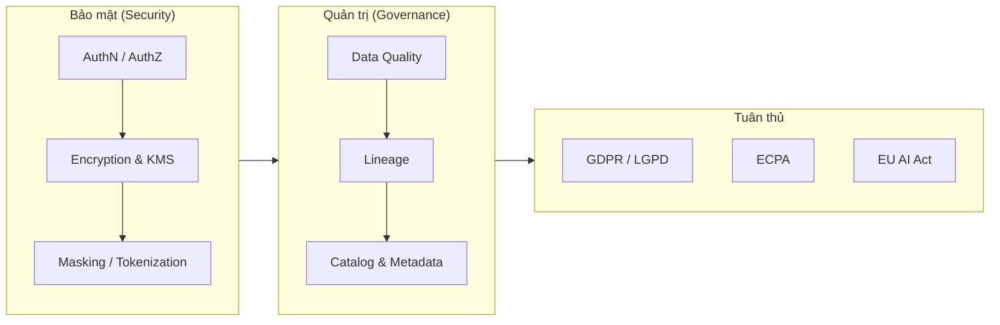
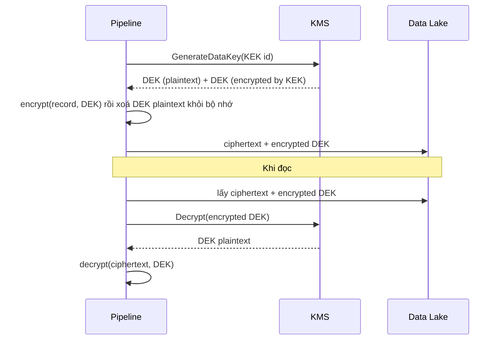
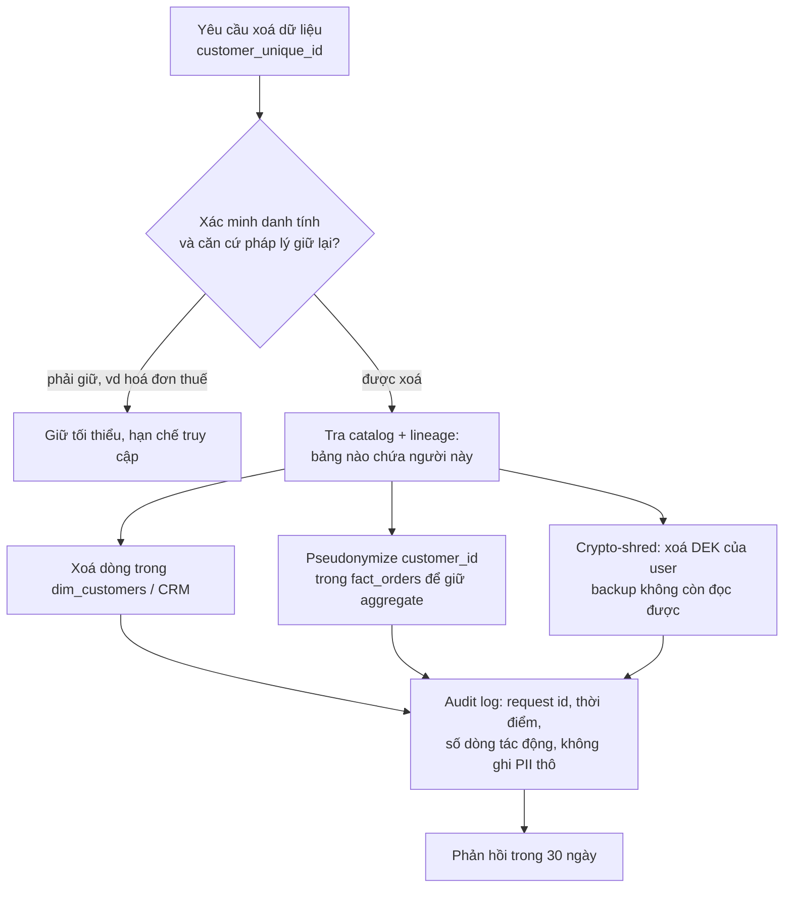
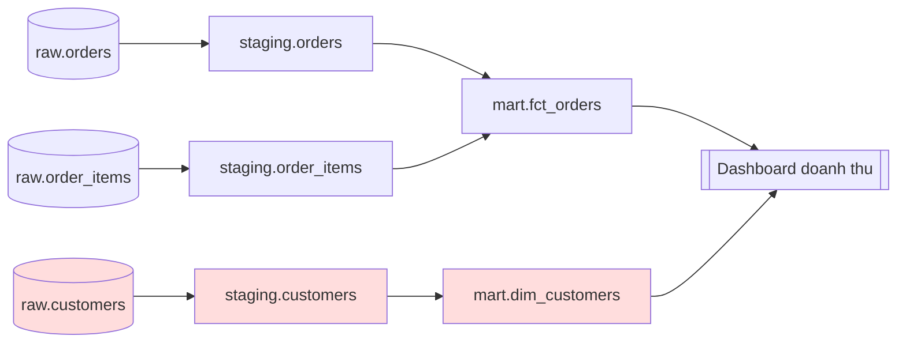

# Security & Governance

Pipeline chạy đúng và nhanh mới là một nửa công việc. Nửa còn lại: **ai được thấy dữ liệu gì**,
dữ liệu có **đáng tin** không, nó **đến từ đâu**, và công ty có **vi phạm luật** khi giữ nó hay không.
Ở các công ty có dữ liệu khách hàng (như Olist: tên, email, CPF, địa chỉ, lịch sử mua), Data Engineer
là người dựng các "lan can" này ngay trong nền tảng: phân quyền, mã hoá, masking, kiểm tra chất lượng,
lineage và catalog. Module này đi qua từng lớp, kèm code Python chạy được và các đánh đổi khi chọn giải pháp.



## 1. Authentication, Authorization và nguyên tắc least privilege

### Authentication (AuthN) và Authorization (AuthZ)

- **Authentication**: xác thực *bạn là ai*. Mật khẩu, SSO (SAML, OIDC), MFA, service account kèm
  key/certificate, IAM role của cloud, Kerberos (Hadoop), mTLS giữa service.
- **Authorization**: quyết định *bạn được làm gì* sau khi đã biết bạn là ai. `GRANT SELECT`, IAM
  policy, bucket policy, row-level security.

AuthN sai thì kẻ lạ vào được; AuthZ sai thì người quen thấy thứ không nên thấy. Phần lớn sự cố rò rỉ dữ
liệu trong data platform là lỗi AuthZ: bucket S3 để public, service account có quyền `*`, analyst được
`SELECT *` trên bảng chứa CPF.

| | Authentication | Authorization |
| --- | --- | --- |
| Câu hỏi | Bạn là ai? | Bạn được làm gì? |
| Cơ chế | Password, MFA, SSO/OIDC, Kerberos, mTLS, API key | RBAC, ABAC, ACL, IAM policy, RLS |
| Lỗi điển hình | Lộ credential, key hard-code trong repo | Cấp quyền thừa, bucket public |
| HTTP status | 401 Unauthorized | 403 Forbidden |

### RBAC và ABAC

- **RBAC (Role-Based Access Control)**: quyền gắn với *role* (`analyst`, `seller`, `finance`), user được
  gán role. Đơn giản, dễ audit, hỗ trợ sẵn trong mọi database (`CREATE ROLE`, `GRANT`). Nhược điểm:
  "role explosion" khi điều kiện phức tạp (`analyst_brazil_sp_no_pii`…).
- **ABAC (Attribute-Based Access Control)**: quyết định dựa trên *thuộc tính* của user (phòng ban,
  quốc gia, clearance), của tài nguyên (tag `pii`, `sensitivity=high`), của ngữ cảnh (purpose, giờ, mạng).
  Linh hoạt, scale theo tag thay vì theo role; nhưng khó debug hơn và cần catalog gắn tag chuẩn.

| Tiêu chí | RBAC | ABAC |
| --- | --- | --- |
| Đơn vị quyết định | Role | Thuộc tính user + resource + context |
| Dễ hiểu / audit | Rất dễ | Khó hơn, cần log lý do quyết định |
| Scale khi có nhiều bảng | Phải grant từng bảng | Gắn tag một lần, policy tự áp |
| Công cụ | GRANT trong Postgres/Snowflake | Snowflake tag-based masking, Unity Catalog ABAC, Apache Ranger, OPA |
| Phù hợp | Tổ chức nhỏ, ít loại dữ liệu nhạy cảm | Nhiều domain, nhiều quy định, dữ liệu tag sẵn |

Thực tế người ta **kết hợp**: RBAC cho quyền thô (ai vào schema nào), ABAC/tag-based policy cho cột
nhạy cảm, và **row-level security (RLS)** cho dòng (seller chỉ thấy đơn của mình).

```sql
-- PostgreSQL: RBAC + row-level security
CREATE ROLE analyst NOLOGIN;
GRANT USAGE ON SCHEMA mart TO analyst;
GRANT SELECT (order_id, order_status, order_purchase_timestamp) ON mart.orders TO analyst;

ALTER TABLE mart.order_items ENABLE ROW LEVEL SECURITY;
CREATE POLICY seller_own_rows ON mart.order_items
    FOR SELECT TO seller_role
    USING (seller_id = current_setting('app.seller_id'));
```

### Least privilege

Mỗi người, mỗi service chỉ có **đúng quyền cần cho việc của nó, trong thời gian cần**:

- Pipeline ghi vào `staging` không cần quyền `DROP` ở `mart`.
- Airflow connection dùng service account riêng cho từng DAG nhóm, không dùng tài khoản admin.
- Quyền tạm thời (just-in-time access) cho truy vấn debug trên dữ liệu production, tự hết hạn.
- **Deny by default**: không có policy cho phép thì từ chối.
- Secret (password, token) để trong secret manager (Vault, AWS Secrets Manager), không trong code/Git.

## 2. Encryption, key management và tokenization

### Encryption at rest và in transit

| Loại | Bảo vệ khỏi | Cách làm phổ biến |
| --- | --- | --- |
| **In transit** | Nghe lén trên mạng, man-in-the-middle | TLS 1.2+/HTTPS, `sslmode=verify-full` cho Postgres, mTLS giữa service, Kafka SSL |
| **At rest** | Mất ổ đĩa, snapshot bị lộ, truy cập vật lý | AES-256 cho disk/volume, S3 SSE-KMS, TDE của database |
| **Column / field-level** | Admin DB, analyst có quyền đọc bảng | Mã hoá từng cột nhạy cảm bằng key riêng ở tầng ứng dụng |
| **In use** | Bộ nhớ của máy đang xử lý | Confidential computing (hiếm trong data team) |

Lưu ý: encryption at rest của cloud **không** ngăn người có quyền `SELECT` đọc dữ liệu. Nó bảo vệ lớp
vật lý. Muốn ngăn analyst đọc CPF thì cần AuthZ, masking hoặc field-level encryption.

### Key management và envelope encryption

Mã hoá chỉ mạnh bằng việc giữ key. Các nguyên tắc:

- Key nằm trong **KMS** (AWS KMS, GCP Cloud KMS, Azure Key Vault, HashiCorp Vault), không trong code.
- **Envelope encryption**: dữ liệu được mã hoá bằng *data key* (DEK); DEK được mã hoá bằng *key
  encryption key* (KEK) nằm trong KMS. Lưu DEK đã mã hoá cạnh dữ liệu. Muốn đọc: gọi KMS giải mã DEK,
  rồi giải mã dữ liệu cục bộ. KEK không bao giờ rời KMS.
- **Key rotation**: đổi key định kỳ. Với envelope encryption chỉ cần mã hoá lại các DEK, không phải
  mã hoá lại hàng TB dữ liệu.
- **Crypto-shredding**: mỗi user một DEK; xoá DEK là dữ liệu của user đó (kể cả trong backup) không
  còn đọc được. Rất hữu ích cho "right to be forgotten".



Mô phỏng envelope encryption bằng `cryptography` (Fernet = AES-128-CBC + HMAC-SHA256):

```python
from cryptography.fernet import Fernet

kek = Fernet(Fernet.generate_key())           # giả lập key nằm trong KMS

def encrypt_record(plaintext: bytes) -> tuple[bytes, bytes]:
    dek_raw = Fernet.generate_key()
    ciphertext = Fernet(dek_raw).encrypt(plaintext)
    encrypted_dek = kek.encrypt(dek_raw)       # chỉ lưu DEK đã mã hoá
    return ciphertext, encrypted_dek

def decrypt_record(ciphertext: bytes, encrypted_dek: bytes) -> bytes:
    dek_raw = kek.decrypt(encrypted_dek)       # "gọi KMS"
    return Fernet(dek_raw).decrypt(ciphertext)

ct, edek = encrypt_record(b"cpf=123.456.789-09")
assert decrypt_record(ct, edek) == b"cpf=123.456.789-09"
```

### Hashing, HMAC, encryption, tokenization: khác nhau thế nào

| Kỹ thuật | Đảo ngược được? | Deterministic? | Dùng cho |
| --- | --- | --- | --- |
| Hash (SHA-256) | Không (nhưng brute-force được nếu không gian nhỏ như số điện thoại) | Có | Checksum, không nên dùng một mình cho PII |
| **HMAC-SHA256 với secret key** | Không, và không brute-force được nếu giữ key | Có | Pseudonymization: join được giữa các bảng |
| Encryption (AES/Fernet) | Có, nếu có key | Fernet: không (có IV ngẫu nhiên) | Lưu PII cần đọc lại |
| **Tokenization** | Có, qua token vault | Thường có | Thẻ thanh toán (PCI DSS), giảm phạm vi hệ thống chạm dữ liệu thật |
| Format-preserving encryption | Có | Có | Giữ định dạng cho hệ thống cũ (FF1/FF3) |

**Tokenization** thay giá trị thật bằng token vô nghĩa (`tok_8f2a…`), giá trị thật nằm trong một
**vault** được bảo vệ riêng. Warehouse, dashboard, ML chỉ thấy token; chỉ vài service (thanh toán, CSKH)
được quyền detokenize. Lợi ích lớn nhất: thu hẹp phạm vi audit (PCI DSS scope).

## 3. Masking, pseudonymization, anonymization và phát hiện PII

### Các mức che dữ liệu

- **Static masking**: tạo bản sao đã che (vd. môi trường dev/test lấy dữ liệu prod đã mask).
- **Dynamic masking**: dữ liệu gốc giữ nguyên, kết quả truy vấn bị che tuỳ người hỏi (Snowflake
  masking policy, SQL Server Dynamic Data Masking, view theo role).
- **Redaction / nulling**: thay bằng `NULL` hoặc `***`.
- **Partial masking**: giữ một phần cho mục đích nghiệp vụ: `j***@gmail.com`, `*** *** 4321`.
- **Generalization**: giảm độ chi tiết: ngày sinh → năm, zip code `01310-200` → `01310`, tuổi → nhóm tuổi.
- **Perturbation / noise**: thêm nhiễu (differential privacy) để thống kê vẫn đúng gần đúng.

### Pseudonymization vs anonymization

| | Pseudonymization | Anonymization |
| --- | --- | --- |
| Định nghĩa | Thay định danh bằng bí danh; có thông tin bổ sung (key) thì nối lại được | Không thể xác định lại cá nhân bằng mọi phương tiện hợp lý |
| Ví dụ | `customer_id` → `HMAC(key, customer_id)` | Bảng tổng hợp doanh thu theo bang với k ≥ 10 |
| GDPR | **Vẫn là dữ liệu cá nhân**, nhưng giảm rủi ro | Không còn là dữ liệu cá nhân, ngoài phạm vi GDPR |
| Giá trị phân tích | Cao: join, đếm khách unique được | Thấp hơn |

Bẫy hay gặp: **hash không có salt/key** không phải anonymization. Không gian số điện thoại hay CPF đủ
nhỏ để brute-force toàn bộ. Và kết hợp các quasi-identifier (zip + ngày sinh + giới tính) có thể xác
định lại phần lớn dân số; vì thế có các kỹ thuật **k-anonymity**, l-diversity.

```python
import hmac, hashlib

SECRET = b"lay-tu-secret-manager"   # không hard-code ở production

def pseudonymize(value: str, key: bytes = SECRET) -> str:
    """Cùng input + cùng key -> cùng output, nên vẫn join được giữa các bảng."""
    return hmac.new(key, value.encode(), hashlib.sha256).hexdigest()[:16]

def mask_email(email: str) -> str:
    local, _, domain = email.partition("@")
    return f"{local[:1]}***@{domain}"

print(pseudonymize("861eff4711a542e4b93843c6dd7febb0"))
print(mask_email("maria.silva@gmail.com"))   # m***@gmail.com
```

### PII detection

Muốn bảo vệ PII thì trước hết phải biết nó nằm ở đâu. Các cách phát hiện:

1. **Theo tên cột / metadata**: `email`, `phone`, `cpf`, `address`. Nhanh, nhưng bỏ sót cột `notes`,
   `review_comment_message` chứa số điện thoại do khách tự gõ.
2. **Theo nội dung (regex + checksum)**: email, số điện thoại, CPF (có 2 chữ số kiểm tra), số thẻ (thuật
   toán **Luhn**). Checksum giảm false positive rất nhiều.
3. **NER / ML**: tên người, địa chỉ trong văn bản tự do (Microsoft Presidio, spaCy, Google DLP, AWS Macie).

Quy trình thực tế: **scan định kỳ** một mẫu dữ liệu mỗi bảng, nếu tỉ lệ dòng khớp vượt ngưỡng thì gắn tag
`pii:email` cho cột trong catalog, tag kích hoạt masking policy tự động (xem phần 6).

```python
import re

CPF_RE = re.compile(r"\b\d{3}\.?\d{3}\.?\d{3}-?\d{2}\b")

def luhn_ok(number: str) -> bool:
    digits = [int(d) for d in number if d.isdigit()][::-1]
    total = sum(d if i % 2 == 0 else (d * 2 - 9 if d * 2 > 9 else d * 2) for i, d in enumerate(digits))
    return len(digits) >= 13 and total % 10 == 0

print(CPF_RE.findall("Cliente 123.456.789-09 ligou"))  # ['123.456.789-09']
print(luhn_ok("4111 1111 1111 1111"))                  # True
```

## 4. Data governance và privacy

**Data governance** là tập hợp *con người, quy trình, công nghệ* để dữ liệu được dùng đúng, an toàn và
đáng tin. Nó không phải một công cụ. Các thành phần:

| Thành phần | Câu hỏi trả lời | DE góp phần |
| --- | --- | --- |
| Ownership & stewardship | Ai chịu trách nhiệm bảng `orders`? | Ghi owner vào catalog, alert gửi đúng người |
| Classification | Cột nào là PII, confidential, public? | PII scan, tag tự động |
| Access policy | Ai được thấy gì? | RBAC/ABAC, masking policy as code |
| Data quality | Số liệu có đúng không? | Test trong pipeline, quality gate |
| Lineage | Dữ liệu từ đâu, ảnh hưởng tới đâu? | Emit lineage từ job |
| Retention & lifecycle | Giữ bao lâu, xoá thế nào? | TTL, partition expiry, xử lý erasure request |
| Audit | Ai đã truy cập gì, khi nào? | Bật access log, lưu bất biến |

### Privacy by design trong pipeline

- **Data minimization**: chỉ thu thập và chuyển các cột thật cần. Ingest bảng `customers` để tính doanh
  thu theo bang thì không cần kéo email.
- **Purpose limitation**: dữ liệu thu cho giao hàng không tự động được dùng cho quảng cáo.
- **Mask sớm**: pseudonymize ngay ở tầng bronze/staging; chỉ một vùng hạn chế giữ dữ liệu thô.
- **Retention**: đặt hạn lưu trữ (vd. log thô 30 ngày), xoá tự động.
- **Erasure**: thiết kế để xoá được một người: biết người đó nằm ở bảng nào (catalog + lineage), có
  `customer_id` để lọc, xử lý cả bản sao trong backup, cache, bản export.



## 5. Data quality: dimensions, expectations và quality gate

Dữ liệu sai lặng lẽ nguy hiểm hơn pipeline chết: dashboard vẫn lên, nhưng số sai. **Data quality** đo
dữ liệu theo nhiều chiều:

| Dimension | Ý nghĩa | Ví dụ check trên Olist |
| --- | --- | --- |
| Completeness | Không thiếu giá trị / dòng | `order_id` không null; số dòng hôm nay không giảm 50% |
| Uniqueness | Không trùng | `order_id` unique trong `orders` |
| Validity | Đúng kiểu, miền, định dạng | `order_status` ∈ {delivered, shipped, canceled…}; `price > 0` |
| Consistency | Khớp giữa các bảng / quy tắc | `delivered_date >= purchase_timestamp`; tổng payment ≈ tổng item + freight |
| Accuracy | Đúng với thực tế | Bang `SP` khớp zip code |
| Timeliness / Freshness | Đủ mới | Bản ghi mới nhất < 2 giờ |
| Referential integrity | Khoá ngoại tồn tại | Mọi `order_items.order_id` có trong `orders` |

### Expectations, schema contract và quality gate

Ý tưởng chung của Great Expectations, pandera, dbt tests, Soda: viết **kỳ vọng** (expectation) có thể
chạy tự động, kết quả là pass/fail kèm *failure cases*.

- **Great Expectations**: `expect_column_values_to_not_be_null`, `expect_column_values_to_be_in_set`…
  gom thành *Expectation Suite*, chạy bằng *Checkpoint*, sinh *Data Docs* (HTML).
- **pandera**: schema cho DataFrame (pandas, polars, pyspark) viết bằng Python, hợp với code pipeline
  và unit test.
- **dbt tests**: `unique`, `not_null`, `accepted_values`, `relationships` trong YAML, chạy sau mỗi model.

```python
import pandas as pd
import pandera.pandas as pa

orders_schema = pa.DataFrameSchema(
    {
        "order_id": pa.Column(str, unique=True, nullable=False),
        "order_status": pa.Column(str, pa.Check.isin(["delivered", "shipped", "canceled", "invoiced"])),
        "price": pa.Column(float, pa.Check.gt(0)),
    },
    strict=False,
)

df = pd.DataFrame({"order_id": ["a", "a", "b"], "order_status": ["delivered", "lost", "shipped"],
                   "price": [10.0, 5.0, -1.0]})
try:
    orders_schema.validate(df, lazy=True)        # lazy=True: gom MỌI lỗi thay vì dừng ở lỗi đầu
except pa.errors.SchemaErrors as err:
    print(err.failure_cases[["column", "check", "failure_case", "index"]])
```

**Quality gate**: dữ liệu chỉ được publish lên tầng `mart` nếu qua check. Các chiến lược khi fail:

| Chiến lược | Khi nào |
| --- | --- |
| Fail cả batch (stop the line) | Lỗi nghiêm trọng: schema đổi, trùng khoá, mất > X% dòng |
| Quarantine dòng lỗi | Lỗi từng dòng, phần còn lại vẫn dùng được; dòng lỗi vào bảng `_quarantine` để xem lại |
| Warn và vẫn publish | Check mềm (freshness hơi trễ, outlier) |

Thêm vào đó là **data contract**: producer (team backend) cam kết schema + ngữ nghĩa + SLA cho dữ liệu
họ phát ra; thay đổi phá vỡ phải qua review. Contract biến check của consumer thành trách nhiệm chung.

## 6. Lineage, metadata và data catalog

### Data lineage

Lineage trả lời: bảng/cột này **được tạo từ đâu** (upstream) và **ảnh hưởng tới đâu** (downstream).
Dùng cho:

- **Impact analysis**: đổi kiểu cột `orders.order_status` thì dashboard nào vỡ?
- **Root cause**: số doanh thu sai, lần ngược lên nguồn nào sai.
- **Compliance**: PII từ `customers.email` chảy tới những bảng nào (cần cho erasure, cho tag propagation).

Có hai mức: **table-level** (bảng → bảng) và **column-level** (cột → cột, cần parse SQL kỹ hơn).
Cách thu thập: parse SQL (sqlglot, dbt manifest), hook vào engine (Spark listener), hoặc job tự phát
event.

**OpenLineage** là chuẩn mở cho việc phát event lineage. Mỗi lần job chạy phát các `RunEvent`
(`START`, `COMPLETE`, `FAIL`, `ABORT`) gồm `run`, `job`, `inputs`, `outputs` và *facets* (schema,
data quality metrics, SQL…). Airflow, Spark, dbt, Flink đều có integration; backend nhận event phổ
biến là **Marquez**, DataHub, OpenMetadata.

```json
{
  "eventType": "COMPLETE",
  "eventTime": "2024-05-01T02:10:00Z",
  "run": {"runId": "0f6c1e7e-..."},
  "job": {"namespace": "olist", "name": "build_fct_orders"},
  "inputs": [{"namespace": "duckdb", "name": "staging.orders"}],
  "outputs": [{"namespace": "duckdb", "name": "mart.fct_orders",
               "facets": {"schema": {"fields": [{"name": "order_id", "type": "VARCHAR"}]}}}],
  "producer": "https://github.com/your-org/olist-pipeline"
}
```



Phần tô đỏ là đường đi của PII: tag `pii` ở `raw.customers` được **propagate** theo lineage xuống
các bảng phía dưới, trừ khi cột đã được mask/pseudonymize ở bước giữa.

### Metadata management và data catalog

Metadata có ba loại:

- **Technical**: schema, kiểu, partition, kích thước, vị trí file.
- **Business**: định nghĩa ("doanh thu = tổng price + freight của đơn delivered"), owner, glossary.
- **Operational**: lần chạy cuối, freshness, kết quả quality check, ai truy vấn nhiều nhất.

**Data catalog** gom các metadata đó vào một chỗ tìm kiếm được, kèm lineage và tag:

| Công cụ | Loại | Điểm nổi bật |
| --- | --- | --- |
| DataHub (LinkedIn) | Open source | Push-based metadata qua Kafka, lineage, tag, glossary |
| OpenMetadata | Open source | Schema-first, quality tests tích hợp, UI thân thiện |
| Amundsen (Lyft) | Open source | Tập trung search/discovery |
| Unity Catalog (Databricks) | Managed / OSS | Governance + quyền + lineage cho lakehouse, ABAC theo tag |
| AWS Glue Data Catalog / Lake Formation | Managed | Metastore + quyền theo cột/dòng/tag trên S3 |
| Google Dataplex / Data Catalog | Managed | Tag template, DLP tích hợp |
| Atlan, Collibra, Alation | Thương mại | Hướng business, workflow stewardship |

### Data interoperability

Interoperability: dữ liệu và metadata trao đổi được giữa các hệ thống mà không phải viết lại. Trong data
platform hiện đại nghĩa là:

- **Open formats**: Parquet, Avro, ORC; **open table formats**: Delta Lake, Apache Iceberg, Hudi, để
  Spark, Trino, DuckDB, Snowflake cùng đọc một bảng.
- **Open metadata/lineage**: OpenLineage, Iceberg REST catalog, Hive Metastore API.
- **Schema registry** (Confluent, Apicurio) cho stream: Avro/Protobuf/JSON Schema có version và luật
  tương thích.
- **Chuẩn ngữ nghĩa**: định nghĩa chung cho mã quốc gia (ISO 3166), tiền tệ (ISO 4217), thời gian
  (ISO 8601, UTC). Không chuẩn hoá thì join giữa domain là cơn ác mộng.

## 7. Quy định: GDPR, ECPA, EU AI Act (góc nhìn Data Engineer)

Phần này là tổng quan thực tế, không phải tư vấn pháp lý. Việc của DE là **biến yêu cầu pháp lý thành
khả năng kỹ thuật**: biết dữ liệu ở đâu, xoá được, export được, giới hạn được truy cập, có log.

### GDPR (EU, 2018)

Áp dụng khi xử lý dữ liệu cá nhân của người ở EU, kể cả công ty ngoài EU. Olist ở Brazil chịu **LGPD**,
luật rất giống GDPR. Việt Nam có Nghị định 13/2023 và Luật Bảo vệ dữ liệu cá nhân.

| Nguyên tắc / quyền | Ý nghĩa với pipeline |
| --- | --- |
| Lawful basis, purpose limitation | Ghi mục đích sử dụng trên dataset; ABAC theo `purpose` |
| Data minimization | Không ingest cột không cần |
| Storage limitation | Retention policy, TTL, xoá partition cũ |
| Right of access / portability (Art. 15, 20) | Export toàn bộ dữ liệu của một người theo định dạng máy đọc được |
| **Right to erasure** (Art. 17) | Xoá/anonymize một người trên mọi bảng, backup, bản sao; thường trong 1 tháng |
| Security of processing (Art. 32) | Encryption, pseudonymization, access control, kiểm thử định kỳ |
| Breach notification (Art. 33) | Báo cơ quan quản lý trong 72 giờ; cần audit log để biết lộ gì |
| Records of processing / DPIA | Catalog + lineage là bằng chứng |
| Chuyển dữ liệu ra ngoài EU | Chọn region cloud, SCC; data residency |

Mức phạt tối đa 20 triệu EUR hoặc 4% doanh thu toàn cầu.

### ECPA (Mỹ, 1986)

**Electronic Communications Privacy Act** bảo vệ nội dung liên lạc điện tử (email, tin nhắn) khi đang
truyền (Wiretap Act) và khi lưu trữ (Stored Communications Act). Với DE: không được tuỳ tiện chặn bắt,
đọc, chia sẻ nội dung liên lạc của người dùng (vd. chat CSKH, email) ngoài phạm vi cho phép; cơ quan
nhà nước muốn truy cập cần quy trình pháp lý. Thực tế: dữ liệu nội dung tin nhắn cần phân loại riêng,
giới hạn truy cập chặt, log mọi truy cập, và có quy trình xử lý yêu cầu từ cơ quan pháp luật.

### EU AI Act (có hiệu lực từ 2024, áp dụng dần 2025–2027)

Phân loại hệ thống AI theo rủi ro: *unacceptable* (cấm, vd. social scoring), *high-risk* (tuyển dụng,
chấm điểm tín dụng, giáo dục…), *limited* (nghĩa vụ minh bạch, vd. chatbot), *minimal*. Với hệ thống
high-risk, Art. 10 yêu cầu **data governance cho dữ liệu train/validation/test**: nguồn gốc, quy trình
thu thập, làm sạch, kiểm tra bias, tính đại diện, và tài liệu kỹ thuật + logging. Với DE nghĩa là:

- Version dataset train (snapshot, Delta/Iceberg time travel) và lưu lineage tới model.
- Quality check và thống kê phân phối (theo nhóm nhân khẩu học nếu phù hợp) có lưu lại.
- Datasheet/model card: dữ liệu gì, từ đâu, giới hạn gì.

| Quy định | Phạm vi | Yêu cầu kỹ thuật chính cho DE |
| --- | --- | --- |
| GDPR / LGPD | Dữ liệu cá nhân | Erasure, access/export, minimization, encryption, breach log |
| ECPA | Nội dung liên lạc điện tử (Mỹ) | Hạn chế truy cập nội dung, audit, quy trình pháp lý |
| EU AI Act | Hệ thống AI ở EU | Data governance cho dataset train, lineage, versioning, tài liệu |
| PCI DSS | Dữ liệu thẻ thanh toán | Tokenization, mã hoá, thu hẹp scope |
| HIPAA | Dữ liệu y tế (Mỹ) | Encryption, access control, audit, de-identification |

## 8. Tài liệu tham khảo

- roadmap.sh, Data Engineer: https://roadmap.sh/data-engineer
- OWASP, Authentication và Authorization Cheat Sheets: https://cheatsheetseries.owasp.org/
- NIST SP 800-162, Guide to ABAC: https://csrc.nist.gov/publications/detail/sp/800-162/final
- PostgreSQL, Row Security Policies: https://www.postgresql.org/docs/current/ddl-rowsecurity.html
- Snowflake, Column-level security & masking policies: https://docs.snowflake.com/en/user-guide/security-column-intro
- AWS KMS, Envelope encryption: https://docs.aws.amazon.com/kms/latest/developerguide/concepts.html#enveloping
- cryptography (Fernet, HMAC): https://cryptography.io/en/latest/
- Microsoft Presidio (PII detection): https://microsoft.github.io/presidio/
- pandera docs: https://pandera.readthedocs.io/
- Great Expectations docs: https://docs.greatexpectations.io/
- dbt data tests: https://docs.getdbt.com/docs/build/data-tests
- OpenLineage spec: https://openlineage.io/docs/spec/object-model
- Marquez: https://marquezproject.ai/
- DataHub: https://datahubproject.io/ · OpenMetadata: https://open-metadata.org/ · Unity Catalog: https://www.unitycatalog.io/
- GDPR full text: https://gdpr-info.eu/ · Art. 17 Right to erasure: https://gdpr-info.eu/art-17-gdpr/
- ECPA (US DOJ): https://bja.ojp.gov/program/it/privacy-civil-liberties/authorities/statutes/1285
- EU AI Act (bản chính thức): https://eur-lex.europa.eu/eli/reg/2024/1689/oj · tóm tắt: https://artificialintelligenceact.eu/
- Sách: *Data Governance: The Definitive Guide* (Eryurek et al., O'Reilly, 2021)
- Sách: *Fundamentals of Data Engineering* (Reis & Housley, O'Reilly, 2022), chương Security & Privacy
