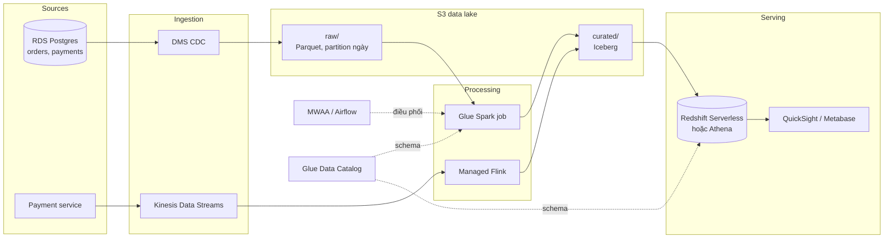
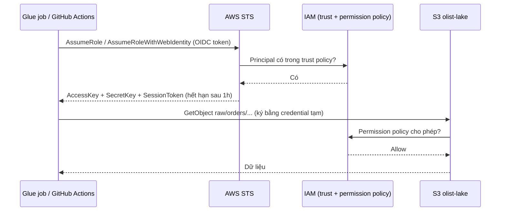
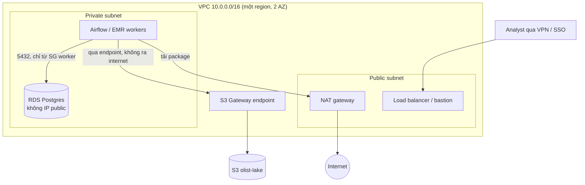

# Cloud cho Data Engineer

Gần như mọi JD Data Engineer đều ghi "kinh nghiệm AWS/Azure/GCP". Tin tốt: bạn không cần thuộc hết
hơn 200 dịch vụ của mỗi cloud. Data Engineer dùng đi dùng lại khoảng một chục loại: **compute**,
**object storage**, **managed database**, **ETL/orchestration**, **warehouse**, **streaming**, cộng
với ba "luật chơi" chung là **IAM**, **mạng** và **chi phí**. Học kỹ các khái niệm này trên một
cloud thì chuyển sang cloud khác chỉ còn là tra bảng tương đương. Module này nối các phần trước:
lake/warehouse của module 04, Spark của module 06, Kafka của module 07, Terraform của module 08,
bảo mật của module 10, và chỉ ra chúng được thuê dưới dạng dịch vụ managed như thế nào. Mọi bài
tập chạy offline (moto, LocalStack, MinIO), **không cần tài khoản cloud và không tốn tiền**.

## 1. Mô hình cloud: IaaS, PaaS, SaaS, serverless, region và trách nhiệm chung

### 1.1. Các mức dịch vụ

Càng đi xuống bảng, bạn quản lý càng ít, trả tiền càng sát với mức sử dụng, nhưng càng ít quyền
kiểm soát và càng gắn chặt với nhà cung cấp.

| Mô hình | Bạn quản lý | Cloud quản lý | Ví dụ cho data | Tính tiền |
| --- | --- | --- | --- | --- |
| On-premise | Tất cả, từ phần cứng | Không có gì | Hadoop cluster trong phòng máy | Mua máy, khấu hao |
| **IaaS** | OS, runtime, ứng dụng, dữ liệu | Phần cứng, ảo hoá, mạng vật lý | EC2, Azure VM, Compute Engine chạy Postgres tự cài | Theo giờ/giây máy chạy |
| **PaaS / managed** | Cấu hình, schema, dữ liệu | OS, patch, backup, HA | RDS, Cloud SQL, EMR, Dataproc, MWAA, Composer | Theo instance-giờ + lưu trữ |
| **Serverless** | Code/SQL và dữ liệu | Toàn bộ hạ tầng, tự co giãn | Lambda, Glue, BigQuery, Athena, Dataflow, Cloud Run | Theo request, byte quét, DPU-giờ |
| **SaaS** | Dữ liệu và người dùng | Toàn bộ ứng dụng | Snowflake, Fivetran, Looker, Power BI | Theo user/credit |

Với đội data nhỏ, nguyên tắc thực dụng là **ưu tiên managed/serverless, chỉ xuống IaaS khi có lý
do** (chi phí ở quy mô lớn, phần mềm không có bản managed, yêu cầu tuân thủ đặc biệt).

### 1.2. Region, Availability Zone, edge

- **Region**: một vùng địa lý (vd. `us-east-1`, `ap-southeast-1` Singapore, `asia-southeast1` của
  GCP, `southeastasia` của Azure). Dữ liệu mặc định **không rời region** trừ khi bạn sao chép, điều
  này quan trọng cho tuân thủ (dữ liệu khách hàng Việt Nam/EU phải nằm ở đâu).
- **Availability Zone (AZ)**: một hay nhiều data center độc lập điện/mạng trong region. Dịch vụ
  "multi-AZ" (RDS Multi-AZ, S3 Standard lưu ít nhất 3 AZ) chịu được mất một AZ.
- **Chọn region** theo: gần người dùng và nguồn dữ liệu (độ trễ, **egress**), có đủ dịch vụ (không
  phải dịch vụ nào cũng có ở mọi region), giá (us-east-1 / us-central1 thường rẻ nhất), quy định pháp lý.
- Truyền dữ liệu **giữa AZ** và **giữa region** đều tính tiền; đặt compute và storage cùng region.

### 1.3. Shared responsibility model

Cloud chịu trách nhiệm bảo mật **của** cloud (data center, phần cứng, hypervisor); bạn chịu trách
nhiệm bảo mật **trong** cloud (IAM, cấu hình mạng, mã hoá, dữ liệu). Phần lớn sự cố rò rỉ dữ liệu
trên cloud là do cấu hình của khách hàng: bucket public, access key lộ trên GitHub, security group
mở `0.0.0.0/0`.

| Lớp | IaaS (EC2) | Managed (RDS) | Serverless (BigQuery, S3) |
| --- | --- | --- | --- |
| Dữ liệu, phân loại, PII | **Bạn** | **Bạn** | **Bạn** |
| IAM, ai được truy cập | **Bạn** | **Bạn** | **Bạn** |
| Mã hoá (bật, quản lý key) | **Bạn** | **Bạn** (cloud cung cấp công cụ) | **Bạn** chọn key, cloud thực thi |
| Cấu hình mạng | **Bạn** | **Bạn** (VPC, security group) | Một phần (VPC endpoint, VPC-SC) |
| OS, patch, DB engine | **Bạn** | Cloud | Cloud |
| Phần cứng, data center | Cloud | Cloud | Cloud |

## 2. Cloud architectures cho data

Các mẫu kiến trúc của module 04 (data lake, warehouse, lakehouse) lên cloud gần như giữ nguyên,
chỉ khác ở chỗ mỗi khối là một dịch vụ được thuê:

- **Data lake trên object storage**: S3 / ADLS Gen2 (Blob) / GCS là "ổ cứng vô hạn" rẻ (~0.02
  USD/GB-tháng), bền 11 số 9. Dữ liệu chia vùng `raw/` (bronze), `curated/` (silver), `gold/`, lưu
  Parquet/Iceberg/Delta, partition kiểu Hive `year=2018/month=01/`.
- **Tách compute khỏi storage**: dữ liệu nằm yên trên object storage, nhiều engine đọc chung (Spark
  trên EMR/Dataproc/Databricks, Athena/Trino, BigQuery qua BigLake, Synapse serverless). Compute
  bật khi cần, tắt khi xong; đây là khác biệt lớn nhất so với Hadoop on-prem (HDFS gắn với máy).
- **Warehouse serverless**: BigQuery, Athena, Redshift Serverless, Synapse serverless SQL pool,
  Snowflake. Không quản cluster, trả theo byte quét hoặc theo thời gian compute.
- **Batch managed**: Glue/EMR Serverless/Dataflow/Dataproc Serverless/Databricks job chạy Spark
  hoặc Beam theo lịch, điều phối bằng Airflow managed (MWAA, Cloud Composer) hoặc Step Functions,
  Workflows, Data Factory.
- **Streaming managed**: Kinesis/MSK, Event Hubs, Pub/Sub/Managed Kafka làm hàng đợi; Managed
  Flink, Stream Analytics, Dataflow streaming để xử lý (nối với Kafka ở module 07).
- **Event-driven**: file rơi vào bucket → sự kiện (S3 Event Notification, Eventarc, Event Grid)
  → hàm serverless (Lambda, Cloud Functions/Run, Azure Functions) nạp hoặc kích hoạt pipeline.

Kiến trúc tham chiếu cho Olist trên AWS (các cloud khác thay tên theo bảng ở mục 3):



Ba kiểu kiến trúc thường gặp khi phỏng vấn, và khi nào chọn:

| Kiểu | Thành phần chính | Hợp khi | Điểm yếu |
| --- | --- | --- | --- |
| Warehouse-centric (ELT) | Ingest thẳng vào BigQuery/Snowflake/Redshift, dbt biến đổi | Đội thiên SQL, dữ liệu có cấu trúc, cần nhanh | Phí compute warehouse cao khi dữ liệu lớn, lock-in SQL dialect |
| Lake + query engine | S3/GCS + Parquet/Iceberg + Athena/Trino/Spark | Dữ liệu lớn, đa dạng, nhiều engine, cần rẻ | Phải tự quản schema, compaction, quyền |
| Lakehouse | Delta/Iceberg + Databricks/Fabric/BigLake, một bản dữ liệu cho BI và ML | Cả BI lẫn ML/AI, muốn ACID trên lake | Phức tạp hơn, phụ thuộc nền tảng lakehouse |

## 3. Bảng dịch vụ tương đương AWS, Azure, GCP

Đây là "từ điển" cần nhớ. Nhánh Cloud Computing của roadmap.sh nêu đích danh 12 dịch vụ trong ba
dòng đầu bảng (compute, object storage, managed SQL) và ETL.

| Nhóm | AWS | Azure | GCP |
| --- | --- | --- | --- |
| Compute (VM) | **EC2** | **Virtual Machines** | **Compute Engine** |
| Container / serverless compute | ECS, EKS, Fargate, Lambda | AKS, Container Apps, Functions | GKE, Cloud Run, Cloud Functions |
| Object storage | **S3** | **Blob Storage** (ADLS Gen2 cho lake) | **Cloud Storage** (GCS) |
| Managed SQL | **RDS**, Aurora | **SQL Database**, Azure Database for PostgreSQL | **Cloud SQL**, AlloyDB |
| ETL serverless | **Glue** (Spark + Data Catalog) | **Data Factory** (copy, Mapping Data Flow) | **Dataflow** (Apache Beam) |
| Spark/Hadoop managed | EMR, EMR Serverless | HDInsight, Databricks, Synapse Spark | Dataproc, Dataproc Serverless |
| Warehouse | Redshift, Athena | Synapse Analytics, Fabric Warehouse | BigQuery |
| Streaming | Kinesis Data Streams, MSK (Kafka) | Event Hubs (có Kafka API) | Pub/Sub, Managed Service for Apache Kafka |
| Stream processing | Managed Service for Apache Flink | Stream Analytics | Dataflow streaming |
| Orchestration | MWAA (Airflow), Step Functions | Data Factory pipelines, Fabric Airflow job | Cloud Composer (Airflow), Workflows |
| NoSQL | DynamoDB, DocumentDB | Cosmos DB | Firestore, Bigtable |
| Catalog / governance | Glue Data Catalog, Lake Formation | Microsoft Purview | Dataplex, Data Catalog |
| Danh tính workload | IAM role | Managed identity (Entra ID) | Service account |
| Secret, key | Secrets Manager, KMS | Key Vault | Secret Manager, Cloud KMS |
| Monitoring | CloudWatch | Azure Monitor | Cloud Monitoring/Logging |
| BI | QuickSight | Power BI | Looker, Looker Studio |

### 3.1. Mười hai dịch vụ của roadmap, mỗi cái một câu

- **EC2 / Azure VM / Compute Engine**: máy ảo theo giờ/giây. DE dùng để chạy công cụ tự host
  (Airflow, Kafka, Trino), bastion host, hoặc job đặc thù. Tiết kiệm bằng **Spot/Preemptible**
  (rẻ 60–90%, có thể bị thu hồi, hợp cho batch chịu lỗi) và Reserved/Savings Plans/CUD.
- **S3 / Blob Storage / Cloud Storage**: object storage, key-value phẳng (prefix chỉ là một phần
  của tên, không có thư mục thật). Nền của mọi data lake. Có versioning, lifecycle, event notification.
- **RDS / SQL Database / Cloud SQL**: Postgres/MySQL/SQL Server managed: backup tự động, patch,
  read replica, failover. Là **nguồn OLTP** của pipeline, không phải nơi chạy phân tích nặng.
- **Glue / Data Factory / Dataflow**: ETL managed nhưng khác bản chất. Glue = Spark serverless +
  Data Catalog + crawler. Data Factory = công cụ điều phối và copy kéo thả (90+ connector), biến đổi
  nặng thì gọi Databricks/Synapse. Dataflow = Apache Beam managed, cùng code cho batch và streaming.

### 3.2. Những chỗ "tương đương" chỉ gần đúng

- **Pub/Sub** không có partition do người dùng quản, thứ tự chỉ đảm bảo theo ordering key; Kinesis
  có shard và Event Hubs có partition, gần với Kafka hơn.
- **BigQuery** hoàn toàn serverless, tính theo byte quét; **Redshift** (provisioned) là cluster bạn
  chọn số node; **Synapse** có cả dedicated SQL pool (provisioned, phải pause để khỏi trả tiền) và
  serverless SQL pool. Microsoft đang dồn trọng tâm sang **Microsoft Fabric** (OneLake, Delta).
- **Azure SQL Database** chỉ là SQL Server; Postgres trên Azure là *Azure Database for PostgreSQL
  flexible server*.
- Tên Azure hay đổi (Synapse → Fabric, Workflow Orchestration Manager → Fabric Airflow job): khi
  đọc JD, tra bảng tương đương theo **chức năng**, không theo tên.

## 4. Object storage bằng code: boto3, LocalStack, MinIO

S3 API đã thành chuẩn de facto: MinIO, LocalStack, Cloudflare R2, Ceph đều nói S3 API, và GCS có
chế độ tương thích (XML API + HMAC key). Vì thế code `boto3` viết một lần chạy được cả local lẫn
AWS, chỉ khác `endpoint_url`.

### 4.1. Chạy S3 giả lập không tốn tiền

| Công cụ | Cách chạy | Hợp cho |
| --- | --- | --- |
| **moto** | Thư viện Python, giả lập trong bộ nhớ (`with mock_aws():`) | Unit test, nhanh, không cần Docker |
| **LocalStack** | Container `localstack/localstack`, một endpoint `:4566` cho S3, IAM, STS, Glue, Kinesis… | Thử Terraform (`tflocal`), AWS CLI (`awslocal`), nhiều dịch vụ cùng lúc |
| **MinIO** | Container `minio/minio`, đã dùng ở module 04 | Object storage thật cho Spark/DuckDB/Trino local |

```bash
docker compose -f setup/docker-compose.yml up -d localstack       # hoặc minio
curl -s http://localhost:4566/_localstack/health
```

### 4.2. Partition, upload, liệt kê, lifecycle

Ví dụ dưới chạy được với LocalStack đang bật (đổi `ENDPOINT` sang `http://localhost:9000` và key
`minioadmin` để dùng MinIO; bỏ `endpoint_url` để chạy trên AWS thật với credential từ `AWS_PROFILE`).

```python
import io
from datetime import date

import boto3
import pandas as pd
from boto3.s3.transfer import TransferConfig

ENDPOINT = "http://localhost:4566"
s3 = boto3.client("s3", endpoint_url=ENDPOINT, region_name="us-east-1",
                  aws_access_key_id="test", aws_secret_access_key="test")
BUCKET = "olist-lake-dev"
s3.create_bucket(Bucket=BUCKET)

# 1) Ghi Parquet theo partition kiểu Hive
orders = pd.DataFrame({
    "order_id": ["e481f51c", "53cdb2fc", "47770eb9"],
    "customer_id": ["9ef432eb", "b0830fb4", "41ce2a54"],
    "order_status": ["delivered", "delivered", "shipped"],
    "order_purchase_timestamp": pd.to_datetime(["2018-01-05 10:56", "2018-01-05 20:41", "2018-01-06 08:38"]),
})
for day, part in orders.groupby(orders["order_purchase_timestamp"].dt.date):
    key = f"raw/orders/year={day:%Y}/month={day:%m}/day={day:%d}/part-0000.parquet"
    buf = io.BytesIO()
    part.to_parquet(buf, index=False)
    s3.put_object(Bucket=BUCKET, Key=key, Body=buf.getvalue())

# 2) File lớn: boto3 tự chia multipart, upload song song, tự abort khi lỗi
config = TransferConfig(multipart_threshold=8 * 1024**2, multipart_chunksize=8 * 1024**2, max_concurrency=4)
big = io.BytesIO(b"x" * (20 * 1024**2))
s3.upload_fileobj(big, BUCKET, "raw/exports/big.bin", Config=config)

# 3) Liệt kê có phân trang (list_objects_v2 trả tối đa 1000 key mỗi lần)
paginator = s3.get_paginator("list_objects_v2")
for page in paginator.paginate(Bucket=BUCKET, Prefix="raw/orders/"):
    for obj in page.get("Contents", []):
        print(obj["Key"], obj["Size"])

# 4) Lifecycle: raw sang IA sau 30 ngày, Glacier sau 90; dọn multipart dở dang
s3.put_bucket_lifecycle_configuration(Bucket=BUCKET, LifecycleConfiguration={"Rules": [
    {"ID": "raw-tiering", "Status": "Enabled", "Filter": {"Prefix": "raw/"},
     "Transitions": [{"Days": 30, "StorageClass": "STANDARD_IA"}, {"Days": 90, "StorageClass": "GLACIER"}]},
    {"ID": "abort-mpu", "Status": "Enabled", "Filter": {"Prefix": ""},
     "AbortIncompleteMultipartUpload": {"DaysAfterInitiation": 7}},
]})
```

DuckDB đọc thẳng lake vừa ghi, có partition pruning:

```python
import duckdb

con = duckdb.connect()
con.sql("INSTALL httpfs; LOAD httpfs;")
con.sql("""CREATE SECRET ls (TYPE s3, KEY_ID 'test', SECRET 'test', REGION 'us-east-1',
           ENDPOINT 'localhost:4566', URL_STYLE 'path', USE_SSL false)""")
print(con.sql("""
    SELECT day, count(*) AS orders
    FROM read_parquet('s3://olist-lake-dev/raw/orders/*/*/*/*.parquet', hive_partitioning = true)
    WHERE year = 2018 AND month = 1
    GROUP BY day ORDER BY day
"""))
```

### 4.3. Những điều cần biết về object storage

- **Consistency**: S3 có strong read-after-write consistency từ 12/2020; GCS và Azure Blob cũng
  strong. Không còn cần "S3Guard" như thời Hadoop cũ.
- **Không có rename**: "đổi tên thư mục" là copy + delete từng object, chậm và không atomic. Đây
  là lý do các table format (Iceberg, Delta) dùng metadata/manifest thay vì rename.
- **Nhiều file nhỏ** làm chậm truy vấn (mỗi file một request) và đắt (phí request, phí tối thiểu
  của class lạnh). Mục tiêu file Parquet 128 MB – 1 GB, chạy compaction định kỳ.
- **Throughput theo prefix**: S3 chịu ~3,500 PUT và 5,500 GET mỗi giây trên mỗi prefix; workload
  rất lớn thì rải key ra nhiều prefix.
- SDK tương ứng: `azure-storage-blob` / `adlfs` cho Azure, `google-cloud-storage` / `gcsfs` cho GCP;
  pandas/pyarrow/DuckDB đọc được `s3://`, `abfs://`, `gs://` qua `fsspec`.

## 5. IAM và least privilege

IAM trả lời câu hỏi: **ai** (principal) được làm **gì** (action) trên **cái gì** (resource) trong
**điều kiện nào** (condition). Đây là phần phỏng vấn hỏi nhiều nhất về cloud, và là phần sai thì hậu
quả nặng nhất.

### 5.1. Khái niệm trên 3 cloud

| Khái niệm | AWS | Azure | GCP |
| --- | --- | --- | --- |
| Danh tính người | IAM Identity Center (SSO) user, IAM user (tránh) | Entra ID user/group | Google account/group |
| Danh tính workload | **IAM role** (assume role, credential tạm) | **Managed identity**, service principal | **Service account** |
| Gói quyền | Policy JSON (managed/inline) | Role definition (built-in/custom) | Role (predefined/custom) |
| Gán quyền | Gắn policy vào role/user; resource policy (bucket policy) | Role assignment tại scope (subscription, RG, resource) | IAM binding tại project/bucket/dataset |
| CI/CD không cần key | OIDC → `AssumeRoleWithWebIdentity` | Workload identity federation | Workload Identity Federation |

Nguyên tắc chung trên mọi cloud:

- **Không dùng access key dài hạn** cho workload. Job chạy trên cloud dùng role/managed identity/
  service account gắn vào compute; CI dùng OIDC federation. Key tĩnh là nguồn rò rỉ số một.
- **Least privilege**: bắt đầu từ không có quyền, thêm đúng action và resource cần. Dùng IAM
  Access Analyzer, IAM Recommender (GCP) để cắt quyền không dùng.
- **Tách role theo workload và môi trường**: role của job ingest khác role của dbt, khác role đọc
  của BI; prod khác dev (thường là account/subscription/project riêng).
- **Explicit deny thắng allow**; không có allow nào khớp thì mặc định deny.

### 5.2. Policy JSON (AWS)

Identity policy cho job Glue: đọc `raw/`, ghi `curated/` có mã hoá KMS, list đúng hai prefix, chặn
mọi request không qua TLS (bài basic 03 yêu cầu viết lại đúng policy này):

```json
{
  "Version": "2012-10-17",
  "Statement": [
    {"Sid": "ReadRaw", "Effect": "Allow", "Action": "s3:GetObject",
     "Resource": "arn:aws:s3:::olist-lake/raw/*"},
    {"Sid": "WriteCuratedKms", "Effect": "Allow", "Action": "s3:PutObject",
     "Resource": "arn:aws:s3:::olist-lake/curated/*",
     "Condition": {"StringEquals": {"s3:x-amz-server-side-encryption": "aws:kms"}}},
    {"Sid": "ListTwoPrefixes", "Effect": "Allow", "Action": "s3:ListBucket",
     "Resource": "arn:aws:s3:::olist-lake",
     "Condition": {"StringLike": {"s3:prefix": ["raw/*", "curated/*"]}}},
    {"Sid": "DenyInsecureTransport", "Effect": "Deny", "Action": "s3:*", "Resource": "*",
     "Condition": {"Bool": {"aws:SecureTransport": "false"}}}
  ]
}
```

### 5.3. Role, trust policy và credential tạm thời

Một role có hai policy: **trust policy** (ai được assume role) và **permission policy** (assume
xong được làm gì). Credential do STS cấp tự hết hạn (mặc định 1 giờ), nên lộ ra cũng ít hại hơn
access key.



Terraform tạo role cho Glue (module 08 đã dạy cú pháp; bài intermediate 02 làm đầy đủ):

```hcl
resource "aws_iam_role" "glue_etl" {
  name = "olist-glue-etl-${var.environment}"
  assume_role_policy = jsonencode({
    Version   = "2012-10-17"
    Statement = [{ Effect = "Allow", Principal = { Service = "glue.amazonaws.com" }, Action = "sts:AssumeRole" }]
  })
}

resource "aws_iam_role_policy" "glue_etl_s3" {
  role = aws_iam_role.glue_etl.id
  policy = jsonencode({
    Version = "2012-10-17"
    Statement = [
      { Effect = "Allow", Action = ["s3:GetObject"], Resource = ["${aws_s3_bucket.lake.arn}/raw/*"] },
      { Effect = "Allow", Action = ["s3:PutObject"], Resource = ["${aws_s3_bucket.lake.arn}/curated/*"] },
      { Effect = "Allow", Action = ["s3:ListBucket"], Resource = [aws_s3_bucket.lake.arn] },
    ]
  })
}
```

Tương đương trên GCP và Azure (CLI):

```bash
# GCP: service account cho Dataflow, chỉ đọc bucket raw
gcloud iam service-accounts create sa-dataflow
gcloud storage buckets add-iam-policy-binding gs://olist-raw-dev \
  --member="serviceAccount:sa-dataflow@my-project.iam.gserviceaccount.com" \
  --role="roles/storage.objectViewer"

# Azure: managed identity của Data Factory được đọc container raw
az role assignment create --assignee <principal-id-cua-adf> \
  --role "Storage Blob Data Reader" \
  --scope "/subscriptions/<sub>/resourceGroups/rg-data/providers/Microsoft.Storage/storageAccounts/olistlake/blobServices/default/containers/raw"
```

## 6. Mạng và bảo mật dữ liệu trên cloud

### 6.1. VPC, subnet, endpoint

- **VPC** (AWS, GCP) / **VNet** (Azure): mạng riêng ảo của bạn, dải IP riêng (vd. `10.0.0.0/16`).
- **Subnet public** có route ra Internet Gateway (load balancer, bastion). **Subnet private** không
  có IP public: database, worker Spark, Airflow đặt ở đây. Muốn ra internet (tải package) thì đi qua
  **NAT gateway**.
- **Security group** (AWS, stateful, gắn vào instance) / **NSG** (Azure) / **firewall rule** (GCP):
  chỉ mở đúng cổng từ đúng nguồn, vd. Postgres 5432 chỉ từ security group của worker.
- **Private endpoint**: truy cập dịch vụ managed (S3, BigQuery, Key Vault…) bằng IP riêng, không đi
  qua internet. AWS: **VPC endpoint** (Gateway endpoint cho S3/DynamoDB miễn phí, Interface endpoint
  qua PrivateLink); Azure: **Private Endpoint**; GCP: **Private Google Access**, Private Service Connect,
  và **VPC Service Controls** để chặn rò dữ liệu ra project khác.



Bẫy chi phí kinh điển: worker trong private subnet đọc S3 **qua NAT gateway** thay vì qua Gateway
endpoint. NAT tính phí theo GB xử lý (khoảng 0.045 USD/GB ở us-east-1), đọc 10 TB/tháng là thêm
~450 USD cho một việc lẽ ra miễn phí.

### 6.2. Bảo mật dữ liệu

| Lớp | Cơ chế | Ví dụ |
| --- | --- | --- |
| At rest | Mã hoá mặc định (SSE-S3, Google-managed, Microsoft-managed); key do bạn quản: SSE-KMS, CMEK, customer-managed key trong Key Vault | Dữ liệu PII dùng KMS key riêng, phân quyền ai được `kms:Decrypt` |
| In transit | TLS bắt buộc | Bucket policy deny `aws:SecureTransport = false`; Postgres `sslmode=require` |
| Truy cập | IAM least privilege, chặn public | S3 Block Public Access ở cấp account; GCS uniform bucket-level access + public access prevention |
| Bí mật | Secrets Manager / Key Vault / Secret Manager | Mật khẩu DB inject vào Airflow connection, không nằm trong code |
| Cột nhạy cảm | Masking, tokenization, policy tag | Lake Formation column filter, BigQuery policy tag, Purview (nối module 10) |
| Audit | CloudTrail, Azure Activity Log, Cloud Audit Logs | Ai đọc bảng `customers` lúc nào |

## 7. Chi phí và FinOps

Trên cloud, kiến trúc **chính là** hoá đơn. Data Engineer được kỳ vọng ước tính được chi phí trước
khi xây và tìm được chỗ lãng phí sau khi chạy.

### 7.1. Các khoản tiền chính

| Khoản | Đơn vị tính (minh hoạ, vùng US) | Đòn bẩy giảm |
| --- | --- | --- |
| Object storage | ~0.02 USD/GB-tháng (Standard), rẻ dần ở class lạnh | Lifecycle, nén, Parquet, xoá dữ liệu tạm |
| Request | ~0.005 USD/1000 PUT, ~0.0004 USD/1000 GET (S3) | Ít file lớn thay vì nhiều file nhỏ |
| **Egress** ra internet | ~0.09–0.12 USD/GB; giữa AZ/region ~0.01–0.02 USD/GB | Xử lý tại chỗ, BI cùng region, nén, CDN |
| Warehouse | BigQuery on-demand 6.25 USD/TiB quét; Redshift/Synapse theo giờ compute | Partition, cluster, chọn cột, materialized view, pause khi rảnh |
| Compute | Theo giây/giờ (VM, DPU, worker) | Serverless, autoscale, Spot/Preemptible, tắt môi trường dev |
| Phí cố định managed | MWAA, Composer, NAT gateway, cluster chạy 24/7 | Chọn dịch vụ tính theo lần chạy khi tải nhỏ |

Storage class tương đương (nóng → lạnh, giá lưu trữ giảm, phí đọc và thời gian lưu tối thiểu tăng):

| AWS S3 | Azure Blob | GCS | Thời gian lưu tối thiểu | Dùng cho |
| --- | --- | --- | --- | --- |
| Standard | Hot | Standard | Không | Dữ liệu đọc thường xuyên, curated/gold |
| Standard-IA | Cool | Nearline | 30 ngày | Raw sau khi đã xử lý, đọc vài lần/tháng |
| Glacier Instant Retrieval | Cold | Coldline | 90 ngày | Lưu trữ đọc theo quý |
| Glacier Deep Archive | Archive | Archive | 180 ngày (AWS/Azure), 365 ngày (GCS) | Lưu theo luật, gần như không đọc |
| Intelligent-Tiering | lifecycle theo last access | Autoclass | | Không biết trước mẫu truy cập |

### 7.2. Ví dụ ước tính: partition + Parquet giảm 120 lần chi phí scan

Bảng `order_items` 730 GB dạng CSV, 20 cột. Dashboard hằng giờ xem 30 ngày gần nhất, dùng 4 cột,
chạy 24 lần/ngày.

```python
def bigquery_cost(gb_per_query, queries_per_month, price_per_tib=6.25):
    return gb_per_query * queries_per_month / 1024 * price_per_tib

queries = 24 * 30
csv_full = 730                       # không partition, định dạng dòng: quét cả bảng
partitioned = 730 * 30 / 730         # partition theo ngày: 30 GB
parquet = partitioned * 4 / 20       # thêm định dạng cột: 6 GB

for name, gb in [("CSV, không partition", csv_full), ("partition ngày", partitioned),
                 ("partition + Parquet", parquet)]:
    print(f"{name:<22} {gb:7.1f} GB/truy vấn  {bigquery_cost(gb, queries):9.2f} USD/tháng")
# CSV, không partition     730.0 GB/truy vấn    3208.01 USD/tháng
# partition ngày            30.0 GB/truy vấn     131.84 USD/tháng
# partition + Parquet        6.0 GB/truy vấn      26.37 USD/tháng
```

### 7.3. Thực hành FinOps

- **Tag/label** mọi resource (`project`, `env`, `team`, `owner`) để chia hoá đơn theo đội (cost allocation).
- **Budget và alert** ở 50/80/100% (AWS Budgets, Azure Cost Management, GCP Budgets) ngay ngày đầu
  tạo tài khoản, kể cả tài khoản học.
- **Giới hạn chi phí truy vấn**: BigQuery `maximum_bytes_billed`, `require_partition_filter`, dry
  run để xem byte sẽ quét; Athena workgroup có giới hạn byte quét.
- **Cam kết dài hạn** cho tải ổn định: Savings Plans/Reserved Instances (AWS), Reservations (Azure),
  Committed Use Discounts (GCP), BigQuery Editions commitment.
- **Tắt khi không dùng**: môi trường dev tạo bằng Terraform và `destroy` cuối ngày; Synapse dedicated
  pool pause; cluster EMR/Dataproc ephemeral (tạo cho job, xoá khi xong).
- **Unit economics**: theo dõi "USD trên 1 triệu đơn hàng xử lý" thay vì chỉ tổng hoá đơn, để biết
  chi phí tăng do tăng trưởng hay do lãng phí.

## 8. Chọn cloud, tránh lock-in và học không tốn tiền

### 8.1. Chọn cloud nào

| Tiêu chí | AWS | Azure | GCP |
| --- | --- | --- | --- |
| Thị phần, việc làm | Lớn nhất, nhiều JD nhất | Mạnh ở doanh nghiệp dùng Microsoft (Entra ID, Power BI, Fabric) | Nhỏ hơn, mạnh ở công ty công nghệ/startup data |
| Điểm mạnh cho data | Nhiều lựa chọn nhất (Glue, EMR, Redshift, Athena, MSK) | Tích hợp Power BI, Fabric/OneLake, Databricks first-party | BigQuery (serverless thật sự), Dataflow, Pub/Sub, Looker |
| Độ khó với người mới | Nhiều dịch vụ chồng chéo, IAM chi tiết | Khái niệm subscription/resource group/Entra | Console gọn, project-based, BigQuery dễ bắt đầu |

Thực tế: **công ty chọn cloud trước, bạn theo công ty**. Để xin việc, học sâu một cloud (thường là
AWS vì nhiều JD, hoặc cloud của công ty bạn nhắm tới), và học bảng tương đương để nói chuyện được
về hai cloud còn lại. Chứng chỉ đáng cân nhắc: AWS Certified Data Engineer – Associate, Microsoft
DP-700 (Fabric Data Engineer), Google Professional Data Engineer.

### 8.2. Vendor lock-in

Lock-in không phải lúc nào cũng xấu: dịch vụ native thường rẻ và ít vận hành hơn. Mục tiêu là
**biết mình đang bị khoá ở đâu và cái giá để thoát**:

- **Dữ liệu ở định dạng mở** (Parquet, Iceberg, Delta) trên object storage: phần di động nhất.
- **Logic ở công cụ mã nguồn mở**: dbt (SQL + adapter cho mọi warehouse), Spark, Beam, Airflow.
- **Hạ tầng bằng Terraform/OpenTofu**: không làm resource di động, nhưng có danh sách đầy đủ để viết
  lại, và cùng một quy trình cho mọi cloud.
- **Giao thức chuẩn**: Kafka API (MSK, Event Hubs, Confluent), S3 API, Postgres wire protocol.
- Phần khó chuyển nhất: SQL dialect/UDF của warehouse, IAM và mạng, pipeline kéo thả (ADF JSON,
  Step Functions), dịch vụ AI/ML native.
- **Multi-cloud chủ động** (chạy song song nhiều cloud) hiếm khi đáng với đội nhỏ: gấp đôi kỹ năng,
  IAM, mạng, và egress giữa các cloud rất đắt. "Một cloud, thiết kế có thể chuyển" là mặc định hợp lý.

### 8.3. Học và thử mà không cháy túi

1. **Local trước**: moto cho unit test, LocalStack/MinIO cho tích hợp (bài tập module này). Code
   boto3/Terraform giữ nguyên, chỉ đổi endpoint.
2. **Free tier/credit**: AWS (tài khoản mới có credit và gói free), GCP (credit dùng thử + always
   free: BigQuery 1 TiB truy vấn và 10 GB lưu trữ mỗi tháng, BigQuery Sandbox không cần thẻ), Azure
   (credit 30 ngày + dịch vụ free 12 tháng). Điều kiện thay đổi theo thời gian, đọc kỹ trang free tier.
3. **Ngay sau khi tạo tài khoản**: bật MFA cho root/owner, tạo budget alert 5–10 USD, không tạo access
   key cho root, chọn một region và ở yên đó.
4. **Mọi thứ bằng Terraform** để `terraform destroy` dọn sạch; hoặc gom vào một resource group
   (Azure) / project (GCP) rồi xoá cả nhóm.
5. Những thứ hay "quên tắt": NAT gateway, cluster EMR/Dataproc/Redshift provisioned, Synapse dedicated
   pool, Composer/MWAA environment, Elastic IP không gắn máy, snapshot cũ.

## 9. Tài liệu tham khảo

- roadmap.sh, Data Engineer Roadmap (nhánh Cloud Computing): https://roadmap.sh/data-engineer
- AWS, Shared Responsibility Model: https://aws.amazon.com/compliance/shared-responsibility-model/
- AWS, Regions and Availability Zones: https://docs.aws.amazon.com/whitepapers/latest/aws-fault-isolation-boundaries/regions.html
- AWS, Compare AWS and Azure/Google Cloud services: https://docs.aws.amazon.com/whitepapers/latest/aws-overview/introduction.html
- Microsoft, Azure for AWS professionals: https://learn.microsoft.com/en-us/azure/architecture/aws-professional/
- Google Cloud, Compare AWS and Azure services to Google Cloud: https://cloud.google.com/docs/get-started/aws-azure-gcp-service-comparison
- Amazon S3 User Guide (storage classes, lifecycle, multipart upload): https://docs.aws.amazon.com/AmazonS3/latest/userguide/Welcome.html
- AWS IAM, Policy evaluation logic: https://docs.aws.amazon.com/IAM/latest/UserGuide/reference_policies_evaluation-logic.html
- AWS IAM, Security best practices: https://docs.aws.amazon.com/IAM/latest/UserGuide/best-practices.html
- Google Cloud IAM overview: https://cloud.google.com/iam/docs/overview
- Azure RBAC overview: https://learn.microsoft.com/en-us/azure/role-based-access-control/overview
- AWS Well-Architected, Data Analytics Lens: https://docs.aws.amazon.com/wellarchitected/latest/analytics-lens/analytics-lens.html
- Azure Architecture Center, Analytics architectures: https://learn.microsoft.com/en-us/azure/architecture/solution-ideas/articles/azure-databricks-modern-analytics-architecture
- Google Cloud Architecture Center, Data analytics: https://cloud.google.com/architecture/data-lifecycle-cloud-platform
- BigQuery pricing: https://cloud.google.com/bigquery/pricing
- FinOps Foundation, FinOps Framework: https://www.finops.org/framework/
- boto3 docs, S3: https://boto3.amazonaws.com/v1/documentation/api/latest/reference/services/s3.html
- moto docs: https://docs.getmoto.org/
- LocalStack docs: https://docs.localstack.cloud/
- Sách: Joe Reis & Matt Housley, *Fundamentals of Data Engineering* (O'Reilly, 2022), chương 4 (chọn công nghệ, cloud, lock-in, FinOps).
- Sách: J.R. Storment & Mike Fuller, *Cloud FinOps* (O'Reilly, 2nd ed., 2023).
