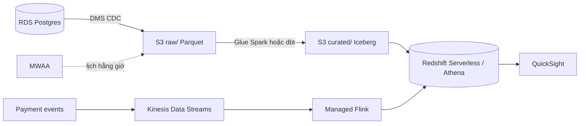

# Câu hỏi phỏng vấn: Cloud cho Data Engineer

## Phân biệt IaaS, PaaS, SaaS và serverless. Cho ví dụ dịch vụ data ở mỗi mức.

- **IaaS**: thuê máy ảo, mạng, đĩa; bạn quản OS trở lên. Ví dụ tự cài Postgres hoặc Airflow trên
  EC2/Azure VM/Compute Engine.
- **PaaS / managed**: cloud quản OS, patch, backup, HA; bạn quản cấu hình và dữ liệu. Ví dụ RDS,
  Cloud SQL, EMR, Dataproc, MWAA, Cloud Composer.
- **Serverless**: không thấy server, tự co giãn về 0, trả theo mức dùng thực (request, byte quét,
  DPU-giờ). Ví dụ BigQuery, Athena, Glue, Lambda, Dataflow, Cloud Run.
- **SaaS**: dùng ứng dụng hoàn chỉnh: Snowflake, Fivetran, Looker, Power BI.

Đánh đổi: càng lên cao càng ít vận hành và nhanh ra sản phẩm, nhưng ít kiểm soát, khó tối ưu ở quy
mô lớn và lock-in nhiều hơn. Với đội data nhỏ tôi ưu tiên managed/serverless, chỉ xuống IaaS khi
có lý do cụ thể (chi phí ở quy mô lớn, phần mềm không có bản managed).

## Region và Availability Zone là gì? Bạn chọn region cho data platform dựa vào đâu?

Region là một vùng địa lý độc lập; AZ là một hay nhiều data center tách biệt điện và mạng bên trong
region, nối với nhau bằng đường truyền độ trễ thấp. Dịch vụ multi-AZ chịu được mất một AZ; muốn
chịu được mất cả region thì phải sao chép sang region khác (DR).

Chọn region theo thứ tự: (1) **tuân thủ pháp lý** về nơi lưu dữ liệu; (2) **gần nguồn dữ liệu và
người dùng** để giảm độ trễ và tránh phí truyền liên region; (3) **có đủ dịch vụ** cần dùng;
(4) **giá**. Nguyên tắc quan trọng nhất: compute và storage cùng region, vì truyền dữ liệu giữa
region tính tiền theo GB và chậm hơn.

## Giải thích shared responsibility model. Nếu một bucket S3 bị lộ dữ liệu, lỗi của ai?

Cloud chịu trách nhiệm bảo mật **của** cloud: data center, phần cứng, hypervisor, mạng vật lý,
phần mềm của dịch vụ managed. Khách hàng chịu trách nhiệm bảo mật **trong** cloud: IAM, cấu hình
mạng, mã hoá, phân loại dữ liệu, bản vá OS với IaaS.

Bucket bị lộ gần như luôn là lỗi cấu hình của khách hàng: bucket policy/ACL public, access key bị
commit lên Git, role quá rộng. Phòng tránh: bật Block Public Access ở cấp account, chặn tạo
resource public bằng policy tổ chức (SCP, Azure Policy, Organization Policy), quét secret trong CI,
và dùng role/credential tạm thời thay vì access key.

## Kể tên dịch vụ tương đương trên AWS, Azure, GCP cho compute, object storage, managed SQL, ETL, warehouse và streaming.

| Nhóm | AWS | Azure | GCP |
| --- | --- | --- | --- |
| Compute | EC2 | Virtual Machines | Compute Engine |
| Object storage | S3 | Blob Storage / ADLS Gen2 | Cloud Storage |
| Managed SQL | RDS / Aurora | SQL Database, Database for PostgreSQL | Cloud SQL / AlloyDB |
| ETL | Glue | Data Factory | Dataflow |
| Warehouse | Redshift, Athena | Synapse / Fabric Warehouse | BigQuery |
| Streaming | Kinesis, MSK | Event Hubs | Pub/Sub |
| Orchestration | MWAA, Step Functions | Data Factory pipelines | Cloud Composer, Workflows |

Tôi sẽ nói thêm rằng "tương đương" chỉ gần đúng: Glue là Spark serverless kèm catalog, Data Factory
thiên về điều phối/copy, Dataflow là Apache Beam; Pub/Sub không có partition như Kinesis/Kafka;
BigQuery hoàn toàn serverless còn Redshift provisioned là cluster tự chọn kích cỡ.

## Vì sao data lake trên cloud thường đặt trên object storage thay vì HDFS hay ổ đĩa của VM?

- **Tách compute khỏi storage**: dữ liệu nằm yên, nhiều engine (Spark, Trino/Athena, BigQuery,
  DuckDB) đọc chung; cluster bật khi cần, tắt khi xong. Với HDFS, tắt cluster là mất chỗ chứa dữ liệu.
- **Rẻ và bền**: khoảng 0.02 USD/GB-tháng, độ bền 11 số 9, tự sao chép nhiều AZ, không phải quản
  replication factor hay thay đĩa hỏng.
- **Co giãn vô hạn**, có lifecycle chuyển class lạnh, versioning, event notification.

Đánh đổi: không có rename atomic, độ trễ mỗi request cao hơn đĩa local, nhiều file nhỏ thì chậm và
đắt. Cách khắc phục là table format (Iceberg/Delta) dùng metadata thay cho rename, file Parquet
128 MB–1 GB và compaction định kỳ.

## IAM role khác IAM user thế nào? Vì sao workload không nên dùng access key?

IAM user có credential dài hạn (mật khẩu, access key) gắn với một danh tính cố định. IAM role không
có credential riêng; một principal được phép (dịch vụ Glue, EC2, Lambda, một user, một token OIDC
từ GitHub Actions) **assume** role qua STS và nhận credential tạm thời tự hết hạn.

Access key dài hạn là nguồn rò rỉ phổ biến nhất: bị commit lên Git, nằm trong image Docker, trong
log. Lộ key nghĩa là kẻ tấn công có quyền đến khi ai đó phát hiện và xoay key. Credential tạm thời
hết hạn sau khoảng một giờ và gắn với workload cụ thể. Trên Azure dùng managed identity, trên GCP
dùng service account gắn vào compute và Workload Identity Federation cho CI, tránh tải key JSON.

## Trust policy và permission policy của một role khác nhau thế nào? IAM đánh giá Allow/Deny ra sao?

Trust policy trả lời "**ai** được assume role" (có trường `Principal`, vd. `glue.amazonaws.com`).
Permission policy trả lời "assume xong được **làm gì** trên **resource nào**".

Thứ tự đánh giá (giản lược): mặc định mọi request bị deny; nếu có statement **Deny** nào khớp thì
deny ngay (explicit deny thắng tất cả); nếu không, có statement **Allow** khớp thì allow; còn lại là
implicit deny. Trong tổ chức còn có các lớp giới hạn khác: SCP của Organizations, permission
boundary, session policy, resource policy (bucket policy). Request phải qua được mọi lớp.

Ví dụ: một Deny `s3:*` khi `aws:SecureTransport = false` vẫn chặn được dù role có allow đầy đủ,
nên chặn rộng bằng Deny an toàn hơn cho phép rộng bằng Allow.

## Viết một policy least-privilege cho job ETL đọc raw, ghi curated trên S3. Những lỗi nào hay gặp?

```json
{
  "Version": "2012-10-17",
  "Statement": [
    {"Sid": "ReadRaw", "Effect": "Allow", "Action": "s3:GetObject",
     "Resource": "arn:aws:s3:::olist-lake/raw/*"},
    {"Sid": "WriteCurated", "Effect": "Allow", "Action": "s3:PutObject",
     "Resource": "arn:aws:s3:::olist-lake/curated/*"},
    {"Sid": "List", "Effect": "Allow", "Action": "s3:ListBucket",
     "Resource": "arn:aws:s3:::olist-lake",
     "Condition": {"StringLike": {"s3:prefix": ["raw/*", "curated/*"]}}}
  ]
}
```

Lỗi hay gặp:

- `s3:*` trên `*` "cho nhanh", rồi không ai thu hẹp lại.
- Nhầm ARN: `ListBucket` áp lên bucket (`arn:aws:s3:::olist-lake`), `GetObject` áp lên object
  (`.../olist-lake/*`). Đặt sai thì list bị từ chối, người ta lại mở rộng thành `*`.
- `arn:aws:s3:::olist-lake*` thiếu dấu `/`: khớp luôn bucket `olist-lake-backup`.
- Cho `DeleteObject` khi job chỉ cần ghi đè; cho `iam:PassRole` trên `*`.

## VPC, subnet private và private endpoint giúp gì cho data platform? Kể một bẫy chi phí liên quan.

Database, worker Spark, Airflow đặt trong **subnet private** không có IP public, chỉ mở cổng cần
thiết qua security group (vd. 5432 chỉ từ security group của worker). Truy cập dịch vụ managed như
S3, BigQuery, Key Vault qua **private endpoint** (VPC endpoint, Private Endpoint, Private Service
Connect) để dữ liệu không đi qua internet, và có thể khoá bucket chỉ nhận request từ endpoint đó
(`aws:SourceVpce`). GCP có thêm VPC Service Controls để chặn sao chép dữ liệu ra project ngoài.

Bẫy chi phí: worker trong subnet private đọc S3 **qua NAT gateway**. NAT tính phí theo GB xử lý,
đọc hàng chục TB mỗi tháng là thêm hàng trăm đến hàng nghìn USD. Gateway endpoint cho S3 thì miễn
phí. Đây là một trong những câu FinOps hay gặp nhất.

## Những khoản nào thường làm hoá đơn cloud của data platform tăng đột biến? Bạn giảm thế nào?

1. **Scan của warehouse**: truy vấn `SELECT *` trên bảng không partition. Giảm bằng partition theo
   ngày, cluster, chọn cột, Parquet, materialized view; bật `require_partition_filter` và
   `maximum_bytes_billed` (BigQuery), giới hạn byte ở Athena workgroup.
2. **Egress**: kéo dữ liệu ra ngoài cloud hoặc giữa region (BI đặt ở cloud khác, đối tác tải file
   lớn). Giảm bằng xử lý tại chỗ, BI cùng region, nén, chỉ xuất bản tổng hợp.
3. **Compute quên tắt**: cluster EMR/Dataproc/Redshift provisioned, Synapse dedicated pool, máy dev.
   Giảm bằng cluster ephemeral, serverless, autoscale, lịch tắt, Terraform `destroy`.
4. **NAT gateway và phí cố định** của dịch vụ managed (MWAA, Composer).
5. **Nhiều file nhỏ** làm tăng phí request và chi phí class lạnh.

Quy trình: tag mọi resource, budget alert, xem cost explorer theo dịch vụ/tag hằng tuần, và đo
unit cost (USD trên một triệu bản ghi) để phân biệt tăng do tăng trưởng hay do lãng phí.

## Bảng 2 TB, 50 cột, partition theo ngày, lưu 2 năm. Analyst chạy 500 truy vấn/ngày, mỗi truy vấn đọc 7 ngày và 5 cột. Ước tính chi phí BigQuery on-demand.

Giả định dữ liệu phân bố đều: 2 TB / 730 ngày ≈ 2.8 GB/ngày. Một truy vấn đọc 7 ngày ≈ 19.6 GB,
định dạng cột nên chỉ đọc 5/50 cột ≈ 1.96 GB. Mỗi tháng: 500 x 30 x 1.96 GB ≈ 29,400 GB ≈ 28.7 TiB.
Giá on-demand 6.25 USD/TiB, trừ 1 TiB miễn phí: ≈ 27.7 x 6.25 ≈ **173 USD/tháng**. Lưu trữ 2 TB ở
mức active ~0.02 USD/GB ≈ 41 USD, phần lớn dữ liệu cũ hơn 90 ngày tự sang long-term giá một nửa.

So sánh: nếu bảng **không partition**, mỗi truy vấn đọc 5 cột của toàn bảng ≈ 205 GB, tức ~3,000
TiB/tháng ≈ 18,700 USD. Partition cắt gần 100 lần. Tôi cũng sẽ nhắc: nếu tải tăng lên vài trăm
TiB/tháng thì nên xem BigQuery Editions (trả theo slot) vì chi phí dự báo được hơn. Điều quan trọng
khi trả lời là nêu giả định và đơn vị tính rõ ràng, không cần con số chính xác.

## Thiết kế pipeline trên cloud: nạp dữ liệu Olist từ Postgres mỗi giờ vào warehouse, kèm dashboard fraud trễ dưới 1 phút. Chọn một cloud và giải thích.

Tôi chọn AWS (cloud khác thay theo bảng tương đương):



- **Ingestion batch**: DMS CDC từ RDS vào S3 (không tải nặng OLTP như dump), partition theo ngày.
- **Biến đổi**: Glue job hoặc dbt trên Redshift/Athena, ghi Iceberg để có upsert và time travel.
  Airflow (MWAA) điều phối, có data quality check trước khi publish.
- **Streaming**: Kinesis → Managed Flink tính rule fraud theo cửa sổ 30 giây → ghi vào bảng/kho
  phục vụ dashboard; nếu chấp nhận vài phút thì Firehose micro-batch rẻ hơn.
- **Bảo mật**: mỗi job một IAM role least privilege, RDS và worker trong subnet private, S3 qua
  Gateway endpoint, KMS cho dữ liệu PII, Lake Formation phân quyền cột.
- **Vận hành và chi phí**: Terraform cho toàn bộ hạ tầng, CloudWatch alert freshness, budget alert;
  ước tính vài trăm USD/tháng, khoản lớn nhất thường là phí cố định MWAA và streaming chạy 24/7.

Điểm cần nói rõ: đánh đổi giữa managed và tự vận hành, giữa streaming thật và micro-batch, và cách
hệ thống phục hồi khi job lỗi (idempotent theo partition, replay từ raw).

## Công ty đang dùng AWS và muốn chuyển một phần sang GCP để dùng BigQuery. Bạn lo ngại điều gì và lập kế hoạch thế nào?

Lo ngại chính:

- **Egress**: dữ liệu từ S3 sang GCP tính phí egress của AWS (~0.09 USD/GB). 100 TB là ~9,000 USD
  cho lần đầu, cộng phí liên tục nếu đồng bộ hằng ngày.
- **IAM và mạng hai nơi**: hai mô hình danh tính, cần federation (Workload Identity Federation cho
  phép GCP tin token AWS) và kết nối riêng (VPN/Interconnect) nếu dữ liệu nhạy cảm.
- **Hai nguồn sự thật**: dữ liệu lệch nhau giữa Redshift và BigQuery.

Kế hoạch: đo lượng dữ liệu cần chuyển và tần suất; ưu tiên chuyển một lần + đồng bộ tăng dần
(BigQuery Data Transfer Service từ S3, Storage Transfer Service); chỉ chuyển bảng đã tổng hợp nếu
được; giữ định dạng mở (Parquet/Iceberg) để không phải export lại; dbt với adapter hai bên để logic
không phải viết hai lần; định nghĩa rõ hệ nào là nguồn sự thật cho từng domain. Cuối cùng là tính
TCO: tiết kiệm từ BigQuery có lớn hơn egress và chi phí vận hành hai cloud không.

## Làm sao giảm vendor lock-in mà vẫn tận dụng được dịch vụ managed?

Chấp nhận lock-in ở chỗ nó mang lại nhiều giá trị và rẻ để thoát, tránh ở chỗ thoát ra rất đắt:

- **Dữ liệu**: định dạng mở (Parquet, Iceberg, Delta) trên object storage; warehouse đọc qua
  external table hoặc là bản sao phục vụ.
- **Logic**: dbt, Spark, Beam, SQL chuẩn; hạn chế UDF/stored procedure riêng của một warehouse.
- **Điều phối**: Airflow (MWAA/Composer/tự host) thay vì pipeline kéo thả khó xuất ra.
- **Hạ tầng**: Terraform/OpenTofu; tách module theo chức năng để biết rõ phải viết lại gì.
- **Giao thức chuẩn**: Kafka API, S3 API, Postgres wire protocol.

Và nói rõ cái giá: tốn thêm công vận hành, không dùng được một số tính năng native. Multi-cloud
chủ động hiếm khi đáng với đội nhỏ; mục tiêu thực tế là "một cloud, thiết kế có thể chuyển".

## Làm sao bạn phát triển và test code dùng AWS mà không cần tài khoản thật?

- **Unit test**: `moto` giả lập S3, IAM, Glue, Kinesis… trong bộ nhớ (`with mock_aws():`); nhanh,
  chạy được trong CI không cần mạng.
- **Integration test**: LocalStack (một endpoint `:4566` cho nhiều dịch vụ, dùng `awslocal`,
  `tflocal` với Terraform) hoặc MinIO cho object storage; code boto3 giữ nguyên, chỉ đổi
  `endpoint_url` qua biến môi trường.
- **Hạ tầng**: `terraform validate`, `terraform plan` với provider trỏ về LocalStack, kiểm tra
  policy bằng IAM Access Analyzer policy validation khi đã có tài khoản.
- **Trên cloud thật**: account/project sandbox riêng, budget alert thấp, mọi thứ tạo bằng Terraform
  để `destroy` hằng ngày.

Giới hạn: giả lập không đủ chính xác cho IAM evaluation phức tạp, hiệu năng, quota và một số dịch
vụ; cần ít nhất một môi trường staging thật trước khi lên production.

## Chọn storage class cho dữ liệu raw của data lake thế nào? Khi nào chuyển sang class lạnh lại đắt hơn?

Dựa vào mẫu truy cập: raw thường chỉ đọc nhiều trong vài ngày đầu (xử lý, backfill gần), sau đó
hiếm khi đọc. Lifecycle phổ biến: Standard 30 ngày → Standard-IA/Nearline/Cool → Glacier/Coldline/
Archive sau 90–180 ngày, xoá theo chính sách retention. Curated/gold đọc thường xuyên nên giữ Standard.

Class lạnh đắt hơn khi:

- **Đọc lại nhiều**: phí truy xuất theo GB vượt phần tiết kiệm lưu trữ (vd. chạy backfill định kỳ
  trên dữ liệu đã chuyển Glacier).
- **Xoá sớm**: thời gian lưu tối thiểu (30/90/180 ngày) vẫn bị tính đủ.
- **Nhiều object nhỏ**: phí tối thiểu 128 KB mỗi object và phí transition theo số object.

Không chắc mẫu truy cập thì dùng S3 Intelligent-Tiering hoặc GCS Autoclass, và gộp file nhỏ trước
khi chuyển.

## Budget alert có ngăn tài khoản phát sinh thêm chi phí không?

Không nên coi alert là trần chi tiêu tự động. Nó báo theo cấu hình và có thể có độ trễ.
Cần inventory, giới hạn truy vấn/tài nguyên phù hợp và dọn tài nguyên lab; kiểm billing sau đó.
Ghi giá và giả định ở thời điểm làm, không hứa lab luôn miễn phí.

## Vì sao phải thử quyền BI bằng đúng danh tính BI?

Owner thường có quyền rộng nên truy vấn thành công bằng owner không chứng minh least privilege.
Thử BI đọc bảng được phép, đọc raw bị cấm và ghi bảng bị từ chối; kiểm quyền kế thừa nếu kết quả
trái dự kiến. Môi trường local giả lập không tự chứng minh IAM cloud thật.
