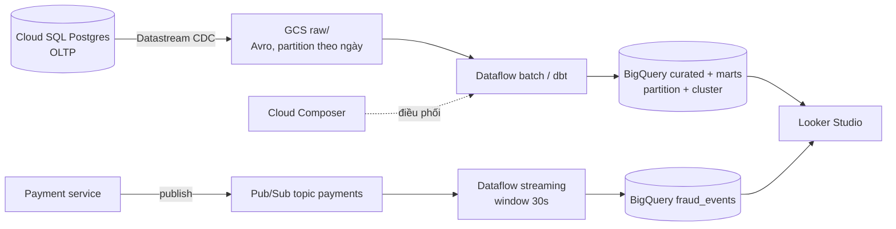

# Hướng giải: data platform Olist trên một cloud

Không có đáp án duy nhất. Người chấm nhìn vào **cách lập luận**: yêu cầu → lựa chọn → đánh đổi →
con số. Dưới đây là hướng làm, các quyết định cần cân nhắc, một bản tham khảo trên GCP (đã qua bộ
test) và rubric.

## Hướng làm

1. **Đọc yêu cầu thành con số**: 2 GB/ngày → ~730 GB raw/năm; 200 truy vấn/ngày; 50 sự kiện/giây
   ≈ 130 triệu message/tháng; fraud < 1 phút → cần streaming thật; đội 3 người → serverless.
2. **Vẽ luồng dữ liệu trước, chọn dịch vụ sau**: nguồn → landing (object storage, định dạng mở)
   → xử lý → warehouse → BI; nhánh streaming riêng; orchestration bao quanh.
3. **Gán dịch vụ cho từng lớp** bằng bảng tương đương (README mục 3), mỗi dịch vụ một câu lý do.
4. **Mô hình chi phí ở trạng thái ổn định**, tách các khoản theo đơn vị tính tiền (GB-tháng,
   worker-giờ, TiB quét, message, GB egress, phí cố định). Thường thấy: **phí cố định (orchestration,
   streaming 24/7) lớn hơn lưu trữ** ở quy mô nhỏ như Olist.
5. **Viết ADR** cho các chỗ có hai lựa chọn hợp lý.
6. **Bảo mật và vận hành**: danh tính cho từng workload, mạng riêng, mã hoá, PII, IaC, alert, DR,
   budget alert, dọn tài nguyên.

## Quyết định cần cân nhắc

| Quyết định | Phương án | Đánh đổi |
| --- | --- | --- |
| Warehouse | Serverless theo byte quét (BigQuery on-demand, Athena, Synapse serverless) vs provisioned (Redshift, BigQuery Editions, Synapse dedicated) | Workload nhỏ, không đều → serverless rẻ; tải đều, lớn → provisioned/commit rẻ và dễ dự báo |
| Orchestration | Managed Airflow (MWAA, Composer ~300–450 USD/tháng) vs Step Functions/Workflows/ADF | Airflow quen thuộc, nhiều operator; dịch vụ native rẻ hơn nhiều cho ít DAG |
| Streaming | Streaming thật (Kinesis + Flink, Pub/Sub + Dataflow, Event Hubs + Stream Analytics) vs micro-batch | Đáp ứng < 1 phút nhưng có phí chạy 24/7 |
| Ingestion OLTP | CDC managed (DMS, Datastream, ADF CDC) vs dump hằng giờ | CDC trễ thấp, không tải nặng nguồn; dump đơn giản nhưng tải nguồn và trễ cao |
| Định dạng lake | Parquet/Iceberg/Delta trên object storage vs chỉ lưu trong warehouse | Định dạng mở chống lock-in, replay được; tốn công quản schema |
| Region | Một region vs multi-region | Multi-region chống sự cố vùng nhưng đắt gấp đôi lưu trữ và phát sinh phí truyền liên vùng |

Phiên bản AWS tương ứng: DMS → S3 (raw) → Glue/EMR Serverless → Redshift Serverless hoặc Athena;
Kinesis Data Streams + Managed Flink; MWAA hoặc Step Functions; QuickSight. Phiên bản Azure:
ADF (CDC) → ADLS Gen2 → Databricks/Synapse Spark → Synapse/Fabric Warehouse; Event Hubs + Stream
Analytics; Power BI.

## Bản tham khảo (GCP)

`estimate.py`:

```python
"""Mô hình chi phí hàng tháng (USD) cho data platform Olist trên GCP."""

from __future__ import annotations

CLOUD = "gcp"

DEFAULT_WORKLOAD = {
    "raw_gb_per_day": 2.0,
    "raw_retention_days": 365,
    "raw_hot_days": 30,
    "curated_retention_days": 3 * 365,
    "compression_ratio": 4.0,
    "queries_per_day": 200,
    "scan_gb_per_query": 0.5,
    "etl_hours_per_day": 1.0,
    "etl_workers": 2,
    "stream_events_per_sec": 50,
    "egress_gb_per_month": 50,
}

# Giá minh hoạ us-central1, tra trên Google Cloud pricing pages / Pricing Calculator. Cập nhật khi dùng thật.
PRICES = {
    "storage_hot_gb_month": 0.020,      # GCS Standard (cũng ≈ BigQuery active storage)
    "storage_cold_gb_month": 0.010,     # GCS Nearline cho raw > 30 ngày
    "etl_worker_hour": 0.30,            # Dataflow batch, worker 4 vCPU / 15 GB
    "scan_per_tb": 6.25,                # BigQuery on-demand, USD/TiB
    "scan_free_tb": 1.0,                # 1 TiB miễn phí mỗi tháng
    "stream_per_tb": 40.0,              # Pub/Sub throughput, USD/TiB
    "stream_msg_kb": 1.0,               # Pub/Sub tính tối thiểu 1 KB mỗi message
    "stream_worker_month": 110.0,       # 1 worker Dataflow streaming chạy 24/7
    "egress_per_gb": 0.12,              # internet egress, premium tier
    "other_fixed_month": 450.0,         # Cloud Composer 2 small + Logging/Monitoring
}

DAYS_PER_MONTH = 30


def estimate(workload: dict = DEFAULT_WORKLOAD, prices: dict = PRICES) -> dict[str, float]:
    w, p = workload, prices
    # Storage ở trạng thái ổn định
    raw_hot = w["raw_gb_per_day"] * min(w["raw_hot_days"], w["raw_retention_days"])
    raw_cold = w["raw_gb_per_day"] * max(0, w["raw_retention_days"] - w["raw_hot_days"])
    curated = w["raw_gb_per_day"] * w["curated_retention_days"] / w["compression_ratio"]
    storage = (raw_hot + curated) * p["storage_hot_gb_month"] + raw_cold * p["storage_cold_gb_month"]

    compute = w["etl_hours_per_day"] * DAYS_PER_MONTH * w["etl_workers"] * p["etl_worker_hour"]

    scanned_tb = w["queries_per_day"] * DAYS_PER_MONTH * w["scan_gb_per_query"] / 1024
    warehouse = max(0.0, scanned_tb - p["scan_free_tb"]) * p["scan_per_tb"]

    messages = w["stream_events_per_sec"] * 86_400 * DAYS_PER_MONTH
    stream_tb = messages * p["stream_msg_kb"] / 1024 ** 3
    streaming = stream_tb * p["stream_per_tb"] + (p["stream_worker_month"] if messages else 0.0)

    egress = w["egress_gb_per_month"] * p["egress_per_gb"]
    other = p["other_fixed_month"]

    result = {
        "storage": round(storage, 2),
        "compute": round(compute, 2),
        "warehouse": round(warehouse, 2),
        "streaming": round(streaming, 2),
        "egress": round(egress, 2),
        "other": round(other, 2),
    }
    result["total"] = round(sum(result.values()), 2)
    return result


if __name__ == "__main__":
    for item, usd in estimate().items():
        print(f"{item:>10}: {usd:10.2f} USD")
```

Kết quả: storage 18.85, compute 18.00, warehouse 12.06, streaming 114.83, egress 6.00,
other 450.00, **tổng ≈ 620 USD/tháng**. Nhận xét: 73% chi phí là phí cố định Composer; nếu ngân sách
chặt, ADR thay bằng Cloud Scheduler + Workflows là quyết định đáng giá nhất.

`design.md` (rút gọn từ bản đã qua test):

````markdown
# Thiết kế data platform Olist trên Google Cloud

## 1. Bối cảnh và yêu cầu

- Batch: dữ liệu Postgres OLTP (~2 GB thô/ngày) vào warehouse, dashboard doanh thu cập nhật mỗi giờ.
- Streaming: sự kiện thanh toán ~50 sự kiện/giây lúc cao điểm, dashboard fraud trễ < 1 phút.
- PII (`customer_unique_id`, zip code) mã hoá, chỉ nhóm được duyệt xem bản gốc.
- Phi chức năng: đội 3 DE, không có đội platform → serverless/managed tối đa; ngân sách < 1,500 USD/tháng.
- Giả định: một region `us-central1` (gần người dùng BI, rẻ), Postgres nguồn đã chuyển lên Cloud SQL.

## 2. Kiến trúc tổng quan



## 3. Dịch vụ theo từng lớp

| Lớp | Dịch vụ | Lý do chọn |
| --- | --- | --- |
| Ingestion batch | Datastream (CDC từ Cloud SQL) | Không tự vận hành Debezium/Kafka Connect |
| Storage | Cloud Storage (GCS) raw/ + lifecycle sang Nearline sau 30 ngày | Rẻ, bền, định dạng mở |
| Processing | Dataflow (Apache Beam) batch, dbt trong BigQuery | Serverless, autoscale |
| Warehouse | BigQuery on-demand, partition theo ngày, cluster theo `seller_id` | Không quản cluster, trả theo byte quét |
| Streaming | Pub/Sub + Dataflow streaming | Trễ vài giây, exactly-once trong Dataflow |
| Orchestration | Cloud Composer 2 (Airflow managed) | Đội đã biết Airflow (module 05) |
| Compute phụ | Cloud Run jobs cho script nhỏ | Trả theo giây, không có VM |
| BI | Looker Studio | Miễn phí, nối thẳng BigQuery |

## 4. Ước tính chi phí

| Khoản | USD/tháng | Ghi chú |
| --- | --- | --- |
| Storage | 18.85 | 60 GB raw nóng + 670 GB raw Nearline + 548 GB curated |
| Compute (Dataflow batch) | 18.00 | 1 giờ/ngày x 2 worker |
| Warehouse (BigQuery scan) | 12.06 | 2.9 TiB quét/tháng, 1 TiB miễn phí |
| Streaming | 114.83 | Pub/Sub ~0.13 TiB + 1 worker streaming 24/7 |
| Egress | 6.00 | 50 GB ra ngoài |
| Khác | 450.00 | Composer small + Logging/Monitoring |
| **Tổng** | **619.74** | Dưới ngân sách 1,500 USD |

Nếu vượt ngân sách: thay Composer bằng Cloud Scheduler + Workflows (tiết kiệm ~400 USD), dùng
BigQuery Editions khi scan vượt ~50 TiB/tháng, đặt budget alert 50/80/100%.

## 5. Quyết định kiến trúc (ADR)

### ADR-1: BigQuery on-demand thay vì slot reservation

- **Bối cảnh**: 200 truy vấn/ngày, mỗi truy vấn quét ~0.5 GB sau partition pruning.
- **Lựa chọn**: on-demand 6.25 USD/TiB.
- **Lý do**: ~3 TiB/tháng chỉ ~12 USD; reservation tối thiểu cao hơn nhiều.
- **Đánh đổi**: một truy vấn `SELECT *` sai có thể tốn tiền → bật `require_partition_filter`,
  giới hạn `maximum_bytes_billed` theo user.

### ADR-2: Dataflow streaming cho fraud thay vì micro-batch 1 phút

- **Bối cảnh**: yêu cầu trễ < 1 phút.
- **Lựa chọn**: Pub/Sub → Dataflow streaming → BigQuery Storage Write API.
- **Lý do**: trễ vài giây, có windowing và exactly-once.
- **Đánh đổi**: worker chạy 24/7 (~110 USD/tháng) là khoản lớn thứ hai; nếu nghiệp vụ chấp nhận
  2–5 phút thì BigQuery subscription của Pub/Sub + scheduled query rẻ hơn.

### ADR-3: Lưu raw trên GCS bằng định dạng mở

- **Bối cảnh**: cần replay, tránh lock-in vào warehouse.
- **Lựa chọn**: raw Avro/Parquet trên GCS, BigQuery đọc qua external/BigLake table khi cần.
- **Lý do**: chuyển sang Spark/DuckDB/cloud khác không phải export lại.
- **Đánh đổi**: hai nơi lưu (GCS + BigQuery) tốn thêm ít storage, cần quản schema ở hai chỗ.

## 6. Bảo mật và IAM

- Mỗi workload một **service account**: `sa-dataflow`, `sa-composer`, `sa-datastream`; quyền tối
  thiểu (`roles/storage.objectViewer` trên bucket raw, `roles/bigquery.dataEditor` trên dataset
  curated). Không tải key JSON; CI dùng Workload Identity Federation.
- Mạng: VPC riêng, Cloud SQL chỉ private IP, Private Service Connect / Private Google Access cho
  worker Dataflow (không IP public), VPC Service Controls bao quanh project dữ liệu.
- Mã hoá: mặc định at rest; bucket raw và dataset PII dùng CMEK (Cloud KMS); TLS in transit.
- PII: tokenize `customer_unique_id` bằng HMAC trong Dataflow; policy tag (Data Catalog) che cột
  zip code, chỉ group `pii-readers` được Fine-Grained Reader.

## 7. Vận hành

- Monitoring: Cloud Monitoring alert cho job Dataflow lỗi, freshness của bảng (scheduled query
  kiểm tra `MAX(order_purchase_timestamp)`), backlog Pub/Sub.
- CI/CD: GitHub Actions chạy test + `dbt build` trên dataset dev, deploy DAG lên Composer.
- IaC: Terraform (provider `google`) cho bucket, dataset, service account, IAM; state trên GCS.
- DR: GCS dual-region cho raw; BigQuery time travel 7 ngày + snapshot hằng tuần; Cloud SQL backup tự động.
- Chi phí: budget alert, label `team`, `env` trên mọi resource, xoá môi trường dev bằng `terraform destroy`.
````

## Rubric (100 điểm)

| Tiêu chí | Điểm |
| --- | --- |
| Bộ test pass (đủ mục, mermaid, ADR, dịch vụ đúng cloud, mô hình chi phí nhất quán) | 20 |
| Kiến trúc đáp ứng mọi yêu cầu: batch hằng giờ, fraud < 1 phút, PII, retention | 20 |
| Lựa chọn dịch vụ hợp lý cho đội 3 người (managed/serverless), có lý do cho từng lớp | 15 |
| Mô hình chi phí: đơn vị tính đúng, giả định rõ, chỉ ra khoản lớn nhất và cách giảm | 15 |
| ADR thể hiện đánh đổi thật (không chỉ liệt kê ưu điểm) | 10 |
| Bảo mật: danh tính từng workload, least privilege, mạng riêng, mã hoá, PII | 10 |
| Vận hành: IaC, CI/CD, monitoring/alert, DR, budget alert, dọn tài nguyên | 10 |
