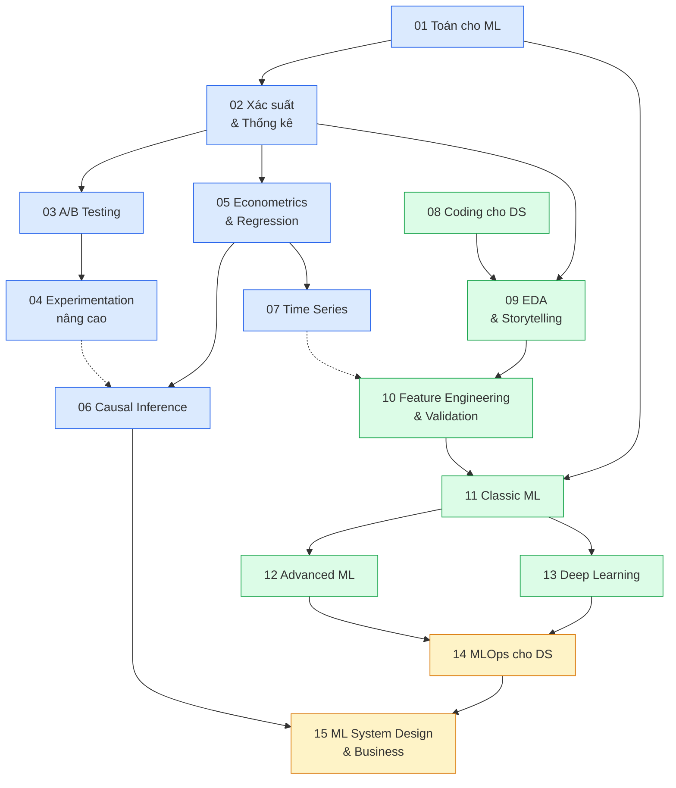
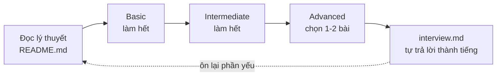

# Lộ trình AI & Data Scientist

Lộ trình bám theo [roadmap.sh/ai-data-scientist](https://roadmap.sh/ai-data-scientist), bổ sung
những phần roadmap gốc còn thiếu so với công việc của một Data Scientist senior hiện nay
(causal inference, feature engineering và validation, recommender, ML system design).

Track này dành cho người đã đi theo hướng Data Engineer và muốn **bổ sung** năng lực Data Science:
đủ để làm việc của DS khi dự án cần, và đủ để phỏng vấn vị trí DS / AI-ML khi có cơ hội. Chuẩn
nhắm tới là làm được thật trong doanh nghiệp, không dừng ở mức biết khái niệm.

Mỗi module có lý thuyết (`README.md`), câu hỏi phỏng vấn (`interview.md`) và bài tập 3 mức
Basic → Intermediate → Advanced có test tự chấm.

## Sơ đồ lộ trình



**Xanh dương** là nhánh thống kê và suy luận nhân quả, thế mạnh khiến DS khác ML engineer.
**Xanh lá** là nhánh dữ liệu và machine learning. **Vàng** là đưa model vào sản phẩm và làm việc
với business. Hai nhánh đầu học song song được; module 08 có thể lướt nhanh vì track Data Engineer
đã dạy kỹ Python và SQL.

## Các module

| # | Module | Node roadmap gốc | Kỹ năng chính |
| --- | --- | --- | --- |
| 01 | Toán cho ML | Mathematics | Vector, ma trận, đạo hàm, gradient, tối ưu |
| 02 | Xác suất & Thống kê suy luận | Statistics | Phân phối, CLT, sampling, ước lượng, bootstrap, Bayesian |
| 03 | Hypothesis Testing & A/B Testing | Statistics | Thiết kế thí nghiệm, power, MDE, SRM, peeking, multiple testing |
| 04 | Experimentation nâng cao | Statistics | CUPED, CUPAC, stratification, ratio metrics, delta method |
| 05 | Econometrics & Regression | Econometrics | OLS, GLM, fitting distributions, panel data |
| 06 | Causal Inference | mở rộng Econometrics | DiD, synthetic control, IV, RDD, propensity score, uplift |
| 07 | Time Series & Forecasting | Econometrics | ARIMA, ETS, lag feature, backtesting |
| 08 | Coding cho DS | Coding | DSA, SQL phỏng vấn DS, pandas/polars hiệu năng |
| 09 | EDA & Data Storytelling | Exploratory Data Analysis | EDA, visualization, kể chuyện bằng dữ liệu |
| 10 | Feature Engineering & Validation | mở rộng Machine Learning | Leakage, encoding, Pipeline, CV theo thời gian/nhóm |
| 11 | Classic ML | Machine Learning | Supervised/unsupervised, metric, calibration, SHAP |
| 12 | Advanced ML | Machine Learning | Gradient boosting, recommender, anomaly detection |
| 13 | Deep Learning với PyTorch | Deep Learning | CNN, RNN/LSTM, Transformers, transfer learning, embeddings |
| 14 | MLOps cho DS | MLOps | MLflow, đóng gói, serve FastAPI, monitoring, ONNX |
| 15 | ML System Design & Business | mở rộng | Đóng khung bài toán, metric, system design, trình bày |

## Ngoài phạm vi track này

- **MLOps chuyên sâu** (CI/CD cho model, drift monitoring đầy đủ, feature store): track MLOps.
- **Ứng dụng LLM** (RAG, agent, prompt engineering): track AI Engineer.
- **Rust, Go** cho inference và hạ tầng: module 14 chỉ giới thiệu ONNX và cách service viết bằng
  ngôn ngữ khác gọi model; học ngôn ngữ thật ở track MLOps / DevOps.
- **R**: không dùng. Toàn bộ track dùng Python.

## Chuẩn bị

1. Môi trường Python: `uv sync` ở gốc repo (xem [`setup/SETUP.md`](../../setup/SETUP.md)).
2. Kaggle token: tạo ở Kaggle → Settings → API → "Generate New Token", ghi vào `setup/.env`:
   `KAGGLE_API_TOKEN=KGAT_...`
3. Dữ liệu thật: track này ưu tiên dữ liệu thật, mỗi bộ dữ liệu có insight và cái "bẩn" riêng.
   Danh sách bộ và lệnh tải ở [`data/README.md`](../../data/README.md):

   ```bash
   uv run python data/download_olist.py            # Olist thật, xương sống của track
   uv run python data/download_dataset.py --list   # các bộ khác theo module
   ```

   Test chấm bài không cần các bộ này (dùng dữ liệu nhỏ sinh trong test); phần kiểm trên dữ liệu
   thật tự skip khi bạn chưa tải.

## Làm bài trên notebook

Nhiều bài tập giao dưới dạng notebook (`starter/*.ipynb`), giống cách DS làm việc hằng ngày.

```bash
uv run jupyter lab      # hoặc mở .ipynb bằng VS Code, chọn kernel .venv của repo
```

- **Cell chấm điểm** chỉ định nghĩa hàm (hoặc hằng). Điền vào chỗ `# TODO`.
- **Cell gắn tag `explore`** là nơi bạn đọc dữ liệu thật, vẽ biểu đồ, gọi hàm để xem kết quả. Test
  bỏ qua các cell này, nên cứ thoải mái khám phá. Muốn thêm cell khám phá thì gắn tag `explore`
  (Jupyter: View → Cell Toolbar → Tags; VS Code: "Add Cell Tag").
- Chấm: `uv run pytest <thư mục bài> -q`. Test chạy các cell chấm điểm rồi kiểm từng hàm.
- Xem lời giải mẫu: `SOLUTION=1 uv run pytest <thư mục bài> -q`, mở notebook trong `solutions/`.

## Cách học hiệu quả



1. **Lý thuyết**: chạy thử code mẫu trong notebook thay vì chỉ đọc.
2. **Basic**: cài đặt phương pháp bằng tay để hiểu nó, rồi mới dùng thư viện.
3. **Intermediate**: phân tích dữ liệu thật như ở công ty, có kết luận và khuyến nghị.
4. **Advanced**: không có đáp án duy nhất; so với rubric trong `SOLUTION.md`.
5. **Phỏng vấn**: đọc câu hỏi, tự trả lời thành tiếng trước khi xem đáp án mẫu. Các câu case
   study và product sense là phần phân loại ứng viên senior.
