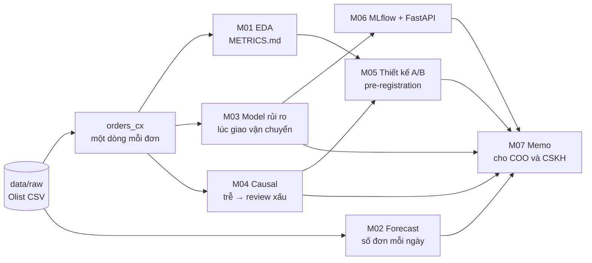
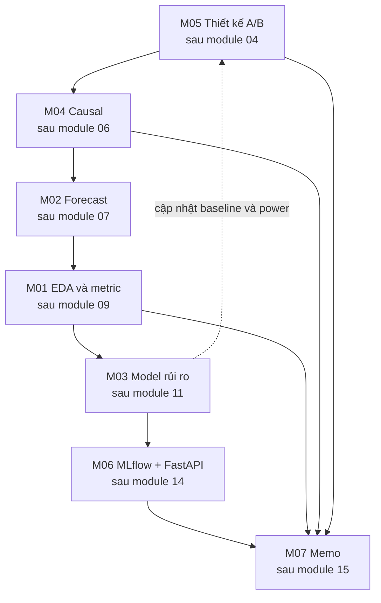

# Olist Customer Experience

Dự án capstone xuyên suốt lộ trình AI & Data Scientist. Bạn đóng vai Data Scientist của Olist, một sàn
thương mại điện tử Brazil, với một câu hỏi kinh doanh duy nhất: **review 1–2 sao đến từ đâu, và làm
gì để giảm nó?** Bảy milestone đi từ EDA và định nghĩa metric, dự báo nhu cầu, model dự đoán đơn rủi ro,
phân tích nhân quả, thiết kế A/B test, đóng gói và serve model, tới một memo cho ban điều hành.

Toàn bộ dự án chạy trên **Olist thật** (khoảng 100 nghìn đơn, 2016–2018). Dữ liệu thật có chỗ "bẩn" của
nó: đơn có nhiều review, review được tạo trước cả ngày giao, ngày hẹn giao rút ngắn từ 06/2018 (nguyên nhân chưa rõ),
tháng cuối chưa đủ nhãn. Xử lý những chỗ đó và nói rõ đã xử lý thế nào là một nửa giá trị của capstone.

## Mục tiêu dự án

- Một **câu chuyện liền mạch** từ dữ liệu tới quyết định: mỗi con số trong memo cuối truy được về một
  notebook hoặc script chạy lại được.
- Thể hiện các kỹ năng nhà tuyển dụng hỏi ở vị trí Data Scientist: định nghĩa metric, forecasting, ML có
  đánh giá theo thời gian, causal inference, thiết kế thí nghiệm, MLOps cơ bản và giao tiếp với
  stakeholder.
- Trung thực: kết luận "luật đơn giản đủ dùng" hay "chưa đủ bằng chứng, cần thí nghiệm" là kết luận
  tốt nếu dữ liệu nói vậy.

## Dữ liệu

```bash
uv run python data/download_olist.py   # cần Kaggle token, ghi vào data/raw/olist_*.csv
```

Schema và ERD: xem `data/README.md`. Không commit dữ liệu thô.

## Định nghĩa dùng chung

Mọi milestone dùng **cùng** các định nghĩa dưới đây (giống các module 06, 09, 10, 11, 12, 15). Đổi định
nghĩa nào thì ghi rõ trong báo cáo và lý do.

| Khái niệm | Định nghĩa | Số trên Olist thật |
| --- | --- | --- |
| Đơn giao xong | `order_status == "delivered"` và có `order_delivered_customer_date` | 96 470 đơn |
| Giao trễ | `order_delivered_customer_date > order_estimated_delivery_date`, so nguyên timestamp | 8.1% đơn giao xong |
| Review của đơn | review có `review_answer_timestamp` muộn nhất (một đơn có thể có nhiều review) | 95 824 đơn có review |
| Review xấu | `review_score <= 2` | 12.8%; 54.1% ở đơn trễ, 9.2% ở đơn đúng hẹn |
| Khách hàng | `customer_unique_id` (không phải `customer_id`, mỗi đơn một `customer_id`) | 93 350 khách, 97% chỉ có một đơn giao xong |
| Chia thời gian | theo `order_purchase_timestamp`: train trước 2018-01-01, validation trước 2018-04-01, test trước 2018-09-01 | 43 362 / 20 468 / 31 994 đơn có review |
| Traffic gần đây | 06/2017 – 07/2018 (61 tuần) | trung vị khoảng 1 259 đơn giao xong mỗi tuần |

Hai thời điểm dự đoán xuất hiện trong dự án, và **thời điểm dự đoán đi theo hành động**:

- **Lúc đơn vừa giao** (module 10, 11, 12): ngày giao thực tế và số ngày trễ là feature hợp lệ. Hợp với
  hành động sau khi giao (gọi xin lỗi, đền bù), không hợp với việc ngăn trễ.
- **Lúc giao cho đơn vị vận chuyển** (`order_delivered_carrier_date`, module 15): chỉ dùng thông tin có
  tới thời điểm đó. Mọi kết quả giao hàng là leak. Từ lúc giao vận chuyển tới lúc khách nhận hàng còn
  trung vị khoảng 7 ngày, đủ để nhắn tin chủ động.

Capstone này chọn can thiệp **trước khi giao** (nhắn tin chủ động cho đơn rủi ro), nên model của M03,
thí nghiệm của M05, service của M06 và memo của M07 đều dùng **thời điểm giao cho vận chuyển**. Model
"lúc vừa giao" của module 11 được giữ làm mốc so sánh.

## Bức tranh tổng thể



## Milestone nối nhau thế nào

Milestone được gắn với module mà nó cần (`after`). Vì thứ tự module của lộ trình, bạn sẽ gặp M05 (sau
module 04) **trước** M01–M04, và M04 (sau module 06) trước M02 (sau module 07). Mỗi milestone vì thế
tự đứng được nhờ phần định nghĩa dùng chung ở trên; khi milestone sau cho con số tốt hơn (ví dụ
precision thật của model ở M03), bạn quay lại cập nhật milestone trước. M07 là nơi mọi thứ hội tụ.



| Milestone | Sau module | Dùng lại | Tạo ra |
| --- | --- | --- | --- |
| [M01](milestones/m01-eda-metrics.md) | 09 EDA & Storytelling | `data/raw` | bảng `orders_cx`, `METRICS.md`, memo EDA |
| [M02](milestones/m02-demand-forecast.md) | 07 Time Series | `data/raw` | backtest, dự báo 14 ngày có khoảng, `FORECAST.md` |
| [M03](milestones/m03-bad-review-model.md) | 11 Classic ML | định nghĩa chung, M01 | model lúc giao vận chuyển, `MODEL_CARD.md`, `flagged.parquet` |
| [M04](milestones/m04-late-delivery-causal.md) | 06 Causal Inference | định nghĩa chung | ATT của giao trễ, phân tích độ nhạy, `CAUSAL.md` |
| [M05](milestones/m05-ab-test-design.md) | 04 Experimentation nâng cao | định nghĩa chung, sau này M03 | `EXPERIMENT_DESIGN.md` (pre-registration) |
| [M06](milestones/m06-mlflow-fastapi.md) | 14 MLOps | model M03 | run MLflow, model trong registry, service FastAPI, batch scoring |
| [M07](milestones/m07-stakeholder-memo.md) | 15 ML System Design | toàn bộ | `MEMO.md` một trang, README portfolio |

## Cấu trúc code

Code của capstone nằm ở [`project/`](project/). Khung gợi ý (bạn tự tạo dần, chi tiết trong
`project/README.md`):

```
project/
├── README.md          # README portfolio, viết lại dần sau mỗi milestone
├── src/olist_cx/      # code dùng chung: định nghĩa, bảng, feature, split
├── notebooks/         # một notebook mỗi milestone phân tích (M01–M05)
├── serving/           # M06: train + đăng ký model, FastAPI, batch scoring
├── reports/           # METRICS.md, FORECAST.md, MODEL_CARD.md, CAUSAL.md, EXPERIMENT_DESIGN.md, MEMO.md
├── artifacts/         # output trung gian (parquet, hình), không commit
└── tests/             # uv run pytest tracks/data-science/capstone/project/tests -q
```

Nguyên tắc: định nghĩa dùng chung viết **một lần** trong `src/olist_cx/` và có test. Notebook gọi hàm,
không chép lại logic. Bài học từ module 14: một hàm feature duy nhất cho train, batch và online.

## Trình bày lên GitHub làm portfolio

1. **Tách thành repo riêng** khi xong M03: copy `project/` ra repo `olist-customer-experience`, kèm
   hướng dẫn tải dữ liệu (đừng commit dữ liệu).
2. **README đầu trang**: câu hỏi kinh doanh, khuyến nghị cuối cùng (từ M07) trong hai câu, sơ đồ
   ở trên, bảng "con số chính" có link tới notebook tạo ra nó.
3. **Mục "Decisions"**: vì sao chọn thời điểm giao vận chuyển, vì sao chia theo thời gian, vì sao
   ước lượng nhân quả không phải hiệu quả của tin nhắn, vì sao thí nghiệm chưa khả thi ở quy mô hiện
   tại (nếu đúng vậy). Đây là chỗ người phỏng vấn hỏi lại.
4. **Chạy lại được**: `uv run pytest` xanh, một lệnh dựng lại bảng `orders_cx`, notebook chạy từ đầu
   tới cuối không lỗi.
5. **Ghi rõ giới hạn**: dữ liệu quan sát, chỉ đơn có review, không có dữ liệu thí nghiệm thật, giả định
   tiền (giá trị một review xấu) chưa được kiểm chứng.

## Tiêu chí hoàn thành toàn dự án

- [ ] Từ máy sạch, làm theo README tải dữ liệu và chạy lại mọi notebook trong vòng 30 phút.
- [ ] Mọi bảng dùng đúng định nghĩa dùng chung; con số nền (95 824 đơn, 12.8% review xấu, 8.1% trễ) khớp.
- [ ] Không có leak: feature của model M03/M06 chỉ dùng thông tin có tới lúc giao vận chuyển.
- [ ] Con số nhân quả (M04) và hiệu quả kỳ vọng của can thiệp (M05) được tách bạch trong memo.
- [ ] Service M06 chạy được, có test, và trả cùng điểm với batch scoring.
- [ ] Memo M07 đọc trong ba phút, câu đầu là một hành động.
