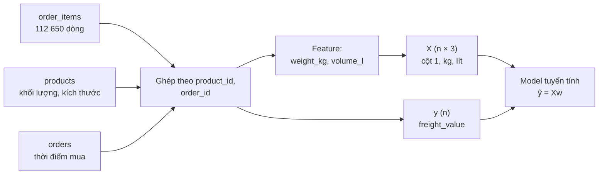
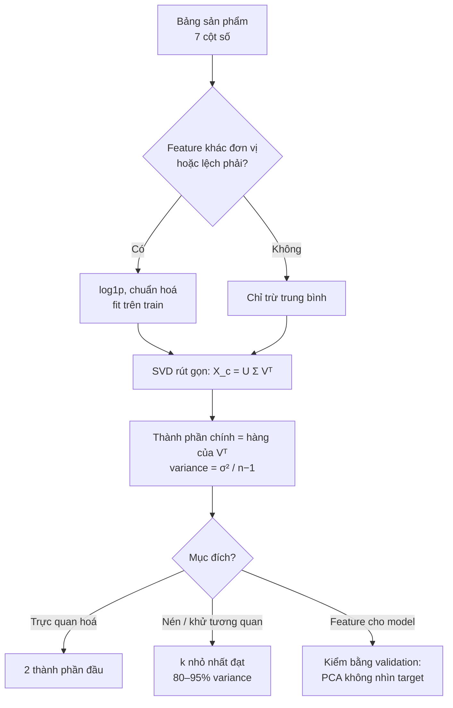
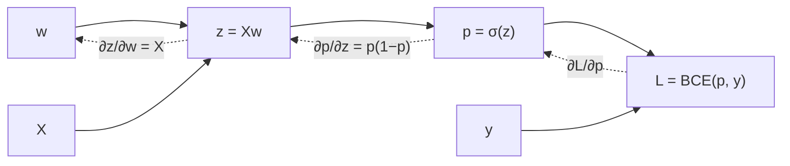
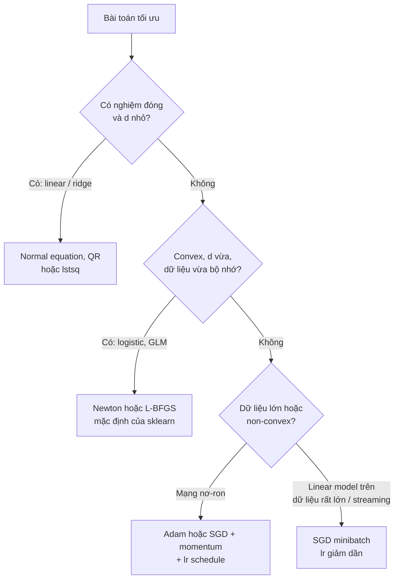

# Toán cho Machine Learning

Bạn không cần chứng minh định lý để làm Data Scientist, nhưng cần đủ toán để trả lời những câu hỏi
mà thư viện không trả lời hộ: vì sao model ra hệ số vô lý, vì sao loss không giảm, vì sao chuẩn hoá
feature làm training nhanh hơn hàng trăm lần, khi nào PCA vô dụng. Module này giữ đúng phần toán
dùng hằng ngày: **linear algebra** (dữ liệu là ma trận, model tuyến tính là phép chiếu), **calculus**
(gradient và chain rule, nền của backpropagation), **optimization** (gradient descent, SGD, momentum,
convex hay không) và **ổn định số** (condition number), phần mà sách giáo khoa hay bỏ qua nhưng
production thì không.

Mọi ví dụ chạy trên **Olist** thật: hồi quy phí ship (`freight_value`) theo khối lượng và thể tích sản
phẩm, PCA trên catalog sản phẩm, logistic regression cho review xấu. Tải dữ liệu:

```bash
uv run python data/download_olist.py
```

Sau module này bạn sẽ:

- Nhìn một bảng dữ liệu như ma trận và linear regression như một phép chiếu; tự viết normal equation.
- Hiểu eigen decomposition, SVD và tự viết PCA; biết khi nào PCA giúp, khi nào không.
- Tự đạo hàm loss bằng chain rule và kiểm tra bằng gradient check.
- Phân biệt bài toán convex và non-convex, và hệ quả thực tế của từng loại.
- Tự viết gradient descent, SGD, momentum; chọn learning rate và schedule có cơ sở.
- Chẩn đoán ill-conditioning và chọn solver đúng (normal equation, QR, SVD, ridge).

## 1. Dữ liệu là vector và ma trận

### Từ bảng tới ma trận

Mỗi dòng của bảng là một **quan sát** (một order item), mỗi cột số là một **feature**. Xếp n quan sát,
d feature được ma trận $$X \in \mathbb{R}^{n \times d}$$; mỗi dòng $$x_i$$ là một vector trong
$$\mathbb{R}^d$$. Target là vector $$y \in \mathbb{R}^n$$.



| Khái niệm | Toán | numpy | Ý nghĩa trong ML |
| --- | --- | --- | --- |
| Vector | $$x \in \mathbb{R}^d$$ | `x.shape == (d,)` | Một quan sát, một bộ hệ số, một embedding |
| Dot product | $$a \cdot b = \sum_j a_j b_j$$ | `a @ b` | Dự đoán tuyến tính $$x_i \cdot w$$; độ "giống nhau" |
| Norm | $$\lVert x\rVert_2 = \sqrt{x \cdot x}$$ | `np.linalg.norm(x)` | Độ lớn; regularization L2; khoảng cách |
| Cosine | $$\frac{a \cdot b}{\lVert a\rVert\,\lVert b\rVert}$$ | | So hướng, bỏ qua độ lớn: chuẩn cho embedding |
| Tích ma trận–vector | $$Xw$$ | `X @ w` | Dự đoán cho **mọi** dòng cùng lúc |
| Chuyển vị | $$X^\top$$ | `X.T` | $$X^\top r$$ gom residual theo từng feature: chính là gradient |
| Ma trận Gram | $$X^\top X$$ (d×d) | `X.T @ X` | Chứa mọi tích chéo giữa các feature; trung tâm của normal equation và covariance |

### Những điều senior để ý

- **Đơn vị đo là một phần của dữ liệu.** Cùng thông tin nhưng `[gram, cm³]` và `[kg, lít]` cho ma trận
  có tính chất số khác nhau cả nghìn lần (mục 7). Chọn đơn vị để các cột có độ lớn tương đương, hoặc
  chuẩn hoá.
- **Chi phí.** $$Xw$$ tốn $$O(nd)$$; $$X^\top X$$ tốn $$O(nd^2)$$; giải hệ d×d tốn $$O(d^3)$$. Với n = 10 triệu,
  d = 100 thì $$X^\top X$$ là một phép cộng dồn chạy được trong SQL hay Spark; với d = 1 triệu feature thưa
  (text, ID) thì không bao giờ tạo $$X^\top X$$, phải dùng ma trận thưa và SGD.
- **Vector hoá.** Vòng lặp Python trên từng dòng chậm hơn `X @ w` hàng trăm lần. Viết công thức dưới dạng
  ma trận trước, rồi code theo đúng công thức.
- **Hình dạng.** Phần lớn bug numpy là bug shape: `(n,)` khác `(n, 1)`, broadcasting ngầm biến phép
  trừ hai vector thành ma trận n×n. Kiểm `shape` ở mọi bước khi tự viết thuật toán.

## 2. Phép chiếu và least squares

### Chiếu một vector

Hình chiếu vuông góc của $$v$$ lên đường thẳng sinh bởi $$u$$ là
$$\mathrm{proj}_u v = \frac{v \cdot u}{u \cdot u}\,u$$. Phần dư $$v - \mathrm{proj}_u v$$ vuông góc với $$u$$, và
đó là điểm trên đường thẳng gần $$v$$ nhất.

### Linear regression là một phép chiếu

Mọi dự đoán $$\hat y = Xw$$ đều nằm trong **không gian cột** của $$X$$ (tổ hợp tuyến tính các cột).
Least squares tìm điểm trong không gian đó gần $$y$$ nhất, tức hình chiếu vuông góc của $$y$$. Điều kiện
"residual vuông góc với mọi cột" cho ngay **normal equation**:

$$
X^\top (y - Xw) = 0 \quad\Longleftrightarrow\quad X^\top X\, w = X^\top y
$$

Cũng thu được bằng cách cho gradient của $$\lVert y - Xw\rVert^2$$ bằng 0 (mục 4). Hai cách nhìn, một
đáp án. Ma trận chiếu là $$P = X(X^\top X)^{-1}X^\top$$; đường chéo của nó là **leverage** của từng
quan sát (điểm có leverage cao kéo đường hồi quy mạnh).

```python
import numpy as np
import pandas as pd

raw = "data/raw/"
items = pd.read_csv(raw + "olist_order_items_dataset.csv")
products = pd.read_csv(raw + "olist_products_dataset.csv")
orders = pd.read_csv(raw + "olist_orders_dataset.csv", parse_dates=["order_purchase_timestamp"])
df = (items.merge(products, on="product_id")
      .merge(orders[["order_id", "order_purchase_timestamp"]], on="order_id")
      .dropna(subset=["product_weight_g", "product_length_cm", "product_height_cm", "product_width_cm"]))
df["weight_kg"] = df.product_weight_g / 1000
df["volume_l"] = df.product_length_cm * df.product_height_cm * df.product_width_cm / 1000
train = df[df.order_purchase_timestamp < "2018-01-01"]          # quy ước chia theo thời gian của track

X = np.column_stack([np.ones(len(train)), train.weight_kg, train.volume_l])
y = train.freight_value.to_numpy()
w = np.linalg.solve(X.T @ X, X.T @ y)                          # không dùng inv
residual = y - X @ w
print(len(train), "item train; w =", w.round(4))
print("Xᵀ·residual =", (X.T @ residual).round(6))              # ≈ 0: residual ⟂ mọi cột
print("R² train =", round(1 - residual @ residual / ((y - y.mean()) @ (y - y.mean())), 3))
```

Kết quả: trên 51 216 item mua trước 2018-01-01,
$$\widehat{\text{freight}} = 13.25 + 1.459\cdot\text{kg} + 0.179\cdot\text{lít}$$ (BRL), R² train 0.458, R² trên
test (đơn mua 04–08/2018) 0.342. Model thiếu feature quan trọng nhất là **quãng đường** giữa seller và
khách; không có optimizer nào sửa được điều đó.

### Khi nào dùng, đánh đổi, lỗi hay gặp

- **Dùng normal equation** khi d nhỏ tới vừa (tới vài nghìn), feature đã chuẩn hoá và không trùng lặp.
  Nó là cách nhanh nhất, và $$X^\top X$$, $$X^\top y$$ cộng dồn được theo chunk nên chạy được trên dữ liệu
  không vừa bộ nhớ.
- **Không dùng** khi các cột gần phụ thuộc tuyến tính (mục 7) hoặc d rất lớn.
- **Lỗi hay gặp**: `np.linalg.inv(X.T @ X) @ X.T @ y`; quên cột intercept; thêm cả dummy cho mọi giá
  trị của một biến phân loại cùng với intercept (dummy trap: các cột dummy cộng lại bằng cột 1, nên
  $$X^\top X$$ suy biến).
- **Rank.** Nếu một cột là tổ hợp tuyến tính của các cột khác, $$X^\top X$$ không khả nghịch và có vô số
  nghiệm cho cùng một dự đoán. Hệ số khi đó **không có nghĩa**, dù dự đoán vẫn tốt.

## 3. Eigen, SVD và PCA

### Eigenvector: hướng mà ma trận chỉ kéo giãn

$$Av = \lambda v$$: nhân $$A$$ vào $$v$$ chỉ đổi độ dài (hệ số $$\lambda$$), không đổi hướng. Ma trận **đối xứng**
(covariance, $$X^\top X$$, Hessian) có tính chất đẹp: mọi trị riêng là số thực và có một bộ eigenvector
trực chuẩn, $$A = V\Lambda V^\top$$. Trị riêng của $$X^\top X$$ cho biết dữ liệu "trải" theo mỗi hướng bao
nhiêu; trị riêng của Hessian cho biết loss cong theo mỗi hướng bao nhiêu (mục 6).

### SVD: phân rã cho mọi ma trận

Mọi ma trận $$X$$ (n×d) viết được thành

$$
X = U\Sigma V^\top, \qquad U^\top U = I,\; V^\top V = I,\; \Sigma = \mathrm{diag}(\sigma_1 \ge \sigma_2 \ge \dots \ge 0)
$$

Liên hệ với eigen: $$X^\top X = V\Sigma^2 V^\top$$, nên cột của $$V$$ là eigenvector của $$X^\top X$$ và
$$\sigma_i^2$$ là trị riêng. SVD là "con dao đa năng": tính rank, pseudo-inverse, nghiệm least squares
ổn định, condition number $$\sigma_1/\sigma_d$$, và xấp xỉ hạng thấp tốt nhất (định lý Eckart–Young:
giữ k singular value lớn nhất cho ma trận hạng k gần $$X$$ nhất). Recommender dựa trên matrix
factorization là ý tưởng hạng thấp này.

### PCA = SVD của dữ liệu đã trừ trung bình

Covariance của dữ liệu đã trừ trung bình là $$C = \frac{1}{n-1}X_c^\top X_c = V\frac{\Sigma^2}{n-1}V^\top$$.
Thành phần chính là eigenvector của $$C$$, variance giải thích là $$\sigma_i^2/(n-1)$$. Làm SVD trên $$X_c$$
thay vì eigen trên $$C$$ tránh bình phương condition number (cùng lý do ở mục 7).



```python
import numpy as np
import pandas as pd
from sklearn.decomposition import PCA

cols = ["product_weight_g", "product_length_cm", "product_height_cm", "product_width_cm",
        "product_photos_qty", "product_name_lenght", "product_description_lenght"]
p = pd.read_csv("data/raw/olist_products_dataset.csv").dropna(subset=cols)
X = np.log1p(p[cols].to_numpy(dtype=float))
Z = (X - X.mean(axis=0)) / X.std(axis=0)

U, s, Vt = np.linalg.svd(Z - Z.mean(axis=0), full_matrices=False)
ratio = s**2 / np.sum(s**2)
print(len(p), "sản phẩm; tỉ lệ variance:", ratio.round(4))
print("sklearn:                ", PCA().fit(Z).explained_variance_ratio_.round(4))
print("PC1:", dict(zip(cols, np.abs(Vt[0]).round(2).tolist())))
```

Trên 32 340 sản phẩm Olist đủ dữ liệu: PC1 giải thích 35.9% variance và là **kích thước** (loading
khoảng 0.4–0.56 trên khối lượng, dài, cao, rộng; dưới 0.09 trên ba cột còn lại); PC2 giải thích 17.6% và
là **độ chăm chút listing** (số ảnh, độ dài tên, mô tả). Cần 5 / 7 thành phần để giữ 90% variance: ba cột
văn bản/ảnh gần như độc lập với nhau nên không nén được. Bài Intermediate 03 đi hết phần này.

### Khi nào dùng PCA, đánh đổi, lỗi hay gặp

| Dùng khi | Tránh khi |
| --- | --- |
| Nhiều feature tương quan mạnh (pixel, cảm biến, embedding) | Cần giải thích bằng feature gốc |
| Trực quan hoá, khử nhiễu | Quan hệ phi tuyến là chính |
| Khử đa cộng tuyến trước hồi quy | Feature quan trọng với target nhưng variance nhỏ (PCA không nhìn target) |

Lỗi hay gặp: không chuẩn hoá khi feature khác đơn vị (PCA chạy theo cột có variance lớn nhất); fit
PCA trên toàn bộ dữ liệu trước khi chia train/test; diễn giải dấu của thành phần (dấu là tuỳ ý);
`np.linalg.svd` với `full_matrices=True` trên dữ liệu nhiều dòng (tạo ma trận n×n).

## 4. Đạo hàm, gradient và chain rule

### Từ đạo hàm tới gradient

Đạo hàm $$f'(x)$$ là độ dốc: $$f(x + h) \approx f(x) + f'(x)h$$. Với hàm nhiều biến $$f: \mathbb{R}^d \to \mathbb{R}$$
(loss theo d tham số), **gradient** $$\nabla f$$ là vector các đạo hàm riêng, và
$$f(w + h) \approx f(w) + \nabla f(w)^\top h$$. Gradient chỉ hướng tăng nhanh nhất, nên $$-\nabla f$$ là hướng
giảm nhanh nhất: toàn bộ ý tưởng của gradient descent.

| Đối tượng | Hình dạng | Dùng ở đâu |
| --- | --- | --- |
| Gradient $$\nabla f$$ | d | Mọi optimizer bậc một |
| Jacobian $$J$$ của $$g: \mathbb{R}^d \to \mathbb{R}^m$$ | m×d | Chain rule cho hàm vector, backprop qua một layer |
| Hessian $$\nabla^2 f$$ | d×d | Độ cong; Newton; kiểm tra convex; condition number của bài toán tối ưu |

Hai gradient phải thuộc lòng, với loss trung bình trên n mẫu:

$$
L_{\text{MSE}}(w) = \frac1n\lVert Xw - y\rVert^2 \;\Rightarrow\; \nabla L = \frac{2}{n}X^\top(Xw - y),
\qquad
L_{\text{log}}(w) = \frac1n\sum_i\left[\log(1 + e^{z_i}) - y_i z_i\right] \;\Rightarrow\; \nabla L = \frac1n X^\top(\sigma(Xw) - y)
$$

với $$z = Xw$$. Cả hai có cùng dạng "$$X^\top \times$$ sai số": mỗi feature nhận phần trách nhiệm tỉ lệ với
giá trị của nó.

### Chain rule và computational graph

Nếu $$L$$ phụ thuộc $$w$$ qua chuỗi $$w \to z \to p \to L$$ thì
$$\frac{\partial L}{\partial w} = \frac{\partial L}{\partial p}\frac{\partial p}{\partial z}\frac{\partial z}{\partial w}$$.
Với logistic regression: $$\frac{\partial L}{\partial p} = \frac{p - y}{p(1-p)}$$,
$$\frac{\partial p}{\partial z} = p(1-p)$$, $$\frac{\partial z}{\partial w} = x$$; nhân lại được $$(p - y)x$$.



**Backpropagation** chỉ là chain rule áp từ cuối graph ngược về đầu (mũi tên đứt), tái sử dụng các
đạo hàm trung gian. Chi phí tính gradient theo mọi tham số chỉ cỡ vài lần chi phí tính loss, bất kể có
bao nhiêu tham số: đó là lý do train được mạng hàng tỉ tham số. PyTorch, JAX gọi đây là **reverse-mode
automatic differentiation**.

### Gradient check bằng sai phân hữu hạn

Khi tự viết gradient (loss mới, layer mới), so với gradient số:

$$
\frac{\partial f}{\partial w_i} \approx \frac{f(w + \varepsilon e_i) - f(w - \varepsilon e_i)}{2\varepsilon}
$$

Sai phân trung tâm có sai số $$O(\varepsilon^2)$$, sai phân tiến chỉ $$O(\varepsilon)$$. Đo bằng sai số tương đối
$$\lVert g_a - g_n\rVert / (\lVert g_a\rVert + \lVert g_n\rVert)$$: dưới 1e-7 là đúng, trên 1e-4 gần như chắc có bug.

```python
import numpy as np
import torch

rng = np.random.default_rng(0)
X = np.column_stack([np.ones(200), rng.normal(size=(200, 2))])
y = (rng.random(200) < 0.3).astype(float)
w = rng.normal(size=3)

def loss(w):
    z = X @ w
    return np.mean(np.logaddexp(0, z) - y * z)          # ổn định số, không tính log(sigmoid)

grad = X.T @ (1 / (1 + np.exp(-X @ w)) - y) / len(y)    # chain rule bằng tay
eps = 1e-5
numeric = np.array([(loss(w + eps * e) - loss(w - eps * e)) / (2 * eps) for e in np.eye(3)])
print("sai số tương đối:", np.linalg.norm(grad - numeric) / (np.linalg.norm(grad) + np.linalg.norm(numeric)))

wt = torch.tensor(w, requires_grad=True)                # autodiff cho cùng kết quả
zt = torch.tensor(X) @ wt
torch.mean(torch.nn.functional.softplus(zt) - torch.tensor(y) * zt).backward()
print("autograd khớp:", np.allclose(wt.grad.numpy(), grad))
```

Lỗi hay gặp: quên hệ số 2 của MSE; tính `log(sigmoid(z))` trực tiếp (ra `-inf` khi z rất âm, nên
PyTorch có `BCEWithLogitsLoss`); gradient check ở w = 0 (nhiều bug bị che vì các số hạng bằng 0);
check bằng float32 (sai số làm tròn lớn hơn ngưỡng). Bài Basic 03.

## 5. Convex và non-convex

### Định nghĩa dùng được

Hàm $$f$$ **convex** nếu đoạn thẳng nối hai điểm bất kỳ trên đồ thị nằm trên đồ thị:
$$f(\theta a + (1-\theta)b) \le \theta f(a) + (1-\theta)f(b)$$ với mọi $$\theta \in [0, 1]$$. Với hàm khả vi hai
lần: convex khi và chỉ khi Hessian **nửa xác định dương** ở mọi điểm ($$v^\top H v \ge 0$$ với mọi $$v$$).
Hệ quả quan trọng nhất: **mọi cực tiểu địa phương là cực tiểu toàn cục**. Gradient descent với lr phù
hợp tới đúng nghiệm tốt nhất, bất kể khởi tạo.

Ví dụ kiểm tra: Hessian của MSE là $$\frac2n X^\top X$$, và $$v^\top X^\top X v = \lVert Xv\rVert^2 \ge 0$$. Hessian
của logistic loss là $$\frac1n X^\top \mathrm{diag}(p(1-p))X$$, cũng nửa xác định dương vì $$p(1-p) > 0$$.
Thêm L2 ($$\lambda > 0$$) làm Hessian xác định dương hẳn: **strongly convex**, nghiệm duy nhất.

| Convex | Non-convex |
| --- | --- |
| Linear / ridge / lasso regression | Mạng nơ-ron (mọi kiến trúc có hidden layer) |
| Logistic regression, softmax regression | Matrix factorization ($$R \approx UV^\top$$, đối xứng khi hoán vị) |
| SVM (hinge loss) | K-means, Gaussian mixture |
| Quantile regression, Poisson GLM | t-SNE, UMAP; mọi bài toán có ràng buộc rời rạc |

### Hệ quả thực tế

- **Convex**: kết quả không phụ thuộc seed hay khởi tạo; hai thư viện khác nhau phải ra cùng hệ số
  (nếu không, một bên chưa hội tụ hoặc khác cách regularize). Có thể dùng solver bậc hai (Newton,
  L-BFGS) và tiêu chuẩn dừng chặt.
- **Non-convex**: nhiều nghiệm; kết quả phụ thuộc seed, khởi tạo, thứ tự dữ liệu, learning rate.
  Phải cố định seed để tái lập, chạy nhiều seed để báo cáo độ dao động, và không diễn giải từng trọng số.
  Trên Olist, một mạng nơ-ron 8 nút ẩn trên cùng 3 feature với logistic regression, chạy 10 seed, cho
  loss train cuối từ 0.3202 tới 0.3281 và trọng số lớp đầu khác hẳn nhau giữa các seed (bài Advanced 02).
- Trong không gian nhiều chiều, thứ cản trở mạng nơ-ron thường là **điểm yên ngựa** (saddle point: cong
  lên theo hướng này, xuống theo hướng khác) và vùng phẳng, hơn là cực tiểu địa phương tồi. Nhiễu của
  SGD và momentum giúp thoát chúng.
- **Dữ liệu tách được hoàn toàn**: logistic loss vẫn convex nhưng không có cực tiểu hữu hạn (loss giảm
  mãi khi $$\lVert w\rVert \to \infty$$). Hệ số phình to là dấu hiệu của feature rò rỉ nhãn; L2 làm bài toán có
  nghiệm.

## 6. Gradient descent, SGD và momentum

### Gradient descent và ngưỡng learning rate

$$
w_{t+1} = w_t - \eta\,\nabla L(w_t)
$$

Với loss bậc hai (MSE), Hessian $$H$$ là hằng. Theo hướng eigenvector có trị riêng $$\lambda$$, sai số nhân
với $$1 - \eta\lambda$$ mỗi bước. Hai hệ quả:

- Hội tụ khi và chỉ khi $$0 < \eta < 2/L$$ với $$L = \lambda_{\max}(H)$$. Vượt ngưỡng là loss nổ theo hàm mũ.
- Với $$\eta = 1/L$$, hướng cong ít nhất ($$\mu = \lambda_{\min}$$) chỉ giảm $$1 - 1/\kappa$$ mỗi bước, với
  $$\kappa = L/\mu$$ là **condition number** của Hessian. Số bước tỉ lệ với $$\kappa$$.

Trên Olist (hồi quy phí ship, 51 216 item train): với đơn vị kg/lít, $$\kappa(H) \approx 1329$$, lr tối đa
0.00108, gradient descent với lr = 1/L cần **9 231 bước** để loss cách tối ưu dưới 1e-6 (tương đối).
Chuẩn hoá hai feature đưa $$\kappa$$ về 8.6, lr tối đa 0.558, và chỉ cần **30 bước**. Cùng nghiệm.

```python
import numpy as np
import pandas as pd

raw = "data/raw/"
df = (pd.read_csv(raw + "olist_order_items_dataset.csv")
      .merge(pd.read_csv(raw + "olist_products_dataset.csv"), on="product_id")
      .merge(pd.read_csv(raw + "olist_orders_dataset.csv", parse_dates=["order_purchase_timestamp"]), on="order_id")
      .dropna(subset=["product_weight_g", "product_length_cm", "product_height_cm", "product_width_cm"]))
df = df[df.order_purchase_timestamp < "2018-01-01"]
F = np.column_stack([df.product_weight_g / 1000,
                     df.product_length_cm * df.product_height_cm * df.product_width_cm / 1000])
y = df.freight_value.to_numpy()

for name, Z in [("kg, lít", F), ("chuẩn hoá", (F - F.mean(0)) / F.std(0))]:
    A = np.column_stack([np.ones(len(y)), Z])
    eig = np.linalg.eigvalsh(2 * A.T @ A / len(y))           # trị riêng của Hessian
    best = np.mean((A @ np.linalg.lstsq(A, y, rcond=None)[0] - y) ** 2)
    w, steps = np.zeros(3), 0
    while np.mean((A @ w - y) ** 2) > best * (1 + 1e-6):
        w -= (1 / eig[-1]) * 2 * A.T @ (A @ w - y) / len(y)
        steps += 1
    print(f"{name:10s} kappa = {eig[-1] / eig[0]:7.1f}  bước = {steps}")
```

### SGD và minibatch

Gradient trên toàn bộ n dòng tốn $$O(nd)$$ mỗi bước. **SGD** ước lượng gradient bằng một minibatch B
dòng: rẻ hơn n/B lần, không chệch nhưng có nhiễu. Với lr cố định, nhiễu không tắt nên w dao động
quanh nghiệm trong một vùng tỉ lệ với lr; muốn hội tụ phải **giảm lr dần** (điều kiện Robbins–Monro:
$$\sum_t \eta_t = \infty$$, $$\sum_t \eta_t^2 < \infty$$, ví dụ $$\eta_t = \eta_0/(1 + kt)$$). Trong bài Intermediate 02, cùng
20 epoch, lr cố định dừng cách nghiệm 0.39–1.69, lr giảm dần chỉ còn 0.008–0.028 (10 seed).

### Momentum và các optimizer thích nghi

Heavy-ball momentum: $$v_{t+1} = \beta v_t - \eta\nabla L(w_t)$$, $$w_{t+1} = w_t + v_{t+1}$$. Gradient cùng dấu
(hướng cong ít) cộng dồn, gradient đổi dấu (hướng cong nhiều, dao động) triệt tiêu. Với tham số tối ưu,
số bước tỉ lệ $$\sqrt\kappa$$ thay vì $$\kappa$$: trên hàm bậc hai có κ = 100, 83–93 bước so với 1 015–1 342 bước
của gradient descent. **Adam** thêm việc chia gradient từng toạ độ cho độ lớn trung bình của nó (một
dạng tiền điều kiện chéo), nên ít nhạy với thang đo feature và là mặc định cho deep learning.

| Schedule | Công thức $$\eta_t$$ | Dùng khi |
| --- | --- | --- |
| Constant | $$\eta_0$$ | Bài toán convex nhỏ, full batch |
| Step decay | $$\eta_0 \gamma^{\lfloor t/s\rfloor}$$ | Train CNN kinh điển: giảm 10 lần ở vài mốc |
| Inverse time | $$\eta_0/(1 + kt)$$ | SGD trên bài toán convex, có bảo đảm lý thuyết |
| Exponential | $$\eta_0 e^{-kt}$$ | Giảm mượt; dễ giảm quá nhanh |
| Warmup + cosine | tăng tuyến tính rồi giảm theo cos | Transformer, mạng lớn với Adam |



Lỗi hay gặp: không chuẩn hoá feature rồi kết luận "gradient descent chậm"; chọn lr bằng mắt thay vì
thử theo thang log (1e-4, 1e-3, 1e-2…); so optimizer theo số epoch thay vì thời gian thực; dùng lr cố
định cho SGD rồi thắc mắc vì sao loss "nhảy" mãi; reset bộ đếm schedule mỗi epoch.

## 7. Condition number và ổn định số

### Condition number đo độ khuếch đại sai số

$$
\kappa(X) = \frac{\sigma_{\max}(X)}{\sigma_{\min}(X)}
$$

Giải một hệ có condition number κ bằng thuật toán ổn định, sai số tương đối của nghiệm cỡ
$$\kappa\cdot\varepsilon_{\text{machine}}$$, với $$\varepsilon \approx 2.2\times10^{-16}$$ cho float64 và $$1.2\times10^{-7}$$ cho float32.
Quy tắc nhẩm: **mất khoảng $$\log_{10}\kappa$$ chữ số đúng**. Normal equation giải hệ $$X^\top X$$ có
$$\kappa(X^\top X) = \kappa(X)^2$$, nên mất gấp đôi số chữ số; QR và SVD làm việc trực tiếp trên $$X$$.

```python
import numpy as np

x = np.linspace(0, 1, 200)
for degree in (4, 8, 12):
    X = np.vander(x, degree + 1, increasing=True)            # 1, x, x², …: các cột gần trùng nhau
    w_true = np.random.default_rng(0).normal(size=degree + 1)
    y = X @ w_true                                           # biết trước đáp án
    err = lambda w: np.linalg.norm(w - w_true) / np.linalg.norm(w_true)
    w_normal = np.linalg.solve(X.T @ X, X.T @ y)
    w_lstsq = np.linalg.lstsq(X, y, rcond=None)[0]           # dùng SVD
    print(f"bậc {degree:2d}  kappa = {np.linalg.cond(X):.1e}  "
          f"normal eq: {err(w_normal):.1e}  lstsq: {err(w_lstsq):.1e}")
```

Ở bậc 12 (κ ≈ 7 · 10⁸), normal equation cho nghiệm sai hoàn toàn còn `lstsq` vẫn đúng tới khoảng 9
chữ số.

### Hai nguồn ill-conditioning, hai cách chữa

| Nguồn | Ví dụ Olist | Dấu hiệu | Cách chữa |
| --- | --- | --- | --- |
| **Thang đo** khác nhau | `[1, gram, cm³]`: κ ≈ 36 431, so với 36.4 khi dùng `[1, kg, lít]` | κ giảm mạnh sau khi chia mỗi cột cho chuẩn của nó | Chuẩn hoá / đổi đơn vị; vô hại với solver tốt nhưng làm gradient descent chậm |
| Cột **gần phụ thuộc tuyến tính** | Thêm "peso cubado" (dài × rộng × cao / 6000) cạnh thể tích: κ ≈ 2.9 · 10¹⁶ | κ vẫn lớn sau khi cân bằng cột; hệ số đổi dấu, phình to | Bỏ cột trùng; ridge; SVD có ngưỡng; PCA |

Với peso cubado, mọi solver cho cùng dự đoán, nhưng hệ số thì không: normal equation nói "thêm một lít
làm phí ship *giảm* 1.19 BRL", `np.linalg.qr` không pivot cho hệ số cỡ 10¹³, SVD cho nghiệm min-norm
chia đều theo tỉ lệ cột. Ai đọc hệ số để định giá sẽ sai (bài Advanced 01).

### Ridge: sửa điều kiện bằng regularization

$$
w_{\text{ridge}} = (X^\top X + \lambda I)^{-1}X^\top y
$$

Cộng $$\lambda$$ vào mọi trị riêng: condition number thành $$(\sigma_{\max}^2 + \lambda)/(\sigma_{\min}^2 + \lambda)$$, hữu hạn
kể cả khi $$X$$ thiếu hạng. Đổi lại là **bias**: hệ số bị kéo về 0. Không phạt intercept, chuẩn hoá feature
trước, chọn λ bằng validation. Theo góc nhìn Bayes, ridge là MAP với prior Gaussian trên hệ số.

### Ổn định số trong code hằng ngày

- `np.logaddexp` / `scipy.special.logsumexp` thay cho `log(sum(exp(...)))`: softmax, log-likelihood.
- `np.log1p(x)`, `np.expm1(x)` cho x nhỏ.
- Tính variance bằng công thức hai lượt (trừ trung bình trước), không dùng $$E[x^2] - E[x]^2$$ khi trung bình lớn.
- float32 (GPU, deep learning) chỉ có khoảng 7 chữ số: bài toán κ = 10⁶ đã gần như hết chữ số đúng.
  Mixed precision dùng float16/bfloat16 cho phép nhân, float32 cho phần cộng dồn và trọng số chính.
- `np.linalg.solve` thay `inv`; `lstsq` khi nghi ngờ thiếu hạng; luôn xem `np.linalg.cond` hoặc
  singular value nhỏ nhất khi hệ số "trông lạ".

## 8. Tài liệu tham khảo

Sách và khoá học:

- Deisenroth, Faisal, Ong. [Mathematics for Machine Learning](https://mml-book.github.io/) (Cambridge
  University Press, 2020, bản PDF miễn phí). Chương 2–7 khớp module này.
- Gilbert Strang. [MIT 18.06 Linear Algebra](https://ocw.mit.edu/courses/18-06-linear-algebra-spring-2010/).
- 3Blue1Brown. [Essence of linear algebra](https://www.3blue1brown.com/topics/linear-algebra), trực
  giác hình học cho phép chiếu, eigen, định thức.
- Boyd & Vandenberghe. [Convex Optimization](https://web.stanford.edu/~boyd/cvxbook/), chương 2–3 và 9.
- Goodfellow, Bengio, Courville. [Deep Learning, chương 4: Numerical Computation](https://www.deeplearningbook.org/contents/numerical.html)
  (overflow, condition number, gradient-based optimization).
- Trefethen & Bau. *Numerical Linear Algebra* (SIAM, 1997): QR, SVD, ổn định số, bài giảng 4–5, 11–12, 18–19.

Từ roadmap.sh/ai-data-scientist (mục Mathematics):

- [roadmap.sh: AI and Data Scientist](https://roadmap.sh/ai-data-scientist)
- [Khan Academy: Linear Algebra](https://www.khanacademy.org/math/linear-algebra)
- [Khan Academy: Multivariable Calculus](https://www.khanacademy.org/math/multivariable-calculus)

Bài viết:

- Gabriel Goh. [Why Momentum Really Works](https://distill.pub/2017/momentum/) (Distill, 2017), có
  minh hoạ tương tác cho κ và momentum.
- Sebastian Ruder. [An overview of gradient descent optimization algorithms](https://arxiv.org/abs/1609.04747) (2016).
- Kingma & Ba. [Adam: A Method for Stochastic Optimization](https://arxiv.org/abs/1412.6980) (2014).
- Parr & Howard. [The Matrix Calculus You Need For Deep Learning](https://explained.ai/matrix-calculus/).
- CS231n. [Optimization](https://cs231n.github.io/optimization-1/) và
  [gradient checking](https://cs231n.github.io/neural-networks-3/).

Tài liệu thư viện:

- [numpy.linalg](https://numpy.org/doc/stable/reference/routines.linalg.html),
  [scipy.linalg](https://docs.scipy.org/doc/scipy/reference/linalg.html)
- [scikit-learn: PCA](https://scikit-learn.org/stable/modules/decomposition.html#pca),
  [linear models](https://scikit-learn.org/stable/modules/linear_model.html)
- [PyTorch: autograd](https://pytorch.org/docs/stable/autograd.html)

Dữ liệu:

- Olist: [Brazilian E-Commerce Public Dataset (Kaggle)](https://www.kaggle.com/datasets/olistbr/brazilian-ecommerce)
