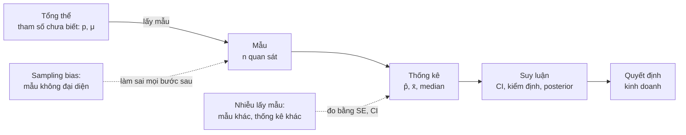
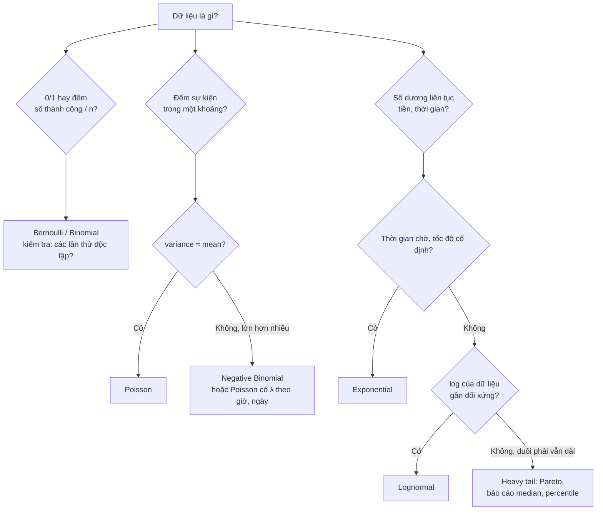
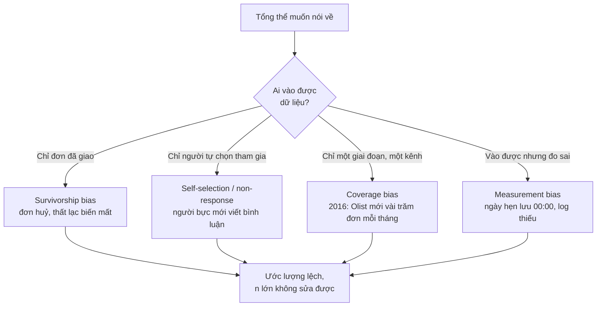
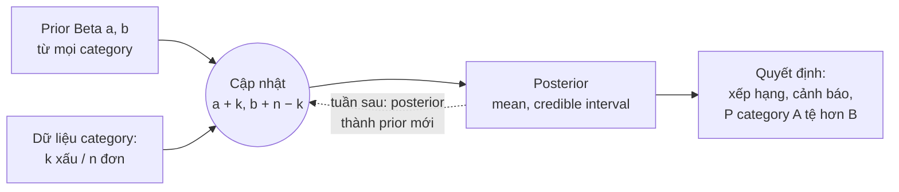

# Xác suất & Thống kê suy luận

Mọi con số một Data Scientist báo cáo đều là **ước lượng** từ một mẫu: tỉ lệ giao trễ tuần này, giá
trị đơn trung bình của khách mới, điểm review của một category. Câu hỏi luôn đi kèm là "con số này
chắc cỡ nào, và nó có đại diện cho thứ ta thật sự quan tâm không". Module này xây nền để trả lời câu
hỏi đó: phân phối xác suất, Law of Large Numbers, Central Limit Theorem, lấy mẫu và sampling bias,
ước lượng bằng MLE, khoảng tin cậy, bootstrap và Bayesian cơ bản.

Module 03 (A/B testing) dùng toàn bộ nền này để so sánh **hai nhóm**: kiểm định, power, CI cho chênh
lệch. Ở đây ta tập trung vào **một tổng thể**: mô tả nó, ước lượng nó, và biết khi nào ước lượng sai.

Toàn bộ ví dụ dùng **Olist thật** (khoảng 99 nghìn đơn hàng thương mại điện tử Brazil, 2016–2018).
Tải dữ liệu:

```bash
uv run python data/download_olist.py
```

Định nghĩa dùng chung của track (mọi module dùng y hệt):

- **Đơn giao xong**: `order_status == "delivered"` và có `order_delivered_customer_date` (96 470 đơn).
- **Giao trễ**: `order_delivered_customer_date > order_estimated_delivery_date`, so nguyên timestamp.
  Tỉ lệ 8.1% trên đơn giao xong.
- **Review**: mỗi đơn giữ review có `review_answer_timestamp` mới nhất. **Review xấu**: `review_score <= 2`.
  Tỉ lệ 12.8%; ở đơn trễ 54.1%.
- **Giá trị đơn** (module này): tổng `price + freight_value` của mọi item trong đơn, đơn vị BRL.
- **Thời gian giao** (module này): `order_delivered_customer_date − order_purchase_timestamp`, tính
  bằng ngày (số thực).

Sau module này bạn sẽ:

- Chọn phân phối phù hợp cho từng loại dữ liệu và nhận ra khi giả định phân phối sai (overdispersion,
  đuôi nặng).
- Giải thích LLN và CLT, và đo được "n bao nhiêu là đủ" cho chính metric của mình thay vì tin "n ≥ 30".
- Nhận diện sampling bias trong dữ liệu sản phẩm và hiệu chỉnh khi có thể.
- Tự viết MLE, dựng và kiểm tra khoảng tin cậy, bootstrap cho thống kê không có công thức.
- Dùng Beta-Binomial để so sánh các nhóm ít dữ liệu mà không bị nhiễu đánh lừa.

## 1. Tổng thể, mẫu và suy luận

### Từ dữ liệu tới quyết định

- **Tổng thể (population)**: tập mọi đơn vị ta muốn nói về. "Mọi đơn hàng của Olist năm 2018",
  hoặc trừu tượng hơn, "mọi đơn hàng Olist sẽ có nếu giữ nguyên vận hành hiện tại".
- **Tham số (parameter)**: con số mô tả tổng thể, thường không biết: tỉ lệ giao trễ thật p, giá trị
  đơn trung bình μ.
- **Mẫu (sample)** và **thống kê (statistic)**: dữ liệu ta có và con số tính từ nó, như tỉ lệ trễ
  trong mẫu, ký hiệu $$\hat p$$. Một công thức biến mẫu thành ước lượng tham số gọi là **estimator**.
- **Suy luận (inference)**: nói điều gì đó về tham số, kèm độ bất định: khoảng tin cậy, kiểm định,
  phân phối posterior.



Hai thứ làm ước lượng sai khác nhau về bản chất. **Nhiễu lấy mẫu** (sampling error) giảm khi n tăng
và đo được bằng standard error. **Bias** (mẫu không đại diện, đo sai) **không** giảm khi n tăng: một
triệu câu trả lời từ một mẫu lệch vẫn cho câu trả lời lệch, chỉ là chắc chắn hơn về con số sai.

### Xác suất có điều kiện và base rate

Trên các đơn giao xong có review của Olist: P(trễ) = 8.0%, P(review xấu) = 12.8%,
P(xấu | trễ) = 54.1%. Câu hỏi ngược lại, "một review xấu thì khả năng đơn đó bị trễ là bao nhiêu",
dùng định lý Bayes:

$$
P(\text{trễ} \mid \text{xấu}) = \frac{P(\text{xấu} \mid \text{trễ})\,P(\text{trễ})}{P(\text{xấu})} = \frac{0.541 \times 0.080}{0.128} \approx 0.34
$$

Dù giao trễ làm review xấu tăng gần 6 lần (54.1% so với 9.2% ở đơn đúng hẹn), chỉ khoảng 1/3 review
xấu đến từ đơn trễ, vì đơn trễ hiếm. Hai phần ba còn lại là sản phẩm sai mô tả, hỏng, thiếu hàng… Đội
CSKH chỉ tập trung vào giao trễ sẽ bỏ sót phần lớn vấn đề. Nhầm $$P(A \mid B)$$ với $$P(B \mid A)$$
(**base rate fallacy**) là lỗi lập luận phổ biến nhất khi đọc metric, kể cả ở người làm dữ liệu lâu năm.

### Kỳ vọng, variance và standard error

Với biến ngẫu nhiên X có kỳ vọng μ và variance $$\sigma^2$$, trung bình của n quan sát độc lập có:

$$
\mathbb{E}[\bar X_n] = \mu,
\qquad
\mathrm{SE}(\bar X_n) = \sqrt{\mathrm{Var}(\bar X_n)} = \frac{\sigma}{\sqrt{n}}
$$

Muốn sai số nhỏ đi một nửa thì cần gấp **4 lần** dữ liệu. Đây là phép tính đầu tiên của mọi câu hỏi
"cần bao nhiêu mẫu". Giả định **độc lập** là chỗ hay vỡ nhất: nhiều đơn của cùng một khách, cùng một
seller, cùng một ngày khuyến mãi tương quan với nhau, nên SE thật lớn hơn công thức.

## 2. Các phân phối hay gặp

Một phân phối là một **mô hình** cho cách dữ liệu sinh ra. Chọn đúng phân phối cho phép trả lời câu
hỏi xác suất (khả năng một seller có 3/20 đơn trễ chỉ do may rủi), mô phỏng, và chọn đúng phương pháp
suy luận. Chọn sai thì mọi con số phía sau sai theo, thường ở phần đuôi, đúng chỗ quan trọng nhất.

| Phân phối | Dữ liệu | Ví dụ Olist | Kỳ vọng / variance | Dấu hiệu dùng sai |
| --- | --- | --- | --- | --- |
| Bernoulli(p) | Một lần thử 0/1 | Một đơn có trễ không | p / p(1 − p) | |
| Binomial(n, p) | Số thành công trong n lần độc lập | Số đơn trễ trong 20 đơn của một seller | np / np(1 − p) | Các lần thử tương quan (cùng chuyến xe) → phân tán hơn Binomial |
| Poisson(λ) | Số sự kiện trong một khoảng, tốc độ cố định | Số đơn mỗi giờ | λ / λ | variance ≫ mean (overdispersion) |
| Normal(μ, σ) | Tổng của nhiều thành phần nhỏ độc lập | Trung bình mẫu (nhờ CLT), log giá trị đơn (xấp xỉ) | μ / σ² | Lệch, đuôi nặng, bị chặn (không âm) |
| Exponential(λ) | Thời gian chờ tới sự kiện, tốc độ cố định, không nhớ | Khoảng cách giữa hai đơn liên tiếp trong giờ cao điểm | 1/λ / 1/λ² | Có "thời gian tối thiểu", tốc độ đổi theo thời gian |
| Lognormal(μ, σ) | Tích của nhiều yếu tố dương | Giá trị đơn, thời gian giao | $$e^{\mu + \sigma^2/2}$$ / tăng rất nhanh theo σ | Đuôi còn nặng hơn Lognormal |
| Heavy tail (Pareto, power law) | Vài quan sát chi phối tổng | Doanh thu theo khách, theo seller | Có thể không có variance hữu hạn | Trung bình mẫu không ổn định dù n lớn |



### Poisson và overdispersion

Poisson có một tham số, nên variance bị **buộc** bằng mean. Kiểm tra nhanh bằng dispersion index =
variance / mean: gần 1 thì Poisson hợp lý.

```python
import pandas as pd
from scipy import stats

orders = pd.read_csv("data/raw/olist_orders_dataset.csv",
                     parse_dates=["order_purchase_timestamp", "order_delivered_customer_date"])
delivered = orders[(orders.order_status == "delivered") & orders.order_delivered_customer_date.notna()]
hourly = (delivered.set_index("order_purchase_timestamp").sort_index()
          .loc["2018-03-01":"2018-03-31"].resample("h").size())

lam = hourly.mean()
print(f"mean {lam:.2f}, variance {hourly.var():.2f}, dispersion {hourly.var() / lam:.2f}")
print(f"P(>= 20 đơn/giờ): Poisson {stats.poisson.sf(19, lam):.4f}, thực tế {(hourly >= 20).mean():.4f}")
```

Tháng 3/2018: trung bình 9.41 đơn mỗi giờ nhưng variance 51.08, dispersion index 5.4. Poisson dự đoán
giờ có từ 20 đơn trở lên chiếm 0.18%; thực tế là 7.4%, gấp hơn 40 lần. Lý do: λ không cố định, ban
ngày đông, đêm vắng. Hỗn hợp nhiều Poisson với λ khác nhau luôn có variance lớn hơn mean. Hệ thống cảnh
báo "lượng đơn bất thường" dựa trên Poisson với một λ chung sẽ báo động gần như mỗi ngày. Cách sửa: mô
hình λ theo giờ trong ngày và ngày trong tuần, hoặc dùng Negative Binomial.

### Lognormal và heavy tail: giá trị đơn

```python
import numpy as np
import pandas as pd
from scipy import stats

orders = pd.read_csv("data/raw/olist_orders_dataset.csv")
items = pd.read_csv("data/raw/olist_order_items_dataset.csv")
delivered = orders[(orders.order_status == "delivered") & orders.order_delivered_customer_date.notna()]
value = (items.assign(v=items.price + items.freight_value).groupby("order_id").v.sum()
         .reindex(delivered.order_id).dropna().to_numpy())

top1 = np.sort(value)[::-1][: len(value) // 100]
print(f"mean {value.mean():.2f}, median {np.median(value):.2f}, max {value.max():.0f}")
print(f"skewness {stats.skew(value):.2f}, skewness của log {stats.skew(np.log(value)):.2f}")
print(f"1% đơn lớn nhất chiếm {top1.sum() / value.sum():.1%} doanh thu")
mu, sigma = np.log(value).mean(), np.log(value).std()
print(f"Lognormal MLE: mu {mu:.3f}, sigma {sigma:.3f}, mean theo mô hình {np.exp(mu + sigma**2 / 2):.1f}")
```

Giá trị đơn: mean 159.83 BRL, median 105.28, max 13 664; skewness 9.37, còn log giá trị đơn chỉ 0.52.
Lognormal là mô hình hợp lý cho phần thân. Nhưng mean theo mô hình (khoảng 151) thấp hơn mean thật: đuôi
phải thật nặng hơn Lognormal. Khi 1% đơn lớn nhất chiếm 10.4% doanh thu, mọi metric dạng "trung bình
doanh thu" sẽ nhạy với vài đơn. Đó là lý do báo cáo median, percentile, hoặc winsorize có ghi chú, và lý
do CLT cần nhiều mẫu hơn bạn nghĩ (phần 3).

### Đánh đổi khi chọn mô hình phân phối

- **Mô hình tham số** (Lognormal, Gamma…) cho phép ngoại suy, mô phỏng, làm việc với nhóm ít dữ liệu,
  nhưng sai ở đâu thì thường sai ở **đuôi**. Bài Advanced 01: Lognormal có AIC tốt nhất cho thời gian
  giao nhưng percentile 95 lệch khỏi thực tế.
- **Phân phối thực nghiệm** (percentile, histogram) không giả định gì, đúng khi có nhiều dữ liệu,
  nhưng không ngoại suy được và nhiễu với nhóm nhỏ.
- Kiểm tra fit bằng mắt (QQ-plot, histogram trên thang log) và bằng con số bạn thật sự dùng (so
  percentile của mô hình với percentile thực nghiệm), không chỉ bằng một chỉ số tổng như AIC.

## 3. Law of Large Numbers và Central Limit Theorem

### Hai định lý, hai câu hỏi

**Law of Large Numbers (LLN)**: trung bình mẫu hội tụ về kỳ vọng thật khi n tăng. Đó là lý do ước lượng
từ dữ liệu có nghĩa. LLN không nói **bao nhanh**.

**Central Limit Theorem (CLT)**: với quan sát độc lập, cùng phân phối, variance hữu hạn, phân phối của
trung bình mẫu xấp xỉ chuẩn khi n đủ lớn, bất kể dữ liệu gốc có phân phối gì:

$$
\frac{\bar X_n - \mu}{\sigma / \sqrt{n}} \xrightarrow{d} \mathcal{N}(0, 1)
$$

CLT là lý do khoảng tin cậy `mean ± 1.96 · SE` và t-test dùng được cho doanh thu, thời gian, mọi thứ
không chuẩn. Nhưng "n đủ lớn" phụ thuộc vào độ lệch của dữ liệu: skewness của trung bình mẫu giảm theo
$$\mathrm{skew}(X)/\sqrt{n}$$. Dữ liệu có skewness 9.37 cần n khoảng 1 000 để skewness của trung bình
xuống dưới 0.3.

### Mô phỏng trên giá trị đơn Olist

Coi 96 470 đơn giao xong là tổng thể, rút mẫu cỡ n, dựng khoảng t 95%, đếm xem bao nhiêu lần khoảng
chứa trung bình tổng thể:

```python
import numpy as np
import pandas as pd
from scipy import stats

orders = pd.read_csv("data/raw/olist_orders_dataset.csv")
items = pd.read_csv("data/raw/olist_order_items_dataset.csv")
delivered = orders[(orders.order_status == "delivered") & orders.order_delivered_customer_date.notna()]
value = (items.assign(v=items.price + items.freight_value).groupby("order_id").v.sum()
         .reindex(delivered.order_id).dropna().to_numpy())

rng = np.random.default_rng(0)
for n in [5, 30, 100, 500, 2000]:
    samples = value[rng.integers(0, len(value), size=(4000, n))]
    half = stats.t.ppf(0.975, n - 1) * samples.std(axis=1, ddof=1) / np.sqrt(n)
    coverage = np.mean(np.abs(samples.mean(axis=1) - value.mean()) <= half)
    print(f"n = {n:5d}: coverage {coverage:.3f}")
```

| n | 5 | 30 | 100 | 500 | 2000 |
| --- | --- | --- | --- | --- | --- |
| Coverage của khoảng t "95%" | 81.1% | 84.5% | 88.5% | 93.4% | 94.7% |

Với n = 30, khoảng "95%" chỉ đúng khoảng 84.5% số lần (4 000 lần mô phỏng; đổi seed thì con số
dao động khoảng ±1 điểm). Khoảng hụt không đối xứng: mẫu nhỏ thường không
chứa đơn lớn nào, nên trung bình mẫu **thấp** và độ lệch chuẩn mẫu cũng thấp, khoảng hẹp và nằm dưới μ.
Báo cáo "giá trị đơn trung bình" từ mẫu nhỏ sẽ có xu hướng đánh giá thấp. Bài Intermediate 01 đi sâu
phần này.

### Khi CLT không cứu bạn

| Tình huống | Vì sao | Làm gì |
| --- | --- | --- |
| Lệch mạnh, n vừa phải | Hội tụ chậm (ví dụ trên) | Bootstrap, log-transform, median |
| Variance vô hạn (Pareto với α ≤ 2) | Điều kiện CLT không thỏa: trung bình mẫu không bao giờ ổn định | Báo cáo median, percentile, hoặc mô hình đuôi riêng |
| Quan sát không độc lập (nhiều đơn của cùng khách, chuỗi thời gian) | SE thật lớn hơn σ/√n | Cluster-robust SE, block bootstrap, gộp theo đơn vị độc lập |
| Thống kê không phải trung bình (max, p99) | CLT nói về trung bình | Lý thuyết giá trị cực trị, bootstrap (cẩn thận) |

Trong A/B test của module 03, mỗi nhánh có hàng nghìn tới hàng triệu đơn vị, nên CLT gần như luôn đủ
cho chênh lệch trung bình; rủi ro thật nằm ở "cá voi" và ở đơn vị không độc lập.

## 4. Lấy mẫu và sampling bias

### Các cách lấy mẫu

| Cách | Làm thế nào | Khi nào dùng | Đánh đổi |
| --- | --- | --- | --- |
| Simple random sampling | Mỗi đơn vị cùng xác suất | Mặc định, khi có danh sách đầy đủ | Nhóm nhỏ có thể có quá ít mẫu |
| Stratified sampling | Chia tầng (vùng, category), lấy mẫu trong mỗi tầng | Muốn đủ mẫu cho nhóm nhỏ, giảm variance | Cần biết tầng trước; phải dùng trọng số khi gộp |
| Cluster sampling | Chọn ngẫu nhiên cụm (seller, ngày), lấy hết trong cụm | Lấy từng đơn vị đắt, lấy cả cụm rẻ | Quan sát trong cụm tương quan → SE lớn hơn |
| Systematic | Lấy mỗi đơn thứ k | Dòng dữ liệu liên tục | Lệch nếu dữ liệu có chu kỳ trùng k |

### Bias đến từ đâu



Ví dụ thật trên Olist:

- **Self-selection**: 40.6% đơn có review kèm bình luận. Trong nhóm có bình luận, tỉ lệ review xấu là
  23.7%; nhóm không bình luận chỉ 5.3%. Một đội phân tích "cảm nhận khách hàng" chỉ từ bình luận (ví dụ
  chạy NLP trên text) sẽ thấy khách tệ gấp đôi thực tế.
- **Survivorship**: thời gian giao chỉ đo được trên đơn đã giao. 2 963 đơn không ở trạng thái
  `delivered`. Nếu một phần trong đó bị huỷ **vì** chờ quá lâu, percentile thời gian giao thật đang bị
  đánh giá thấp.
- **Coverage theo thời gian**: tháng 10/2016 có 324 đơn, tháng 11/2017 có 7 544. Một con số "trung bình
  mỗi tuần" tính trên cả giai đoạn không đại diện cho traffic hiện tại; vì vậy track dùng giai đoạn
  2017-06 tới 2018-07 cho baseline traffic.

```python
import pandas as pd

orders = pd.read_csv("data/raw/olist_orders_dataset.csv")
reviews = pd.read_csv("data/raw/olist_order_reviews_dataset.csv", parse_dates=["review_answer_timestamp"])
delivered = orders[(orders.order_status == "delivered") & orders.order_delivered_customer_date.notna()]
latest = reviews.sort_values("review_answer_timestamp").drop_duplicates("order_id", keep="last")
df = delivered.merge(latest, on="order_id")
df["bad"] = df.review_score <= 2
has_comment = df.review_comment_message.notna()
print(f"có bình luận: {has_comment.mean():.1%} đơn")
print(f"review xấu khi có bình luận {df.bad[has_comment].mean():.1%}, khi không {df.bad[~has_comment].mean():.1%}")
```

### Sửa được và không sửa được

Nếu xác suất vào mẫu chỉ phụ thuộc **biến quan sát được** (khách có đơn trễ nghe máy khảo sát nhiều
hơn), ta hiệu chỉnh được bằng **post-stratification** (tính trung bình từng tầng rồi gộp theo tỉ trọng
tổng thể) hoặc **inverse probability weighting** (mỗi quan sát nhận trọng số 1/xác suất được chọn). Nếu
xác suất vào mẫu phụ thuộc **chính đại lượng cần đo** (người không hài lòng trả lời nhiều hơn, cùng điều
kiện như nhau), không phương pháp thống kê nào sửa được hoàn toàn: phải sửa ở khâu thu thập, hoặc phân
tích độ nhạy. Bài Advanced 02 làm cả hai trường hợp trên Olist.

Lỗi hay gặp nhất: phát hiện bias rồi "tăng cỡ mẫu" để khắc phục. Bias không giảm theo n.

## 5. Ước lượng: MLE và khoảng tin cậy

### Một estimator tốt là gì

- **Bias**: $$\mathbb{E}[\hat\theta] - \theta$$. Variance mẫu với `ddof=0` lệch xuống; `ddof=1` không lệch.
- **Variance** của estimator: ước lượng dao động bao nhiêu giữa các mẫu.
- **MSE** = bias² + variance. Chấp nhận chút bias để giảm nhiều variance thường đáng (shrinkage ở phần 7,
  regularization trong ML là cùng một ý tưởng).
- **Consistency**: hội tụ về giá trị thật khi n tăng.

### Maximum Likelihood Estimation

Chọn tham số làm dữ liệu quan sát được "có khả năng xảy ra nhất":

$$
\hat\theta_{\mathrm{MLE}} = \arg\max_\theta \sum_{i=1}^{n} \log f(x_i \mid \theta)
$$

Với Bernoulli, MLE của p là tỉ lệ mẫu; Poisson là trung bình; Exponential là 1/trung bình; Lognormal là
trung bình và độ lệch chuẩn của log. Khi không có công thức đóng, cực tiểu negative log-likelihood bằng
optimizer. Logistic regression, neural network với cross-entropy loss đều là MLE theo cách này. Bài Basic
02 tự viết cả hai đường.

MLE còn cho cách **so sánh mô hình**: $$\mathrm{AIC} = 2k - 2\log \hat L$$, càng nhỏ càng tốt, phạt số tham số k. Trên
thời gian giao của Olist:

```python
import pandas as pd
from scipy import stats

orders = pd.read_csv("data/raw/olist_orders_dataset.csv",
                     parse_dates=["order_purchase_timestamp", "order_delivered_customer_date"])
d = orders[(orders.order_status == "delivered") & orders.order_delivered_customer_date.notna()]
days = ((d.order_delivered_customer_date - d.order_purchase_timestamp).dt.total_seconds() / 86400).to_numpy()

for name, dist in [("expon", stats.expon), ("gamma", stats.gamma), ("lognorm", stats.lognorm)]:
    params = dist.fit(days, floc=0)
    loglik = dist.logpdf(days, *params).sum()
    k = len(params) - 1
    print(f"{name:8s} AIC {2 * k - 2 * loglik:9.0f}  q95 {dist.ppf(0.95, *params):5.2f}")
print(f"q95 thực nghiệm {pd.Series(days).quantile(0.95):.2f}")
```

Lognormal có AIC thấp nhất (644 383), Exponential tệ nhất (681 153, q95 37.6 ngày so với thực tế 29.3).
Nhưng q95 của Lognormal là 30.7 ngày, lệch 1.4 ngày khỏi q95 thực nghiệm. Nếu đặt ngày hẹn giao theo
p95, mô hình "tốt nhất" vẫn sai đúng chỗ cần.

Giới hạn của MLE: với mẫu nhỏ có thể cho kết quả cực đoan (0 review xấu trên 7 đơn → tỉ lệ 0%), và khi
mô hình sai, MLE cho tham số "gần nhất" trong họ phân phối đã chọn, không phải sự thật.

### Khoảng tin cậy

Khoảng tin cậy 95% là **thủ tục** cho ra khoảng chứa tham số thật trong 95% số lần lặp lại việc lấy mẫu.
Với một khoảng cụ thể đã tính, tham số hoặc nằm trong hoặc không; nói "95% xác suất tham số nằm trong
khoảng này" là cách hiểu Bayesian (phần 7), không phải tần suất.

Cho trung bình, CI t:

$$
\bar x \pm t_{1-\alpha/2,\,n-1} \cdot \frac{s}{\sqrt{n}}
$$

Cho tỉ lệ, CI Wald $$\hat p \pm z\sqrt{\hat p(1-\hat p)/n}$$ hỏng khi p nhỏ hoặc n nhỏ: với 0 review xấu
trên 7 đơn, Wald cho [0, 0]. Mô phỏng với p = 2%, n = 50: Wald chỉ phủ khoảng 63% thay vì 95%; Wilson
phủ khoảng 92%. Mặc định dùng **Wilson** cho tỉ lệ (`proportion_confint(method="wilson")`). Bài Basic 03
tự viết và kiểm tra độ phủ bằng mô phỏng.

CI cho **chênh lệch** giữa hai nhóm và quan hệ giữa CI với kiểm định nằm ở
[module 03](../03-ab-testing/README.md).

| Câu hỏi | Công cụ | Lưu ý |
| --- | --- | --- |
| Trung bình, n lớn, đuôi vừa | CI t | Kiểm tra độ lệch (phần 3) |
| Tỉ lệ | Wilson | Wald chỉ khi n·p̂ và n·(1 − p̂) đều lớn |
| Median, percentile | CI từ thống kê thứ tự, bootstrap | Phần 6 |
| Nhiều nhóm nhỏ cần so sánh | Beta-Binomial, mô hình phân cấp | Phần 7 |

## 6. Bootstrap

### Ý tưởng

Ta muốn biết thống kê dao động thế nào giữa các mẫu, nhưng chỉ có một mẫu. Bootstrap coi mẫu là tổng
thể thu nhỏ: lấy lại n quan sát **có hoàn lại** từ mẫu, tính thống kê, lặp vài nghìn lần. Phân phối
của các thống kê đó xấp xỉ phân phối lấy mẫu. CI percentile 95% là percentile 2.5 và 97.5 của nó.

Bootstrap dùng được cho **mọi thống kê** (median, percentile 90, tỉ số, hệ số mô hình) mà không cần công
thức SE. Đó là lý do nó là công cụ hằng ngày của DS.

```python
import numpy as np
import pandas as pd

orders = pd.read_csv("data/raw/olist_orders_dataset.csv",
                     parse_dates=["order_purchase_timestamp", "order_delivered_customer_date"])
customers = pd.read_csv("data/raw/olist_customers_dataset.csv")
d = orders[(orders.order_status == "delivered") & orders.order_delivered_customer_date.notna()]
d = d.merge(customers[["customer_id", "customer_state"]], on="customer_id")
d["days"] = (d.order_delivered_customer_date - d.order_purchase_timestamp).dt.total_seconds() / 86400

rng = np.random.default_rng(0)
for state in ["SP", "AM", "RR"]:
    x = d.loc[d.customer_state == state, "days"].to_numpy()
    boot = np.median(x[rng.integers(0, len(x), size=(2000, len(x)))], axis=1)
    lo, hi = np.percentile(boot, [2.5, 97.5])
    print(f"{state}: n = {len(x):5d}, median {np.median(x):5.2f} ngày, CI 95% [{lo:.2f}, {hi:.2f}]")
```

SP (40 494 đơn) có median 7.21 ngày với CI rộng chưa tới 0.1 ngày. AM (145 đơn) median 25.88 ngày, RR
(41 đơn) median 25.01 ngày nhưng CI của RR rộng khoảng 12 ngày. "AM chậm hơn RR" là nhiễu; "các bang
miền Bắc chậm hơn SP hơn ba lần" là thật. Dashboard hiện median theo bang mà không có CI hoặc số đơn sẽ
khiến người đọc rút ra kết luận từ nhiễu.

Với median còn một cách không cần mô phỏng: số quan sát dưới median thật có phân phối Binomial(n, 0.5),
nên một cặp thống kê thứ tự $$[x_{(j)}, x_{(n-j+1)}]$$ chọn đúng j là CI chính xác. Bài Intermediate 02
so hai cách.

### Khi bootstrap hỏng

| Tình huống | Vì sao | Thay bằng |
| --- | --- | --- |
| Max, min, percentile đuôi với mẫu nhỏ | Mẫu bootstrap không vượt được max của mẫu gốc: CI cho max có độ phủ gần 0 | Lý thuyết giá trị cực trị, hoặc đừng ước lượng max |
| Dữ liệu phụ thuộc (chuỗi thời gian, nhiều đơn cùng khách) | Resample từng dòng phá cấu trúc phụ thuộc → CI quá hẹp | Block bootstrap, cluster bootstrap |
| Mẫu rất nhỏ (n < 20) | Mẫu không đại diện được tổng thể | CI chính xác, Bayesian với prior hợp lý |
| Mẫu lệch | Bootstrap đo nhiễu, không đo bias | Sửa thiết kế mẫu, hiệu chỉnh trọng số |
| Dữ liệu rất lớn | 2000 lần × hàng chục triệu dòng | Chia lô, Poisson bootstrap, hoặc công thức SE nếu có |

Bootstrap cho **chênh lệch** giữa hai nhánh thí nghiệm có ở [module 03](../03-ab-testing/README.md).

## 7. Bayesian: prior, posterior, Beta-Binomial

### Bài toán: category ít đơn

Xếp hạng category theo tỉ lệ review xấu thô trên Olist: đứng đầu là `security_and_services` (1 xấu
trên 2 đơn, 50%), thứ hai `fashion_male_clothing` (24/105, 22.9%). Một category 2 đơn đứng đầu bảng chỉ
vì may rủi. Bỏ category dưới 30 đơn là ngưỡng tuỳ tiện và vứt thông tin. Cách tốt hơn: kết hợp dữ liệu
riêng của category với hiểu biết chung về **mọi** category.

### Định lý Bayes cho tham số

$$
\underbrace{p(\theta \mid \text{data})}_{\text{posterior}} \propto \underbrace{p(\text{data} \mid \theta)}_{\text{likelihood}} \times \underbrace{p(\theta)}_{\text{prior}}
$$

Với tỉ lệ, prior **Beta(a, b)** và likelihood Binomial là cặp **conjugate**: posterior vẫn là Beta, chỉ
cần cộng số đếm:

$$
p \sim \mathrm{Beta}(a, b),\ \ k \mid p \sim \mathrm{Binomial}(n, p)
\;\Longrightarrow\;
p \mid k \sim \mathrm{Beta}(a + k,\ b + n - k),
\qquad
\mathbb{E}[p \mid k] = \frac{a + k}{a + b + n}
$$

Đọc công thức: prior như thể ta đã thấy a review xấu trên a + b đơn "ảo". Category ít đơn thì posterior
gần prior; category nhiều đơn thì posterior gần tỉ lệ thô. Hiện tượng này gọi là **shrinkage**.



### Prior lấy từ đâu: empirical Bayes

Với 71 category, ước lượng prior từ chính dữ liệu: khớp mean và variance (sau khi trừ phần nhiễu
Binomial) của tỉ lệ giữa các category với mean và variance của Beta. Trên Olist ra a ≈ 30.5, b ≈ 208.9:
prior mean 12.75%, nặng như 240 đơn. Các category của Olist khác nhau ít hơn ta tưởng khi nhìn tỉ lệ thô.

```python
import numpy as np
import pandas as pd
from scipy import stats

raw = "data/raw/"
orders = pd.read_csv(raw + "olist_orders_dataset.csv")
reviews = pd.read_csv(raw + "olist_order_reviews_dataset.csv", parse_dates=["review_answer_timestamp"])
items = pd.read_csv(raw + "olist_order_items_dataset.csv")
products = pd.read_csv(raw + "olist_products_dataset.csv")
names = pd.read_csv(raw + "product_category_name_translation.csv", encoding="utf-8-sig")

delivered = orders[(orders.order_status == "delivered") & orders.order_delivered_customer_date.notna()]
latest = reviews.sort_values("review_answer_timestamp").drop_duplicates("order_id", keep="last")
first = (items[items.order_item_id == 1].merge(products, on="product_id")
         .merge(names, on="product_category_name"))
df = delivered[["order_id"]].merge(latest, on="order_id").merge(first, on="order_id")
c = (df.assign(bad=df.review_score <= 2)
       .groupby("product_category_name_english").bad.agg(k="sum", n="size"))

m = c.k.sum() / c.n.sum()
tau2 = (c.n * (c.k / c.n - m) ** 2).sum() / c.n.sum() - m * (1 - m) * len(c) / c.n.sum()
a = m * (m * (1 - m) / tau2 - 1)
b = (1 - m) * (m * (1 - m) / tau2 - 1)
c["raw"] = c.k / c.n
c["posterior"] = (a + c.k) / (a + b + c.n)
c["lo"], c["hi"] = stats.beta.ppf([[0.025], [0.975]], a + c.k, b + c.n - c.k)
print(f"prior a = {a:.1f}, b = {b:.1f}")
print(c.sort_values("raw", ascending=False).head(4).round(3))
print(c.sort_values("posterior", ascending=False).head(4).round(3))
```

| Category | n | Thô | Posterior mean | Credible interval 95% |
| --- | --- | --- | --- | --- |
| security_and_services | 2 | 50.0% | 13.1% | [9.1%, 17.6%] |
| fashion_male_clothing | 105 | 22.9% | 15.8% | [12.2%, 19.9%] |
| office_furniture | 1 236 | 21.8% | 20.4% | [18.4%, 22.5%] |
| bed_bath_table | 9 072 | 15.7% | 15.6% | [14.9%, 16.4%] |

Sau shrinkage, `office_furniture` mới là vấn đề thật (nhiều đơn, tỉ lệ cao, khoảng hẹp).
`fashion_male_clothing` gần như ngang `bed_bath_table`. Bài Intermediate 03 làm trọn quy trình và tính
xác suất một category tệ hơn category khác.

### Frequentist và Bayesian: khi nào dùng gì

| | Frequentist | Bayesian |
| --- | --- | --- |
| Tham số | Cố định, chưa biết | Biến ngẫu nhiên có phân phối |
| Kết quả | Ước lượng điểm, CI, p-value | Phân phối posterior, credible interval, P(A > B) |
| Diễn giải | "Thủ tục này đúng 95% số lần" | "Với prior này, 95% xác suất tham số trong khoảng" |
| Mạnh khi | Dữ liệu nhiều, cần quy trình chuẩn, chuẩn mực ngành (A/B test, y tế) | Dữ liệu ít, nhiều nhóm liên quan, cần câu trả lời dạng xác suất cho quyết định |
| Rủi ro | Kết quả cực đoan với mẫu nhỏ | Prior sai hoặc được chọn để ra kết quả mong muốn |

Lỗi hay gặp: chọn prior **sau khi** nhìn dữ liệu của chính nhóm cần đánh giá, hoặc không báo cáo prior
đã dùng. Với dữ liệu lớn, prior hợp lý gần như không ảnh hưởng và hai trường phái cho cùng kết luận.
Mô hình Bayesian phức tạp hơn (phân cấp nhiều tầng, biến liên tục) dùng PyMC hoặc Stan.

## 8. Tài liệu tham khảo

Sách:

- [OpenIntro Statistics](https://www.openintro.org/book/os/): xác suất, phân phối, CLT, inference.
- Allen Downey. [Think Stats](https://greenteapress.com/wp/think-stats-3e/) và
  [Think Bayes](https://greenteapress.com/wp/think-bayes/): thống kê và Bayesian bằng Python.
- Larry Wasserman. *All of Statistics* (Springer, 2004): MLE, bootstrap, ở mức chặt chẽ hơn.
- Bradley Efron, Robert Tibshirani. *An Introduction to the Bootstrap* (Chapman & Hall, 1993).
- Andrew Gelman et al. [Bayesian Data Analysis](https://sites.stat.columbia.edu/gelman/book/) (bản PDF
  miễn phí trên trang tác giả).
- Cameron Davidson-Pilon. [Probabilistic Programming and Bayesian Methods for Hackers](https://github.com/CamDavidsonPilon/Probabilistic-Programming-and-Bayesian-Methods-for-Hackers).

Khoá học (từ roadmap.sh/ai-data-scientist, mục Statistics):

- [Statistics and Probability (Khan Academy)](https://www.khanacademy.org/math/statistics-probability)
- [Coursera: Introduction to Statistics (Stanford)](https://www.coursera.org/learn/stanford-statistics)
- [MIT 18.05 Introduction to Probability and Statistics](https://ocw.mit.edu/courses/18-05-introduction-to-probability-and-statistics-spring-2022/)

Bài viết:

- David Robinson. [Understanding empirical Bayes estimation (using baseball statistics)](http://varianceexplained.org/r/empirical_bayes_baseball/): cùng bài toán Beta-Binomial với tỉ lệ đánh bóng.
- Evan Miller. [How Not To Sort By Average Rating](https://www.evanmiller.org/how-not-to-sort-by-average-rating.html): Wilson interval cho xếp hạng.
- Brown, Cai, DasGupta (2001). [Interval Estimation for a Binomial Proportion](https://projecteuclid.org/journals/statistical-science/volume-16/issue-2/Interval-Estimation-for-a-Binomial-Proportion/10.1214/ss/1009213286.full): vì sao Wald hỏng.

Tài liệu thư viện:

- [scipy.stats](https://docs.scipy.org/doc/scipy/reference/stats.html): phân phối, `fit`, `bootstrap`.
- [statsmodels: proportion_confint](https://www.statsmodels.org/stable/generated/statsmodels.stats.proportion.proportion_confint.html)
- [numpy.random.Generator](https://numpy.org/doc/stable/reference/random/generator.html)

Dữ liệu:

- [Olist Brazilian E-Commerce Public Dataset (Kaggle)](https://www.kaggle.com/datasets/olistbr/brazilian-ecommerce)
