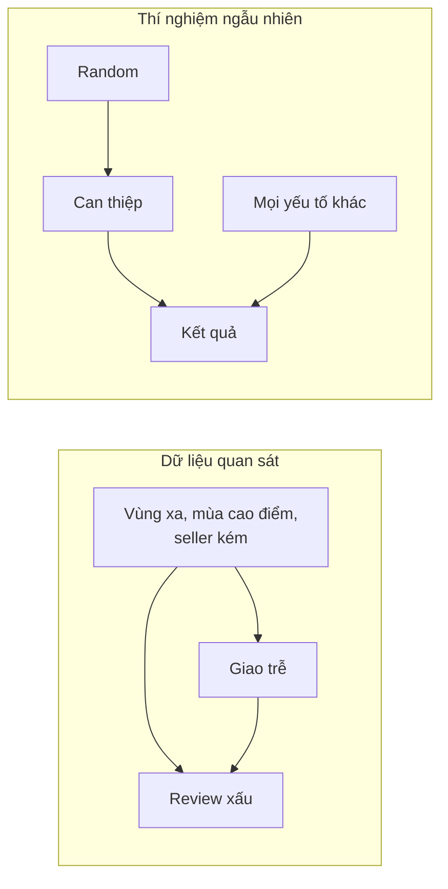
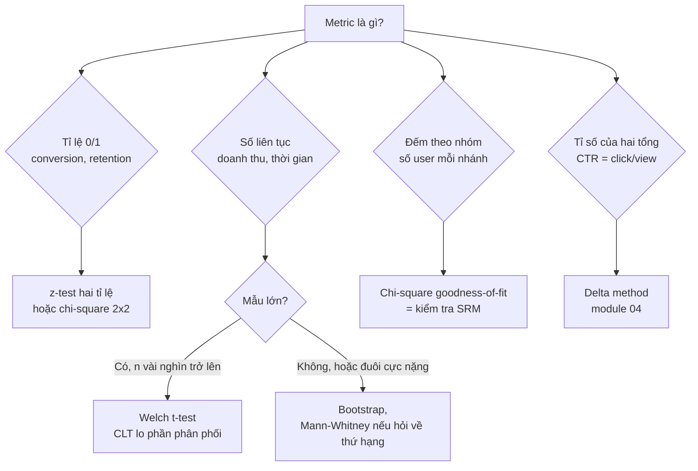
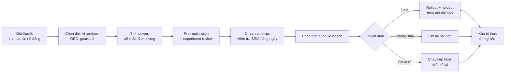

# Hypothesis Testing & A/B Testing

A/B testing là cách doanh nghiệp trả lời câu hỏi "thay đổi này có làm mọi thứ tốt hơn không"
bằng bằng chứng thay vì cảm giác. Ở các công ty sản phẩm lớn (Booking, Netflix, Microsoft, Shopee,
Grab…), gần như mọi thay đổi đều qua thí nghiệm, và Data Scientist là người chịu trách nhiệm cho
việc thí nghiệm được **thiết kế đúng, đọc đúng và ra quyết định đúng**. Phỏng vấn DS sản phẩm luôn
có ít nhất một vòng về chủ đề này.

Module dùng ba bộ dữ liệu thật: **Cookie Cats** (game di động thử dời "cổng chờ" từ level 30 sang
40), **Hillstrom** (thí nghiệm email 3 nhánh của một nhà bán lẻ) và **ab_data** (thử landing page
mới, có dữ liệu bẩn). Baseline cho phần thiết kế lấy từ **Olist** thật. Tải dữ liệu:

```bash
uv run python data/download_dataset.py cookie-cats
uv run python data/download_dataset.py hillstrom
uv run python data/download_dataset.py ab-data
uv run python data/download_olist.py
```

Sau module này bạn sẽ:

- Chọn đúng kiểm định cho từng loại metric và giải thích p-value, confidence interval cho người
  không làm thống kê.
- Thiết kế một thí nghiệm: đơn vị random, metric chính, guardrail, cỡ mẫu, thời lượng.
- Tính power, MDE, sample size và đánh đổi giữa chúng.
- Phát hiện và xử lý các lỗi làm hỏng thí nghiệm: SRM, peeking, multiple testing, novelty.
- Ra quyết định ship / không ship / chạy tiếp từ kết quả, kể cả khi kết quả "xấu xí".

## 1. Vì sao doanh nghiệp chạy thí nghiệm

### Tương quan không phải nhân quả

Đội sản phẩm Olist thấy: khách nhận được email nhắc đánh giá có review score cao hơn khách không
nhận. Kết luận "email làm tăng điểm review" có thể sai hoàn toàn, vì email chỉ được gửi cho đơn đã
giao thành công, mà đơn giao thành công vốn có điểm cao hơn. Đó là **confounding**: một yếu tố thứ
ba (giao thành công) tác động lên cả "nhận email" lẫn "điểm review".

Trên dữ liệu Olist thật, đơn giao trễ có tỉ lệ review 1–2 sao là **54%**, đơn giao đúng hẹn chỉ
**9%**. Rất muốn kết luận "giao trễ làm review xấu đi 45 điểm phần trăm". Nhưng đơn giao trễ
cũng tập trung ở vùng xa, ở một số seller, ở mùa cao điểm; một phần chênh lệch có thể đến từ
những thứ đó. Muốn biết tác động thật thì cần **so sánh hai nhóm giống hệt nhau, chỉ khác đúng
một điều**. Randomization làm được việc đó: chia ngẫu nhiên thì mọi yếu tố khác, kể cả những yếu
tố ta không đo được, phân bố đều giữa hai nhóm (theo kỳ vọng).



Bên trái, ta không tách được phần nào của chênh lệch là do giao trễ. Bên phải, random cắt mũi tên
từ "yếu tố khác" vào "can thiệp", nên chênh lệch giữa hai nhóm là tác động nhân quả.

### Khi nào A/B test là công cụ đúng

| Tình huống | A/B test? | Thay bằng gì |
| --- | --- | --- |
| Đổi giao diện, thuật toán gợi ý, email, giá khuyến mãi theo user | Có | |
| Quyết định chỉ làm một lần (đổi logo, mở kho mới ở một bang) | Không đủ đơn vị để random | Causal inference trên dữ liệu quan sát (module 06), synthetic control |
| Thay đổi ảnh hưởng cả thị trường (giá sàn của toàn bộ seller) | Random theo user bị nhiễm chéo | Switchback, random theo vùng (module 04) |
| Có thể gây hại hoặc vi phạm đạo đức (ẩn thông tin an toàn) | Không | Phân tích quan sát, nghiên cứu định tính |
| Lượng traffic quá ít (B2B vài trăm khách) | Thường không đủ power | Nghiên cứu định tính, Bayesian với prior mạnh, ra quyết định bằng lập luận |
| Thay đổi hiển nhiên đúng (sửa bug thanh toán) | Không cần | Ship, theo dõi metric |

Thí nghiệm không miễn phí: tốn traffic, thời gian chờ, công sức kỹ thuật, và chi phí cơ hội khi
một nửa user dùng phiên bản kém hơn. DS senior biết khi nào **không** nên chạy thí nghiệm.

## 2. Hypothesis testing cho thí nghiệm

### Khung tư duy

- **H0 (null hypothesis)**: thay đổi không có tác động; mọi chênh lệch quan sát được là do ngẫu
  nhiên của việc lấy mẫu.
- **H1 (alternative)**: có tác động. Thường dùng **two-sided** (tốt hơn hoặc tệ hơn), vì thay đổi
  có thể làm hại và ta cần biết điều đó.
- **Test statistic**: một con số đo "chênh lệch quan sát được lớn cỡ nào so với độ nhiễu",
  ví dụ z = (p̂_B − p̂_A) / SE.
- **p-value**: *nếu H0 đúng*, xác suất thấy một chênh lệch ít nhất cực đoan như đã thấy.
  p-value **không phải** xác suất H0 đúng, cũng không phải xác suất thay đổi có hiệu quả.
- **α (significance level)**: ngưỡng chấp nhận báo động nhầm, thường 0.05. Bác bỏ H0 khi p < α.

|  | H0 đúng (không có tác động) | H1 đúng (có tác động) |
| --- | --- | --- |
| Bác bỏ H0 ("có tác động") | **Type I error** (false positive), xác suất α | Đúng: xác suất là **power** = 1 − β |
| Không bác bỏ H0 | Đúng | **Type II error** (false negative), xác suất β |

Hai loại sai có giá khác nhau. Ship nhầm một thay đổi vô dụng (Type I) tốn chi phí bảo trì và làm
team tin sai. Bỏ lỡ một thay đổi tốt (Type II) mất doanh thu. Chọn α và power là quyết định kinh
doanh, không chỉ là quy ước.

### Chọn kiểm định theo loại metric



**z-test hai tỉ lệ** (conversion, retention). Với x_A thành công trên n_A người:

```
p̂ = (x_A + x_B) / (n_A + n_B)                      # pooled, dùng khi giả định H0
z = (p̂_B − p̂_A) / sqrt( p̂(1 − p̂)(1/n_A + 1/n_B) )
```

**Welch t-test** (doanh thu, số phút xem). Không giả định hai nhóm cùng variance, nên là lựa chọn
mặc định thay cho Student t-test. Với mẫu vài nghìn trở lên, CLT đảm bảo trung bình mẫu xấp xỉ
chuẩn kể cả khi doanh thu lệch phải nặng, **miễn là variance hữu hạn và không có vài giá trị khổng
lồ chi phối**. Doanh thu có "cá voi" (một khách mua 500 lần mức trung bình) cần xử lý thêm:
winsorize (cắt ở percentile 99.9), hoặc bootstrap để kiểm tra lại.

**Mann-Whitney U** kiểm định về **thứ hạng**, không phải về trung bình. Nó trả lời "giá trị ở B
có xu hướng lớn hơn ở A không", nên không dùng được để nói "doanh thu trung bình tăng 3%". Đây là
lỗi hay gặp: dùng Mann-Whitney vì "dữ liệu không chuẩn" rồi báo cáo như thể kiểm định trung bình.

### Ví dụ thật: Cookie Cats

Cookie Cats là game xếp hình. Khi chơi tới một level nhất định, người chơi gặp "gate": phải chờ
hoặc trả tiền để đi tiếp. Nhà phát hành thử dời gate từ level 30 (`gate_30`, control) sang level 40
(`gate_40`, treatment) và đo retention sau 1 ngày, 7 ngày.

```python
import pandas as pd
from statsmodels.stats.proportion import proportions_ztest

df = pd.read_csv("data/raw/cookie-cats/cookie_cats.csv")
summary = df.groupby("version")[["retention_1", "retention_7"]].agg(["sum", "count", "mean"])
print(summary)

for metric in ["retention_1", "retention_7"]:
    g = df.groupby("version")[metric].agg(["sum", "count"])
    z, p = proportions_ztest(count=[g.loc["gate_40", "sum"], g.loc["gate_30", "sum"]],
                             nobs=[g.loc["gate_40", "count"], g.loc["gate_30", "count"]])
    print(f"{metric}: z = {z:.3f}, p = {p:.4f}")
```

Kết quả: `retention_1` là 44.8% → 44.2% (z = −1.78, p = 0.074); `retention_7` là 19.0% → 18.2%
(z = −3.16, p = 0.0016). Dời gate ra xa làm retention 7 ngày **giảm**. Lời giải thích hợp lý là
gate buộc người chơi nghỉ, và nghỉ giữa chừng giúp họ không chán game (hedonic adaptation). Bài
Intermediate 01 sẽ đào sâu bộ này, kể cả một vấn đề về cỡ nhóm mà bản tóm tắt trên che mất.

### Bootstrap

Khi không có công thức SE đáng tin (median, percentile, metric phức tạp), **bootstrap** ước lượng
phân phối của thống kê bằng cách lấy mẫu lại có hoàn lại từ chính dữ liệu, mỗi nhóm riêng:

```python
import numpy as np

def bootstrap_diff(a: np.ndarray, b: np.ndarray, stat=np.mean, n_boot=2000, seed=0):
    rng = np.random.default_rng(seed)
    diffs = np.array([
        stat(rng.choice(b, size=len(b))) - stat(rng.choice(a, size=len(a)))
        for _ in range(n_boot)
    ])
    return stat(b) - stat(a), np.percentile(diffs, [2.5, 97.5])

rng = np.random.default_rng(1)
a = rng.exponential(10, 5000)   # doanh thu lệch phải
b = rng.exponential(10.5, 5000)
print(bootstrap_diff(a, b))
print(bootstrap_diff(a, b, stat=np.median))
```

Bootstrap không phải phép màu. Nó vẫn dựa vào giả định mẫu đại diện cho tổng thể, và với đuôi cực
nặng thì percentile bootstrap cũng bất ổn. Với dữ liệu lớn, bootstrap tốn tính toán: 2000 lần
resample trên 10 triệu dòng là việc của Spark, hoặc dùng Poisson bootstrap (mỗi dòng nhận trọng số
Poisson(1)), cách các experimentation platform dùng để chạy song song.

## 3. Thiết kế thí nghiệm

Một thí nghiệm hỏng thường hỏng từ khâu thiết kế, không phải khâu phân tích. Mọi quyết định dưới
đây phải **viết ra trước khi chạy**.

### Đơn vị random (randomization unit)

| Đơn vị | Ưu | Nhược | Dùng khi |
| --- | --- | --- | --- |
| User (đăng nhập) | Trải nghiệm nhất quán, đo được hành vi dài hạn | Cần đăng nhập | Mặc định cho sản phẩm có tài khoản |
| Cookie / device | Không cần đăng nhập | Một người nhiều thiết bị → thấy cả hai phiên bản | Trang công khai, landing page |
| Session / pageview | Nhiều đơn vị, power cao | Cùng user thấy A rồi B, nhiễm chéo | Thay đổi nhỏ, không có hiệu ứng ghi nhớ (thứ tự kết quả tìm kiếm) |
| Vùng / thành phố / thời gian | Tránh nhiễm chéo ở marketplace | Ít đơn vị, power thấp | Marketplace, pricing, logistics (module 04) |

**Quy tắc vàng: đơn vị phân tích phải khớp đơn vị random.** Random theo user nhưng tính
conversion theo pageview thì các pageview của cùng một user không độc lập; công thức SE thông
thường sẽ quá nhỏ và báo "có ý nghĩa" nhầm. Khi bắt buộc phải lệch (CTR theo pageview, random theo
user), dùng delta method hoặc cluster-robust SE (module 04).

### Metric: OEC, guardrail, metric chẩn đoán

- **OEC (Overall Evaluation Criterion)** / primary metric: **một** metric quyết định ship. Phải
  nhạy (thay đổi được trong vài tuần), gắn với giá trị dài hạn, khó "gian lận". Ví dụ Cookie Cats:
  `retention_7` tốt hơn `retention_1` vì gần giá trị dài hạn hơn.
- **Guardrail metrics**: những thứ không được phép xấu đi, dù OEC tăng. Gồm guardrail kinh doanh
  (doanh thu, tỉ lệ hoàn đơn, khiếu nại) và guardrail chất lượng dữ liệu (SRM, tỉ lệ log thiếu).
- **Diagnostic / secondary metrics**: giúp hiểu *vì sao* OEC đổi (click vào nút mới, thời gian trên
  trang). Không dùng để quyết định, vì càng nhiều metric càng dễ có một cái "có ý nghĩa" do may.

Một thí nghiệm của Olist nhắm giảm review xấu bằng cách nhắn tin chủ động cho đơn có nguy cơ giao
trễ có thể dùng:

| Vai trò | Metric | Lý do |
| --- | --- | --- |
| OEC | Tỉ lệ review 1–2 sao trên đơn đã giao | Mục tiêu trực tiếp; baseline thật 12.8% |
| Guardrail | Tỉ lệ huỷ đơn, chi phí CSKH mỗi đơn, tỉ lệ có review | Tin nhắn có thể khiến khách huỷ, hoặc làm ít người để lại review hơn (selection bias trên chính OEC) |
| Diagnostic | Tỉ lệ mở tin nhắn, số liên hệ CSKH | Giải thích cơ chế |

### Phân bổ traffic và thời lượng

- 50/50 cho power cao nhất với cùng tổng traffic. Ramp-up (1% → 5% → 50%) để bắt lỗi kỹ thuật sớm,
  nhưng **chỉ phân tích giai đoạn phân bổ ổn định**, vì người vào ở các giai đoạn khác nhau có thể
  khác nhau.
- Chạy **trọn số tuần** (ít nhất 1–2 tuần), vì hành vi thứ Bảy khác thứ Hai. Thí nghiệm chạy từ
  thứ Hai đến thứ Sáu đo một tổng thể không có thật.
- Thời lượng tính từ cỡ mẫu cần (mục 4) chia cho traffic mỗi ngày, làm tròn lên số tuần, và cộng
  thêm thời gian để metric "chín" (retention 7 ngày cần thêm 7 ngày sau khi người cuối cùng vào).



## 4. Power, MDE và sample size

### Bốn đại lượng ràng buộc nhau

Cho một metric, bốn đại lượng sau quyết định lẫn nhau; biết ba thì tính được cái thứ tư:

- **α**: ngưỡng Type I (0.05).
- **Power** (1 − β): xác suất phát hiện tác động nếu tác động thật đúng bằng MDE (thường 0.8).
- **MDE (Minimum Detectable Effect)**: tác động nhỏ nhất ta muốn phát hiện được.
- **n**: cỡ mẫu mỗi nhóm.

Với metric tỉ lệ, baseline p₁, muốn phát hiện p₂ = p₁ + MDE, two-sided:

```
n mỗi nhóm = (z_{1−α/2} + z_{1−β})² · [p₁(1 − p₁) + p₂(1 − p₂)] / MDE²
```

Với metric liên tục có độ lệch chuẩn σ: `n = 2σ²(z_{1−α/2} + z_{1−β})² / MDE²`.

Ba hệ quả thực tế:

1. **n tỉ lệ nghịch với MDE²**: muốn phát hiện tác động nhỏ đi một nửa thì cần gấp **4 lần** mẫu.
2. **n tỉ lệ thuận với variance**: giảm variance (CUPED, module 04) có giá trị y như có thêm traffic.
3. **MDE nên là con số kinh doanh**, không phải con số thống kê: "tác động nhỏ nhất đáng để
   ship, sau khi trừ chi phí xây và bảo trì tính năng".

```python
import math
from scipy.stats import norm

def n_per_group(p1: float, mde: float, alpha: float = 0.05, power: float = 0.8) -> int:
    p2 = p1 + mde
    z = norm.ppf(1 - alpha / 2) + norm.ppf(power)
    return math.ceil(z**2 * (p1 * (1 - p1) + p2 * (1 - p2)) / mde**2)

# Olist: baseline review xấu 12.8%, muốn phát hiện giảm 1 điểm phần trăm
n = n_per_group(0.128, -0.01)
print(n, "đơn mỗi nhóm")                      # ~17 nghìn
print(n * 2 / 1259, "tuần với ~1259 đơn giao mỗi tuần")   # ~27 tuần: quá lâu
print(n_per_group(0.128, -0.02) * 2 / 1259)  # nhắm giảm 2 điểm: ~6.5 tuần
```

Con số 27 tuần nói với bạn một điều quan trọng *trước khi* tốn công: với traffic của Olist (2018),
thí nghiệm nhắm tác động 1 điểm phần trăm là không khả thi. Lựa chọn: chấp nhận MDE lớn hơn, chỉ
can thiệp nhóm có nguy cơ cao (baseline cao hơn, tác động lớn hơn), giảm variance, hoặc chọn metric
nhạy hơn.

### Power thấp nguy hiểm hơn bạn nghĩ

Thí nghiệm power thấp không chỉ "hay bỏ lỡ". Khi nó *tình cờ* có ý nghĩa thống kê, tác động ước
lượng gần như chắc chắn **bị phóng đại** (winner's curse, còn gọi là Type M error): chỉ những lần
nhiễu đẩy ước lượng lên cao mới vượt được ngưỡng. Team ship với kỳ vọng +8%, thực tế +1%. Đó là
lý do không nên chạy thí nghiệm "cứ thử xem" khi đã biết power chỉ 20%.

### Trong thực tế lấy σ và baseline ở đâu

Từ dữ liệu lịch sử của **chính tổng thể sẽ vào thí nghiệm**, trong một khoảng thời gian dài bằng
thí nghiệm dự kiến. Lỗi hay gặp: lấy baseline của toàn bộ user, trong khi thí nghiệm chỉ áp lên
user mới (baseline khác hẳn). Với metric lệch phải như doanh thu, σ rất lớn so với trung bình nên
cỡ mẫu cần thường gấp nhiều lần metric tỉ lệ.

## 5. Phân tích và ra quyết định

### Báo cáo confidence interval, không chỉ p-value

p-value chỉ nói "có khác không"; **confidence interval (CI)** nói "khác bao nhiêu" và "chắc cỡ
nào". Báo cáo chuẩn cho mỗi metric: giá trị hai nhóm, chênh lệch tuyệt đối và tương đối, CI 95%,
p-value.

CI 95% hiểu đúng: nếu lặp lại thí nghiệm nhiều lần, 95% các khoảng được dựng theo cách này sẽ chứa
giá trị thật. Với PM có thể nói gọn: "tác động nằm đâu đó trong khoảng này, và ta khá chắc chắn
về điều đó".

Kết quả Hillstrom thật (chênh lệch so với nhóm không nhận email, CI 95%):

| Nhánh | visit | conversion | spend ($/khách) |
| --- | --- | --- | --- |
| Mens E-Mail | +7.7 điểm % [7.0, 8.3] | +0.68 điểm % [0.50, 0.86] | +0.77 [0.49, 1.05] |
| Womens E-Mail | +4.5 điểm % [3.9, 5.2] | +0.31 điểm % [0.15, 0.47] | +0.42 [0.17, 0.68] |

Cả hai email đều có tác động; email nam tốt hơn trên mọi metric. Câu hỏi kinh doanh tiếp theo
không còn là thống kê: +$0.77 mỗi khách có lớn hơn chi phí gửi email và chi phí cơ hội không? Với
nhóm khách nào thì có (bài Advanced 01)?

### Statistical significance khác practical significance

Với 10 triệu user, một tác động +0.01% cũng "có ý nghĩa thống kê". Với 2 nghìn user, tác động
+5% có thể không. Quyết định dựa trên **CI so với ngưỡng có ý nghĩa kinh doanh**:

| CI của tác động | Ý nghĩa | Quyết định thường gặp |
| --- | --- | --- |
| Toàn bộ trên ngưỡng kinh doanh | Chắc chắn có lợi đủ lớn | Ship |
| Trên 0 nhưng chạm dưới ngưỡng | Có lợi, chưa chắc đủ lớn | Ship nếu chi phí thấp; hoặc chạy thêm |
| Chứa 0, hẹp quanh 0 | Gần như chắc không có tác động đáng kể | Không ship (hoặc ship nếu là thay đổi vì lý do khác, như giảm chi phí kỹ thuật) |
| Chứa 0, rất rộng | Không đủ dữ liệu để kết luận | Thí nghiệm thiếu power; đừng nói "không có tác động" |
| Toàn bộ dưới 0 | Có hại | Không ship, tìm hiểu vì sao |

"Không có ý nghĩa thống kê" **không** có nghĩa là "chứng minh không có tác động". Muốn kết luận
"không tệ hơn" thì phải thiết kế **non-inferiority test** từ đầu, với một biên chấp nhận được.

### OEC tăng nhưng guardrail giảm

Tình huống thường gặp nhất trong thực tế và hay xuất hiện trong phỏng vấn. Không có công thức; cần
lượng hoá đánh đổi về cùng một đơn vị (thường là tiền hoặc giá trị dài hạn), hiểu cơ chế (tại sao
guardrail giảm, có sửa được không), và đưa quyết định lên đúng người. DS không tự quyết một mình,
nhưng DS phải là người đặt đánh đổi lên bàn một cách rõ ràng.

## 6. Bẫy thường gặp

### SRM: Sample Ratio Mismatch

Thiết kế chia 50/50 nhưng nhận về 50.4/49.6 với hàng chục nghìn user thì gần như chắc chắn có lỗi:
bug trong code phân nhóm, redirect làm mất user ở một nhánh, bot bị lọc khác nhau, log của một
nhánh bị trễ. Khi có SRM, **mọi kết quả khác đều không đáng tin**, vì hai nhóm không còn so sánh
được.

Kiểm tra bằng chi-square goodness-of-fit trên số đơn vị mỗi nhánh. Ngành thường dùng ngưỡng rất
chặt (p < 0.001), vì kiểm tra này chạy hằng ngày cho mọi thí nghiệm và ta không muốn báo động nhầm
liên tục.

```python
from scipy.stats import chisquare

print(chisquare([44700, 45489]))   # Cookie Cats: p ≈ 0.0086
```

Cookie Cats có p ≈ 0.0086: không vượt ngưỡng 0.001 nhưng vượt 0.01. Thí nghiệm chuẩn mực sẽ chọn
ngưỡng **trước** khi nhìn dữ liệu; nếu chọn 0.01 thì phải điều tra trước khi tin vào kết quả
retention. Đây là bài Basic 03.

Khi gặp SRM: không "sửa" bằng cách lấy mẫu lại cho cân; tìm nguyên nhân. Chia nhỏ theo trình duyệt,
quốc gia, ngày, phiên bản app để tìm lát cắt lệch. Nhiều khi nguyên nhân cũng chính là phát hiện
quan trọng (phiên bản mới làm crash trên một loại điện thoại).

### Dữ liệu gán nhóm bẩn

Bộ `ab_data` có 3893 dòng mà nhóm và trang hiển thị không khớp (control thấy trang mới, hoặc
ngược lại) và user xuất hiện hai lần. Phải quyết định có loại hay không, và **lý do loại phải độc
lập với kết quả**. Loại user "gặp lỗi" chỉ ở nhánh treatment là đưa selection bias vào. Phân tích
**intention-to-treat** (theo nhóm được gán, bất kể thấy gì) luôn là phân tích chính đáng tin nhất.

### Peeking: nhìn kết quả mỗi ngày và dừng khi thấy p < 0.05

p-value của một thí nghiệm A/A (không có tác động) dao động lên xuống theo thời gian. Nếu nhìn
mỗi ngày và dừng ngay lần đầu thấy p < 0.05, tỉ lệ false positive thực tế không còn là 5% mà có
thể lên 20–30%. Đây là lỗi phổ biến nhất ở công ty không có experimentation platform.

Cách xử lý:

- **Cố định cỡ mẫu** từ trước, chỉ đọc kết quả khi đủ (vẫn được xem SRM và guardrail an toàn hằng
  ngày).
- **Group sequential design**: định trước K lần nhìn với biên chặt hơn ở các lần đầu, ví dụ
  O'Brien-Fleming: lần nhìn thứ k bác bỏ khi |z| > c·sqrt(K/k). Lần đầu gần như phải có bằng chứng
  áp đảo; lần cuối biên gần 1.96. Bài Intermediate 03 cho bạn tự hiệu chỉnh c bằng mô phỏng.
- **Always-valid inference** (mSPRT, confidence sequence): cho phép nhìn bất cứ lúc nào; được dùng
  trong platform của Optimizely, Eppo, Statsig.

### Multiple testing

Kiểm 20 metric độc lập ở α = 0.05 thì xác suất có ít nhất một metric "có ý nghĩa" do may là
1 − 0.95²⁰ ≈ 64%. Tương tự với nhiều nhánh, nhiều phân khúc (segment). Phương pháp hiệu chỉnh:

| Phương pháp | Kiểm soát | Đặc điểm |
| --- | --- | --- |
| Bonferroni | FWER (xác suất có ≥ 1 false positive) | Đơn giản, quá bảo thủ khi nhiều kiểm định |
| Holm | FWER | Luôn mạnh hơn Bonferroni, không cần giả định gì thêm, nên dùng thay Bonferroni |
| Benjamini-Hochberg | FDR (tỉ lệ false positive trong số các phát hiện) | Phù hợp khi sàng lọc nhiều metric/segment để tìm hướng điều tra |

Cách giảm vấn đề từ gốc: **một** OEC định trước. Phân tích segment là để *sinh giả thuyết* cho
thí nghiệm sau, không phải để tìm "segment thắng" rồi ship cho riêng segment đó.

### Novelty và primacy effect

User phản ứng với cái *mới* chứ không phải cái *tốt hơn*: nút màu mới được bấm nhiều trong tuần
đầu rồi trở lại bình thường (novelty), hoặc user quen giao diện cũ nên ban đầu phản ứng tệ
(primacy). Dấu hiệu: tác động theo ngày có xu hướng rõ. Cách nhìn: tách tác động theo "số ngày kể
từ lần đầu thấy". Module 04 đi sâu vào phần này cùng với network effect.

## 7. Quy trình thí nghiệm ở doanh nghiệp

### Pre-registration

Trước khi bật thí nghiệm, viết ra (thường là một trang tài liệu):

1. Giả thuyết và vì sao tin nó đúng (dữ liệu, nghiên cứu user).
2. Thay đổi cụ thể, đơn vị random, tổng thể đủ điều kiện, tỉ lệ phân bổ.
3. OEC, guardrail, metric chẩn đoán, với định nghĩa chính xác (công thức, cửa sổ thời gian).
4. MDE, α, power, cỡ mẫu, thời lượng, kế hoạch dừng sớm (nếu có).
5. Kế hoạch phân tích: kiểm định nào, hiệu chỉnh multiple testing ra sao, segment nào sẽ xem.
6. Quy tắc ra quyết định: kết quả thế nào thì ship.

Viết trước để không thể "tìm cách đọc" kết quả theo ý muốn sau khi thấy dữ liệu. Bài Advanced 02
là viết một tài liệu như thế cho Olist.

### Experimentation platform

Công ty chạy hàng trăm thí nghiệm song song cần một nền tảng: phân nhóm nhất quán (hash user_id +
salt của thí nghiệm), feature flag, pipeline tính metric tự động, kiểm tra SRM tự động, dashboard
kết quả có CI. Các sản phẩm: Optimizely, Statsig, Eppo, GrowthBook (mã nguồn mở), hoặc tự xây
(Booking, Netflix, Microsoft ExP). Data Engineer xây pipeline metric; Data Scientist định nghĩa
metric, phương pháp thống kê, và review thiết kế thí nghiệm. Hiểu cả hai phía là lợi thế lớn của
bạn.

```python
import hashlib

def assign(user_id: str, experiment: str, treatment_share: float = 0.5) -> str:
    """Phân nhóm nhất quán: cùng user, cùng thí nghiệm → luôn cùng nhóm, không cần lưu bảng."""
    h = int(hashlib.sha256(f"{experiment}:{user_id}".encode()).hexdigest()[:8], 16)
    return "treatment" if h / 0xFFFFFFFF < treatment_share else "control"

print([assign(f"user{i}", "gate-40") for i in range(6)])
```

Salt theo tên thí nghiệm để hai thí nghiệm chạy song song không bị phân nhóm trùng nhau (user ở
treatment của thí nghiệm này không bị "dính" vào treatment của thí nghiệm kia).

### Văn hoá

Ở các công ty có văn hoá thí nghiệm trưởng thành, phần lớn ý tưởng **không** cải thiện metric
(Microsoft báo cáo khoảng 1/3 có lợi, 1/3 trung tính, 1/3 có hại). Một DS giỏi giúp team chấp nhận
điều đó, giữ kỷ luật phương pháp khi kết quả không như mong đợi, và biến cả những thí nghiệm "thất
bại" thành tri thức cho lần sau.

## 8. Tài liệu tham khảo

Sách và tổng quan:

- Ron Kohavi, Diane Tang, Ya Xu. *Trustworthy Online Controlled Experiments: A Practical Guide to
  A/B Testing* (Cambridge University Press, 2020). Sách gối đầu giường của ngành.
- [OpenIntro Statistics](https://www.openintro.org/book/os/), chương về inference cho tỉ lệ và
  trung bình.
- [Statistics and Probability (Khan Academy)](https://www.khanacademy.org/math/statistics-probability).

Từ roadmap.sh/ai-data-scientist (mục Statistics):

- [Coursera: Introduction to Statistics (Stanford)](https://www.coursera.org/learn/stanford-statistics)
- [Coursera: Hypothesis Testing](https://www.coursera.org/learn/hypothesis-testing-public-health)
- [Minimum Detectable Effect](https://splitmetrics.com/resources/minimum-detectable-effect-mde/)

Bài viết và paper:

- Kohavi et al. [Seven Rules of Thumb for Web Site Experimenters](https://exp-platform.com/rules-of-thumb/) (KDD 2014).
- Fabijan et al. [Diagnosing Sample Ratio Mismatch in Online Controlled Experiments](https://exp-platform.com/Documents/2019_KDDFabijanGupchupFuptaOmhoverVermeerDmitriev.pdf) (KDD 2019).
- Evan Miller. [How Not To Run an A/B Test](https://www.evanmiller.org/how-not-to-run-an-ab-test.html) (peeking).
- Johari et al. [Always Valid Inference: Continuous Monitoring of A/B Tests](https://arxiv.org/abs/1512.04922) (2017).
- Benjamini & Hochberg (1995). Controlling the False Discovery Rate.

Tài liệu thư viện:

- [scipy.stats](https://docs.scipy.org/doc/scipy/reference/stats.html)
- [statsmodels: proportion](https://www.statsmodels.org/stable/stats.html#proportion), [power](https://www.statsmodels.org/stable/stats.html#power-and-sample-size-calculations), [multipletests](https://www.statsmodels.org/stable/generated/statsmodels.stats.multitest.multipletests.html)

Dữ liệu:

- Cookie Cats: [Kaggle](https://www.kaggle.com/datasets/yufengsui/mobile-games-ab-testing)
- Hillstrom: [MineThatData E-Mail Analytics Challenge](https://blog.minethatdata.com/2008/03/minethatdata-e-mail-analytics-and-data.html)
- ab_data: [Kaggle](https://www.kaggle.com/datasets/zhangluyuan/ab-testing)
