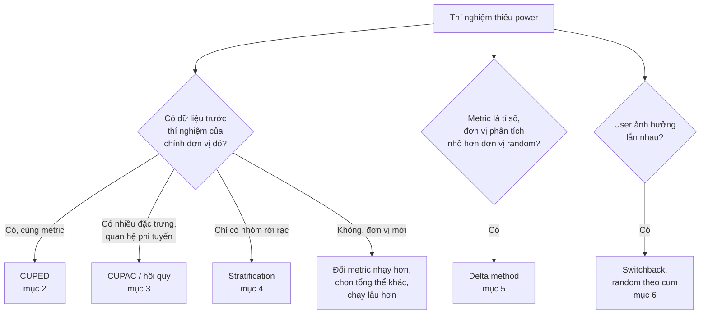
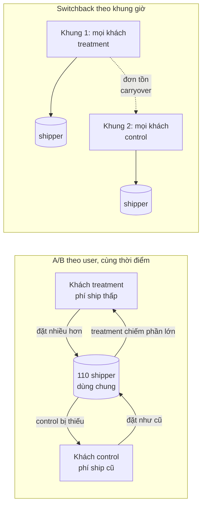
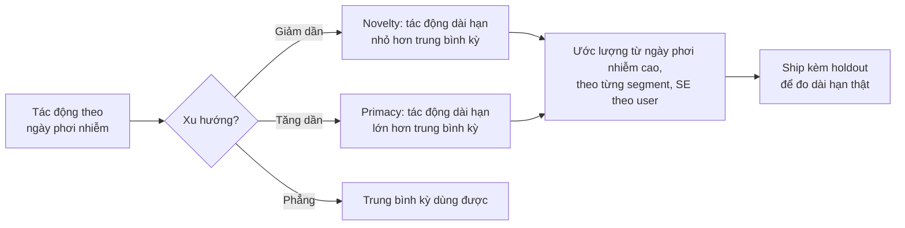

# Experimentation nâng cao

Module 03 dạy chạy một thí nghiệm đúng. Module này dạy chạy thí nghiệm **nhạy hơn** với cùng lượng
traffic, đọc đúng những metric khó (tỉ số, đơn vị phân tích khác đơn vị random), và nhận ra khi giả
định cốt lõi của A/B test bị vỡ: user ảnh hưởng lẫn nhau (network effect, marketplace), tác động
đổi theo thời gian (novelty, primacy), tác động khác nhau giữa các nhóm (heterogeneous effect).
Đây là phần phân biệt một DS làm thí nghiệm ở mức "chạy được" với người thiết kế experimentation
platform ở Booking, Netflix, Microsoft, DoorDash.

Dữ liệu thật dùng trong module: **Hillstrom** (thí nghiệm email, có chi tiêu 12 tháng trước thí
nghiệm), **Rossmann** (doanh số ngày của 1 115 cửa hàng, cho thí nghiệm cấp cửa hàng) và **Olist**
(ratio metric theo khách, CUPAC). Tải dữ liệu:

```bash
uv run python data/download_dataset.py hillstrom
uv run python data/download_dataset.py store-sales
uv run python data/download_olist.py
```

Sau module này bạn sẽ:

- Quy được "giảm variance" ra "MDE nhỏ hơn" và "ít traffic hơn", và biết trước khi chạy một kỹ
  thuật sẽ giúp được bao nhiêu.
- Tự cài CUPED, CUPAC, post-stratification, và biết khi nào mỗi cách gần như vô dụng.
- Tính đúng sai số của ratio metric bằng delta method và kiểm chứng bằng A/A trên dữ liệu thật.
- Nhận ra interference (network effect, nguồn cung chung) và thiết kế switchback hoặc random theo
  cụm.
- Đọc tác động theo thời gian (novelty, primacy) và theo nhóm (heterogeneous effect) mà không tự
  lừa mình.

## 1. Vì sao phải tăng độ nhạy

### Variance là chi phí

Nhắc lại từ module 03: với metric có độ lệch chuẩn $$\sigma$$, $$n$$ đơn vị mỗi nhánh, α = 0.05 và
power 80%, tác động nhỏ nhất phát hiện được là

$$
\mathrm{MDE} \approx (z_{1-\alpha/2} + z_{1-\beta})\,\sigma\sqrt{\frac{2}{n}} \approx 2.8\,\sigma\sqrt{\frac{2}{n}}
$$

Có ba cách làm MDE nhỏ lại: tăng $$n$$ (thêm traffic, chạy lâu hơn), tăng tác động (chọn tổng thể
phản ứng mạnh hơn), hoặc **giảm** $$\sigma$$. Cách thứ ba là chủ đề của bốn mục đầu. Giảm variance
một tỉ lệ $$v$$ tương đương nhân traffic lên $$1/(1-v)$$ lần: giảm 50% variance là có gấp đôi user
miễn phí, giảm 98% là gấp 50 lần.

Ở module 03, thí nghiệm giảm review xấu của Olist cần 16 930 đơn mỗi nhóm, khoảng 27 tuần. Câu hỏi
tự nhiên: giảm variance cứu được bao nhiêu? Câu trả lời trên dữ liệu thật (mục 3) là "gần như
không", và hiểu vì sao quan trọng không kém biết công thức.

### Bản đồ kỹ thuật



Hai nhánh dưới không làm thí nghiệm nhạy hơn, nhưng thiếu chúng thì "độ nhạy" là ảo: SE tính sai
hoặc ước lượng bị lệch.

## 2. CUPED

### Ý tưởng

CUPED (Controlled-experiment Using Pre-Experiment Data, Deng và cộng sự ở Microsoft, 2013): phần lớn
khác biệt giữa các user là khác biệt **có sẵn từ trước** (người mua nhiều tháng trước vẫn mua nhiều
tháng này). Trừ phần dự đoán được từ dữ liệu trước thí nghiệm $$X$$, chỉ còn lại phần nhiễu thật:

$$
Y_{\text{cuped}} = Y - \theta\,(X - \bar X), \qquad \theta = \frac{\mathrm{cov}(Y, X)}{\mathrm{var}(X)},
\qquad \mathrm{var}(Y_{\text{cuped}}) = \mathrm{var}(Y)\,(1 - \rho^2)
$$

Với $$\rho$$ là tương quan giữa $$Y$$ và $$X$$. Vì $$X$$ đo trước khi random, trung bình của nó bằng
nhau giữa hai nhánh theo kỳ vọng, nên phép trừ **không làm lệch** ước lượng tác động; nó chỉ trừ bớt
phần "xui rủi" khi một nhánh tình cờ nhận nhiều user mạnh hơn.

CUPED một covariate chính là hồi quy `Y ~ treat + X`. Lin (2013) chỉ ra hồi quy có thêm tương tác
`treat × (X − mean)` không làm độ chính xác tiệm cận tệ hơn hiệu trung bình thông thường, kể cả khi mô hình sai: hồi quy trong thí
nghiệm ngẫu nhiên là an toàn, khác hẳn hồi quy trên dữ liệu quan sát.

### Trên dữ liệu thật: 98% và 0.4%

```python
import numpy as np
import pandas as pd

train = pd.read_csv("data/raw/store-sales/train.csv", parse_dates=["Date"], dtype={"StateHoliday": str})
open_days = train[train.Open == 1]

def window(lo, hi):
    w = open_days[(open_days.Date >= lo) & (open_days.Date <= hi)]
    return w.groupby("Store").Sales.mean()

d = pd.concat({"x": window("2015-05-04", "2015-05-31"), "y": window("2015-06-01", "2015-06-28")}, axis=1).dropna()
rho = np.corrcoef(d.y, d.x)[0, 1]
theta = np.cov(d.y, d.x)[0, 1] / d.x.var()
y_cuped = d.y - theta * (d.x - d.x.mean())
print(len(d), "cửa hàng, rho =", round(rho, 4), ", giảm variance:", round(1 - y_cuped.var() / d.y.var(), 4))

hill = pd.read_csv("data/raw/hillstrom/hillstrom.csv")
print("Hillstrom: rho(visit, history) =", round(np.corrcoef(hill.visit, hill.history)[0, 1], 4))
```

| Bộ dữ liệu | Metric | Covariate | $$\rho$$ | Giảm variance |
| --- | --- | --- | --- | --- |
| Rossmann, 1 115 cửa hàng | Doanh số trung bình ngày, 6/2015 | Cùng metric, 4 tuần trước | 0.9908 | 98.2% |
| Hillstrom, 64 000 khách | `visit` trong 2 tuần | `history` (chi tiêu 12 tháng trước) | 0.065 | 0.4% |

Với Rossmann, MDE của thí nghiệm cấp cửa hàng giảm từ 5.84% doanh số xuống 0.79% (bài Advanced 01).
Với Hillstrom, CUPED gần như không làm gì. Khác biệt nằm ở covariate: Rossmann có **chính metric
đó, của chính đơn vị đó, ở kỳ liền trước**; Hillstrom chỉ có một đại lượng khác hẳn ("tổng chi
tiêu một năm" để dự đoán "có ghé website trong hai tuần không").

### Thực tế triển khai

Ba chỗ khó thường gặp khi đưa CUPED lên một experimentation platform:

- **User không có dữ liệu trước thí nghiệm** (user mới, cookie mới): không bỏ họ khỏi phân tích
  (làm đổi tổng thể). Điền covariate bằng một hằng số (0 hoặc trung bình) **và** thêm biến chỉ báo
  "không có lịch sử" vào hồi quy. Có cả hai thì mới tương đương điều chỉnh riêng nhóm có lịch sử,
  nhóm mới giữ nguyên; chỉ đặt $$X = 0$$ mà không có biến chỉ báo thì $$\theta$$ bị ước lượng trên
  hỗn hợp hai nhóm và user mới bị "điều chỉnh" theo một quan hệ không áp dụng cho họ. Tỉ lệ user mới
  càng cao, lợi ích càng giảm. Netflix ghi nhận đúng điều này (Xie và Aurisset 2016, mục 5.2.1): với
  user mới, mức giảm variance rất thấp ở mọi metric và mọi kỹ thuật, vì lúc gán nhóm không có
  covariate nào tương quan mạnh với metric (tương quan Pearson chỉ 0.2–0.4).
- **Cửa sổ trước thí nghiệm**: thường bằng thời lượng thí nghiệm. Tuyệt đối không chồng lên ngày
  bật thí nghiệm, kể cả một ngày.
- **Mỗi metric một covariate**: covariate tốt nhất cho "số phiên" là "số phiên kỳ trước", cho
  "doanh thu" là "doanh thu kỳ trước". Vì vậy pipeline metric nên tính sẵn giá trị kỳ trước cho mọi
  metric và mọi đơn vị.

Lỗi hay gặp: dùng covariate đo **sau** khi bắt đầu thí nghiệm. Covariate chứa tác động, CUPED trừ
mất tác động (bài Basic 01 có test minh hoạ đúng lỗi này).

## 3. CUPAC và hồi quy với nhiều covariate

### Ý tưởng

Khi không có một covariate mạnh duy nhất, có thể gom nhiều đặc trưng trước thí nghiệm bằng một
model ML: huấn luyện model dự đoán metric, rồi dùng **dự đoán** làm covariate CUPED. DoorDash gọi
cách này là **CUPAC** (Control Using Predictions As Covariates). Mức giảm variance bằng $$R^2$$ của
model trên dữ liệu thí nghiệm, nên model càng dự đoán tốt metric càng có lợi.

Điều kiện để không lệch giống CUPED: dự đoán chỉ được dùng thông tin **có trước** khi random, và
model không được "thấy" outcome của chính đơn vị nó dự đoán. Hai cách bảo đảm:

| Cách | Làm thế nào | Khi nào dùng |
| --- | --- | --- |
| Huấn luyện trên kỳ trước | Model học từ dữ liệu trước thí nghiệm, dự đoán cho đơn vị trong thí nghiệm | Có lịch sử đủ dài, platform chạy thường xuyên |
| Cross-fitting | Chia K fold, dự đoán mỗi fold bằng model học trên các fold còn lại, không dùng biến treatment | Phân tích một lần, không có kỳ trước phù hợp |

Hồi quy tuyến tính nhiều covariate (`Y ~ treat + X1 + X2 + C(kênh)`) là phiên bản đơn giản của cùng
ý tưởng, thường đủ tốt và dễ giải thích.

### Trên dữ liệu thật

Hillstrom (bài Intermediate 01), email nữ so với không gửi, metric `visit`:

| Cách | SE | Giảm variance |
| --- | --- | --- |
| Không điều chỉnh | 0.003234 | |
| CUPED với `history` | 0.003228 | 0.4% |
| Hồi quy 7 cột hồ sơ khách | 0.003192 | khoảng 2.6% |
| CUPAC (gradient boosting, 5 fold) | 0.003195 | 2.4% |

Olist: dự đoán đơn có bị giao trễ (hay bị review xấu) từ những gì biết **lúc đặt hàng** (giá, phí
ship, số món, số ngày giao dự kiến, bang của khách và seller, tỉ lệ trễ trước đó của seller). Model
LightGBM học trên đơn mua trước 2018-01-01, áp lên đơn giao xong mua từ 2018-01-01 tới 2018-08-31:

| Metric | Tỉ lệ trong kỳ áp dụng | $$\rho$$(metric, dự đoán) | Giảm variance |
| --- | --- | --- | --- |
| Giao trễ | 9.4% | 0.153 | 2.3% |
| Review xấu (≤ 2 sao) | 13.4% | 0.147 | 2.2% |

Hai con số này nói rằng thí nghiệm 27 tuần của module 03 (chính xác là 26.9 tuần) chỉ rút xuống
khoảng 26.3 tuần dù dùng ML. Lý do chung
với Hillstrom, và với kết quả của Netflix cho user mới nêu ở mục 2: 97% khách Olist chỉ mua một lần, không có
"chính metric đó ở kỳ trước" để khai thác, và giao trễ chủ yếu do những gì xảy ra **sau** khi đặt
hàng. Hệ số $$\theta$$ của CUPAC ở đây chỉ khoảng 0.46 (giao trễ) và 0.60 (review xấu) thay vì gần 1:
model huấn luyện trên 2017 dự đoán lệch cho 2018, một dấu hiệu distribution shift. CUPAC vẫn không
lệch (θ ước lượng lại trên dữ liệu thí nghiệm), chỉ kém hiệu quả.

Bài học senior: trước khi hứa "dùng CUPED/CUPAC giảm 50% thời gian", đo $$\rho$$ hoặc $$R^2$$ trên dữ
liệu lịch sử của **đúng tổng thể sẽ vào thí nghiệm**. Một con số trung thực 2% tốt hơn một lời hứa
50% không thành.

## 4. Stratification

### Hai thời điểm chia tầng

Chia tổng thể thành các tầng (strata) đồng nhất, như loại cửa hàng hay mức chi tiêu, rồi:

- **Stratified sampling**: random **trong từng tầng** lúc gán, bảo đảm mỗi tầng chia đều hai nhánh.
- **Post-stratification**: random bình thường, lúc phân tích tính tác động trong từng tầng rồi gộp
  theo tỉ trọng tầng:

$$
\hat\tau_{\text{post}} = \sum_k \frac{N_k}{N}\left(\bar y_{T,k} - \bar y_{C,k}\right)
$$

Cả hai loại bỏ phần variance **giữa** các tầng. Bài của Netflix (Xie và Aurisset, KDD 2016, mục 5.2 và 6) so sánh
stratified sampling, post-stratification và CUPED trên dữ liệu thật: về lý thuyết chúng giảm
variance như nhau khi mẫu lớn, nhưng stratified sampling khi gán user theo thời gian thực cần hệ
thống hàng đợi phức tạp và trong thực tế cho kết quả kém hơn. Khuyến nghị của họ: với thí nghiệm
lớn, dùng kỹ thuật **sau khi gán** (post-stratification, CUPED).

| | Stratified sampling | Post-stratification / CUPED |
| --- | --- | --- |
| Cần tầng từ khi nào | Trước khi gán | Lúc phân tích |
| Chi phí hạ tầng | Cao (sửa assignment) | Thấp |
| Lợi rõ nhất khi | Ít đơn vị (vài chục cửa hàng, thành phố): tránh hai nhánh lệch nặng ngay từ đầu | Nhiều đơn vị, user đến liên tục |
| Rủi ro | Phân tích quên tính theo tầng, SE quá lớn | Chọn tầng sau khi thấy kết quả (p-hacking) |

### Tầng tốt là tầng dự đoán được metric

Trên Rossmann (bảng theo cửa hàng ở mục 2):

| Cách chia | Phần variance doanh số được giải thích |
| --- | --- |
| Theo `StoreType` (4 loại cửa hàng) | 4.0% |
| Theo 10 decile doanh số tháng trước | 85.9% |
| CUPED với doanh số tháng trước (không chia tầng) | 98.2% |

`StoreType` nghe hợp lý nhưng gần như vô dụng. Decile doanh số tốt, nhưng bỏ phí biến thiên bên trong
mỗi decile mà CUPED tận dụng được. Thiết kế mạnh cho thí nghiệm cấp cửa hàng là kết hợp: **gán theo
tầng** decile doanh số (hai nhánh cân bằng ngay từ đầu, lãnh đạo nhìn bảng so sánh thấy hợp lý),
**phân tích bằng CUPED** hoặc hồi quy.

## 5. Ratio metrics và delta method

### Khi đơn vị phân tích nhỏ hơn đơn vị random

Nhiều metric quan trọng là **tỉ số của hai tổng**: CTR (click / lượt xem), giá trung bình mỗi sản
phẩm (doanh thu / số sản phẩm), doanh thu mỗi phiên. Thí nghiệm random theo user, nhưng tử và mẫu
đếm theo lượt xem, sản phẩm, phiên. Các quan sát của cùng một user tương quan với nhau, nên coi chúng
độc lập (z-test trên lượt xem, t-test trên sản phẩm) cho SE quá nhỏ.

Gộp về mức user: $$Y_i$$ là tổng tử số, $$X_i$$ là tổng mẫu số của user $$i$$. Metric là
$$R = \bar Y / \bar X$$. Delta method (khai triển Taylor bậc một) cho:

$$
\mathrm{var}(R) \approx \frac{1}{n\,\mu_X^2}\left(\sigma_Y^2 - 2R\,\sigma_{XY} + R^2\sigma_X^2\right)
$$

Bài của Microsoft (Deng, Knoblich, Lu 2018) là hướng dẫn thực hành chuẩn: delta method cho ratio
metric, cho thay đổi tương đối $$R_B / R_A - 1$$ (con số PM hay hỏi), và cho cả metric percentile.
Ưu điểm so với bootstrap: một phép tính trên các tổng đã có sẵn, chạy được cho hàng nghìn metric ×
hàng trăm thí nghiệm mỗi ngày.

```python
import numpy as np
import pandas as pd

def ratio_delta(num, den):
    num, den = np.asarray(num, float), np.asarray(den, float)
    r = num.sum() / den.sum()
    c = np.cov(num, den)
    return r, (c[0, 0] - 2 * r * c[0, 1] + r**2 * c[1, 1]) / (len(num) * den.mean() ** 2)

orders = pd.read_csv("data/raw/olist_orders_dataset.csv")
customers = pd.read_csv("data/raw/olist_customers_dataset.csv")
items = pd.read_csv("data/raw/olist_order_items_dataset.csv")
done = orders[(orders.order_status == "delivered") & orders.order_delivered_customer_date.notna()]
done = done.merge(customers[["customer_id", "customer_unique_id"]], on="customer_id")
items = items.merge(done[["order_id", "customer_unique_id"]], on="order_id")

per_customer = items.groupby("customer_unique_id").price.agg(["sum", "size"])
r, var = ratio_delta(per_customer["sum"], per_customer["size"])
naive_se = items.price.std() / np.sqrt(len(items))
print(f"Giá trung bình mỗi sản phẩm: {r:.2f}; SE delta: {np.sqrt(var):.3f}; SE coi sản phẩm độc lập: {naive_se:.3f}")
print("design effect:", round(var / naive_se**2, 3))
```

### Kiểm chứng bằng A/A trên Olist thật

Random **khách** (`customer_unique_id`) 2 000 lần, không có tác động nào (bài Intermediate 02):

| Cách tính SE | Tỉ lệ p < 0.05 |
| --- | --- |
| Delta method theo khách | 5.3% |
| Coi mỗi sản phẩm độc lập | 7.3% |

Design effect của Olist chỉ khoảng 1.17 vì đa số khách mua một sản phẩm. Trên log pageview, nơi mỗi
user có hàng chục quan sát và hành vi khác nhau nhiều giữa user, design effect lớn hơn nhiều: dữ liệu
mô phỏng ở bài Basic 02 (khoảng 10 lượt xem mỗi user) cho tỉ lệ báo động nhầm khoảng 25% với cách
tính ngây thơ.

### Chọn metric nào

Delta method trả lời "tính SE thế nào", không trả lời "nên dùng metric nào". Giá trung bình mỗi sản
phẩm tăng có thể vì khách mua ít món rẻ hơn, tức doanh thu giảm. OEC nên là metric **theo đơn vị
random** (doanh thu mỗi khách được random); metric tỉ số hợp làm metric chẩn đoán. Lỗi hay gặp
khác: lấy trung bình các tỉ lệ của từng user (`mean(click / view)`), một metric khác hẳn (mỗi user
cùng trọng số), và nó vỡ khi user có 0 lượt xem.

## 6. Interference: network effect, marketplace, switchback

### Khi A/B test theo user sai từ gốc

Mọi phân tích ở module 03 dựa trên **SUTVA**: kết quả của một user chỉ phụ thuộc nhánh của chính user
đó. Giả định này vỡ khi:

- **Network effect**: tính năng nhắn tin, chia sẻ, mời bạn. User treatment gửi tin cho user control,
  control cũng "được" tính năng một phần, tác động bị **đánh giá thấp**.
- **Nguồn cung chung** (marketplace hai phía: giao hàng, gọi xe, đặt phòng): treatment giảm phí
  ship, khách treatment đặt nhiều hơn và **chiếm** shipper của khách control. Control trông tệ đi,
  tác động bị **phóng đại**.
- **Ngân sách chung**: thí nghiệm đấu giá quảng cáo, treatment tiêu nhiều ngân sách hơn, control còn
  ít.



Bài Intermediate 03 mô phỏng đúng tình huống này: tác động thật khi bật cho tất cả là +0.0109 đơn
mỗi user, A/B theo user báo +0.0407 (gấp khoảng 3.7 lần) với CI rất hẹp quanh con số sai. Tăng cỡ
mẫu không sửa được thiên lệch này.

### Các thiết kế thay thế

| Thiết kế | Đơn vị random | Dùng khi | Đánh đổi |
| --- | --- | --- | --- |
| Switchback | Khung thời gian (30 phút, 1 giờ) trong một vùng | Marketplace, pricing, thuật toán điều phối | Carryover giữa các khung; ít đơn vị; chỉ đo tác động ngắn hạn |
| Random theo vùng địa lý | Thành phố, quận | Tác động dài hạn ở marketplace | Rất ít đơn vị, các vùng khác nhau nhiều: cần CUPED / synthetic control |
| Cluster randomization trên đồ thị | Cụm user kết nối dày (Ugander và cộng sự, 2013) | Mạng xã hội, nhắn tin | Cụm không bao giờ tách hoàn toàn; ít cụm |
| Ego-network, two-sided randomization | Kết hợp phía cầu và phía cung | Đo riêng hiệu ứng cầu, cung, cân bằng | Phức tạp, cần platform chuyên |

**Switchback** đổi nhánh cho cả một vùng theo khung giờ: trong một khung, mọi khách và shipper cùng
một nhánh, không ai "cướp" của ai. Hai quyết định thiết kế:

- **Độ dài khung (block)**: ngắn thì nhiều đơn vị, cân bằng giờ trong ngày tốt, nhưng carryover
  (đơn tồn, shipper đang trên đường) chiếm phần lớn thời gian; dài thì ngược lại.
- **Burn-in**: bỏ một phần đầu mỗi block khỏi phân tích. Trong mô phỏng của bài Intermediate 03, đổi
  nhánh mỗi khung và không bỏ gì thì ước lượng chỉ còn khoảng 2% tác động thật; block 6 khung, bỏ 2
  khung đầu thì về khoảng 96%.

Phân tích switchback theo **đơn vị random là khung thời gian** (hoặc block), không theo user. Các
khung liền nhau tương quan, nên SE chuẩn thường dùng randomization inference (Bojinov, Simchi-Levi,
Zhao). DoorDash và Lyft đều đã viết về việc dùng switchback cho thay đổi thuật toán điều phối.

## 7. Tác động theo thời gian và theo nhóm

### Novelty và primacy

- **Novelty effect**: user phản ứng với cái **mới** chứ không phải cái **tốt hơn**. Tác động lớn
  những ngày đầu rồi giảm dần.
- **Primacy effect** (change aversion): user quen giao diện cũ, ban đầu phản ứng tệ, sau đó quen dần.
  Tác động lúc đầu âm hoặc nhỏ, tăng dần.

Cả hai làm **trung bình toàn kỳ** khác tác động dài hạn. Cách nhìn đúng là tác động theo **số ngày kể
từ lần đầu user thấy thay đổi** (ngày phơi nhiễm), không theo ngày lịch: theo ngày lịch, user mới vào
sau (đang hào hứng) trộn với user đã quen, xu hướng bị che.



Ba bẫy khi ước lượng tác động dài hạn (bài Advanced 02 có đủ cả ba):

1. **Thành phần thay đổi**: chỉ user vào sớm mới có ngày phơi nhiễm cao. Cửa sổ "ngày 14 trở đi" có
   ít user mới hơn toàn kỳ; ước lượng phải tính theo từng segment rồi gộp theo tỉ lệ thật.
2. **SE theo dòng**: trong cửa sổ cuối mỗi user có nhiều dòng; SE coi các dòng độc lập quá nhỏ. Gộp
   theo user (delta method). Trong bài, SE đúng lớn gấp khoảng 2.4 lần SE theo dòng.
3. **Ngoại suy**: 4 tuần không cho biết tuần thứ 10. Giải pháp bền là **holdout**: sau khi ship giữ
   1–5% user ở phiên bản cũ thêm vài tháng để đo tác động dài hạn thật.

### Heterogeneous effect

Tác động trung bình có thể che những nhóm phản ứng rất khác nhau (CATE: Conditional Average Treatment
Effect). Ở module 03 bạn thấy email nữ chỉ hiệu quả với khách từng mua hàng nữ. Quy tắc khi phân tích:

- **Kiểm định chính khác biệt**: hồi quy `Y ~ treat * C(nhóm)` và kiểm định hệ số tương tác. "Nhóm A
  có ý nghĩa, nhóm B không" **không** chứng minh A và B khác nhau.
- **Định trước** vài chiều có lý do (user mới/cũ, platform, quốc gia); với hàng chục chiều, hiệu
  chỉnh multiple testing hoặc coi kết quả là giả thuyết cho thí nghiệm sau.
- **Coi chừng tương tác với thời gian**: trong bài Advanced 02, tác động dài hạn của user mới gấp
  khoảng 2.4 lần user cũ, nhưng trung bình 4 tuần của hai nhóm gần bằng nhau (p tương tác 0.80) vì
  novelty của user cũ bù vào.
- Với nhiều chiều cùng lúc, mô hình học CATE như causal forest (Wager và Athey) hay meta-learner
  (module 06) tìm nhóm phản ứng mạnh; dùng chúng để **nhắm mục tiêu** thì phải đánh giá trên dữ liệu
  chưa dùng để học.

| Câu hỏi | Công cụ | Lỗi hay gặp |
| --- | --- | --- |
| Tác động có đổi theo thời gian? | Tác động theo ngày phơi nhiễm, WLS xu hướng | Nhìn theo ngày lịch |
| Tác động dài hạn bao nhiêu? | Cửa sổ cuối theo segment, holdout | Dùng trung bình toàn kỳ |
| Nhóm nào phản ứng khác? | Kiểm định tương tác, causal forest | So "có ý nghĩa / không có ý nghĩa" giữa các nhóm |

## 8. Tài liệu tham khảo

Từ roadmap.sh/ai-data-scientist (mục Statistics, "Increasing Test Sensitivity" và "Ratio Metrics"):

- [Minimum Detectable Effect](https://splitmetrics.com/resources/minimum-detectable-effect-mde/)
- Deng, Xu, Kohavi, Walker. [Improving the Sensitivity of Online Controlled Experiments by Utilizing Pre-Experiment Data (CUPED)](https://exp-platform.com/Documents/2013-02-CUPED-ImprovingSensitivityOfControlledExperiments.pdf) (WSDM 2013).
- Xie, Aurisset. [Improving the Sensitivity of Online Controlled Experiments: Case Studies at Netflix](https://www.kdd.org/kdd2016/papers/files/adp0945-xieA.pdf) (KDD 2016): stratification, post-stratification, CUPED.
- Booking.com. *How Booking.com increases the power of online experiments with CUPED* (blog booking.ai, 2018; trang chặn truy cập tự động nên không đặt link).
- DoorDash Engineering. *Improving Experimental Power through Control Using Predictions as Covariate (CUPAC)* (2020; trang chặn truy cập tự động nên không đặt link).
- Deng, Knoblich, Lu. [Applying the Delta Method in Metric Analytics: A Practical Guide with Novel Ideas](https://arxiv.org/abs/1803.06336) (KDD 2018, Microsoft).

Đọc thêm:

- Ron Kohavi, Diane Tang, Ya Xu. *Trustworthy Online Controlled Experiments* (Cambridge University
  Press, 2020): chương về variance reduction, ratio metric, interference, novelty.
- Kohavi et al. [Seven Rules of Thumb for Web Site Experimenters](https://exp-platform.com/rules-of-thumb/) (KDD 2014).
- Deng et al. [From Augmentation to Decomposition: A New Look at CUPED in 2023](https://arxiv.org/abs/2312.02935).
- Lin. [Agnostic Notes on Regression Adjustments to Experimental Data](https://arxiv.org/abs/1208.2301) (2013).
- Bojinov, Simchi-Levi, Zhao. [Design and Analysis of Switchback Experiments](https://arxiv.org/abs/2009.00148) (Management Science 2023).
- Ugander et al. [Graph Cluster Randomization: Network Exposure to Multiple Universes](https://arxiv.org/abs/1305.6979) (KDD 2013).
- Wager, Athey. [Estimation and Inference of Heterogeneous Treatment Effects using Random Forests](https://arxiv.org/abs/1510.04342) (JASA 2018).

Tài liệu thư viện và dữ liệu:

- [statsmodels OLS](https://www.statsmodels.org/stable/generated/statsmodels.regression.linear_model.OLS.html), [scikit-learn cross-validation](https://scikit-learn.org/stable/modules/cross_validation.html)
- Rossmann: [Kaggle](https://www.kaggle.com/datasets/pratyushakar/rossmann-store-sales)
- Hillstrom: [MineThatData E-Mail Analytics Challenge](https://blog.minethatdata.com/2008/03/minethatdata-e-mail-analytics-and-data.html)
- Olist: [Kaggle](https://www.kaggle.com/datasets/olistbr/brazilian-ecommerce)
