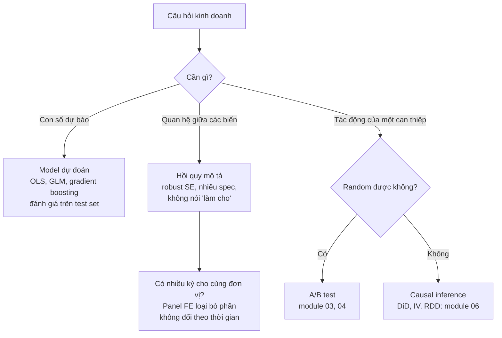
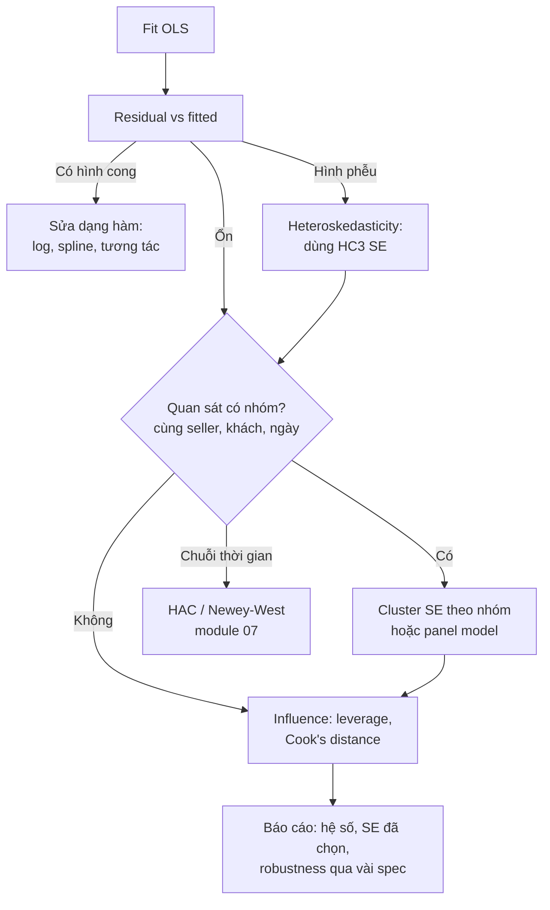
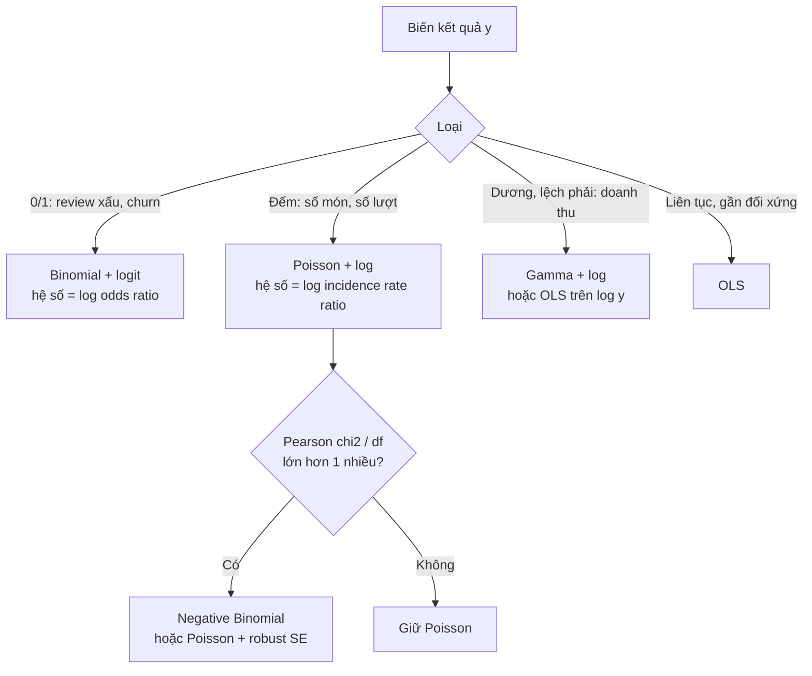
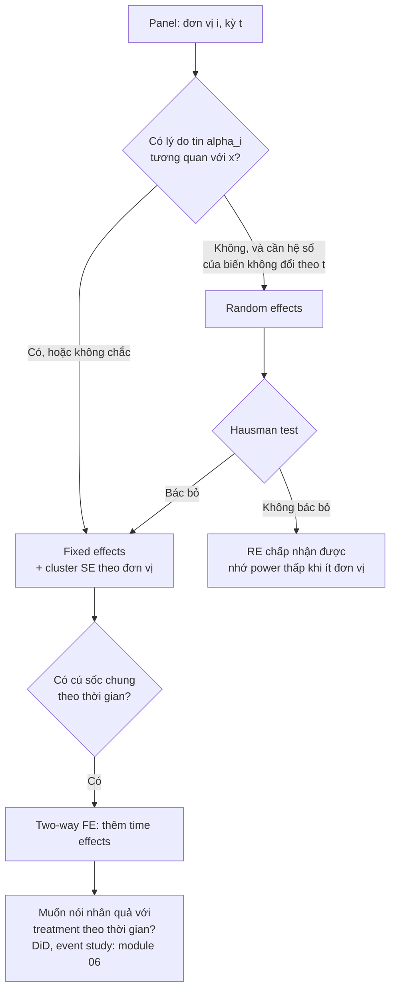

# Econometrics & Regression

Hồi quy là công cụ Data Scientist dùng nhiều nhất sau `groupby`. Nó trả lời "phí ship tăng bao
nhiêu khi khoảng cách gấp đôi", "giao trễ làm khả năng review xấu tăng bao nhiêu", "doanh nghiệp
đầu tư thêm bao nhiêu khi giá trị thị trường tăng". Econometrics là phần thống kê lo cho các con số
đó **đáng tin**: hệ số có nghĩa là gì, sai số chuẩn có đúng không, khi nào một giả định vỡ thì kết
luận vỡ theo. Phỏng vấn DS (nhất là product analytics, pricing, marketplace) thường hỏi đúng những
chỗ này, không hỏi công thức.

Module dùng dữ liệu thật: **Olist** (phí ship từng món, giá trị đơn, số món mỗi đơn, review) và
**Grunfeld** (đầu tư của 11 công ty Mỹ trong 20 năm, có sẵn trong `statsmodels`, không cần tải).
Tải Olist:

```bash
uv run python data/download_olist.py
```

Các khối code Python trong bài này chạy **nối tiếp nhau** từ thư mục gốc repo (khối sau dùng biến
của khối trước), như các cell của một notebook.

Sau module này bạn sẽ:

- Viết OLS bằng ma trận, đọc từng con số trong bảng `summary()`, diễn giải hệ số ở dạng log-log.
- Chẩn đoán residual, phát hiện heteroskedasticity và chọn đúng loại robust / cluster SE.
- Nhận ra multicollinearity bằng VIF và biết khi nào nó **không** phải vấn đề.
- Chọn GLM theo loại biến kết quả (logistic, Poisson, Negative Binomial) và diễn giải hệ số.
- Fit phân phối bằng MLE, so sánh bằng log-likelihood / AIC, QQ-plot, KS test, và biết giới hạn
  của từng cách.
- Dùng panel data: pooled, fixed effects, random effects, Hausman test.

## 1. Hồi quy để làm gì: dự đoán, mô tả, hay nhân quả

Cùng một lệnh `ols(...)`, ba mục đích khác nhau đòi hỏi ba cách đánh giá khác nhau:

| Mục đích | Câu hỏi | Quan tâm nhất | Đánh giá bằng |
| --- | --- | --- | --- |
| Dự đoán | "Đơn này phí ship bao nhiêu?" | $$\hat y$$ chính xác trên dữ liệu mới | RMSE / MAE trên tập test, chia theo thời gian |
| Mô tả (association) | "Phí ship gắn với khoảng cách thế nào, khi giữ cân nặng cố định?" | Dấu và độ lớn của $$\hat\beta$$, SE đúng | CI của hệ số, robustness qua nhiều spec |
| Nhân quả | "Nếu Olist mở kho ở bang khách, phí ship giảm bao nhiêu?" | $$\hat\beta$$ không bị bias | Thiết kế nghiên cứu (thí nghiệm, DiD, IV: module 06) |

Lỗi hay gặp nhất của DS: chạy hồi quy với mục đích mô tả rồi báo cáo như nhân quả ("thêm 1 ảnh sản
phẩm làm doanh thu tăng 3%"). Hệ số OLS chỉ là nhân quả khi biến giải thích **không tương quan với
phần không quan sát được** trong sai số. Điều này không kiểm được bằng dữ liệu; nó đến từ thiết kế.



Module này lo phần "quan hệ" và "dự đoán bằng model có cấu trúc", cộng panel data như bước đầu tiên
để kiểm soát những thứ không đo được. Module 06 lo nhân quả trên dữ liệu quan sát; module 07 lo
chuỗi thời gian (ARIMA, forecasting), nơi residual tương quan theo thời gian là chuyện mặc định.

## 2. OLS: công thức, ma trận và cách đọc hệ số

### Công thức

Model tuyến tính cho $$n$$ quan sát, $$k$$ biến (kể cả hằng số):

$$
y = X\beta + \varepsilon,
\qquad
\hat\beta = (X^\top X)^{-1} X^\top y
$$

$$\hat\beta$$ là nghiệm làm tổng bình phương residual nhỏ nhất. Ước lượng phương sai sai số và ma trận
hiệp phương sai của hệ số (giả định **homoskedastic**, sai số độc lập):

$$
\hat\sigma^2 = \frac{\hat\varepsilon^\top \hat\varepsilon}{n - k},
\qquad
\widehat{\mathrm{Var}}(\hat\beta) = \hat\sigma^2 (X^\top X)^{-1}
$$

SE của từng hệ số là căn của đường chéo. $$R^2 = 1 - \mathrm{SSR}/\mathrm{SST}$$ đo tỉ lệ variance
của $$y$$ được giải thích, chỉ so được giữa các model có **cùng** biến $$y$$.

Trong code, đừng nghịch đảo $$X^\top X$$ trực tiếp: dùng `np.linalg.lstsq` (QR/SVD) ổn định số
học hơn, và kiểm tra rank để phát hiện cột trùng lặp.

```python
import numpy as np
import pandas as pd
import statsmodels.api as sm

g = sm.datasets.grunfeld.load_pandas().data           # 11 công ty x 20 năm, có sẵn
X = np.column_stack([np.ones(len(g)), g[["value", "capital"]].to_numpy()])
y = g["invest"].to_numpy()

beta, *_ = np.linalg.lstsq(X, y, rcond=None)
resid = y - X @ beta
n, k = X.shape
sigma2 = resid @ resid / (n - k)
se = np.sqrt(np.diag(sigma2 * np.linalg.inv(X.T @ X)))
print(beta.round(4), se.round(4))
print(sm.OLS(y, X).fit().bse.round(4))                 # khớp statsmodels
```

SE tự tính khớp SE của statsmodels; hệ số `value` 0.1145, `capital` 0.2275 (pooled OLS, chưa xử lý cấu trúc
panel; mục 7 sẽ thấy vì sao con số này đáng ngờ). Bài Basic 01 là tự viết đủ hàm này.

### Ví dụ thật: phí ship Olist

Phí ship (`freight_value`) của Olist phụ thuộc cân nặng, kích thước, khoảng cách người bán – người
mua. Lấy các đơn **giao xong** chỉ có **một món** (để phí ship gắn rõ với một sản phẩm), nối toạ độ
theo zip prefix (trung vị toạ độ mỗi prefix trong bảng geolocation), tính khoảng cách đường chim bay
bằng công thức haversine:

```python
R = "data/raw/"
items = pd.read_csv(R + "olist_order_items_dataset.csv")
orders = pd.read_csv(R + "olist_orders_dataset.csv",
                     parse_dates=["order_delivered_customer_date", "order_estimated_delivery_date"])
customers = pd.read_csv(R + "olist_customers_dataset.csv", dtype={"customer_zip_code_prefix": str})
sellers = pd.read_csv(R + "olist_sellers_dataset.csv", dtype={"seller_zip_code_prefix": str})
products = pd.read_csv(R + "olist_products_dataset.csv")
geo = (pd.read_csv(R + "olist_geolocation_dataset.csv", dtype={"geolocation_zip_code_prefix": str})
         .groupby("geolocation_zip_code_prefix")[["geolocation_lat", "geolocation_lng"]].median())

def haversine_km(lat1, lon1, lat2, lon2):
    lat1, lon1, lat2, lon2 = map(np.radians, (lat1, lon1, lat2, lon2))
    a = np.sin((lat2 - lat1) / 2) ** 2 + np.cos(lat1) * np.cos(lat2) * np.sin((lon2 - lon1) / 2) ** 2
    return 2 * 6371 * np.arcsin(np.sqrt(a))

delivered = orders[(orders.order_status == "delivered") & orders.order_delivered_customer_date.notna()]
n_items = items.groupby("order_id").size()
d = (items[items.order_id.isin(n_items[n_items == 1].index)]
     .merge(delivered[["order_id", "customer_id"]], on="order_id")
     .merge(customers[["customer_id", "customer_zip_code_prefix", "customer_state"]], on="customer_id")
     .merge(sellers, on="seller_id")
     .merge(products, on="product_id")
     .join(geo.add_prefix("c_"), on="customer_zip_code_prefix")
     .join(geo.add_prefix("s_"), on="seller_zip_code_prefix"))
d["distance_km"] = haversine_km(d.c_geolocation_lat, d.c_geolocation_lng, d.s_geolocation_lat, d.s_geolocation_lng)
d["volume_cm3"] = d.product_length_cm * d.product_height_cm * d.product_width_cm
d["same_state"] = (d.customer_state == d.seller_state).astype(int)
d = d.dropna(subset=["distance_km", "product_weight_g", "volume_cm3"])
d = d[(d.freight_value > 0) & (d.product_weight_g > 0) & (d.distance_km > 0)].copy()
d["log_freight"] = np.log(d.freight_value)
d["log_weight"] = np.log(d.product_weight_g)
d["log_volume"] = np.log(d.volume_cm3)
d["log_distance"] = np.log1p(d.distance_km)
d["log_price"] = np.log(d.price)

import statsmodels.formula.api as smf
FORMULA = "log_freight ~ log_weight + log_volume + log_distance + same_state + log_price"
m = smf.ols(FORMULA, d).fit()
print(len(d), round(m.rsquared, 3))
print(m.params.round(4))
```

Kết quả trên 86 065 đơn: $$R^2 = 0.655$$, hệ số `log_weight` 0.1345, `log_volume` 0.0298,
`log_distance` 0.1418, `same_state` −0.2242, `log_price` 0.0964.

### Đọc hệ số khi có log

| Dạng | Hệ số $$\beta$$ nghĩa là | Ví dụ ở trên |
| --- | --- | --- |
| log y ~ log x | **elasticity**: x tăng 1% thì y tăng khoảng β% | Khoảng cách gấp đôi: phí ship nhân $$2^{0.1418} \approx 1.103$$, tức +10.3% |
| log y ~ x (dummy) | y nhân $$e^{\beta}$$ khi dummy từ 0 lên 1 | Cùng bang: $$e^{-0.2242} - 1 \approx -20.1\%$$ |
| y ~ log x | x tăng 1% thì y tăng β/100 đơn vị | |
| y ~ x | x tăng 1 đơn vị thì y tăng β đơn vị | |

Ba điều senior luôn nói kèm:

- "Khi giữ các biến khác cố định" không phải câu nói suông. Bỏ `same_state` khỏi model thì hệ số
  `log_distance` nhảy từ 0.1418 lên 0.2001, vì khoảng cách và cùng bang tương quan −0.74: model thiếu
  biến gán phần tác động của "khác bang" cho khoảng cách. Đó là **omitted variable bias**:

$$
\mathrm{plim}\,\hat\beta_1 = \beta_1 + \beta_2 \cdot \frac{\mathrm{Cov}(x_1, x_2)}{\mathrm{Var}(x_1)}
$$

- Hệ số `log_price` dương (0.0964) không có nghĩa "người bán tính thêm ship khi giá cao". Giá đại
  diện cho thứ model không thấy (hàng dễ vỡ, cần đóng gói kỹ, bảo hiểm). Đó là mô tả, không phải cơ
  chế.
- Đưa log vào vì quan hệ **nhân**: phí ship tăng theo tỉ lệ với khoảng cách và cân nặng, và residual
  của model log gần đối xứng hơn hẳn (skewness 1.30 so với 5.10 của model tuyến tính trên
  `freight_value`). Khi dự đoán ngược về BRL, $$e^{\widehat{\log y}}$$ là ước lượng của **median**,
  không phải mean; cần nhân thêm hệ số hiệu chỉnh (smearing của Duan) nếu cần trung bình.

## 3. Giả định của OLS, chẩn đoán residual và robust SE

### Cái gì cần cho cái gì

| Giả định | Vỡ thì sao | Cách kiểm | Cách xử lý |
| --- | --- | --- | --- |
| Tuyến tính theo tham số (đúng dạng hàm) | $$\hat\beta$$ sai, dự đoán lệch có hệ thống | Residual vs fitted có hình cong, partial residual plot | Log, spline, biến tương tác |
| Exogeneity: $$E[\varepsilon \mid X] = 0$$ | $$\hat\beta$$ **bias**, không sửa được bằng thêm dữ liệu | Không kiểm được bằng thống kê; lập luận về thiết kế | Thêm biến kiểm soát, panel FE (mục 7), IV (module 06) |
| Không đa cộng tuyến hoàn hảo | Không tính được $$\hat\beta$$ | Rank của X, VIF (mục 4) | Bỏ cột trùng |
| Homoskedasticity | $$\hat\beta$$ vẫn không bias, nhưng **SE sai** | Residual vs fitted hình phễu, Breusch-Pagan, White | Robust SE (HC), WLS, log y |
| Sai số độc lập | **SE sai** (thường quá nhỏ) | Cấu trúc dữ liệu: cùng khách, cùng seller, cùng ngày | Cluster SE, panel model, HAC cho chuỗi thời gian |
| Sai số chuẩn | Chỉ quan trọng với mẫu nhỏ | QQ-plot residual, Jarque-Bera | Mẫu lớn: CLT lo; mẫu nhỏ: bootstrap |

Hai dòng đầu quyết định $$\hat\beta$$ có đúng không. Ba dòng sau quyết định SE, p-value, CI có đúng
không. Dòng cuối gần như không quan trọng với dữ liệu cỡ Olist: Jarque-Bera trên residual model log
là 71 942 (p ≈ 0), nhưng với 86 nghìn quan sát thì phân phối của $$\hat\beta$$ vẫn gần chuẩn. Lỗi hay
gặp: cố "chuẩn hoá residual" bằng mọi giá trong khi vấn đề thật là sai số không độc lập.



### Heteroskedasticity và robust SE

Khi variance của sai số thay đổi theo $$X$$ (đơn xa có phí ship biến động hơn đơn gần), công thức
$$\hat\sigma^2 (X^\top X)^{-1}$$ sai. Công thức "sandwich" của White không cần giả định đó:

$$
\widehat{\mathrm{Var}}_{\mathrm{HC0}}(\hat\beta) = (X^\top X)^{-1} \left( \sum_i \hat\varepsilon_i^2 \, x_i x_i^\top \right) (X^\top X)^{-1}
$$

Các biến thể khác nhau ở cách phóng to $$\hat\varepsilon_i^2$$ để bù việc residual nhỏ hơn sai số
thật, nhất là ở điểm có leverage $$h_{ii}$$ cao:

| Loại | Trọng số cho $$\hat\varepsilon_i^2$$ | Dùng khi |
| --- | --- | --- |
| HC0 | 1 | Lý thuyết; mẫu rất lớn |
| HC1 | $$n/(n-k)$$ | Mặc định của Stata `, robust` |
| HC3 | $$1/(1-h_{ii})^2$$ | **Mặc định khuyên dùng**, tốt nhất với mẫu nhỏ và trung bình |
| Cluster | Cộng score theo nhóm trước khi bình phương | Quan sát trong cùng nhóm tương quan |

Trên Olist, model tuyến tính `freight_value ~ product_weight_g + distance_km + price` có
Breusch-Pagan LM = 7 977 (p ≈ 0) và SE HC3 của hệ số cân nặng, giá **gấp 3.3 lần** SE cổ điển.
Model log giảm hẳn ảnh hưởng của vấn đề này: Breusch-Pagan vẫn bác bỏ (LM = 8 494; với 86 nghìn
dòng, mọi lệch nhỏ đều "có ý nghĩa"), nhưng tỉ lệ HC3 / cổ điển chỉ còn 0.91–1.17. Vấn đề lớn hơn
nằm ở chỗ khác:

```python
from statsmodels.stats.diagnostic import het_breuschpagan

classic = m.bse
hc3 = smf.ols(FORMULA, d).fit(cov_type="HC3").bse
cluster = smf.ols(FORMULA, d).fit(cov_type="cluster",
                                  cov_kwds={"groups": pd.factorize(d.seller_id)[0]}).bse
print(pd.DataFrame({"HC3 / classic": hc3 / classic, "cluster / classic": cluster / classic}).round(2))
print("Breusch-Pagan LM (model log):", round(het_breuschpagan(m.resid, m.model.exog)[0]))

lin = smf.ols("freight_value ~ product_weight_g + distance_km + price", d).fit()
print("Breusch-Pagan LM (model tuyến tính):", round(het_breuschpagan(lin.resid, lin.model.exog)[0]))
print((smf.ols("freight_value ~ product_weight_g + distance_km + price", d).fit(cov_type="HC3").bse / lin.bse).round(2))
```

Cluster theo seller làm SE tăng **3.5–8.7 lần**. 86 065 đơn đến từ 2 879 seller; mỗi seller có
chính sách đóng gói, kho, hợp đồng vận chuyển riêng, nên residual của cùng seller tương quan. Thông
tin thật gần với "vài nghìn seller" hơn là "86 nghìn đơn". Quy tắc thực hành: **cluster ở cấp mà
bạn nghĩ sai số tương quan**, hoặc ở cấp mà treatment được gán. Cần đủ nhiều cluster (vài chục trở
lên); ít cluster quá thì chính cluster SE cũng sai (dùng wild cluster bootstrap).

Bài Basic 02 là tự viết HC0/HC1/HC3 và Breusch-Pagan.

### Điểm ảnh hưởng (influence)

Leverage $$h_{ii}$$ đo một điểm xa tâm của $$X$$ cỡ nào; Cook's distance đo hệ số thay đổi bao
nhiêu nếu bỏ điểm đó. Ngưỡng $$4/n$$ hay được dùng gắn cờ 5 601 đơn (6.5%) trong model log, nhưng
Cook's distance lớn nhất chỉ 0.005: không điểm nào một mình kéo được model 86 nghìn dòng. Với dữ
liệu lớn, influence chủ yếu là công cụ **tìm dữ liệu bẩn** hơn là lý do để bỏ điểm: 4 sản phẩm
có cân nặng 0 g, một sản phẩm nặng 23.7 kg giá 32.90 BRL với phí ship 28.90 BRL. Không bỏ
outlier chỉ vì nó làm kết quả "xấu"; nếu bỏ, báo cáo cả hai bản.

## 4. Multicollinearity và VIF

### VIF đo gì

Biến $$x_j$$ hồi quy lên mọi biến còn lại cho $$R_j^2$$. Variance Inflation Factor:

$$
\mathrm{VIF}_j = \frac{1}{1 - R_j^2}
$$

$$\mathrm{Var}(\hat\beta_j)$$ bị nhân lên đúng VIF lần so với khi $$x_j$$ không tương quan với các
biến khác. VIF 4 nghĩa là SE gấp đôi.

Model phí ship ở mục 2: VIF lớn nhất là 2.80 (`log_weight`, tương quan 0.77 với `log_volume`).
Không đáng lo. Thêm cả log chiều dài, cao, rộng **cùng** `log_volume` thì VIF lên cỡ $$10^{15}$$:
$$\log V = \log L + \log H + \log W$$ là đa cộng tuyến hoàn hảo, model không xác định.

```python
from statsmodels.stats.outliers_influence import variance_inflation_factor

Xv = sm.add_constant(d[["log_weight", "log_volume", "log_distance", "same_state", "log_price"]])
print({c: round(variance_inflation_factor(Xv.to_numpy(), i), 2) for i, c in enumerate(Xv.columns) if c != "const"})
```

Lưu ý: `variance_inflation_factor` của statsmodels **không tự thêm hằng số**. Quên `add_constant`
cho ra VIF rất lớn với mọi biến có trung bình xa 0, một lỗi phổ biến trên Stack Overflow.

### Khi nào multicollinearity là vấn đề

| Mục đích | Có vấn đề không | Lý do |
| --- | --- | --- |
| Dự đoán | Gần như không | Dự đoán vẫn ổn định khi dữ liệu mới có cùng cấu trúc tương quan |
| Diễn giải một hệ số | Có | SE lớn, hệ số đổi dấu khi thêm bớt biến |
| Biến kiểm soát tương quan với nhau | Không | Chỉ hệ số của biến quan tâm cần chính xác; VIF của biến kiểm soát không quan trọng |
| Biến quan tâm tương quan mạnh với biến kiểm soát | Có, nhưng không "sửa" được | Dữ liệu không đủ thông tin để tách hai tác động; cần thêm dữ liệu hoặc thiết kế khác |

Ngưỡng "VIF > 10 thì bỏ biến" là quy tắc ngón tay cái, không phải luật. Bỏ một biến kiểm soát quan
trọng chỉ để hạ VIF là đổi **variance** lấy **bias** (omitted variable bias ở mục 2), thường là đổi
tệ. Các lựa chọn tốt hơn: gộp biến cùng bản chất (cân nặng và thể tích thành "cân nặng tính cước"),
regularization (Ridge) nếu mục đích là dự đoán, hoặc chấp nhận SE lớn và nói thẳng điều đó.

Bài Basic 03 là tự viết VIF và thuật toán loại biến lặp.

## 5. GLM: logistic, Poisson và khi Poisson không đủ

### Một khung cho nhiều loại biến kết quả

OLS giả định $$y$$ liên tục, không chặn. Với $$y$$ là 0/1, là số đếm, là số dương lệch phải, GLM
(Generalized Linear Model) giữ phần tuyến tính $$\eta = X\beta$$ nhưng nối nó với kỳ vọng qua một
**link function** và chọn **family** cho phân phối:

$$
g\big(E[y \mid X]\big) = X\beta
$$



GLM được fit bằng MLE (thuật toán IRLS). Không có $$R^2$$ theo nghĩa OLS; so sánh model bằng
deviance, log-likelihood, AIC, và quan trọng hơn là calibration của dự đoán.

### Logistic: giao trễ và review xấu trên Olist

Đơn giao xong có review (mỗi đơn giữ review trả lời muộn nhất): 95 824 đơn, review xấu 12.8%, ở đơn
trễ 54.1%, ở đơn đúng hẹn 9.2%.

```python
reviews = pd.read_csv(R + "olist_order_reviews_dataset.csv", parse_dates=["review_answer_timestamp"])
rev = reviews.sort_values("review_answer_timestamp").drop_duplicates("order_id", keep="last")
o = delivered.merge(rev[["order_id", "review_score"]], on="order_id")
o["bad"] = (o.review_score <= 2).astype(int)
o["late"] = (o.order_delivered_customer_date > o.order_estimated_delivery_date).astype(int)
agg = items.groupby("order_id").agg(n_items=("order_item_id", "size"), n_sellers=("seller_id", "nunique"),
                                    value=("price", "sum"), freight=("freight_value", "sum"))
o = o.join(agg, on="order_id").dropna(subset=["n_items"])
o["log_value"] = np.log(o.value + o.freight)
o["multi_item"] = (o.n_items > 1).astype(int)
o["multi_seller"] = (o.n_sellers > 1).astype(int)

logit = smf.logit("bad ~ late + log_value + multi_item + multi_seller", o).fit(disp=0)
print(np.exp(logit.params).round(2))                                   # odds ratio
print(logit.get_margeff(dummy=True).summary_frame()["dy/dx"].round(3))  # thay đổi xác suất
```

| Biến | Odds ratio | Thay đổi xác suất trung bình (AME, rời rạc) |
| --- | --- | --- |
| `late` | 13.10 | +45.4 điểm % |
| `multi_item` | 2.79 | +12.3 điểm % |
| `multi_seller` | 3.54 | +17.0 điểm % |
| `log_value` | 1.10 | +0.9 điểm % mỗi đơn vị log |

Ba điều cần nói khi trình bày:

- **Odds ratio không phải tỉ lệ xác suất.** OR 13 không có nghĩa "đơn trễ có khả năng review xấu
  gấp 13 lần". Xác suất là 54% so với 9% (gấp khoảng 6); odds là 1.18 so với 0.10. Với stakeholder,
  nói bằng thay đổi xác suất (average marginal effect).
- `get_margeff()` mặc định coi `late` là biến liên tục, cho +24.1 điểm %, sai cho biến 0/1. Với
  dummy dùng `dummy=True` (so dự đoán khi bật và tắt biến cho từng đơn rồi lấy trung bình): +45.4.
- Linear probability model (OLS trên `bad`, robust SE) cho hệ số `late` 0.454, gần như trùng AME.
  LPM dễ đọc và thường đủ cho mục đích mô tả; logistic cần khi dự đoán xác suất gần 0 hoặc 1. Đơn
  có nhiều seller có review xấu cao hơn hẳn: một đơn bị tách thành nhiều kiện giao lệch ngày.

### Poisson và overdispersion: số món mỗi đơn

Số món mỗi đơn đều ≥ 1, nên model số món **thêm** (`n_items − 1`). Trên 96 470 đơn giao xong:
trung bình 0.142, variance 0.290. Poisson ép variance bằng mean, ở đây variance gấp đôi:
**overdispersion**.

```python
ov = items.groupby("order_id").agg(n_items=("order_item_id", "size"), mean_price=("price", "mean"))
ov = ov[ov.index.isin(delivered.order_id)]
ov["extra"] = ov.n_items - 1
ov["log_mean_price"] = np.log(ov.mean_price)

pois = smf.glm("extra ~ log_mean_price", ov, family=sm.families.Poisson()).fit()
print("Pearson chi2/df:", round(pois.pearson_chi2 / pois.df_resid, 2))
print("IRR:", np.exp(pois.params["log_mean_price"]).round(3))
pois_robust = smf.glm("extra ~ log_mean_price", ov, family=sm.families.Poisson()).fit(cov_type="HC0")
negbin = smf.negativebinomial("extra ~ log_mean_price", ov).fit(disp=0)
print(round(pois.bse["log_mean_price"], 4), round(pois_robust.bse["log_mean_price"], 4))
print(round(pois.aic), round(negbin.aic))
```

- Pearson $$\chi^2$$/df = 1.98. Hệ số `log_mean_price` là −0.389: giá trung bình mỗi món gấp $$e$$
  lần thì số món thêm nhân 0.678 (incidence rate ratio). Hàng rẻ được mua nhiều món hơn.
- Hệ số Poisson vẫn nhất quán khi mean đúng dạng (Poisson là quasi-MLE), nhưng SE cổ điển 0.0097
  quá nhỏ; SE robust là 0.0150.
- Negative Binomial thêm tham số $$\alpha$$ cho phép $$\mathrm{Var} = \mu + \alpha\mu^2$$: hệ số
  −0.401, AIC 78 047 so với 87 399 của Poisson. Dữ liệu cũng có nhiều 0 hơn Poisson dự đoán (90.0%
  so với 86.7%), gợi ý cân nhắc zero-inflated / hurdle model nếu số 0 có cơ chế riêng (khách chỉ
  định mua một món).

## 6. Fitting distributions: MLE, QQ-plot, KS test

### Vì sao DS cần fit phân phối

Mô phỏng (doanh thu tháng tới, nhu cầu tồn kho), tính xác suất đuôi ("bao nhiêu % đơn trên 1 000
BRL"), chọn family cho GLM, sinh dữ liệu giả cho test. Câu hỏi luôn là: phân phối nào mô tả dữ liệu
**ở phần mình quan tâm** (thân hay đuôi).

### MLE

Chọn tham số $$\theta$$ làm dữ liệu quan sát được "có khả năng nhất":

$$
\hat\theta = \arg\max_\theta \sum_{i=1}^{n} \log f(x_i \mid \theta)
$$

Lognormal có nghiệm đóng: $$\hat\mu$$ và $$\hat\sigma$$ là trung bình và độ lệch chuẩn (chia cho
$$n$$, không phải $$n-1$$) của $$\log x$$. Gamma không có nghiệm đóng cho shape, phải tối ưu số
(`scipy.stats.gamma.fit(x, floc=0)`; nhớ cố định `loc=0`, nếu không scipy fit thêm tham số dịch
chuyển và thường hội tụ về chỗ vô nghĩa).

So sánh các phân phối bằng log-likelihood, hoặc AIC $$= 2k - 2\log L$$ khi số tham số khác nhau.

### Ví dụ thật: giá trị đơn Olist

Giá trị đơn = tổng `price` + `freight_value` của các món, trên 96 470 đơn giao xong: median 105.28,
mean 159.83, percentile 99 là 1 052.4 BRL.

```python
from scipy import stats

x = (items.groupby("order_id")[["price", "freight_value"]].sum().sum(axis=1)
     .loc[lambda s: s.index.isin(delivered.order_id)].to_numpy())
mu, sigma = np.log(x).mean(), np.log(x).std()                 # MLE lognormal, ddof=0
shape, _, scale = stats.gamma.fit(x, floc=0)
ll_ln = stats.lognorm.logpdf(x, sigma, scale=np.exp(mu)).sum()
ll_g = stats.gamma.logpdf(x, shape, scale=scale).sum()
print(len(x), round(mu, 3), round(sigma, 3), round(shape, 3), round(scale, 2))
print("AIC lognormal", round(4 - 2 * ll_ln), "gamma", round(4 - 2 * ll_g))
print(stats.kstest(x, "lognorm", args=(sigma, 0, np.exp(mu))))
for name, sf in [("lognormal", stats.lognorm.sf(1000, sigma, scale=np.exp(mu))),
                 ("gamma", stats.gamma.sf(1000, shape, scale=scale))]:
    print(name, f"P(x > 1000) = {sf:.4f}")
print("thực tế", f"{(x > 1000).mean():.4f}")
```

| | Lognormal | Gamma |
| --- | --- | --- |
| Tham số MLE | $$\hat\mu = 4.691$$, $$\hat\sigma = 0.808$$ | shape 1.448, scale 110.37 |
| Log-likelihood | −568 783 | −582 335 |
| AIC | 1 137 571 | 1 164 674 |
| KS statistic | 0.026 | 0.097 |
| P(đơn > 1 000 BRL) | 0.30% | 0.04% |
| Thực tế | 1.15% | 1.15% |

Lognormal thắng rõ. Nhưng **cả hai đều đánh giá thấp đuôi**: thực tế có 1.15% đơn trên 1 000 BRL,
lognormal nói 0.30% (thấp gần 4 lần), gamma nói 0.04%. Nếu mục đích là tính rủi ro đơn lớn (bảo
hiểm hàng, hạn mức tín dụng) thì phải model riêng phần đuôi (mixture, Pareto cho đuôi), không dùng
phân phối "thắng AIC".

### QQ-plot và KS test

**QQ-plot** vẽ quantile lý thuyết với quantile mẫu; lệch khỏi đường chéo ở đâu là phân phối sai ở đó.
Với lognormal, dễ nhất là vẽ QQ của $$\log x$$ với phân phối chuẩn. Đây là công cụ **chính** để đánh
giá fit, vì nó chỉ ra lệch ở thân hay đuôi.

**KS test** dùng khoảng cách lớn nhất giữa CDF thực nghiệm và CDF lý thuyết. Hai cái bẫy:

1. **Mẫu lớn thì mọi thứ đều bị bác bỏ.** Với 96 470 đơn, KS cho lognormal có p ≈ 7.8e-57 dù
   statistic chỉ 0.026. Lấy ngẫu nhiên 500 đơn, cùng phân phối đó cho p = 0.78. KS trả lời "dữ liệu
   có đúng tuyệt đối là lognormal không" (không bao giờ đúng), chứ không trả lời "lognormal có đủ tốt
   không".
2. **Tham số ước lượng từ chính dữ liệu** làm p-value của KS quá lớn (test quá dễ dãi); p-value đúng
   cần Lilliefors hoặc parametric bootstrap. Dùng KS statistic để **so sánh** các phân phối thì vẫn
   ổn.

Bài Intermediate 03 là fit, so sánh và vẽ QQ cho giá trị đơn Olist.

## 7. Panel data: fixed effects, random effects

### Vì sao panel

Panel là dữ liệu có **nhiều đơn vị quan sát qua nhiều kỳ**: công ty × năm, seller × tháng, khách ×
tuần. Lợi thế lớn nhất: model hoá được một phần không quan sát được của từng đơn vị
($$\alpha_i$$: năng lực quản lý của công ty, "độ cẩn thận" của seller):

$$
y_{it} = \alpha_i + x_{it}^\top \beta + \varepsilon_{it}
$$

Nếu $$\alpha_i$$ tương quan với $$x_{it}$$ (công ty quản lý tốt vừa có giá trị thị trường cao vừa
đầu tư nhiều), pooled OLS bỏ qua $$\alpha_i$$ sẽ bị omitted variable bias.

| Model | Giả định về $$\alpha_i$$ | Ước lượng từ | Điểm mạnh | Điểm yếu |
| --- | --- | --- | --- | --- |
| Pooled OLS | Không có, hoặc không tương quan với x | Mọi biến thiên | Đơn giản | Bias nếu $$\alpha_i$$ tương quan x |
| Fixed effects (within) | Tuỳ ý, được phép tương quan với x | Biến thiên **trong** từng đơn vị qua thời gian | Loại mọi thứ không đổi theo thời gian, kể cả không đo được | Không ước lượng được biến không đổi theo thời gian; mất hiệu quả nếu x ít thay đổi |
| Random effects | Ngẫu nhiên, **không** tương quan với x | Trung bình có trọng số của within và between | Hiệu quả hơn, giữ được biến không đổi | Bias nếu giả định sai |

Fixed effects bằng **within transformation**: trừ trung bình theo đơn vị cho cả y và x, rồi OLS.
$$\alpha_i$$ biến mất vì nó không đổi theo t:

$$
y_{it} - \bar y_i = (x_{it} - \bar x_i)^\top \beta + (\varepsilon_{it} - \bar\varepsilon_i)
$$

Kết quả giống hệt LSDV (thêm một dummy cho mỗi đơn vị), nhưng không phải tạo hàng nghìn cột. Bẫy khi
tự làm: OLS trên dữ liệu đã demean chia SSR cho $$n - k$$, trong khi đúng phải là $$n - k - N$$
($$N$$ đơn vị đã "tiêu" $$N$$ bậc tự do), nên SE hơi nhỏ.

### Ví dụ thật: Grunfeld

`invest` (đầu tư) theo `value` (giá trị thị trường) và `capital` (vốn tích luỹ) của 11 công ty, 20
năm (1935–1954).

```python
from linearmodels.panel import PanelOLS, PooledOLS, RandomEffects
from scipy import stats

g["year"] = g.year.astype(int)
p = g.set_index(["firm", "year"])
exog = sm.add_constant(p[["value", "capital"]])
pooled = PooledOLS(p.invest, exog).fit()
fe = PanelOLS(p.invest, exog, entity_effects=True).fit()
re = RandomEffects(p.invest, exog).fit()
print(pd.DataFrame({"pooled": pooled.params, "FE": fe.params, "RE": re.params}).round(4))
print(fe.f_pooled)                                     # H0: mọi alpha_i bằng nhau

cols = ["value", "capital"]
diff = fe.params[cols] - re.params[cols]
V = fe.cov.loc[cols, cols] - re.cov.loc[cols, cols]
H = float(diff @ np.linalg.inv(V) @ diff)
print("Hausman", round(H, 2), "p =", round(stats.chi2.sf(H, len(cols)), 3))
```

| | Pooled | Fixed effects | Random effects |
| --- | --- | --- | --- |
| `value` | 0.1145 | 0.1101 | 0.1093 |
| `capital` | 0.2275 | 0.3100 | 0.3080 |

- F test cho fixed effects: F(10, 207) = 49.2, p ≈ 0. Các công ty khác nhau thật; pooled OLS sai
  dạng. 71% variance của phần sai số tổng nằm ở cấp công ty.
- Hệ số `capital` tăng từ 0.23 lên 0.31 khi so **trong** từng công ty: pooled trộn chênh lệch giữa
  các công ty (General Motors đầu tư trung bình 608, Diamond Match 3) vào hệ số.
- **Hausman test** so FE với RE: nếu RE đúng thì hai ước lượng gần nhau. Ở đây H = 3.97, p = 0.138,
  không bác bỏ RE. Nhưng với chỉ 11 công ty, test có power thấp; và Hausman cổ điển dùng SE không
  robust. Thực tế nhiều người chọn FE mặc định cho dữ liệu quan sát khi biến quan tâm thay đổi đủ
  theo thời gian, vì giả định của RE ("đặc tính công ty không tương quan với giá trị thị trường")
  khó tin.
- SE FE cổ điển của `capital` là 0.0165; cluster theo công ty là 0.0501, gấp 3 lần. Sai số của cùng
  công ty tương quan qua các năm; với panel, **cluster theo đơn vị là mặc định**.
- Thêm **time effects** (two-way FE) loại cú sốc chung mỗi năm (suy thoái, chiến tranh): hệ số
  `value` 0.1167, `capital` 0.3514.



### Giới hạn

Fixed effects chỉ loại phần **không đổi theo thời gian**. Một seller đổi đối tác vận chuyển giữa
chừng làm cả tỉ lệ trễ lẫn chất lượng đóng gói thay đổi cùng lúc, FE không cứu được. FE cũng khuếch
đại sai số đo lường (biến thiên within nhỏ, nhiễu tương đối lớn). Two-way FE với treatment bật ở
nhiều thời điểm khác nhau có vấn đề riêng (trọng số âm), là chủ đề DiD của module 06.

Bài Advanced 01 là tự viết within estimator và Hausman cho Grunfeld; Advanced 02 dựng panel seller ×
tháng từ Olist để đo quan hệ giữa giao trễ và review xấu trong từng seller.

## 8. Tài liệu tham khảo

Sách:

- Jeffrey Wooldridge. *Introductory Econometrics: A Modern Approach*. Giáo trình chuẩn, chương
  2–8 (OLS, heteroskedasticity), 13–14 (panel).
- Angrist & Pischke. *Mostly Harmless Econometrics* (Princeton, 2009). Cách nghĩ về hồi quy như
  công cụ ước lượng tác động.
- [Introduction to Econometrics with R](https://www.econometrics-with-r.org/) (miễn phí, theo
  Stock & Watson; code R nhưng lý thuyết dùng chung).
- [An Introduction to Statistical Learning](https://www.statlearning.com/), chương 3 (linear
  regression) và 4 (logistic).
- Scott Cunningham. [Causal Inference: The Mixtape](https://mixtape.scunning.com/), chương 2
  (probability and regression review) và 8 (panel data).
- Nick Huntington-Klein. [The Effect](https://theeffectbook.net/), chương 13 (regression) và 16
  (fixed effects).

Bài viết:

- Cameron & Miller. [A Practitioner's Guide to Cluster-Robust Inference](http://cameron.econ.ucdavis.edu/research/Cameron_Miller_JHR_2015_February.pdf)
  (Journal of Human Resources, 2015).
- Roadmap: [roadmap.sh/ai-data-scientist](https://roadmap.sh/ai-data-scientist), mục Econometrics.

Tài liệu thư viện:

- statsmodels: [linear regression](https://www.statsmodels.org/stable/regression.html),
  [robust covariance](https://www.statsmodels.org/stable/generated/statsmodels.regression.linear_model.RegressionResults.get_robustcov_results.html),
  [regression diagnostics](https://www.statsmodels.org/stable/diagnostic.html),
  [VIF](https://www.statsmodels.org/stable/generated/statsmodels.stats.outliers_influence.variance_inflation_factor.html),
  [GLM](https://www.statsmodels.org/stable/glm.html),
  [discrete models](https://www.statsmodels.org/stable/discretemod.html).
- linearmodels: [panel models](https://bashtage.github.io/linearmodels/panel/introduction.html),
  [PanelOLS](https://bashtage.github.io/linearmodels/panel/panel/linearmodels.panel.model.PanelOLS.html).
- scipy: [rv_continuous.fit](https://docs.scipy.org/doc/scipy/reference/generated/scipy.stats.rv_continuous.fit.html),
  [kstest](https://docs.scipy.org/doc/scipy/reference/generated/scipy.stats.kstest.html).

Dữ liệu:

- Olist: [Kaggle Brazilian E-Commerce](https://www.kaggle.com/datasets/olistbr/brazilian-ecommerce).
- Grunfeld: [statsmodels datasets](https://www.statsmodels.org/stable/datasets/generated/grunfeld.html).
