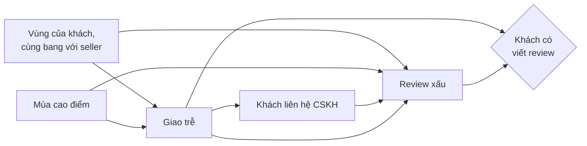
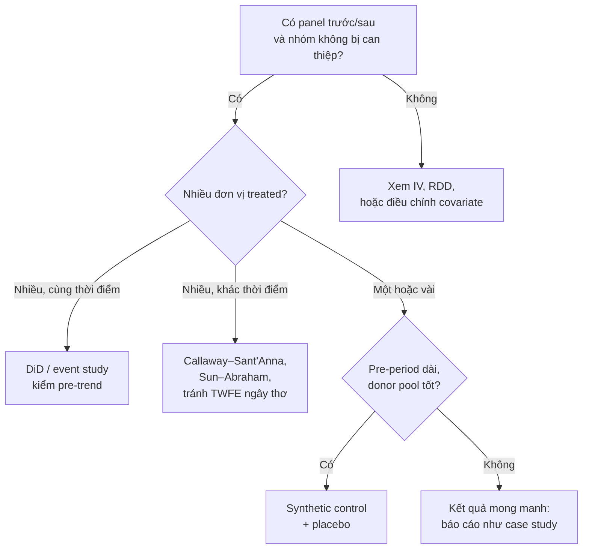
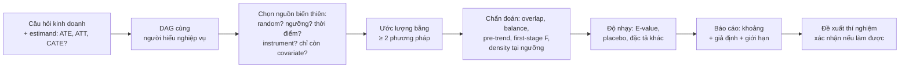

# Causal Inference

Module 03 kết thúc bằng một câu hỏi: khi **không** chạy được A/B test (quyết định chỉ làm một lần,
chính sách áp lên cả một bang, thay đổi đã xảy ra từ năm ngoái, hoặc random là phi đạo đức) thì
làm sao biết tác động thật? Causal inference trên dữ liệu quan sát là câu trả lời. Đây là kỹ năng
phân biệt Data Scientist senior với người chỉ biết chạy mô hình: DS sản phẩm, DS kinh tế, DS
marketing đều bị hỏi "con số này là tương quan hay nhân quả?" mỗi tuần.

Module dùng bốn bộ dữ liệu thật, mỗi bộ là một "bài kinh điển" của ngành, cộng Olist cho câu hỏi
kinh doanh:

- **LaLonde** (chương trình đào tạo nghề NSW): có kết quả thí nghiệm ngẫu nhiên làm chuẩn để kiểm
  tra phương pháp quan sát.
- **Proposition 99** (thuế thuốc lá California 1989): DiD và synthetic control.
- **Card** (khoảng cách tới trường đại học): instrumental variables.
- **Hillstrom** (thí nghiệm email, module 03): uplift / CATE.
- **Olist**: giao trễ có thật sự làm review xấu đi không, và bao nhiêu.

```bash
uv run python data/download_dataset.py lalonde
uv run python data/download_dataset.py prop99
uv run python data/download_dataset.py card
uv run python data/download_dataset.py hillstrom
uv run python data/download_olist.py
```

Sau module này bạn sẽ:

- Vẽ DAG cho một câu hỏi kinh doanh và chọn đúng biến cần (và **không được**) điều chỉnh.
- Ước lượng tác động bằng propensity score (matching, IPW), DiD, synthetic control, IV, RDD, và
  biết mỗi phương pháp dựa trên giả định nào, kiểm tra giả định đó ra sao.
- Ước lượng tác động theo từng nhóm khách (uplift, CATE) và đánh giá mô hình uplift.
- Làm phân tích độ nhạy, và viết kết luận nhân quả trung thực: một khoảng kèm danh sách giả định,
  không phải một con số "đã chứng minh".

## 1. Từ tương quan đến nhân quả

### Potential outcomes

Mỗi đơn vị (khách, đơn hàng, bang) có hai kết quả tiềm năng: $$Y_i(1)$$ nếu được can thiệp và
$$Y_i(0)$$ nếu không. Tác động trên đơn vị đó là $$Y_i(1) - Y_i(0)$$, nhưng ta chỉ bao giờ thấy **một**
trong hai: đó là "vấn đề cơ bản của causal inference". Vì vậy ta ước lượng trung bình:

| Đại lượng | Định nghĩa | Trả lời câu hỏi |
| --- | --- | --- |
| ATE | $$E[Y(1) - Y(0)]$$ | Áp cho tất cả thì trung bình thay đổi bao nhiêu? |
| ATT | $$E[Y(1) - Y(0) \mid T = 1]$$ | Với những người **đã** được can thiệp, can thiệp đáng giá bao nhiêu? |
| CATE | $$E[Y(1) - Y(0) \mid X = x]$$ | Với nhóm khách có đặc điểm x thì sao? (mục 6) |
| LATE | Tác động trên complier | IV và thí nghiệm có non-compliance trả lời câu này (mục 5) |

So sánh ngây thơ hai nhóm cho:

$$
E[Y \mid T=1] - E[Y \mid T=0] = \underbrace{E[Y(1) - Y(0) \mid T=1]}_{\text{ATT}} + \underbrace{E[Y(0) \mid T=1] - E[Y(0) \mid T=0]}_{\text{selection bias}}
$$

Selection bias là chênh lệch giữa hai nhóm **nếu không ai được can thiệp**. Random làm nó bằng 0.
Không random thì mọi phương pháp trong module này là các cách khác nhau để lập luận rằng nó bằng 0
(hoặc khử được nó), mỗi cách với một giả định riêng.

### Ví dụ Olist

Trên Olist thật, 95 824 đơn giao xong có review: review 1–2 sao ở đơn giao trễ là **54.1%**, ở đơn
đúng hẹn là **9.2%**. Chênh 44.8 điểm phần trăm. Câu hỏi của Giám đốc Vận hành: "giảm giao trễ thì
review xấu giảm bao nhiêu?" Câu trả lời chỉ là 44.8 điểm nếu đơn trễ và đơn đúng hẹn giống nhau ở
mọi thứ khác. Chúng không giống: chỉ 27% đơn trễ có khách cùng bang với seller, so với 37% ở đơn
đúng hẹn; đơn trễ tập trung vào mùa cao điểm (tỉ lệ trễ 14% trong tháng 11/2017, 21% trong tháng 3/2018, so với khoảng 8% trung
bình). Bài Advanced 01 làm trọn phân tích này.

### Bản đồ phương pháp

| Phương pháp | Giả định cốt lõi | Dữ liệu cần | Ví dụ trong module |
| --- | --- | --- | --- |
| Điều chỉnh (regression, matching, IPW) | Không còn confounder chưa đo (unconfoundedness) + overlap | Covariate đo **trước** can thiệp | LaLonde, Olist |
| DiD | Parallel trends | Panel trước / sau, nhóm so sánh | Prop 99 |
| Synthetic control | Tổ hợp donor tái tạo được đơn vị treated | Một đơn vị treated, chuỗi trước dài | California |
| IV | Instrument chỉ tác động qua treatment (exclusion) | Một instrument mạnh | Card |
| RDD | Không ai kiểm soát chính xác được biến chạy quanh ngưỡng | Quy tắc ngưỡng | Điểm seller, ngày hẹn giao |
| Uplift / CATE | Random (hoặc unconfoundedness) | Thí nghiệm có nhiều covariate | Hillstrom |

Không phương pháp nào "tốt nhất". Phương pháp được chọn theo **nguồn biến thiên** mà dữ liệu cho
phép tin là gần như ngẫu nhiên, không theo độ phức tạp của mô hình.

## 2. DAG: confounder, collider, mediator, backdoor

### Ba khối cơ bản

Một DAG (directed acyclic graph) vẽ giả định nhân quả: mũi tên A → B nghĩa là A có thể ảnh hưởng
trực tiếp tới B. Mọi DAG ghép từ ba khối:

| Khối | Hình | Thông tin chảy? | Điều kiện trên node giữa |
| --- | --- | --- | --- |
| Chain (mediator) | T → M → Y | Có | Chặn: cắt mất phần tác động đi qua M |
| Fork (confounder) | T ← Z → Y | Có: tạo tương quan giả | Chặn: đây là việc ta **muốn** làm |
| Collider | T → C ← Y | **Không** | **Mở**: tạo tương quan giả từ hư không |



Đọc DAG Olist: vùng và mùa là **confounder** (phải điều chỉnh); liên hệ CSKH là **mediator** (không
điều chỉnh nếu muốn tác động tổng của giao trễ); "có viết review" là **collider**: dữ liệu chỉ có
đơn có review, tức là ta đã điều kiện trên nó mà không chọn. Không có biến nào sửa được lỗi
selection kiểu này; phải nêu nó như một giới hạn.

### Collider bias: thêm biến có thể làm hỏng kết quả

Giả sử chất lượng hàng và tốc độ giao của seller hoàn toàn độc lập, nhưng sàn chỉ "đề xuất" seller
có tổng điểm cao. Phân tích chỉ trên seller được đề xuất:

```python
import numpy as np

rng = np.random.default_rng(0)
n = 100_000
quality = rng.normal(size=n)          # chất lượng hàng
speed = rng.normal(size=n)            # tốc độ giao: độc lập với chất lượng
featured = quality + speed > 1.5      # sàn chỉ "đề xuất" seller có tổng điểm cao: collider

print(f"Mọi seller:        corr = {np.corrcoef(quality, speed)[0, 1]:+.3f}")
print(f"Seller được đề xuất: corr = {np.corrcoef(quality[featured], speed[featured])[0, 1]:+.3f}")
```

Tương quan +0.002 trên mọi seller thành −0.676 trong nhóm được đề xuất: "seller giao nhanh thì
hàng kém" là ảo giác do chọn mẫu. Đây cũng là lý do "khách phàn nàn nhiều nhất là khách trung
thành nhất" hay "nhà hàng ngon thì vị trí xấu" thường là collider bias.

### Backdoor criterion

Một tập biến Z đủ để ước lượng tác động của T lên Y bằng điều chỉnh khi:

1. Không biến nào trong Z là hậu duệ của T (không điều chỉnh mediator, không điều chỉnh hậu quả).
2. Z chặn mọi đường "cửa sau" từ T tới Y (đường bắt đầu bằng mũi tên **đi vào** T).

Khi đó

$$
E[Y \mid do(T = t)] = \sum_z E[Y \mid T = t, Z = z]\, P(Z = z)
$$

Hệ quả thực hành:

- "Cho mọi biến vào hồi quy" **sai** khi có biến sau can thiệp. Ví dụ hay gặp: đo tác động của
  chương trình khách hàng thân thiết lên doanh thu, có điều chỉnh "số lần mua trong kỳ": số lần mua
  là mediator, điều chỉnh nó xoá phần lớn tác động.
- Biến chỉ ảnh hưởng tới treatment mà không tới outcome (như instrument) không cần điều chỉnh, và
  điều chỉnh nó làm tăng variance (thậm chí khuếch đại bias nếu còn confounder chưa đo).
- DAG đến từ hiểu biết nghiệp vụ, không đến từ dữ liệu. Giá trị của nó là biến giả định thành
  hình vẽ để đồng nghiệp tranh luận. Bài Basic 01 cài thuật toán d-separation và backdoor.

## 3. Propensity score: matching, IPW, overlap

### Ý tưởng

Dưới giả định **unconfoundedness** (không còn confounder ngoài X đã đo) và **overlap**
($$0 < e(x) < 1$$ với mọi x), chỉ cần điều chỉnh cho một con số: propensity score
$$e(x) = P(T = 1 \mid X = x)$$ (Rosenbaum & Rubin 1983). Hai đơn vị có cùng propensity thì "đáng lẽ"
có cùng khả năng được can thiệp, nên so sánh chúng giống như so trong một thí nghiệm nhỏ.

| Cách dùng | Làm gì | Ưu | Nhược |
| --- | --- | --- | --- |
| Matching | Ghép mỗi người treated với người control có propensity gần nhất | Dễ giải thích ("so với người giống họ") | Bỏ phí dữ liệu, kết quả phụ thuộc cách ghép |
| IPW | Gán trọng số để nhóm control giống nhóm treated (hoặc cả hai giống tổng thể) | Dùng mọi dữ liệu, dễ tính SE bằng bootstrap | Propensity gần 0 hoặc 1 cho trọng số khổng lồ |
| Stratification | Chia theo bin propensity, so trong từng bin | Minh bạch | Bias còn lại trong bin |
| Doubly robust (AIPW) | Kết hợp mô hình outcome và propensity | Đúng nếu một trong hai mô hình đúng | Phức tạp hơn để giải thích |

Trọng số IPW cho ATT: người treated nhận 1, người control nhận $$e(x)/(1 - e(x))$$. Ước lượng chuẩn
hoá (Hájek):

$$
\widehat{\mathrm{ATT}} = \bar y_{T} - \frac{\sum_{i \in C} w_i\, y_i}{\sum_{i \in C} w_i},
\qquad w_i = \frac{e(x_i)}{1 - e(x_i)}
$$

### LaLonde: phương pháp quan sát có tìm lại kết quả thí nghiệm không?

Chương trình NSW chia ngẫu nhiên người tham gia; tác động thật lên thu nhập 1978 là **$1 794**.
LaLonde (1986) thay nhóm control ngẫu nhiên bằng 2 490 người từ khảo sát PSID và cho thấy các
phương pháp thời đó sai rất xa. Thử lại với propensity score:

```python
import numpy as np
import pandas as pd
import statsmodels.api as sm

nsw = pd.read_stata("data/raw/lalonde/nsw_dw.dta")
psid = pd.read_stata("data/raw/lalonde/psid_controls.dta")
obs = pd.concat([nsw[nsw.treat == 1], psid], ignore_index=True)
cov = ["age", "education", "black", "hispanic", "married", "nodegree", "re74", "re75"]

def diff(df):
    return df.re78[df.treat == 1].mean() - df.re78[df.treat == 0].mean()

X = sm.add_constant(obs[cov])
ps = sm.Logit(obs.treat, X).fit(disp=0).predict(X).to_numpy()
t = obs.treat.to_numpy() == 1
y = obs.re78.to_numpy()
w = ps / (1 - ps)
att = y[t].mean() - np.sum(w[~t] * y[~t]) / np.sum(w[~t])
ess = w[~t].sum() ** 2 / (w[~t] ** 2).sum()
print(f"Thí nghiệm: {diff(nsw):.0f} | ngây thơ: {diff(obs):.0f} | IPW: {att:.0f} | ESS control: {ess:.1f}")
```

Kết quả: thí nghiệm $1 794, so sánh ngây thơ −$15 205 (người PSID có thu nhập gấp ba), IPW $1 759.
Nghe như thắng lợi, nhưng ESS (effective sample size) của nhóm control chỉ **42.6** trên 2 490 người:
1 952 người PSID có propensity dưới 0.01 và gần như không đóng góp gì. Đổi đặc tả propensity (thêm
bình phương tuổi, học vấn, biến "không có thu nhập") thì IPW thành $2 768; thêm trimming thì có đặc
tả cho $582. Bài Intermediate 01 làm trọn bảng độ nhạy này.

### Kiểm tra bắt buộc

- **Overlap**: histogram propensity hai nhóm. Nếu nhóm control dồn hết về 0, phương pháp đang ngoại
  suy, không so sánh.
- **Balance**: standardized mean difference (SMD) mỗi covariate, trước và sau khi cân. Ngưỡng quen
  dùng |SMD| < 0.1.
- **ESS** và trọng số lớn nhất: một người chiếm 5.8% tổng trọng số nhóm control (như LaLonde) là
  dấu hiệu ước lượng mong manh.
- Mô hình propensity được chọn để **cân bằng**, không phải để dự đoán giỏi. AUC rất cao là tin xấu.

Lỗi hay gặp: dùng `LogisticRegression` mặc định của scikit-learn (có regularization L2, biến không
chuẩn hoá) làm propensity; điều chỉnh biến sau can thiệp; trimming rồi vẫn gọi kết quả là "ATT trên
mọi người tham gia".

## 4. Difference-in-Differences và synthetic control

### DiD

Khi có dữ liệu trước và sau cho cả nhóm được can thiệp và nhóm không, DiD lấy thay đổi của nhóm
treated trừ thay đổi của nhóm control:

$$
\widehat{\tau}_{\mathrm{DiD}} = \left(\bar y_{T,\text{post}} - \bar y_{T,\text{pre}}\right) - \left(\bar y_{C,\text{post}} - \bar y_{C,\text{pre}}\right)
$$

Hiệu thứ nhất khử khác biệt cố định giữa hai nhóm; hiệu thứ hai khử xu hướng chung theo thời gian.
Giả định duy nhất nhưng không kiểm được trực tiếp: **parallel trends**, nếu không can thiệp thì hai
nhóm sẽ thay đổi song song.

Proposition 99 (California, từ 1989):

```python
import pandas as pd

df = pd.read_csv("data/raw/prop99/smoking_data.csv")
df["treated"] = df.state == "California"
df["post"] = df.year >= 1989
m = df.groupby(["treated", "post"]).cigsale.mean()
did = (m[True, True] - m[True, False]) - (m[False, True] - m[False, False])
print(m.round(1))
print(f"DiD = {did:.2f} bao/người/năm")
```

DiD cho −27.35 bao/người/năm. Nhưng trước 1989 California đã giảm nhanh hơn trung bình 38 bang khác
1.23 bao mỗi năm (khoảng cách đi từ +2.9 năm 1970 xuống −23.7 năm 1988): parallel trends không đứng
vững, và DiD gán một phần xu hướng sẵn có cho chính sách. Thêm vào đó, với **một** bang được can
thiệp, SE cluster (2.85) không đáng tin.



Lỗi hay gặp với DiD:

- Kiểm pre-trend bằng một kiểm định "không có ý nghĩa thống kê" rồi coi như parallel trends đúng:
  kiểm định đó thường thiếu power (Roth 2022). Nhìn độ lớn trên biểu đồ event study.
- Two-way fixed effects với can thiệp ở nhiều thời điểm khác nhau: có thể cho trọng số âm và ra
  con số vô nghĩa khi tác động thay đổi theo thời gian (Goodman-Bacon 2021).
- Nhóm control bị ảnh hưởng gián tiếp (spillover): khách ở bang bên cạnh sang California mua hàng.

### Synthetic control

Khi chỉ có một đơn vị treated, thay "trung bình mọi đơn vị khác" bằng một tổ hợp lồi được chọn để
bám sát đơn vị treated trước can thiệp (Abadie, Diamond, Hainmueller 2010): trọng số
$$w_j \ge 0$$, $$\sum_j w_j = 1$$, tối thiểu hoá sai lệch trước can thiệp.

Với California, chỉ khớp chính `cigsale` 1970–1988: California tổng hợp là Utah 0.39, Montana 0.23,
Nevada 0.20, Connecticut 0.11 cùng hai bang nhỏ; RMSPE trước 1.66 bao. Khoảng cách năm 2000 là
−26.6 bao, trung bình 1989–2000 là −19.5 bao: nhỏ hơn DiD, vì nhóm so sánh mới đã có xu hướng giảm
giống California.

Suy luận bằng **placebo**: lần lượt coi từng bang là "treated" và tính tỉ số RMSPE sau/trước.
California đứng thứ 3/39 (p hoán vị 0.077). Với 39 đơn vị, p không bao giờ nhỏ hơn 1/39 ≈ 0.026;
và đặc tả (có khớp covariate không) đổi được thứ hạng: theo bài báo gốc (Abadie et al. 2010), khớp
thêm covariate thì California hạng 1/39 (kết quả của bài báo, module này không chạy lại). Bài
Intermediate 02 làm từ đầu.

Trong doanh nghiệp, synthetic control (và họ hàng của nó như CausalImpact) là công cụ chuẩn để đo
chiến dịch marketing theo vùng, mở kho mới ở một thành phố, đổi chính sách ở một thị trường.

## 5. Instrumental variables và Regression Discontinuity

### IV

Khi confounder không đo được (năng lực, động lực), tìm một biến Z (instrument) thoả ba điều:

1. **Relevance**: Z ảnh hưởng tới T. Kiểm được bằng first stage.
2. **Exclusion**: Z chỉ ảnh hưởng tới Y **qua** T. Không kiểm được bằng dữ liệu; phải lập luận.
3. **Monotonicity**: Z không đẩy ai theo chiều ngược lại. Cần cho cách hiểu LATE.

Với instrument nhị phân, Wald estimator:

$$
\widehat{\tau}_{\mathrm{IV}} = \frac{E[Y \mid Z = 1] - E[Y \mid Z = 0]}{E[T \mid Z = 1] - E[T \mid Z = 0]}
$$

Tử số là tác động của Z lên Y (reduced form), mẫu số là tác động của Z lên T (first stage). Tỉ số
là tác động của T lên Y **trên complier**: những người đổi T vì Z.

Card (1995): học thêm một năm thì lương tăng bao nhiêu? Instrument là `nearc4`, lớn lên gần một
trường đại học 4 năm.

```python
import pandas as pd
import statsmodels.api as sm
from linearmodels.iv import IV2SLS

card = pd.read_csv("data/raw/card/card.csv")
exog = ["exper", "expersq", "black", "south", "smsa", "smsa66"] + [f"reg66{i}" for i in range(2, 10)]
ols = sm.OLS(card.lwage, sm.add_constant(card[["educ"] + exog])).fit()
iv = IV2SLS(card.lwage, sm.add_constant(card[exog]), card.educ, card.nearc4).fit(
    cov_type="unadjusted", debiased=True)
print(f"OLS: {ols.params.educ:.4f} | 2SLS: {iv.params.educ:.4f} (SE {iv.std_errors.educ:.4f})")
print(f"First-stage F: {iv.first_stage.diagnostics.loc['educ', 'f.stat']:.2f}")
```

OLS cho 0.0747 (mỗi năm học tăng khoảng 7.5% lương), 2SLS cho 0.1315 với SE 0.0550, first-stage F
13.26. 2SLS **lớn hơn** OLS, ngược với trực giác "OLS lệch lên vì năng lực". Hai lời giải thích:
complier (người đi học thêm vì gần trường) có lợi ích biên cao hơn trung bình, và sai số đo `educ`
kéo OLS về 0. CI của 2SLS rộng gấp khoảng 16 lần OLS: cái giá của việc chỉ dùng phần biến thiên
"sạch".

Lỗi hay gặp: instrument yếu (F dưới 10, khi đó 2SLS lệch về OLS và CI sai; nên báo CI
Anderson–Rubin); tự chạy hai lần OLS rồi báo SE của lần hai (sai, bài Intermediate 03 cho thấy vì
sao); tin exclusion mà không lập luận (người sống gần trường cũng sống ở thành phố nhiều hơn: 80% so
với 33% năm 1966).

Trong sản phẩm số, IV xuất hiện tự nhiên ở **encouragement design** và thí nghiệm có non-compliance:
random việc *mời* dùng tính năng, không random việc *dùng*. Tác động lên người thực sự dùng bằng ITT
chia cho chênh lệch tỉ lệ dùng giữa hai nhóm: đúng là Wald estimator.

### RDD

Khi can thiệp được quyết định bởi một ngưỡng trên biến liên tục (điểm tín dụng ≥ 650 thì được
duyệt, seller điểm ≥ 4.5 được gắn huy hiệu, đơn trên 200 BRL được miễn phí ship), đơn vị ngay trên
và ngay dưới ngưỡng gần như giống nhau. Bước nhảy của $$E[Y \mid X = x]$$ tại ngưỡng là tác động
**tại ngưỡng**:

$$
\tau_{\mathrm{RDD}} = \lim_{x \downarrow c} E[Y \mid X = x] - \lim_{x \uparrow c} E[Y \mid X = x]
$$

Ước lượng chuẩn là local linear (một đường mỗi bên, kernel tam giác, bandwidth chọn bằng thuật
toán của `rdrobust`), không phải đa thức bậc cao toàn cục. Kiểm tra: mật độ biến chạy liên tục tại
ngưỡng (không ai "chen" qua), covariate trước can thiệp không nhảy, kết quả không đổi nhiều theo
bandwidth. Bài Basic 03 cài cả ba.

Ví dụ Olist: biến chạy là số ngày giao so với ngày hẹn, ngưỡng là ngày hẹn. Tỉ lệ review xấu: giao
sớm 1–3 ngày 10.9–11.8%, giao trong ngày hẹn 12.4%, trễ 1 ngày 19.7%, trễ 2 ngày 34.3%, trễ 3 ngày
50.4%. Không có bước nhảy lớn tại đúng ngưỡng; review xấu tăng **dần** theo số ngày trễ. Đó là
một phát hiện có giá trị: "trễ" nhị phân không phải đơn vị đúng để quản lý, số ngày trễ mới là.

## 6. Uplift và CATE

### Từ "trung bình" sang "cho ai"

ATE trả lời "có nên làm không". Kinh doanh thường hỏi "nên làm **cho ai**": gửi voucher cho khách
nào, email cho ai, gọi điện giữ chân ai. Đó là CATE $$\tau(x) = E[Y(1) - Y(0) \mid X = x]$$, trong
marketing gọi là **uplift**. Bốn nhóm khách cổ điển:

| Nhóm | Không nhận | Nhận | Nên làm gì |
| --- | --- | --- | --- |
| Persuadable | Không mua | Mua | **Nhắm vào nhóm này** |
| Sure thing | Mua | Mua | Bỏ: tốn tiền vô ích |
| Lost cause | Không mua | Không mua | Bỏ |
| Sleeping dog | Mua | Không mua (bị làm phiền) | Tránh tuyệt đối |

Mô hình "xác suất mua" thông thường nhắm vào sure thing, chính nhóm không cần can thiệp.

### Meta-learners

| Learner | Cách làm | Khi nào |
| --- | --- | --- |
| S-learner | Một mô hình $$\mu(x, t)$$, uplift = $$\mu(x, 1) - \mu(x, 0)$$ | Đơn giản; dễ "quên" treatment khi tác động nhỏ |
| T-learner | Hai mô hình riêng cho treated và control | Mẫu hai nhóm lớn, cân bằng |
| X-learner | Ước lượng tác động từng người bằng mô hình nhóm kia, rồi học lại | Hai nhóm lệch cỡ (90/10) |
| DR-learner, causal forest | Kết hợp propensity và outcome, có lý thuyết suy luận | Dữ liệu quan sát, cần CI cho CATE |

Thư viện: `econml` (Microsoft), `causalml` (Uber). Không có "nhãn uplift" cho từng người, nên không
có accuracy; đánh giá bằng **Qini / uplift curve** trên tập test của một thí nghiệm: xếp khách theo
uplift dự đoán, tính số outcome tăng thêm khi chỉ can thiệp k% đầu, so với đường xếp ngẫu nhiên.

Trên Hillstrom (email nữ so với không gửi), tác động trung bình lên visit là +4.5 điểm %, nhưng với
khách từng mua hàng nữ là +7.3 điểm %, khách chưa từng mua hàng nữ chỉ +1.1 điểm %. Một T-learner
logistic trên tập test đạt Qini 0.0044, luật một cột "từng mua hàng nữ" đạt 0.0038: mô hình chỉ
hơn luật đơn giản một chút. Bài Advanced 02 đi trọn đường từ mô hình tới chiến lược có quy ra tiền.

Lỗi hay gặp: chấm Qini trên tập huấn luyện; chọn ngưỡng gửi sau khi nhìn dữ liệu rồi báo lợi nhuận
trên chính dữ liệu đó; dùng outcome nhiễu (doanh thu với 99% bằng 0) để chọn ngưỡng.

## 7. Phân tích độ nhạy và quy trình làm việc

### Mọi kết luận quan sát đều dựa trên giả định không kiểm được

Phân tích độ nhạy trả lời: "giả định sai cỡ nào thì kết luận đổi?". Công cụ dễ dùng nhất là
**E-value** (VanderWeele & Ding 2017). Với risk ratio quan sát RR > 1:

$$
E = RR + \sqrt{RR\,(RR - 1)}
$$

E là độ mạnh tối thiểu (theo thang risk ratio) mà một confounder chưa đo phải có với **cả**
treatment lẫn outcome để kéo tác động về 0. Các công cụ khác:

- **Omitted variable bias bounds** (Cinelli & Hazlett 2020, gói `sensemakr`): so confounder giả định
  với confounder đã đo mạnh nhất ("phải mạnh gấp mấy lần vùng của khách").
- **Placebo / negative control**: outcome không thể bị treatment ảnh hưởng (review của đơn **trước**
  đó của cùng khách), treatment giả (ngày can thiệp giả, bang giả). Phải ra 0.
- **Refutation** kiểu DoWhy: thêm confounder ngẫu nhiên, thay treatment bằng nhiễu, chạy trên tập con.

```python
import math

def e_value(rr: float) -> float:
    rr = 1 / rr if rr < 1 else rr
    return rr + math.sqrt(rr * (rr - 1))

rr_olist = 0.5407 / 0.0922          # review xấu: đơn trễ / đơn đúng hẹn
print(f"RR = {rr_olist:.2f}, E-value = {e_value(rr_olist):.1f}")
```

Olist: RR 5.86, E-value 11.2. Một confounder chưa đo phải làm cả khả năng trễ lẫn khả năng review
xấu tăng khoảng 11 lần thì mới xoá được tác động. Kết luận "giao trễ gây review xấu" rất vững; còn
**độ lớn** chính xác vẫn phụ thuộc giả định (selection do "có review", chất lượng seller). Điều chỉnh
mọi confounder đo được (bang, tháng, giá, phí ship, số ngày hứa giao) trên đơn mua từ 2017 chỉ đổi
con số ngây thơ 44.9 điểm % (đơn từ 2017; trên mọi đơn là 44.8) thành 44.4 (hồi quy) và 45.0 (IPW).

### Quy trình



### Bảng lỗi hay gặp

| Lỗi | Hậu quả | Phòng |
| --- | --- | --- |
| Điều chỉnh biến sau can thiệp (mediator, collider) | Mất tác động hoặc tạo tương quan giả | Vẽ DAG, chỉ dùng covariate đo trước can thiệp |
| Không kiểm overlap | Ngoại suy, trọng số khổng lồ | Histogram propensity, ESS, trimming có ghi rõ |
| Báo một con số, giấu bảng độ nhạy | Người đọc tin quá mức | Bảng ước lượng theo đặc tả, E-value |
| Gọi LATE là ATE | Ngoại suy sai tổng thể | Nói rõ tác động cho **ai** |
| SE thông thường với 1 đơn vị treated | Tự tin giả | Placebo / permutation |
| Chọn phương pháp theo kết quả mong muốn | p-hacking nhân quả | Viết kế hoạch phân tích trước, như pre-registration ở module 03 |

Khi có thể, câu trả lời tốt nhất cho một câu hỏi nhân quả vẫn là **chạy thí nghiệm**. Causal
inference trên dữ liệu quan sát là cách ra quyết định khi không thể, và là cách chọn thí nghiệm nào
đáng chạy.

## 8. Tài liệu tham khảo

Sách (miễn phí trực tuyến):

- Miguel Hernán, James Robins. [Causal Inference: What If](https://miguelhernan.org/whatifbook).
- Scott Cunningham. [Causal Inference: The Mixtape](https://mixtape.scunning.com/). DiD, synthetic
  control, IV, RDD với code.
- Nick Huntington-Klein. [The Effect](https://theeffectbook.net/). Dễ đọc nhất cho người mới.
- Matheus Facure. [Causal Inference for the Brave and True](https://matheusfacure.github.io/python-causality-handbook/landing-page.html).
  Python, nhiều ví dụ ngành công nghệ.
- Chernozhukov et al. [Applied Causal Inference Powered by ML and AI](https://causalml-book.org/).

Từ roadmap.sh: [AI & Data Scientist](https://roadmap.sh/ai-data-scientist), mục Causal Inference.

Paper gốc của các ví dụ:

- Dehejia & Wahba. [Causal Effects in Non-Experimental Studies](https://www.nber.org/papers/w6586) (LaLonde, propensity score).
- Abadie, Diamond, Hainmueller. [Synthetic Control Methods for Comparative Case Studies](https://www.nber.org/papers/w12831) (Proposition 99).
- Card. [Using Geographic Variation in College Proximity to Estimate the Return to Schooling](https://www.nber.org/papers/w4483).
- Goodman-Bacon. [Difference-in-Differences with Variation in Treatment Timing](https://www.nber.org/papers/w25018).
- Roth. [Pretest with Caution: Event-Study Estimates after Testing for Parallel Trends](https://www.aeaweb.org/articles?id=10.1257/aeri.20210236).
- Lee, McCrary, Moreira, Porter. [Valid t-Ratio Inference for IV](https://www.aeaweb.org/articles?id=10.1257/aer.20211063).
- Arkhangelsky et al. [Synthetic Difference in Differences](https://arxiv.org/abs/1812.09970).
- Künzel et al. [Meta-learners for Estimating Heterogeneous Treatment Effects](https://arxiv.org/abs/1706.03461).
- Wager & Athey. [Estimation and Inference of Heterogeneous Treatment Effects using Random Forests](https://arxiv.org/abs/1510.04342).
- VanderWeele & Ding. [Sensitivity Analysis in Observational Research: Introducing the E-Value](https://pubmed.ncbi.nlm.nih.gov/28693043/).

Thư viện:

- [DoWhy](https://www.pywhy.org/dowhy/), [EconML](https://github.com/py-why/EconML), [dagitty](https://www.dagitty.net/)
- [linearmodels: IV](https://bashtage.github.io/linearmodels/iv/index.html), [rdrobust](https://rdpackages.github.io/rdrobust/)
- [E-value calculator](https://www.evalue-calculator.com/)

Dữ liệu:

- LaLonde / NSW: [trang dữ liệu của Rajeev Dehejia](https://users.nber.org/~rdehejia/nswdata2.html)
- Proposition 99: [SyntheticControlMethods](https://github.com/OscarEngelbrektson/SyntheticControlMethods)
- Card: [Rdatasets](https://vincentarelbundock.github.io/Rdatasets/) (gói wooldridge)
- Hillstrom: [MineThatData E-Mail Analytics Challenge](https://blog.minethatdata.com/2008/03/minethatdata-e-mail-analytics-and-data.html)
- Olist: [Kaggle](https://www.kaggle.com/datasets/olistbr/brazilian-ecommerce)
