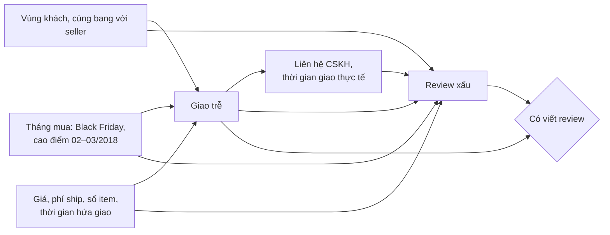

# Hướng làm: giao trễ → review xấu trên Olist

Bài Advanced không có đáp án duy nhất. Dưới đây là hướng làm, các số tham chiếu trên Olist thật
(bản cài đặt tham chiếu của người soạn), các quyết định cần cân nhắc, và rubric.

## 1. Bảng phân tích

95 824 đơn giao xong có review; 8.0% trễ (8.1% nếu tính trên mọi đơn giao xong, kể cả đơn không
review). Review xấu: 54.1% ở đơn trễ, 9.2% ở đơn đúng hẹn, chênh **44.8 điểm phần trăm**.

## 2. DAG và tập điều chỉnh

- **Điều chỉnh**: bang của khách, cùng bang với seller, tháng mua, giá, phí ship, số item, số ngày
  hứa giao. Tất cả xác định **trước** khi đơn trễ.
- **Không điều chỉnh**: thời gian giao thực tế, liên hệ CSKH (mediator); nội dung review (outcome).
- **Selection**: "có viết review" phụ thuộc cả giao trễ lẫn trải nghiệm. Bảng chỉ có đơn có review
  là điều kiện trên một collider. Không biến nào sửa được; phải nêu trong giới hạn và, nếu muốn,
  phân tích thêm tỉ lệ có review theo trạng thái trễ.

## 3. Ước lượng (đơn mua từ 01/2017, 95 560 đơn)

Covariate: `promised_days`, `log_freight`, `log_price`, `n_items`, `same_state`, `C(customer_state)`,
`C(purchase_month)`.

| Ước lượng | Tác động lên tỉ lệ review xấu |
| --- | --- |
| Ngây thơ | +44.9 điểm % |
| Hồi quy (LPM) | +44.4 điểm %, CI 95% HC1 [43.2, 45.5] |
| IPW (ATT) | +45.0 điểm % |

Chẩn đoán: propensity trung vị 0.126 ở đơn trễ, 0.049 ở đơn đúng hẹn; chỉ 169 đơn có propensity
trên 0.5. Overlap tốt: ESS của nhóm control khoảng 35 nghìn trên 87 902. Sau IPW mọi |SMD| của
biến số không quá 0.02 (trước đó `promised_days` −0.23, `same_state` −0.21).

**Điều đáng chú ý**: điều chỉnh gần như không đổi con số. Câu chuyện "đơn trễ tập trung ở vùng xa
nên review xấu" của module 03 là một giả thuyết hợp lý, nhưng với các confounder **đo được** thì
gần như toàn bộ khoảng cách vẫn còn. Lời giải tốt nói thẳng điều này, thay vì cố tìm ra một con số
nhỏ hơn.

## 4. Liều: số ngày trễ

| Giao so với ngày hẹn | Review xấu |
| --- | --- |
| Sớm 1–3 ngày | 10.9–11.8% |
| Trong ngày hẹn (sau 00:00, tính là trễ theo định nghĩa) | 12.4% |
| Trễ 1 ngày | 19.7% |
| Trễ 2 ngày | 34.3% |
| Trễ 3 ngày | 50.4% |
| Trễ 5 ngày | 64.7% |

Không có bước nhảy lớn ở đúng ngưỡng; review xấu tăng **dần** theo số ngày trễ. Ước lượng RDD
local linear ở ngưỡng 0 vì thế không ổn định (đường cong bên phải rất dốc). Bài học: "trễ" nhị
phân gộp hai thứ khác hẳn nhau. 34% đơn trễ chỉ trễ dưới 3 ngày, 42% trễ từ 7 ngày trở lên.
Khuyến nghị vận hành khác đi: ưu tiên loại bỏ đơn trễ **nặng**, và cân nhắc thông báo chủ động
ngày giao mới trước khi quá hạn.

## 5. Độ nhạy

RR thô 5.88 → E-value 11.2; RR sau IPW 5.95 → E-value 11.4. Bằng lời: một confounder chưa đo phải
làm khả năng trễ **và** khả năng review xấu cùng tăng khoảng 11 lần thì mới kéo tác động về 0. Rất
khó tưởng tượng một biến như vậy ngoài chính chất lượng seller; nên kết luận "giao trễ gây review
xấu" rất vững, còn **độ lớn chính xác** thì vẫn phụ thuộc giả định (selection, seller).

Thêm điểm cộng: điều chỉnh cho `seller_id` (fixed effect hoặc thống kê lịch sử của seller tính
trước ngày mua) để kiểm tra confounding do chất lượng seller.

## 6. Quy ra quyết định

Một cách quy đổi: giảm 1 điểm phần trăm tỉ lệ đơn trễ (khoảng 960 đơn trên 95 nghìn) giảm khoảng
430 review xấu (0.448 × 960, nếu đơn được cứu là đơn trễ trung bình). Muốn quy ra tiền cần thêm giá
trị của một review xấu (khách không quay lại, ảnh hưởng xếp hạng seller), và đó là chỗ đề xuất thí
nghiệm: random nhắn tin chủ động (module 03 Advanced 02) hoặc random ưu tiên vận chuyển cho một
nhóm đơn.

## Rubric

| Tiêu chí | Điểm | Đạt khi |
| --- | --- | --- |
| Bảng dữ liệu đúng | 10 | Đúng định nghĩa chung, test pass, kiểm tra con số tổng quát |
| DAG và tập điều chỉnh | 20 | Phân biệt confounder / mediator; không điều chỉnh biến sau can thiệp; nhận ra selection do "có review" |
| Ước lượng và chẩn đoán | 20 | Ít nhất hai phương pháp; overlap, balance trước/sau, ESS; diễn giải đúng việc điều chỉnh ít thay đổi kết quả |
| Liều / phân tích sâu | 15 | Nhìn theo số ngày trễ, rút ra hệ quả cho vận hành |
| Độ nhạy | 15 | E-value tính đúng và diễn giải bằng lời; nêu confounder có thể thiếu (seller) |
| Báo cáo | 20 | Kết luận ở đầu, con số kèm khoảng, không quá lời, giới hạn rõ, đề xuất bước tiếp theo khả thi |

Từ 70 điểm: đủ để đội vận hành dùng làm căn cứ ưu tiên dự án logistics.
