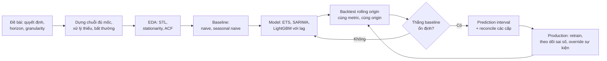
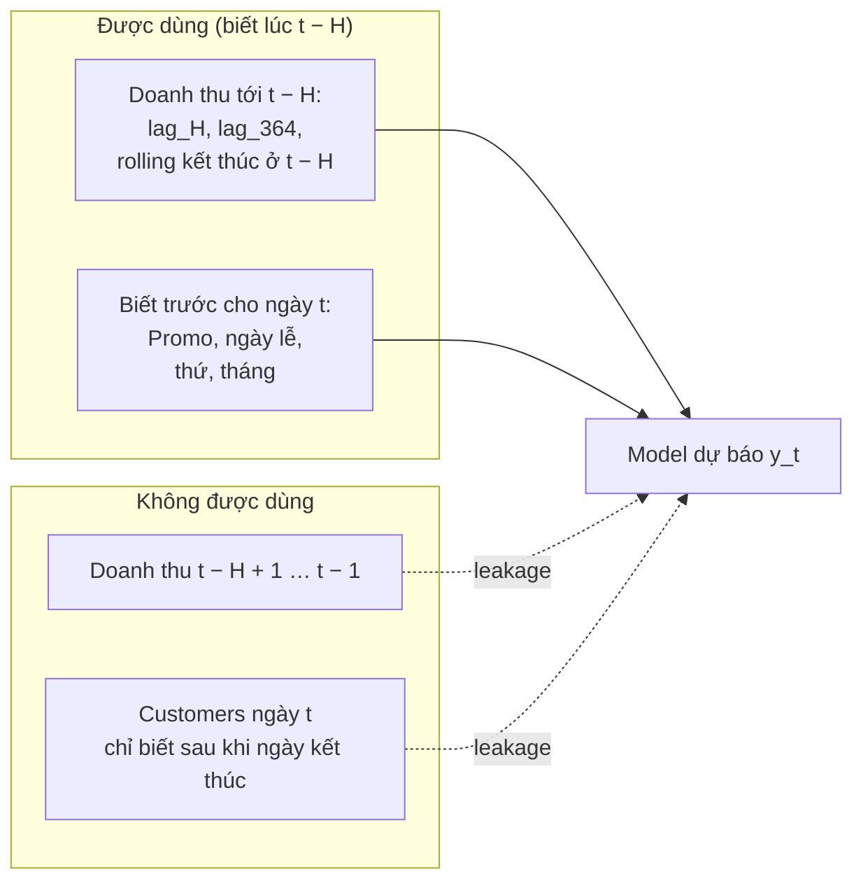
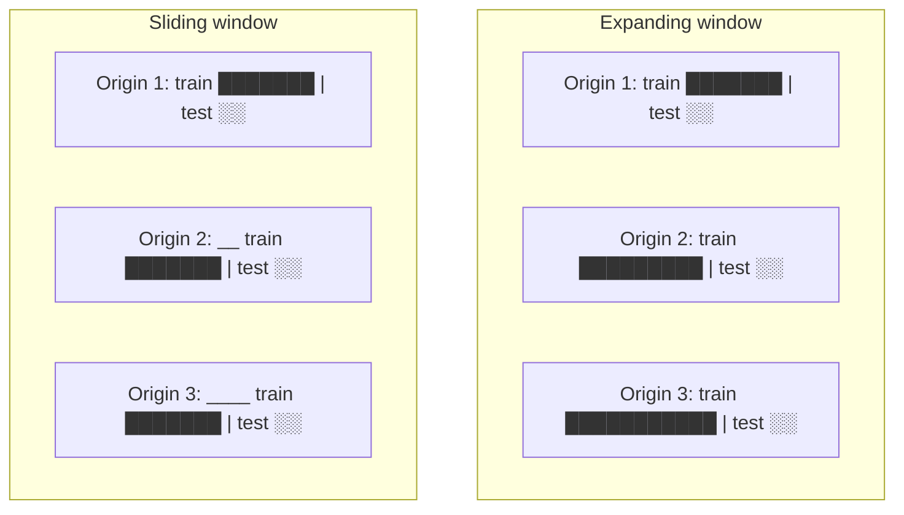
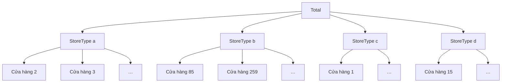

# Time Series & Forecasting

Dự báo là một trong những việc Data Scientist được giao nhiều nhất ở doanh nghiệp: bao nhiêu đơn
tuần sau để xếp ca kho, bao nhiêu doanh thu quý tới để lập ngân sách, bao nhiêu hàng cần nhập để
không hết hàng mà cũng không tồn kho. Khác với bài toán ML dạng bảng, dữ liệu có **thứ tự**: quá khứ
dự báo tương lai, không bao giờ ngược lại. Hầu hết lỗi nghiêm trọng trong forecasting (leakage,
đánh giá sai, khoảng dự báo hứa suông) đều đến từ việc quên điều đó.

Module dùng hai bộ dữ liệu thật: **số đơn Olist mỗi ngày** (một chuỗi, có xu hướng, mùa vụ tuần và
Black Friday) và **Rossmann** (`store-sales`: doanh thu ngày của 1 115 nhà thuốc ở Đức, 2013–2015;
bài tập dùng 20–50 cửa hàng để chạy nhanh). Tải dữ liệu:

```bash
uv run python data/download_olist.py
uv run python data/download_dataset.py store-sales
```

Sau module này bạn sẽ:

- Đọc cấu trúc một chuỗi (xu hướng, mùa vụ, bất thường) bằng STL, ADF/KPSS, ACF/PACF.
- Dựng baseline, chọn metric (MAE, MAPE, sMAPE, MASE) và biết metric nào hỏng ở đâu.
- Fit và đọc ARIMA/SARIMA, ETS; biết khi nào chúng không thắng nổi seasonal naive.
- Biến forecasting thành supervised learning với lag/rolling feature mà không leakage.
- Đánh giá bằng backtest rolling origin, dựng prediction interval có độ phủ đúng như đã hứa.
- Dự báo nhiều cấp (cửa hàng, vùng, toàn chuỗi) và reconcile để các con số cộng khớp nhau.

## 1. Forecasting trong doanh nghiệp

### Câu hỏi trước khi chọn model

Một yêu cầu "dự báo doanh số" chưa phải là đề bài. Trước khi mở notebook, cần chốt:

| Câu hỏi | Ví dụ Olist | Vì sao quan trọng |
| --- | --- | --- |
| Quyết định nào dùng dự báo? | Xếp ca kho, đặt xe tải | Quyết định định ra metric và mức phân vị cần dự báo |
| Horizon bao xa? | 14 ngày (lịch ca chốt trước 2 tuần) | Feature chỉ được dùng dữ liệu cũ hơn horizon |
| Độ chi tiết (granularity)? | Ngày × kho | Chi tiết hơn thì nhiễu hơn; cần cộng lên cấp trên cho khớp |
| Dự báo lập lúc nào, dữ liệu trễ bao lâu? | Sáng thứ Hai, dữ liệu tới hết Chủ nhật | Backtest phải mô phỏng đúng độ trễ này |
| Sai số nào đắt hơn? | Thiếu người tốn gấp 4 lần thừa người | Dự báo phân vị 0.8 thay vì trung bình |
| Có sự kiện biết trước không? | Black Friday, khuyến mãi | Biến ngoại sinh hoặc điều chỉnh thủ công |

### Chuỗi Olist

Đếm số đơn (mọi trạng thái) theo ngày mua, từ thứ Hai 2017-01-09 tới Chủ nhật 2018-08-19: 588 ngày,
97 845 đơn. Trước 2017-01-09 Olist gần như chưa có đơn; sau 2018-08-19 bộ dữ liệu bị cắt dần (đơn
mua cuối tháng 8 chưa vào hết), nên phải bỏ, không phải là "số đơn giảm".

```python
import pandas as pd

orders = pd.read_csv("data/raw/olist_orders_dataset.csv", parse_dates=["order_purchase_timestamp"])
y = (orders.order_purchase_timestamp.dt.normalize().value_counts()
     .reindex(pd.date_range("2017-01-09", "2018-08-19"), fill_value=0).astype(float))
print(len(y), int(y.sum()), y.idxmax().date(), int(y.max()))
print("TB nửa đầu 2017:", round(y["2017-01":"2017-06"].mean(), 1), "| nửa đầu 2018:", round(y["2018-01":"2018-06"].mean(), 1))
print(y.groupby(y.index.day_of_week).mean().round(0).to_dict())   # 0 = thứ Hai
```

Trung bình 84 đơn/ngày nửa đầu 2017, 228 đơn/ngày nửa đầu 2018: xu hướng tăng gần gấp 3. Thứ Bảy
ít đơn nhất. Ngày 2017-11-24 (Black Friday) có 1 176 đơn, gấp 6 tới 8 lần các thứ Sáu khác trong
tháng. Ba đặc điểm đó (xu hướng, mùa vụ tuần, ngày đặc biệt) quyết định mọi lựa chọn phía sau.

Lưu ý `reindex(..., fill_value=0)`: chuỗi thời gian **phải đủ mọi mốc thời gian**. Thiếu một ngày
thì "lag 7" không còn là "cùng thứ tuần trước", và mọi model mùa vụ lệch pha.

### Quy trình



## 2. Phân rã, stationarity và ACF/PACF

### Phân rã (decomposition)

Một chuỗi thường được xem là tổng (hoặc tích) của ba thành phần: xu hướng (trend), mùa vụ (seasonal)
và phần dư (remainder): dạng cộng $$y_t = T_t + S_t + R_t$$ hoặc dạng nhân
$$y_t = T_t \times S_t \times R_t$$.

Dạng nhân khi biên độ mùa vụ lớn lên theo mức của chuỗi (doanh thu bán lẻ tăng trưởng); lấy log
đưa về dạng cộng. **STL** (Seasonal-Trend decomposition using LOESS) là lựa chọn mặc định: chịu được
mùa vụ thay đổi dần, và với `robust=True` thì một ngày như Black Friday không làm méo thành phần mùa vụ.

```python
import numpy as np
import pandas as pd
from statsmodels.tsa.seasonal import STL

orders = pd.read_csv("data/raw/olist_orders_dataset.csv", parse_dates=["order_purchase_timestamp"])
y = (orders.order_purchase_timestamp.dt.normalize().value_counts()
     .reindex(pd.date_range("2017-01-09", "2018-08-19"), fill_value=0).astype(float))

stl = STL(y, period=7, robust=True).fit()
print(stl.seasonal.groupby(y.index.day_of_week).mean().round(1).to_dict())
strength_trend = max(0, 1 - np.var(stl.resid) / np.var(stl.resid + stl.trend))
strength_season = max(0, 1 - np.var(stl.resid) / np.var(stl.resid + stl.seasonal))
print(round(strength_trend, 2), round(strength_season, 2), round(stl.resid["2017-11-24"]))
```

Thành phần mùa vụ: +24 đơn thứ Hai, −43 đơn thứ Bảy, −27 đơn Chủ nhật. Độ mạnh xu hướng 0.71, độ
mạnh mùa vụ 0.23 (thang 0–1 của Hyndman): chuỗi Olist chủ yếu là câu chuyện tăng trưởng. Phần dư
ngày Black Friday là +920 đơn: STL robust đẩy cú sốc sang phần dư thay vì để nó làm hỏng mùa vụ.

### Stationarity

Chuỗi **dừng** (weakly stationary) có trung bình, phương sai và tự tương quan không đổi theo thời
gian. ARIMA cần chuỗi dừng sau khi sai phân; ML với lag cũng học tốt hơn khi quan hệ ổn định. Hai
kiểm định hay dùng có giả thuyết **ngược nhau**, nên dùng cả hai:

| ADF (H0: có unit root, không dừng) | KPSS (H0: dừng) | Kết luận | Làm gì |
| --- | --- | --- | --- |
| Bác bỏ | Không bác bỏ | Dừng | Dùng trực tiếp |
| Không bác bỏ | Bác bỏ | Không dừng | Sai phân |
| Không bác bỏ | Không bác bỏ | Trend-stationary | Trừ xu hướng (detrend) |
| Bác bỏ | Bác bỏ | Difference-stationary | Sai phân, kiểm lại |

```python
import warnings

import pandas as pd
from statsmodels.tsa.stattools import adfuller, kpss

orders = pd.read_csv("data/raw/olist_orders_dataset.csv", parse_dates=["order_purchase_timestamp"])
y = (orders.order_purchase_timestamp.dt.normalize().value_counts()
     .reindex(pd.date_range("2017-01-09", "2018-08-19"), fill_value=0).astype(float))

with warnings.catch_warnings():
    warnings.simplefilter("ignore")      # KPSS cảnh báo khi p nằm ngoài bảng tra (bị chặn ở 0.01 / 0.1)
    for name, x in [("gốc", y), ("sai phân 1", y.diff().dropna())]:
        adf_p = adfuller(x, autolag="AIC", result_object=False)[1]
        kpss_p = kpss(x, regression="c", nlags="auto", result_object=False)[1]
        print(f"{name}: ADF p = {adf_p:.3f}, KPSS p = {kpss_p:.3f}")
```

Chuỗi gốc: ADF p = 0.069, KPSS p ≤ 0.01: không dừng. Sau một lần sai phân: ADF p < 0.001, KPSS
p ≥ 0.1: dừng. Đó là `d = 1` trong ARIMA.

Lỗi hay gặp: coi p-value của ADF là "xác suất chuỗi dừng"; chạy kiểm định trên chuỗi có cú sốc lớn
(Black Friday làm cả hai kiểm định méo); sai phân quá tay (sai phân một chuỗi đã dừng tạo ra tự
tương quan âm giả và làm dự báo kém đi).

### ACF và PACF

**ACF** ở lag k là tương quan giữa chuỗi và chính nó lùi k bước; **PACF** là tương quan đó sau khi
đã loại ảnh hưởng của các lag 1..k−1. Với Olist đã sai phân bậc 1: ACF lag 1 = −0.24 (sai phân tạo
tự tương quan âm, dấu hiệu của thành phần MA), lag 7 = 0.23 và lag 14 = 0.18 (mùa vụ tuần).

| Mẫu hình | ACF | PACF | Gợi ý |
| --- | --- | --- | --- |
| AR(p) | Tắt dần | Cắt sau lag p | Thêm bậc AR |
| MA(q) | Cắt sau lag q | Tắt dần | Thêm bậc MA |
| Mùa vụ m | Đỉnh ở m, 2m, … | Đỉnh ở m | Sai phân mùa vụ hoặc thành phần mùa vụ |

Đọc ACF/PACF là để có điểm khởi đầu, không phải để chốt model: chọn cuối cùng bằng AIC trên tập
train và **backtest** trên dữ liệu chưa thấy (bài Basic 03, Intermediate 02).

## 3. Baseline và metric

### Baseline

| Baseline | Dự báo | Mạnh khi |
| --- | --- | --- |
| Naive | Giá trị cuối | Chuỗi kiểu random walk (giá, tỉ giá) |
| Mean | Trung bình lịch sử | Chuỗi dừng quanh một mức |
| Drift | Kéo dài đường nối điểm đầu và cuối | Tăng trưởng đều |
| Seasonal naive | Giá trị cùng mùa vụ gần nhất (cùng thứ tuần trước) | Bán lẻ, vận hành theo ngày |

Seasonal naive là baseline **bắt buộc** cho dữ liệu theo ngày. Trên Olist, SARIMA chỉ thắng nó
khoảng 5% (mục 4). Trên Rossmann, LightGBM thắng hơn một nửa sai số (mục 5). Không chạy baseline thì
không biết mình đang ở trường hợp nào.

### Metric

$$
\mathrm{MAE} = \frac{1}{H}\sum_{h=1}^{H} |e_h|,
\qquad
\mathrm{RMSE} = \sqrt{\frac{1}{H}\sum_{h=1}^{H} e_h^2},
\qquad
\mathrm{MAPE} = \frac{1}{H}\sum_{h=1}^{H} \left|\frac{e_h}{y_h}\right|
$$

$$
\mathrm{sMAPE} = \frac{1}{H}\sum_{h=1}^{H} \frac{2|e_h|}{|y_h| + |\hat y_h|},
\qquad
\mathrm{MASE} = \frac{\mathrm{MAE}}{\frac{1}{T - m}\sum_{t=m+1}^{T} |y_t - y_{t-m}|}
$$

với $$e_h = y_h - \hat y_h$$ và mẫu số MASE là MAE in-sample của seasonal naive bậc $$m$$ trên tập train.

| Metric | Ưu | Hỏng khi | Dùng khi |
| --- | --- | --- | --- |
| MAE | Dễ giải thích, cùng đơn vị | So chuỗi khác quy mô | Một chuỗi, báo cáo vận hành |
| RMSE | Phạt nặng sai số lớn | Vài ngày bất thường chi phối | Sai số lớn thật sự đắt |
| MAPE | Phần trăm, kinh doanh thích | y = 0 (Chủ nhật đóng cửa); bất đối xứng, khuyến khích dự báo thấp | Chuỗi dương, xa 0 |
| sMAPE | Có trần | Vẫn bất đối xứng; khó giải thích | So với kết quả M3/M4 |
| MASE | Không phụ thuộc quy mô, chịu được số 0 | Chuỗi hằng | **So model trên nhiều chuỗi** |
| WAPE | Phần trăm trên tổng, chịu được số 0 | Che sai số của chuỗi nhỏ | Báo cáo tổng hợp cho kinh doanh |

```python
import numpy as np

def mase(y_true, y_pred, y_train, m=1):
    scale = np.mean(np.abs(y_train[m:] - y_train[:-m]))
    return np.mean(np.abs(np.asarray(y_true) - np.asarray(y_pred))) / scale

rng = np.random.default_rng(0)
week = np.array([30.0, 28, 27, 25, 22, 10, 12])
train = np.tile(week, 10) + rng.normal(0, 2, 70)
test = np.tile(week, 2) + rng.normal(0, 2, 14)
print("naive:", round(mase(test, np.full(14, train[-1]), train, m=7), 2))
print("seasonal naive:", round(mase(test, train[-7:][np.arange(14) % 7], train, m=7), 2))
```

MASE = 1 nghĩa là sai số bằng seasonal naive một bước trong lịch sử. Dự báo nhiều bước thường có
MASE > 1 kể cả khi model tốt; muốn biết model có thắng baseline không, chạy baseline trong cùng
backtest và so trực tiếp.

Chọn metric là chọn đại lượng dự báo: tối ưu MAE cho ra **median**, tối ưu RMSE cho ra **mean**,
tối ưu pinball loss ở mức q cho ra **phân vị q**. Với doanh thu lệch phải, ba con số đó khác nhau.

## 4. ARIMA, SARIMA và ETS

### ARIMA(p, d, q)

Sai phân $$d$$ lần cho chuỗi dừng, rồi mô hình hoá chuỗi đã sai phân $$y'_t$$ bằng phần AR (hồi quy
lên chính nó) và phần MA (hồi quy lên các cú sốc quá khứ):

$$
y'_t = c + \phi_1 y'_{t-1} + \dots + \phi_p y'_{t-p} + \varepsilon_t + \theta_1 \varepsilon_{t-1} + \dots + \theta_q \varepsilon_{t-q}
$$

**SARIMA(p, d, q)(P, D, Q)[m]** thêm các thành phần tương tự ở lag mùa vụ $$m, 2m, \dots$$ và sai
phân mùa vụ $$D$$ lần. Với dữ liệu ngày, $$m = 7$$. Quy trình Box-Jenkins: chọn $$d, D$$ bằng kiểm
định stationarity, gợi ý $$p, q, P, Q$$ từ ACF/PACF, so vài ứng viên bằng AIC, kiểm tra residual không
còn tự tương quan (Ljung-Box), và cuối cùng **backtest**.

```python
import warnings

import numpy as np
import pandas as pd
from statsmodels.tsa.statespace.sarimax import SARIMAX

orders = pd.read_csv("data/raw/olist_orders_dataset.csv", parse_dates=["order_purchase_timestamp"])
y = (orders.order_purchase_timestamp.dt.normalize().value_counts()
     .reindex(pd.date_range("2017-01-09", "2018-08-19"), fill_value=0).astype(float))

cutoff = pd.Timestamp("2018-07-08")
train, test = y[y.index < cutoff], y[cutoff:cutoff + pd.Timedelta(days=13)]
with warnings.catch_warnings():
    warnings.simplefilter("ignore")
    fit = SARIMAX(train.to_numpy(), order=(1, 1, 1), seasonal_order=(0, 1, 1, 7)).fit(disp=False)
pred = fit.get_forecast(14)
lo, hi = pred.conf_int(alpha=0.2).T
snaive = train.to_numpy()[-7:][np.arange(14) % 7]
print("AIC", round(fit.aic), "| MAE SARIMA", round(np.mean(np.abs(test.to_numpy() - pred.predicted_mean)), 1),
      "| MAE seasonal naive", round(np.mean(np.abs(test.to_numpy() - snaive)), 1))
print("coverage PI 80%:", np.mean((test.to_numpy() >= lo) & (test.to_numpy() <= hi)))
```

Một origin chưa nói được gì (ở origin này SARIMA thắng rõ). Trên 12 origin cách nhau 14 ngày (tháng
3 tới tháng 8/2018), MASE trung bình:

| Model | MASE trung bình | Thắng seasonal naive |
| --- | --- | --- |
| SARIMA(1,1,1)(0,1,1)[7] | 1.19 | 7/12 origin |
| ETS cộng tính, trend damped, mùa vụ 7 | 1.22 | |
| SARIMA(0,1,1)(0,1,1)[7] ("airline") | 1.23 | |
| Seasonal naive | 1.26 | |
| SARIMA(1,1,1)(1,0,1)[7] | 1.28 | |

Mức thắng tốt nhất khoảng 5%, trong khi MASE của từng origin dao động từ 0.6 tới 2.9. Origin
2018-05-13 làm mọi model sai nặng: tuần 21–27/5/2018 số đơn giảm gần một nửa (1 837 xuống 954
đơn/tuần), trùng thời gian cuộc đình công của tài xế xe tải ở Brazil. Không model đơn biến nào thấy
trước được điều đó. Bài Intermediate 02 làm trọn phân tích này.

### ETS (Error, Trend, Seasonal)

Exponential smoothing dự báo bằng trung bình có trọng số giảm dần theo cấp số nhân của quá khứ, tách
riêng **level**, **trend** và **season**, mỗi cái cập nhật với một hệ số làm mượt. Ví dụ Holt-Winters
cộng tính:

$$
\ell_t = \alpha (y_t - s_{t-m}) + (1 - \alpha)(\ell_{t-1} + b_{t-1}),
\qquad
b_t = \beta (\ell_t - \ell_{t-1}) + (1 - \beta) b_{t-1}
$$

$$
s_t = \gamma (y_t - \ell_{t-1} - b_{t-1}) + (1 - \gamma) s_{t-m},
\qquad
\hat y_{t+h} = \ell_t + h\,b_t + s_{t+h-m}
$$

Mỗi thành phần có thể là không có (N), cộng (A), nhân (M), và trend có thể **damped** (tắt dần,
thường dự báo xa tốt hơn vì xu hướng hiếm khi kéo dài mãi). `ETSModel` trong statsmodels là bản
state-space, cho likelihood, AIC và prediction interval.

| | ARIMA/SARIMA | ETS |
| --- | --- | --- |
| Ý tưởng | Tự tương quan của chuỗi đã sai phân | Làm mượt level, trend, season |
| Mạnh khi | Cấu trúc tự tương quan phức tạp, thêm biến ngoại sinh (SARIMAX) | Mùa vụ rõ, trend thay đổi dần; rất ổn định |
| Yếu khi | Nhiều mùa vụ (ngày + năm), chuỗi dài: fit chậm | Không có biến ngoại sinh |
| Tốc độ | Giây mỗi chuỗi | Nhanh hơn |

Cả hai là model **một chuỗi** (local): 1 000 cửa hàng là 1 000 model, mỗi cái chỉ học từ lịch sử của
mình. Với nhiều mùa vụ (ngày trong tuần + ngày trong năm), dùng TBATS, MSTL, hoặc chuyển sang ML.

## 5. Machine learning với lag feature

### Biến forecasting thành supervised learning

Mỗi dòng là một (chuỗi, thời điểm), target là $$y_t$$, feature là những gì **biết được lúc lập dự
báo**: giá trị quá khứ (lag), thống kê trượt (rolling mean), lịch (thứ, tháng, ngày lễ), và biến biết
trước (lịch khuyến mãi, giá đã lên kế hoạch). Một model gradient boosting **chung cho mọi chuỗi**
(global model) học được mẫu hình chung từ hàng nghìn cửa hàng: đó là cách các đội đứng đầu cuộc thi
M5 (Walmart) làm.

Quy tắc không được vi phạm: dự báo cho ngày $$t$$ lập ở ngày $$t - H$$ thì mọi feature tính từ
target chỉ được dùng dữ liệu tới $$t - H$$.



### Rossmann: một LightGBM cho 50 cửa hàng

Dự báo doanh thu từng cửa hàng, từng ngày, cho 42 ngày (đề cuộc thi Kaggle). Feature: lag 42, 49,
56, 364 ngày; trung bình 28 ngày kết thúc ở $$t - 42$$; trung bình 8 tuần cùng thứ; `Promo`,
ngày lễ, thứ, tháng, ngày. Ngày đóng cửa là `NaN`, không phải 0. Origin 2015-06-20, MAE trên ngày
mở cửa:

| Cách | MAE (€) | RMSPE |
| --- | --- | --- |
| Seasonal naive (cùng thứ tuần trước) | 1 501 | 0.350 |
| LightGBM, feature lùi ≥ 42 ngày | 665 | 0.138 |
| LightGBM thêm lag 1 và lag 7 (leakage) | 575 | 0.114 |

Baseline thua nặng vì Rossmann chạy khuyến mãi xen kẽ theo tuần (ngày có khuyến mãi bán trung bình
8 228 €, không có 5 929 €), nên "tuần trước" thường có trạng thái khuyến mãi ngược với tuần cần dự
báo. Bản có leakage đẹp hơn 13% nhưng không bao giờ đạt được: để dự báo ngày thứ 30 ta không có
doanh thu ngày thứ 29. Kiểm tra leakage bằng cách **sửa dữ liệu tương lai và xem feature có đổi
không**:

```python
import numpy as np
import pandas as pd

rng = np.random.default_rng(0)
df = pd.DataFrame({"store": np.repeat([1, 2], 100),
                   "date": np.tile(pd.date_range("2018-01-01", periods=100), 2),
                   "sales": rng.gamma(5, 100, 200)})

def features(d: pd.DataFrame, horizon: int) -> pd.DataFrame:
    g = d.groupby("store").sales
    out = pd.DataFrame(index=d.index)
    out["lag_h"] = g.shift(horizon)
    out["roll_28"] = out.lag_h.groupby(d.store).transform(lambda x: x.rolling(28, min_periods=1).mean())
    out["roll_28_leaky"] = g.transform(lambda x: x.rolling(28, min_periods=1).mean())   # quên lùi
    return out

boundary = pd.Timestamp("2018-03-01")
changed = df.assign(sales=np.where(df.date >= boundary, df.sales * 10, df.sales))
before = df.date < boundary + pd.Timedelta(days=14)        # các ngày chỉ được thấy dữ liệu trước boundary
a, b = features(df, 14)[before], features(changed, 14)[before]
print({c: bool(np.allclose(a[c], b[c], equal_nan=True)) for c in a.columns})
```

`lag_h` và `roll_28` không đổi; `roll_28_leaky` đổi, nghĩa là nó đang nhìn thấy tương lai. Test của
bài Intermediate 03 dùng đúng cách này.

### Chiến lược nhiều bước

| Chiến lược | Cách làm | Đánh đổi |
| --- | --- | --- |
| Direct, lag ≥ H | Một model, mọi lag lùi ít nhất H | Đơn giản; bước gần không dùng được dữ liệu mới nhất |
| Direct theo horizon | Model riêng cho từng bước (hoặc từng tuần) | Chính xác hơn ở bước gần; nhiều model để vận hành |
| Recursive | Một model lag 1, đưa dự báo vào làm lag cho bước sau | Một model; sai số tích luỹ, feature phân phối khác lúc train |

### Khi nào ML, khi nào thống kê

| Tình huống | Nên dùng |
| --- | --- |
| Một vài chuỗi, ít lịch sử, cần interval tốt | ETS, SARIMA |
| Hàng nghìn chuỗi liên quan, nhiều biến biết trước (giá, khuyến mãi) | Global LightGBM |
| Chuỗi mới, chưa có lịch sử (cold start) | Global model với feature của sản phẩm/cửa hàng |
| Cần giải thích cho tài chính, quy định | ETS/SARIMA, hoặc regression với feature lịch (module 05) |

Lag feature cũng là một dạng feature engineering có nguy cơ leakage; cách chia train/validation theo
thời gian, có `gap` bằng horizon, được bàn kỹ ở module 10. Regression có biến lịch và biến ngoại
sinh là nền tảng của module 05.

## 6. Backtesting và prediction interval

### Rolling origin

Một lần chia train/test cho một con số; con số đó có thể may hoặc xui (ở Olist, origin 2018-04-15
seasonal naive thắng SARIMA, origin 2018-05-27 thì ngược lại). **Rolling origin** (time series
cross-validation) lặp lại: train tới origin, dự báo H bước, dời origin, làm lại.



Nguyên tắc:

- Backtest mô phỏng **đúng** production: cùng tần suất retrain, cùng độ trễ dữ liệu, cùng horizon.
- Mọi model chạy trên **cùng** các origin và cùng metric; báo cáo trung bình, trung vị và độ dao động.
- Chọn cấu hình trên các origin cũ, báo cáo trên các origin mới hơn. Chọn model bằng chính các
  origin dùng để báo cáo là overfit vào backtest.
- Báo sai số **theo horizon**: dự báo ngày mai và dự báo hai tuần tới có độ tin khác nhau.

```python
import numpy as np

def rolling_origin(y, forecast_fn, initial, horizon, step):
    errors = []
    for cutoff in range(initial, len(y) - horizon + 1, step):
        pred = forecast_fn(y[:cutoff].copy(), horizon)       # chỉ đưa quá khứ, và là bản sao
        errors.append(np.abs(y[cutoff:cutoff + horizon] - pred))
    return np.array(errors)                                   # origin × horizon

rng = np.random.default_rng(0)
y = np.cumsum(rng.normal(0, 1, 2000))                         # random walk
err = rolling_origin(y, lambda tr, h: np.full(h, tr[-1]), initial=500, horizon=10, step=5)
print(len(err), "origin; MAE theo h:", err.mean(axis=0).round(2))
print("MAE(h=10) / MAE(h=1) =", round(err.mean(axis=0)[9] / err.mean(axis=0)[0], 2), "≈ sqrt(10) =", round(np.sqrt(10), 2))
```

### Prediction interval

Một dự báo điểm không đủ để ra quyết định. Người lập kế hoạch cần "bình thường bao nhiêu, ngày bận
hợp lý là bao nhiêu". Ba cách dựng khoảng:

| Cách | Ý tưởng | Đánh đổi |
| --- | --- | --- |
| Lý thuyết (ETS, SARIMA) | Phân phối sai số từ model, thường giả định chuẩn | Có sẵn; sai khi giả định sai (đuôi nặng, phương sai đổi) |
| Empirical / conformal | Phân vị của sai số backtest theo từng bước h | Không giả định phân phối; cần nhiều origin; giả định tương lai giống giai đoạn hiệu chỉnh |
| Quantile regression | Model dự báo trực tiếp phân vị (LightGBM `objective="quantile"`) | Linh hoạt, dùng được feature; mỗi phân vị một model, có thể cắt nhau |

Chấm khoảng bằng **coverage** (tỉ lệ giá trị thật nằm trong khoảng, phải gần mức danh nghĩa) và
**interval score**, metric thưởng khoảng hẹp và phạt nặng điểm nằm ngoài:

$$
S_\alpha(l, u; y) = (u - l) + \frac{2}{\alpha}(l - y)\,\mathbf 1\{y < l\} + \frac{2}{\alpha}(y - u)\,\mathbf 1\{y > u\}
$$

Trên Olist (khoảng 80%, hiệu chỉnh trên 38 origin từ 2017-06 tới 2018-02, đánh giá trên 12 origin
năm 2018):

| Model điểm + cách dựng khoảng | Coverage | Interval score |
| --- | --- | --- |
| SARIMA, khoảng lý thuyết | 94.0% | 191.2 |
| SARIMA, empirical theo sai số tuyệt đối | 66.7% | 179.4 |
| SARIMA, empirical theo log-ratio | 83.3% | 175.0 |
| Seasonal naive, empirical theo sai số tuyệt đối | 68.5% | 214.5 |

Khoảng lý thuyết phủ thừa (Black Friday trong train làm phương sai phình ra); khoảng theo sai số
tuyệt đối phủ thiếu (năm 2018 lớn hơn giai đoạn hiệu chỉnh, sai số tuyệt đối cũng lớn hơn); sai số
tương đối giải quyết được phần lớn. Bài Advanced 02 làm trọn phân tích này.

Chọn mức phân vị theo chi phí: nếu thiếu một đơn vị tốn $$c_u$$ và thừa tốn $$c_o$$, phân vị tối ưu
là $$c_u / (c_u + c_o)$$ (bài toán newsvendor). Thiếu người tốn gấp 4 lần thừa người thì lập kế hoạch
theo phân vị 0.8, không theo dự báo trung bình.

## 7. Hierarchical forecasting và reconciliation

### Bài toán

Doanh nghiệp cần dự báo ở nhiều cấp cùng lúc: tài chính cần tổng toàn chuỗi, mua hàng cần theo loại
cửa hàng, vận hành cần từng cửa hàng. Dự báo độc lập từng cấp thì các con số **không cộng khớp**
(incoherent): tổng dự báo các cửa hàng khác dự báo toàn chuỗi, và mỗi phòng ban cầm một con số.



Gọi $$\mathbf b_t$$ là vector các chuỗi đáy (cửa hàng) và $$\mathbf S$$ là **ma trận tổng hợp** (mỗi
dòng là một node, mỗi cột là một chuỗi đáy, phần tử là 1 nếu chuỗi đáy thuộc node đó). Mọi node:
$$\mathbf y_t = \mathbf S\,\mathbf b_t$$. Reconciliation tuyến tính biến base forecast $$\hat{\mathbf y}_h$$
(mọi node, dự báo độc lập) thành dự báo coherent:

$$
\tilde{\mathbf y}_h = \mathbf S\,(\mathbf S^\top \mathbf W^{-1} \mathbf S)^{-1}\,\mathbf S^\top \mathbf W^{-1}\,\hat{\mathbf y}_h
$$

| Phương pháp | W | Ý nghĩa |
| --- | --- | --- |
| Bottom-up | (chỉ lấy dự báo đáy rồi cộng lên) | Giữ chi tiết; bỏ thông tin của cấp trên |
| Top-down | (chia tổng theo tỉ lệ lịch sử) | Ổn định ở cấp trên; mất mẫu hình riêng của đáy |
| OLS | I | Chiếu trực giao lên không gian coherent |
| WLS structural | diag(số chuỗi đáy dưới mỗi node) | Node lớn sai số lớn hơn |
| WLS variance / MinT | phương sai (hoặc hiệp phương sai co) của sai số base forecast | Tin node dự báo tốt hơn; cần ước lượng sai số đúng horizon |

```python
import numpy as np

# 3 cửa hàng: hai thuộc loại a, một thuộc loại b. Dòng: Total, a, b, s1, s2, s3
S = np.array([[1, 1, 1], [1, 1, 0], [0, 0, 1], [1, 0, 0], [0, 1, 0], [0, 0, 1]], dtype=float)
base = np.array([300.0, 190.0, 95.0, 100.0, 80.0, 100.0])     # dự báo độc lập: 100 + 80 + 100 ≠ 300
print("lệch Total - tổng đáy:", base[0] - base[3:].sum())

P_ols = S @ np.linalg.solve(S.T @ S, S.T)
W_inv = np.diag(1 / S.sum(axis=1))                             # WLS structural
P_wls = S @ np.linalg.solve(S.T @ W_inv @ S, S.T @ W_inv)
for name, P in [("OLS", P_ols), ("WLS", P_wls)]:
    rec = P @ base
    print(name, rec.round(1), "| coherent:", np.isclose(rec[0], rec[3:].sum()))
```

### Khi nào reconcile giúp

Trên Rossmann (20 cửa hàng, theo tuần, horizon 6 tuần, hai origin), bài Advanced 01 cho thấy:

- Base forecast **tuyến tính và giống nhau ở mọi node** (seasonal naive 52 tuần) đã coherent sẵn:
  reconcile không đổi gì.
- Cùng loại model ở mọi node (Holt damped) nhưng tham số fit riêng từng node: không còn coherent chính
  xác, chỉ gần coherent; reconcile gần như không đổi MAE.
- Cấp trên dùng model có mùa vụ năm, cấp cửa hàng dùng Holt: reconcile **OLS** kéo dự báo cửa hàng
  về phía thông tin mùa vụ của cấp trên, MAE cửa hàng giảm từ 6 891 xuống 3 738 €/tuần (origin
  2015-06-21) và từ 6 505 xuống 3 602 (origin 2015-05-10). Bottom-up vứt thông tin đó nên tệ ở mọi cấp.
- WLS theo phương sai residual in-sample một bước lại **tệ hơn** base, vì residual một bước của Holt
  nhỏ hơn nhiều so với sai số 6 tuần. Trọng số phải ước lượng ở đúng horizon.

Reconcile không biến model tệ thành model tốt; nó đảm bảo các con số khớp nhau và chuyển thông tin
giữa các cấp khi mỗi cấp biết một điều khác nhau.

## 8. Tài liệu tham khảo

Sách:

- Rob J Hyndman, George Athanasopoulos. [Forecasting: Principles and Practice, 3rd ed](https://otexts.com/fpp3/).
  Sách gối đầu giường, miễn phí; chương [hierarchical](https://otexts.com/fpp3/hierarchical.html) và
  [prediction intervals](https://otexts.com/fpp3/prediction-intervals.html).
- [Forecasting: Principles and Practice, the Pythonic Way](https://otexts.com/fpppy/), bản Python của
  sách trên với thư viện Nixtla.

Từ roadmap.sh/ai-data-scientist:

- [AI & Data Scientist Roadmap](https://roadmap.sh/ai-data-scientist), mục Time Series.

Bài viết và paper:

- Hyndman & Koehler (2006). [Another look at measures of forecast accuracy](https://robjhyndman.com/papers/mase.pdf) (MASE).
- Gneiting & Raftery (2007). [Strictly Proper Scoring Rules, Prediction, and Estimation](https://sites.stat.washington.edu/raftery/Research/PDF/Gneiting2007jasa.pdf) (interval score).
- Wickramasuriya, Athanasopoulos & Hyndman (2019). [Optimal forecast reconciliation for hierarchical and grouped time series through trace minimization](https://robjhyndman.com/publications/mint/) (MinT).
- Makridakis, Spiliotis & Assimakopoulos (2022). The M5 competition: Background, organization, and implementation. International Journal of Forecasting.

Tài liệu thư viện:

- [statsmodels: Time Series Analysis](https://www.statsmodels.org/stable/tsa.html),
  [SARIMAX](https://www.statsmodels.org/stable/generated/statsmodels.tsa.statespace.sarimax.SARIMAX.html),
  [ADF và KPSS](https://www.statsmodels.org/stable/examples/notebooks/generated/stationarity_detrending_adf_kpss.html)
- [LightGBM](https://lightgbm.readthedocs.io/en/stable/)
- [Nixtla hierarchicalforecast](https://github.com/Nixtla/hierarchicalforecast)

Dữ liệu:

- Olist: [Kaggle](https://www.kaggle.com/datasets/olistbr/brazilian-ecommerce)
- Rossmann Store Sales: [Kaggle](https://www.kaggle.com/c/rossmann-store-sales)
