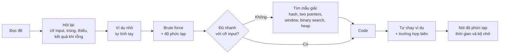
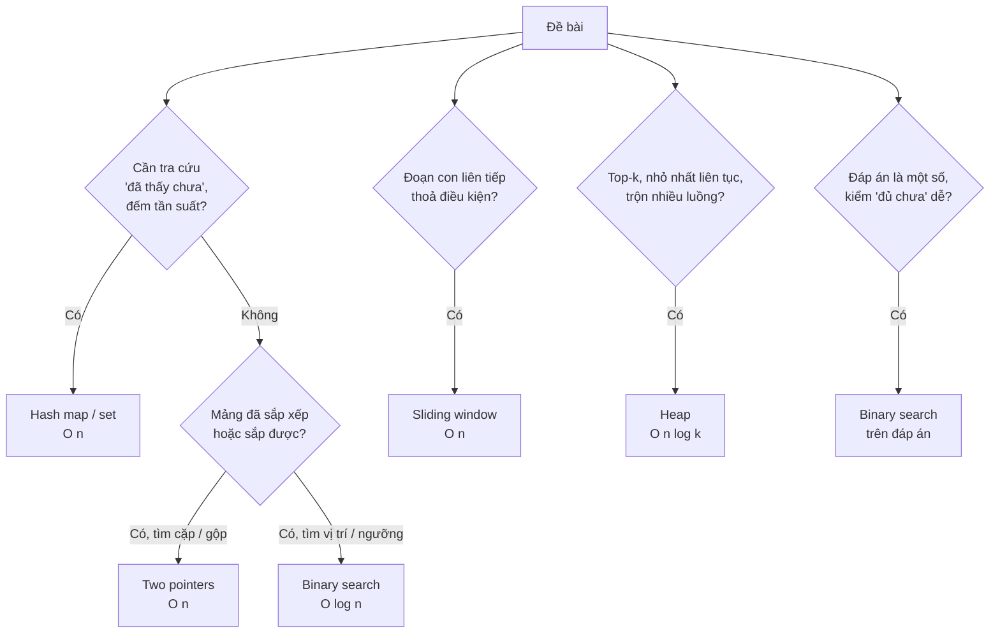
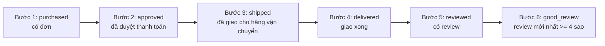
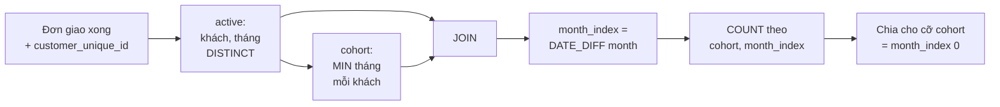

# Coding cho Data Scientist

Gần như mọi quy trình tuyển Data Scientist đều có ít nhất một vòng code: một bài thuật toán ngắn
(DSA), một bài SQL trên bảng sự kiện hoặc đơn hàng, đôi khi là "mở notebook và phân tích bộ này
trong 45 phút". Vòng này hiếm khi là nơi bạn *ghi điểm*, nhưng rất hay là nơi bạn *bị loại*: viết
đúng nhưng chậm, quên trường hợp biên, đếm sai mẫu số của tỉ lệ, hoặc join làm nhân dòng mà không
biết.

Module này không dạy lại Python và SQL cơ bản. Bạn đã học window function, CTE, CTE đệ quy và
gaps-and-islands ở [module Foundations của track Data Engineer](/t/data-engineer/m/01-foundations)
(mục 2). Ở đây ta tập trung vào ba thứ mà vòng phỏng vấn DS thật sự hỏi:

- **DSA mức phỏng vấn DS**: năm mẫu giải (hash map, two pointers, sliding window, binary search, heap)
  đủ cho phần lớn câu hỏi, và cách nói về độ phức tạp.
- **SQL dạng phỏng vấn DS** trên DuckDB với Olist thật: funnel, cohort retention, gaps-and-islands,
  và các bẫy làm sai con số.
- **pandas/polars nhanh**: vector hoá, dtype, lazy evaluation, và khi nào đổi công cụ.

Mọi ví dụ chạy trên **Olist** thật nạp vào DuckDB. Tải dữ liệu:

```bash
uv run python data/download_olist.py
```

Sau module này bạn sẽ:

- Nhận ra mẫu giải từ đề bài và giải thích độ phức tạp trước khi code.
- Viết query funnel và retention cohort đúng định nghĩa, phân biệt "0%" với "chưa quan sát được".
- Phát hiện join nhân dòng, mẫu số sai, NULL trong `NOT IN`, trung bình không trọng số.
- Viết lại một pipeline pandas chậm thành nhanh hơn hàng chục lần, và biết khi nào nên chuyển sang
  polars hay DuckDB.

## 1. Vòng coding trong phỏng vấn DS

### Họ kiểm tra gì

| Dạng vòng | Thời lượng | Kiểm tra điều gì | Lỗi hay khiến trượt |
| --- | --- | --- | --- |
| DSA (LeetCode easy–medium) | 30–45 phút | Tư duy thuật toán, độ phức tạp, code sạch | Lao vào code ngay, không hỏi lại đề, không tự test |
| SQL live | 30–45 phút | Join, window, aggregate, định nghĩa metric | Nhân dòng khi join, mẫu số sai, quên NULL |
| pandas/Python live | 30–60 phút | Thao tác dữ liệu nhanh, đọc dữ liệu bẩn | Vòng lặp theo dòng, không kiểm tra kết quả |
| Take-home | 3–8 giờ | Cả quy trình: làm sạch, phân tích, trình bày | Notebook không chạy lại được, kết luận vượt quá dữ liệu |

So với vòng của Software Engineer, đề DSA cho DS thường dễ hơn một bậc (ít khi có quy hoạch động khó
hay đồ thị phức tạp), nhưng người phỏng vấn chú ý hơn tới **cách bạn nói về dữ liệu**: input lớn cỡ
nào, có trùng không, có thiếu không. Đề SQL thì ngược lại: thường khó hơn vòng SQL của Data Analyst,
vì đề cố ý chứa bẫy định nghĩa.

### Một quy trình giải ổn định



Nói brute force trước không phải là yếu: nó cho người phỏng vấn thấy bạn hiểu đề và có một đáp án
đúng làm mốc. Sau đó mới tối ưu.

### Ước lượng nhanh: cỡ input quyết định thuật toán

Python thuần chạy cỡ $$10^7$$ phép tính đơn giản mỗi giây. Từ cỡ input ta suy ra độ phức tạp cần có:

| Cỡ n | Độ phức tạp chấp nhận được | Mẫu thường gặp |
| --- | --- | --- |
| tới vài nghìn | $$O(n^2)$$ | Hai vòng lặp lồng nhau, so mọi cặp |
| $$10^5$$ – $$10^6$$ | $$O(n \log n)$$ hoặc $$O(n)$$ | Sắp xếp, heap, binary search, hash map, two pointers |
| $$10^8$$ trở lên | $$O(n)$$ một lượt, không vừa bộ nhớ | Streaming, xử lý theo chunk, SQL engine |

Với $$n = 2 \times 10^5$$, thuật toán $$O(n^2)$$ cần khoảng $$2 \times 10^{10}$$ phép so sánh, tức
hàng chục phút bằng Python; $$O(n)$$ chạy dưới một giây. Các bài tập DSA của module kiểm đúng điều này:
test chạy với n = 200 000 và giới hạn 10 giây.

## 2. DSA: năm mẫu giải hay gặp



### Hash map và hash set

Khi nào dùng: cần biết "đã thấy giá trị này chưa", đếm tần suất, gom nhóm, hoặc tra số bù (two sum).
Đổi $$O(n)$$ bộ nhớ lấy thời gian tra cứu trung bình $$O(1)$$.

```python
from collections import Counter

def two_sum(nums, target):
    """Cặp (i, j), i < j, nums[i] + nums[j] == target; j nhỏ nhất. O(n)."""
    first_index = {}
    for j, x in enumerate(nums):
        if target - x in first_index:
            return first_index[target - x], j
        first_index.setdefault(x, j)
    return None

print(two_sum([3, 8, 1, 5], 6))                        # (2, 3)
print(Counter(["SP", "RJ", "SP", "MG", "SP"]).most_common(2))
```

Lỗi hay gặp: dùng `list` để kiểm "đã thấy" (`x in seen_list` là $$O(n)$$, cả thuật toán thành
$$O(n^2)$$); quên trường hợp một phần tử bị dùng hai lần (`[3, 4]`, target 6); dùng giá trị không
hashable (list, dict) làm key.

### Two pointers

Khi nào dùng: mảng **đã sắp xếp**, tìm cặp hoặc đếm cặp thoả điều kiện, gộp hai mảng, loại trùng tại
chỗ. Hai con trỏ chỉ đi một chiều nên tổng số bước là $$O(n)$$.

```python
def count_pairs_within_budget(prices, budget):
    """Số cặp i < j có prices[i] + prices[j] <= budget. prices đã sắp xếp. O(n)."""
    left, right, count = 0, len(prices) - 1, 0
    while left < right:
        if prices[left] + prices[right] <= budget:
            count += right - left      # prices[left] ghép được với mọi phần tử tới right
            left += 1
        else:
            right -= 1
    return count

print(count_pairs_within_budget([1, 2, 3, 4, 5], 6))   # 6
```

Đánh đổi: nếu mảng chưa sắp xếp thì phải sort trước, $$O(n \log n)$$; khi đó hash map có thể tốt hơn
(two sum chưa sắp xếp: hash map $$O(n)$$ thắng sort + two pointers).

### Sliding window

Khi nào dùng: đoạn con **liên tiếp** dài nhất / ngắn nhất / nhiều nhất thoả điều kiện; số sự kiện
trong mọi cửa sổ thời gian (tải đỉnh, rate limit, phát hiện gian lận "quá 5 giao dịch trong 1 phút").

```python
def max_events_in_window(timestamps, window):
    """Số sự kiện nhiều nhất trong một đoạn [t, t + window]. timestamps đã sắp xếp. O(n)."""
    best, left = 0, 0
    for right, t in enumerate(timestamps):
        while t - timestamps[left] > window:
            left += 1
        best = max(best, right - left + 1)
    return best

print(max_events_in_window([1, 2, 3, 10, 11], 2))     # 3
```

Điều kiện để cửa sổ co giãn đúng: khi mở rộng sang phải thì "vi phạm" chỉ có thể tăng, và co bên trái
thì giảm (tính đơn điệu). Với tổng của đoạn con, điều đó cần giá trị **không âm**; có số âm thì dùng
prefix sum + hash map thay vì sliding window. Đây là câu hỏi nối tiếp phổ biến.

### Binary search, kể cả trên đáp án

Khi nào dùng: tìm vị trí trong mảng sắp xếp (`bisect`), hoặc khi đáp án là một con số và hàm
"con số này đủ chưa?" **đơn điệu** (đủ ở c thì đủ ở mọi giá trị lớn hơn). Khi đó tìm nhị phân trên
đáp án: $$O(n \log S)$$ với S là khoảng giá trị.

```python
def min_daily_capacity(weights, days):
    """Sức chứa nhỏ nhất mỗi ngày để giao hết các kiện theo thứ tự trong `days` ngày."""
    def days_needed(cap):
        used, load = 1, 0
        for w in weights:
            if load + w > cap:
                used, load = used + 1, 0
            load += w
        return used

    lo, hi = max(weights), sum(weights)
    while lo < hi:                       # bất biến: đáp án nằm trong [lo, hi]
        mid = (lo + hi) // 2
        if days_needed(mid) <= days:
            hi = mid
        else:
            lo = mid + 1
    return lo

print(min_daily_capacity([1, 2, 3, 4, 5, 6, 7, 8, 9, 10], 5))   # 15
```

Lỗi hay gặp: vòng lặp vô hạn do cập nhật `lo = mid` thay vì `mid + 1`; cận dưới sai (phải chở được
kiện nặng nhất nên `lo = max(weights)`, không phải 1); quên kiểm tính đơn điệu.

### Heap

Khi nào dùng: top-k trong dữ liệu lớn hoặc dạng luồng ($$O(n \log k)$$ thay vì sort cả mảng
$$O(n \log n)$$, và chỉ cần $$O(k)$$ bộ nhớ), phần tử nhỏ nhất liên tục (lập lịch, Dijkstra), trung
vị chạy (hai heap), trộn k luồng đã sắp xếp.

```python
import heapq

def running_median(stream):
    low, high, out = [], [], []          # low: max-heap (lưu số âm), high: min-heap
    for x in stream:
        if low and x > -low[0]:
            heapq.heappush(high, x)
        else:
            heapq.heappush(low, -x)
        if len(low) > len(high) + 1:
            heapq.heappush(high, -heapq.heappop(low))
        elif len(high) > len(low):
            heapq.heappush(low, -heapq.heappop(high))
        out.append(float(-low[0]) if len(low) > len(high) else (-low[0] + high[0]) / 2)
    return out

print(running_median([5, 15, 1, 3]))                    # [5.0, 10.0, 5.0, 4.0]
print(heapq.nlargest(2, [("s1", 30.0), ("s2", 12.0), ("s3", 41.5)], key=lambda kv: kv[1]))
```

`heapq` của Python chỉ có min-heap: max-heap là lưu số âm. Phương án "giữ list đã sắp xếp và
`bisect.insort`" cho trung vị chạy nghe hợp lý nhưng mỗi lần chèn phải dời phần tử trong list, tức
$$O(n)$$, cả thuật toán $$O(n^2)$$. Trên 300 nghìn phần tử, đo trên máy viết bài: hai heap 0.13
giây, `insort` 4.5 giây; khoảng cách tăng theo n.

## 3. SQL dạng phỏng vấn DS trên DuckDB

### Vì sao DuckDB

DuckDB là SQL engine chạy trong tiến trình Python, đọc thẳng CSV/Parquet/DataFrame, không cần server.
Với DS nó là cầu nối hoàn hảo: luyện SQL đúng cú pháp chuẩn (window, `QUALIFY`, `FILTER`) trên dữ liệu
thật, rồi lấy kết quả về pandas bằng `.df()`. Nạp Olist dưới dạng VIEW (không copy dữ liệu):

```python
import duckdb

con = duckdb.connect()
for t in ["orders", "order_items", "order_payments", "order_reviews", "customers", "products"]:
    con.execute(f"CREATE VIEW {t} AS SELECT * FROM 'data/raw/olist_{t}_dataset.csv'")
print(con.sql("SELECT order_status, COUNT(*) AS n FROM orders GROUP BY 1 ORDER BY n DESC LIMIT 3").df())
```

Window function, CTE, thứ tự thực thi logic đã có ở module Foundations của track DE. Dưới đây là
các mẫu **dạng phỏng vấn DS** và các bẫy làm sai con số.

### Mẫu 1: khử trùng lặp, giữ bản mới nhất

Olist có 99 224 dòng review cho 98 673 đơn: một số đơn có nhiều review. Mọi metric về review đều
phải chọn **một** review mỗi đơn trước (track này giữ review có `review_answer_timestamp` mới nhất).
`QUALIFY` lọc theo kết quả window mà không cần bọc subquery:

```sql
SELECT *
FROM order_reviews
QUALIFY ROW_NUMBER() OVER (PARTITION BY order_id ORDER BY review_answer_timestamp DESC) = 1;
```

Dùng `ROW_NUMBER` (đúng một dòng mỗi nhóm), không dùng `RANK` (hai review cùng timestamp sẽ cùng giữ
lại). PostgreSQL không có `QUALIFY`: bọc trong CTE rồi `WHERE rn = 1`.

### Mẫu 2: top-N mỗi nhóm và so với kỳ trước

```python
import duckdb

con = duckdb.connect()
for t in ["orders", "order_items", "customers", "products"]:
    con.execute(f"CREATE VIEW {t} AS SELECT * FROM 'data/raw/olist_{t}_dataset.csv'")

top3 = con.sql("""
    WITH revenue AS (
        SELECT c.customer_state AS state, p.product_category_name AS category, SUM(i.price) AS revenue
        FROM order_items i
        JOIN orders o USING (order_id)
        JOIN customers c USING (customer_id)
        JOIN products p USING (product_id)
        WHERE o.order_status = 'delivered' AND o.order_delivered_customer_date IS NOT NULL
        GROUP BY 1, 2
    )
    SELECT state, category, ROUND(revenue, 2) AS revenue
    FROM revenue
    QUALIFY DENSE_RANK() OVER (PARTITION BY state ORDER BY revenue DESC) <= 3
    ORDER BY state, revenue DESC
""").df()
print(top3.head(6))

mom = con.sql("""
    WITH monthly AS (
        SELECT DATE_TRUNC('month', o.order_purchase_timestamp)::DATE AS month, SUM(i.price) AS gmv
        FROM order_items i JOIN orders o USING (order_id)
        WHERE o.order_status = 'delivered' AND o.order_delivered_customer_date IS NOT NULL
          AND o.order_purchase_timestamp >= TIMESTAMP '2017-10-01'
          AND o.order_purchase_timestamp <  TIMESTAMP '2018-01-01'
        GROUP BY 1
    )
    SELECT month, ROUND(gmv, 2) AS gmv, ROUND(gmv / LAG(gmv) OVER (ORDER BY month) - 1, 4) AS mom
    FROM monthly ORDER BY month
""").df()
print(mom)
```

GMV tháng 11/2017 (Black Friday) tăng 52.4% so với tháng 10, rồi tháng 12 giảm 26.5%. Câu hỏi nối
tiếp hay gặp: "tháng không có đơn thì `LAG` lấy tháng nào?" — lấy dòng trước, không phải tháng
trước; phải dựng dãy tháng đầy đủ (date spine) rồi `LEFT JOIN` nếu dữ liệu có tháng trống.

### Bẫy làm sai con số

**Join nhân dòng (fan-out).** Một đơn có nhiều món (`order_items`) và nhiều lần thanh toán
(`order_payments`: trả góp, voucher). Join cả hai rồi `SUM(payment_value)` thì mỗi khoản thanh toán
bị nhân với số món:

```python
import duckdb

con = duckdb.connect()
for t in ["order_items", "order_payments"]:
    con.execute(f"CREATE VIEW {t} AS SELECT * FROM 'data/raw/olist_{t}_dataset.csv'")
right = con.sql("SELECT SUM(payment_value) FROM order_payments").fetchall()[0][0]
wrong = con.sql("""SELECT SUM(p.payment_value)
                   FROM order_items i JOIN order_payments p USING (order_id)""").fetchall()[0][0]
print(f"đúng {right:,.2f} | sai {wrong:,.2f} | thổi phồng {wrong / right - 1:.1%}")
```

Doanh thu bị thổi phồng 26.9% mà query vẫn chạy, không báo lỗi gì. Cách phòng: **gộp về đúng grain
trước khi join** (tổng thanh toán theo đơn, rồi mới join với bảng ở grain đơn), và luôn kiểm số dòng
trước/sau join. Trong pandas: `merge(..., validate="many_to_one")`.

Các bẫy khác ứng viên hay mắc:

| Bẫy | Ví dụ | Cách đúng |
| --- | --- | --- |
| `NOT IN` với subquery có NULL | `WHERE id NOT IN (SELECT x FROM t)`; chỉ một `x` NULL là kết quả rỗng | `NOT EXISTS` hoặc `LEFT JOIN ... WHERE t.x IS NULL` |
| Chia số nguyên | `SUM(late::INT) / COUNT(*)` ra 0 ở PostgreSQL | `AVG(late::INT)` hoặc ép `::DOUBLE` |
| `COUNT(*)` sau `LEFT JOIN` | Đếm cả dòng không khớp (NULL) | `COUNT(cột_bên_phải)` hoặc `COUNT(DISTINCT ...)` |
| `WHERE` trên bảng bên phải của `LEFT JOIN` | Biến `LEFT JOIN` thành `INNER JOIN` | Đưa điều kiện vào `ON` |
| `BETWEEN` với timestamp | `BETWEEN '2018-01-01' AND '2018-01-31'` bỏ mất ngày 31 sau 00:00 | Khoảng nửa mở `>= '2018-01-01' AND < '2018-02-01'` |
| Đơn vị khách sai | Olist cấp `customer_id` mới cho mỗi đơn | Gộp theo `customer_unique_id` |
| Từ khoá trùng tên cột | DuckDB không chấp nhận alias `months` (là đơn vị interval) | Đặt tên `n_months` |

## 4. Funnel

### Định nghĩa trước khi viết query

Funnel đo tỉ lệ đơn vị (user, session, đơn) đi qua một chuỗi bước. Với Olist không có clickstream,
ta dựng funnel **vòng đời đơn hàng**:



Ba quyết định phải nói rõ trước khi viết một dòng SQL, vì mỗi cái đổi con số:

1. **Tuần tự hay độc lập**: đơn có ngày giao nhưng thiếu mốc duyệt có được tính ở bước "delivered"
   không? Funnel tuần tự chỉ tính đơn ở bước k nếu đã qua mọi bước trước, nên số đơn luôn giảm dần.
2. **Có bắt buộc thứ tự thời gian không**: mốc sau phải không sớm hơn mốc trước?
3. **Mẫu số của tỉ lệ**: so với bước trước (để tìm chỗ rơi nhiều nhất) hay so với bước đầu (để đọc
   tỉ lệ chuyển đổi cuối cùng).

### Kết quả trên Olist thật

Funnel tuần tự (cột "lỏng") và funnel có thêm điều kiện thời gian (cột "chặt") trên 99 441 đơn:

| Bước | Lỏng: số đơn | Lỏng: so với bước trước | Chặt: số đơn | Chặt: so với bước trước |
| --- | --- | --- | --- | --- |
| 1. purchased | 99 441 | 100% | 99 441 | 100% |
| 2. approved | 99 281 | 99.8% | 99 281 | 99.8% |
| 3. shipped | 97 644 | 98.4% | 96 285 | 97.0% |
| 4. delivered | 96 455 | 98.8% | 95 082 | 98.8% |
| 5. reviewed | 95 809 | 99.3% | 94 443 | 99.3% |
| 6. good_review | 75 623 | 78.9% | 74 480 | 78.9% |

Hai điều đọc được. Một: chỗ rơi lớn nhất không nằm ở vận hành mà ở **trải nghiệm**: 21% đơn đã
giao và có review nhưng review mới nhất dưới 4 sao. Hai: có 1 359 đơn được "giao cho hãng vận chuyển"
**trước** khi được duyệt thanh toán. Đó là lỗi dữ liệu hoặc quy trình (hàng đi trước khi thanh toán
được xác nhận), và funnel chặt làm nó lộ ra. Trong phỏng vấn, nói được "tôi sẽ kiểm thứ tự thời
gian vì dữ liệu log thường lệch" là điểm cộng rõ.

Mẫu SQL cho funnel tuần tự dùng cờ boolean và `COUNT(*) FILTER (...)`, rồi `LAG` / `FIRST_VALUE`
cho tỉ lệ. Bài Basic 03 viết trọn query này.

### Lỗi hay gặp với funnel

- Đếm mỗi bước độc lập rồi chia cho nhau: tỉ lệ có thể lớn hơn 100% (bước sau có đơn mà bước trước
  không có).
- Không cố định cửa sổ thời gian: funnel "xem sản phẩm → mua" phải có giới hạn (mua trong 7 ngày
  sau khi xem), nếu không người vào gần cuối kỳ bị tính là "không mua" chỉ vì chưa kịp.
- Lẫn đơn vị: funnel theo session và theo user cho con số rất khác; phải khớp với câu hỏi kinh doanh.
- So sánh hai funnel (trước/sau một thay đổi) mà không kiểm tra thành phần traffic: tỉ lệ thay đổi
  có thể chỉ vì nguồn traffic đổi (Simpson's paradox, module 09).

## 5. Cohort retention và gaps-and-islands

### Cohort retention

"Viết query retention theo cohort tháng" là câu SQL DS kinh điển nhất. Các bước:



Gọi $$n_{c,k}$$ là số khách của cohort c có đơn ở tháng thứ k sau tháng cohort ($$n_{c,0}$$ là cỡ
cohort). Tỉ lệ retention tháng k của cohort c là:

$$
r_{c,k} = \frac{n_{c,k}}{n_{c,0}}
$$

Trên Olist thật (đơn giao xong, mua trước 2018-09-01): 93 350 khách, chỉ **3.0%** có từ hai đơn trở
lên. Retention tháng 1 trung bình có trọng số là 0.48%, từ tháng 3 trở đi khoảng 0.23–0.25% mỗi
tháng. Olist gần như là doanh nghiệp "mua một lần", và đó là một phát hiện sản phẩm quan trọng.

Ba chi tiết phân biệt ứng viên senior:

1. **0% khác "chưa biết"**. Cohort 2018-07 chỉ quan sát được tháng 1 (tháng 8); ô tháng 2 của nó
   phải là NaN, không phải 0. Ngược lại, ô đã quan sát mà không ai quay lại là 0, không phải NaN.
   Đây là **right-censoring**.
2. **Trung bình có trọng số**. Lấy trung bình cộng cột tháng 1 của ma trận retention trên Olist ra
   4.96%, gấp mười lần con số đúng 0.48%: cohort 2016-12 chỉ có **1** khách và khách đó quay lại,
   nên ô của nó là 100%. Trung bình đúng là tổng khách quay lại chia tổng cỡ cohort, chỉ trên các
   cohort đã quan sát được tháng đó:

$$
\bar r_k = \frac{\sum_{c\,:\,c + k \le T} n_{c,k}}{\sum_{c\,:\,c + k \le T} n_{c,0}}
$$

3. **Đơn vị khách**. Olist có 99 441 `customer_id` nhưng chỉ 96 096 `customer_unique_id`. Tính
   theo `customer_id` thì mọi khách đều "chỉ mua một lần" và retention bằng 0.

Bài Intermediate 02 dựng trọn phân tích này trong notebook, kèm heatmap.

### Gaps-and-islands

Mẹo cốt lõi (đã học ở track DE): trong một chuỗi liên tiếp, `số thứ tự của giá trị − ROW_NUMBER()`
là hằng số, nên dùng nó làm khoá nhóm. Áp lên câu hỏi kinh doanh: **seller của Olist bán liên tục
được bao nhiêu tháng?**

```python
import duckdb

con = duckdb.connect()
for t in ["orders", "order_items"]:
    con.execute(f"CREATE VIEW {t} AS SELECT * FROM 'data/raw/olist_{t}_dataset.csv'")
streaks = con.sql("""
    WITH active AS (
        SELECT DISTINCT i.seller_id, DATE_TRUNC('month', o.order_purchase_timestamp)::DATE AS month
        FROM order_items i JOIN orders o USING (order_id)
        WHERE o.order_status = 'delivered' AND o.order_delivered_customer_date IS NOT NULL
          AND o.order_purchase_timestamp < TIMESTAMP '2018-09-01'
    ), grouped AS (
        SELECT seller_id, month,
               DATE_DIFF('month', DATE '2000-01-01', month)
                 - ROW_NUMBER() OVER (PARTITION BY seller_id ORDER BY month) AS grp
        FROM active
    )
    SELECT seller_id, MIN(month) AS start_month, MAX(month) AS end_month, COUNT(*) AS n_months
    FROM grouped GROUP BY seller_id, grp
""").df()
longest = streaks.groupby("seller_id")["n_months"].max()
print(len(streaks), "chuỗi của", len(longest), "seller")
print("chưa từng bán 2 tháng liền:", (longest == 1).mean().round(3))
print("có chuỗi >= 6 tháng:", (longest >= 6).mean().round(3), "| chuỗi 20 tháng:", (longest == 20).sum())
```

Kết quả: 2 970 seller tạo 5 183 chuỗi; 32.4% seller chưa từng bán hai tháng liền; 24.1% có ít nhất
một chuỗi từ 6 tháng; 35 seller bán liên tục cả 20 tháng từ 01/2017 tới 08/2018. `DATE '2000-01-01'`
chỉ là mốc để đổi tháng thành số nguyên; trừ trực tiếp `month - INTERVAL (ROW_NUMBER()) MONTH` như ở
track DE cũng được.

**Biến thể sessionization / cho phép khoảng trống**: một seller nghỉ đúng một tháng có nên coi là
"rời bỏ"? Thường là không. Khi đó dùng `LAG` để tính khoảng cách tới lần hoạt động trước, đánh cờ
`is_new = khoảng cách > ngưỡng`, rồi `SUM(is_new) OVER (PARTITION BY ... ORDER BY ...)` ra số thứ tự
đợt. Đây cũng chính là cách gom click thành session (khoảng cách > 30 phút là session mới). Với ngưỡng
"nghỉ tối đa 1 tháng", 5 183 chuỗi gộp lại còn 3 914 đợt hoạt động, và 735 seller có hơn một đợt
(nghỉ từ 2 tháng rồi quay lại). Bài Advanced 01 đi trọn phân tích này.

## 6. pandas nhanh

### Vector hoá: bỏ vòng lặp theo dòng

`iterrows` tạo một `Series` mới cho mỗi dòng; `apply(axis=1)` cũng gọi hàm Python mỗi dòng. Phép
toán trên cột chạy một vòng lặp C trên mảng:

```python
import time
import pandas as pd

dates = ["order_purchase_timestamp", "order_delivered_customer_date", "order_estimated_delivery_date"]
orders = pd.read_csv("data/raw/olist_orders_dataset.csv", parse_dates=dates)
d = orders.dropna(subset=["order_delivered_customer_date"]).head(20_000)

def timed(f):
    start = time.perf_counter()
    f()
    return time.perf_counter() - start

t_iter = timed(lambda: [(r.order_delivered_customer_date - r.order_purchase_timestamp).total_seconds() / 86400
                        for _, r in d.iterrows()])
t_apply = timed(lambda: d.apply(lambda r: (r.order_delivered_customer_date - r.order_purchase_timestamp)
                                .total_seconds() / 86400, axis=1))
t_vec = timed(lambda: (d.order_delivered_customer_date - d.order_purchase_timestamp).dt.total_seconds() / 86400)
print(f"iterrows {t_iter:.3f}s | apply {t_apply:.3f}s | vector {t_vec:.4f}s | nhanh hơn ~{t_iter / t_vec:.0f} lần")
```

Trên 20 000 đơn, đo trên máy viết bài: `iterrows` 0.58 giây, `apply(axis=1)` 0.19 giây, phép trừ
hai cột 0.8 mili giây, tức nhanh hơn khoảng 750 lần. Trên toàn bộ 96 476 đơn có ngày giao, lúc máy
đang chạy nhiều việc khác, `iterrows` mất 10.4 giây còn phép trừ hai cột 1.5 mili giây. Con số cụ
thể tuỳ máy và tải; hãy tự chạy khối trên. Khoảng cách hàng trăm tới hàng nghìn lần là bình thường.

Các thay thế thường dùng:

| Đang viết | Thay bằng |
| --- | --- |
| `apply(lambda r: a if cond else b, axis=1)` | `np.where(cond, a, b)`, nhiều nhánh: `np.select` |
| Vòng lặp tra từ điển | `Series.map(dict)` hoặc `merge` |
| `groupby().apply(lambda g: g.x / g.x.sum())` | `x / groupby().x.transform("sum")` |
| Cộng dồn trong vòng lặp | `cumsum`, `groupby().cumsum()`, `rolling` |
| Lặp theo nhóm để lấy dòng mới nhất | `sort_values` + `drop_duplicates(keep="last")` |

Ví dụ thật: tỉ trọng doanh thu của mỗi món trong doanh thu seller trên 112 650 dòng `order_items`:
`groupby().apply` mất 1.32 giây, `transform("sum")` mất 0.011 giây.

### dtype: bộ nhớ là tốc độ

pandas 3 lưu chuỗi mặc định bằng kiểu `str` (dựa trên Arrow), gọn hơn `object` của pandas 2 nhiều.
Cột ít giá trị khác nhau còn gọn hơn nữa với `category`:

```python
import pandas as pd

orders = pd.read_csv("data/raw/olist_orders_dataset.csv")
status = orders["order_status"]
for name, s in [("object", status.astype(object)), ("str", status), ("category", status.astype("category"))]:
    print(f"{name:8s} {s.memory_usage(deep=True) / 1e6:.2f} MB")
```

Cột `order_status` (8 giá trị trên 99 441 dòng): `object` 5.77 MB, `str` 1.69 MB, `category` 0.10 MB.
Downcast số nguyên (`pd.to_numeric(..., downcast="integer")`) và chỉ đọc cột cần (`usecols`) là hai
cách rẻ nhất tiếp theo. Đánh đổi của `category`: thêm giá trị mới hoặc nối hai cột category có tập
giá trị khác nhau sẽ ép về `object`/`str`. `groupby` trên cột category: pandas 2 mặc định
`observed=False` (liệt kê cả nhóm rỗng, kèm cảnh báo), từ pandas 3 mặc định `observed=True` (chỉ nhóm có
dữ liệu); code phải chạy trên cả hai phiên bản thì truyền `observed=` tường minh.

### Ba thói quen tránh sai

- **`merge(..., validate="many_to_one")`**: báo lỗi ngay khi bảng bên phải có khoá trùng, thay vì âm
  thầm nhân dòng như ví dụ fan-out ở mục 3.
- **Copy-on-Write** (mặc định từ pandas 3): `df[df.x > 0]["y"] = 1` không còn sửa `df` (trước đây
  chỉ cảnh báo `SettingWithCopyWarning`). Viết `df.loc[df.x > 0, "y"] = 1`.
- **Kiểm kết quả, không chỉ thời gian**: khi tối ưu, so bản mới với bản cũ bằng
  `pd.testing.assert_frame_equal` trên dữ liệu thật trước khi xoá bản cũ. Bài Intermediate 03 làm
  đúng như vậy với bảng điểm seller: bản vector hoá nhanh hơn bản `iterrows` 16–23 lần trên Olist
  (tuỳ tải máy lúc đo), và test chặn mọi `iterrows`/`apply`.

## 7. polars, DuckDB và chọn công cụ

### polars: expression và lazy

polars viết bằng Rust, dùng bộ nhớ Arrow, chạy đa luồng mặc định. Hai ý tưởng cần nắm:

- **Expression**: `pl.col("price").sum()` là một mô tả phép tính, không phải giá trị. Ghép expression
  trong `select`, `with_columns`, `filter`, `group_by().agg()`; polars tự chạy song song các
  expression độc lập.
- **Lazy**: `pl.scan_csv(...)` hoặc `df.lazy()` chỉ dựng kế hoạch truy vấn; `.collect()` mới chạy. Trước
  khi chạy, optimizer đẩy `filter` xuống sát nguồn (predicate pushdown) và chỉ đọc cột cần
  (projection pushdown).

```python
import polars as pl

orders = pl.scan_csv("data/raw/olist_orders_dataset.csv", try_parse_dates=True)
items = pl.scan_csv("data/raw/olist_order_items_dataset.csv")
done = orders.filter(
    (pl.col("order_status") == "delivered") & pl.col("order_delivered_customer_date").is_not_null()
).select("order_id", late=pl.col("order_delivered_customer_date") > pl.col("order_estimated_delivery_date"))
plan = (items.join(done, on="order_id")
             .group_by("seller_id")
             .agg(revenue=pl.col("price").sum(), late_rate=pl.col("late").mean(), n_items=pl.len())
             .sort("revenue", descending=True))
print(plan.explain())               # kế hoạch đã tối ưu, đọc từ dưới lên
print(plan.collect().head(3))
```

Trong kế hoạch in ra, tìm dòng ngay dưới `Csv SCAN [...olist_order_items_dataset.csv]`: polars 2.1
ghi `PROJECT 3/7 COLUMNS`, tức chỉ đọc 3 trên 7 cột của `order_items` (cách ghi có thể khác giữa các
phiên bản, ý nghĩa thì không). Bạn không phải tự viết `usecols`.

### Đo trên Olist: pandas, polars, DuckDB

Cùng bảng điểm seller (số đơn, doanh thu, tỉ lệ trễ, điểm review, tỉ lệ review xấu), dữ liệu đã nạp
sẵn trong bộ nhớ, lấy thời gian nhỏ nhất của 3 lần, máy 16 nhân. Bản "×10" nhân Olist lên 10 lần
(đổi khoá cho khác nhau):

| Dữ liệu | pandas (đã vector hoá) | polars lazy | DuckDB SQL |
| --- | --- | --- | --- |
| Olist ×1 (112 650 món) | 0.30 s | 0.035 s | 0.038 s |
| Olist ×10 (1 126 500 món) | 3.2 s | 0.50 s | 0.28 s |

pandas đã vector hoá vẫn chậm hơn 6–11 lần, chủ yếu vì chạy một luồng và tạo nhiều bản sao trung gian
qua mỗi `merge`. Nhưng hãy nhìn đơn vị: dưới một giây ở cỡ Olist. Đổi công cụ chỉ đáng khi thời gian
hoặc bộ nhớ thật sự là nút thắt.

### Chọn công cụ

| Tình huống | Chọn | Vì sao |
| --- | --- | --- |
| Khám phá, dữ liệu vừa RAM, cần vẽ, sklearn, statsmodels | pandas | Hệ sinh thái lớn nhất, đồng nghiệp đọc được |
| Pipeline biến đổi lớn trong Python, cần nhanh, nhiều bước | polars lazy | Đa luồng, optimizer, API biểu thức rõ ràng |
| Logic là join/aggregate, team quen SQL, dữ liệu là file Parquet/CSV lớn hơn RAM | DuckDB | SQL chuẩn, out-of-core, đọc thẳng file |
| Hàng trăm GB trở lên, nhiều người dùng chung | Warehouse (BigQuery, Snowflake) hoặc Spark | Vượt khỏi một máy (track DE) |

Ba công cụ trao đổi dữ liệu qua Arrow gần như miễn phí (`pl.from_pandas`, `con.sql(...).pl()`,
`.to_pandas()`), nên không phải chọn một cho cả dự án: DuckDB cho bước join nặng, pandas cho bước
vẽ cuối là kết hợp phổ biến. Lỗi hay gặp khi chuyển sang polars: viết theo thói quen pandas
(`.to_pandas()` giữa chừng, lặp theo dòng bằng `iter_rows`), mất toàn bộ lợi ích; hoặc gọi
`.collect()` sau mỗi bước, làm optimizer không nhìn được cả kế hoạch. Bài Advanced 02 viết lại bảng
điểm seller bằng polars lazy và đo cả ba công cụ.

## 8. Tài liệu tham khảo

DSA và phỏng vấn:

- [Python: heapq](https://docs.python.org/3/library/heapq.html), [bisect](https://docs.python.org/3/library/bisect.html), [collections](https://docs.python.org/3/library/collections.html)
- [Python Wiki: TimeComplexity](https://wiki.python.org/moin/TimeComplexity) (độ phức tạp của list, dict, set)
- [NeetCode roadmap](https://neetcode.io/roadmap): danh sách bài theo mẫu giải

SQL và DuckDB:

- [DuckDB: Window functions](https://duckdb.org/docs/stable/sql/functions/window_functions), [QUALIFY](https://duckdb.org/docs/stable/sql/query_syntax/qualify), [FILTER](https://duckdb.org/docs/stable/sql/query_syntax/filter)
- [DuckDB: Python API](https://duckdb.org/docs/stable/clients/python/overview)
- [Mode: SQL Tutorial](https://mode.com/sql-tutorial/) (phần window function, performance tuning)
- Module [Foundations của track Data Engineer](/t/data-engineer/m/01-foundations), mục 2 (window, CTE, gaps-and-islands)

pandas và polars:

- [pandas: Enhancing performance](https://pandas.pydata.org/docs/user_guide/enhancingperf.html), [Scaling to large datasets](https://pandas.pydata.org/docs/user_guide/scale.html), [Copy-on-Write](https://pandas.pydata.org/docs/user_guide/copy_on_write.html)
- [polars User Guide: Lazy API](https://docs.pola.rs/user-guide/lazy/), [Coming from pandas](https://docs.pola.rs/user-guide/migration/pandas/)
- Wes McKinney, *Python for Data Analysis*, 3rd ed. ([bản đọc online](https://wesmckinney.com/book/))

Từ roadmap.sh/ai-data-scientist (mục Coding):

- [roadmap.sh: AI & Data Scientist](https://roadmap.sh/ai-data-scientist)
- [Kaggle Learn: Pandas](https://www.kaggle.com/learn/pandas), [Advanced SQL](https://www.kaggle.com/learn/advanced-sql)

Dữ liệu:

- Olist: [Brazilian E-Commerce Public Dataset (Kaggle)](https://www.kaggle.com/datasets/olistbr/brazilian-ecommerce)
