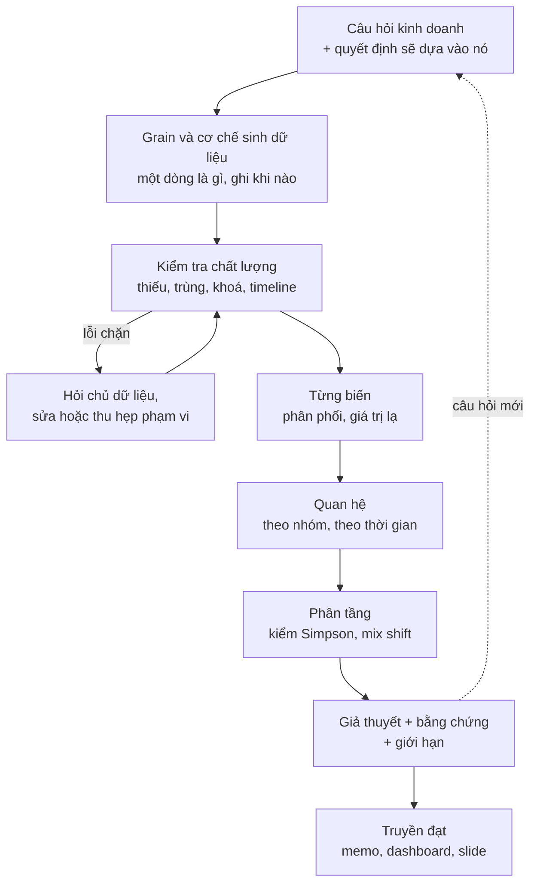
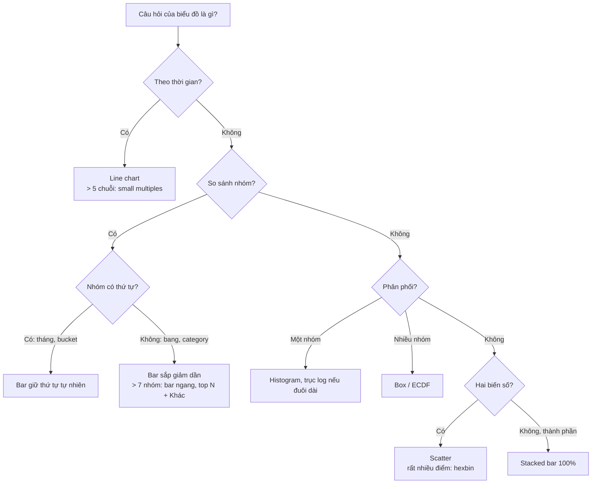
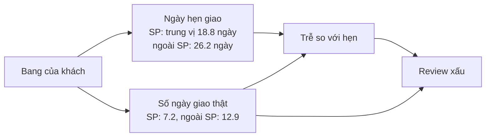
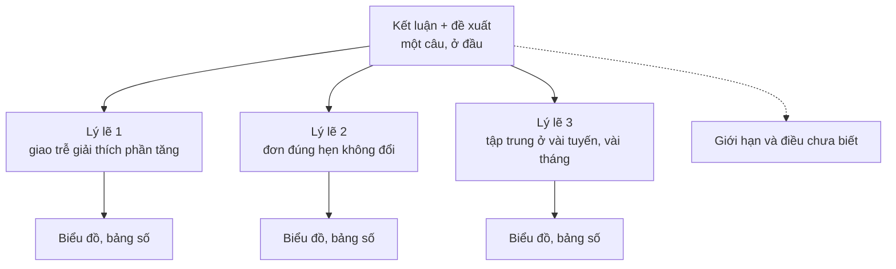

# EDA & Data Storytelling

Phần lớn giá trị một Data Scientist tạo ra không đến từ model mà từ việc **hiểu đúng dữ liệu và
khiến người khác hành động theo**. Exploratory Data Analysis (EDA) là bước bạn biết dữ liệu nói gì,
không nói gì và bẩn ở đâu, trước khi đặt cược thời gian vào một model hay một thí nghiệm. Data
storytelling là bước biến phát hiện thành quyết định: một biểu đồ đúng, một tiêu đề nói thẳng kết
luận, một memo một trang mà lãnh đạo đọc trong hai phút.

Module dùng **Olist thật** (99 441 đơn, 2016–2018). Đây cũng là dữ liệu của capstone, nên mọi phát
hiện ở đây sẽ dùng lại ở milestone "EDA và định nghĩa metric". Tải dữ liệu:

```bash
uv run python data/download_olist.py
```

Các định nghĩa dùng chung cả track (không tự đặt lại): **đơn giao xong** là `order_status ==
"delivered"` và có `order_delivered_customer_date`; **giao trễ** là so nguyên timestamp
`order_delivered_customer_date > order_estimated_delivery_date`; mỗi đơn giữ review có
`review_answer_timestamp` mới nhất; **review xấu** là `review_score <= 2`; **khách** là
`customer_unique_id`. Trên 95 824 đơn giao xong có review: tỉ lệ trễ 8.0% (8.1% trên cả 96 470 đơn giao xong), review
xấu 12.8%, ở đơn trễ 54.1%, ở đơn đúng hẹn 9.2%.

Sau module này bạn sẽ:

- Chạy một vòng EDA có mục tiêu, có giới hạn thời gian, thay vì "vẽ mọi thứ rồi xem".
- Kiểm tra chất lượng dữ liệu một cách hệ thống và tự động, biết lỗi nào chặn phân tích, lỗi nào
  chỉ cần ghi chú.
- Chọn biểu đồ theo câu hỏi, tránh các lỗi trực quan hoá làm người xem hiểu sai.
- Nhận ra Simpson's paradox trên dữ liệu thật và biết rằng câu trả lời nằm ở cơ chế, không ở
  thống kê.
- Kể chuyện bằng dữ liệu: khung SCQA, tiêu đề là kết luận, dashboard cho theo dõi, memo cho quyết
  định.

## 1. EDA để làm gì và quy trình

### EDA không phải "vẽ hết mọi cột"

John Tukey đặt tên EDA năm 1977 để phân biệt với *confirmatory* analysis: EDA là đi tìm, sinh giả
thuyết; kiểm định là xác nhận. Trong doanh nghiệp, EDA có ba mục đích, xếp theo thứ tự ưu tiên:

1. **Kiểm tra dữ liệu có dùng được cho câu hỏi không**: đúng grain chưa, thiếu gì, lệch gì, có
   khoảng thời gian nào hỏng không.
2. **Hiểu cơ chế sinh dữ liệu**: một dòng sinh ra khi nào, bởi ai, hệ thống nào ghi, cột nào được
   điền sau (review chỉ có sau khi giao, nên không dùng được để dự đoán lúc đặt hàng).
3. **Tìm tín hiệu và sinh giả thuyết** cho bước sau: thí nghiệm (module 03), causal (module 06),
   feature cho model (module 10).

EDA không có điểm dừng tự nhiên, nên DS senior **time-box** nó (ví dụ hai ngày) và bắt đầu từ một
câu hỏi kinh doanh cụ thể. "Khám phá dữ liệu Olist" là một tuần trôi qua không có gì; "vì sao review
xấu tăng vọt đầu năm 2018" là một câu hỏi có câu trả lời.

### Quy trình



Ba thói quen phân biệt EDA tốt với EDA tốn thời gian:

| Thói quen | Vì sao | Ví dụ trên Olist |
| --- | --- | --- |
| Viết ra grain trước khi groupby | Sai grain là nguồn số sai phổ biến nhất | `order_items` một dòng là một đơn vị sản phẩm; cộng `freight_value` theo đơn chứ không lấy dòng đầu |
| Ghi mọi quyết định lọc kèm số dòng mất | Người đọc cần biết kết luận áp dụng cho tổng thể nào | 99 441 đơn → 96 470 giao xong → 95 824 có review |
| Mỗi biểu đồ trả lời một câu hỏi viết sẵn | Biểu đồ không có câu hỏi thì không ai biết đọc gì | "Review xấu có đi theo giao trễ theo tháng không?" |

### Khi nào dùng công cụ profiling tự động

`ydata-profiling`, `sweetviz`, `df.describe()` cho bức tranh nhanh trong vài phút. Chúng hữu ích ở
lần nhìn đầu, nhưng không biết **quy tắc nghiệp vụ** (đơn `delivered` phải có ngày giao, ngày giao
cho hãng vận chuyển phải trước ngày khách nhận) và không biết câu hỏi của bạn. Trong production, các
kiểm tra quan trọng được viết thành rule có tên, chạy mỗi lần dữ liệu về (Great Expectations,
pandera, dbt tests). Bài Basic 01 và Intermediate 01 làm đúng hai mức này.

## 2. Kiểm tra chất lượng dữ liệu

### Các chiều chất lượng

| Chiều | Câu hỏi | Kiểm tra điển hình |
| --- | --- | --- |
| Completeness | Có thiếu không, thiếu có ngẫu nhiên không? | Tỉ lệ null theo cột, theo thời gian, theo nguồn |
| Uniqueness | Khoá có thật sự là khoá? | Đếm dòng có khoá lặp |
| Validity | Giá trị có hợp lệ? | Miền giá trị, kiểu, giá trị "giả null" (`0`, `""`, `not_defined`) |
| Consistency | Các bảng, các cột có khớp nhau? | Tổng thanh toán ≈ tiền hàng + vận chuyển; timeline hợp lý |
| Referential integrity | Khoá ngoại có trỏ tới dòng tồn tại? | Item trỏ tới đơn không có; zip không có trong bảng toạ độ |
| Timeliness | Dữ liệu có đủ mới, giai đoạn cuối đã "chín"? | Tháng cuối có đủ ngày, metric trễ (review) đã về chưa |

Điều quan trọng hơn cả con số là **thiếu có ngẫu nhiên không**. Review không có nội dung (58.7%)
không ngẫu nhiên: khách hài lòng thường chỉ chấm sao. Phân tích sentiment trên phần có nội dung là
phân tích một tổng thể lệch về phía phàn nàn.

### Những điểm "bẩn" của Olist thật

`data/README.md` liệt kê các ca biên mà dữ liệu giả mô phỏng. Đây là con số đo lại trên **bộ thật**
(một vài chỗ khác bản mô tả dữ liệu giả, ghi ở cột cuối):

| Điểm bẩn | Số đo trên Olist thật | Ghi chú |
| --- | --- | --- |
| Đơn không phải `delivered` | 2 963 / 99 441 (3.0%) | `shipped` 1 107, `canceled` 625, `unavailable` 609… |
| Đơn không có dòng nào trong `order_items` | 775 | 603 là `unavailable`, 164 `canceled` |
| `delivered` nhưng thiếu ngày khách nhận / thiếu `order_approved_at` | 8 / 14 | Nhỏ, nhưng làm hỏng phép trừ ngày nếu không lọc |
| Ngày giao cho hãng vận chuyển **sau** ngày khách nhận | 23 đơn | Timeline không thể xảy ra: lỗi ghi nhận |
| Đơn không có review | 768 (0.8%) | |
| `review_id` không duy nhất | 1 603 dòng; 547 đơn có hơn một review | Không dùng `review_id` làm khoá |
| Review không có tiêu đề / không có nội dung | 88.3% / 58.7% | Thiếu không ngẫu nhiên |
| Sản phẩm thiếu category | 610 (1.85%) | Cũng thiếu các cột mô tả |
| Category không có trong bảng dịch | 2: `pc_gamer`, `portateis_cozinha_e_preparadores_de_alimentos` | Join sang tiếng Anh ra NaN |
| Khách mua nhiều lần (`customer_unique_id` có > 1 `customer_id`) | 2 997 / 96 096 (3.1%) | Đếm khách bằng `customer_id` là sai |
| Đơn có nhiều dòng thanh toán | 2 961 (3.0%) | Bản mô tả dữ liệu giả ghi ~8% |
| `payment_installments = 0` / `payment_type = "not_defined"` | 2 / 3 dòng | |
| Tổng thanh toán lệch tiền hàng + vận chuyển quá 1 BRL | 249 / 98 665 đơn | Lãi trả góp, voucher |
| Zip của khách / seller không có trong `geolocation` | 278 (0.28%) / 7 | |
| `geolocation`: dòng trùng hoàn toàn | 261 831 / 1 000 163 | 19 015 zip prefix, một zip nhiều toạ độ |
| `freight_value = 0` | 383 item (0.34%) | |
| Tháng cuối gần như trống | 2018-09: 16 đơn, 2018-10: 4 đơn | Dữ liệu cắt ở 2018-10-17; đơn sau 2018-08 còn dở dang |

Đoạn code dưới đây là profiling tối thiểu bạn nên có trong đầu ngón tay:

```python
import pandas as pd

reviews = pd.read_csv("data/raw/olist_order_reviews_dataset.csv")
products = pd.read_csv("data/raw/olist_products_dataset.csv")

def profile(df: pd.DataFrame) -> pd.DataFrame:
    return pd.DataFrame({
        "dtype": df.dtypes.astype(str),
        "missing_rate": df.isna().mean().round(4),
        "n_unique": df.nunique(),
    })

print(profile(reviews))
print("review_id lặp:", reviews.review_id.duplicated(keep=False).sum(), "dòng")
print("order_id có >1 review:", (reviews.order_id.value_counts() > 1).sum(), "đơn")
print("product thiếu category:", products.product_category_name.isna().sum())
```

`n_unique` của `review_id` là 98 410 trên 99 224 dòng: chỉ một dòng output đã nói cột này không phải
khoá.

### Lỗi nào chặn, lỗi nào ghi chú

Không phải lỗi nào cũng cần sửa trước khi phân tích. Phân loại theo **tác động lên câu hỏi**:

- **Chặn (error)**: khoá chính lặp, khoá ngoại mồ côi ở quan hệ bắt buộc, timeline không thể có. Kết
  quả join và đếm sẽ sai; phải sửa hoặc loại có lý do, rồi ghi lại.
- **Cảnh báo (warning)**: thiếu một phần, giá trị lạ hiếm, quan hệ tuỳ chọn không khớp. Ghi số
  lượng, kiểm xem kết luận có nhạy với việc loại hay giữ không.
- **Thông tin (info)**: đặc điểm của nghiệp vụ (phí vận chuyển 0 vì khuyến mãi). Không phải lỗi,
  nhưng người phân tích sau cần biết.

Lỗi hay gặp: "làm sạch" bằng cách xoá mọi dòng có null rồi báo cáo trên phần còn lại mà không nói
mất bao nhiêu và mất ai. Nếu dòng bị xoá tập trung ở một nhóm (đơn huỷ, vùng xa), kết luận đã bị
lệch.

## 3. Phân phối, quan hệ và tỉ lệ

### Một biến: hình dạng trước, trung bình sau

Giá item trên Olist: trung bình 120.65 BRL, trung vị 74.99, p99 890, max 6 735, skew 7.9. Trung bình
cao hơn trung vị 60% vì đuôi phải dài. Báo cáo "giá trung bình 121 BRL" cho người đọc hình dung sai
về một đơn hàng điển hình.

```python
import numpy as np
import pandas as pd

items = pd.read_csv("data/raw/olist_order_items_dataset.csv")
for col in ["price", "freight_value"]:
    s = items[col]
    q = s.quantile([0.5, 0.99])
    print(f"{col}: mean {s.mean():.2f}, median {q[0.5]:.2f}, p99 {q[0.99]:.2f}, "
          f"max {s.max():.2f}, skew {s.skew():.1f}, p99/median {q[0.99] / q[0.5]:.1f}, "
          f"zero {(s == 0).mean():.2%}")

# Histogram trên thang log: bins đều theo log10(price)
counts, edges = np.histogram(np.log10(items.price), bins=30)
print("bin đông nhất quanh", round(10 ** edges[counts.argmax()]), "BRL")
```

Quy tắc thực dụng (bài Basic 03 cài đặt nó):

- Đuôi dài, toàn số dương, p99 gấp hơn 10 lần trung vị (giá: 11.9 lần) → trục **log**. Histogram
  10 bins đều trên thang tuyến tính dồn 98.3% item vào cột đầu tiên (0.85–674 BRL).
- Có số 0 (phí vận chuyển: 0.34%) → `log1p` hoặc tách riêng phần bằng 0; `log(0)` không xác định.
- Đuôi vừa phải (phí vận chuyển: 5.2 lần) → giữ tuyến tính, có thể cắt trục ở p99 và ghi chú.
- Số bins không phải chuyện thẩm mỹ: quá ít bins che hai đỉnh, quá nhiều bins vẽ nhiễu. Quy tắc
  Freedman–Diaconis chọn độ rộng bin theo IQR, ít bị outlier kéo hơn quy tắc Sturges:

$$
h = 2\,\mathrm{IQR}\, n^{-1/3}, \qquad n_{\text{bins}} = \left\lceil \frac{\max - \min}{h} \right\rceil
$$

- Muốn so phân phối giữa nhiều nhóm: **ECDF** (đường tích luỹ) hoặc boxplot. Chồng nhiều histogram
  lên nhau gần như không đọc được.

Phân phối `review_score` (95 824 đơn giao xong) có dạng chữ J: 59.2% là 5 sao, 9.8% là 1 sao, chỉ
3.1% là 2 sao. Điểm trung bình 4.16 che mất cấu trúc hai cực đó; đó là lý do cả track dùng tỉ lệ review xấu thay vì
điểm trung bình.

### Hai biến: tỉ lệ cần mẫu số và độ bất định

So sánh tỉ lệ theo nhóm là việc DS làm nhiều nhất và sai nhiều nhất. Xếp hạng bang theo tỉ lệ review
xấu: bang "tốt nhất" là AP với 6.1%, nhưng chỉ có 66 đơn; bang "tệ nhất" AL 21.3% trên 394 đơn.
Với 66 đơn (4 review xấu), khoảng tin cậy Wilson 95% là 2.4% tới 14.6%, nên AP có thể nằm gần như
bất cứ đâu trong bảng xếp hạng. Ở mức seller càng rõ: 56 seller có tỉ lệ trễ 100%, và **cả 56** đều chỉ có 1–2
đơn.

Cách làm đúng:

- Luôn hiện **n** cạnh tỉ lệ, và khoảng tin cậy (Wilson cho tỉ lệ, chính xác hơn công thức normal
  khi n nhỏ hoặc tỉ lệ gần 0/1).
- Đặt ngưỡng n tối thiểu trước khi xếp hạng, hoặc dùng **funnel plot**: vẽ tỉ lệ theo n, kèm giới
  hạn kiểm soát quanh tỉ lệ chung. Điểm nằm ngoài phễu mới đáng điều tra (bài Advanced 02).
- Với nhiều nhóm nhỏ, cân nhắc shrinkage (empirical Bayes) kéo tỉ lệ của nhóm nhỏ về trung bình.

Khoảng Wilson cho tỉ lệ $$\hat p$$ trên $$n$$ quan sát, với $$z = 1.96$$:

$$
\frac{\hat p + \frac{z^2}{2n} \pm z\sqrt{\frac{\hat p(1-\hat p)}{n} + \frac{z^2}{4n^2}}}{1 + \frac{z^2}{n}}
$$

### Tương quan không phải toàn bộ câu chuyện

Spearman giữa số ngày giao và review xấu chỉ 0.21, nhưng tỉ lệ review xấu của đơn trễ gấp gần sáu
lần đơn đúng hẹn. Quan hệ không tuyến tính và có ngưỡng (vượt ngày hẹn), nên một hệ số tương quan nói
rất ít. Nhìn bảng theo nhóm hoặc đường trung bình theo bin trước khi tóm tắt bằng một con số.

## 4. Chọn biểu đồ đúng

### Bắt đầu từ câu hỏi, không từ loại biểu đồ

| Câu hỏi | Biểu đồ mặc định | Tránh | Ghi chú |
| --- | --- | --- | --- |
| Thay đổi theo thời gian (trend) | Line | Bar cho chuỗi dài, pie theo tháng | Trục y không bắt buộc từ 0; nhiều chuỗi (> 5) thì small multiples |
| So sánh giữa nhóm (comparison) | Bar, sắp xếp giảm dần | Pie, bar 3D | Trục bar **luôn** từ 0; nhiều nhóm (> 7) thì bar ngang để đọc nhãn |
| Phân phối (distribution) | Histogram; box/ECDF khi so nhiều nhóm | Bar của trung bình | n nhỏ (< 30) thì vẽ từng điểm (strip) |
| Quan hệ hai biến số (relationship) | Scatter; hexbin khi rất nhiều điểm | Line nối các điểm không có thứ tự | 95 nghìn điểm scatter là một vệt mực: dùng hexbin hoặc alpha |
| Thành phần (composition) | Stacked bar 100% (≤ 5 phần); bar sắp xếp + gộp "Khác" khi nhiều phần | Pie nhiều lát, donut | Pie chỉ chấp nhận được với 2–3 phần |

Thứ tự trên bar chart cũng là một quyết định: category **danh định** (bang, category sản phẩm) sắp
theo giá trị giảm dần để mắt đọc thứ hạng ngay; category **có thứ tự** (tháng, bucket số ngày giao,
1–5 sao) giữ thứ tự tự nhiên, sắp theo giá trị sẽ phá mất cấu trúc. Bài Basic 02 cài các quy tắc này
thành một hàm trả về "chart spec", thứ có thể kiểm thử mà không cần nhìn ảnh.



### Nguyên tắc trình bày

- **Một biểu đồ, một thông điệp.** Nếu cần hai câu "và" để nói biểu đồ cho thấy gì, tách làm hai.
- **Màu mang thông tin hoặc không dùng.** Một màu trung tính cho mọi bar, một màu nhấn cho bar cần
  chú ý. Bảng màu cầu vồng cho dữ liệu liên tục tạo ra ranh giới giả; dùng palette sequential
  (viridis) hoặc diverging khi có điểm giữa có nghĩa. Khoảng 8% nam giới mù màu đỏ–xanh lá.
- **Ghi chú thẳng trên biểu đồ** (annotation: "Black Friday", "đình công xe tải") thay vì để người
  đọc dò legend.
- **Bỏ mực thừa**: khung, lưới đậm, bóng đổ, 3D. Edward Tufte gọi đó là chartjunk.

```python
import matplotlib
matplotlib.use("Agg")
import matplotlib.pyplot as plt
import pandas as pd
import seaborn as sns

products = pd.read_csv("data/raw/olist_products_dataset.csv")
items = pd.read_csv("data/raw/olist_order_items_dataset.csv")
tr = pd.read_csv("data/raw/product_category_name_translation.csv")
cat = (items.merge(products[["product_id", "product_category_name"]], on="product_id")
       .merge(tr, on="product_category_name", how="left")
       .groupby("product_category_name_english").price.sum()
       .sort_values(ascending=False))
top = pd.concat([cat.head(7), pd.Series({"other": cat.iloc[7:].sum()})]) / 1e6

fig, ax = plt.subplots(figsize=(7, 4))
sns.barplot(x=top.values, y=top.index, color="#2563eb", ax=ax)   # một màu: màu không mang thông tin
ax.set_title("7 category đầu chiếm một nửa tiền hàng")             # tiêu đề là kết luận
ax.set_xlabel("Tiền hàng (triệu BRL)")
ax.set_ylabel("")
sns.despine()
plt.close(fig)
print(top.round(2))
print("7 category đầu:", f"{cat.head(7).sum() / cat.sum():.1%}")
```

Kết quả: `health_beauty` dẫn đầu với 1.26 triệu BRL, 7 category đầu chiếm 50.5% tiền hàng, 64
category còn lại gộp vào "other". Gộp "Khác" ở cuối, không xếp theo giá trị, vì nó không phải một
category thật. Để ý một lỗi im lặng: 1 627 item thiếu category hoặc có category chưa dịch ra NaN và
bị `groupby` bỏ đi không báo gì; tỉ lệ 50.5% là trên phần đã có tên. Muốn giữ chúng thì
`fillna("(thiếu)")` trước khi groupby.

seaborn hợp với EDA vì nhận DataFrame "dài" và tự tính thống kê (`histplot`, `ecdfplot`,
`boxplot`, `barplot` có CI). Với biểu đồ trình bày cho stakeholder, bạn thường cần kiểm soát từng chi
tiết bằng matplotlib, hoặc vẽ trong công cụ BI.

## 5. Lỗi trực quan hoá hay gặp

| Lỗi | Vì sao sai | Sửa |
| --- | --- | --- |
| Trục bar không bắt đầu từ 0 | Độ dài bar là thông tin; cắt trục làm chênh lệch 2% trông như gấp đôi | Bar luôn từ 0; muốn nhấn chênh lệch nhỏ thì vẽ chính chênh lệch, hoặc dùng dot plot |
| Hai trục y (dual axis) | Người vẽ chọn tỉ lệ hai trục, nên chọn được mọi "tương quan" muốn thấy | Hai biểu đồ chung trục x; hoặc chuẩn hoá về chỉ số (tháng đầu = 100) |
| Kỳ cuối chưa đủ dữ liệu | Line chart "lao dốc" ở tháng cuối vì tháng chưa hết hoặc metric chưa chín | Bỏ hoặc đánh dấu kỳ chưa đầy đủ; ghi ngày cắt dữ liệu |
| Xếp hạng nhóm nhỏ | Nhóm ít quan sát luôn chiếm hai đầu bảng xếp hạng | Hiện n và CI, ngưỡng n tối thiểu, funnel plot |
| Pie / donut nhiều lát | Mắt người so góc và diện tích kém hơn so độ dài | Bar sắp xếp |
| Biểu đồ tích luỹ cho số theo kỳ | Đường tích luỹ luôn đi lên, che mất việc tháng gần nhất giảm | Vẽ theo kỳ; tích luỹ chỉ khi câu hỏi là "tới nay đã bao nhiêu" |
| Tỉ lệ không có mẫu số hoặc khác mẫu số | "Review xấu 12.8%" của đơn giao xong khác "trên mọi đơn" | Ghi rõ mẫu số trong tiêu đề phụ hoặc chú thích |
| Overplotting | 95 nghìn điểm scatter chồng lên nhau, không thấy mật độ | Hexbin, alpha nhỏ, lấy mẫu, hoặc bin rồi vẽ trung bình |
| Trục log không ghi chú | Người đọc so khoảng cách như thang tuyến tính | Ghi "thang log" trên trục, dùng nhãn 10, 100, 1 000 |

Ví dụ thật của lỗi "kỳ cuối chưa đủ dữ liệu":

```python
import pandas as pd

orders = pd.read_csv("data/raw/olist_orders_dataset.csv", parse_dates=["order_purchase_timestamp"])
monthly = orders.groupby(orders.order_purchase_timestamp.dt.to_period("M")).size()
print(monthly.tail(4))
print("Dữ liệu dừng ở", orders.order_purchase_timestamp.max())
```

Tháng 7 và 8/2018 có 6 292 và 6 512 đơn, tháng 9 có 16, tháng 10 có 4. Một line chart "số đơn theo
tháng" vẽ thẳng từ dữ liệu sẽ cho thấy Olist sụp đổ vào tháng 9/2018, trong khi thật ra bộ dữ liệu
được cắt ở 2018-10-17 và các đơn cuối chưa đi hết vòng đời. Có hai lớp "chưa đủ": **tháng chưa hết**
(số đơn) và **metric chưa chín** (đơn mua cuối tháng 8 chưa giao xong, chưa có review). Đó là lý do
cả track bỏ đơn mua sau 2018-08-31, và bài Intermediate 03 đánh dấu tháng chưa đầy đủ theo một
"thời gian chín" định trước.

Một lỗi khó thấy hơn: dữ liệu có **tháng trống**. Olist không có đơn nào trong tháng 11/2016. Nếu
groupby rồi vẽ, line chart nối thẳng tháng 10 sang tháng 12 như thể có dữ liệu ở giữa. Luôn
reindex về lưới thời gian đầy đủ trước khi vẽ.

## 6. Simpson's paradox

### Hiện tượng

Simpson's paradox: một quan hệ thấy ở dữ liệu gộp **đảo chiều** (hoặc biến mất) khi chia theo một
biến thứ ba. Nó không phải trò đố vui; nó xảy ra mỗi khi hai nhóm khác nhau về **thành phần** (mix)
của một biến cũng ảnh hưởng tới kết quả.

Trên Olist thật: khách ở bang SP có tỉ lệ review xấu **10.7%**, khách ngoài SP **14.3%**. Kết luận
nhanh: "khách SP dễ tính hơn". Giờ chia theo số ngày giao:

| Số ngày giao | SP | ngoài SP | Tỉ trọng đơn SP trong nhóm | Tỉ trọng đơn ngoài SP |
| --- | --- | --- | --- | --- |
| 0–6 | 7.35% | 7.70% | 46.9% | 12.7% |
| 7–13 | 9.46% | 8.64% | 39.4% | 43.5% |
| 14–20 | 15.45% | 10.63% | 9.5% | 24.7% |
| 21–29 | 40.64% | 21.36% | 3.0% | 12.0% |
| 30+ | 66.80% | 62.49% | 1.3% | 7.1% |
| **Gộp** | **10.69%** | **14.34%** | | |

Ở 4 trong 5 nhóm số ngày giao, khách SP có tỉ lệ review xấu **cao hơn**; ở nhóm nhanh nhất hai bên
gần như bằng nhau. Nhưng 46.9% đơn của SP giao dưới 7 ngày, so với 12.7% ngoài SP. Kết quả gộp chủ
yếu phản ánh "SP được giao nhanh hơn", không phải "khách SP dễ tính".

**Direct standardization** trả lời câu hỏi "nếu hai nhóm có cùng phân bố số ngày giao thì sao":
lấy trung bình có trọng số của tỉ lệ từng tầng, với cùng một bộ trọng số $$w_s$$ (ở đây là phân bố
chung của cả hai nhóm):

$$
\text{rate}^{\text{std}}_g = \sum_s w_s \, \text{rate}_{g,s}, \qquad \sum_s w_s = 1
$$

```python
import pandas as pd

dates = ["order_purchase_timestamp", "order_delivered_customer_date", "order_estimated_delivery_date"]
orders = pd.read_csv("data/raw/olist_orders_dataset.csv", parse_dates=dates)
reviews = pd.read_csv("data/raw/olist_order_reviews_dataset.csv", parse_dates=["review_answer_timestamp"])
customers = pd.read_csv("data/raw/olist_customers_dataset.csv")

df = orders[(orders.order_status == "delivered") & orders.order_delivered_customer_date.notna()]
latest = reviews.sort_values("review_answer_timestamp").drop_duplicates("order_id", keep="last")
df = (df.merge(latest[["order_id", "review_score"]], on="order_id")
        .merge(customers[["customer_id", "customer_state"]], on="customer_id"))
df["bad"] = df.review_score <= 2
df["region"] = df.customer_state.eq("SP").map({True: "SP", False: "ngoài SP"})
days = (df.order_delivered_customer_date - df.order_purchase_timestamp).dt.total_seconds() / 86400
df["days"] = pd.cut(days, [0, 7, 14, 21, 30, float("inf")], right=False,
                    labels=["0-6", "7-13", "14-20", "21-29", "30+"])

print(df.groupby("region").bad.mean().round(4))                       # gộp
table = df.pivot_table(index="days", columns="region", values="bad", aggfunc="mean", observed=True)
print(table.round(4))                                                  # theo từng tầng
w = df.days.value_counts(normalize=True).sort_index()                  # phân bố chung của tầng
print((table.mul(w, axis=0).sum()).round(4))                           # tỉ lệ chuẩn hoá
```

Chuẩn hoá theo số ngày giao: SP 15.20%, ngoài SP 12.28%. Chênh lệch đổi dấu từ −3.7 điểm phần trăm
thành +2.9.

### Chia theo biến nào mới đúng? Câu trả lời nằm ở cơ chế

Thống kê không tự nói nên tin bảng gộp hay bảng phân tầng. Phải vẽ cơ chế:



- Nếu câu hỏi là "**khách SP có dễ tính hơn không**" (một đặc điểm của người), phải so ở cùng trải
  nghiệm. Nhưng trải nghiệm là gì? Khách đánh giá theo **lời hứa**, không theo số ngày tuyệt đối: 20
  ngày là trễ với khách SP (được hẹn 18.8 ngày) nhưng là sớm với khách được hẹn 26 ngày. Chia theo
  trễ / đúng hẹn: khách SP có tỉ lệ review xấu thấp hơn ở **cả hai** tầng (đúng hẹn 8.6% so với
  9.7%; trễ 44.6% so với 58.3%). Cùng dữ liệu, ba cách chia, ba câu chuyện.
- Nếu câu hỏi là "**mở kho ở ngoài SP có làm review tốt lên không**", số ngày giao là **mediator**:
  kho mới tác động lên review chính là qua việc giao nhanh hơn. Chia theo số ngày giao sẽ xoá đúng
  phần tác động bạn muốn đo; bảng gộp (cộng các điều chỉnh confounder thật) mới là thứ cần nhìn.

Quy tắc: phân tầng theo **confounder** (thứ ảnh hưởng cả nhóm lẫn kết quả, xảy ra trước), không
phân tầng theo **mediator** (thứ nằm trên đường tác động) hay **collider**. Đây là cầu nối sang
causal inference (module 06). Trong EDA, việc của bạn là **nhận ra** mix shift và nói rõ kết luận đổi
thế nào theo cách chia, thay vì chọn bảng nào hợp ý.

Simpson's paradox còn xuất hiện theo **thời gian** (mix shift): tỉ lệ review xấu cả năm 2018 (13.4%)
cao hơn 2017 (12.1%), nhưng ở đơn trễ thì 2018 thấp hơn (53.8% so với 54.6%); phần lớn chênh lệch
đến từ tỉ trọng đơn trễ tăng từ 6.5% lên 9.3%. Một dashboard chỉ hiện con số gộp sẽ khiến team chất
lượng dịch vụ đi tìm nguyên nhân sai chỗ.

## 7. Kể chuyện với dữ liệu: SCQA, dashboard và memo

### Tiêu đề là kết luận

So hai tiêu đề cho cùng một biểu đồ tỉ lệ review xấu theo tháng:

- "Tỉ lệ review xấu theo tháng, 2017–2018" (mô tả: người đọc phải tự tìm ý).
- "Review xấu lên 21% vào tháng 3/2018, gấp đôi giữa năm 2017, cùng lúc giao trễ vọt lên 21%" (kết luận:
  người đọc biết ngay cần nhìn gì, và có thể phản bác).

Tiêu đề kết luận (action title) buộc bạn **có** một kết luận. Nếu không viết được, biểu đồ chưa sẵn
sàng để đưa ra. Số trong tiêu đề phải khớp số trong biểu đồ (tháng 3/2018: 21.2% review xấu, 21.1%
đơn trễ; tháng 1/2018 là 13.7% và 6.5%; tháng 5–10/2017 review xấu dao động 9.4–11.1%).

### Khung SCQA

Barbara Minto (McKinsey) đề xuất mở đầu một thông điệp bằng SCQA, rồi trình bày theo **kim tự
tháp**: kết luận trước, lý lẽ sau, chi tiết cuối.

| Phần | Nội dung | Ví dụ Olist |
| --- | --- | --- |
| Situation | Bối cảnh mọi người đồng ý | Review xấu dao động 9–13% từ tháng 2 tới tháng 10/2017 |
| Complication | Điều thay đổi, vấn đề | Tháng 2–3/2018 review xấu lên 19–21%, cùng lúc giao trễ lên 16–21% |
| Question | Câu hỏi người đọc tự hỏi | Có phải chất lượng sản phẩm/seller xấu đi, hay do giao hàng? |
| Answer | Câu trả lời + hành động | Gần như toàn bộ do giao trễ: giữ tỉ lệ trễ của tháng 1/2018 thì tháng 3 chỉ còn 13.6% review xấu, ngang tháng 1; ở đơn đúng hẹn review xấu chỉ nhích từ 10.3% lên 10.7% (tháng 2). Đề xuất: cảnh báo chủ động cho đơn có nguy cơ trễ |



Lỗi hay gặp: kể theo **thứ tự mình làm** ("đầu tiên tôi làm sạch dữ liệu, sau đó tôi groupby…").
Người đọc không cần hành trình, họ cần kết luận và lý do tin nó.

### Dashboard khác memo

| | Dashboard | Memo / báo cáo phân tích |
| --- | --- | --- |
| Mục đích | Theo dõi: "mọi thứ có bình thường không?" | Quyết định: "nên làm gì?" |
| Tần suất | Liên tục, tự cập nhật | Một lần, cho một câu hỏi |
| Người đọc | Người vận hành, quản lý trực tiếp | Người ra quyết định |
| Nội dung | Ít KPI có định nghĩa chặt, so với kỳ trước/mục tiêu, cảnh báo | Kết luận, bằng chứng chọn lọc, giới hạn, đề xuất |
| Lỗi hay gặp | 40 biểu đồ, không ai biết nhìn cái nào; kỳ cuối chưa đủ; metric không định nghĩa | Kể quá trình, chôn kết luận ở trang 5, không nêu giới hạn |

Một dashboard tốt cho đội vận hành Olist có: 3–5 KPI ở hàng đầu (đơn giao xong, tỉ lệ trễ, tỉ lệ review
xấu, có định nghĩa và kỳ so sánh), một line chart theo tuần **chỉ gồm tuần đã chín**, một funnel
plot seller để biết ai cần can thiệp, và một dòng ghi "dữ liệu tới ngày X". Mỗi KPI có một chủ sở
hữu và một ngưỡng hành động; KPI không ai hành động theo thì bỏ.

Memo một trang (bài Advanced 01): tiêu đề là kết luận; SCQA trong một đoạn; ba lý lẽ, mỗi lý lẽ một
biểu đồ hoặc một bảng; một đoạn giới hạn (dữ liệu nào thiếu, kết luận không áp dụng cho ai, cái gì là
tương quan chứ chưa phải nhân quả); đề xuất kèm người chịu trách nhiệm và bước tiếp theo.

### Trung thực là một phần của kể chuyện

Kể chuyện hay mà sai còn nguy hiểm hơn biểu đồ xấu. Ba nguyên tắc:

- **Ghi giới hạn ngay cạnh kết luận**, không dồn xuống chú thích nhỏ.
- **Phân biệt tương quan và nhân quả bằng ngôn ngữ**: "đơn trễ có tỉ lệ review xấu cao gấp 6 lần"
  khác với "giao trễ làm review xấu tăng 6 lần".
- **Không chọn khung hình hợp ý**: cùng dữ liệu, chọn khoảng thời gian, trục, cách chia khác nhau ra
  câu chuyện khác nhau (Simpson ở mục 6). Nếu kết luận đổi theo lựa chọn, nói ra.

## 8. Tài liệu tham khảo

Sách:

- John W. Tukey. *Exploratory Data Analysis* (Addison-Wesley, 1977). Nguồn gốc của EDA, boxplot.
- Claus O. Wilke. [Fundamentals of Data Visualization](https://clauswilke.com/dataviz/) (O'Reilly,
  2019, đọc miễn phí). Chọn biểu đồ, màu, các lỗi hay gặp.
- Cole Nussbaumer Knaflic. *Storytelling with Data* (Wiley, 2015). Xem thêm
  [storytellingwithdata.com](https://www.storytellingwithdata.com/).
- Barbara Minto. *The Pyramid Principle* (1987). SCQA và cấu trúc kim tự tháp.
- Edward Tufte. *The Visual Display of Quantitative Information* (1983). Data-ink, chartjunk.

Từ roadmap.sh/ai-data-scientist (mục Exploratory Data Analysis):

- [roadmap.sh: AI & Data Scientist](https://roadmap.sh/ai-data-scientist)
- [Data to Viz](https://www.data-to-viz.com/): cây quyết định chọn biểu đồ theo kiểu dữ liệu.
- [Financial Times Visual Vocabulary](https://github.com/Financial-Times/chart-doctor/tree/main/visual-vocabulary)

Simpson's paradox và tỉ lệ:

- [Simpson's Paradox (Stanford Encyclopedia of Philosophy)](https://plato.stanford.edu/entries/paradox-simpson/)
- Judea Pearl. [Understanding Simpson's Paradox](https://ftp.cs.ucla.edu/pub/stat_ser/r414.pdf) (2014).
- David Spiegelhalter. [Funnel plots for comparing institutional performance](https://pubmed.ncbi.nlm.nih.gov/15568194/) (Statistics in Medicine, 2005).

Công cụ:

- [seaborn tutorial](https://seaborn.pydata.org/tutorial.html), [matplotlib](https://matplotlib.org/stable/users/index.html)
- [ydata-profiling](https://docs.profiling.ydata.ai/), [pandera](https://pandera.readthedocs.io/), [Great Expectations](https://docs.greatexpectations.io/)

Dữ liệu:

- Olist: [Brazilian E-Commerce Public Dataset (Kaggle)](https://www.kaggle.com/datasets/olistbr/brazilian-ecommerce)
