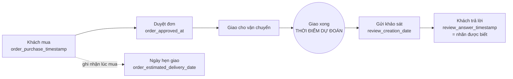
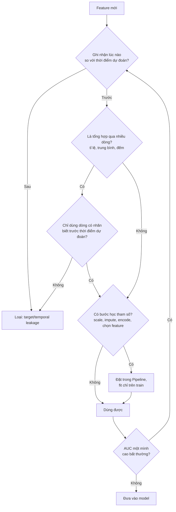
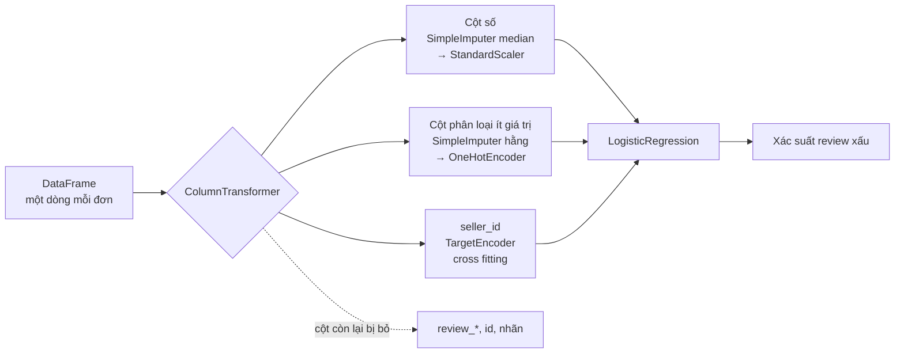
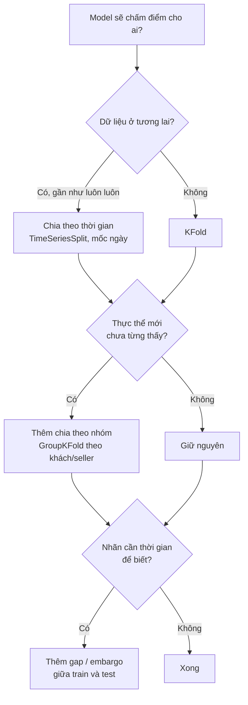

# Feature Engineering & Validation

Phần lớn chênh lệch giữa một model "đẹp trên notebook" và một model chạy được ở production không
nằm ở thuật toán mà ở hai việc: **feature được tạo ra thế nào** và **model được đánh giá ra sao**.
Một feature rò rỉ thông tin tương lai có thể đẩy AUC validation lên vài điểm; một cách chia
cross-validation sai có thể làm con số đó trông chắc chắn. Cả hai đều chỉ lộ ra khi model đã chạy
thật, lúc sửa đắt nhất. Phỏng vấn DS thường có ít nhất một câu "bạn sẽ phát hiện leakage thế nào"
hoặc "bạn validate model này ra sao", và câu trả lời phân biệt rất rõ người đã từng đưa model vào
production với người chưa.

Module dùng một bài toán xuyên suốt trên **Olist** thật, cũng là bài toán của các module ML sau:
**dự đoán review xấu** (1–2 sao) ngay khi đơn vừa giao xong, để đội chăm sóc khách hàng liên hệ
trước. Module 11 sẽ xây model trên pipeline feature của module này, nên ở đây model luôn đơn giản
(logistic regression) để sự chú ý dồn vào dữ liệu. Tải dữ liệu:

```bash
uv run python data/download_olist.py
```

Sau module này bạn sẽ:

- Đóng khung một bài toán dự đoán: thời điểm dự đoán, nhãn, cách chia dữ liệu theo thời gian.
- Nhận ra và chặn ba loại leakage: target leakage, temporal leakage, train-test contamination.
- Chọn cách mã hoá biến phân loại (one-hot, target encoding out-of-fold, hashing) và xử lý scaling,
  missing value đúng chỗ.
- Tạo feature từ thời gian, văn bản, địa lý, kể cả feature tổng hợp theo thời gian (point-in-time).
- Gói mọi bước vào `Pipeline` / `ColumnTransformer` để không bước nào nhìn thấy validation.
- Chọn cách cross-validation theo cách model sẽ được dùng: theo thời gian, theo nhóm.
- Chọn feature mà không tự lừa mình.

## 1. Đóng khung bài toán trước khi làm feature

### Ba câu hỏi phải trả lời trước dòng code đầu tiên

1. **Dự đoán lúc nào?** Mọi feature phải biết được *tại thời điểm đó*. Với bài toán của module:
   lúc đơn vừa giao (`order_delivered_customer_date`). Nếu đổi thành "lúc khách vừa mua" thì thời
   gian giao hàng, feature mạnh nhất, không còn dùng được.
2. **Nhãn là gì, khi nào biết nhãn?** Review xấu: `review_score <= 2`, lấy review trả lời sau cùng
   của mỗi đơn. Nhãn biết khi khách trả lời review, trung vị 1.9 ngày sau khi giao.
3. **Model sẽ chấm điểm cho ai?** Đơn **tương lai**. Vì vậy dữ liệu đánh giá phải là đơn ở tương
   lai so với dữ liệu train.



Mọi thứ trước nút tròn (và ngày hẹn giao, dù *giá trị* là một ngày tương lai, vì nó được ghi nhận
lúc mua) là feature hợp lệ. Mọi thứ sau nó là leakage.

### Chia theo thời gian (định nghĩa chung của track)

Train là đơn mua trước 2018-01-01, validation từ 2018-01-01 tới trước 2018-04-01, test từ 2018-04-01
tới hết 2018-08-31; bỏ đơn mua sau đó (còn dở dang). Mọi module ML trên Olist dùng y hệt.

```python
import pandas as pd

raw = "data/raw/"
dates = ["order_purchase_timestamp", "order_delivered_customer_date", "order_estimated_delivery_date"]
orders = pd.read_csv(raw + "olist_orders_dataset.csv", parse_dates=dates)
reviews = pd.read_csv(raw + "olist_order_reviews_dataset.csv", parse_dates=["review_answer_timestamp"])

delivered = orders[(orders.order_status == "delivered") & orders.order_delivered_customer_date.notna()]
latest = reviews.sort_values("review_answer_timestamp").drop_duplicates("order_id", keep="last")
df = delivered.merge(latest[["order_id", "review_score"]], on="order_id")
df["bad_review"] = (df.review_score <= 2).astype(int)

t = df.order_purchase_timestamp
split = pd.cut(t, pd.to_datetime(["2000-01-01", "2018-01-01", "2018-04-01", "2018-09-01"]),
               right=False, labels=["train", "val", "test"])
print(df.groupby(split, observed=True).bad_review.agg(["size", "mean"]))
late = df.order_delivered_customer_date > df.order_estimated_delivery_date
print(late.groupby(split, observed=True).mean())
```

| Phần | Số đơn | Review xấu | Giao trễ |
| --- | --- | --- | --- |
| train | 43 362 | 12.1% | 6.5% |
| val | 20 468 | 18.0% | 14.4% |
| test | 31 994 | 10.4% | 5.9% |

Ba giai đoạn khác nhau rõ: quý 1/2018 giao trễ hơn gấp đôi các giai đoạn khác, review xấu cao hơn hẳn. Đây không phải lỗi
của cách chia mà là **sự thật mà cách chia làm lộ ra**: khi chạy thật, model cũng sẽ gặp những giai
đoạn khác với lúc train. Chia ngẫu nhiên sẽ làm ba phần giống nhau, và chính vì thế mà che mất điều
quan trọng nhất (bài Basic 01).

| Dùng cho | Chọn gì |
| --- | --- |
| Train | Học tham số model và mọi bước tiền xử lý |
| Validation | So sánh feature, chọn tham số, chọn ngưỡng |
| Test | Đo **một lần**, sau khi đã chốt mọi thứ. Nhìn test rồi sửa model là biến test thành validation |

## 2. Data leakage

Leakage là khi model dùng thông tin **không có** lúc dự đoán thật. Kết quả luôn giống nhau: điểm
đánh giá đẹp, điểm thật tệ hơn. Ba loại hay gặp:

| Loại | Cơ chế | Ví dụ trên Olist | Cách chặn |
| --- | --- | --- | --- |
| **Target leakage** | Feature là hệ quả của nhãn, hoặc được tạo ra cùng lúc với nhãn | Độ dài bình luận review; thời gian từ lúc giao tới lúc trả lời review | Hỏi "feature này ghi nhận lúc nào"; bỏ mọi cột sinh ra từ quá trình tạo nhãn |
| **Temporal leakage** | Feature dùng dữ liệu tương lai so với thời điểm dự đoán | Tỉ lệ review xấu của seller tính trên toàn bộ dữ liệu, kể cả các đơn sau | Feature tổng hợp tính point-in-time (as-of) |
| **Train-test contamination** | Tham số tiền xử lý học từ cả validation/test, hoặc cùng một thực thể nằm ở cả hai phía | `StandardScaler`, imputer, target encoding fit trên toàn bảng; cùng một khách ở cả train và test | Gói mọi bước vào `Pipeline`, fit trên train; chia theo nhóm |

### Phép kiểm nhanh: AUC một mình và thời điểm ghi nhận

```python
import pandas as pd
from sklearn.metrics import roc_auc_score

raw = "data/raw/"
dates = ["order_purchase_timestamp", "order_delivered_customer_date", "order_estimated_delivery_date"]
orders = pd.read_csv(raw + "olist_orders_dataset.csv", parse_dates=dates)
reviews = pd.read_csv(raw + "olist_order_reviews_dataset.csv",
                      parse_dates=["review_creation_date", "review_answer_timestamp"])
delivered = orders[(orders.order_status == "delivered") & orders.order_delivered_customer_date.notna()]
latest = reviews.sort_values("review_answer_timestamp").drop_duplicates("order_id", keep="last")
df = delivered.merge(latest, on="order_id")
y = (df.review_score <= 2).astype(int)

day = pd.Timedelta(days=1)
candidates = {
    "delay_days": (df.order_delivered_customer_date - df.order_estimated_delivery_date) / day,
    "comment_len": df.review_comment_message.fillna("").str.len(),
    "review_wait_days": (df.review_answer_timestamp - df.order_delivered_customer_date) / day,
}
for name, x in candidates.items():
    auc = roc_auc_score(y, x)
    print(f"{name:18s} AUC một mình = {max(auc, 1 - auc):.3f}")

# Thời điểm dự đoán: lúc giao xong. Feature nào chỉ có SAU thời điểm đó?
after = (df.review_creation_date > df.order_delivered_customer_date).mean()
print(f"review_creation_date sau lúc giao: {after:.1%} số đơn")
```

```text
delay_days         AUC một mình = 0.657
comment_len        AUC một mình = 0.756
review_wait_days   AUC một mình = 0.633
review_creation_date sau lúc giao: 91.5% số đơn
```

Độ dài bình luận dự đoán review xấu tốt hơn cả độ trễ giao hàng: khách bực thì viết dài. Nó là
target leakage vì bình luận là một phần của chính review. Thêm nó vào pipeline đầy đủ làm AUC
validation nhảy từ 0.801 lên 0.876 (bài Intermediate 02). Ngược lại, leakage tinh vi hơn không có AUC
một mình cao: tỉ lệ review xấu của seller tính trên toàn bộ dữ liệu chỉ có AUC một mình khoảng 0.65
trên validation, nhưng đẩy AUC validation lên 0.824 và AUC test lên 0.759, so với 0.804 và 0.711 khi
tính đúng (bài Advanced 01).



### Dấu hiệu nghi ngờ

- Một feature "quá tốt": AUC một mình trên 0.9 cho một bài toán mà chuyên gia nghiệp vụ nói là khó.
- Điểm validation cao hơn hẳn điểm của bất kỳ ai từng làm bài toán này.
- Điểm production tụt mạnh so với offline ngay tuần đầu.
- Feature quan trọng nhất là một id, một timestamp, hoặc một cột mà không ai giải thích được ý nghĩa.

Leakage không phải lúc nào cũng là lỗi code. Nhiều khi là lỗi **dữ liệu**: bảng chỉ lưu giá trị mới
nhất (bị ghi đè), nên cột "trạng thái khách" lúc train là trạng thái *hôm nay*, không phải lúc dự đoán.
Đó là lý do có bảng snapshot và feature store với as-of join (module 14).

## 3. Mã hoá biến phân loại, scaling và missing value

### Chọn cách mã hoá

| Cách | Khi nào dùng | Đánh đổi | Lỗi hay gặp |
| --- | --- | --- | --- |
| **One-hot** | Vài chục giá trị trở xuống (bang, phương thức thanh toán) | Dễ hiểu, không dùng nhãn; số cột tăng theo số giá trị | Giá trị mới ở production làm vỡ model; `get_dummies` riêng trên train và test cho cột lệch nhau |
| **Ordinal** | Có thứ tự thật (S < M < L); hoặc cho model cây | Một cột; model tuyến tính hiểu sai nếu thứ tự không thật | Đánh số danh mục theo bảng chữ cái rồi đưa vào logistic |
| **Target encoding** | Hàng trăm tới hàng nghìn giá trị có tín hiệu (seller, sản phẩm, zip) | Một cột, mạnh; dùng nhãn nên dễ rò rỉ | Tính trên chính tập train không có cross fitting |
| **Hashing** | Rất nhiều giá trị, xuất hiện liên tục (từ ngữ, user agent) | Không cần lưu từ điển, chịu được giá trị mới; có va chạm | Chọn số chiều quá nhỏ |
| **Embedding** | Rất nhiều giá trị, có quan hệ với nhau (sản phẩm, user) | Mạnh nhất; cần model học được (module 13) | Dùng cho bài toán dữ liệu nhỏ |

Với model cây (module 11, 12), one-hot nhiều cột làm cây khó chia; LightGBM có xử lý category riêng.

### Target encoding và vì sao phải out-of-fold

Target encoding thay mỗi category bằng tỉ lệ nhãn của nó, làm trơn về tỉ lệ chung (prior) để category
ít dòng không nhận giá trị cực đoan. Với $$n_c$$ dòng có tổng nhãn $$s_c$$, mức làm trơn $$m$$:

$$
\mathrm{enc}(c) = \frac{s_c + m \cdot \text{prior}}{n_c + m}
$$

Tính công thức này trên chính các dòng train rồi gán lại cho chúng là leakage: với category ít dòng,
mã phần lớn là nhãn của chính dòng đó. **Out-of-fold**: chia train thành K phần, dòng ở phần k được mã
hoá bằng bảng học từ K − 1 phần còn lại. Validation và test dùng bảng học trên toàn train.

```python
import pandas as pd
from sklearn.metrics import roc_auc_score
from sklearn.model_selection import KFold
from sklearn.preprocessing import TargetEncoder

raw = "data/raw/"
orders = pd.read_csv(raw + "olist_orders_dataset.csv",
                     parse_dates=["order_purchase_timestamp", "order_delivered_customer_date"])
reviews = pd.read_csv(raw + "olist_order_reviews_dataset.csv", parse_dates=["review_answer_timestamp"])
customers = pd.read_csv(raw + "olist_customers_dataset.csv", dtype={"customer_zip_code_prefix": str})
delivered = orders[(orders.order_status == "delivered") & orders.order_delivered_customer_date.notna()]
latest = reviews.sort_values("review_answer_timestamp").drop_duplicates("order_id", keep="last")
df = delivered.merge(latest, on="order_id").merge(customers, on="customer_id")
df["bad_review"] = (df.review_score <= 2).astype(int)
train = df[df.order_purchase_timestamp < "2018-01-01"]
val = df[(df.order_purchase_timestamp >= "2018-01-01") & (df.order_purchase_timestamp < "2018-04-01")]
col = "customer_zip_code_prefix"
print(train[col].nunique(), "mã zip trong train")

# Cách sai: trung bình nhãn theo nhóm, tính trên chính các dòng train rồi gán lại cho chúng
prior, m = train.bad_review.mean(), 20
stats = train.groupby(col).bad_review.agg(["sum", "count"])
naive = (stats["sum"] + m * prior) / (stats["count"] + m)
print("naive: AUC train", round(roc_auc_score(train.bad_review, train[col].map(naive)), 3),
      "| AUC val", round(roc_auc_score(val.bad_review, val[col].map(naive).fillna(prior)), 3))

# Cách đúng: sklearn TargetEncoder dùng cross fitting trong fit_transform
enc = TargetEncoder(target_type="binary", cv=KFold(5, shuffle=True, random_state=0))
oof = enc.fit_transform(train[[col]], train.bad_review)[:, 0]
print("cross-fit: AUC train", round(roc_auc_score(train.bad_review, oof), 3),
      "| AUC val", round(roc_auc_score(val.bad_review, enc.transform(val[[col]])[:, 0]), 3))
```

```text
12036 mã zip trong train
naive: AUC train 0.856 | AUC val 0.536
cross-fit: AUC train 0.53 | AUC val 0.533
```

Mã zip của khách gần như không có tín hiệu (AUC validation 0.53), nhưng mã hoá ngây thơ "dự đoán"
được train với AUC 0.856. Một model nhận feature này sẽ đặt trọng số lớn cho nó và trả giá trên dữ
liệu mới. `TargetEncoder` của sklearn làm cross fitting trong `fit_transform`, nên khi nằm trong
`Pipeline` nó tự đúng. Bài Intermediate 01 cho bạn tự cài để thấy nó chặn rò rỉ ở đâu.

### Scaling

| Model | Cần scale? | Vì sao |
| --- | --- | --- |
| Logistic/linear có regularization, SVM, kNN, mạng nơ-ron, PCA | Có | Phạt L1/L2 và khoảng cách phụ thuộc đơn vị đo |
| Cây, random forest, gradient boosting | Không | Chỉ dùng thứ tự giá trị |

`StandardScaler` (trừ trung bình, chia độ lệch chuẩn) là mặc định; `RobustScaler` (median, IQR) khi
có outlier nặng; log transform trước khi scale cho biến lệch phải như giá tiền. Mọi scaler học tham số,
nên phải fit trên train.

### Missing value

- **Thiếu cũng là thông tin.** Sản phẩm thiếu danh mục, đơn thiếu ngày duyệt có thể khác các đơn
  khác. `SimpleImputer(add_indicator=True)` thêm cột đánh dấu dòng bị thiếu.
- **Không dùng `fillna(0)` mặc định**: 0 là một giá trị có nghĩa (giao đúng 0 ngày trễ).
- Impute bằng median **học trên train**. Impute bằng median toàn bảng là contamination nhỏ, nhưng
  impute bằng model dùng cả cột nhãn là leakage lớn.

## 4. Feature từ thời gian, văn bản, địa lý

### Thời gian

- **Khoảng thời gian** quan trọng hơn mốc thời gian: thời gian hứa giao, thời gian giao thật, độ trễ
  so với lời hứa. Tính bằng số ngày thực, `(a − b) / pd.Timedelta(days=1)`, không dùng `.dt.days`
  (làm tròn xuống: giao trễ 15 giờ thành 0 ngày).
- **Lịch**: giờ, thứ, ngày lễ, mùa cao điểm. Giờ và thứ là biến vòng tròn; với model tuyến tính, mã
  hoá $$(\sin(2\pi h / 24), \cos(2\pi h / 24))$$ để 23h đứng cạnh 0h.
- **Feature tổng hợp theo thời gian** (số đơn của seller 30 ngày qua, tỉ lệ review xấu của seller
  tới nay) phải tính **as-of** thời điểm dự đoán (bài Advanced 01).

```python
import numpy as np
import pandas as pd

def haversine_km(lat1, lon1, lat2, lon2):
    lat1, lon1, lat2, lon2 = map(np.radians, (lat1, lon1, lat2, lon2))
    a = np.sin((lat2 - lat1) / 2) ** 2 + np.cos(lat1) * np.cos(lat2) * np.sin((lon2 - lon1) / 2) ** 2
    return 2 * 6371.0 * np.arcsin(np.sqrt(a))

raw = "data/raw/"
zips = {"customer_zip_code_prefix": str, "seller_zip_code_prefix": str, "geolocation_zip_code_prefix": str}
orders = pd.read_csv(raw + "olist_orders_dataset.csv", parse_dates=[
    "order_purchase_timestamp", "order_delivered_customer_date", "order_estimated_delivery_date"])
reviews = pd.read_csv(raw + "olist_order_reviews_dataset.csv", parse_dates=["review_answer_timestamp"])
customers = pd.read_csv(raw + "olist_customers_dataset.csv", dtype=zips)
sellers = pd.read_csv(raw + "olist_sellers_dataset.csv", dtype=zips)
items = pd.read_csv(raw + "olist_order_items_dataset.csv")
geo = pd.read_csv(raw + "olist_geolocation_dataset.csv", dtype=zips)

delivered = orders[(orders.order_status == "delivered") & orders.order_delivered_customer_date.notna()]
latest = reviews.sort_values("review_answer_timestamp").drop_duplicates("order_id", keep="last")
first_seller = items[items.order_item_id == 1][["order_id", "seller_id"]]
df = (delivered.merge(latest[["order_id", "review_score"]], on="order_id")
      .merge(customers, on="customer_id").merge(first_seller, on="order_id").merge(sellers, on="seller_id"))
df["bad_review"] = (df.review_score <= 2).astype(int)

# Thời gian: chênh lệch so với ngày hứa, theo ngày
df["delay_days"] = (df.order_delivered_customer_date - df.order_estimated_delivery_date) / pd.Timedelta(days=1)
bins = [-np.inf, -10, -3, 0, 3, 10, np.inf]
print(df.groupby(pd.cut(df.delay_days, bins)).bad_review.agg(["size", "mean"]).round(3))

# Địa lý: toạ độ trung vị mỗi zip prefix, rồi khoảng cách khách - seller
centroid = geo.groupby("geolocation_zip_code_prefix")[["geolocation_lat", "geolocation_lng"]].median()
c = centroid.reindex(df.customer_zip_code_prefix).to_numpy()
s = centroid.reindex(df.seller_zip_code_prefix).to_numpy()
df["distance_km"] = haversine_km(c[:, 0], c[:, 1], s[:, 0], s[:, 1])
print("thiếu toạ độ:", round(df.distance_km.isna().mean(), 4), "| trung vị km:", round(df.distance_km.median()))
print(df.groupby(pd.qcut(df.distance_km, 4)).bad_review.mean().round(3))
```

```text
                size   mean
delay_days                 
(-inf, -10.0]  56905  0.090
(-10.0, -3.0]  26553  0.094
(-3.0, 0.0]     4705  0.112
(0.0, 3.0]      2636  0.191
(3.0, 10.0]     2793  0.669
(10.0, inf]     2232  0.793
thiếu toạ độ: 0.005 | trung vị km: 434
distance_km
(-0.001, 184.604]     0.102
(184.604, 433.743]    0.131
(433.743, 798.024]    0.134
(798.024, 8677.86]    0.146
Name: bad_review, dtype: float64
```

Quan hệ giữa độ trễ và review xấu **không tuyến tính**: giao sớm 10 ngày hay 3 ngày gần như như nhau
(9%), trễ dưới 3 ngày đã lên 19%, trễ 3–10 ngày nhảy lên 67%. Model tuyến tính trên `delay_days` thô sẽ
bỏ lỡ bậc thang này; thêm feature dạng khoảng (binning), spline, hoặc dùng model cây.

### Địa lý

- Toạ độ từ zip prefix (Olist có khoảng 1 triệu dòng geolocation cho 19 015 prefix: lấy **trung
  vị**), khoảng cách khách–seller bằng công thức haversine với bán kính $$R = 6371$$ km:

$$
d = 2R \arcsin\sqrt{\sin^2\frac{\varphi_2 - \varphi_1}{2} + \cos\varphi_1 \cos\varphi_2 \sin^2\frac{\lambda_2 - \lambda_1}{2}}
$$

- Dữ liệu địa lý bẩn: khoảng cách lớn nhất 8 678 km ở bảng trên đến từ toạ độ nằm ngoài Brazil (42
  dòng geolocation). Lọc theo khung bao trước khi lấy trung vị. Zip phải đọc dạng chuỗi, nếu không
  `01037` thành `1037` và join trượt im lặng.
- Bang, vùng, cùng bang hay không; với dữ liệu lớn: H3/geohash, mật độ, khoảng cách tới kho.

Khoảng cách có tín hiệu (10.2% ở quartile gần nhất, 14.6% ở xa nhất) nhưng yếu hơn nhiều so với
thời gian giao, và phần lớn có thể đi qua thời gian giao: xa thì giao lâu.

### Văn bản

Với văn bản có sẵn **trước** thời điểm dự đoán (tên, mô tả sản phẩm, ghi chú của khách khi đặt), các
bước từ rẻ tới đắt: độ dài và đếm (số ảnh, độ dài mô tả); bag-of-words / TF-IDF (`TfidfVectorizer`,
hoặc `HashingVectorizer` khi từ điển quá lớn); embedding từ model ngôn ngữ (module 13). Ở bài toán
này, văn bản giàu thông tin nhất là bình luận review, và nó là leakage. Bộ Olist chỉ có độ dài tên và
mô tả sản phẩm, không có nội dung.

## 5. sklearn Pipeline và ColumnTransformer

`Pipeline` nối các bước tiền xử lý và model thành **một estimator**: `fit` học mọi tham số từ dữ liệu
truyền vào, `predict` áp dụng đúng các tham số đó. `ColumnTransformer` cho mỗi nhóm cột một cách xử
lý riêng. Lợi ích không chỉ là gọn code:

- **Chặn contamination**: cross-validation fit lại cả pipeline trong mỗi fold, nên scaler, imputer,
  encoder, bộ chọn feature không bao giờ thấy fold kiểm tra.
- **Train và serve cùng một logic**: lưu một đối tượng, không có chuyện "lúc train scale theo cách này,
  lúc serve quên scale" (training-serving skew).
- **Tuning được cả tiền xử lý**: `GridSearchCV` tìm `columntransformer__num__simpleimputer__strategy`
  cùng lúc với `C` của model.



```python
import pandas as pd
from sklearn.compose import ColumnTransformer
from sklearn.impute import SimpleImputer
from sklearn.linear_model import LogisticRegression
from sklearn.metrics import roc_auc_score
from sklearn.model_selection import KFold
from sklearn.pipeline import make_pipeline
from sklearn.preprocessing import OneHotEncoder, StandardScaler, TargetEncoder

raw = "data/raw/"
orders = pd.read_csv(raw + "olist_orders_dataset.csv", parse_dates=[
    "order_purchase_timestamp", "order_delivered_customer_date", "order_estimated_delivery_date"])
reviews = pd.read_csv(raw + "olist_order_reviews_dataset.csv", parse_dates=["review_answer_timestamp"])
customers = pd.read_csv(raw + "olist_customers_dataset.csv")
sellers = pd.read_csv(raw + "olist_sellers_dataset.csv")
items = pd.read_csv(raw + "olist_order_items_dataset.csv")

delivered = orders[(orders.order_status == "delivered") & orders.order_delivered_customer_date.notna()]
latest = reviews.sort_values("review_answer_timestamp").drop_duplicates("order_id", keep="last")
per_order = items.groupby("order_id").agg(n_items=("order_item_id", "size"), price=("price", "sum"),
                                          freight=("freight_value", "sum"), seller_id=("seller_id", "first"))
df = (delivered.merge(latest[["order_id", "review_score"]], on="order_id").merge(customers, on="customer_id")
      .merge(per_order, on="order_id").merge(sellers, on="seller_id"))
df["bad_review"] = (df.review_score <= 2).astype(int)
day = pd.Timedelta(days=1)
df["promised_days"] = (df.order_estimated_delivery_date - df.order_purchase_timestamp) / day
df["delivery_days"] = (df.order_delivered_customer_date - df.order_purchase_timestamp) / day
df["delay_days"] = (df.order_delivered_customer_date - df.order_estimated_delivery_date) / day

numeric = ["promised_days", "delivery_days", "delay_days", "n_items", "price", "freight"]
categorical = ["customer_state", "seller_state"]
high_card = ["seller_id"]
preprocess = ColumnTransformer([
    ("num", make_pipeline(SimpleImputer(strategy="median"), StandardScaler()), numeric),
    ("cat", OneHotEncoder(handle_unknown="infrequent_if_exist", min_frequency=20), categorical),
    ("te", TargetEncoder(cv=KFold(5, shuffle=True, random_state=0)), high_card),
])
model = make_pipeline(preprocess, LogisticRegression(max_iter=2000))

train = df[df.order_purchase_timestamp < "2018-01-01"]
val = df[(df.order_purchase_timestamp >= "2018-01-01") & (df.order_purchase_timestamp < "2018-04-01")]
model.fit(train, train.bad_review)              # mọi bước học tham số CHỈ từ train
print("AUC val:", round(roc_auc_score(val.bad_review, model.predict_proba(val)[:, 1]), 4))
```

Kết quả: AUC validation 0.795 với 9 feature. Bản đầy đủ ở bài Intermediate 02 (22 cột đầu vào) đạt
0.801. Các điểm cần để ý trong code:

- `handle_unknown="infrequent_if_exist"` và `min_frequency=20`: category hiếm và category lạ ở
  production dùng chung một cột, model không vỡ.
- `remainder="drop"` (mặc định): chỉ cột được nêu tên mới vào model. Đổi thành `"passthrough"` là
  đưa cả `review_score` vào model.
- Mọi bước tạo feature *không học tham số* (hiệu hai ngày, khoảng cách) có thể làm trước khi chia; mọi
  bước *học từ dữ liệu* (median, trung bình, từ điển category, bảng target encoding) phải nằm trong
  pipeline. Bước tổng hợp qua nhiều đơn (tỉ lệ của seller) là trường hợp thứ ba: phải tính
  point-in-time.

## 6. Validation: cross-validation theo thời gian và theo nhóm

Câu hỏi đúng không phải "cách chia nào cho điểm cao" mà là **"dữ liệu đánh giá có giống dữ liệu model
sẽ gặp khi chạy thật không"**.

| Cách chia | Mô phỏng tình huống | Dùng khi | Lỗi hay gặp |
| --- | --- | --- | --- |
| `KFold` / `StratifiedKFold` ngẫu nhiên | Dòng mới rút từ cùng phân phối | Dữ liệu i.i.d. thật sự, không có thời gian hay nhóm | Dùng cho dữ liệu có drift hoặc có nhiều dòng mỗi thực thể |
| `GroupKFold` / `StratifiedGroupKFold` | Thực thể **mới** (khách, bệnh nhân, seller) | Nhiều dòng mỗi thực thể; model sẽ gặp thực thể chưa thấy | Chọn sai cấp nhóm (đơn thay vì khách) |
| `TimeSeriesSplit` / chia theo mốc ngày | **Tương lai** | Gần như mọi bài toán kinh doanh | Quên sắp theo thời gian; quên `gap` khi nhãn cần thời gian để biết |
| Chia theo thời gian **và** nhóm | Khách mới, trong tương lai | Cold-start (gợi ý cho khách mới) | Ít dữ liệu mỗi fold |



### Trên Olist: KFold cho con số ổn định và sai

Cùng model logistic đầy đủ, trên dữ liệu phát triển (train + val, 63 830 đơn), bài Intermediate 03:

| Cách chia | AUC trung bình | Std giữa các fold |
| --- | --- | --- |
| KFold ngẫu nhiên | 0.754 | 0.005 |
| GroupKFold theo khách | 0.754 | 0.008 |
| Theo thời gian (5 fold) | 0.743 | 0.059 |

AUC từng fold thời gian: 0.668, 0.687, 0.783, 0.754, 0.825 (tháng 6/2017 tới tháng 3/2018). AUC thật
trên test (tháng 4–8/2018): **0.695**. KFold nói "0.754 ± 0.005", một con số chắc chắn và sai;
chia theo thời gian nói "từ 0.67 tới 0.83 tuỳ giai đoạn", và test rơi đúng vào khoảng đó. Chia theo
thời gian không dự báo được tương lai, nhưng nó trung thực về việc tương lai có thể khác quá khứ.

### Theo nhóm: khi một thực thể có nhiều dòng

Nếu cùng một khách ở cả train và test, model có thể "nhớ" khách thay vì học quy luật. Trên Olist, chỉ
5.9% đơn thuộc khách mua từ 2 lần, nên hiệu ứng nhỏ: thêm target encoding của `customer_unique_id`,
KFold tăng lên 0.760, GroupKFold vẫn 0.754. Phần tăng 0.006 là ảo. Ví dụ mô phỏng dưới đây cho thấy
hiệu ứng khi mỗi khách có 10 dòng: đặc điểm khách *không liên quan* tới nhãn, nhưng nhãn phụ thuộc
khách.

```python
import numpy as np
from sklearn.ensemble import RandomForestClassifier
from sklearn.model_selection import GroupKFold, KFold, cross_val_score

rng = np.random.default_rng(0)
n_customers, rows_each = 300, 10
groups = np.repeat(np.arange(n_customers), rows_each)
profile = rng.normal(size=(n_customers, 5))[groups]           # đặc điểm cố định của từng khách
propensity = rng.normal(size=n_customers)[groups]             # "tính khó tính", KHÔNG liên quan profile
y = (rng.random(len(groups)) < 1 / (1 + np.exp(-3 * propensity))).astype(int)

model = RandomForestClassifier(n_estimators=200, min_samples_leaf=5, random_state=0)
splits = {"KFold": KFold(5, shuffle=True, random_state=0).split(profile),
          "GroupKFold": GroupKFold(5).split(profile, y, groups)}
for name, cv in splits.items():
    auc = cross_val_score(model, profile, y, cv=cv, scoring="roc_auc")
    print(f"{name:10s} AUC = {auc.mean():.3f}")
```

```text
KFold      AUC = 0.889
GroupKFold AUC = 0.506
```

KFold báo model tốt; thật ra model chỉ nhận ra khách đã gặp. Với khách mới, AUC là 0.5.

### Chọn tham số mà không làm hỏng ước lượng

Dùng cùng một cross-validation để vừa chọn tham số vừa báo cáo điểm sẽ lạc quan: điểm báo cáo là
điểm của cấu hình *thắng* trong nhiều cấu hình. Hai cách: giữ một tập test tách riêng (cách của track
này), hoặc nested cross-validation (vòng trong chọn tham số, vòng ngoài đo). Với dữ liệu theo thời gian,
cả hai vòng đều phải chia theo thời gian.

## 7. Feature selection

### Vì sao chọn feature

Ít feature hơn nghĩa là ít bảng phải join lúc serving, ít thứ có thể hỏng hay drift, dễ giải thích
hơn, và đôi khi model tốt hơn (bớt nhiễu). Cái giá: mất tín hiệu yếu nhưng thật, và bản thân việc
chọn có thể overfit.

| Họ phương pháp | Ví dụ | Ưu | Nhược |
| --- | --- | --- | --- |
| Filter | Tương quan, `f_classif`, mutual information | Nhanh, độc lập với model | Xét từng feature riêng, bỏ qua tương tác và trùng lặp |
| Wrapper | RFE, forward/backward selection | Xét tổ hợp feature | Đắt, dễ overfit tập validation |
| Embedded | L1 (lasso), importance của cây | Có sẵn khi train | L1 chọn ngẫu nhiên một trong các feature tương quan; importance của cây thiên vị feature nhiều giá trị |
| Permutation importance | Hoán vị một cột trên validation, đo metric giảm | Theo metric thật, trên dữ liệu chưa thấy, cho mọi model | Feature tương quan che cho nhau; tốn thời gian |

### Lỗi kinh điển: chọn feature trước khi cross-validate

```python
import numpy as np
from sklearn.feature_selection import SelectKBest, f_classif
from sklearn.linear_model import LogisticRegression
from sklearn.model_selection import StratifiedKFold, cross_val_score
from sklearn.pipeline import make_pipeline

rng = np.random.default_rng(0)
X = rng.normal(size=(200, 5000))          # 5 000 feature nhiễu
y = rng.integers(0, 2, 200)               # nhãn ngẫu nhiên: AUC thật là 0.5
cv = StratifiedKFold(5, shuffle=True, random_state=0)

# Sai: chọn 20 feature "tốt nhất" trên TOÀN BỘ dữ liệu, rồi mới cross-validate
top = SelectKBest(f_classif, k=20).fit(X, y).get_support()
wrong = cross_val_score(LogisticRegression(max_iter=1000), X[:, top], y, cv=cv, scoring="roc_auc")

# Đúng: bước chọn feature nằm trong pipeline, học lại ở mỗi fold
pipe = make_pipeline(SelectKBest(f_classif, k=20), LogisticRegression(max_iter=1000))
right = cross_val_score(pipe, X, y, cv=cv, scoring="roc_auc")
print(f"chọn ngoài CV: {wrong.mean():.3f} | chọn trong CV: {right.mean():.3f}")
```

```text
chọn ngoài CV: 0.892 | chọn trong CV: 0.557
```

Nhãn ngẫu nhiên, nhưng chọn 20 trong 5 000 feature nhiễu trên toàn bộ dữ liệu rồi mới cross-validate
cho AUC 0.89: bước chọn đã nhìn thấy nhãn của mọi fold kiểm tra. Đặt bộ chọn trong pipeline thì AUC
về gần 0.5. Đây cùng một cơ chế với target encoding không out-of-fold: **mọi bước học từ nhãn phải
nằm trong vòng cross-validation**.

### Trên Olist

Permutation importance trên validation của pipeline đầy đủ: `delivery_days` (AUC giảm 0.094),
`delay_days` (0.041), `n_items` (0.022), `n_sellers` (0.011), rồi `seller_id`, khoảng cách, danh mục,
thời gian hứa giao, bang khách. 13 trong 22 cột đầu vào làm AUC giảm dưới 0.001. Bỏ chúng: AUC
validation 0.803 (so với 0.801), AUC test 0.699 (so với 0.700). Pipeline đơn giản hơn nhiều với cùng
chất lượng. Nhưng: hoán vị từng cột trong ba cột giao hàng (`promised_days`, `delivery_days`,
`delay_days`) cho tổng mức giảm 0.137, hoán vị cả nhóm cùng lúc cho 0.257, vì các cột tương quan che
cho nhau. Bài Advanced 02 đi trọn quy trình này.

## 8. Tài liệu tham khảo

Sách và bài viết:

- Hastie, Tibshirani, Friedman. *The Elements of Statistical Learning* (Springer, 2009), mục 7.10.2
  "The Wrong and Right Way to Do Cross-validation".
- Kaufman, Rosset, Perlich. *Leakage in Data Mining: Formulation, Detection, and Avoidance* (KDD 2011).
- Kapoor, Narayanan. [Leakage and the Reproducibility Crisis in ML-based Science](https://reproducible.cs.princeton.edu/) (2023).
- Micci-Barreca. *A Preprocessing Scheme for High-Cardinality Categorical Attributes in Classification
  and Prediction Problems* (SIGKDD Explorations, 2001), gốc của target encoding.
- Max Kuhn, Kjell Johnson. [Feature Engineering and Selection](https://bookdown.org/max/FES/) (sách online miễn phí).
- Sculley et al. [Hidden Technical Debt in Machine Learning Systems](https://papers.nips.cc/paper/2015/hash/86df7dcfd896fcaf2674f757a2463eba-Abstract.html) (NeurIPS 2015).

Từ roadmap.sh/ai-data-scientist (mục Feature Engineering, Model Evaluation):

- [roadmap.sh: AI and Data Scientist](https://roadmap.sh/ai-data-scientist)
- [Kaggle Learn: Feature Engineering](https://www.kaggle.com/learn/feature-engineering)
- [Kaggle Learn: Data Leakage](https://www.kaggle.com/code/alexisbcook/data-leakage)

Tài liệu thư viện:

- scikit-learn: [Common pitfalls (data leakage)](https://scikit-learn.org/stable/common_pitfalls.html),
  [Pipelines and composite estimators](https://scikit-learn.org/stable/modules/compose.html),
  [Cross-validation](https://scikit-learn.org/stable/modules/cross_validation.html),
  [TargetEncoder](https://scikit-learn.org/stable/modules/preprocessing.html#target-encoder),
  [Permutation importance](https://scikit-learn.org/stable/modules/permutation_importance.html),
  [Feature selection](https://scikit-learn.org/stable/modules/feature_selection.html).
- pandas: [merge_asof](https://pandas.pydata.org/docs/reference/api/pandas.merge_asof.html) (as-of join cho feature point-in-time).

Dữ liệu:

- Olist: [Brazilian E-Commerce Public Dataset by Olist](https://www.kaggle.com/datasets/olistbr/brazilian-ecommerce) (Kaggle).
