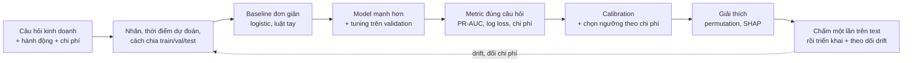
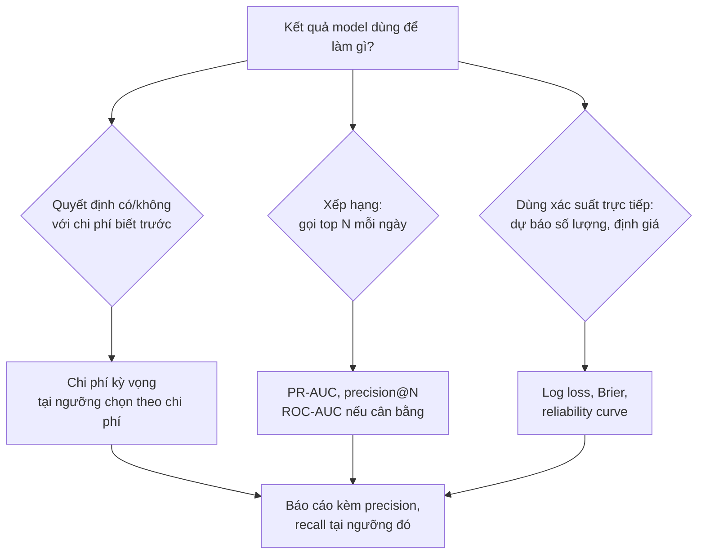

# Classic Machine Learning

Phần lớn bài toán ML trong doanh nghiệp vẫn là dữ liệu dạng bảng: dự đoán khách rời bỏ, đơn bị review
xấu, giao dịch gian lận, phân khúc khách hàng. Ở đó, logistic regression, random forest, gradient boosting
và k-means vẫn là công cụ chính, và cái phân biệt một DS senior không phải là biết nhiều thuật toán mà là
**đặt bài toán đúng, đo đúng, chọn ngưỡng theo tiền, tin được xác suất, và giải thích được model**.

Module dùng hai bộ dữ liệu thật cho ba bài toán: **Olist** (dự đoán review 1–2 sao, và phân khúc khách theo
RFM) và **Telco Customer Churn** (7 043 khách của một nhà mạng: churn, calibration, giải thích model). Tải dữ liệu:

```bash
uv run python data/download_olist.py
uv run python data/download_dataset.py telco-churn
```

Module 10 đã dạy cách dựng feature không leak, `Pipeline`, `ColumnTransformer` và CV theo thời gian / theo
nhóm. Module này dùng lại đúng bài toán và cách chia của module 10, và tập trung vào model, metric và quyết
định. Gradient boosting (XGBoost, LightGBM) được dạy sâu ở module 12.

Sau module này bạn sẽ:

- Chọn họ model phù hợp và giải thích được đánh đổi bias-variance của từng lựa chọn.
- Chọn metric theo câu hỏi kinh doanh (ROC-AUC, PR-AUC, F1, log loss, Brier) và chọn ngưỡng theo ma trận
  chi phí, không theo thói quen 0.5.
- Xử lý imbalanced data mà không phá hỏng xác suất; đo và sửa calibration.
- Tuning có kỷ luật: không overfit tập validation, biết khi nào tuning đáng công.
- Phân cụm (k-means, DBSCAN), giảm chiều (PCA), và biết khi nào phân cụm là công cụ sai.
- Giải thích model bằng permutation importance và SHAP, và biết chúng **không** nói gì.

## 1. Bài toán supervised và bias-variance

### Đặt bài toán trước khi chọn model

Bài toán xuyên suốt module (giống module 10): **khi một đơn Olist vừa giao tới khách, dự đoán đơn đó có bị
review 1–2 sao không**, để đội CSKH liên hệ chủ động. Bốn câu hỏi phải trả lời trước khi viết dòng code nào:

| Câu hỏi | Lựa chọn cho Olist | Vì sao quan trọng |
| --- | --- | --- |
| Dự đoán **lúc nào**? | Lúc đơn vừa giao (`order_delivered_customer_date`), đúng như module 10 | Feature giao hàng (số ngày giao thực tế, trễ bao nhiêu) hợp lệ; **mọi cột review** (điểm, bình luận, ngày tạo, ngày trả lời) là leakage |
| Nhãn là gì? | `review_score <= 2`, review mới nhất của đơn | Tỉ lệ dương 12.8%: mất cân bằng vừa phải |
| Chia dữ liệu thế nào? | Theo thời gian: train trước 2018-01-01, validation tới trước 2018-04-01, test tới hết 2018-08-31 | Model sẽ chạy trên đơn **tương lai**; chia ngẫu nhiên cho điểm lạc quan giả |
| Hành động là gì, giá bao nhiêu? | Liên hệ tốn tiền, bỏ lỡ review xấu tốn nhiều hơn | Quyết định ngưỡng (mục 3), không phải ROC-AUC |



Nếu muốn can thiệp **trước** khi giao (nhắn tin cho đơn có nguy cơ trễ), đó là một bài toán khác với thời
điểm dự đoán khác (lúc mua hoặc lúc giao cho hãng vận chuyển): phải bỏ mọi kết quả giao hàng xảy ra sau thời
điểm đó (`delivery_days`, `late_days`), và ROC-AUC sẽ thấp hơn nhiều.

Baseline đơn giản không phải thủ tục. Nếu logistic regression trên 8 feature đã đạt gần model phức tạp, đó
là thông tin: phần còn lại nằm ở **dữ liệu**, không phải ở thuật toán.

### Bias-variance

Với dữ liệu sinh từ $$y = f(x) + \varepsilon$$, $$\mathrm{Var}(\varepsilon) = \sigma^2$$, sai số kỳ vọng
của một model $$\hat f$$ học từ một tập train ngẫu nhiên, tại điểm $$x$$:

$$
\mathbb{E}\big[(y - \hat f(x))^2\big] = \underbrace{\big(\mathbb{E}[\hat f(x)] - f(x)\big)^2}_{\text{bias}^2}
+ \underbrace{\mathrm{Var}\big(\hat f(x)\big)}_{\text{variance}} + \underbrace{\sigma^2}_{\text{noise}}
$$

- **Bias**: model quá đơn giản để bắt được $$f$$ (đường thẳng cho quan hệ hình sin). Thêm dữ liệu không
  chữa được.
- **Variance**: model nhạy với tập train cụ thể (cây sâu, kNN với k = 1). Thêm dữ liệu, regularize, hoặc
  lấy trung bình nhiều model (bagging, random forest) thì giảm.
- **Noise**: không model nào vượt qua được. Review xấu phụ thuộc cả tâm trạng khách, thứ không có trong dữ
  liệu: trần ROC-AUC của bài Olist thấp hơn 1 nhiều.

Đo trực tiếp bằng mô phỏng: rút 300 tập train từ cùng một "thế giới", fit kNN, xem dự đoán dao động thế nào.

```python
import numpy as np
from sklearn.neighbors import KNeighborsRegressor

rng = np.random.default_rng(0)
f = lambda x: np.sin(2 * np.pi * x)
x_test = np.linspace(0.05, 0.95, 40)

for k in [1, 7, 30]:
    preds = []
    for _ in range(300):                      # 300 tập train khác nhau từ cùng một "thế giới"
        x = rng.random(60)
        y = f(x) + rng.normal(0, 0.3, 60)
        model = KNeighborsRegressor(k).fit(x.reshape(-1, 1), y)
        preds.append(model.predict(x_test.reshape(-1, 1)))
    preds = np.array(preds)
    bias2 = np.mean((preds.mean(axis=0) - f(x_test)) ** 2)
    var = np.mean(preds.var(axis=0))
    print(f"k={k:>2}: bias²={bias2:.3f}  variance={var:.3f}  tổng (+ noise 0.09)={bias2 + var + 0.09:.3f}")
```

k = 1 gần như không bias nhưng variance 0.094 (lớn hơn cả noise); k = 30 thì ngược lại, bias² 0.069; k = 7
cân bằng, tổng sai số 0.109. Bài Basic 03 cho bạn tự cài phép đo này.

Trong thực tế không mô phỏng được, nên dùng **dấu hiệu**: train tốt hơn validation nhiều là variance cao
(regularize, giảm độ sâu, thêm dữ liệu); cả hai đều kém và gần nhau là bias cao (feature tốt hơn, model linh
hoạt hơn). Learning curve (điểm theo cỡ tập train) cho biết thêm dữ liệu có đáng không: nếu đường
validation đã phẳng, thu thêm dữ liệu cùng loại không giúp.

## 2. Các model supervised kinh điển

### Bảng chọn nhanh

| Model | Ý tưởng | Khi nào dùng | Đánh đổi | Lỗi hay gặp |
| --- | --- | --- | --- | --- |
| Linear / logistic regression | Tổ hợp tuyến tính của feature, qua sigmoid cho xác suất | Baseline luôn có; cần giải thích hệ số; dữ liệu ít; cần xác suất ổn định | Bias cao nếu quan hệ phi tuyến hoặc có tương tác; phải tự tạo feature | Quên scale khi có regularization; đọc hệ số như nhân quả; multicollinearity làm hệ số nhảy |
| kNN | Dự đoán theo k điểm gần nhất | Dữ liệu ít chiều, cần baseline phi tham số, recommender đơn giản | Dự đoán chậm (phải quét dữ liệu), kém ở nhiều chiều (curse of dimensionality) | Không scale feature: cột "giá" (hàng trăm) lấn át cột "số món" (1–3) |
| SVM | Siêu phẳng có margin lớn nhất; kernel cho biên phi tuyến | Dữ liệu vừa (tới vài chục nghìn dòng), nhiều chiều (text) | RBF kernel tốn O(n²) bộ nhớ/thời gian; không cho xác suất trực tiếp | Dùng `SVC(probability=True)` (deprecated từ sklearn 1.9) thay vì calibrate riêng |
| Decision tree | Chia không gian bằng các câu hỏi if/else | Cần luật dễ đọc cho người vận hành; khối xây dựng cho ensemble | Một cây sâu variance rất cao; biên dạng bậc thang | Để cây mọc hết: train hoàn hảo, validation tệ, xác suất 0/1 làm log loss bùng nổ |
| Random forest | Trung bình nhiều cây sâu, mỗi cây trên bootstrap + tập con feature | Mặc định mạnh cho dữ liệu bảng, ít phải tuning | Nặng bộ nhớ; không ngoại suy ngoài khoảng train; thường thua gradient boosting một chút | Tin `feature_importances_` (MDI): thiên vị feature nhiều giá trị (mục 7) |
| Gradient boosting | Cộng dần các cây nhỏ, mỗi cây sửa lỗi của tổng trước | Hầu hết bài dữ liệu bảng cần điểm cao nhất | Nhiều siêu tham số, dễ overfit nếu không early stopping | Module 12 |

### Logistic regression và regularization

Logistic regression mô hình hoá log-odds là hàm tuyến tính, và học bằng cách cực tiểu log loss cộng một số
hạng phạt:

$$
P(y = 1 \mid x) = \sigma(w^\top x + b) = \frac{1}{1 + e^{-(w^\top x + b)}},
\qquad
\min_{w, b}\; -\sum_i \big[y_i \log p_i + (1 - y_i)\log(1 - p_i)\big] + \frac{1}{C}\,\Omega(w)
$$

với $$\Omega(w) = \tfrac{1}{2}\lVert w \rVert_2^2$$ (L2, ridge: co mọi hệ số về 0, ổn định khi feature tương
quan) hoặc $$\lVert w \rVert_1$$ (L1, lasso: đẩy nhiều hệ số về đúng 0, tự chọn feature). Trong sklearn
`C` là **nghịch đảo** độ mạnh regularization: C nhỏ là phạt mạnh. Vì phạt tính trên độ lớn hệ số, feature
phải được scale trước, nếu không feature có đơn vị nhỏ bị phạt oan. Diễn giải hệ số, khoảng tin cậy và
GLM nói chung ở module 05.

### So sánh trên Olist thật

Dựng bảng một dòng mỗi đơn giao xong có review, 8 feature biết lúc giao hàng, chia theo thời gian, rồi so
năm model trên validation (khoảng 15 giây):

```python
import numpy as np
import pandas as pd
from sklearn.ensemble import RandomForestClassifier
from sklearn.linear_model import LogisticRegression
from sklearn.metrics import average_precision_score, roc_auc_score
from sklearn.neighbors import KNeighborsClassifier
from sklearn.pipeline import make_pipeline
from sklearn.preprocessing import StandardScaler
from sklearn.tree import DecisionTreeClassifier

R = "data/raw/"
dates = ["order_purchase_timestamp", "order_delivered_customer_date", "order_estimated_delivery_date"]
orders = pd.read_csv(R + "olist_orders_dataset.csv", parse_dates=dates)
reviews = pd.read_csv(R + "olist_order_reviews_dataset.csv", parse_dates=["review_answer_timestamp"])
items = pd.read_csv(R + "olist_order_items_dataset.csv")
payments = pd.read_csv(R + "olist_order_payments_dataset.csv")

d = orders[(orders.order_status == "delivered") & orders.order_delivered_customer_date.notna()
           & (orders.order_purchase_timestamp < "2018-09-01")]
latest = reviews.sort_values("review_answer_timestamp").drop_duplicates("order_id", keep="last")
df = (d.merge(latest[["order_id", "review_score"]], on="order_id")
       .merge(items.groupby("order_id").agg(n_items=("order_item_id", "size"), n_sellers=("seller_id", "nunique"),
                                            total_price=("price", "sum"), freight=("freight_value", "sum")),
              on="order_id")
       .merge(payments.groupby("order_id").agg(max_installments=("payment_installments", "max")),
              on="order_id", how="left"))
day = pd.Timedelta(days=1)
df["delivery_days"] = (df.order_delivered_customer_date - df.order_purchase_timestamp) / day
df["late_days"] = (df.order_delivered_customer_date - df.order_estimated_delivery_date) / day
df["estimated_days"] = (df.order_estimated_delivery_date - df.order_purchase_timestamp) / day
df["freight_ratio"] = df.freight / (df.total_price + df.freight)
df["max_installments"] = df.max_installments.fillna(1)
df["bad"] = (df.review_score <= 2).astype(int)
FEATURES = ["delivery_days", "late_days", "estimated_days", "n_items", "n_sellers",
            "total_price", "freight_ratio", "max_installments"]

t = df.order_purchase_timestamp
train, val = df[t < "2018-01-01"], df[(t >= "2018-01-01") & (t < "2018-04-01")]
print(len(df), len(train), len(val), round(train.bad.mean(), 3), round(val.bad.mean(), 3))

models = {
    "logistic": make_pipeline(StandardScaler(), LogisticRegression(max_iter=1000)),
    "knn_50": make_pipeline(StandardScaler(), KNeighborsClassifier(50)),
    "tree_depth5": DecisionTreeClassifier(max_depth=5, random_state=0),
    "tree_full": DecisionTreeClassifier(random_state=0),
    "random_forest": RandomForestClassifier(300, min_samples_leaf=20, n_jobs=-1, random_state=0),
}
for name, m in models.items():
    m.fit(train[FEATURES], train.bad)
    p_tr = m.predict_proba(train[FEATURES])[:, 1]
    p_va = m.predict_proba(val[FEATURES])[:, 1]
    print(f"{name:>13}: train ROC-AUC {roc_auc_score(train.bad, p_tr):.3f} | val ROC-AUC "
          f"{roc_auc_score(val.bad, p_va):.3f}  PR-AUC {average_precision_score(val.bad, p_va):.3f}")
```

| Model | Train ROC-AUC | Val ROC-AUC | Val PR-AUC |
| --- | --- | --- | --- |
| logistic | 0.711 | 0.798 | 0.569 |
| knn_50 | 0.772 | 0.794 | 0.594 |
| tree_depth5 | 0.724 | 0.808 | 0.591 |
| tree_full | 1.000 | 0.648 | 0.283 |
| random_forest | 0.918 | 0.806 | 0.611 |

Bốn bài học từ bảng này:

1. **Cây đầy đủ** là variance thuần tuý: thuộc lòng train (1.000), sụp ở validation (0.648).
2. Random forest cũng có train 0.918, nhưng đó là variance *được kiểm soát*: trung bình 300 cây giữ
   validation cao nhất. Khoảng cách train/validation lớn không tự nó là lỗi; điểm validation mới là thứ để chọn.
3. Logistic có **validation cao hơn train** (0.798 so với 0.711). Không phải phép màu: tập validation
   (quý 1/2018) có 14.4% đơn trễ so với 6.5% ở train, và đơn trễ dễ nhận ra. Phân phối dữ liệu đổi theo thời
   gian, và điểm số đổi theo. Trên tập test (tháng 4–8/2018, 5.9% đơn trễ), random forest chỉ còn ROC-AUC
   0.686, PR-AUC 0.337 (bài Intermediate 01). Đây là lý do phải chia theo thời gian và báo cáo trên test.
4. Bốn model hợp lý cách nhau chưa tới 0.015 ROC-AUC. Muốn tốt hơn nhiều thì cần **feature** tốt hơn (lịch
   sử seller, danh mục sản phẩm, vùng: module 10), không phải model khác.

SVM không có trong bảng vì kernel RBF trên 43 nghìn dòng chậm; thử trên mẫu 5 000 dòng thì không hơn các
model trên. Trên dữ liệu bảng cỡ này, SVM hiếm khi là lựa chọn đầu tiên.

## 3. Metric và chọn ngưỡng theo chi phí

### Từ confusion matrix

|  | Thật là dương | Thật là âm |
| --- | --- | --- |
| Dự đoán dương | TP | FP |
| Dự đoán âm | FN | TN |

$$
\text{precision} = \frac{TP}{TP + FP}, \qquad \text{recall} = \frac{TP}{TP + FN}, \qquad
F_1 = \frac{2 \cdot \text{precision} \cdot \text{recall}}{\text{precision} + \text{recall}}
$$

Ba metric này phụ thuộc **ngưỡng**. Hai metric sau đánh giá **thứ hạng** trên mọi ngưỡng:

- **ROC-AUC**: xác suất một ca dương ngẫu nhiên được chấm điểm cao hơn một ca âm ngẫu nhiên. Model đoán
  bừa cho 0.5 bất kể tỉ lệ dương. Vì TN chiếm đa số khi dữ liệu mất cân bằng, ROC-AUC có thể cao trong khi
  top danh sách vẫn toàn ca âm.
- **PR-AUC** (average precision): diện tích dưới đường precision-recall. Model đoán bừa cho PR-AUC bằng
  **tỉ lệ dương** (12.8% ở Olist, 0.17% ở dữ liệu fraud), nên luôn so với con số đó. Phù hợp khi điều ta
  quan tâm là "top danh sách có đúng không".

Hai metric đánh giá **xác suất**:

$$
\text{log loss} = -\frac{1}{n}\sum_i \big[y_i \log p_i + (1 - y_i)\log(1 - p_i)\big],
\qquad
\text{Brier} = \frac{1}{n}\sum_i (p_i - y_i)^2
$$

Log loss phạt cực nặng dự đoán tự tin mà sai (p = 0.001 cho một ca dương tốn gần 7 đơn vị), nên cây quyết
định mọc hết (xác suất 0 hoặc 1) có log loss 7.2 trên validation Olist, trong khi các model khác khoảng 0.34–0.41.
Brier bị chặn trong [0, 1], ít nhạy với vài ca cực đoan, dễ giải thích hơn cho người không làm ML.



### Chọn ngưỡng theo ma trận chi phí

Ngưỡng 0.5 chỉ tối ưu khi FP và FN tốn như nhau **và** xác suất đã calibrate. Gọi $$C_{FP}$$ là chi phí
liên hệ một đơn không có vấn đề, $$C_{FN}$$ là thiệt hại khi bỏ lỡ một đơn sẽ bị review xấu (TP, TN tốn 0).
Với một đơn có xác suất $$p$$, liên hệ có chi phí kỳ vọng $$(1 - p)\,C_{FP}$$, không liên hệ có chi phí kỳ
vọng $$p\,C_{FN}$$. Liên hệ khi cái trước nhỏ hơn:

$$
p \;\ge\; t^* = \frac{C_{FP}}{C_{FP} + C_{FN}}
$$

Tổng quát khi cả bốn ô đều có chi phí: $$t^* = \dfrac{C_{FP} - C_{TN}}{(C_{FP} - C_{TN}) + (C_{FN} - C_{TP})}$$.

Với $$C_{FP} = 5$$ R$ và $$C_{FN} = 30$$ R$: $$t^* = 5/35 \approx 0.143$$, xa 0.5. Trên tập test Olist
(bài Intermediate 01, random forest ở trên):

| Ngưỡng | Chi phí mỗi đơn (R$) | Tỉ lệ đơn được liên hệ |
| --- | --- | --- |
| Không liên hệ ai | 3.114 | 0% |
| 0.5 | 2.627 | 2.8% |
| Lý thuyết 5/35 = 0.143 | 2.279 | 15.2% |
| Quét trên validation: 0.175 | 2.263 | 10.7% |

Trên 31 994 đơn của tập test, khác biệt giữa ngưỡng 0.5 và ngưỡng chọn theo chi phí là khoảng 11.6 nghìn R$. Ba điểm
thực tế:

- Công thức $$t^*$$ chỉ đúng khi xác suất **calibrated** (mục 4). Nếu không, quét ngưỡng trên validation
  và chấm trên test (bài Basic 02).
- Chi phí là **giả định kinh doanh**, không phải con số thống kê. Luôn kèm phân tích độ nhạy: nếu
  $$C_{FN}$$ là 15 chứ không phải 30 thì kết luận còn đứng không?
- Năng lực vận hành thường là ràng buộc thật (CSKH chỉ gọi được 100 đơn mỗi tuần). Khi đó bài toán thành
  "chọn top N", và metric đúng là precision@N (bài Advanced 02).

**F1** là trung bình điều hoà của precision và recall, ngầm giả định một tỉ lệ đánh đổi cố định giữa FP và
FN. Nó tiện khi chưa ai nói được chi phí, nhưng ngưỡng tối ưu F1 trên validation Olist là khoảng 0.27,
khác hẳn ngưỡng theo chi phí. Khi có chi phí thật, dùng chi phí.

## 4. Imbalanced data và calibration

### Imbalanced data: vấn đề thật là gì

Mất cân bằng (12.8% review xấu, 26.5% churn, 0.17% fraud) **không** làm model hỏng. Vấn đề thật là:

1. **Metric sai**: accuracy 87% bằng cách đoán "không ai review xấu". Dùng PR-AUC, chi phí, recall tại
   precision cố định.
2. **Ngưỡng sai**: ngưỡng 0.5 trên xác suất calibrated hiếm khi bắt được ca dương nào. Sửa ngưỡng (mục 3).
3. **Quá ít ca dương tuyệt đối**: 300 ca fraud thì model nào cũng khó học. Đây là vấn đề dữ liệu; resampling
   không tạo ra thông tin mới.

| Cách | Làm gì | Đánh đổi |
| --- | --- | --- |
| Đổi ngưỡng | Giữ model, chọn ngưỡng theo chi phí | Rẻ nhất, giữ nguyên xác suất. Nên thử đầu tiên |
| `class_weight="balanced"` | Mỗi ca dương nặng gấp $$n_{neg}/n_{pos}$$ lần trong loss | Thứ hạng gần như không đổi; xác suất bị phình (phải sửa lại nếu cần xác suất) |
| Undersample lớp đa số | Bỏ bớt ca âm khi train | Train nhanh hơn trên dữ liệu khổng lồ; mất thông tin; xác suất lệch như trên |
| Oversample / SMOTE | Nhân bản hoặc nội suy ca dương | Dễ overfit; **phải** làm trong từng fold CV (làm trước khi chia là leakage); thư viện `imbalanced-learn` |

Vì sao class_weight làm phình xác suất: model học trên một thế giới mà tỉ lệ dương hiệu dụng là
$$\pi_s$$ (0.5 với balanced), trong khi thật là $$\pi$$. Theo Bayes, odds bị nhân với một hệ số cố định, và
ta sửa lại được (prior correction):

$$
\text{odds}_{\text{đúng}} = \text{odds}_{\text{model}} \cdot \frac{\pi / (1 - \pi)}{\pi_s / (1 - \pi_s)},
\qquad p = \frac{\text{odds}}{1 + \text{odds}}
$$

Hệ quả thú vị: ngưỡng 0.5 trên model balanced tương đương ngưỡng $$\pi$$ (tỉ lệ dương) trên model thường.
Nhiều người "thấy class_weight cải thiện recall", thật ra chỉ là đã hạ ngưỡng.

### Calibration

Model **calibrated** khi trong các đơn được dự đoán 30%, đúng khoảng 30% bị review xấu. Cần calibration khi
dùng xác suất trực tiếp: công thức ngưỡng $$t^*$$, dự báo "quý này mất bao nhiêu khách" bằng tổng xác suất,
định giá rủi ro, ghép với một model khác.

Đo bằng **reliability curve** (chia dự đoán thành khoảng, so trung bình dự đoán với tỉ lệ dương thật),
**Brier**, và **ECE** (expected calibration error):

$$
\text{ECE} = \sum_{b} \frac{n_b}{n}\,\big|\bar p_b - \bar y_b\big|
$$

Sửa bằng một hàm đơn điệu học trên **tập calibration riêng** (không phải tập train, nơi model đã quá tự tin):

- **Platt / sigmoid**: logistic regression một biến trên logit của score. Ít tham số, ổn với vài trăm ca.
- **Isotonic**: hàm bậc thang đơn điệu bất kỳ. Linh hoạt, cần nhiều dữ liệu hơn (vài nghìn ca), có thể
  overfit tập calibration nhỏ.
- `CalibratedClassifierCV` của sklearn làm việc này với cross-validation.

Trên Telco churn (chia 75/25 phân tầng), cùng một logistic regression có và không có class_weight:

```python
import pandas as pd
from sklearn.compose import ColumnTransformer
from sklearn.linear_model import LogisticRegression
from sklearn.metrics import brier_score_loss, roc_auc_score
from sklearn.model_selection import train_test_split
from sklearn.pipeline import Pipeline
from sklearn.preprocessing import OneHotEncoder, StandardScaler

df = pd.read_csv("data/raw/telco-churn/WA_Fn-UseC_-Telco-Customer-Churn.csv")
df["TotalCharges"] = pd.to_numeric(df.TotalCharges, errors="coerce").fillna(0.0)   # 11 ô trống: tenure = 0
y = (df.Churn == "Yes").astype(int)
X = df.drop(columns=["customerID", "Churn"])
num = ["tenure", "MonthlyCharges", "TotalCharges", "SeniorCitizen"]
cat = [c for c in X.columns if c not in num]
X_tr, X_te, y_tr, y_te = train_test_split(X, y, test_size=0.25, stratify=y, random_state=42)

for cw in [None, "balanced"]:
    pre = ColumnTransformer([("num", StandardScaler(), num),
                             ("cat", OneHotEncoder(handle_unknown="ignore", drop="if_binary"), cat)])
    model = Pipeline([("pre", pre), ("clf", LogisticRegression(max_iter=2000, class_weight=cw))]).fit(X_tr, y_tr)
    p = model.predict_proba(X_te)[:, 1]
    print(f"class_weight={cw}: ROC-AUC {roc_auc_score(y_te, p):.3f}  Brier {brier_score_loss(y_te, p):.3f}  "
          f"xác suất trung bình {p.mean():.3f}  (churn thật {y_te.mean():.3f})")
```

ROC-AUC gần như không đổi (0.847 và 0.846), nhưng model balanced dự đoán trung bình 41.3% churn trong khi
thật là 26.5%, và Brier tệ đi từ 0.136 lên 0.166. Trong bài Intermediate 02 (chia train / calibration / test 60/20/20), prior correction hoặc
recalibration đưa Brier của model balanced về mức của model gốc. Model không balanced trên Telco vốn đã
calibrated tốt (ECE khoảng 0.02), và isotonic trên tập calibration 1 409 khách còn làm nó **tệ đi** một chút
(ECE của random forest từ 0.017 lên 0.032): đừng calibrate theo phản xạ, hãy đo trước.

Calibration cũng hỏng theo thời gian: trên Olist, random forest dự đoán trung bình 16.8% review xấu ở
validation trong khi thật là 18.0%, rồi 11.1% ở test so với thật 10.4%. Khi tỉ lệ nền đổi, xác suất cần được
calibrate lại trên dữ liệu gần đây.

## 5. Tuning và chọn model

### Ba tập, ba vai trò

- **Train**: fit tham số của model (hệ số, các cây).
- **Validation** (hoặc CV trên train): chọn siêu tham số, chọn model, chọn ngưỡng, fit calibration.
- **Test**: chấm **một lần** ở cuối. Nhìn test rồi quay lại sửa model là biến test thành validation, và con
  số báo cáo sẽ lạc quan.

Cách chia phải giống cách model được dùng: theo thời gian khi dự đoán tương lai, theo nhóm (khách, seller)
khi model gặp khách mới (module 10). Với dữ liệu ít và không có yếu tố thời gian, dùng
`StratifiedKFold` để mỗi fold có cùng tỉ lệ dương.

### Grid, random search và hơn thế

| Cách | Khi nào | Ghi chú |
| --- | --- | --- |
| Grid search | 1–2 siêu tham số, lưới nhỏ | Tốn kém theo cấp số nhân khi thêm tham số |
| Random search | Mặc định cho 3+ tham số | Bergstra & Bengio (2012): cùng ngân sách, random tìm tốt hơn grid vì phần lớn tham số ít quan trọng |
| Bayesian optimization (Optuna) | Mỗi lần fit đắt (phút trở lên) | Dùng kết quả cũ để chọn điểm thử tiếp |
| Successive halving (`HalvingRandomSearchCV`) | Nhiều ứng viên, dữ liệu lớn | Loại sớm ứng viên kém trên mẫu nhỏ |

```python
import pandas as pd
from sklearn.compose import ColumnTransformer
from sklearn.ensemble import RandomForestClassifier
from sklearn.metrics import roc_auc_score
from sklearn.model_selection import RandomizedSearchCV, StratifiedKFold, train_test_split
from sklearn.pipeline import Pipeline
from sklearn.preprocessing import OneHotEncoder

df = pd.read_csv("data/raw/telco-churn/WA_Fn-UseC_-Telco-Customer-Churn.csv")
df["TotalCharges"] = pd.to_numeric(df.TotalCharges, errors="coerce").fillna(0.0)
y = (df.Churn == "Yes").astype(int)
X = df.drop(columns=["customerID", "Churn"])
num = ["tenure", "MonthlyCharges", "TotalCharges", "SeniorCitizen"]
cat = [c for c in X.columns if c not in num]
X_tr, X_te, y_tr, y_te = train_test_split(X, y, test_size=0.25, stratify=y, random_state=42)

pre = ColumnTransformer([("num", "passthrough", num),
                         ("cat", OneHotEncoder(handle_unknown="ignore", drop="if_binary"), cat)])
pipe = Pipeline([("pre", pre), ("clf", RandomForestClassifier(300, random_state=0))])
space = {"clf__max_depth": [4, 6, 8, 12, None], "clf__min_samples_leaf": [1, 5, 10, 20, 50],
         "clf__max_features": ["sqrt", 0.3, 0.5]}
search = RandomizedSearchCV(pipe, space, n_iter=12, scoring="roc_auc", random_state=0, n_jobs=-1,
                            cv=StratifiedKFold(5, shuffle=True, random_state=0)).fit(X_tr, y_tr)
print(search.best_params_, round(search.best_score_, 4))
print("test:", round(roc_auc_score(y_te, search.predict_proba(X_te)[:, 1]), 4))
```

Kết quả: CV ROC-AUC 0.846, test 0.847, trong khi logistic regression không tuning đạt 0.847 trên cùng tập
test. Tuning random forest không mang lại gì so với baseline tuyến tính. Đó là kết quả phổ biến trên dữ liệu
bảng nhỏ, ít feature, và là lý do luôn có baseline.

### Lỗi hay gặp khi tuning

- **Overfit tập validation**: thử 500 cấu hình rồi chọn cái tốt nhất trên validation thì điểm validation
  của nó lạc quan (winner's curse, như module 03). Chấm lại trên test, hoặc dùng **nested CV** (vòng ngoài
  đánh giá, vòng trong tuning) khi cần ước lượng không chệch.
- **Preprocessing ngoài pipeline**: scale, impute, target encoding, SMOTE trên toàn bộ dữ liệu trước khi
  CV là leakage. Đặt mọi thứ trong `Pipeline` (module 10).
- **Tuning metric sai**: tuning theo ROC-AUC rồi quyết định theo chi phí tại ngưỡng. Nếu được, tuning theo
  metric gần quyết định nhất (PR-AUC, log loss, hoặc chi phí).
- **Tuning quá sớm**: một feature tốt thường đáng hơn mọi lần tuning. Tuning là bước cuối, với ngân sách
  giới hạn trước.

## 6. Unsupervised: k-means, DBSCAN, PCA

### k-means

Chia $$n$$ điểm thành $$k$$ cụm để cực tiểu tổng bình phương khoảng cách tới tâm cụm (inertia):

$$
\min_{C_1, \dots, C_k} \sum_{j=1}^{k} \sum_{x_i \in C_j} \lVert x_i - \mu_j \rVert^2
$$

Thuật toán Lloyd: gán mỗi điểm vào tâm gần nhất, tính lại tâm, lặp tới khi ổn định. Chỉ hội tụ về cực tiểu
**cục bộ**, nên chạy nhiều lần với khởi tạo khác nhau (`n_init`) và khởi tạo k-means++.

Giả định ngầm: cụm hình cầu, cỡ tương đương, khoảng cách Euclid có nghĩa. Hệ quả thực tế:

- **Scale quyết định tất cả.** Không scale thì feature có đơn vị lớn nhất chiếm hết khoảng cách. Dữ liệu lệch
  phải (tiền) nên `log1p` trước khi chuẩn hoá.
- **Chọn k**: elbow (inertia theo k) và **silhouette** (mỗi điểm gần cụm mình hơn cụm gần nhất bao nhiêu, từ
  −1 tới 1). Cả hai chỉ là gợi ý; k cuối cùng là con số **dùng được** cho người làm chiến dịch.
- Mỗi lần chạy lại (dữ liệu mới, seed khác) nhãn cụm có thể đổi số thứ tự hoặc đổi ranh giới. Nếu đội CRM dùng
  nhãn hằng tháng, phải cố định tâm cụm hoặc ánh xạ cụm mới về cụm cũ.

### Ví dụ thật: RFM trên Olist

RFM cho mỗi `customer_unique_id`: Recency (số ngày từ lần mua cuối tới 2018-09-01), Frequency (số đơn giao
xong), Monetary (tổng thanh toán).

```python
import numpy as np
import pandas as pd
from sklearn.cluster import KMeans
from sklearn.metrics import silhouette_score
from sklearn.preprocessing import StandardScaler

R = "data/raw/"
orders = pd.read_csv(R + "olist_orders_dataset.csv",
                     parse_dates=["order_purchase_timestamp", "order_delivered_customer_date"])
customers = pd.read_csv(R + "olist_customers_dataset.csv")
payments = pd.read_csv(R + "olist_order_payments_dataset.csv")
snapshot = pd.Timestamp("2018-09-01")

d = orders[(orders.order_status == "delivered") & orders.order_delivered_customer_date.notna()
           & (orders.order_purchase_timestamp < snapshot)]
d = (d.merge(customers[["customer_id", "customer_unique_id"]], on="customer_id")
      .merge(payments.groupby("order_id").payment_value.sum().rename("value"), on="order_id", how="left")
      .fillna({"value": 0.0}))
rfm = d.groupby("customer_unique_id").agg(last=("order_purchase_timestamp", "max"),
                                          frequency=("order_id", "nunique"), monetary=("value", "sum"))
rfm["recency"] = (snapshot - rfm.pop("last")).dt.days
print(len(rfm), "khách; mua từ 2 đơn:", round((rfm.frequency > 1).mean(), 3))

X = StandardScaler().fit_transform(np.log1p(rfm[["recency", "frequency", "monetary"]]))
for k in [2, 3, 4, 5]:
    labels = KMeans(k, n_init=3, random_state=0).fit_predict(X)
    print(k, round(silhouette_score(X, labels, sample_size=10_000, random_state=0), 3))
labels = KMeans(4, n_init=3, random_state=0).fit_predict(X)
print(rfm.groupby(labels).agg(n=("recency", "size"), recency=("recency", "median"),
                              frequency=("frequency", "mean"), monetary=("monetary", "median")).round(1))
```

93 350 khách, chỉ **3.0%** mua từ 2 đơn trở lên. Silhouette cao nhất ở k = 2 (0.718), nhưng hai cụm đó chỉ là
"mua một lần" và "mua nhiều lần", điều một dòng `frequency > 1` làm được, không cần k-means. Với k = 4, cụm
có ý nghĩa cho CRM:

| Cụm (k = 4) | Số khách | Recency trung vị (ngày) | Monetary trung vị (R$) | Đọc là |
| --- | --- | --- | --- | --- |
| Khách quay lại | 2 801 | 201 | 225.6 | Mọi khách mua từ 2 đơn trở lên; đáng chăm sóc nhất |
| Mới mua | 16 648 | 40 | 104.5 | Còn "nóng": thời điểm tốt để khuyến khích đơn thứ hai |
| Lâu rồi, chi nhiều | 32 092 | 259 | 199.0 | Win-back có chọn lọc |
| Lâu rồi, chi ít | 41 809 | 273 | 65.7 | Chi phí giữ chân có thể lớn hơn giá trị |

Bài học senior: với 97% khách mua một lần, chữ F trong RFM gần như hằng số, và phân cụm chủ yếu chia theo R
và M. Phân cụm là công cụ **khám phá và giao tiếp**; nếu câu hỏi thật là "ai sẽ quay lại", đó là bài toán
supervised. Không scale, k-means trên RFM thô cắt khách gần như chỉ theo monetary (bài Intermediate 03).

### DBSCAN

Cụm là vùng mật độ cao: điểm có ít nhất `min_samples` láng giềng trong bán kính `eps` là điểm lõi; cụm là
các điểm lõi nối nhau; điểm không thuộc vùng đặc nào là **nhiễu** (nhãn −1).

| | k-means | DBSCAN |
| --- | --- | --- |
| Cần chọn | k | `eps`, `min_samples` |
| Hình dạng cụm | Gần cầu, cỡ tương đương | Bất kỳ |
| Outlier | Bị ép vào một cụm | Tách riêng thành nhiễu |
| Dữ liệu lớn, nhiều chiều | Tốt | Khó chọn `eps`; mật độ không đều thì một `eps` không đủ (HDBSCAN xử lý tốt hơn) |

Trên RFM Olist (mẫu 10 000 khách), `eps` từ 0.2 lên 0.3 rồi 0.5 cho 1, 3, 2 cụm: kết quả nhạy với tham số,
và dữ liệu không có cấu trúc mật độ rõ. DBSCAN hữu ích hơn cho dữ liệu toạ độ (cụm điểm giao hàng) và phát
hiện điểm lạ.

### PCA

PCA tìm các hướng trực giao có phương sai lớn nhất (vector riêng của ma trận hiệp phương sai, tính bằng SVD;
module 01). Dùng để: nén feature tương quan cao trước một model tuyến tính, nhìn dữ liệu nhiều chiều trên mặt
phẳng 2D, khử nhiễu. Lưu ý: PCA nhạy với scale (chuẩn hoá trước), thành phần chính khó diễn giải, và hướng có
phương sai lớn không nhất thiết là hướng quan trọng cho nhãn. Trên RFM đã chuẩn hoá, ba thành phần giải thích
38.9%, 33.3%, 27.8% phương sai: ba feature gần như độc lập, nên PCA không nén được gì. Dùng PCA để vẽ, không
để phân cụm.

## 7. Interpretability: permutation importance và SHAP

### Ba câu hỏi khác nhau

| Câu hỏi | Công cụ | Ghi chú |
| --- | --- | --- |
| Model dựa vào feature nào, nói chung? | Permutation importance, trung bình \|SHAP\| | Global |
| Vì sao khách **này** có điểm cao? | SHAP của một dòng | Local; cho CSKH, cho khách hàng hỏi "vì sao tôi bị từ chối" |
| Nếu **thay đổi** feature X thì kết quả đổi bao nhiêu? | Không phải hai công cụ trên | Câu hỏi nhân quả: thí nghiệm (module 03) hoặc causal inference (module 06) |

### Permutation importance

Hoán vị ngẫu nhiên một cột trên tập **held-out**, đo metric giảm bao nhiêu. Đơn giản, áp dụng cho mọi model,
đo đúng thứ ta quan tâm (điểm số trên dữ liệu mới). Hai cạm bẫy:

- **Feature tương quan**: hoán vị một cột trong khi bản sao của nó vẫn còn, model vẫn lấy được thông tin, nên
  cả hai trông kém quan trọng. Hoán vị cũng tạo ra những dòng phi thực tế (khách 1 tháng tuổi với tổng cước
  của 6 năm).
- Tính trên tập train thì đo mức model **thuộc lòng** feature đó, không phải mức nó giúp dự đoán.

**MDI** (`feature_importances_` của cây) tính trên train và thiên vị feature liên tục hoặc nhiều giá trị
(nhiều chỗ để cắt). Dùng để xem nhanh, không dùng để kết luận.

### SHAP

Shapley value từ lý thuyết trò chơi: phần đóng góp của feature $$j$$ là đóng góp biên trung bình của nó trên
mọi thứ tự thêm feature:

$$
\phi_j = \sum_{S \subseteq F \setminus \{j\}} \frac{|S|!\,(|F| - |S| - 1)!}{|F|!}\,\big[v(S \cup \{j\}) - v(S)\big]
$$

Tính chất quan trọng nhất cho thực hành là **additivity**: dự đoán của một dòng bằng giá trị nền cộng tổng
SHAP của các feature,
$$f(x) = \phi_0 + \sum_j \phi_j$$.
Nhờ đó SHAP của một biến phân loại đã one-hot là tổng SHAP các cột con. `TreeExplainer` tính chính xác và
nhanh cho model cây; model khác dùng `KernelExplainer` (chậm, xấp xỉ).

Trên Telco churn, random forest (ROC-AUC test 0.845) giải thích bằng ba cách:

```python
import numpy as np
import pandas as pd
import shap
from sklearn.compose import ColumnTransformer
from sklearn.ensemble import RandomForestClassifier
from sklearn.inspection import permutation_importance
from sklearn.model_selection import train_test_split
from sklearn.pipeline import Pipeline
from sklearn.preprocessing import OneHotEncoder

df = pd.read_csv("data/raw/telco-churn/WA_Fn-UseC_-Telco-Customer-Churn.csv")
df["TotalCharges"] = pd.to_numeric(df.TotalCharges, errors="coerce").fillna(0.0)
y = (df.Churn == "Yes").astype(int)
X = df.drop(columns=["customerID", "Churn"])
num = ["tenure", "MonthlyCharges", "TotalCharges", "SeniorCitizen"]
cat = [c for c in X.columns if c not in num]
X_tr, X_te, y_tr, y_te = train_test_split(X, y, test_size=0.25, stratify=y, random_state=42)
pre = ColumnTransformer([("num", "passthrough", num),
                         ("cat", OneHotEncoder(handle_unknown="ignore", drop="if_binary"), cat)])
model = Pipeline([("pre", pre), ("clf", RandomForestClassifier(300, min_samples_leaf=10, random_state=0,
                                                              n_jobs=-1))]).fit(X_tr, y_tr)

# 1. permutation trên test, hoán vị cột thô (cả biến phân loại một lúc)
perm = permutation_importance(model, X_te, y_te, scoring="roc_auc", n_repeats=10, random_state=0)
print(pd.Series(perm.importances_mean, index=X_te.columns).sort_values(ascending=False).head(5).round(4))

# 2. MDI: trên cột đã one-hot, tính trên train
names = model[0].get_feature_names_out()
print(pd.Series(model[-1].feature_importances_, index=names).sort_values(ascending=False).head(5).round(3))

# 3. SHAP trên 500 khách test, gộp cột one-hot về biến gốc
Xt = pd.DataFrame(model[0].transform(X_te.iloc[:500]), columns=names)
sv = shap.TreeExplainer(model[-1])(Xt).values[..., 1]
owner = [next(c for c in sorted(X.columns, key=len, reverse=True) if n.split("__")[1].startswith(c))
         for n in names]
print(pd.DataFrame(np.abs(sv), columns=names).T.groupby(owner).sum().T.mean()
      .sort_values(ascending=False).head(5).round(4))
```

| Hạng | Permutation (giảm ROC-AUC) | MDI | SHAP gộp (trung bình \|SHAP\|, 500 khách) |
| --- | --- | --- | --- |
| 1 | Contract 0.0485 | tenure 0.147 | Contract |
| 2 | tenure 0.0257 | Contract_Month-to-month 0.135 | InternetService |
| 3 | InternetService 0.0213 | TotalCharges 0.117 | tenure |
| 4 | TotalCharges 0.0137 | MonthlyCharges 0.076 | OnlineSecurity |
| 5 | PaymentMethod 0.0035 | OnlineSecurity_No 0.064 | TechSupport |

Số permutation ở đây (sklearn, 10 lần lặp) và SHAP (500 khách) hơi khác bảng trong SOLUTION của bài Advanced 01
(hàm tự cài, SHAP trên cả tập test) vì khác cách cài và cỡ mẫu; thứ hạng giống nhau.

Đọc bảng như một senior:

- Ba cách đồng ý về nhóm đầu (loại hợp đồng, thời gian gắn bó, loại internet), khác nhau ở thứ tự. Đừng
  báo cáo một thứ hạng như sự thật tuyệt đối.
- MDI xếp `MonthlyCharges` thứ 4, permutation thì gần 0: `TotalCharges` gần bằng `tenure × MonthlyCharges`,
  nên hoán vị một cột thì các cột kia bù lại. Bỏ `TotalCharges` rồi train lại, ROC-AUC gần như giữ nguyên (bài
  Advanced 01).
- "Khách hợp đồng tháng churn nhiều" (42.7% so với 2.8% ở hợp đồng 2 năm) **không** có nghĩa chuyển khách
  sang hợp đồng 2 năm sẽ giảm churn của họ 40 điểm. Khách chọn hợp đồng dài vốn đã gắn bó hơn. SHAP giải thích
  **model**, không giải thích **thế giới**. Muốn biết tác động của một ưu đãi đổi hợp đồng, chạy thí nghiệm.

### Lỗi hay gặp với giải thích model

- Giải thích một model tệ: nếu ROC-AUC chỉ 0.6, câu chuyện SHAP đẹp đến mấy cũng không đáng tin.
- Dùng SHAP để "chứng minh" model công bằng: feature bị loại (giới tính) vẫn có thể đi vào qua proxy (vùng,
  sản phẩm). Kiểm tra fairness bằng metric theo nhóm, không phải bằng SHAP của một cột.
- Quên rằng SHAP phụ thuộc dữ liệu nền (background): `TreeExplainer` mặc định dùng phân phối train của cây;
  đổi background thì giá trị đổi.

## 8. Tài liệu tham khảo

Sách:

- Hastie, Tibshirani, Friedman. [The Elements of Statistical Learning](https://link.springer.com/book/10.1007/978-0-387-84858-7)
  (Springer; tác giả có bản PDF miễn phí). Chương 2 (bias-variance), 4 (logistic), 9–10, 15 (cây, random forest), 14 (unsupervised).
- James, Witten, Hastie, Tibshirani. [An Introduction to Statistical Learning](https://www.statlearning.com/)
  (miễn phí, có bản Python). Nhẹ nhàng hơn ESL.
- Christoph Molnar. [Interpretable Machine Learning](https://christophm.github.io/interpretable-ml-book/).
  Permutation importance, SHAP và giới hạn của chúng.

Từ roadmap.sh/ai-data-scientist (mục Machine Learning):

- [Machine Learning Specialization (Andrew Ng)](https://www.coursera.org/specializations/machine-learning-introduction)
- [scikit-learn User Guide](https://scikit-learn.org/stable/user_guide.html)

Bài viết và paper:

- Niculescu-Mizil & Caruana. [Predicting Good Probabilities With Supervised Learning](https://www.cs.cornell.edu/~alexn/papers/calibration.icml05.crc.rev3.pdf) (ICML 2005).
- Bergstra & Bengio. [Random Search for Hyper-Parameter Optimization](https://www.jmlr.org/papers/v13/bergstra12a.html) (JMLR 2012).
- Lundberg & Lee. [A Unified Approach to Interpreting Model Predictions](https://arxiv.org/abs/1705.07874) (NeurIPS 2017), bài gốc của SHAP.
- Saito & Rehmsmeier. [The Precision-Recall Plot Is More Informative than the ROC Plot When Evaluating Binary Classifiers on Imbalanced Datasets](https://journals.plos.org/plosone/article?id=10.1371/journal.pone.0118432) (PLOS ONE 2015).
- Elkan. [The Foundations of Cost-Sensitive Learning](https://cseweb.ucsd.edu/~elkan/rescale.pdf) (IJCAI 2001): ngưỡng theo chi phí và prior correction.

Tài liệu thư viện:

- scikit-learn: [Model evaluation](https://scikit-learn.org/stable/modules/model_evaluation.html),
  [Probability calibration](https://scikit-learn.org/stable/modules/calibration.html),
  [Tuning the decision threshold](https://scikit-learn.org/stable/modules/classification_threshold.html),
  [Clustering](https://scikit-learn.org/stable/modules/clustering.html),
  [Permutation importance](https://scikit-learn.org/stable/modules/permutation_importance.html)
- [SHAP documentation](https://shap.readthedocs.io/en/latest/)
- [imbalanced-learn](https://imbalanced-learn.org/stable/)

Dữ liệu:

- Olist: [Brazilian E-Commerce Public Dataset (Kaggle)](https://www.kaggle.com/datasets/olistbr/brazilian-ecommerce)
- Telco Customer Churn: [Kaggle](https://www.kaggle.com/datasets/blastchar/telco-customer-churn)
