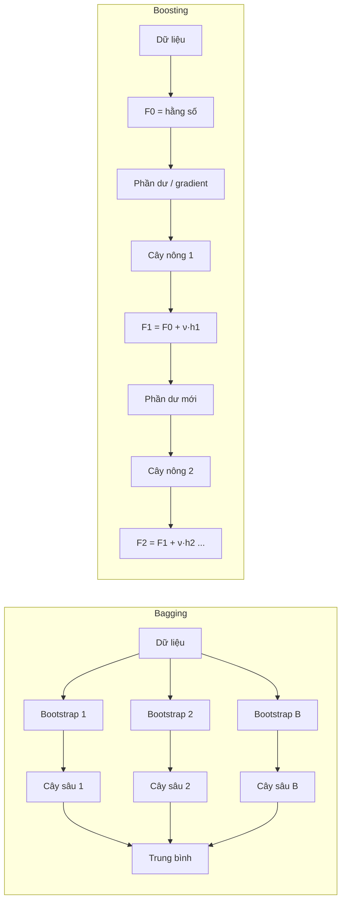
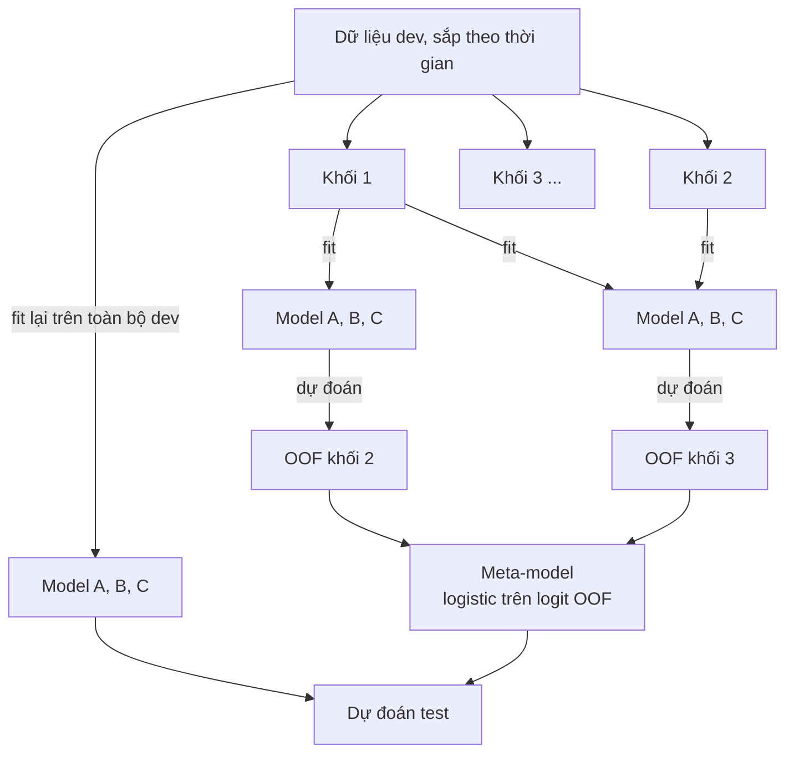
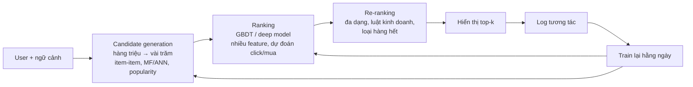
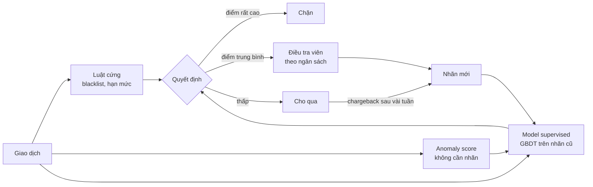

# Advanced ML: Ensembles, Gradient Boosting, Recommender Systems, Anomaly Detection

Module 11 dạy từng model riêng lẻ và cách đo chúng. Module này dạy những thứ thật sự chạy trong
production ở phần lớn công ty có dữ liệu dạng bảng: **gradient boosting** (XGBoost, LightGBM,
CatBoost) gần như luôn là model mạnh nhất cho dữ liệu bảng; **recommender system** là bài toán ML
mang lại doanh thu trực tiếp nhất ở thương mại điện tử và nội dung số; **anomaly detection** là nền
của chống gian lận, giám sát hệ thống, kiểm soát chất lượng dữ liệu. Phỏng vấn DS/MLE senior hầu
như luôn hỏi sâu về ít nhất một trong ba mảng này.

Module dùng ba bộ dữ liệu thật: **Olist** (bài toán review xấu, cùng định nghĩa và cùng mốc thời
gian với module 10, 11), **MovieLens** (100 836 rating phim) và **Credit Card Fraud** của ULB
(284 807 giao dịch, 0.17% gian lận). Tải dữ liệu:

```bash
uv run python data/download_olist.py
uv run python data/download_dataset.py movielens
uv run python data/download_dataset.py creditcard-fraud
```

Bài toán Olist trong module này giữ đúng khung của module 10: **dự đoán tại lúc đơn vừa giao
xong** liệu khách có để lại review 1–2 sao. Thời gian giao thực tế và cờ trễ là feature hợp lệ ở
điểm dự đoán này; mọi cột của review là leakage. Train là đơn mua trước 2018-01-01, validation từ
2018-01-01 tới hết tháng 3/2018, test từ 2018-04-01 tới hết 2018-08-31. Một can thiệp chủ động
**trước khi** giao là một bài toán khác, với điểm dự đoán khác (lúc mua hoặc lúc giao cho hãng vận
chuyển), và phải bỏ mọi kết quả giao hàng.

Sau module này bạn sẽ:

- Giải thích vì sao bagging giảm variance còn boosting giảm bias, và chọn đúng họ ensemble.
- Tự viết gradient boosting, và hiểu từng tham số của XGBoost/LightGBM tác động vào đâu.
- Dùng early stopping, learning rate, regularization để có model boosting tốt mà không tune mù.
- Biết khi nào stacking đáng làm và làm nó không rò rỉ dữ liệu.
- Dựng và đánh giá offline một recommender (popularity, item-item CF, matrix factorization), xử lý
  cold start.
- Phát hiện bất thường khi gần như không có nhãn, và đo đúng khi lớp dương chỉ chiếm 0.1%.

## 1. Ensemble: bagging và boosting

### Vì sao kết hợp nhiều model lại tốt hơn

Sai số kỳ vọng của một model (squared loss) tách thành bias² + variance + nhiễu không giảm được.
Hai họ ensemble tấn công hai thành phần khác nhau:

| | Bagging (random forest) | Boosting (gradient boosting) |
| --- | --- | --- |
| Base learner | Cây sâu: bias thấp, variance cao | Cây nông: bias cao, variance thấp |
| Cách kết hợp | Song song, lấy trung bình | Tuần tự, cây sau sửa lỗi cây trước |
| Giảm chủ yếu | Variance | Bias (và variance nhờ shrinkage) |
| Nhạy tham số | Ít, mặc định thường ổn | Nhiều: learning rate, số cây, độ sâu |
| Overfit khi thêm cây | Không (chỉ tốn tài nguyên) | Có, cần early stopping |
| Song song hoá | Theo cây | Trong từng cây (theo feature, theo bin) |

Trung bình của B cây, mỗi cây có variance $$\sigma^2$$ và tương quan từng đôi $$\rho$$, có variance

$$
\rho\,\sigma^2 + \frac{1 - \rho}{B}\,\sigma^2
$$

Thêm cây chỉ xoá được số hạng thứ hai. Random forest giảm $$\rho$$ bằng cách cho mỗi lần tách nút chỉ
xét một phần feature (`max_features`), nên các cây khác nhau hơn. Mỗi cây bỏ sót khoảng 37% dữ
liệu (out-of-bag), dùng được để ước lượng sai số mà không cần tập riêng (bài Basic 02), nhưng
**không** dùng được với dữ liệu theo thời gian.



### Ví dụ thật: Olist

Bảy feature số đơn giản (số món, số seller, giá, phí ship, số ngày giao, số ngày hứa, số ngày trễ so
với hẹn), train trên đơn trước 2018, đo AUC trên test:

```python
import pandas as pd

raw = "data/raw/"
o = pd.read_csv(raw + "olist_orders_dataset.csv", parse_dates=[
    "order_purchase_timestamp", "order_delivered_customer_date", "order_estimated_delivery_date"])
r = pd.read_csv(raw + "olist_order_reviews_dataset.csv", parse_dates=["review_answer_timestamp"])
it = pd.read_csv(raw + "olist_order_items_dataset.csv")
o = o[(o.order_status == "delivered") & o.order_delivered_customer_date.notna()]
r = r.sort_values("review_answer_timestamp").drop_duplicates("order_id", keep="last")
df = o.merge(r[["order_id", "review_score"]], on="order_id").merge(
    it.groupby("order_id").agg(n_items=("order_item_id", "size"), n_sellers=("seller_id", "nunique"),
                               price=("price", "sum"), freight=("freight_value", "sum")).reset_index(),
    on="order_id")
day = pd.Timedelta(days=1)
df["delivery_days"] = (df.order_delivered_customer_date - df.order_purchase_timestamp) / day
df["promised_days"] = (df.order_estimated_delivery_date - df.order_purchase_timestamp) / day
df["days_vs_estimate"] = (df.order_delivered_customer_date - df.order_estimated_delivery_date) / day
df["bad_review"] = (df.review_score <= 2).astype(int)
X_cols = ["n_items", "n_sellers", "price", "freight", "delivery_days", "promised_days", "days_vs_estimate"]
t = df.order_purchase_timestamp
train = df[t < "2018-01-01"]
val = df[(t >= "2018-01-01") & (t < "2018-04-01")]
test = df[(t >= "2018-04-01") & (t < "2018-09-01")]

import lightgbm as lgb
from sklearn.ensemble import BaggingClassifier, RandomForestClassifier
from sklearn.metrics import roc_auc_score
from sklearn.tree import DecisionTreeClassifier

models = {
    "1 cây sâu": DecisionTreeClassifier(random_state=0),
    "1 cây max_depth=3": DecisionTreeClassifier(max_depth=3, random_state=0),
    "bagging 100 cây sâu": BaggingClassifier(DecisionTreeClassifier(), n_estimators=100, random_state=0),
    "random forest": RandomForestClassifier(n_estimators=100, min_samples_leaf=20, random_state=0),
    "boosting (LightGBM)": lgb.LGBMClassifier(n_estimators=150, learning_rate=0.05, min_child_samples=50,
                                              n_jobs=1, verbose=-1, random_state=0),
}
for name, m in models.items():
    m.fit(train[X_cols], train.bad_review)
    auc_tr = roc_auc_score(train.bad_review, m.predict_proba(train[X_cols])[:, 1])
    auc_te = roc_auc_score(test.bad_review, m.predict_proba(test[X_cols])[:, 1])
    print(f"{name:20s} train AUC {auc_tr:.3f}   test AUC {auc_te:.3f}")
```

| Model | AUC train | AUC test |
| --- | --- | --- |
| 1 cây sâu | 1.000 | 0.572 |
| 1 cây `max_depth=3` | 0.701 | 0.678 |
| Bagging 100 cây sâu | 1.000 | 0.669 |
| Random forest | 0.913 | 0.688 |
| Boosting (LightGBM) | 0.809 | 0.690 |

Một cây sâu thuộc lòng train (AUC 1.000) và gần như vô dụng trên test (0.572). Bagging cùng loại cây
đó kéo test lên 0.669: variance giảm, bias giữ nguyên. Random forest (thêm `max_features`, lá tối
thiểu 20 đơn) lên 0.688. Boosting đạt 0.690 với khoảng cách train/test nhỏ hơn nhiều. Chênh lệch
giữa random forest và boosting ở đây nhỏ; với feature giàu hơn (bài Intermediate 01) boosting thường
nới rộng khoảng cách.

## 2. Gradient boosting từ đầu

### Gradient descent trong không gian hàm

Gradient boosting xây mô hình cộng $$F_M(x) = F_0 + \nu \sum_{m=1}^{M} h_m(x)$$. Ở vòng $$m$$, ta muốn
giảm loss $$\sum_i L(y_i, F(x_i))$$ bằng cách đi ngược gradient theo **giá trị dự đoán**. Gradient chỉ
biết tại các điểm train, nên ta fit một cây $$h_m$$ để xấp xỉ nó:

$$
r_{im} = -\left.\frac{\partial L(y_i, F)}{\partial F}\right|_{F = F_{m-1}(x_i)},
\qquad h_m \approx \arg\min_h \sum_i \big(r_{im} - h(x_i)\big)^2,
\qquad F_m = F_{m-1} + \nu\, h_m
$$

- **Squared loss** $$\tfrac12 (y - F)^2$$: negative gradient là phần dư $$y - F$$. Đây là trường hợp
  trực quan "cây sau học phần dư của cây trước".
- **Absolute loss**: negative gradient là $$\operatorname{sign}(y - F)$$; giá trị mỗi lá được đặt lại
  bằng median phần dư (bài Basic 01).
- **Log loss** (phân loại nhị phân, $$F$$ là logit, $$p = \sigma(F)$$): negative gradient là
  $$y - p$$, Hessian là $$p(1 - p)$$. Giá trị lá tối ưu theo bước Newton là
  $$\gamma = \sum_{i \in \text{leaf}} (y_i - p_i) \big/ \sum_{i \in \text{leaf}} p_i (1 - p_i)$$.

**Shrinkage** $$\nu$$ (learning rate) làm mỗi bước nhỏ lại, để nhiều cây cùng đóng góp và không cây nào
"thuộc lòng" nhiễu. Learning rate nhỏ cần nhiều cây hơn nhưng thường tổng quát hoá tốt hơn.

```python
import numpy as np
from sklearn.ensemble import GradientBoostingRegressor
from sklearn.tree import DecisionTreeRegressor

rng = np.random.default_rng(0)
X = rng.uniform(-3, 3, size=(500, 2))
y = np.sin(X[:, 0]) + 0.3 * X[:, 1] ** 2 + rng.normal(0, 0.3, 500)

def fit_gb(X, y, n_estimators=100, learning_rate=0.1, max_depth=3):
    f0 = y.mean()                        # F0: hằng số tốt nhất cho squared loss
    F = np.full(len(y), f0)
    trees = []
    for _ in range(n_estimators):
        residual = y - F                 # = negative gradient của ½(y − F)²
        tree = DecisionTreeRegressor(max_depth=max_depth, random_state=0).fit(X, residual)
        F += learning_rate * tree.predict(X)
        trees.append(tree)
    return f0, trees

def predict_gb(f0, trees, X, learning_rate=0.1):
    return f0 + learning_rate * sum(t.predict(X) for t in trees)

f0, trees = fit_gb(X, y)
ours = predict_gb(f0, trees, X)
sk = GradientBoostingRegressor(n_estimators=100, learning_rate=0.1, max_depth=3, random_state=0).fit(X, y)
print("lệch tối đa so với sklearn:", np.abs(ours - sk.predict(X)).max())
for m in [1, 10, 100]:
    print(m, "cây: train MSE", round(np.mean((y - predict_gb(f0, trees[:m], X)) ** 2), 4))
```

Mười dòng code trùng `GradientBoostingRegressor` của sklearn tới sai số máy (lệch tối đa
2.7e-15). Loss train giảm đều: 1.059 sau một cây, 0.333 sau 10 cây, 0.055 sau 100 cây. Nhiễu sinh ra
có phương sai 0.09, nên MSE train 0.055 nghĩa là mô hình đã bắt đầu học nhiễu: loss train giảm mãi
không phải tin tốt. Đó là lý do cần early stopping trên dữ liệu chưa thấy.

### Những thứ thư viện thật thêm vào

| Kỹ thuật | Tác dụng |
| --- | --- |
| Subsampling dòng (`bagging_fraction`, stochastic GB) | Mỗi cây học trên một phần dữ liệu: giảm variance, nhanh hơn |
| Subsampling cột (`feature_fraction`, `colsample_bytree`) | Như random forest, giảm tương quan giữa các cây |
| Regularization trên lá (`lambda_l2`, `min_child_weight`) | Giá trị lá nhỏ lại, lá cần đủ "khối lượng" Hessian |
| Bước Newton (gradient + Hessian) | Hội tụ nhanh hơn, xử lý mọi loss khả vi hai lần giống nhau |
| Histogram | Chia feature liên tục thành ≤ 255 bin, tìm điểm cắt trên bin thay vì trên từng giá trị |

## 3. XGBoost và LightGBM

### XGBoost: objective có regularization và bước Newton

XGBoost (Chen & Guestrin, 2016) viết objective tại vòng $$t$$ bằng khai triển Taylor bậc hai, với
$$g_i, h_i$$ là gradient và Hessian của loss tại dự đoán hiện tại, $$T$$ là số lá, $$w_j$$ là giá trị lá:

$$
\mathcal{L}^{(t)} \approx \sum_i \Big[g_i f_t(x_i) + \tfrac12 h_i f_t(x_i)^2\Big] + \gamma T + \tfrac12 \lambda \sum_j w_j^2
$$

Giải ra giá trị lá tối ưu và **gain** của một lần tách (G, H là tổng g, h trong nút trái L / phải R):

$$
w_j^\ast = -\frac{G_j}{H_j + \lambda},
\qquad
\text{Gain} = \frac12\left[\frac{G_L^2}{H_L + \lambda} + \frac{G_R^2}{H_R + \lambda} - \frac{(G_L + G_R)^2}{H_L + H_R + \lambda}\right] - \gamma
$$

Hệ quả thực tế: $$\lambda$$ (`reg_lambda`) co giá trị lá; $$\gamma$$ (`gamma`, `min_split_loss`) là mức
gain tối thiểu để tách, nên cây tự dừng khi tách không đáng; `min_child_weight` là tổng Hessian tối
thiểu của một lá (với log loss, lá toàn điểm có $$p$$ gần 0 hoặc 1 có Hessian nhỏ, nên không tách
được). XGBoost mặc định mọc cây **theo tầng** (depth-wise) và học sẵn hướng đi cho giá trị thiếu ở
mỗi nút.

### LightGBM: nhanh hơn trên dữ liệu lớn

LightGBM (Ke et al., 2017) dùng cùng nền tảng (gradient + Hessian, histogram) và thêm:

- **Leaf-wise growth**: mỗi bước tách lá có gain lớn nhất trên toàn cây, thay vì tách hết một tầng.
  Cùng số lá thì loss giảm nhiều hơn, nhưng cây có thể rất sâu một nhánh: kiểm soát bằng
  `num_leaves` (tham số chính) và `min_data_in_leaf`, đặt thêm `max_depth` nếu dữ liệu nhỏ.
- **GOSS** (Gradient-based One-Side Sampling): giữ các dòng gradient lớn, lấy mẫu dòng gradient
  nhỏ. **EFB** (Exclusive Feature Bundling): gộp các feature thưa hiếm khi khác 0 cùng lúc.
- **Categorical native**: cột kiểu `category` được tách bằng cách sắp các giá trị theo thống kê
  gradient, không cần one-hot. Mạnh nhưng dễ overfit với cột nhiều giá trị (`cat_smooth`,
  `min_data_per_group`).

| | XGBoost | LightGBM | CatBoost |
| --- | --- | --- | --- |
| Mọc cây | Theo tầng (có `grow_policy=lossguide`) | Theo lá | Cây đối xứng (oblivious) |
| Categorical | Có (gần đây), thường one-hot/encode trước | Native | Native, ordered target statistics chống leakage |
| Điểm mạnh | Ổn định, hệ sinh thái rộng, GPU tốt | Rất nhanh trên dữ liệu lớn, ít RAM | Mặc định tốt, ít tune, nhiều cột phân loại |
| Điểm yếu | Chậm hơn LightGBM trên CPU với dữ liệu lớn | Dễ overfit dữ liệu nhỏ nếu `num_leaves` lớn | Train chậm hơn, ít linh hoạt |

Trong thực tế ba thư viện cho chất lượng gần nhau khi tune cẩn thận; chọn theo hạ tầng sẵn có, dữ
liệu (nhiều cột phân loại → CatBoost hoặc LightGBM) và thời gian train. Môi trường của khoá học cài
LightGBM, nên code dùng LightGBM; tên tham số XGBoost tương đương nằm trong bảng dưới.

### Tham số quan trọng và thứ tự tune

| Nhóm | LightGBM | XGBoost | Hướng dẫn |
| --- | --- | --- | --- |
| Số cây | `num_boost_round` + early stopping | `n_estimators` + early stopping | Không tune tay; để early stopping chọn |
| Tốc độ học | `learning_rate` | `eta` | 0.05–0.1 khi thử, 0.01–0.05 khi chốt |
| Độ phức tạp cây | `num_leaves`, `max_depth` | `max_depth`, `max_leaves` | Tune đầu tiên; `num_leaves` 15–255 |
| Lá tối thiểu | `min_data_in_leaf`, `min_sum_hessian_in_leaf` | `min_child_weight` | Tăng khi overfit, dữ liệu nhiễu |
| Ngẫu nhiên | `bagging_fraction` + `bagging_freq`, `feature_fraction` | `subsample`, `colsample_bytree` | 0.7–0.9 |
| Regularization | `lambda_l1`, `lambda_l2`, `min_gain_to_split` | `alpha`, `lambda`, `gamma` | Tune sau cùng, tác động nhỏ hơn |
| Mất cân bằng | `scale_pos_weight`, `is_unbalance` | `scale_pos_weight` | Làm hỏng calibration; thường tốt hơn là giữ nguyên và chọn ngưỡng (module 11) |

Thứ tự thực dụng: cố định learning rate 0.1 → tune độ phức tạp cây và lá tối thiểu → subsampling →
regularization → hạ learning rate, để early stopping chọn lại số cây. Random search hoặc Optuna
trên CV **theo thời gian** (module 10) tốt hơn grid search.

### Early stopping

Train tối đa N vòng, đánh giá trên tập validation sau mỗi vòng, dừng khi metric không cải thiện sau
`patience` vòng, và dùng model tại vòng tốt nhất:

```python
import pandas as pd

raw = "data/raw/"
o = pd.read_csv(raw + "olist_orders_dataset.csv", parse_dates=[
    "order_purchase_timestamp", "order_delivered_customer_date", "order_estimated_delivery_date"])
r = pd.read_csv(raw + "olist_order_reviews_dataset.csv", parse_dates=["review_answer_timestamp"])
it = pd.read_csv(raw + "olist_order_items_dataset.csv")
o = o[(o.order_status == "delivered") & o.order_delivered_customer_date.notna()]
r = r.sort_values("review_answer_timestamp").drop_duplicates("order_id", keep="last")
df = o.merge(r[["order_id", "review_score"]], on="order_id").merge(
    it.groupby("order_id").agg(n_items=("order_item_id", "size"), n_sellers=("seller_id", "nunique"),
                               price=("price", "sum"), freight=("freight_value", "sum")).reset_index(),
    on="order_id")
day = pd.Timedelta(days=1)
df["delivery_days"] = (df.order_delivered_customer_date - df.order_purchase_timestamp) / day
df["promised_days"] = (df.order_estimated_delivery_date - df.order_purchase_timestamp) / day
df["days_vs_estimate"] = (df.order_delivered_customer_date - df.order_estimated_delivery_date) / day
df["bad_review"] = (df.review_score <= 2).astype(int)
X_cols = ["n_items", "n_sellers", "price", "freight", "delivery_days", "promised_days", "days_vs_estimate"]
t = df.order_purchase_timestamp
train = df[t < "2018-01-01"]
val = df[(t >= "2018-01-01") & (t < "2018-04-01")]
test = df[(t >= "2018-04-01") & (t < "2018-09-01")]

import lightgbm as lgb
from sklearn.metrics import roc_auc_score

params = dict(objective="binary", learning_rate=0.05, num_leaves=31, min_data_in_leaf=50,
              lambda_l2=1.0, num_threads=1, verbose=-1, seed=0)
dtrain = lgb.Dataset(train[X_cols], train.bad_review)
dval = lgb.Dataset(val[X_cols], val.bad_review, reference=dtrain)
model = lgb.train(params, dtrain, num_boost_round=2000, valid_sets=[dval],
                  callbacks=[lgb.early_stopping(stopping_rounds=50, verbose=False)])
print("best_iteration:", model.best_iteration)
no_es = lgb.train(params, dtrain, num_boost_round=1000)
for name, m, k in [("early stopping", model, model.best_iteration), ("1000 vòng", no_es, 1000)]:
    print(f"{name:15s} val AUC {roc_auc_score(val.bad_review, m.predict(val[X_cols], num_iteration=k)):.3f}"
          f"  test AUC {roc_auc_score(test.bad_review, m.predict(test[X_cols], num_iteration=k)):.3f}")
```

Với cùng 7 feature: early stopping chọn 83 cây, AUC test 0.694; train đủ 1 000 cây không dừng cho
AUC test 0.672 (và AUC validation 0.793 so với 0.812). Bài Intermediate 01 dùng 21 feature, đạt AUC
test 0.707 với 117 cây.

Lỗi hay gặp:

- Đưa test vào `valid_sets`: early stopping dùng test để chọn số cây, con số test hết khách quan.
- Validation không đại diện: trên Olist, quý 1/2018 có tỉ lệ trễ bất thường (21% đơn tháng 3), AUC
  validation cao hơn test hơn 0.1. Số cây chọn trên đó vẫn dùng được, nhưng đừng báo cáo AUC
  validation như hiệu năng production.
- Early stopping theo AUC thay vì log loss: AUC phẳng rất lâu, dừng muộn và dao động.

## 4. Stacking và blending

### Ý tưởng

Stacking (Wolpert, 1992) học một **meta-model** trên dự đoán của nhiều model tầng 1. Điểm mấu chốt:
meta-model phải học trên dự đoán **out-of-fold** (OOF), tức dự đoán cho mỗi dòng đến từ một model
không thấy dòng đó. Nếu dùng dự đoán in-sample, meta-model sẽ tin tuyệt đối vào model overfit nhất
(cây sâu có AUC train 1.000).



Với dữ liệu theo thời gian, fold phải **mở rộng theo thời gian** (expanding window): khối đầu không
có OOF. **Blending** là phiên bản đơn giản: model tầng 1 học trên train, meta-model học trên một tập
holdout (validation), đánh giá trên test.

```python
import pandas as pd

raw = "data/raw/"
o = pd.read_csv(raw + "olist_orders_dataset.csv", parse_dates=[
    "order_purchase_timestamp", "order_delivered_customer_date", "order_estimated_delivery_date"])
r = pd.read_csv(raw + "olist_order_reviews_dataset.csv", parse_dates=["review_answer_timestamp"])
it = pd.read_csv(raw + "olist_order_items_dataset.csv")
o = o[(o.order_status == "delivered") & o.order_delivered_customer_date.notna()]
r = r.sort_values("review_answer_timestamp").drop_duplicates("order_id", keep="last")
df = o.merge(r[["order_id", "review_score"]], on="order_id").merge(
    it.groupby("order_id").agg(n_items=("order_item_id", "size"), n_sellers=("seller_id", "nunique"),
                               price=("price", "sum"), freight=("freight_value", "sum")).reset_index(),
    on="order_id")
day = pd.Timedelta(days=1)
df["delivery_days"] = (df.order_delivered_customer_date - df.order_purchase_timestamp) / day
df["promised_days"] = (df.order_estimated_delivery_date - df.order_purchase_timestamp) / day
df["days_vs_estimate"] = (df.order_delivered_customer_date - df.order_estimated_delivery_date) / day
df["bad_review"] = (df.review_score <= 2).astype(int)
X_cols = ["n_items", "n_sellers", "price", "freight", "delivery_days", "promised_days", "days_vs_estimate"]
t = df.order_purchase_timestamp
train = df[t < "2018-01-01"]
val = df[(t >= "2018-01-01") & (t < "2018-04-01")]
test = df[(t >= "2018-04-01") & (t < "2018-09-01")]

import lightgbm as lgb
import numpy as np
from sklearn.linear_model import LogisticRegression
from sklearn.metrics import roc_auc_score
from sklearn.pipeline import make_pipeline
from sklearn.preprocessing import StandardScaler

# Tầng 1: hai model khác bản chất, chỉ học trên train
logit = make_pipeline(StandardScaler(), LogisticRegression(max_iter=1000)).fit(train[X_cols], train.bad_review)
gbm = lgb.LGBMClassifier(n_estimators=150, learning_rate=0.05, min_child_samples=50,
                         n_jobs=1, verbose=-1, random_state=0).fit(train[X_cols], train.bad_review)

def level1(frame):
    p = np.column_stack([logit.predict_proba(frame[X_cols])[:, 1], gbm.predict_proba(frame[X_cols])[:, 1]])
    return np.log(p / (1 - p))           # đưa về thang logit cho meta-model tuyến tính

# Tầng 2 (blending): meta-model học trên validation, dữ liệu mà tầng 1 chưa thấy
meta = LogisticRegression().fit(level1(val), val.bad_review)
print("trọng số meta:", meta.coef_.round(2))
z_test = level1(test)
for name, s in [("logistic", z_test[:, 0]), ("lightgbm", z_test[:, 1]),
                ("trung bình", z_test.mean(1)), ("stacking", meta.decision_function(z_test))]:
    print(f"{name:10s} test AUC {roc_auc_score(test.bad_review, s):.4f}")
```

Trên test: logistic 0.6852, LightGBM 0.6905, **trung bình đơn giản 0.6963**, stacking 0.6921.
Meta-model gán hệ số 1.04 cho LightGBM và 0.10 cho logistic. Trung bình đơn giản thắng stacking. Một lời giải
thích hợp lý: meta-model học trọng số trên quý 1/2018, giai đoạn trễ bất thường, nên trọng số đó
không còn tối ưu cho test. Bài Advanced 01 làm
bản OOF đầy đủ với ba model và bootstrap: stacking không hơn LightGBM đơn một cách phân biệt được.

### Khi nào stacking đáng làm

| Đáng | Không đáng |
| --- | --- |
| Cuộc thi, nơi +0.001 AUC đổi thứ hạng | Production nơi mỗi model là một thứ phải giám sát, retrain, debug |
| Các model tầng 1 **khác bản chất** (cây + tuyến tính + kNN + mạng nơ-ron), tương quan dự đoán thấp | Các model cùng họ (LightGBM + XGBoost + random forest): tương quan OOF 0.95+ |
| Nhiều dữ liệu cho meta-model | Ít dữ liệu, meta-model overfit |
| Lợi ích đo được có khoảng tin cậy tách khỏi 0 | Lợi ích nằm trong nhiễu |

Thứ tự ưu tiên của người làm thật: feature tốt hơn > một model boosting tune tốt > trung bình vài
model khác bản chất > stacking.

## 5. Recommender systems

### Bài toán và các họ phương pháp

Recommender trả lời "nên cho user này xem gì?". Dữ liệu thường là **implicit feedback** (xem, click,
mua: chỉ có tín hiệu dương, không có "ghét") nhiều hơn explicit feedback (rating). Ma trận user ×
item cực kỳ thưa: MovieLens latest-small có 610 user, 9 724 phim, mật độ 1.7%; 3 446 phim chỉ có
một rating, và 10% phim phổ biến nhất chiếm 60% số rating (long tail).

| Phương pháp | Ý tưởng | Ưu | Nhược |
| --- | --- | --- | --- |
| Popularity | Item được tương tác nhiều nhất (theo thời gian, vùng) | Baseline mạnh, cold start user | Không cá nhân hoá, khuếch đại người giàu càng giàu |
| Content-based | Item giống nội dung item user đã thích | Cold start item | Ít bất ngờ, cần feature nội dung tốt |
| Item-item CF | Item hay được tương tác cùng nhau | Giải thích được ("vì bạn xem X"), ổn định, Amazon dùng từ 2003 | Cold start, item hiếm |
| Matrix factorization | User và item là vector ẩn, điểm là tích vô hướng | Bắt cấu trúc toàn cục, gọn | Cold start, tối ưu RMSE không đồng nghĩa top-k tốt |
| Two-tower / deep | Mạng nơ-ron cho user và item, kết hợp feature | Dùng mọi feature, quy mô lớn | Tốn hạ tầng, khó debug |

### Item-item CF

Cosine giữa hai cột của ma trận tương tác $$X$$ (user × item):

$$
\operatorname{sim}(i, j) = \frac{x_i^\top x_j}{\lVert x_i \rVert\,\lVert x_j \rVert},
\qquad
\text{score}(u, i) = \sum_{j \in H_u} \operatorname{sim}(i, j)
$$

với $$H_u$$ là lịch sử của user. Không cần dựng ma trận độ giống đầy đủ: nếu $$\tilde X$$ là $$X$$ đã chuẩn
hoá cột thì vector điểm là $$\tilde X^\top(\tilde X h_u)$$, hai phép nhân thưa.

### Matrix factorization

Với rating tường minh, mô hình có bias (Koren, Bell, Volinsky, 2009):

$$
\hat r_{ui} = \mu + b_u + b_i + p_u^\top q_i,
\qquad
\min \sum_{(u,i)} \big(r_{ui} - \hat r_{ui}\big)^2 + \lambda\big(\lVert p_u \rVert^2 + \lVert q_i \rVert^2 + b_u^2 + b_i^2\big)
$$

Học bằng **SGD** (duyệt từng rating) hoặc **ALS** (cố định Q, mỗi user là một ridge regression; rồi
đổi vai; song song hoá tự nhiên, Spark MLlib dùng ALS). Với implicit feedback, mọi cặp chưa tương
tác là âm tính yếu (iALS, Hu et al. 2008) hoặc tối ưu trực tiếp thứ hạng (BPR). Trên split theo
thời gian của MovieLens (bài Advanced 02), baseline chỉ bias có RMSE 0.902, MF 20 chiều 0.893: phần
lớn tín hiệu nằm ở bias. Và MF tối ưu RMSE có precision@10 chỉ 0.071, **không thắng popularity** (0.075;
chênh 0.004 trên 610 user, trong khi sai số chuẩn xấp xỉ của mỗi con số đã khoảng 0.003: nằm trong
nhiễu), thấp xa item-item (0.097) dù vẫn hơn baseline chỉ bias.

### Đánh giá offline

Metric xếp hạng @k (bài Basic 03), với relevance nhị phân:

$$
\mathrm{P@}k = \frac{|\text{top}_k \cap \text{rel}|}{k},
\qquad
\mathrm{R@}k = \frac{|\text{top}_k \cap \text{rel}|}{|\text{rel}|},
\qquad
\mathrm{NDCG@}k = \frac{\sum_{i=1}^{k} \mathrm{rel}_i / \log_2(i + 1)}{\mathrm{IDCG@}k}
$$

Cộng thêm **coverage** (bao nhiêu item khác nhau được gợi ý), novelty, diversity. Chia train/test
theo thời gian (mỗi user: phần tương tác mới nhất làm test), không chia ngẫu nhiên theo dòng.

```python
import numpy as np
import pandas as pd
import scipy.sparse as sp

ratings = pd.read_csv("data/raw/movielens/ratings.csv").sort_values(["userId", "timestamp", "movieId"])
# Mỗi user: 20% lượt rating mới nhất làm test (mô phỏng "dự đoán user sẽ xem gì tiếp")
newest_rank = ratings.groupby("userId").cumcount(ascending=False)
n_user = ratings.groupby("userId").movieId.transform("size")
is_test = newest_rank < np.ceil(0.2 * n_user)
train, test = ratings[~is_test], ratings[is_test]
truth = test.groupby("userId").movieId.apply(set)
seen = train.groupby("userId").movieId.apply(set)
K = 10

def precision_at_k(recs):
    return np.mean([len(set(recs[u][:K]) & truth[u]) / K for u in truth.index])

# Popularity: phim được nhiều người rating nhất, bỏ phim user đã xem
counts = train.groupby("movieId").size().reset_index(name="n").sort_values(["n", "movieId"], ascending=[False, True])
popular = counts.movieId.to_numpy()
pop_recs = {u: [m for m in popular[:K + len(seen[u])] if m not in seen[u]][:K] for u in truth.index}

# Item-item CF: cosine giữa các cột của ma trận user × item nhị phân
users, items = np.sort(train.userId.unique()), np.sort(train.movieId.unique())
X = sp.csr_matrix((np.ones(len(train)), (np.searchsorted(users, train.userId), np.searchsorted(items, train.movieId))))
Xn = sp.csr_matrix(X.multiply(1 / np.sqrt(np.asarray(X.sum(0)))))     # chuẩn hoá mỗi cột item về độ dài 1
ii_recs = {}
for u in truth.index:
    hist = Xn[np.searchsorted(users, u)].indices
    score = Xn.T @ np.asarray(Xn[:, hist].sum(1)).ravel()   # = tổng cosine(item, từng phim trong lịch sử)
    score[hist] = -np.inf
    ii_recs[u] = items[np.lexsort((items, -score))[:K]].tolist()

for name, recs in [("popularity", pop_recs), ("item-item", ii_recs)]:
    coverage = len({m for r in recs.values() for m in r})
    print(f"{name:10s} precision@10 {precision_at_k(recs):.4f}   số phim khác nhau được gợi ý {coverage}")
```

Popularity: precision@10 0.0748, chỉ 98 phim khác nhau được gợi ý cho 610 user. Item-item: 0.0970
(+30%) và 473 phim. Nếu chỉ tính "trúng" với phim user chấm ≥ 4 sao, hai cách gần bằng nhau (0.059
và 0.058, bài Intermediate 02): ma trận nhị phân đoán **xem gì**, không đoán **thích gì**.

### Cold start và hệ thống thật

- **User mới**: popularity theo ngữ cảnh (vùng, giờ, nguồn truy cập), hỏi sở thích lúc đăng ký,
  chuyển dần sang CF khi có vài tương tác.
- **Item mới**: content-based (thể loại, mô tả, ảnh), slot "mới" có giới hạn, exploration (bandit).
  Trong split của MovieLens, 8.3% rating test thuộc phim chưa có trong train.
- **Feedback loop**: model chỉ thấy phản hồi trên những gì nó đã gợi ý. Giữ một phần traffic cho
  exploration để có dữ liệu không thiên lệch.
- Offline metric chỉ là proxy; quyết định cuối cùng bằng A/B test (module 03).



Kiến trúc hai tầng (Covington et al., YouTube 2016) là chuẩn của ngành: tầng đầu tối ưu **recall**
với chi phí thấp, tầng sau tối ưu **precision** với model nặng, thường chính là gradient boosting
của mục 3 (learning to rank).

## 6. Anomaly detection

### Bài toán

Tìm điểm "khác thường" khi nhãn rất ít hoặc không có: gian lận, xâm nhập, lỗi cảm biến, dữ liệu
pipeline hỏng. Ba tình huống:

| Tình huống | Có nhãn? | Cách làm |
| --- | --- | --- |
| Không nhãn | Không | Isolation forest, LOF, autoencoder, thống kê (z-score, IQR) |
| Có dữ liệu "sạch" | Chỉ biết dòng bình thường | Học phân phối bình thường (one-class, autoencoder trên dữ liệu sạch) |
| Có nhãn (dù chậm) | Có | Supervised (gradient boosting) với xử lý mất cân bằng; anomaly score làm feature |

### Isolation forest

Ý tưởng (Liu, Ting, Zhou, 2008): điểm bất thường **dễ cô lập**. Xây nhiều cây ngẫu nhiên, mỗi nút
chọn ngẫu nhiên một feature và một ngưỡng; điểm bất thường bị tách riêng sau ít lần cắt. Với
$$E[h(x)]$$ là độ sâu trung bình để cô lập $$x$$ và $$c(n)$$ là độ sâu trung bình của một tìm kiếm không
thành công trong cây nhị phân $$n$$ điểm:

$$
s(x, n) = 2^{-E[h(x)] / c(n)}
$$

$$s$$ gần 1 là bất thường, quanh 0.5 trở xuống là bình thường. Nhanh (mỗi cây chỉ dùng 256 điểm mẫu),
không cần chuẩn hoá. Điểm yếu: cắt song song trục, nên kém với bất thường "lệch khỏi cấu trúc"
nhưng không cực đoan trên trục nào (bài Intermediate 03 có ví dụ).

### Autoencoder (ý niệm)

Autoencoder nén dữ liệu xuống ít chiều rồi dựng lại; học trên dữ liệu bình thường thì dựng lại tốt
dữ liệu bình thường và dựng lại kém điểm bất thường. **Sai số dựng lại** là điểm bất thường. PCA là
autoencoder tuyến tính một lớp ẩn: thử PCA trước, chỉ dùng autoencoder sâu khi quan hệ phi tuyến rõ
và có đủ dữ liệu. Rủi ro lớn nhất là **contamination**: dữ liệu huấn luyện lẫn bất thường thì mô hình
học luôn cách dựng lại chúng.

### Đánh giá khi cực kỳ mất cân bằng

Với 0.15% dương tính, ROC-AUC gây hiểu lầm: FPR 1% trên 140 nghìn giao dịch bình thường là khoảng
1 400 báo động sai mỗi ngày. Dùng:

- **PR-AUC / average precision**: baseline của bộ chấm ngẫu nhiên là tỉ lệ dương tính, không phải 0.5.
- **Precision và recall tại ngân sách cảnh báo** (precision@k): đội điều tra xem được k giao dịch/ngày.
- **Chi phí**: giá một gian lận lọt lưới so với giá một lần điều tra (module 11).
- Chia **theo thời gian** và tính tới **độ trễ của nhãn** (chargeback về sau vài tuần).

```python
import lightgbm as lgb
import numpy as np
import pandas as pd
from sklearn.decomposition import PCA
from sklearn.ensemble import IsolationForest
from sklearn.metrics import average_precision_score, roc_auc_score
from sklearn.preprocessing import StandardScaler

df = pd.read_csv("data/raw/creditcard-fraud/creditcard.csv")
df["Amount"] = np.log1p(df["Amount"])
features = [f"V{i}" for i in range(1, 29)] + ["Amount"]
train, test = df[df.Time < 86_400], df[df.Time >= 86_400]      # ngày 1 / ngày 2
y = test.Class.to_numpy()
print(f"test: {len(test)} giao dịch, {y.sum()} gian lận ({y.mean():.3%})")

iso = IsolationForest(n_estimators=200, random_state=0).fit(train[features])

def pca_error(fit_rows):
    """Autoencoder tuyến tính: nén 29 chiều về 15 rồi dựng lại; lỗi dựng lại cao = bất thường."""
    scaler = StandardScaler().fit(fit_rows[features])
    pca = PCA(n_components=15).fit(scaler.transform(fit_rows[features]))
    z = scaler.transform(test[features])
    return ((z - pca.inverse_transform(pca.transform(z))) ** 2).sum(1)

gbm = lgb.LGBMClassifier(n_estimators=300, learning_rate=0.05, num_leaves=15, min_child_samples=50,
                         n_jobs=1, verbose=-1, random_state=0).fit(train[features], train.Class)
scores = {
    "isolation forest (không nhãn)": -iso.score_samples(test[features]),
    "PCA, học trên mọi giao dịch": pca_error(train),
    "PCA, học trên giao dịch sạch": pca_error(train[train.Class == 0]),
    "LightGBM (có nhãn)": gbm.predict_proba(test[features])[:, 1],
}
for name, s in scores.items():
    top = np.argsort(-s)[:100]
    print(f"{name:32s} ROC-AUC {roc_auc_score(y, s):.3f}  PR-AUC {average_precision_score(y, s):.3f}"
          f"  precision@100 {y[top].mean():.2f}")
```

| Bộ chấm (ngày 2: 140 021 giao dịch, 211 gian lận) | ROC-AUC | PR-AUC | precision@100 |
| --- | --- | --- | --- |
| Isolation forest (không nhãn) | 0.956 | 0.130 | 0.26 |
| PCA, học trên mọi giao dịch | 0.927 | 0.041 | 0.08 |
| PCA, học trên giao dịch sạch | 0.971 | 0.209 | 0.38 |
| LightGBM (có nhãn) | 0.869 | 0.621 | 0.95 |

Ba bài học: ROC-AUC xếp hạng ngược với PR-AUC (LightGBM có ROC-AUC **thấp nhất** nhưng PR-AUC gấp 3
lần, và 95/100 cảnh báo đầu là thật); contamination làm PCA rơi từ 0.209 xuống 0.041; có nhãn thì
supervised thắng xa. Anomaly detection vẫn có vai trò: bắt kiểu gian lận mới chưa có nhãn, làm
feature cho model supervised, giám sát drift.



## 7. Chọn công cụ và lỗi hay gặp

### Chọn gì cho bài toán nào

| Bài toán | Bắt đầu với | Nâng cấp khi |
| --- | --- | --- |
| Dữ liệu bảng, có nhãn | LightGBM/XGBoost/CatBoost + early stopping | Feature tốt hơn trước; ensemble khác bản chất khi lợi ích đo được |
| Cần giải thích cho cơ quan quản lý | Logistic regression / GAM, hoặc GBDT với monotone constraints | |
| Gợi ý sản phẩm | Popularity + item-item | MF / two-tower cho candidate, GBDT cho ranking |
| Phát hiện bất thường không nhãn | Isolation forest, PCA reconstruction | Autoencoder; chuyển sang supervised ngay khi có nhãn |
| Rất ít dữ liệu (vài trăm dòng) | Model tuyến tính có regularization | Boosting dễ overfit; random forest an toàn hơn |

### Lỗi hay gặp

- **Leakage trong boosting**: boosting tìm ra mọi lối tắt, kể cả cột chỉ biết sau thời điểm dự
  đoán (module 10). Feature quan trọng "đẹp bất thường" là dấu hiệu đầu tiên.
- **Tune trên test**, hoặc early stopping trên test.
- **CV ngẫu nhiên trên dữ liệu thời gian** cho early stopping, OOF stacking, đánh giá recommender.
- **`scale_pos_weight` rồi dùng xác suất như thật**: xác suất bị lệch, phải calibrate lại (module 11).
- **Feature importance theo gain** dùng để kết luận nhân quả. Gain thiên về feature nhiều giá trị;
  dùng SHAP/permutation (module 11) và nhớ đó vẫn là tương quan.
- **Recommender chỉ tối ưu RMSE** rồi kỳ vọng top-k tốt.
- **Anomaly detection báo ROC-AUC** cho người vận hành.
- **Model không được giám sát sau khi ra production**: dữ liệu trôi (giao hàng trễ mùa cao điểm,
  kiểu gian lận mới) làm model xuống cấp âm thầm. Module MLOps xử lý phần này.

## 8. Tài liệu tham khảo

Sách và tổng quan:

- Trevor Hastie, Robert Tibshirani, Jerome Friedman. *The Elements of Statistical Learning*
  (chương 8, 10, 15, 16: bagging, boosting, random forest, ensemble). [An Introduction to Statistical
  Learning](https://www.statlearning.com/) là bản dễ đọc hơn, chương 8.
- [scikit-learn: Ensembles](https://scikit-learn.org/stable/modules/ensemble.html),
  [Novelty and Outlier Detection](https://scikit-learn.org/stable/modules/outlier_detection.html)
- [Google: Recommendation Systems course](https://developers.google.com/machine-learning/recommendation)
- [Reproducible Machine Learning for Credit Card Fraud Detection](https://fraud-detection-handbook.github.io/fraud-detection-handbook/Foreword.html) (sách mở của ULB, cùng nhóm công bố bộ dữ liệu)
- Goodfellow, Bengio, Courville. [Deep Learning, chương 14: Autoencoders](https://www.deeplearningbook.org/contents/autoencoders.html)

Từ roadmap.sh/ai-data-scientist (mục Machine Learning):

- [AI & Data Scientist Roadmap](https://roadmap.sh/ai-data-scientist)

Paper:

- Friedman (2001). [Greedy Function Approximation: A Gradient Boosting Machine](https://projecteuclid.org/journals/annals-of-statistics/volume-29/issue-5/Greedy-function-approximation-A-gradient-boosting-machine/10.1214/aos/1013203451.full).
- Breiman (2001). [Random Forests](https://link.springer.com/article/10.1023/A:1010933404324).
- Chen & Guestrin (2016). [XGBoost: A Scalable Tree Boosting System](https://arxiv.org/abs/1603.02754).
- Ke et al. (2017). [LightGBM: A Highly Efficient Gradient Boosting Decision Tree](https://papers.nips.cc/paper/6907-lightgbm-a-highly-efficient-gradient-boosting-decision-tree).
- Prokhorenkova et al. (2018). [CatBoost: unbiased boosting with categorical features](https://arxiv.org/abs/1706.09516).
- Wolpert (1992). Stacked Generalization. *Neural Networks* 5(2).
- Linden, Smith, York (2003). [Amazon.com Recommendations: Item-to-Item Collaborative Filtering](https://www.cs.umd.edu/~samir/498/Amazon-Recommendations.pdf).
- Koren, Bell, Volinsky (2009). [Matrix Factorization Techniques for Recommender Systems](https://datajobs.com/data-science-repo/Recommender-Systems-%5BNetflix%5D.pdf).
- Hu, Koren, Volinsky (2008). [Collaborative Filtering for Implicit Feedback Datasets](http://yifanhu.net/PUB/cf.pdf).
- Rendle et al. (2009). [BPR: Bayesian Personalized Ranking from Implicit Feedback](https://arxiv.org/abs/1205.2618).
- Covington, Adams, Sargin (2016). [Deep Neural Networks for YouTube Recommendations](https://research.google/pubs/deep-neural-networks-for-youtube-recommendations/).
- Liu, Ting, Zhou (2008). [Isolation Forest](https://cs.nju.edu.cn/zhouzh/zhouzh.files/publication/icdm08b.pdf).
- Saito & Rehmsmeier (2015). [The Precision-Recall Plot Is More Informative than the ROC Plot When Evaluating Binary Classifiers on Imbalanced Datasets](https://journals.plos.org/plosone/article?id=10.1371/journal.pone.0118432).

Tài liệu thư viện:

- [LightGBM: Parameters](https://lightgbm.readthedocs.io/en/latest/Parameters.html), [Parameters Tuning](https://lightgbm.readthedocs.io/en/latest/Parameters-Tuning.html)
- [XGBoost: Introduction to Boosted Trees](https://xgboost.readthedocs.io/en/stable/tutorials/model.html)

Dữ liệu:

- MovieLens: F. Maxwell Harper, Joseph A. Konstan (2015), The MovieLens Datasets: History and
  Context. [README của bộ latest-small](https://files.grouplens.org/datasets/movielens/ml-latest-small-README.html) (điều khoản sử dụng).
- Credit Card Fraud (ULB Machine Learning Group): [Kaggle](https://www.kaggle.com/datasets/mlg-ulb/creditcardfraud)
