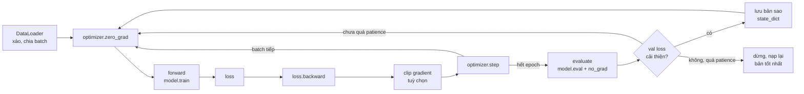
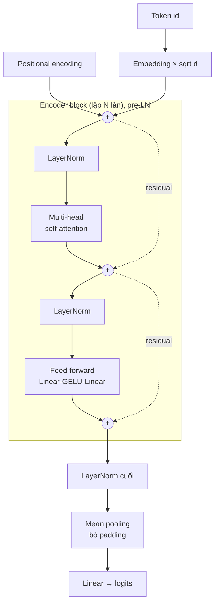
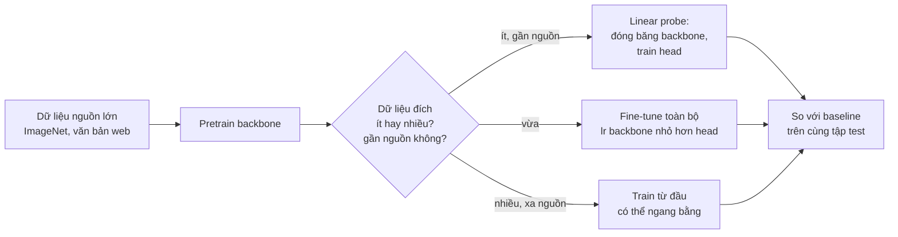

# Deep Learning với PyTorch

Deep learning là công cụ mặc định cho dữ liệu **không có cấu trúc bảng**: ảnh, văn bản, âm thanh,
chuỗi sự kiện dài. Với dữ liệu bảng (phần lớn công việc của Data Scientist), gradient boosting ở
module 12 vẫn thường thắng. Một DS senior cần biết cả hai phía: dựng và train được một mạng nơ-ron
đúng cách, và biết lúc nào **không** nên dùng nó. Module này đi từ tensor và autograd tới
Transformer, luôn kèm thí nghiệm thật trên CPU và một baseline đơn giản để so.

Module dùng **FashionMNIST** (70 000 ảnh quần áo 28×28) cho phần ảnh và **lời bình review Olist**
(tiếng Bồ Đào Nha) cho phần văn bản và embeddings. Toán nền (gradient, chain rule, gradient
descent, momentum, Adam) đã có ở module 01; ở đây chỉ nhắc lại khi cần. Tải dữ liệu:

```bash
uv run python data/download_olist.py
# FashionMNIST tự tải (khoảng 30 MB) vào data/raw/fashion-mnist khi chạy cell explore đầu tiên
# của bài Intermediate 01, hoặc bất kỳ khối code nào dưới đây có download=True
```

Sau module này bạn sẽ:

- Dùng tensor, autograd và viết vòng train chuẩn không có bug "im lặng".
- Dựng MLP, CNN, LSTM, Transformer encoder bằng PyTorch thuần và hiểu vì sao mỗi kiến trúc hợp với
  loại dữ liệu nào.
- Dùng regularization (dropout, weight decay, early stopping) dựa trên đường cong validation.
- Hiểu embeddings: học từ tác vụ có nhãn, học tự giám sát (word2vec), và transfer learning.
- Chọn chạy trên CPU hay GPU, ước lượng bộ nhớ, và chuyển dự án sang GPU (RTX 3050 4GB).

## 1. Tensor, autograd và vòng train

### Tensor

Tensor là mảng nhiều chiều giống `numpy.ndarray`, cộng thêm hai thứ: chạy được trên GPU (`device`),
và ghi lại phép toán để tự tính gradient (`requires_grad`). Ba thuộc tính phải luôn để ý là
`shape`, `dtype`, `device`; phần lớn lỗi PyTorch là lệch một trong ba.

```python
import torch

x = torch.arange(6, dtype=torch.float32).reshape(2, 3)    # tensor 2×3
b = torch.tensor([10.0, 20.0, 30.0])                      # shape (3,)
print(x + b)                                              # broadcasting: b được "kéo" lên 2×3
print(x.dtype, x.shape, x.device)

w = torch.tensor([1.0, -2.0, 0.5], requires_grad=True)
loss = ((x @ w) ** 2).mean()                              # forward dựng graph
loss.backward()                                           # backward điền w.grad
print(loss.item(), w.grad)
print(loss.grad_fn, loss.grad_fn.next_functions)
```

Kết quả: `loss = 3.625`, `w.grad = [-7.5, -11.0, -14.5]`. `grad_fn` cho thấy graph: `MeanBackward0`
nối về `PowBackward0`, rồi về phép nhân ma trận.

### Autograd

PyTorch dựng **computational graph động** (define-by-run): mỗi phép toán trên tensor có
`requires_grad` tạo một nút ghi lại cách tính đạo hàm cục bộ. `loss.backward()` đi ngược graph theo
chain rule (reverse-mode autodiff, mục 4 module 01) và **cộng dồn** gradient vào `.grad` của các lá.
Bài Basic 01 cho bạn tự viết một bản thu nhỏ (khoảng 100 dòng) để thấy không có phép màu nào.

Ba hệ quả thực tế:

| Hành vi | Hệ quả | Cách làm đúng |
| --- | --- | --- |
| Gradient cộng dồn qua các lần `backward()` | Quên xoá thì mỗi bước dùng tổng gradient cũ | `optimizer.zero_grad()` mỗi batch |
| Graph giữ mọi activation tới khi `backward()` | Cộng dồn `loss` (tensor) qua batch giữ cả graph, rò bộ nhớ | Log bằng `loss.item()` |
| Đánh giá vẫn dựng graph nếu không tắt | Tốn bộ nhớ, chậm | `with torch.no_grad():` (hoặc `torch.inference_mode()`) |

### Vòng train chuẩn



Bốn bước trong mỗi batch (`zero_grad → forward → backward → step`) và hai chế độ `train()` /
`eval()` là khung của mọi model trong module. `model.eval()` đổi hành vi của dropout và BatchNorm;
`torch.no_grad()` tắt việc dựng graph. Hai thứ độc lập, thiếu cái nào cũng là bug. Bài Basic 02 viết
vòng này kèm early stopping và test từng chi tiết (loss trung bình theo mẫu, chế độ train/eval, khôi
phục trọng số tốt nhất).

Optimizer: **Adam / AdamW** là mặc định an toàn (lr 1e-3 cho hầu hết model nhỏ); SGD + momentum vẫn
được dùng cho CNN lớn khi cần tổng quát hoá tốt nhất và có thời gian tune lịch learning rate. Cơ chế
của cả hai ở mục 6 module 01.

## 2. MLP và regularization

### MLP

Multi-layer perceptron là chuỗi `Linear → activation → Linear → ...`. Không có activation phi
tuyến thì mọi tầng gộp lại vẫn là một phép biến đổi tuyến tính. Lựa chọn mặc định:

| Thành phần | Mặc định | Ghi chú |
| --- | --- | --- |
| Activation | ReLU (CNN, MLP), GELU (Transformer) | `sigmoid`/`tanh` ở tầng ẩn dễ làm gradient biến mất |
| Khởi tạo | Mặc định của PyTorch (Kaiming uniform) | Chỉ đổi khi có lý do; khởi tạo hằng số làm mọi nơ-ron giống nhau |
| Loss phân loại nhiều lớp | `CrossEntropyLoss` trên **logits** | Không tự thêm softmax trước nó |
| Loss nhị phân | `BCEWithLogitsLoss` trên logits | Ổn định số hơn `sigmoid` + `BCELoss` |
| Chuẩn hoá input | Trừ mean, chia std của tập **train** | Không chuẩn hoá thì lr phù hợp khác nhau theo feature (condition number, module 01) |

Trên FashionMNIST, MLP 784-256-128-10 (235 146 tham số) đạt **87.7%** test accuracy sau 5 epoch, 4
giây trên CPU (bài Intermediate 01).

### Overfitting và ba cách chống

Mạng nơ-ron có nhiều tham số hơn số mẫu là chuyện thường. Thí nghiệm dưới đây cố tình train MLP 2
tầng 512 nơ-ron trên chỉ **1 000 ảnh**, theo dõi val loss trên 10 000 ảnh validation qua 100 epoch
(chạy khoảng 30 giây trên CPU):

```python
import torch
from torch import nn
from torchvision.datasets import FashionMNIST

torch.manual_seed(0)
torch.set_num_threads(4)
train = FashionMNIST("data/raw/fashion-mnist", train=True, download=True)
idx = torch.randperm(50000)[:1000]                    # cố ý chỉ 1 000 ảnh train để thấy overfitting
X, y = train.data[idx].float().div(255).flatten(1), train.targets[idx]
Xt, yt = train.data[50000:].float().div(255).flatten(1), train.targets[50000:]   # 10 000 ảnh validation

def run(dropout=0.0, weight_decay=0.0, epochs=100):
    torch.manual_seed(1)
    model = nn.Sequential(nn.Linear(784, 512), nn.ReLU(), nn.Dropout(dropout),
                          nn.Linear(512, 512), nn.ReLU(), nn.Dropout(dropout), nn.Linear(512, 10))
    opt = torch.optim.AdamW(model.parameters(), lr=1e-3, weight_decay=weight_decay)
    curve = []
    for _ in range(epochs):
        model.train()
        for b in torch.randperm(1000).split(100):
            opt.zero_grad()
            nn.functional.cross_entropy(model(X[b]), y[b]).backward()
            opt.step()
        model.eval()
        with torch.no_grad():
            logits = model(Xt)
            curve.append((nn.functional.cross_entropy(logits, yt).item(), (logits.argmax(1) == yt).float().mean().item()))
    best = min(range(epochs), key=lambda e: curve[e][0])
    return best, curve[best], curve[-1]

for name, kw in [("không regularization", {}), ("dropout 0.5", {"dropout": 0.5}),
                 ("weight decay 1.0", {"weight_decay": 1.0}), ("cả hai", {"dropout": 0.5, "weight_decay": 1.0})]:
    best, (bl, ba), (fl, fa) = run(**kw)
    print(f"{name:22s} val loss tốt nhất {bl:.3f} (epoch {best + 1}, acc {ba:.3f}) | epoch 100: loss {fl:.3f}, acc {fa:.3f}")
```

| Cấu hình | Val loss tốt nhất (epoch) | Val loss epoch 100 | Val accuracy epoch 100 |
| --- | --- | --- | --- |
| Không regularization | 0.577 (9) | 1.193 | 0.817 |
| Dropout 0.5 | 0.535 (20) | 0.835 | 0.819 |
| Weight decay 1.0 (AdamW) | 0.569 (13) | 0.803 | 0.808 |
| Cả hai | 0.536 (26) | 0.611 | 0.821 |

Bài học không nằm ở accuracy (gần như không đổi, 0.81–0.82) mà ở **loss**: không regularization, val
loss tăng gấp đôi sau epoch 9 vì model ngày càng **tự tin sai** (xác suất dự đoán cực đoan). Nếu bạn
dùng xác suất của model (xếp hạng rủi ro, ngưỡng theo chi phí như module 11) thì đó là hỏng thật,
dù accuracy trông ổn.

- **Dropout**: khi train, mỗi nơ-ron bị tắt ngẫu nhiên với xác suất p (phần còn lại nhân
  $$1/(1-p)$$ để giữ kỳ vọng). Model không dựa được vào một nơ-ron cụ thể, giống train một tập hợp
  nhiều mạng con. Khi `eval()` thì tắt dropout.
- **Weight decay**: thêm $$\lambda \lVert w\rVert^2$$ vào loss, tức kéo trọng số về 0 mỗi bước. Với Adam
  phải dùng **AdamW** (decoupled weight decay); `Adam(weight_decay=...)` cộng phạt vào gradient rồi
  bị chia cho căn moment bậc hai nên hiệu lực không đều giữa các tham số.
- **Early stopping**: giữ trọng số ở epoch val loss nhỏ nhất. Rẻ nhất, gần như luôn nên bật, và
  cũng là một dạng regularization (giới hạn số bước tối ưu).

Ba thứ khác cũng là regularization: **data augmentation** (lật, cắt, đổi màu ảnh: "thêm dữ liệu" miễn
phí, thường hiệu quả nhất với ảnh), **BatchNorm/LayerNorm** (chủ yếu để train ổn định, có tác dụng
phụ regularize), và **thêm dữ liệu thật**, luôn là cách tốt nhất nếu làm được.

Lỗi hay gặp: chọn epoch hay mức regularization theo tập test; so hai cấu hình chỉ với một seed; tăng
dropout khi vấn đề thật là underfitting (train loss cũng cao).

## 3. CNN cho ảnh

### Convolution: dùng lại một bộ lọc ở mọi vị trí

Một tầng `Conv2d(C_in, C_out, k)` trượt `C_out` bộ lọc kích thước $$C_{in} \times k \times k$$ trên ảnh.
Hai tính chất làm CNN hợp với ảnh:

- **Weight sharing**: cùng một bộ lọc dùng ở mọi vị trí, nên số tham số không phụ thuộc kích thước
  ảnh: $$C_{out}(C_{in}k^2 + 1)$$.
- **Translation equivariance**: vật dịch sang phải thì bản đồ đặc trưng cũng dịch theo. Kết hợp với
  pooling, model nhận ra "cổ áo" ở bất kỳ đâu.

Kích thước đầu ra theo mỗi chiều, với input $$n$$, kernel $$k$$, padding $$p$$, stride $$s$$:

$$
n_{out} = \left\lfloor \frac{n + 2p - k}{s} \right\rfloor + 1
$$

```python
import torch
from torch import nn

x = torch.randn(1, 1, 28, 28)                             # (batch, kênh, cao, rộng)
for layer in [nn.Conv2d(1, 32, 3, padding=1), nn.MaxPool2d(2), nn.Conv2d(32, 64, 3, padding=1),
              nn.MaxPool2d(2), nn.Conv2d(64, 64, 3, stride=2)]:
    x = layer(x)
    n = sum(p.numel() for p in layer.parameters())
    print(f"{layer.__class__.__name__:10s} → {tuple(x.shape)}, {n} tham số")

# cùng "nhìn" ảnh 28×28 → 32 bản đồ đặc trưng: Linear cần bao nhiêu tham số?
print("Linear tương đương:", 28 * 28 * 32 * 28 * 28, "tham số")
```

Tầng conv đầu chỉ có 320 tham số; một tầng Linear làm cùng phép biến đổi kích thước (784 → 32×28×28)
cần 19 668 992 tham số. Tầng cuối minh hoạ công thức: 7×7, kernel 3, stride 2, không padding cho
$$\lfloor (7 - 3)/2 \rfloor + 1 = 3$$.

### Kết quả trên FashionMNIST

Bài Intermediate 01, 5 epoch, Adam lr 1e-3, 50 000 ảnh train, CPU i7-11800H 8 luồng:

| Model | Tham số | Thời gian | Test accuracy |
| --- | --- | --- | --- |
| MLP 784-256-128-10 | 235 146 | 4 s | 0.8768 |
| CNN 2 khối conv + 2 Linear | 421 642 | 52 s | 0.9048 |

CNN giảm khoảng 23% số ảnh sai nhưng chậm hơn khoảng 13 lần trên CPU. Đáng chú ý: 401 536 trong
421 642 tham số của CNN nằm ở tầng `Linear` sau `Flatten`, không phải ở conv. Kiến trúc hiện đại
(ResNet) thay `Flatten` bằng **global average pooling** vì lý do này. Lớp khó nhất là Shirt (67.8%),
bị nhầm với Coat, T-shirt/top, Pullover: giới hạn của ảnh 28×28 xám, không phải của model.

### Khi nào dùng, đánh đổi, lỗi hay gặp

- Ảnh, phổ âm thanh (spectrogram), chuỗi 1D có mẫu cục bộ (`Conv1d` cho tín hiệu cảm biến): CNN.
  Với ảnh thật, gần như luôn bắt đầu từ model **pretrain** (ResNet, EfficientNet, ViT) thay vì train
  từ đầu (mục 6).
- Đánh đổi: CNN chậm hơn nhiều trên CPU; cần GPU khi ảnh lớn hoặc dữ liệu nhiều.
- Lỗi hay gặp: quên chiều kênh (`(N, H, W)` thay vì `(N, 1, H, W)`), chuẩn hoá bằng thống kê của cả
  test, augmentation làm đổi nhãn (lật chữ "6" thành "9"), đánh giá ở chế độ train.

## 4. RNN và LSTM cho chuỗi

### RNN và vấn đề vanishing gradient

RNN đọc chuỗi từng bước, cập nhật trạng thái ẩn $$h_t = \tanh(W_x x_t + W_h h_{t-1} + b)$$. Gradient
từ loss ở bước cuối về bước đầu phải đi qua tích của $$T$$ ma trận Jacobian; tích này thường **co về 0**
(vanishing) hoặc **nổ** (exploding). Nổ thì chữa bằng gradient clipping; co về 0 thì RNN thường
"quên" thông tin xa.

### LSTM và GRU

LSTM thêm **cell state** $$c_t$$ cập nhật kiểu cộng, điều khiển bởi các cổng (forget $$f_t$$, input
$$i_t$$, output $$o_t$$, đều là sigmoid):

$$
c_t = f_t \odot c_{t-1} + i_t \odot \tilde c_t, \qquad h_t = o_t \odot \tanh(c_t)
$$

Khi forget gate gần 1, gradient đi qua $$c_t$$ gần như nguyên vẹn qua nhiều bước. GRU gộp lại thành
hai cổng, ít tham số hơn, chất lượng thường tương đương.

```python
import torch
from torch import nn
from torch.nn.utils.rnn import pack_padded_sequence

torch.manual_seed(0)
lstm = nn.LSTM(input_size=8, hidden_size=16, batch_first=True)
x = torch.randn(3, 5, 8)                                  # 3 chuỗi, tối đa 5 bước, 8 đặc trưng mỗi bước
lengths = torch.tensor([5, 2, 3])                         # độ dài thật; phần còn lại là padding
output, (h_n, c_n) = lstm(pack_padded_sequence(x, lengths, batch_first=True, enforce_sorted=False))
print(h_n.shape, c_n.shape)                               # (num_layers, batch, hidden)
print(sum(p.numel() for p in lstm.parameters()), "tham số = 4 cổng × (16×8 + 16×16 + 2×16)")
```

`pack_padded_sequence` làm mỗi chuỗi dừng đúng ở token thật cuối cùng, nên `h_n` là trạng thái
"sau khi đọc xong" của từng chuỗi, không bị padding làm nhiễu.

Thí nghiệm của bài Intermediate 02: chuỗi 10–20 token, nhãn là token **đầu tiên** chẵn hay lẻ (phải
nhớ một bit qua 10–20 bước). 3 000 chuỗi train, 10 epoch, Adam lr 3e-3, 10 seed:

| Cell | Số seed đạt trên 90% accuracy kiểm tra |
| --- | --- |
| LSTM | 10/10 (đều 100%) |
| GRU | 10/10 (đều 100%) |
| RNN thường | 2/10 (8 seed còn lại 47–58%, gần đoán mò) |

Cùng cấu hình nhưng lr 1e-2 thì LSTM cũng kẹt ở khoảng 50% (3/3 seed thử): bài toán có "bước chuyển
pha", và learning rate là siêu tham số đầu tiên cần thử khi loss đứng yên.

### Khi nào dùng, đánh đổi, lỗi hay gặp

| Tình huống | Lựa chọn thường tốt |
| --- | --- |
| Chuỗi sự kiện người dùng, cảm biến, cần chạy streaming từng bước với độ trễ thấp | LSTM/GRU nhỏ |
| Văn bản, chuỗi dài, nhiều dữ liệu | Transformer (mục 5), thường là bản pretrain |
| Dự báo chuỗi thời gian dạng bảng (doanh số theo ngày) | Gradient boosting với lag feature (module 07) hoặc model thống kê; RNN hiếm khi thắng mà khó vận hành hơn |

Lỗi hay gặp: lấy `output[:, -1]` (là padding với chuỗi ngắn) thay vì `h_n`; quên
`enforce_sorted=False`; không clip gradient; dùng RNN cho bài toán mà một feature tổng hợp đơn giản
(đếm, trung bình theo cửa sổ) đã giải được.

## 5. Attention và Transformer

### Scaled dot-product attention

Mỗi vị trí tạo ra một **query** (đang tìm gì), một **key** (mình chứa gì) và một **value** (nội dung
đưa ra). Output ở mỗi vị trí là trung bình có trọng số của các value, trọng số theo độ khớp
query-key:

$$
\mathrm{Attention}(Q, K, V) = \mathrm{softmax}\!\left(\frac{QK^\top}{\sqrt{d_k}}\right)V
$$

Chia cho $$\sqrt{d_k}$$ vì tích vô hướng của hai vector ngẫu nhiên $$d_k$$ chiều có độ lệch chuẩn khoảng
$$\sqrt{d_k}$$: không chia thì softmax gần như one-hot và gradient gần 0.

```python
import math

import torch
import torch.nn.functional as F

torch.manual_seed(0)
q, k, v = (torch.randn(2, 4, 6, 16) for _ in range(3))      # (batch, head, độ dài, d_k)
weights = torch.softmax(q @ k.transpose(-2, -1) / math.sqrt(16), dim=-1)
mine = weights @ v
print(torch.allclose(mine, F.scaled_dot_product_attention(q, k, v), atol=1e-6))

# vì sao chia sqrt(d_k): độ lệch chuẩn của điểm số tăng theo sqrt(d_k)
for d in (16, 64, 256):
    a, b = torch.randn(10000, d), torch.randn(10000, d)
    scores = (a * b).sum(-1)
    print(d, round(scores.std().item(), 2), round((scores / math.sqrt(d)).std().item(), 2))
```

Độ lệch chuẩn của điểm số là 3.97, 7.97, 16.17 với d = 16, 64, 256; sau khi chia đều về khoảng 1.
**Mask** che những cặp không được nhìn: causal mask (token không nhìn tương lai, dùng cho model sinh
văn bản) và padding mask (không nhìn vị trí đệm). Bài Basic 03 tự viết cả hai và đối chiếu với
`F.scaled_dot_product_attention`.

### Transformer encoder



- **Multi-head**: chia $$d_{model}$$ thành h head, mỗi head attention trong không gian con riêng (một head
  có thể theo dõi phủ định, một head theo dõi chủ ngữ...), rồi ghép lại.
- **Positional encoding**: attention không biết thứ tự (hoán vị input thì output hoán vị theo), nên
  phải cộng thông tin vị trí vào embedding. Bản sinusoid gốc:

$$
PE_{(pos,\,2i)} = \sin\!\left(\frac{pos}{10000^{2i/d}}\right), \qquad PE_{(pos,\,2i+1)} = \cos\!\left(\frac{pos}{10000^{2i/d}}\right)
$$

- **Residual + LayerNorm**: giữ gradient đi được qua nhiều tầng. Bản **pre-LN** (LayerNorm trước
  attention/FFN) train ổn định hơn bản post-LN của paper gốc.

### So với RNN, và cái giá

| | RNN/LSTM | Transformer |
| --- | --- | --- |
| Đường đi giữa hai token xa nhau | $$O(L)$$ bước | 1 bước |
| Train song song theo độ dài | Không (tuần tự) | Có |
| Chi phí theo độ dài chuỗi | $$O(L)$$ | $$O(L^2)$$ bộ nhớ và tính toán cho attention |
| Cần nhiều dữ liệu | Ít hơn | Nhiều; mạnh nhất khi pretrain |

Đánh đổi thực tế được minh hoạ ở bài Advanced 02: Transformer 2 tầng (344 961 tham số) train **từ
đầu** trên khoảng 18 nghìn review Olist đạt test AUC 0.944–0.947 (3 seed), thấp hơn TF-IDF +
logistic regression (0.950; thêm bigram 0.955), và train mất 56–77 giây so với dưới 6 giây. Sức mạnh
của Transformer đến từ **pretrain trên lượng văn bản khổng lồ**; train từ đầu trên dữ liệu nhỏ thì
baseline tuyến tính thường thắng. Ứng dụng LLM (RAG, agent) thuộc track AI Engineer.

## 6. Embeddings và transfer learning

### Embedding là gì

`nn.Embedding(V, d)` là một bảng tra $$V \times d$$: mỗi id (từ, sản phẩm, khách hàng) ứng với một
vector học được. Nó thay one-hot $$V$$ chiều thưa bằng vector $$d$$ chiều dày đặc, và nếu được train
đúng mục tiêu thì các đối tượng "giống nhau" nằm gần nhau. Embedding dùng được cho mọi biến phân loại
nhiều giá trị (mã sản phẩm, seller, thành phố), không chỉ văn bản.

### Embedding học từ nhãn: chỉ học đúng thứ được hỏi

Bài Intermediate 03 train một model "túi embedding" (trung bình embedding các từ rồi qua Linear) để
phân loại review xấu trên 38 872 review Olist có lời bình:

| Model | Test AUC | Test PR-AUC |
| --- | --- | --- |
| TF-IDF + logistic regression | 0.9501 | 0.8062 |
| Túi embedding (dim 32) | 0.9422 | 0.7647 |

Model thua baseline, và hàng xóm gần nhất của "pessimo" trong embedding của nó là
`vinil, posicao, mensagem, ...`: vô nghĩa. Model phân loại nhị phân chỉ cần **một hướng** trong không
gian embedding (hướng tốt/xấu, rất rõ: `ninguem, dinheiro, pessima, insatisfeito` đối với `rapida,
atenciosa, incrivel, parabens`); các hướng khác không bị ràng buộc gì.

### Embedding tự giám sát: word2vec

Muốn embedding mang nghĩa chung, train trên mục tiêu **tự giám sát** dùng chính văn bản: skip-gram
dự đoán từ ngữ cảnh (cửa sổ ±2 từ), với **negative sampling** (cặp thật có tích vô hướng cao, cặp từ
ngẫu nhiên có tích thấp). Đoạn dưới train trên mọi lời bình Olist, khoảng 10 giây trên CPU:

```python
import collections, re, unicodedata

import pandas as pd
import torch
import torch.nn.functional as F
from torch import nn

torch.manual_seed(0)
torch.set_num_threads(4)

def tokenize(s):
    s = unicodedata.normalize("NFKD", s.lower())
    return re.findall(r"[a-z]+", "".join(c for c in s if not unicodedata.combining(c)))

texts = pd.read_csv("data/raw/olist_order_reviews_dataset.csv").review_comment_message.dropna()
docs = [tokenize(t) for t in texts]
counts = collections.Counter(w for d in docs for w in d)
vocab = {w: i for i, w in enumerate(w for w, c in counts.most_common() if c >= 5)}
pairs = torch.tensor([(ids[i], ids[j]) for d in docs for ids in [[vocab[w] for w in d if w in vocab]]
                      for i in range(len(ids)) for j in range(max(0, i - 2), min(len(ids), i + 3)) if j != i])
print(len(docs), "lời bình,", sum(counts.values()), "token,", len(vocab), "từ,", len(pairs), "cặp (từ, ngữ cảnh)")

# skip-gram + negative sampling: cặp thật có tích vô hướng cao, cặp ngẫu nhiên có tích thấp
noise = torch.tensor([counts[w] for w in vocab], dtype=torch.float) ** 0.75
emb_in, emb_out = nn.Embedding(len(vocab), 64), nn.Embedding(len(vocab), 64)
nn.init.uniform_(emb_in.weight, -0.5 / 64, 0.5 / 64)
nn.init.zeros_(emb_out.weight)
opt = torch.optim.Adam([*emb_in.parameters(), *emb_out.parameters()], lr=3e-3)
for epoch in range(3):
    for batch in pairs[torch.randperm(len(pairs))].split(4096):
        c, o = emb_in(batch[:, 0]), emb_out(batch[:, 1])
        neg = emb_out(torch.multinomial(noise, len(batch) * 5, replacement=True).view(len(batch), 5))
        loss = -(F.logsigmoid((c * o).sum(-1)) + F.logsigmoid(-(neg @ c[:, :, None]).squeeze(-1)).sum(-1)).mean()
        opt.zero_grad()
        loss.backward()
        opt.step()

E = F.normalize(emb_in.weight.detach(), dim=1)
words = list(vocab)
for w in ["otimo", "defeito", "entregue", "atraso"]:
    sims = E @ E[vocab[w]]
    print(w, "→", [words[i] for i in sims.topk(6).indices.tolist()[1:]])
```

Trên 40 977 lời bình (473 513 token, 3 609 từ xuất hiện ít nhất 5 lần), hàng xóm gần nhất có nghĩa:
"otimo" gần `maravilhoso, excelente, exelente, perfeito, fantastico`; "defeito" gần `torto,
arranhado, riscos, ...`; "entregue" gần các lỗi chính tả của chính nó (`entrgue, entrege`) và
`recebido, enviado, postado`. Embedding tự giám sát học cả cách người dùng gõ sai. Lưu ý: đoạn trên
dùng mọi review cho mục đích minh hoạ; nếu đưa embedding vào model dự báo thì chỉ train nó trên dữ liệu
thuộc giai đoạn train.

### Transfer learning

Transfer learning dùng lại một model đã train trên tác vụ nguồn lớn cho tác vụ đích có ít nhãn:



Bài Advanced 01 làm thí nghiệm có đối chứng trên FashionMNIST: pretrain CNN trên 5 lớp áo/quần/váy,
chuyển sang 5 lớp giày/túi/áo sơ mi. Kết quả (3 seed, test 5 000 ảnh): với 10 ảnh nhãn mỗi lớp, từ đầu
0.838, linear probe 0.764, fine-tune 0.852; với 200 ảnh mỗi lớp lần lượt 0.948, 0.873, 0.953. Linear
probe **thua** train từ đầu ở mọi mức vì nguồn quá hẹp và quá xa đích. Trong test của bài, khi nguồn
dạy đúng đặc trưng đích cần, linear probe với 6 ảnh mỗi lớp đạt 99–100%. Bài học: transfer learning
mạnh khi nguồn **rộng và gần** đích (ImageNet cho ảnh sản phẩm, model ngôn ngữ tiếng Bồ Đào Nha cho
review), và luôn cần đối chứng.

Lỗi hay gặp: dùng sai transform chuẩn hoá của weights pretrain; fine-tune với lr lớn làm "quên" đặc
trưng đã học; đóng băng nhưng để BatchNorm ở chế độ train (running stats vẫn đổi).

## 7. Chọn CPU hay GPU, và vận hành training

### Khi nào cần GPU

| Việc | CPU đủ | Nên dùng GPU |
| --- | --- | --- |
| Model bảng, MLP nhỏ, túi embedding, TF-IDF | Có (giây tới phút) | Không cần |
| CNN nhỏ trên ảnh nhỏ (FashionMNIST) | Được (khoảng 1 phút cho 5 epoch) | Nhanh hơn nhiều, tiện khi tune |
| CNN/Transformer pretrain cỡ ResNet, BERT-base: fine-tune | Rất chậm | Có |
| Suy luận (inference) model nhỏ, ít request | Thường đủ, rẻ hơn khi deploy | Khi cần throughput hoặc độ trễ thấp với model lớn |

GPU nhanh vì nhân ma trận và convolution song song hàng nghìn lõi. Nó không giúp khi nút thắt là đọc
dữ liệu (DataLoader chậm, ảnh decode trên CPU) hoặc model quá nhỏ (chi phí chép dữ liệu sang GPU lớn
hơn phần tính).

### Ước lượng bộ nhớ

Train fp32 với Adam cần khoảng **16 byte mỗi tham số** cho trạng thái (trọng số 4, gradient 4, hai
moment của Adam 8), **cộng activation** (tỉ lệ với batch size và độ dài chuỗi / kích thước ảnh,
thường là phần lớn nhất).

```python
import torch
from torch import nn
from torchvision.models import resnet18

device = torch.device("cuda" if torch.cuda.is_available() else "cpu")
print("device:", device, "| torch", torch.__version__)
if device.type == "cuda":
    print(torch.cuda.get_device_name(0), round(torch.cuda.get_device_properties(0).total_memory / 2**30, 1), "GiB")

def train_state_gib(model: nn.Module) -> float:
    """fp32 + Adam: trọng số 4 byte + gradient 4 + hai moment 8 = 16 byte mỗi tham số (chưa tính activation)."""
    return sum(p.numel() for p in model.parameters()) * 16 / 2**30

bert_base_like = nn.TransformerEncoder(nn.TransformerEncoderLayer(768, 12, 3072, batch_first=True), 12)
for name, m in [("resnet18", resnet18()), ("encoder 12 tầng cỡ BERT-base", bert_base_like)]:
    n = sum(p.numel() for p in m.parameters())
    print(f"{name}: {n / 1e6:.1f} triệu tham số, trạng thái train ≈ {train_state_gib(m):.2f} GiB")

model = nn.Linear(10, 2).to(device)                       # model và dữ liệu phải cùng device
x = torch.randn(4, 10, device=device)
print(model(x).device)
```

ResNet18 (11.7 triệu tham số) cần khoảng 0.17 GiB cho trạng thái train; 12 tầng encoder cỡ BERT-base
(85.1 triệu tham số, chưa tính bảng embedding từ vựng) cần khoảng 1.27 GiB, trước khi tính activation.
Viết code **không phụ thuộc device** như trên (`device` chọn một lần, `.to(device)` cho model và mọi
batch) để cùng một notebook chạy được trên CPU và GPU.

### Train trên RTX 3050 4GB

Máy có RTX 3050 4GB (kiến trúc Ampere) đủ cho mọi bài của module này và fine-tune ResNet18/50 hay
model ngôn ngữ cỡ nhỏ. Với 4 GB:

- Dùng **mixed precision**: `torch.autocast(device_type="cuda", dtype=torch.bfloat16)` (Ampere hỗ
  trợ bf16) hoặc fp16 kèm `torch.amp.GradScaler`: activation tốn khoảng một nửa bộ nhớ, thường nhanh hơn.
- Hết bộ nhớ (`CUDA out of memory`): giảm batch size, dùng **gradient accumulation** (cộng gradient
  qua k batch nhỏ rồi mới `step()`), giảm độ dài chuỗi, hoặc gradient checkpointing.
- Theo dõi bằng `nvidia-smi` và `torch.cuda.max_memory_allocated()`; `DataLoader(num_workers=2–4,
  pin_memory=True)` để GPU không ngồi chờ dữ liệu.
- Model 7 tỉ tham số trở lên không train được trên 4 GB; đó là việc của GPU cloud hoặc kỹ thuật như
  LoRA, nằm ngoài module này.

### Chuyển torch của dự án sang bản CUDA

Dự án cài sẵn bản CPU (`torch 2.14.1+cpu`) để chạy được trên mọi máy và CI. Trên máy có GPU NVIDIA:

1. Trong `pyproject.toml`, đổi index của PyTorch từ `https://download.pytorch.org/whl/cpu` sang
   `https://download.pytorch.org/whl/cu128` (hoặc bản cuXXX hợp với driver; RTX 3050 chạy được
   cu121, cu124, cu126, cu128), và đổi tên index (ví dụ `pytorch-cu128`) ở **cả** `[[tool.uv.index]]`
   lẫn `[tool.uv.sources]` (dòng `torch` và `torchvision`).
2. Chạy `uv sync`. Nếu phiên bản cần thay đổi:
   `uv lock --upgrade-package torch --upgrade-package torchvision` rồi `uv sync`. Index CUDA phải có
   đúng phiên bản torch đang ghim.
3. Kiểm tra: `uv run python -c "import torch; print(torch.__version__, torch.cuda.is_available())"`,
   mong đợi đuôi `+cu128` và `True`. `nvidia-smi` cho biết driver hỗ trợ CUDA tới bản nào.
4. `uv sync` sau khi đổi index ghi lại `uv.lock` và cả `.venv`: **đừng commit** `pyproject.toml` và
   `uv.lock` đã đổi. Đổi lại về index CPU (rồi `uv sync`) trước khi chạy test của repo hoặc commit; trên
   máy không có GPU và CI chỉ có bản CPU. Test của module chạy được với `CUDA_VISIBLE_DEVICES=""`.

### Tái lập và gỡ lỗi

- `torch.manual_seed(...)`, generator có seed cho việc xáo dữ liệu, `torch.use_deterministic_algorithms(True)`
  khi cần kết quả giống hệt (một số kernel GPU chậm hơn hoặc không hỗ trợ). Kết quả khác nhau giữa
  CPU và GPU, giữa số luồng khác nhau là bình thường ở mức sai số làm tròn.
- Trước khi train lớn, **overfit một batch nhỏ**: loss không về gần 0 thì pipeline có bug (nhãn lệch,
  quên `zero_grad`, sai chiều).
- Log train loss, val loss, learning rate, chuẩn gradient mỗi epoch; lưu checkpoint (`state_dict` của
  model **và** optimizer) để train tiếp được.

## 8. Tài liệu tham khảo

Sách và khoá học:

- Ian Goodfellow, Yoshua Bengio, Aaron Courville. [Deep Learning](https://www.deeplearningbook.org/) (MIT Press, 2016).
- Aston Zhang và cộng sự. [Dive into Deep Learning](https://d2l.ai/), có code PyTorch cho từng chương.
- [CS231n: Convolutional Neural Networks](https://cs231n.github.io/convolutional-networks/) (Stanford).
- Andrej Karpathy. [micrograd](https://github.com/karpathy/micrograd): autograd vô hướng, nền của bài Basic 01.
- Christopher Olah. [Understanding LSTM Networks](https://colah.github.io/posts/2015-08-Understanding-LSTMs/).
- [roadmap.sh: AI and Data Scientist](https://roadmap.sh/ai-data-scientist), mục Deep Learning.

Paper:

- Vaswani et al. [Attention Is All You Need](https://arxiv.org/abs/1706.03762) (2017).
- Xiong et al. [On Layer Normalization in the Transformer Architecture](https://arxiv.org/abs/2002.04745) (2020), pre-LN.
- Mikolov et al. [Distributed Representations of Words and Phrases](https://arxiv.org/abs/1310.4546) (2013), negative sampling.
- Srivastava et al. [Dropout](https://jmlr.org/papers/v15/srivastava14a.html) (JMLR 2014).
- Loshchilov & Hutter. [Decoupled Weight Decay Regularization](https://arxiv.org/abs/1711.05101) (AdamW, 2019).
- He et al. [Deep Residual Learning for Image Recognition](https://arxiv.org/abs/1512.03385) (ResNet, 2015).

Tài liệu PyTorch:

- [PyTorch documentation](https://pytorch.org/docs/stable/index.html), [Learn the Basics](https://pytorch.org/tutorials/beginner/basics/intro.html)
- [Reproducibility](https://pytorch.org/docs/stable/notes/randomness.html), [Automatic Mixed Precision](https://pytorch.org/docs/stable/amp.html)
- [Cài PyTorch theo CUDA](https://pytorch.org/get-started/locally/), [uv: dùng với PyTorch](https://docs.astral.sh/uv/guides/integration/pytorch/)

Dữ liệu:

- FashionMNIST: [zalandoresearch/fashion-mnist](https://github.com/zalandoresearch/fashion-mnist) (MIT).
- Olist: [Brazilian E-Commerce Public Dataset](https://www.kaggle.com/datasets/olistbr/brazilian-ecommerce).
