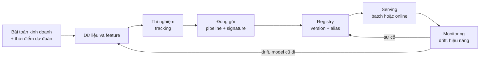
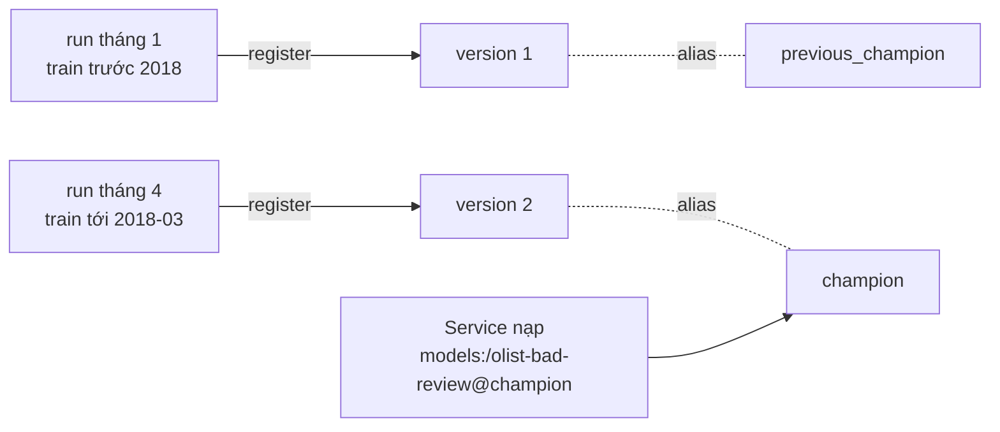
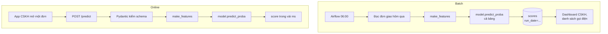
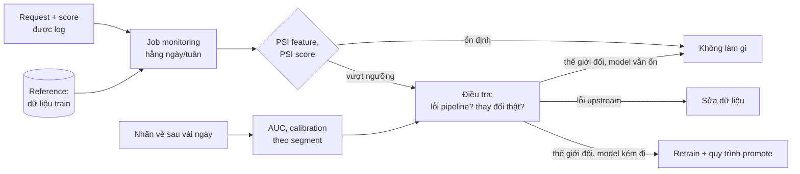

# MLOps cho Data Scientist

Một model chỉ tạo ra giá trị khi nó chạy ngoài notebook: được gọi bởi một hệ thống khác, chấm điểm
dữ liệu mới mỗi ngày, và có người biết khi nào nó bắt đầu sai. Ở phần lớn công ty, Data Scientist
không tự xây hạ tầng đó, nhưng **phải** giao một model có thể vận hành được: tái lập được, có phiên
bản, có hợp đồng đầu vào rõ ràng, có cách theo dõi. DS không hiểu phần này thường bị kẹt ở câu
"model chạy tốt trên máy em" và mất hàng tuần qua lại với đội kỹ thuật.

Module này dừng ở đúng mức một DS cần. CI/CD cho model, hệ thống drift đầy đủ, feature store,
serving quy mô lớn thuộc track **MLOps** riêng (đang soạn, mục "MLOps" trong app). Docker, CI/CD
pipeline, Airflow bạn đã học ở track Data Engineer
(`tracks/data-engineer/modules/08-devops-for-data`); module này dùng lại, không dạy lại.

Ví dụ xuyên suốt là model **review xấu** của Olist (`review_score <= 2`, 12.8% đơn giao xong), chấm
**lúc đơn vừa giao xong**: được dùng số ngày giao thật và số ngày trễ, không được dùng bất cứ cột nào
sinh ra từ review. Chia theo thời gian mua: train trước 2018-01-01, validation tới trước
2018-04-01, test tới hết 2018-08-31. Tải dữ liệu:

```bash
uv run python data/download_olist.py
```

Sau module này bạn sẽ:

- Ghi mọi thí nghiệm bằng MLflow sao cho tái lập và so sánh được, và tìm lại run tốt nhất bằng truy
  vấn.
- Đóng gói model thành một artifact có signature, đăng ký vào Model Registry và phát hành bằng alias.
- Viết một API FastAPI có schema chặt, và biết khi nào batch scoring tốt hơn online.
- Đo data drift bằng PSI và KS, và phân biệt drift đáng lo với drift vô hại.
- Xuất model sang ONNX cho service viết bằng Go, Rust, C++, và kiểm tra output khớp.

## 1. Vòng đời model và việc của Data Scientist



Mỗi mũi tên là một chỗ hay hỏng. Vòng lặp từ monitoring quay lại dữ liệu là lý do MLOps tồn tại:
model không "xong" khi deploy, nó bắt đầu cũ đi từ ngày đó.

### Ai làm gì

| Việc | Data Scientist | ML Engineer / MLOps | Data Engineer |
| --- | --- | --- | --- |
| Định nghĩa bài toán, nhãn, thời điểm dự đoán | **Chính** | Góp ý | Góp ý về dữ liệu có sẵn |
| Feature, train, chọn model | **Chính** | Review | Pipeline dữ liệu nguồn |
| Tracking, đóng gói, signature | **Chính** | Đặt chuẩn | |
| Registry, quy tắc promote | Đề xuất ngưỡng | **Chính** (quy trình) | |
| API, Docker, CI/CD, hạ tầng serving | Viết bản tối thiểu, test được | **Chính** | Batch job (Airflow) |
| Monitoring | Chọn chỉ số và ngưỡng, đọc kết quả | **Chính** (hệ thống) | Chất lượng dữ liệu upstream |

Ở công ty nhỏ, DS làm gần như tất cả các cột. Ở công ty lớn, DS làm cột đầu và chịu trách nhiệm
cho **hợp đồng** giữa các cột: model nhận gì, trả gì, đúng khi nào.

### Thời điểm dự đoán quyết định mọi thứ

Câu hỏi đầu tiên khi đưa một model ra production: **model được gọi lúc nào, và lúc đó biết những
gì?** Model review xấu của module chấm lúc đơn vừa giao xong, nên `delivery_days` và `delay_days`
là hợp lệ. Nếu đội CSKH muốn can thiệp **trước khi** giao (nhắn tin cho đơn có nguy cơ trễ), đó
là một model khác, train tại thời điểm mua hoặc lúc giao cho hãng vận chuyển, không được dùng kết
quả giao hàng. Gọi model "lúc giao" cho đơn chưa giao không báo lỗi gì cả, chỉ cho kết quả sai.
Schema của API (mục 4) là chỗ khoá điều này lại.

## 2. Tracking thí nghiệm với MLflow

### Vì sao cần

Sau ba tuần thử nghiệm, câu hỏi "model AUC 0.80 hôm thứ Ba dùng feature nào, dữ liệu tới ngày nào,
C bằng bao nhiêu?" không ai trả lời được nếu chỉ có notebook. Experiment tracking ghi lại mỗi lần
train thành một **run**: params, metrics, tags (git commit, phiên bản dữ liệu), artifacts (model,
biểu đồ, bảng). MLflow là công cụ mã nguồn mở phổ biến nhất; Weights & Biases, Neptune, Comet,
Vertex AI Experiments, SageMaker Experiments cùng ý tưởng.

MLflow tách hai nơi lưu: **backend store** (metadata: run, params, metrics, registry; một database)
và **artifact store** (tệp: model, hình; thư mục cục bộ, S3, GCS). MLflow 3 đã đưa backend dạng
thư mục `./mlruns` vào chế độ bảo trì và báo lỗi khi dùng; dùng SQLite khi học, PostgreSQL khi làm
thật.

```python
import os
os.environ.setdefault("MLFLOW_DISABLE_AGENT_HINT", "1")
import tempfile
from pathlib import Path

import mlflow
import pandas as pd
from mlflow import MlflowClient
from sklearn.linear_model import LogisticRegression
from sklearn.metrics import roc_auc_score
from sklearn.pipeline import make_pipeline
from sklearn.preprocessing import StandardScaler

# Nhãn và chia thời gian theo định nghĩa chung của track; 3 feature giao hàng, có sẵn lúc đơn vừa giao
dates = ["order_purchase_timestamp", "order_delivered_customer_date", "order_estimated_delivery_date"]
orders = pd.read_csv("data/raw/olist_orders_dataset.csv", parse_dates=dates)
reviews = pd.read_csv("data/raw/olist_order_reviews_dataset.csv", parse_dates=["review_answer_timestamp"])
done = orders[(orders.order_status == "delivered") & orders.order_delivered_customer_date.notna()]
latest = reviews.sort_values("review_answer_timestamp").drop_duplicates("order_id", keep="last")
df = done.merge(latest[["order_id", "review_score"]], on="order_id")
df["bad_review"] = (df.review_score <= 2).astype(int)
day = pd.Timedelta(days=1)
df["promised_days"] = (df.order_estimated_delivery_date - df.order_purchase_timestamp) / day
df["delivery_days"] = (df.order_delivered_customer_date - df.order_purchase_timestamp) / day
df["delay_days"] = (df.order_delivered_customer_date - df.order_estimated_delivery_date) / day
features = ["promised_days", "delivery_days", "delay_days"]
t = df.order_purchase_timestamp
train, val = df[t < "2018-01-01"], df[(t >= "2018-01-01") & (t < "2018-04-01")]

store = Path(tempfile.mkdtemp())                       # không bao giờ ghi vào repo
uri = f"sqlite:///{store / 'mlflow.db'}"
exp_id = MlflowClient(uri).create_experiment("olist-bad-review", artifact_location=(store / "art").as_uri())
mlflow.set_tracking_uri(uri)

for C in [0.01, 1.0]:
    with mlflow.start_run(experiment_id=exp_id):
        model = make_pipeline(StandardScaler(), LogisticRegression(C=C)).fit(train[features], train.bad_review)
        auc = roc_auc_score(val.bad_review, model.predict_proba(val[features])[:, 1])
        mlflow.log_params({"C": C, "features": ",".join(features), "train_end": "2018-01-01"})
        mlflow.log_metric("val_auc", auc)
        mlflow.set_tag("git_commit", "abc1234")        # trong thực tế: lấy từ `git rev-parse HEAD`

best = MlflowClient(uri).search_runs([exp_id], order_by=["metrics.val_auc DESC"], max_results=1)[0]
print(best.data.params["C"], round(best.data.metrics["val_auc"], 4))
```

Kết quả: run tốt nhất là `C = 0.01`, `val_auc` 0.7573 (model 3 feature). Ba điều trong đoạn code
là thói quen cần có:

- **Artifact location tường minh.** Không chỉ định thì artifact rơi vào `./mlruns` của thư mục đang
  chạy, thường là giữa repo.
- **Ghi cả dữ liệu, không chỉ model.** `train_end`, danh sách feature, git commit. Hai run cùng
  params khác dữ liệu sẽ trông như "kết quả không ổn định".
- **Chọn bằng truy vấn trên validation.** `search_runs(order_by=...)` thay cho nhìn bằng mắt trên UI.

### Lỗi hay gặp

| Lỗi | Hậu quả | Cách tránh |
| --- | --- | --- |
| Chọn run theo metric trên test | Test không còn là ước lượng khách quan | Chọn trên validation, chấm test một lần cho model đã chọn |
| Tin vào chênh lệch nhỏ giữa các run | Kể chuyện về nhiễu (0.0015 AUC trên 20 nghìn đơn) | So với sai số của metric, hoặc dùng nhiều fold theo thời gian |
| Autolog mọi thứ, không đặt tên | Hàng trăm run không ai đọc được | Quy ước tên experiment, tên metric, tag bắt buộc |
| Fluent API trong code chạy song song | Ghi nhầm vào run của tiến trình khác | `MlflowClient(uri)` với `run_id` tường minh |

## 3. Đóng gói model: pipeline, signature, registry

### Pipeline là đơn vị deploy

Thứ được deploy không phải "hệ số của logistic regression" mà là **toàn bộ** đường đi từ dữ liệu thô
tới xác suất: điền thiếu, scale, one-hot, model. Để tiền xử lý ở notebook và chỉ lưu model là cách
chắc chắn nhất để production tính feature khác lúc train. Gói tất cả trong một `sklearn.Pipeline`
(module 10), và test rằng cùng một đơn đi qua đường train và đường serve cho cùng một score (bài
Intermediate 02).

### Signature là hợp đồng

MLflow lưu model kèm **signature**: tên, kiểu, thứ tự cột đầu vào và dạng đầu ra. Khi nạp qua
`mlflow.pyfunc`, MLflow kiểm đầu vào theo signature: thiếu cột là lỗi ngay, thay vì một dự đoán sai
lặng lẽ.

```python
import os
os.environ.setdefault("MLFLOW_DISABLE_AGENT_HINT", "1")
import tempfile
from pathlib import Path

import mlflow
import numpy as np
import pandas as pd
from mlflow import MlflowClient
from mlflow.models import infer_signature
from sklearn.impute import SimpleImputer
from sklearn.linear_model import LogisticRegression
from sklearn.pipeline import make_pipeline
from sklearn.preprocessing import StandardScaler

dates = ["order_purchase_timestamp", "order_delivered_customer_date", "order_estimated_delivery_date"]
orders = pd.read_csv("data/raw/olist_orders_dataset.csv", parse_dates=dates)
reviews = pd.read_csv("data/raw/olist_order_reviews_dataset.csv", parse_dates=["review_answer_timestamp"])
done = orders[(orders.order_status == "delivered") & orders.order_delivered_customer_date.notna()]
latest = reviews.sort_values("review_answer_timestamp").drop_duplicates("order_id", keep="last")
df = done.merge(latest[["order_id", "review_score"]], on="order_id")
df["bad_review"] = (df.review_score <= 2).astype(int)
df["delivery_days"] = (df.order_delivered_customer_date - df.order_purchase_timestamp) / pd.Timedelta(days=1)
df["delay_days"] = (df.order_delivered_customer_date - df.order_estimated_delivery_date) / pd.Timedelta(days=1)
X = df.loc[df.order_purchase_timestamp < "2018-01-01", ["delivery_days", "delay_days"]]
y = df.loc[X.index, "bad_review"]

# Pipeline gói cả tiền xử lý: điền thiếu và scale đi cùng model, không nằm rời trong notebook
model = make_pipeline(SimpleImputer(strategy="median"), StandardScaler(), LogisticRegression()).fit(X, y)

store = Path(tempfile.mkdtemp())
uri = f"sqlite:///{store / 'mlflow.db'}"
exp_id = MlflowClient(uri).create_experiment("package", artifact_location=(store / "art").as_uri())
mlflow.set_tracking_uri(uri)
with mlflow.start_run(experiment_id=exp_id):
    info = mlflow.sklearn.log_model(
        model, name="model",
        signature=infer_signature(X, model.predict_proba(X)),   # hợp đồng đầu vào/đầu ra
        input_example=X.head(2),
        pyfunc_predict_fn="predict_proba",                      # pyfunc trả xác suất, không phải nhãn 0/1
        skops_trusted_types=["numpy.dtype"],
        pip_requirements=["scikit-learn", "pandas"],
    )

version = mlflow.register_model(info.model_uri, "olist-bad-review")
MlflowClient(uri).set_registered_model_alias("olist-bad-review", "champion", version.version)

served = mlflow.pyfunc.load_model("models:/olist-bad-review@champion")   # service nạp theo alias
request = pd.DataFrame({"delivery_days": [8.0, 30.0], "delay_days": [-10.0, 6.0]})
print(np.round(np.asarray(served.predict(request))[:, 1], 3))
```

Hai đơn trong request nhận xác suất review xấu 0.086 (giao nhanh, sớm 10 ngày) và 0.332 (giao 30
ngày, trễ 6 ngày). Những chi tiết đáng nhớ:

- **`pyfunc_predict_fn="predict_proba"`.** Mặc định pyfunc của classifier gọi `predict`, trả 0/1 ở
  ngưỡng 0.5. Với tỉ lệ dương 12.8% gần như không đơn nào vượt 0.5: service trả toàn số 0.
- **Signature suy trên dữ liệu thật đủ lớn.** Cột có giá trị thiếu ở train được đánh dấu optional;
  suy trên vài dòng không thiếu thì request có `null` bị từ chối. MLflow cũng **không** tự đổi
  `int64` sang `float64` khi kiểm schema: thống nhất kiểu số từ đầu.
- **Định dạng lưu.** MLflow 3 lưu model scikit-learn bằng skops thay cho pickle, vì nạp pickle là
  chạy code tuỳ ý. Đổi lại phải khai báo kiểu tin cậy (`skops_trusted_types`).

### Model Registry và alias



Registry giữ mọi version của một model có tên, mỗi version trỏ về run sinh ra nó (dữ liệu, code,
metric). **Alias** (`champion`, `challenger`, `previous_champion`) là con trỏ đặt tên tới một version.
Service nạp theo alias, nên phát hành là đổi alias, rollback là trỏ alias về version cũ, không ai
phải sửa code service. Các stage cố định `Staging`/`Production` của MLflow cũ đã bị thay bằng alias.

Quy tắc promote (khi nào challenger được làm champion) nên được viết trước, như quy tắc ra quyết
định của một A/B test (module 03). Bài Advanced 02 làm trọn quy trình: shadow, quy tắc, alias,
rollback.

## 4. Serving: batch hay online, và FastAPI

### Hai cách phục vụ một model



| Tiêu chí | Batch | Online (API) |
| --- | --- | --- |
| Khi nào cần kết quả | Có thể chờ tới lần chạy kế (giờ, ngày) | Ngay trong request của người dùng |
| Độ trễ cho phép | Phút tới giờ | Vài chục ms (p99) |
| Hạ tầng | Một job theo lịch (Airflow), đọc ghi bảng | Service luôn chạy, autoscale, health check |
| Feature | Tính trên cả bảng, join thoải mái | Phải có sẵn lúc request: gửi kèm, hoặc tra feature store |
| Lỗi | Chạy lại job (phải idempotent) | Ảnh hưởng người dùng ngay; cần fallback |
| Chi phí | Rẻ: tính một lần, đọc nhiều lần | Đắt hơn: luôn chạy kể cả lúc không có request |
| Ví dụ Olist | Danh sách đơn nguy cơ review xấu mỗi sáng cho CSKH | Điểm hiện ngay khi tổng đài viên mở đơn |

Mặc định nên là **batch** khi kết quả không cần tức thì: đơn giản hơn, rẻ hơn, dễ debug hơn. Nhiều
"nhu cầu realtime" thực ra là "cần mới hơn một ngày", và batch mỗi giờ là đủ. Khi phải có cả hai,
nguy hiểm lớn nhất là **training-serving skew**: batch tính feature bằng SQL, online bằng Python, và
hai bên lệch nhau ở chi tiết (làm tròn ngày, múi giờ, giá trị thiếu). Cách phòng: một hàm feature
duy nhất cho cả hai đường, và kiểm parity định kỳ (bài Intermediate 02).

### FastAPI cho service tối thiểu

FastAPI dùng Pydantic để kiểm request theo schema có kiểu và ràng buộc, tự sinh tài liệu OpenAPI,
và test được bằng `TestClient` mà không cần chạy server.

```python
import warnings

import numpy as np
import pandas as pd
from fastapi import FastAPI
from pydantic import BaseModel, Field
from sklearn.linear_model import LogisticRegression

with warnings.catch_warnings():
    warnings.filterwarnings("ignore", message="Using `httpx`")    # Starlette khuyên gói httpx2; vô hại
    from fastapi.testclient import TestClient

FEATURES = ["delivery_days", "delay_days"]


class Order(BaseModel):
    order_id: str
    delivery_days: float = Field(ge=0)
    delay_days: float


class PredictRequest(BaseModel):
    orders: list[Order] = Field(min_length=1, max_length=1000)


def create_app(model, model_version: str, threshold: float) -> FastAPI:
    app = FastAPI()

    @app.get("/health")
    def health():
        return {"status": "ok", "model_version": model_version}

    @app.post("/predict")
    def predict(req: PredictRequest):
        X = pd.DataFrame([o.model_dump() for o in req.orders])
        scores = model.predict_proba(X[FEATURES])[:, 1]          # một lần gọi cho cả batch
        return {"model_version": model_version,
                "predictions": [{"order_id": o, "score": float(s), "high_risk": bool(s >= threshold)}
                                for o, s in zip(X.order_id, scores)]}

    return app


# Model đồ chơi để chạy ví dụ; production truyền model nạp từ registry lúc khởi động
rng = np.random.default_rng(0)
X = pd.DataFrame({"delivery_days": rng.uniform(2, 40, 500), "delay_days": rng.normal(-10, 8, 500)})
model = LogisticRegression().fit(X, (X.delay_days + rng.normal(0, 4, 500) > 0).astype(int))

client = TestClient(create_app(model, model_version="3", threshold=0.3))
ok = client.post("/predict", json={"orders": [{"order_id": "a", "delivery_days": 25, "delay_days": 4}]})
bad = client.post("/predict", json={"orders": [{"order_id": "b", "delivery_days": -1, "delay_days": 0}]})
print(ok.status_code, ok.json()["predictions"][0]["high_risk"], bad.status_code)
```

Request hợp lệ trả 200, request có `delivery_days = -1` trả 422 trước khi tới model. Các nguyên tắc
cho một service model:

- **Schema là hợp đồng và là chốt chặn.** Chỉ nhận feature có sẵn ở thời điểm dự đoán; ràng buộc
  theo miền nghiệp vụ (giá không âm, loại thanh toán trong danh sách), không theo khoảng thấy ở
  train.
- **Nạp model một lần lúc khởi động**, truyền vào `create_app`; không đọc đĩa trong mỗi request.
- **Chấm cả batch trong một lần gọi model.** Với pipeline scikit-learn của module, chấm một dòng tốn
  khoảng 3 ms, phần lớn là chi phí cố định; chấm 32 nghìn dòng một lần chỉ khoảng 20 ms.
- **Trả kèm `model_version`** và log request/score: thiếu nó thì không debug được sự cố, cũng không
  có dữ liệu cho monitoring.
- **`/health`** cho load balancer và Kubernetes biết service sống.

Đóng gói service vào Docker image, chạy bằng `uvicorn`, đưa vào CI/CD là phần bạn đã làm ở track Data
Engineer (`tracks/data-engineer/modules/08-devops-for-data`). Khác biệt duy nhất đáng nhớ: image
của model thường nặng (scikit-learn, numpy, có khi torch), nên tách tầng cài thư viện khỏi tầng
copy model để build nhanh, và **không** nhét dữ liệu train vào image.

## 5. Monitoring: data drift, PSI và KS

### Theo dõi cái gì

| Tầng | Chỉ số | Có ngay? |
| --- | --- | --- |
| Service | Số request, lỗi 4xx/5xx, p50/p99 latency | Có |
| Dữ liệu đầu vào | Tỉ lệ thiếu, giá trị ngoài miền, **phân phối từng feature** (data drift) | Có |
| Dự đoán | Phân phối score, tỉ lệ vượt ngưỡng (prediction drift) | Có |
| Hiệu năng | AUC, calibration, precision ở ngưỡng | **Chỉ khi nhãn về** |
| Kinh doanh | Tỉ lệ review xấu thật, chi phí CSKH | Chậm nhất |

Nhãn của model này là review, về sau khi giao với trung vị khoảng 2 ngày (90% trong vòng 5.3 ngày).
Model khác có nhãn chậm hơn nhiều: churn sau 90 ngày, vỡ nợ sau 12 tháng. Trong lúc chờ, drift của
feature và của score là **tín hiệu sớm** duy nhất.



### PSI

Population Stability Index so phân phối hiện tại với một phân phối reference (thường là dữ liệu
train). Chia trục giá trị thành các bin theo quantile của reference; với $$e_i$$ và $$a_i$$ là tỉ lệ
của reference và của mẫu hiện tại trong bin $$i$$:

$$
\mathrm{PSI} = \sum_i (a_i - e_i)\,\ln\frac{a_i}{e_i}
$$

Quy ước ngành (từ credit scoring): dưới 0.1 là ổn định, 0.1 tới 0.25 là trôi vừa, từ 0.25 là trôi
lớn. Đây là quy ước, không phải định luật: hiệu chỉnh bằng PSI giữa các giai đoạn "bình thường" của
chính dữ liệu bạn. Chi tiết cài đặt quyết định con số: bin theo quantile hay khoảng đều, biên ngoài
cùng có mở ra vô cực không, bin rỗng chặn bằng `eps` bao nhiêu (bài Basic 01).

### KS

Thống kê Kolmogorov-Smirnov là khoảng cách lớn nhất giữa hai hàm phân phối tích luỹ thực nghiệm:

$$
D = \max_x \left| F_{\text{ref}}(x) - F_{\text{cur}}(x) \right|
$$

Dùng **thống kê** $$D$$ như một thước đo độ lớn, không dùng p-value: với hàng chục nghìn dòng, p-value
gần như luôn bằng 0 kể cả khi khác biệt không đáng kể.

### Ví dụ thật: `delay_days` trên Olist

```python
import numpy as np
import pandas as pd
from scipy.stats import ks_2samp


def psi(expected, actual, bins=10, eps=1e-4):
    e_v = np.asarray(expected, float); a_v = np.asarray(actual, float)
    e_v, a_v = e_v[~np.isnan(e_v)], a_v[~np.isnan(a_v)]
    edges = np.unique(np.quantile(e_v, np.linspace(0, 1, bins + 1)))   # bin theo quantile của reference
    edges[0], edges[-1] = -np.inf, np.inf                              # giá trị ngoài khoảng vẫn được đếm
    e = np.clip(np.histogram(e_v, edges)[0] / len(e_v), eps, None)
    a = np.clip(np.histogram(a_v, edges)[0] / len(a_v), eps, None)
    return float(np.sum((a - e) * np.log(a / e)))


dates = ["order_purchase_timestamp", "order_delivered_customer_date", "order_estimated_delivery_date"]
orders = pd.read_csv("data/raw/olist_orders_dataset.csv", parse_dates=dates)
reviews = pd.read_csv("data/raw/olist_order_reviews_dataset.csv", parse_dates=["review_answer_timestamp"])
done = orders[(orders.order_status == "delivered") & orders.order_delivered_customer_date.notna()]
latest = reviews.sort_values("review_answer_timestamp").drop_duplicates("order_id", keep="last")
df = done.merge(latest[["order_id"]], on="order_id")
df["delay_days"] = (df.order_delivered_customer_date - df.order_estimated_delivery_date) / pd.Timedelta(days=1)

t = df.order_purchase_timestamp
reference = df[t < "2018-01-01"].delay_days
test = df[(t >= "2018-04-01") & (t < "2018-09-01")].delay_days
print("cả giai đoạn test: PSI", round(psi(reference, test), 3), "| KS", round(ks_2samp(reference, test).statistic, 4),
      "| KS p-value", f"{ks_2samp(reference, test).pvalue:.0e}")
prod = df[(t >= "2018-01-01") & (t < "2018-09-01")]
for month, g in prod.groupby(prod.order_purchase_timestamp.dt.strftime("%Y-%m")):
    print(month, "trễ", f"{(g.delay_days > 0).mean():.1%}", "PSI", round(psi(reference, g.delay_days), 3))
```

Trên cả giai đoạn test (04 tới 08/2018), PSI của `delay_days` là 0.073: "ổn định". KS = 0.0785 với
p-value cỡ 5e-99: "khác biệt cực kỳ có ý nghĩa". Cả hai đúng, nhưng chỉ PSI (hay chính $$D$$) trả lời
câu hỏi của monitoring. Nhìn theo tháng thì khác hẳn: tháng 3/2018 có 21.1% đơn trễ (PSI 0.50),
tháng 6/2018 chỉ 1.4% (PSI 0.65). Gộp nhiều tháng, các chiều trôi triệt tiêu nhau. Bài học: giám sát
theo cửa sổ ngắn.

Tháng 6/2018 là drift "major" nhưng theo hướng **tốt** (giao nhanh hơn hẳn). Tự động retrain theo
cảnh báo này sẽ train model mới trên một tháng gần như không có đơn trễ. Drift là lý do để **điều
tra**, không phải lệnh retrain.

### Drift, mix shift và concept drift

Model của module (12 feature, xem bài Intermediate 01) có AUC 0.799 trên validation (quý 1/2018)
nhưng chỉ 0.696 trên test. Thoạt nhìn là model "hỏng". Tách theo nhóm:

| Giai đoạn | Đơn trễ | AUC toàn bộ | AUC trong đơn đúng hẹn | AUC trong đơn trễ |
| --- | --- | --- | --- | --- |
| train | 6.5% | 0.717 | 0.626 | 0.729 |
| validation | 14.4% | 0.799 | 0.656 | 0.738 |
| test | 5.9% | 0.696 | 0.637 | 0.741 |

AUC trong từng nhóm gần như đứng yên; cái đổi là **tổ hợp** (mix shift): giai đoạn nhiều đơn trễ thì
dễ phân biệt hơn vì trễ là tín hiệu mạnh. Concept drift (quan hệ giữa feature và nhãn đổi) mới là
lý do thật để retrain, và chỉ thấy được khi nhìn metric theo segment. Bài Intermediate 03 làm trọn
phân tích này.

### Khi nào là việc của track MLOps

Module này cho bạn công cụ để đo và đọc drift. Một hệ thống monitoring đầy đủ (tính tự động cho
hàng trăm feature, lưu lịch sử, dashboard, alert routing, phát hiện drift đa biến, Evidently hay
WhyLabs hay Arize) thuộc track MLOps.

## 6. ONNX và vì sao service Go, Rust, C++ gọi model

### Vấn đề

Service đơn hàng của Olist viết bằng Go và cần điểm review xấu trong lúc xử lý một request. Có ba
cách:

| Cách | Ưu | Nhược |
| --- | --- | --- |
| Gọi service Python qua HTTP/gRPC (mục 4) | Giữ nguyên code DS, đổi model dễ | Thêm một service phải vận hành, thêm 1 tới vài ms mạng, thêm điểm hỏng |
| Viết lại model bằng Go | Nhanh, không phụ thuộc | Hai bản cài phải giữ khớp; không khả thi với model cây lớn hay mạng nơ-ron |
| Xuất model sang định dạng trung gian, chạy bằng runtime gốc của Go | Một nguồn sự thật, nhanh, không có service Python | Không phải bước tiền xử lý nào cũng xuất được; phải kiểm parity |

**ONNX** (Open Neural Network Exchange) là định dạng mở mô tả model như một graph các phép toán.
`onnxruntime` (viết bằng C++) chạy graph đó, có binding cho Python, C, C++, C#, Java, JavaScript, và
qua C API cho Go, Rust. Converter: `skl2onnx` cho scikit-learn, `onnxmltools` cho LightGBM và XGBoost,
`torch.onnx` cho PyTorch.

Vì sao các đội backend thích cách này: service viết bằng Go/Rust/C++ để có độ trễ thấp và ổn định,
dùng ít bộ nhớ, không có GIL; nhúng model vào cùng tiến trình loại bỏ cả chi phí mạng lẫn một service
Python phải trực. Model cũng chạy được trên thiết bị (mobile, trình duyệt, edge) nơi không có Python.

```python
import time

import numpy as np
import onnxruntime as ort
import pandas as pd
from skl2onnx import to_onnx
from skl2onnx.common.data_types import FloatTensorType, StringTensorType
from sklearn.compose import ColumnTransformer
from sklearn.impute import SimpleImputer
from sklearn.linear_model import LogisticRegression
from sklearn.pipeline import make_pipeline
from sklearn.preprocessing import OneHotEncoder, StandardScaler

dates = ["order_purchase_timestamp", "order_delivered_customer_date", "order_estimated_delivery_date"]
orders = pd.read_csv("data/raw/olist_orders_dataset.csv", parse_dates=dates)
reviews = pd.read_csv("data/raw/olist_order_reviews_dataset.csv", parse_dates=["review_answer_timestamp"])
customers = pd.read_csv("data/raw/olist_customers_dataset.csv")
done = orders[(orders.order_status == "delivered") & orders.order_delivered_customer_date.notna()]
latest = reviews.sort_values("review_answer_timestamp").drop_duplicates("order_id", keep="last")
df = done.merge(latest[["order_id", "review_score"]], on="order_id").merge(customers[["customer_id", "customer_state"]], on="customer_id")
df["bad_review"] = (df.review_score <= 2).astype(int)
df["delivery_days"] = (df.order_delivered_customer_date - df.order_purchase_timestamp) / pd.Timedelta(days=1)
df["delay_days"] = (df.order_delivered_customer_date - df.order_estimated_delivery_date) / pd.Timedelta(days=1)
num, cat = ["delivery_days", "delay_days"], ["customer_state"]
t = df.order_purchase_timestamp
train, test = df[t < "2018-01-01"], df[(t >= "2018-04-01") & (t < "2018-09-01")]

pipe = make_pipeline(
    ColumnTransformer([("num", make_pipeline(SimpleImputer(strategy="median"), StandardScaler()), num),
                       ("cat", OneHotEncoder(handle_unknown="ignore"), cat)]),
    LogisticRegression(max_iter=1000)).fit(train[num + cat], train.bad_review)

# Một input mỗi cột, đúng tên: service Go/Rust gọi theo tên, không theo vị trí
inputs = [(c, FloatTensorType([None, 1])) for c in num] + [(c, StringTensorType([None, 1])) for c in cat]
onx = to_onnx(pipe, initial_types=inputs, options={"zipmap": False})
sess = ort.InferenceSession(onx.SerializeToString(), providers=["CPUExecutionProvider"])


def feed(X):
    d = {c: X[[c]].to_numpy(np.float32) for c in num}
    d.update({c: X[[c]].astype(str).to_numpy() for c in cat})
    return d


p_onnx = sess.run(["probabilities"], feed(test))[0][:, 1]
p_skl = pipe.predict_proba(test[num + cat])[:, 1]
print("sai lệch lớn nhất:", f"{np.abs(p_onnx - p_skl).max():.1e}", "| kích thước:", len(onx.SerializeToString()), "byte")

row = test[num + cat].iloc[[0]]
ready = feed(row)                                       # ở Go/Rust, input vốn đã là mảng
for name, fn in [("scikit-learn", lambda: pipe.predict_proba(row)),
                 ("onnxruntime + dựng input từ DataFrame", lambda: sess.run(None, feed(row))),
                 ("onnxruntime, input có sẵn", lambda: sess.run(None, ready))]:
    fn()                                                # warm-up
    start = time.perf_counter()
    for _ in range(300):
        fn()
    print(f"{name}: {(time.perf_counter() - start) / 300 * 1000:.3f} ms mỗi lần chấm 1 dòng")
```

Trên máy viết bài: sai lệch lớn nhất giữa hai bản là khoảng 1e-7 (do `float32`). Chấm một dòng bằng
scikit-learn mất khoảng 2.7 ms; onnxruntime khoảng 0.75 ms nếu tính cả việc dựng input từ DataFrame,
và khoảng 0.01 ms khi input có sẵn dạng mảng, đúng hoàn cảnh của một service Go. Chi phí của
scikit-learn với một dòng gần như toàn là chi phí cố định của Python, không phải phép tính.

### Những gì cần cẩn thận

- **Không phải gì cũng xuất được.** `SimpleImputer` cho cột chuỗi với giá trị thiếu là NaN bị
  `skl2onnx` từ chối; hàm Python tự viết trong pipeline (`FunctionTransformer`) không xuất được.
  Phần không xuất được phải viết lại ở phía gọi, và trở thành nguồn skew.
- **Hợp đồng theo tên.** Một input mỗi cột, đúng tên, thay vì một ma trận phụ thuộc thứ tự cột.
- **`float32`.** ONNX thường chạy `float32`; model cây có thể rẽ nhánh khác với vài điểm sát ngưỡng.
  Kiểm parity trên cả tập test, không chỉ vài dòng (bài Advanced 01).
- **Kiểm trong CI.** Tập "golden" vài nghìn dòng kèm output kỳ vọng, lưu cùng version model; cả
  phía Python lẫn phía Go chấm tập đó và so.

ONNX không phải lựa chọn mặc định. Khi độ trễ không chặt và feature cần logic Python phức tạp, một
service Python sau FastAPI đơn giản hơn nhiều. Các lựa chọn khác cùng mục đích: Treelite và `lleaves`
cho model cây, TorchScript cho PyTorch, PMML cho hệ thống cũ.

## 7. Từ notebook tới production: checklist của Data Scientist

Trước khi nói "model xong rồi", tự trả lời được từng dòng:

| Hạng mục | Câu hỏi | Mục |
| --- | --- | --- |
| Thời điểm dự đoán | Model được gọi lúc nào, lúc đó có những feature nào? | 1 |
| Tái lập | Từ run trong MLflow có dựng lại được model không (code, dữ liệu, params)? | 2 |
| Đóng gói | Mọi tiền xử lý có nằm trong pipeline không? Signature có đúng kiểu, đúng cột optional? | 3 |
| Phiên bản | Model có trong registry, service nạp theo alias, rollback được bằng một lệnh? | 3 |
| Hợp đồng | Schema đầu vào có ràng buộc nghiệp vụ? Output là xác suất hay nhãn, ngưỡng nằm ở đâu? | 4 |
| Parity | Batch và online (hoặc Python và ONNX) cho cùng score trên cùng đơn? | 4, 6 |
| Monitoring | Theo dõi feature nào, score nào, metric nào theo segment, ngưỡng nào, ai nhận? | 5 |
| Nhãn về trễ | Bao lâu mới đo được hiệu năng, trong lúc chờ dựa vào tín hiệu gì? | 5 |
| Phát hành | Shadow hay canary, quy tắc promote viết trước chưa? | 3 |

### Lỗi hay gặp nhất

- **Notebook là sản phẩm.** Model được "deploy" bằng cách chạy notebook mỗi sáng. Không ai biết
  phiên bản nào đang chạy, chạy lại thì ra kết quả khác.
- **Leakage chỉ lộ ở production.** Feature có ở train nhưng không có lúc dự đoán (cột từ review),
  AUC offline đẹp, production vô dụng. Xác định thời điểm dự đoán trước khi chọn feature (module 10).
- **Không có baseline để so.** Model mới "AUC 0.80" nhưng không ai biết quy tắc đơn giản "đơn trễ là
  rủi ro" được bao nhiêu. Luôn deploy kèm so sánh với baseline đơn giản.
- **Retrain tự động mù quáng.** Retrain theo lịch hoặc theo cảnh báo drift mà không có quy trình
  promote, model tệ hơn có thể thay model tốt mà không ai biết.
- **Quên rằng ngưỡng là quyết định kinh doanh.** Ngưỡng `high_risk` phụ thuộc chi phí liên hệ khách
  và lợi ích, thay đổi độc lập với model, nên là cấu hình chứ không cứng trong code.

### Những gì để dành cho track MLOps

CI/CD riêng cho model (test dữ liệu, test model, build, deploy tự động khi đăng ký version mới),
feature store (Feast, Tecton) giải bài toán skew ở quy mô lớn, hệ thống monitoring và drift đầy đủ,
serving quy mô lớn (KServe, BentoML, Triton, Ray Serve), A/B test hạ tầng cho model, quản lý GPU và
chi phí. Ở track này bạn đủ để giao cho đội MLOps một model sạch và nói chuyện cùng ngôn ngữ với họ.

## 8. Tài liệu tham khảo

Sách và bài viết nền tảng:

- Chip Huyen. *Designing Machine Learning Systems* (O'Reilly, 2022). Chương về deployment, data
  distribution shift và monitoring.
- Sculley et al. [Hidden Technical Debt in Machine Learning Systems](https://papers.nips.cc/paper/2015/hash/86df7dcfd896fcaf2674f757a2463eba-Abstract.html) (NeurIPS 2015).
- Breck et al. [The ML Test Score: A Rubric for ML Production Readiness](https://research.google/pubs/the-ml-test-score-a-rubric-for-ml-production-readiness-and-technical-debt-reduction/) (Google, 2017).
- Google Cloud. [MLOps: Continuous delivery and automation pipelines in machine learning](https://cloud.google.com/architecture/mlops-continuous-delivery-and-automation-pipelines-in-machine-learning).
- [Made With ML: MLOps](https://madewithml.com/), khoá học miễn phí đi từ tracking tới serving.

Từ roadmap.sh/ai-data-scientist (mục MLOps):

- [roadmap.sh: MLOps](https://roadmap.sh/mlops)
- [Coursera: Machine Learning in Production (DeepLearning.AI)](https://www.coursera.org/learn/introduction-to-machine-learning-in-production)

Tài liệu công cụ:

- [MLflow Tracking](https://mlflow.org/docs/latest/ml/tracking/), [Model Registry](https://mlflow.org/docs/latest/ml/model-registry/), [Model Signatures](https://mlflow.org/docs/latest/ml/model/signatures/)
- [FastAPI](https://fastapi.tiangolo.com/), [Testing](https://fastapi.tiangolo.com/tutorial/testing/)
- [Pydantic: Fields](https://docs.pydantic.dev/latest/concepts/fields/)
- [ONNX](https://onnx.ai/), [ONNX Runtime](https://onnxruntime.ai/docs/), [sklearn-onnx](https://onnx.ai/sklearn-onnx/)
- [scipy.stats.ks_2samp](https://docs.scipy.org/doc/scipy/reference/generated/scipy.stats.ks_2samp.html)

Monitoring và drift:

- Rabanser, Günnemann, Lipton. [Failing Loudly: An Empirical Study of Methods for Detecting Dataset Shift](https://arxiv.org/abs/1810.11953) (NeurIPS 2019).
- [Evidently: data drift](https://docs.evidentlyai.com/), thư viện mã nguồn mở cho báo cáo drift.

Dữ liệu:

- Olist: [Brazilian E-Commerce Public Dataset (Kaggle)](https://www.kaggle.com/datasets/olistbr/brazilian-ecommerce)
