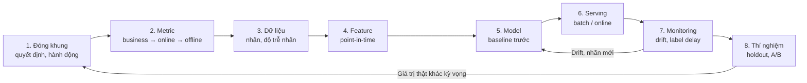
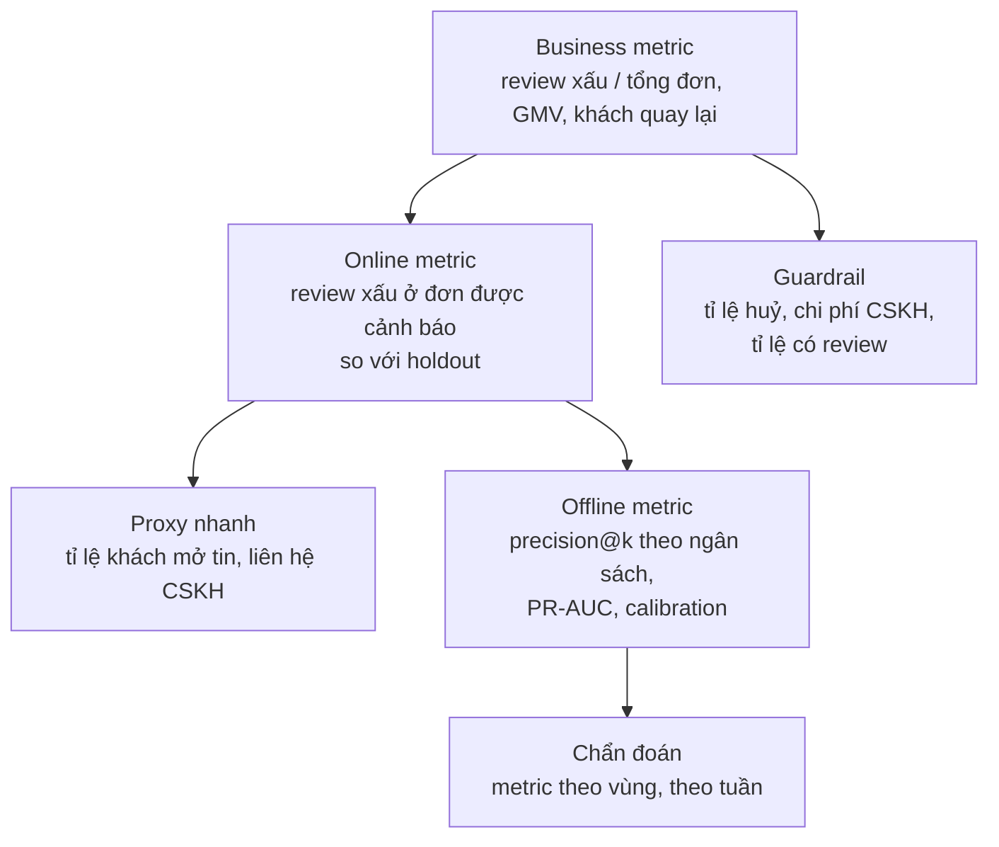
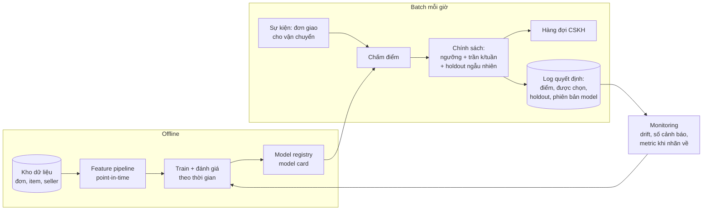
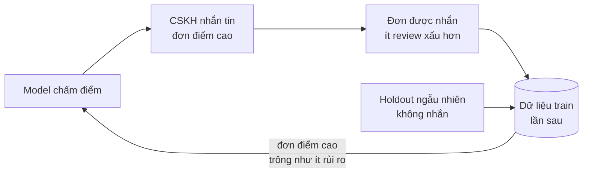

# ML System Design & làm việc với business

Mười bốn module trước dạy từng mảnh: thí nghiệm, nhân quả, forecasting, feature, model, MLOps. Module
này ghép chúng thành **một hệ thống phục vụ một quyết định kinh doanh**, và dạy phần việc mà phỏng vấn
DS senior luôn hỏi nhưng ít khoá học dạy: đóng khung bài toán, đổi metric model ra tiền, thiết kế để hệ
thống không tự làm hỏng dữ liệu của chính nó, và thuyết phục người ra quyết định bằng một trang giấy.

Xuyên suốt module là một bài toán thật trên **Olist**: hệ thống cảnh báo đơn có nguy cơ giao trễ để
đội CSKH chủ động liên hệ khách. Mọi con số dưới đây tính lại từ dữ liệu Olist thật, theo định nghĩa
dùng chung của track (đơn giao xong, giao trễ so nguyên timestamp, review mới nhất, chia train /
validation / test ở 2018-01-01 và 2018-04-01). Tải dữ liệu:

```bash
uv run python data/download_olist.py
```

Sau module này bạn sẽ:

- Trả lời một câu ML system design theo khung tám bước, biết dành thời gian cho bước nào.
- Đóng khung bài toán: quyết định gì, ai ra quyết định, lúc nào, bằng hành động gì; và chọn metric theo
  tầng (business → online → offline).
- Đổi precision / recall thành tiền: expected value, break-even precision, precision@k theo ngân sách.
- Nhận ra feedback loop, label delay và khoảng cách offline–online trước khi chúng làm hỏng hệ thống.
- Kiểm tra fairness theo nhóm và hiểu đánh đổi giữa các định nghĩa.
- Viết design doc và memo một trang cho stakeholder, nói rõ điều chưa biết.

## 1. Khung trả lời một bài ML system design

### Tám bước

Câu hỏi phỏng vấn thường mở: "Thiết kế hệ thống phát hiện đơn có nguy cơ giao trễ cho một sàn thương
mại điện tử." Ứng viên yếu nhảy ngay vào "dùng XGBoost với các feature…". Ứng viên mạnh đi theo một
khung, nói to giả định, và dành nhiều thời gian nhất cho phần quyết định thành bại: đóng khung và
metric.

| Bước | Câu hỏi phải trả lời | Đầu ra | Module liên quan |
| --- | --- | --- | --- |
| 1. Đóng khung | Quyết định gì? Ai dùng? Lúc nào? Hành động gì? Có cần ML không? | Một câu mô tả quyết định, baseline không ML | 09 |
| 2. Metric | Business metric nào đổi? Online metric nào đo được trong vài tuần? Offline metric nào chọn model? | Cây metric, guardrail, giá trị tiền của từng loại lỗi | 03, 11 |
| 3. Dữ liệu | Nhãn định nghĩa thế nào, có sau bao lâu? Dữ liệu nào có **tại thời điểm quyết định**? | Định nghĩa nhãn, cửa sổ thời gian, rủi ro leak | 10 |
| 4. Feature | Feature nào, tính batch hay real-time, point-in-time ra sao? | Danh sách feature theo nguồn và độ trễ | 10 |
| 5. Model | Baseline gì? Model nào đủ tốt? Cần calibrate không? | Thang baseline → model, metric offline | 11, 12, 13 |
| 6. Serving | Batch hay online? Latency? Fallback khi model chết? | Kiến trúc, SLA | 14 |
| 7. Monitoring | Theo dõi gì khi nhãn về chậm? Khi nào retrain? | Dashboard, cảnh báo, chính sách retrain | 14 |
| 8. Thí nghiệm | Chứng minh giá trị thật thế nào? Holdout ra sao? | Thiết kế A/B hoặc holdout, cỡ mẫu | 03, 04, 06 |



Trong 45 phút phỏng vấn, một phân bổ hợp lý: 10 phút cho bước 1–2, 10 phút cho dữ liệu và feature,
5–8 phút cho model, 10 phút cho serving và monitoring, phần còn lại cho thí nghiệm và câu hỏi đào sâu.
Người phỏng vấn senior thường đánh giá cao bước 1–2 hơn cả, vì đó là nơi dự án thật hỏng.

### Có cần ML không?

Câu hỏi đầu tiên của bước 1. Trên Olist, khi đơn vừa giao cho đơn vị vận chuyển, một luật một dòng
"còn dưới 5 ngày tới ngày hẹn giao thì cảnh báo" bắt được 35.2% số đơn trễ với precision 42.7% trên tập
test. Trên số gộp cả tập test, model LightGBM dùng cùng thời điểm, chọn top 10% đơn, có giá trị kinh doanh
ngang luật đó; tách giai đoạn thì kết luận khác nhau theo giai đoạn (mục 3).
Quy tắc số 1 trong [Rules of ML](https://developers.google.com/machine-learning/guides/rules-of-ml) của
Google: đừng ngại ra mắt sản phẩm không có ML. Luật đơn giản cho bạn baseline, dữ liệu log, và một hệ
thống chạy thật để sau này model thay vào.

ML đáng làm khi: luật đơn giản đã chạm trần, tín hiệu nằm ở tương tác của nhiều biến, quy mô quyết định
lớn (hàng nghìn quyết định mỗi ngày), và có vòng phản hồi để học tiếp. ML không đáng làm khi: ít quyết
định, chi phí sai rất cao và cần giải thích từng ca (nên dùng luật có kiểm toán), hoặc chưa có nhãn.

### Lỗi hay gặp

- Bắt đầu bằng thuật toán. Người phỏng vấn sẽ hỏi lại "model này phục vụ quyết định gì?".
- Không hỏi về hành động. Dự đoán chính xác mà không ai làm gì với nó thì giá trị bằng 0.
- Nói "dùng accuracy / AUC" mà không nối về tiền hay về quyết định.
- Bỏ qua thời điểm dự đoán: feature "ngày giao cho vận chuyển" có lúc khách vừa đặt hàng không?
- Quên phần sau khi ra mắt: monitoring, retrain, và làm sao biết hệ thống có giá trị thật.

## 2. Đóng khung bài toán và chọn metric

### Từ mục tiêu kinh doanh tới bài toán ML

Mục tiêu "giảm review xấu" chưa phải bài toán ML. Phải viết được câu: "**Vào lúc** đơn được giao cho
đơn vị vận chuyển, **hệ thống** chấm điểm nguy cơ giao trễ, **đội CSKH** nhắn tin xin lỗi và báo ngày
giao mới cho tối đa **N đơn mỗi ngày** có điểm cao nhất, **để** giảm tỉ lệ review 1–2 sao." Câu đó chốt
năm thứ: thời điểm, đối tượng, người hành động, hành động, ràng buộc ngân sách.

Vì sao nhắm vào giao trễ? Trên Olist thật, 8.1% đơn giao xong bị trễ; review xấu là 54.1% ở đơn trễ và
9.2% ở đơn đúng hẹn. Module 06 ước lượng tác động nhân quả của trễ lên review xấu khoảng +44 điểm phần
trăm sau khi điều chỉnh confounder, nên giảm thiệt hại của trễ là đòn bẩy lớn nhất.

### Thời điểm quyết định là một lựa chọn thiết kế

Dự đoán càng sớm, càng nhiều thời gian hành động nhưng càng ít thông tin. Trên Olist (code ở mục 3):

| Thời điểm dự đoán | Thông tin có thêm | Còn bao lâu tới ngày hẹn (trung vị) | ROC-AUC test | PR-AUC test |
| --- | --- | --- | --- | --- |
| Lúc khách đặt hàng | Ngày hẹn, phí ship, số item, bang khách và seller | 23.2 ngày | 0.707 | 0.120 |
| Lúc giao cho vận chuyển | Thêm số ngày seller xử lý, số ngày còn lại tới ngày hẹn | 20.3 ngày | 0.807 | 0.378 |

Tỉ lệ đơn trễ trên tập test là 6.0%, nên PR-AUC 0.120 chỉ gấp đôi đoán bừa, còn 0.378 gấp hơn sáu lần.
Đợi thêm khoảng 2 ngày (trung vị thời gian seller xử lý là 2.2 ngày) đổi lấy một model tốt hơn hẳn, và
vẫn còn ba tuần để hành động.

So với module 10 và 11: ở đó model dự đoán *review xấu* **lúc đơn vừa giao tới khách**, nên ngày giao
thực tế và số ngày trễ là feature hợp lệ (chỉ cột review là leak). Hệ thống ở đây muốn **can thiệp
trước khi đơn tới tay khách**, nên thời điểm dự đoán phải sớm hơn, và mọi kết quả sau thời điểm đó
(ngày giao thực tế, trễ hay không, review) đều là leak. Cùng bộ dữ liệu, cùng nhãn gần giống nhau,
nhưng **thời điểm dự đoán đi theo hành động bạn làm được**: hành động khác thì tập feature hợp lệ khác.

Không có câu trả lời chung: chống gian lận thẻ phải quyết định trong vài
trăm mili giây trước khi duyệt giao dịch; churn có thể đợi cả tuần. Nhưng **luôn** đặt câu hỏi này.

### Cây metric



- **Business metric** là thứ ban giám đốc quan tâm nhưng đổi chậm và chịu nhiều tác động khác.
- **Online metric** đo tác động của hệ thống khi chạy thật, thường so với holdout (mục 5).
- **Offline metric** dùng để chọn model trước khi ra mắt. Phải chọn offline metric **giống nhất với
  cách model được dùng**: CSKH chỉ liên hệ N đơn mỗi ngày nên precision@N quan trọng hơn ROC-AUC trên
  toàn bộ thứ hạng (module 11, mục 3).
- **Guardrail** chặn tối ưu cục bộ: tin nhắn có thể khiến khách huỷ đơn hoặc không để lại review nữa
  (selection bias trên chính metric, xem module 03).

### Offline và online lệch nhau

| Nguyên nhân | Ví dụ ở Olist | Cách giảm |
| --- | --- | --- |
| Proxy sai | Model đoán *trễ*, nhưng mục tiêu là *review xấu*; đơn trễ 1 ngày ít bực hơn trễ 10 ngày | Chọn nhãn gần mục tiêu, hoặc chấm offline bằng giá trị tiền |
| Phân phối đổi | Validation (01–03/2018) có 14.6% đơn trễ, test (04–08/2018) chỉ 6.0% | Đánh giá theo thời gian, theo dõi prevalence |
| Hành động thay đổi kết quả | Đơn được nhắn tin có review tốt hơn, nên nhãn sau ra mắt không còn là "nếu không làm gì" | Holdout, log quyết định (mục 5) |
| Ràng buộc vận hành | Tuần khủng hoảng có hàng trăm đơn trễ, CSKH chỉ xử lý được vài chục | Đo precision@k theo đúng ngân sách |
| Người dùng phản ứng | Khách quen nhận tin, bỏ qua | Theo dõi online metric theo thời gian (novelty, module 04) |

PR-AUC phụ thuộc prevalence: model lúc đặt hàng có PR-AUC 0.274 trên validation nhưng 0.120 trên
test, phần lớn vì tỉ lệ trễ giảm từ 14.6% xuống 6.0%, không phải vì model tệ đi. So PR-AUC với
prevalence (lift 1.9 lần và 2.0 lần) trước khi kết luận model "hỏng".

## 3. Chi phí lỗi: từ metric model sang tiền

### Giá trị của một quyết định

Module 11 chọn ngưỡng theo ma trận chi phí với giả định ngầm: liên hệ một đơn sắp bị review xấu là
**chặn được** thiệt hại. Thực tế can thiệp chỉ cứu được một phần. Gọi $$C$$ là chi phí một lần hành
động, $$V$$ là thiệt hại của một review xấu, $$\Delta$$ là mức giảm xác suất review xấu khi hành động
trên một đơn **thật sự** trễ (uplift, module 06). So với không làm gì, mỗi đơn được chọn mang lại:

| | Đơn thật sự trễ (TP) | Đơn không trễ (FP) |
| --- | --- | --- |
| Hành động | $$\Delta V - C$$ | $$-C$$ |

Chọn $$k$$ đơn với precision $$\pi$$ cho giá trị kỳ vọng:

$$
\mathrm{EV}(k) = k\,\big(\pi\,\Delta V - C\big)
\qquad\Rightarrow\qquad
\text{có lãi khi}\quad \pi > \pi^* = \frac{C}{\Delta V}
$$

$$\pi^*$$ là **break-even precision**. Nếu $$\pi^* > 1$$ thì không model nào cứu được, kể cả model hoàn
hảo; phải đổi hành động (rẻ hơn, hiệu quả hơn) chứ không phải đổi model. Đây là phép tính nên làm ở
phút thứ năm của mọi dự án, trước khi train bất cứ thứ gì.

```python
def break_even_precision(cost_action: float, loss_event: float, effect: float) -> float:
    return cost_action / (effect * loss_event)

def expected_value(k: int, precision: float, cost_action: float, loss_event: float, effect: float) -> float:
    return k * (precision * effect * loss_event - cost_action)

V, DELTA = 30.0, 0.15   # giả định: một review xấu thiệt 30 R$, liên hệ giảm 15 điểm % xác suất review xấu
for name, cost in [("gọi điện CSKH", 5.0), ("tin nhắn tự động", 0.5)]:
    print(f"{name}: break-even precision = {break_even_precision(cost, V, DELTA):.1%}")
print(expected_value(1607, 0.391, 0.5, V, DELTA))   # top 5% tập test, precision 39.1%
```

Với giả định trên, gọi điện (5 R$) cần precision 111.1%: **không bao giờ có lãi**. Tin nhắn tự động
(0.5 R$) chỉ cần 11.1%. Hai con số giả định $$V$$ và $$\Delta$$ là của business, không phải của DS;
việc của DS là làm chúng hiện rõ trên bàn và cho biết kết luận nhạy với chúng tới đâu.

### Ngân sách can thiệp và precision@k

Khi CSKH chỉ làm được $$k$$ việc mỗi tuần, câu hỏi không còn là "ngưỡng nào" mà là "top $$k$$ đúng tới
đâu". Metric đúng là precision@k và recall@k:

$$
\text{precision@}k = \frac{\#\{\text{đơn trễ trong top } k\}}{k},
\qquad
\text{recall@}k = \frac{\#\{\text{đơn trễ trong top } k\}}{\#\{\text{đơn trễ}\}}
$$

Ngân sách cố định gặp một vấn đề thật: số đơn trễ mỗi tuần **dao động cực mạnh**. Giai đoạn 06/2017 –
07/2018, Olist có trung vị 1 259 đơn giao xong và 61 đơn trễ mỗi tuần, nhưng phân vị 90 là 289 và tuần
tệ nhất là 565 (khủng hoảng vận chuyển 02–03/2018).

```python
import pandas as pd

raw = "data/raw/"
dates = ["order_purchase_timestamp", "order_delivered_customer_date", "order_estimated_delivery_date"]
orders = pd.read_csv(raw + "olist_orders_dataset.csv", parse_dates=dates)
reviews = pd.read_csv(raw + "olist_order_reviews_dataset.csv", parse_dates=["review_answer_timestamp"])

d = orders[(orders.order_status == "delivered") & orders.order_delivered_customer_date.notna()].copy()
d["late"] = d.order_delivered_customer_date > d.order_estimated_delivery_date
rv = reviews.sort_values("review_answer_timestamp").drop_duplicates("order_id", keep="last")
d = d.merge(rv[["order_id", "review_score"]], on="order_id", how="left")
has = d.review_score.notna()
print(f"trễ {d.late.mean():.1%}; review xấu: trễ {(d.review_score[has & d.late] <= 2).mean():.1%}, "
      f"đúng hẹn {(d.review_score[has & ~d.late] <= 2).mean():.1%}")

weekly = d.set_index("order_purchase_timestamp").resample("W").agg({"order_id": "size", "late": "sum"}).iloc[1:-1]
weekly = weekly[(weekly.index >= "2017-06-01") & (weekly.index < "2018-08-01")]
print(weekly.order_id.median(), weekly.late.median(), weekly.late.quantile(0.9), weekly.late.max())
```

Hệ quả thiết kế: với $$k$$ cố định, tuần yên ả buộc CSKH nhắn cho nhiều đơn không trễ (precision thấp,
có thể dưới $$\pi^*$$), tuần khủng hoảng thì bỏ sót phần lớn. Chính sách lai thường tốt hơn: **cảnh báo
khi điểm vượt ngưỡng (đảm bảo precision tối thiểu), tối đa $$k$$ đơn mỗi tuần (tôn trọng năng lực)**, và
có kế hoạch tăng nhân lực khi số cảnh báo chạm trần nhiều tuần liền (bài Advanced 01).

### Đặt model, luật và tiền cạnh nhau

```python
import numpy as np
import pandas as pd
import lightgbm as lgb
from sklearn.metrics import roc_auc_score, average_precision_score

raw = "data/raw/"
dates = ["order_purchase_timestamp", "order_delivered_carrier_date",
         "order_delivered_customer_date", "order_estimated_delivery_date"]
o = pd.read_csv(raw + "olist_orders_dataset.csv", parse_dates=dates)
o = o[(o.order_status == "delivered") & o.order_delivered_customer_date.notna()]
o = o.merge(pd.read_csv(raw + "olist_customers_dataset.csv")[["customer_id", "customer_state"]], on="customer_id")
it = pd.read_csv(raw + "olist_order_items_dataset.csv").merge(
    pd.read_csv(raw + "olist_sellers_dataset.csv")[["seller_id", "seller_state"]], on="seller_id")
it = it.merge(o[["order_id", "customer_state"]], on="order_id")
it["same"] = it.seller_state == it.customer_state
agg = it.groupby("order_id").agg(n_items=("order_item_id", "size"), n_sellers=("seller_id", "nunique"),
                                 freight=("freight_value", "sum"), same_state=("same", "all"))
o = o.merge(agg, on="order_id", how="left")
day = pd.Timedelta(days=1)
df = pd.DataFrame({
    "purchase_ts": o.order_purchase_timestamp,
    "late": (o.order_delivered_customer_date > o.order_estimated_delivery_date).astype(int),
    "promised_days": (o.order_estimated_delivery_date - o.order_purchase_timestamp) / day,
    "same_state": o.same_state.fillna(False).astype(int), "log_freight": np.log1p(o.freight.fillna(0)),
    "n_items": o.n_items.fillna(0), "n_sellers": o.n_sellers.fillna(0),
    "customer_state": o.customer_state.astype("category"),
    "handling_days": (o.order_delivered_carrier_date - o.order_purchase_timestamp) / day,
    "remaining_days": (o.order_estimated_delivery_date - o.order_delivered_carrier_date) / day,
})
train = df[df.purchase_ts < "2018-01-01"]
test = df[(df.purchase_ts >= "2018-04-01") & (df.purchase_ts < "2018-09-01")]
weeks = test.purchase_ts.dt.to_period("W").nunique()
base = ["promised_days", "same_state", "log_freight", "n_items", "n_sellers", "customer_state"]
V, DELTA, COST = 30.0, 0.15, 0.5

def value_per_week(selected):
    return (test.late[selected].sum() * DELTA * V - selected.sum() * COST) / weeks

for name, feats in [("đặt hàng", base), ("giao vận chuyển", base + ["handling_days", "remaining_days"])]:
    m = lgb.LGBMClassifier(n_estimators=300, learning_rate=0.05, min_child_samples=50, verbose=-1, random_state=0)
    p = m.fit(train[feats], train.late).predict_proba(test[feats])[:, 1]
    top10 = np.zeros(len(p), dtype=bool)
    top10[np.argsort(-p, kind="stable")[: int(0.1 * len(p))]] = True
    print(f"{name}: ROC-AUC {roc_auc_score(test.late, p):.3f}, PR-AUC {average_precision_score(test.late, p):.3f}, "
          f"top 10%: precision {test.late[top10].mean():.3f}, {value_per_week(top10):.0f} R$/tuần")

rule = (test.remaining_days < 5).to_numpy()
print(f"luật còn < 5 ngày: precision {test.late[rule].mean():.3f}, recall {test.late[rule].sum() / test.late.sum():.3f}, "
      f"{value_per_week(rule):.0f} R$/tuần")
```

Kết quả (tin nhắn 0.5 R$, $$V$$ = 30 R$, $$\Delta$$ = 0.15):

| Chính sách | Precision | Giá trị mỗi tuần |
| --- | --- | --- |
| Model lúc đặt hàng, top 10% | 0.137 | khoảng 16 R$ |
| Model lúc giao vận chuyển, top 10% | 0.264 | khoảng 96 R$ |
| Luật "còn dưới 5 ngày tới ngày hẹn" | 0.427 | khoảng 99 R$ |

Luật chọn 1 596 đơn, khoảng 5% tập test. Ở cùng cỡ k đó trên số gộp, luật nhỉnh hơn model: precision
0.427 so với 0.393 của model top 1 596 đơn (0.391 ở top 5%, 1 607 đơn).

**Đừng tin con số gộp.** 1 195 trong 1 596 đơn luật chọn là đơn mua tháng 08/2018. Từ 06/2018 ngày hẹn
giao rút ngắn (trung vị số ngày hứa giao 22.6 ngày ở đơn mua 04–07/2018, 13.4 ngày ở 08/2018; nguyên nhân
chưa rõ), nên "còn dưới 5 ngày" chọn rất ít đơn ở giai đoạn đầu và gần 19% đơn ở tháng 8. Bảng gộp trộn
hai chế độ. So trong từng giai đoạn, với model chọn top k bằng đúng số đơn luật chọn ở giai đoạn đó
(như capstone M03):

| Giai đoạn mua | Đơn | Tỉ lệ trễ | Luật chọn (k) | Precision luật | Precision model cùng k | R$ luật / model (cả giai đoạn) |
| --- | --- | --- | --- | --- | --- | --- |
| 04–07/2018 | 25 799 | 5.0% | 401 (1.6%) | 0.494 | 0.564 | khoảng 690 / 817 |
| 08/2018 | 6 351 | 10.4% | 1 195 (18.8%) | 0.404 | 0.305 | khoảng 1 576 / 1 041 |

Ở 04–07/2018, model hơn luật ở cùng k; ở 08/2018, luật hơn model. Một giải thích có thể: model train
trên đơn trước 2018, chưa thấy chế độ ngày hẹn mới, nên thứ hạng của nó lệch ở tháng 8; còn luật tự "ăn
theo" ngày hẹn ngắn. Tháng 8 chỉ có khoảng 4 tuần và chưa biết chế độ đó còn kéo dài không, nên chưa kết
luận được luật hay model tốt hơn về lâu dài.

Ba bài học. Một: **thời điểm quyết định** đáng giá hơn mọi tuning. Hai: luật một dòng là đối thủ thật
của model (hơn ở tháng 8, thua ở 04–07/2018), nên model phải chứng minh nó hơn luật, trong từng giai đoạn,
trước khi được ra mắt. Ba: kể cả chính sách tốt nhất cũng chỉ khoảng
100 R$ mỗi tuần, khoảng 5 nghìn R$ một năm, không trả nổi chi phí một kỹ sư bảo trì. Kết luận đúng
không phải "dự án thất bại" mà là câu hỏi cho business: **giả định $$V$$ = 30 R$ đến từ đâu?**

### Kiểm tra giả định bằng dữ liệu

Trên Olist, khách có đơn mua trước 03/2018 quay lại mua trong 180 ngày với tỉ lệ 3.15% nếu review đơn đó
không xấu và 2.93% nếu review xấu. Chênh 0.22 điểm phần trăm nhân giá trị đơn trung bình 159.8 R$ chỉ
khoảng 0.36 R$ GMV mỗi review xấu (và đây mới là tương quan). Nếu $$V$$ = 30 R$ là đúng, phần lớn giá trị
phải đến từ kênh khác: điểm uy tín của sàn và seller, chi phí CSKH khi khách khiếu nại, tỉ lệ huỷ. DS
phải nói thẳng điều đó trong memo (mục 7) thay vì trình bày con số đẹp từ một giả định chưa ai kiểm.

## 4. Dữ liệu, feature, model và serving

### Dữ liệu và feature theo thời điểm

| Nguồn | Có lúc đặt hàng? | Có lúc giao vận chuyển? | Ghi chú |
| --- | --- | --- | --- |
| Ngày hẹn giao, phí ship, giá, số item | Có | Có | Từ đơn hàng |
| Bang khách, bang seller | Có | Có | Proxy địa lý, xem mục 6 về fairness |
| Lịch sử trễ của seller (90 ngày) | Có, nếu tính point-in-time | Có | Phải as-of join (module 10, bài Advanced 01) |
| Ngày giao cho vận chuyển, số ngày seller xử lý | Không | Có | Đúng loại feature gây leak nếu dùng cho model lúc đặt hàng |
| Ngày giao thực tế, review | Không | Không | Đây là nhãn |

Hai cảnh báo về chính bảng dữ liệu của module. Một: 165 trên 32 150 đơn tập test có `handling_days`
âm (ngày giao vận chuyển ghi trước ngày mua): lỗi dữ liệu nguồn, phải lọc hoặc kiểm tra trước khi tin
feature. Hai: bảng chỉ gồm đơn **cuối cùng** giao xong, tức là điều kiện trên kết quả; khi serving, hệ
thống chấm điểm cả đơn đang trên đường (có thể bị huỷ, thất lạc, khoảng 3% đơn của Olist không ở trạng
thái `delivered`), nên metric offline ở đây hơi lạc quan.

Training-serving skew là lỗi phổ biến nhất ở bước này: feature lúc train tính bằng SQL trên bảng đã
"chốt sổ", lúc serving tính từ event stream, hai bên lệch nhau vài phần trăm và model kém đi mà không ai
biết. Cách phòng: một định nghĩa feature dùng chung cho cả hai đường (feature store, ngoài phạm vi module 14; xem track MLOps), log
feature lúc serving rồi so phân phối với lúc train.

### Model: thang baseline

1. Luật nghiệp vụ ("còn dưới 5 ngày").
2. Logistic regression trên vài feature, đã calibrate.
3. Gradient boosting (module 12), calibrate nếu dùng xác suất để tính tiền (module 11, mục 4).
4. Chỉ khi có dữ liệu văn bản / ảnh / chuỗi dài mới cân nhắc deep learning (module 13).

Mỗi bậc phải hơn bậc trước trên **metric offline gắn với tiền** (giá trị ở ngân sách thật), không chỉ
trên AUC. Model phức tạp hơn tốn thêm chi phí bảo trì, giải thích và debug ("Hidden Technical Debt in
Machine Learning Systems", Sculley et al.).

### Serving

| Kiểu | Khi nào | Ví dụ | Đánh đổi |
| --- | --- | --- | --- |
| Batch (theo giờ / ngày) | Quyết định không gấp, hành động do người làm | Cảnh báo đơn trễ cho CSKH, churn | Rẻ, dễ debug; điểm cũ tới lần chạy sau |
| Online request-response | Quyết định trong luồng người dùng | Gợi ý sản phẩm, duyệt giao dịch | Cần latency thấp, feature real-time, fallback |
| Streaming | Phản ứng với sự kiện trong vài giây | Phát hiện gian lận khi đang thanh toán | Phức tạp nhất; chỉ khi chậm vài phút là mất tiền |

Hệ thống cảnh báo đơn trễ là bài toán batch: CSKH làm việc theo ca, chấm điểm mỗi giờ là thừa đủ. Chọn
online "cho hiện đại" là lỗi thiết kế tốn kém. Dù batch hay online, luôn có **fallback**: nếu model hoặc
pipeline lỗi, hệ thống quay về luật nghiệp vụ, không im lặng ngừng cảnh báo.



Log quyết định là thành phần dễ bị bỏ qua nhất và quan trọng nhất: không có nó thì không đo được tác
động, không retrain đúng được, và không trả lời được câu "vì sao đơn này được / không được cảnh báo".

## 5. Monitoring, feedback loop và thí nghiệm

### Theo dõi gì

| Tầng | Metric | Có ngay? |
| --- | --- | --- |
| Dữ liệu | Schema, tỉ lệ null, phân phối feature (PSI, module 14) | Có |
| Dự đoán | Phân phối điểm, số cảnh báo mỗi ngày, tỉ lệ chạm trần | Có |
| Chất lượng model | Precision@k, recall, calibration | Chỉ khi nhãn về |
| Kinh doanh | Review xấu ở nhóm cảnh báo so với holdout, chi phí CSKH | Chậm vài tuần |

### Label delay

Nhãn "trễ" của một đơn được biết khi đơn tới tay khách (nếu đúng hẹn) hoặc **ngay khi qua ngày hẹn mà
chưa giao** (nếu trễ). Nhãn đúng hẹn vì thế thường về sớm hơn nhãn trễ, và một dashboard tính tỉ lệ trễ
trên các nhãn **đã có** sẽ báo thấp một cách có hệ thống:

```python
import pandas as pd

dates = ["order_purchase_timestamp", "order_delivered_customer_date", "order_estimated_delivery_date"]
o = pd.read_csv("data/raw/olist_orders_dataset.csv", parse_dates=dates)
o = o[(o.order_status == "delivered") & o.order_delivered_customer_date.notna()]
late = o.order_delivered_customer_date > o.order_estimated_delivery_date
known_at = o.order_delivered_customer_date.where(~late, o.order_estimated_delivery_date)

cohort = (o.order_purchase_timestamp >= "2018-02-01") & (o.order_purchase_timestamp < "2018-03-01")
print(f"tỉ lệ trễ thật của đơn mua 02/2018: {late[cohort].mean():.1%}")
for as_of in ["2018-03-01", "2018-03-15", "2018-03-29"]:
    known = cohort & (known_at <= as_of)
    print(as_of, f"đã có nhãn {known.sum() / cohort.sum():.0%}, tỉ lệ trễ nhìn thấy {late[known].mean():.1%}")
```

Đơn mua tháng 02/2018 rốt cuộc trễ 16.0%. Nhìn vào ngày 2018-03-01, chỉ 47% đơn có nhãn và tỉ lệ trễ
nhìn thấy là 1.4%; ngày 2018-03-15 là 8.9%; phải tới 2018-03-29 mới gần đúng (15.8%). Một hệ thống
monitoring ngây thơ sẽ báo "mọi thứ ổn" đúng lúc khủng hoảng tệ nhất. Cách xử lý: chỉ tính metric trên
cohort đã **chín**, theo dõi proxy có ngay (phân phối điểm, số đơn quá hạn chưa giao), và nói rõ độ
trễ trên dashboard (bài Basic 03).

Định nghĩa "chín" phải dựa vào **nhãn dương**, không phải mọi nhãn. Ở Olist, 95% mọi nhãn có trong
25.4 ngày và 98.0% trong 30 ngày sau khi mua, nhưng nhãn trễ về chậm hơn hẳn: chỉ 85.9% có trong 30
ngày, phân vị 95 là 34.2 ngày. Quy tắc "cohort đủ 30 ngày" vì thế vẫn đánh rơi khoảng 14% đơn trễ, đúng
loại bias vừa nói ở trên. Dùng mốc theo nhãn trễ: cohort đủ **35 ngày** (95.8% nhãn trễ đã có).

### Feedback loop

Khi model quyết định hành động, hành động thay đổi chính dữ liệu model sẽ học lần sau.



| Loại | Cơ chế | Hậu quả | Cách phòng |
| --- | --- | --- | --- |
| Hành động đổi nhãn | Đơn được can thiệp ít review xấu hơn | Retrain học rằng nhóm rủi ro "không rủi ro"; model tự phá mình | Train trên đơn không can thiệp (holdout + đơn không được chọn), có trọng số |
| Selection của nhãn | Chỉ thấy kết quả của quyết định đã làm (khoản vay đã duyệt) | Không bao giờ biết người bị từ chối có trả được không | Exploration nhỏ ngẫu nhiên, reject inference |
| Degenerate loop | Recsys chỉ gợi ý thứ đã phổ biến, thứ đó càng phổ biến | Đa dạng giảm, item mới không có cơ hội (module 12) | Exploration, log propensity |
| Hành vi chiến lược | Seller biết luật cảnh báo và lách | Feature mất giá trị | Feature khó lách, theo dõi drift |

So sánh ngây thơ "đơn được nhắn tin" với "đơn không được nhắn" luôn sai: đơn được nhắn là đơn rủi ro
cao, nên có thể vẫn nhiều review xấu hơn dù tin nhắn có tác dụng. Cách đúng là **holdout**: trong số đơn
đủ điều kiện cảnh báo, giữ ngẫu nhiên một phần không nhắn, rồi so hai nhóm (bài Intermediate 02).

### Thí nghiệm để chứng minh giá trị

Holdout chính là một A/B test trên tổng thể "đơn được cảnh báo" (module 03). Với chính sách top 5% lúc
giao vận chuyển, precision 39.1%, review xấu ở nhóm cảnh báo khi không can thiệp khoảng 26.8% (0.391 ×
54.1% + 0.609 × 9.2%), và tác động kỳ vọng là 0.391 × 15 = 5.9 điểm phần trăm:

```python
import math
from scipy.stats import norm

precision, delta = 0.391, 0.15
p1 = precision * 0.541 + (1 - precision) * 0.092
mde = -precision * delta
z = norm.ppf(0.975) + norm.ppf(0.8)
n_equal = math.ceil(z**2 * (p1 * (1 - p1) + (p1 + mde) * (1 - p1 - mde)) / mde**2)
n_total_80_20 = ((p1 + mde) * (1 - p1 - mde) / 0.8 + p1 * (1 - p1) / 0.2) / (mde / z) ** 2
print(n_equal, "đơn mỗi nhóm nếu chia 50/50;", round(n_total_80_20), "đơn cảnh báo nếu holdout 20%")
print(round(2 * n_equal / 70), "tuần với 50/50,", round(n_total_80_20 / 70), "tuần với holdout 20% (70 cảnh báo/tuần)")
```

Với khoảng 70 đơn cảnh báo mỗi tuần, holdout 20% cần khoảng 39 tuần; chia 50/50 lúc đầu cần 24 tuần.
Con số 70 là trung bình gộp của chính sách top 5% trên 23 tuần test, và nó dồn về cuối kỳ: đơn mua
04–07/2018 chỉ khoảng 55 cảnh báo mỗi tuần (precision 0.348), tháng 08/2018 khoảng 148. Nếu tháng 8 là
bất thường, cùng phép tính với 55 cảnh báo mỗi tuần và precision 0.348 cần khoảng 59 tuần (holdout 20%)
hoặc 36 tuần (50/50). Ra mắt luật trước (pha 1) còn chậm hơn: ngoài tháng 8 luật chỉ chọn khoảng 23 đơn
mỗi tuần (precision 0.494), tức khoảng 81 tuần với holdout 20%, 49 tuần với 50/50.
Một đợt chạy thử 8 tuần (như memo mẫu ở mục 7) với 70 cảnh báo mỗi tuần chỉ có khoảng 280 đơn mỗi nhóm,
đủ power 80% cho tác động từ khoảng 9.7 điểm phần trăm trở lên, khoảng 1.65 lần tác động kỳ vọng 5.9
điểm (ở nhịp ngoài tháng 8 còn ít đơn hơn nữa): nó chỉ bắt được tác động
lớn bất ngờ hoặc tín hiệu có hại, không chứng minh được giá trị kỳ vọng. Nói rõ điều này trong memo.
Lựa chọn thực tế: chạy 50/50 giai đoạn đầu rồi giữ holdout nhỏ lâu dài, đo proxy nhanh hơn (khách liên
hệ CSKH), hoặc chấp nhận rằng ở quy mô này giá trị chỉ chứng minh được ở mức "không có hại". Một DS
senior nói điều này **trước** khi ra mắt.

## 6. Fairness và rủi ro

### Các định nghĩa và vì sao chúng xung đột

Với nhóm $$g$$ (vùng, giới tính, độ tuổi…), quyết định $$\hat Y$$ và nhãn $$Y$$:

| Định nghĩa | Yêu cầu bằng nhau giữa các nhóm | Ý nghĩa |
| --- | --- | --- |
| Demographic parity | $$P(\hat Y = 1 \mid g)$$ (selection rate) | Mỗi nhóm được chọn cùng tỉ lệ |
| Equal opportunity | $$P(\hat Y = 1 \mid Y = 1, g)$$ (recall, TPR) | Người cần được giúp có cùng cơ hội được giúp |
| Equalized odds | TPR và FPR | Thêm: người không cần cũng bị làm phiền cùng tỉ lệ |
| Predictive parity | $$P(Y = 1 \mid \hat Y = 1, g)$$ (precision) | Cảnh báo ở mọi nhóm đáng tin như nhau |
| Calibration theo nhóm | $$P(Y = 1 \mid s, g) = s$$ | Điểm có cùng ý nghĩa ở mọi nhóm |

Khi tỉ lệ nền khác nhau giữa các nhóm, không thể đạt cùng lúc calibration (hoặc predictive parity) và
equalized odds, trừ khi model hoàn hảo (Kleinberg et al.; Chouldechova). Fairness vì thế là **lựa chọn
có chủ đích** giữa các định nghĩa, theo bản chất của quyết định: can thiệp có lợi (nhắn tin hỗ trợ) thì
chú ý equal opportunity; can thiệp gây hại (khoá tài khoản nghi gian lận) thì chú ý FPR.

### Olist: ai được cảnh báo

Tỉ lệ trễ theo vùng của khách trên **toàn bộ** 96 470 đơn giao xong: Bắc / Đông Bắc 13.6%, São Paulo
5.9%, các bang còn lại 8.8%. Bảng dưới chỉ tính trên **tập test** (đơn mua 04–08/2018, nên tỉ lệ trễ thấp
hơn), chọn top 5% theo model lúc giao vận chuyển (bài Intermediate 03):

| Vùng | Đơn | Tỉ lệ trễ | Selection rate | Precision | Recall (TPR) | FPR |
| --- | --- | --- | --- | --- | --- | --- |
| Bắc / Đông Bắc | 3 298 | 11.1% | 17.0% | 20.6% | 31.7% | 15.2% |
| São Paulo | 14 751 | 6.1% | 4.4% | 60.1% | 43.6% | 1.9% |
| Bang khác | 14 101 | 4.8% | 2.8% | 30.5% | 17.9% | 2.0% |

Khách ở bang khác có đơn trễ chỉ có 17.9% cơ hội được hỗ trợ, so với 43.6% ở São Paulo. Khách Bắc / Đông
Bắc nhận nhiều cảnh báo nhầm (FPR 15.2%). Với model lúc đặt hàng (yếu hơn), Bắc / Đông Bắc nhận 50% số
cảnh báo dù chỉ chiếm 18.9% số đơn trễ: **model yếu dựa vào proxy nhóm** (bang của khách) thay vì tín
hiệu của từng đơn. Chia ngân sách theo số đơn trễ kỳ vọng của từng vùng nâng recall bang khác lên 23.5%,
hạ Bắc / Đông Bắc xuống 20.8%, tổng giá trị gần như không đổi: fairness ở đây có giá rất rẻ, nhưng không
miễn phí cho mọi nhóm.

### Quy trình

- Định nghĩa nhóm cần bảo vệ và định nghĩa fairness **trước** khi train, cùng legal và business.
- Báo cáo metric theo nhóm trong mọi lần đánh giá, không chỉ metric tổng.
- Cẩn thận với proxy: bỏ cột "bang" không làm model công bằng hơn nếu phí ship, khoảng cách vẫn mã hoá
  cùng thông tin.
- Ghi vào **model card** (Mitchell et al.): mục đích, dữ liệu, metric theo nhóm, giới hạn đã biết.
- Rủi ro khác cần ghi: quyền riêng tư (tin nhắn dùng dữ liệu gì), lạm dụng (CSKH dùng điểm để ưu tiên
  khách "giá trị cao" thay vì khách bị trễ), và tác động lên seller (cảnh báo nhiều có làm sàn phạt
  seller không).

## 7. Làm việc với stakeholder: design doc, memo một trang

### Ai cần gì

| Người | Câu hỏi họ thật sự hỏi | DS mang tới |
| --- | --- | --- |
| Giám đốc / COO | Có đáng làm không, rủi ro gì, cần tôi quyết gì | Memo một trang, con số tiền theo kịch bản |
| PM | Ra mắt khi nào, đo thành công thế nào | Cây metric, kế hoạch holdout, mốc thời gian |
| Vận hành / CSKH | Mỗi ngày bao nhiêu việc, làm gì với từng cảnh báo | Số cảnh báo theo tuần, quy trình, trần năng lực |
| Kỹ sư | Chạy ở đâu, SLA, fallback | Design doc, kiến trúc, hợp đồng dữ liệu |
| Legal / compliance | Dùng dữ liệu gì, có phân biệt đối xử không | Model card, báo cáo fairness |

### Memo một trang

Cấu trúc **BLUF** (bottom line up front, nguyên lý kim tự tháp của Barbara Minto): câu đầu là khuyến
nghị và việc cần quyết. Người đọc dừng sau câu đầu vẫn biết đủ.

1. **Khuyến nghị**: một hai câu, có động từ hành động và mốc thời gian.
2. **Vì sao**: vấn đề bằng con số thật (review xấu 54.1% ở đơn trễ so với 9.2%).
3. **Con số chính**: giá trị theo kịch bản thấp / cơ sở / cao, nói rõ giả định nào quyết định.
4. **Rủi ro và điều chưa biết**: điều gì làm khuyến nghị sai, và cách ta sẽ biết sớm.
5. **Cần quyết định**: ai, quyết gì, trước ngày nào.

Ví dụ câu mở đầu tốt: "Đề xuất chạy thử 8 tuần tin nhắn tự động cho đơn có nguy cơ trễ, chi phí dưới 1
nghìn R$, kèm holdout để đo tác động; chưa đầu tư model ML cho tới khi đo được giá trị một review xấu."
Câu mở đầu tồi: "Nhóm đã xây dựng model LightGBM với ROC-AUC 0.81."

### Nói về bất định

- Dùng **khoảng và kịch bản**, không dùng một con số. Biểu đồ tornado (giá trị thay đổi bao nhiêu khi
  từng giả định đi từ thấp tới cao) cho thấy giả định nào đáng bỏ công kiểm chứng (bài Advanced 02).
- Tính **break-even**: "dự án hoà vốn nếu một review xấu thiệt từ X R$ trở lên". Người kinh doanh trả
  lời được câu "X có hợp lý không" dễ hơn câu "V bằng bao nhiêu".
- Tách rõ điều đã đo, điều ước lượng, điều giả định.

### Design doc

Design doc dành cho kỹ sư và DS khác review, dài hơn memo, gồm: bối cảnh và mục tiêu, phi mục tiêu
(non-goals), đóng khung và metric, dữ liệu và nhãn, feature, model và baseline, serving và fallback,
monitoring, kế hoạch thí nghiệm, fairness và rủi ro, phương án đã loại và vì sao, câu hỏi mở. Mục
"phương án đã loại" thường là phần người review đọc kỹ nhất (bài Advanced 01).

### Lỗi hay gặp

- Trình bày theo thứ tự đã làm (dữ liệu → model → kết quả) thay vì theo thứ tự người đọc cần.
- Báo cáo AUC cho người không làm ML. Đổi sang "trong 100 đơn được cảnh báo, khoảng 39 đơn thật sự trễ".
- Giấu điều chưa biết để đề xuất trông chắc chắn hơn. Khi giả định vỡ, uy tín mất theo.
- Không dám khuyến nghị **không làm**. Một DS nói "chưa đáng làm, đây là lý do và đây là cách rẻ hơn để
  biết" tiết kiệm cho công ty nhiều hơn một model chạy tốt mà không ai cần.

## 8. Tài liệu tham khảo

Sách:

- Chip Huyen. *Designing Machine Learning Systems* ([tóm tắt chương và tài nguyên](https://github.com/chiphuyen/dmls-book))
  (O'Reilly, 2022). Đóng khung, dữ liệu, feedback loop, monitoring.
- Chip Huyen. [Machine Learning Interviews Book](https://huyenchip.com/ml-interviews-book/), phần ML system design.
- Ron Kohavi, Diane Tang, Ya Xu. [Trustworthy Online Controlled Experiments](https://experimentguide.com/)
  (Cambridge University Press, 2020).
- Solon Barocas, Moritz Hardt, Arvind Narayanan. [Fairness and Machine Learning](https://fairmlbook.org/).
- Barbara Minto. *The Pyramid Principle* (Pearson). Cấu trúc memo và trình bày.

Bài viết và paper:

- Martin Zinkevich. [Rules of Machine Learning: Best Practices for ML Engineering](https://developers.google.com/machine-learning/guides/rules-of-ml) (Google).
- Sculley et al. [Hidden Technical Debt in Machine Learning Systems](https://papers.nips.cc/paper/5656-hidden-technical-debt-in-machine-learning-systems) (NeurIPS 2015).
- Eugene Yan. [How to Write Design Docs for Machine Learning Systems](https://eugeneyan.com/writing/ml-design-docs/).
- Mitchell et al. [Model Cards for Model Reporting](https://arxiv.org/abs/1810.03993) (2019).
- Kleinberg, Mullainathan, Raghavan. [Inherent Trade-Offs in the Fair Determination of Risk Scores](https://arxiv.org/abs/1609.05807) (2016).
- Chouldechova. [Fair prediction with disparate impact](https://arxiv.org/abs/1703.00056) (2017).
- Jiang et al. [Degenerate Feedback Loops in Recommender Systems](https://arxiv.org/abs/1902.10730) (2019).

Từ roadmap.sh/ai-data-scientist:

- [AI & Data Scientist Roadmap](https://roadmap.sh/ai-data-scientist)

Tài liệu thư viện:

- [scikit-learn: tuning the decision threshold](https://scikit-learn.org/stable/modules/classification_threshold.html)
- [Fairlearn](https://fairlearn.org/): metric theo nhóm và các thuật toán giảm chênh lệch.

Dữ liệu:

- Olist: [Brazilian E-Commerce Public Dataset (Kaggle)](https://www.kaggle.com/datasets/olistbr/brazilian-ecommerce)
