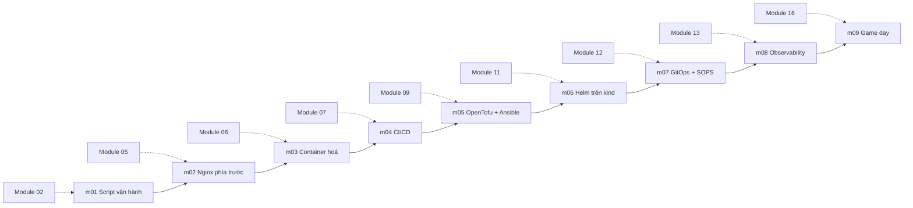

# Lộ trình DevOps

Lộ trình tự học DevOps bám theo [roadmap.sh/devops](https://roadmap.sh/devops), nhắm tới mức **DevOps
engineer senior**: không dừng ở "biết công cụ", mà tự vận hành được một dịch vụ, ra quyết định có đánh đổi,
xử lý sự cố và trả lời được câu hỏi phỏng vấn thiết kế. Phần roadmap.sh còn thiếu (giới thiệu DevOps & SRE,
vận hành SRE) được bổ sung ở module 00 và 16.

Lộ trình gồm 17 module (00–16). Mỗi module có lý thuyết (`README.md`), câu hỏi phỏng vấn (`interview.md`),
khoảng 7 bài tập 3 mức Basic → Intermediate → Advanced chấm bằng `pytest`, cùng một milestone của dự án
capstone [Olist Shop lên production local](capstone/README.md).

## Dành cho ai, nối với track Data Engineer thế nào

Track này giả định bạn đã quen Python, SQL, Docker cơ bản (ví dụ đã học track
[Data Engineer](../data-engineer/README.md)). Phần trùng với track DE chỉ được nhắc lại ngắn trong **một**
phần của module, kèm link về module gốc ([DE 08 DevOps cho Data](../data-engineer/modules/08-devops-for-data/README.md),
[DE 11 Cloud](../data-engineer/modules/11-cloud/README.md)). Riêng **Kubernetes** và **IaC** được dạy lại đầy
đủ, tới mức gần CKA và Terraform Associate, vì track DE chỉ dạy ở mức "đủ dùng cho data".

Bài tập đặt trong bối cảnh công việc DevOps (vận hành dịch vụ, tự động hoá, deploy, xử lý sự cố), không chép
lại bài của track DE.

## Các module

| # | Module | Trọng tâm |
| --- | --- | --- |
| 00 | [`00-introduction`](modules/00-introduction/README.md) Giới thiệu DevOps & SRE | CALMS, DORA metrics, DevOps vs SRE vs Platform Engineering, bản đồ công cụ |
| 01 | [`01-linux-terminal`](modules/01-linux-terminal/README.md) Linux & terminal | Process, performance, text, systemd, quyền, cài binary có kiểm checksum |
| 02 | [`02-scripting`](modules/02-scripting/README.md) Scripting & lập trình | Bash strict mode, trap, idempotent, test script; Python automation |
| 03 | [`03-git-vcs-hosting`](modules/03-git-vcs-hosting/README.md) Git & VCS hosting | Branching strategy, trunk-based, PR flow, hooks, monorepo |
| 04 | [`04-networking-protocols`](modules/04-networking-protocols/README.md) Networking & protocols | DNS, HTTP, TLS, SSH, email (SPF, DKIM, DMARC) với Mailpit |
| 05 | [`05-web-server-proxy`](modules/05-web-server-proxy/README.md) Web server & proxy | Nginx reverse proxy, cache, load balancer, TLS, rate limit |
| 06 | [`06-containers`](modules/06-containers/README.md) Containers | Multi-stage, hardening, rootless, registry, quét lỗ hổng |
| 07 | [`07-cicd-artifacts`](modules/07-cicd-artifacts/README.md) CI/CD & artifact | GitHub Actions + `act`, chiến lược deploy, artifact |
| 08 | [`08-iac-provisioning`](modules/08-iac-provisioning/README.md) Provisioning (IaC) | OpenTofu + LocalStack: state, module, import, drift, test |
| 09 | [`09-config-management`](modules/09-config-management/README.md) Configuration management | Ansible role, idempotency, vault, molecule |
| 10 | [`10-kubernetes-core`](modules/10-kubernetes-core/README.md) Kubernetes core | Kiến trúc, workload, Service, Ingress, storage, etcd backup |
| 11 | [`11-kubernetes-production`](modules/11-kubernetes-production/README.md) Kubernetes production | RBAC, NetworkPolicy, scheduling, autoscaling, Helm, troubleshooting |
| 12 | [`12-gitops-secrets`](modules/12-gitops-secrets/README.md) GitOps & secrets | ArgoCD, SOPS, Vault, Sealed Secrets |
| 13 | [`13-observability`](modules/13-observability/README.md) Observability | Prometheus, Grafana, Loki, OpenTelemetry, Jaeger, alerting |
| 14 | [`14-cloud-serverless`](modules/14-cloud-serverless/README.md) Cloud & serverless | AWS core qua LocalStack, lab free tier, Lambda |
| 15 | [`15-service-mesh-patterns`](modules/15-service-mesh-patterns/README.md) Service mesh & patterns | Linkerd, cloud design patterns |
| 16 | [`16-sre-operations`](modules/16-sre-operations/README.md) SRE & vận hành | SLO, error budget, incident, postmortem, chaos, FinOps |

Module được phát hành theo ba đợt: 00–05 trước, 06–11 sau đó, 12–16 cuối cùng. Link tới module chưa có sẽ
hoạt động khi module đó được thêm.

```mermaid
flowchart LR
    subgraph Nền tảng
        M00[00 Giới thiệu] --> M01[01 Linux] --> M02[02 Scripting]
        M02 --> M03[03 Git]
        M03 --> M04[04 Networking]
        M04 --> M05[05 Nginx]
    end
    subgraph Đóng gói và tự động hoá
        M06[06 Containers] --> M07[07 CI/CD]
        M07 --> M08[08 IaC OpenTofu]
        M08 --> M09[09 Ansible]
    end
    subgraph Kubernetes
        M10[10 K8s core] --> M11[11 K8s production]
        M11 --> M12[12 GitOps & secrets]
    end
    subgraph Vận hành
        M13[13 Observability] --> M14[14 Cloud]
        M14 --> M15[15 Service mesh]
        M15 --> M16[16 SRE]
    end
    M05 --> M06
    M09 --> M10
    M12 --> M13
```



## Capstone đi cùng module

Capstone đưa ứng dụng mẫu **Olist Shop** (`sample-app/`: API FastAPI, worker, Postgres, Redis) lên
"production" trên máy local qua 9 milestone. Mỗi milestone mở ra sau một module và dùng lại kết quả của
milestone trước. Chi tiết và cách chấm ở [capstone/README.md](capstone/README.md).



## Dạng bài và cách chấm

`pytest` là bộ chấm duy nhất. Test **gọi công cụ thật** (docker, nginx trong container, kind, kubectl, helm,
tofu, ansible, act…) khi được, và tự `skip` kèm lời nhắc khi máy thiếu công cụ, công cụ cũ hơn mức tối thiểu
hoặc chưa bật cluster. Test skip **không** tính là đạt.

| Dạng bài | Bạn làm gì | Test kiểm gì |
| --- | --- | --- |
| File cấu hình / script | Sửa Dockerfile, YAML, `.tf`, playbook, `.sh`, `nginx.conf` có TODO | Chạy công cụ thật: build, `nginx -t` rồi gọi HTTP, `tofu plan`, `kubectl apply --dry-run=server`… |
| Sự cố cố ý | Đề chỉ tả triệu chứng; bạn chẩn đoán và sửa | Hệ thống chạy lại đúng; nguyên nhân gốc nằm trong `solutions/` |
| Cài và xác minh | Cài công cụ vào `~/.local/bin` có kiểm checksum | Công cụ có trong `PATH`, đủ phiên bản, có tệp `.sha256` đã kiểm |
| Chọn công cụ | Trả lời trắc nghiệm theo tình huống | Đáp án trong `quiz-answers.yaml`, giải thích trong `SOLUTION.md` |
| Advanced | Thiết kế, runbook, postmortem, review kiến trúc | Tự chấm theo rubric trong `SOLUTION.md` |

Chạy test của một bài, rồi so với lời giải tham chiếu (Basic và Intermediate):

```bash
uv run pytest tracks/devops/modules/<module>/exercises/<level>/<bài> -q -rs
SOLUTION=1 uv run pytest tracks/devops/modules/<module>/exercises/<level>/<bài> -q -rs
```

`-rs` in lý do skip, nhờ đó bạn biết còn thiếu công cụ nào.

## Công cụ và cluster

Track này **không có script cài tự động**. Mỗi công cụ được dạy cài ở module dùng nó lần đầu, trong phần
`## 0. Cài đặt` của module: bảng phiên bản đã kiểm, lệnh tải, kiểm checksum, cài vào `~/.local/bin` (không
cần sudo nếu được), lệnh xác nhận và cách gỡ. Mục lục ở [`setup/DEVOPS-TOOLS.md`](../../setup/DEVOPS-TOOLS.md).
Không bao giờ chạy script tải từ mạng thẳng vào shell với quyền root, và không bỏ qua bước kiểm checksum.

Dịch vụ phụ trợ của track nằm dưới profile `devops` của `setup/docker-compose.yml` (ví dụ Mailpit cho module
04), không đụng các service của track Data Engineer. Ứng dụng mẫu có compose riêng trong
[`sample-app/`](sample-app/README.md), cổng host mặc định `25432`, `26379`, `28000` để không trùng project khác.

Từ module 10, bài cần Kubernetes dùng chung một cluster kind tên `devops-lab`. Module 10 hướng dẫn tạo đầy đủ;
khung lệnh như sau:

```bash
nice -n 15 taskset -c 12-35 kind create cluster --name devops-lab
docker update --cpuset-cpus 12-35 devops-lab-control-plane
kubectl cluster-info --context kind-devops-lab
kind delete cluster --name devops-lab
```

Test cần cluster tự skip khi `devops-lab` chưa chạy. Xoá cluster khi học xong để trả tài nguyên cho máy.

## Ghim CPU trên máy dùng chung

Cluster, image lớn và stack observability có thể ăn hết CPU. Quy ước của track:

- Lệnh nặng chạy trực tiếp trên máy (build, test, `kind create`) chạy với `nice -n 15 taskset -c 12-35`.
- Container không kế thừa `nice` và `taskset` của lệnh gõ, nên phải ghim bằng `--cpuset-cpus` (hoặc `cpuset`
  trong compose). Đặt `DEVOPS_CPUSET=12-35` để mọi container của track và test bài tập dùng dải core này;
  test gọi `docker run` lấy cờ từ `testkit.docker_cpu_args()`, có `--rm` và dọn container trong `finally`.
- Máy ít hơn 36 core: đặt dải phù hợp (ví dụ `DEVOPS_CPUSET=2-5`) hoặc `DEVOPS_CPUSET=none` để không ghim.
- Mỗi lúc chạy một việc nặng, tắt container và cluster sau mỗi đợt kiểm.

Giải thích chi tiết ở mục "Ghim CPU" của [`setup/DEVOPS-TOOLS.md`](../../setup/DEVOPS-TOOLS.md).

## Cloud

Mọi bài chạy local (LocalStack, MinIO, kind). Khi cần trải nghiệm cloud thật, module 08 và 14 có hướng dẫn AWS
free tier kèm chi phí ước tính, budget alarm và lệnh dọn. Không bài nào bắt buộc cloud thật hay tốn tiền mới qua.
