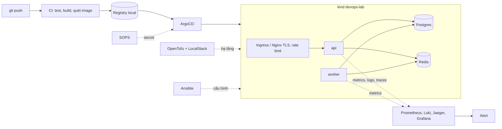
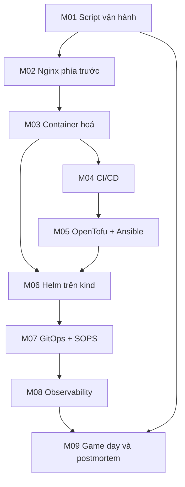

# Olist Shop lên production local

Dự án capstone xuyên suốt lộ trình DevOps. Bạn nhận **Olist Shop**, một service nhỏ do "team khác" viết
([`sample-app/`](../sample-app/README.md)), và đưa nó từ "chạy được trên máy dev" lên mức vận hành như
production, nhưng toàn bộ trên máy local: script vận hành, Nginx có TLS, image đã quét lỗ hổng, pipeline CI/CD,
hạ tầng bằng code, Kubernetes, GitOps, observability và cuối cùng là một game day có sự cố thật.

Bạn **không** viết code ứng dụng. Việc của bạn là mọi thứ xung quanh nó, giống công việc hằng ngày của một
DevOps engineer.

## Ứng dụng bạn vận hành

| Thành phần | Việc | Interface ổn định |
| --- | --- | --- |
| API (FastAPI, `olist_shop.main:app`) | Trả đơn hàng, doanh thu theo bang, nhận job | `/healthz` (liveness), `/readyz` (readiness, kiểm DB và Redis), `/orders/{order_id}`, `/stats/revenue-by-state`, `POST /jobs/recompute`, `/metrics` |
| Worker (`python -m olist_shop.worker`) | Lấy job từ list Redis `olist:jobs`, tính bảng `revenue_by_state` | Metrics ở cổng `9101`, thoát sạch khi nhận `SIGTERM` |
| Postgres 16 | Dữ liệu đơn hàng Olist | Cổng host mặc định `25432` |
| Redis 7 | Hàng đợi job | Cổng host mặc định `26379` |

API mặc định ở cổng host `28000`. Log là JSON một dòng mỗi sự kiện, có `request_id` lấy từ header
`X-Request-ID`, nên bạn lần được một request đi qua Nginx, API và log. Dữ liệu là Olist thật
(`data/download_olist.py`) hoặc bộ giả lập cùng schema (`data/generate_olist.py`), nạp bằng
`python -m olist_shop.seed`. Cách chạy bằng compose, biến môi trường và cổng: xem
[README của sample-app](../sample-app/README.md).

## Kiến trúc đích



## Milestone nối nhau thế nào



| Milestone | Sau module | Dùng lại | Tạo ra | Chấm |
| --- | --- | --- | --- | --- |
| [M01](milestones/m01-ops-scripts.md) | 02 Scripting | sample-app compose | `bootstrap.sh`, `healthcheck.sh` chạy lại an toàn, `backup.sh` bỏ qua bản đã có cùng timestamp | pytest |
| [M02](milestones/m02-nginx-front.md) | 05 Web server & proxy | M01 | `gen-cert.sh` tạo cert tự ký, cấu hình Nginx: reverse proxy, TLS, rate limit, truyền `X-Request-ID` | pytest |
| [M03](milestones/m03-containers.md) | 06 Containers | M02 | Dockerfile multi-stage chạy non-root, image đã quét lỗ hổng | pytest |
| [M04](milestones/m04-cicd-pipeline.md) | 07 CI/CD & artifact | M03 | workflow GitHub Actions chạy bằng `act`: test, build, push registry local, deploy staging | pytest |
| [M05](milestones/m05-iac-config.md) | 09 Configuration management | M03, M04 | hạ tầng OpenTofu trên LocalStack, role Ansible cấu hình host | pytest |
| [M06](milestones/m06-kubernetes-helm.md) | 11 Kubernetes production | M03, M05 | Helm chart tự viết, HPA, NetworkPolicy, RBAC trên kind | pytest |
| [M07](milestones/m07-gitops-secrets.md) | 12 GitOps & secrets | M06 | ArgoCD đồng bộ chart từ Git, secret mã hoá bằng SOPS | pytest |
| [M08](milestones/m08-observability.md) | 13 Observability | M06, M07 | metrics, logs, traces; dashboard Grafana và alert rule | pytest |
| [M09](milestones/m09-game-day.md) | 16 SRE & vận hành | toàn bộ | SLO, game day với sự cố bơm vào, khôi phục, postmortem; tuỳ chọn deploy AWS thật | rubric tự đánh giá |

Milestone M01–M02 có ngay cùng module 00–05; M03–M06 và M07–M09 được thêm cùng các module tương ứng.

## Cách chấm

Làm theo cách của capstone track Data Engineer:

- Mỗi milestone là một tệp markdown trong `milestones/` gồm **Mục tiêu**, **Việc cần làm**, **Kết quả nộp** và
  **Tiêu chí đạt** (checklist).
- Code của bạn nằm ở [`project/`](project/). **M01–M08** có test pytest trong `capstone/project/tests`, chạy công
  cụ thật (bash, nginx trong container, docker, act, tofu, ansible, kind, helm…) và tự skip khi thiếu công cụ hoặc
  cluster. Test skip không tính là đạt.
- `solutions/` giữ bản tham chiếu cho phần chấm được. Chỉ mở sau khi đã tự làm.
- **M09** không có test: đây là bài đánh giá độc lập, bạn tự chấm theo rubric trong tệp milestone (SLO đặt có cơ
  sở, phát hiện và khôi phục sự cố trong thời gian mục tiêu, postmortem không đổ lỗi, hành động khắc phục có
  người và hạn). Script bơm lỗi chọn ngẫu nhiên theo seed lúc chạy; đừng đọc nó trước game day.

```bash
uv run pytest tracks/devops/capstone/project/tests -q -rs
SOLUTION=1 uv run pytest tracks/devops/capstone/project/tests -q -rs
```

Lệnh đầu chấm code của bạn; lệnh sau chạy bản tham chiếu, phải pass khi đã cài đủ công cụ. Thêm `-k m02` để
chỉ chạy một milestone.

Test của capstone dựng container qua `testkit.DockerLab` với cờ ghim CPU từ `testkit.docker_cpu_args()`, đặt tên
ngẫu nhiên có tiền tố `devops-ex-` và xoá khi kết thúc, nên lỗi hay ngắt giữa chừng cũng không để lại container. Trên
máy dùng chung, đặt `DEVOPS_CPUSET` theo máy của bạn (xem [Ghim CPU](../README.md#ghim-cpu-trên-máy-dùng-chung)) và chạy lệnh nặng với `nice -n 15 taskset -c "$DEVOPS_CPUSET"`.

## Trình bày làm portfolio

1. **Tách repo riêng** khi xong M04: `olist-shop-platform` gồm `project/`, sample-app và README riêng.
2. **README đầu trang**: một câu mô tả, sơ đồ kiến trúc đích ở trên, Quick start ≤ 5 lệnh, bảng công cụ.
3. **Mục "Design decisions"**: vì sao Nginx thay vì Caddy, vì sao kind thay vì k3d, vì sao SOPS thay vì Sealed
   Secrets, chiến lược deploy đã chọn và cái giá của nó. Đây là chỗ thường bị hỏi lại khi phỏng vấn.
4. **Bằng chứng vận hành**: ảnh dashboard, alert đã bắn trong game day, postmortem M09.
5. **Ghi rõ giới hạn**: mọi thứ chạy local, LocalStack chỉ giả lập AWS, sự cố là bơm vào có chủ đích.

## Tiêu chí hoàn thành toàn dự án

- [ ] Từ máy sạch, làm theo README dựng lại toàn bộ (cluster, ứng dụng, observability) trong ≤ 30 phút.
- [ ] Mọi thay đổi lên cluster đi qua Git (ArgoCD), không `kubectl apply` tay.
- [ ] Không có secret dạng rõ trong repo.
- [ ] Image chạy non-root, không có lỗ hổng CRITICAL chưa giải thích.
- [ ] Dashboard cho thấy request rate, error rate, latency của API và độ dài hàng đợi job; có ít nhất một alert
  dựa trên SLO.
- [ ] Game day M09 có postmortem đủ timeline, nguyên nhân gốc, tác động và hành động khắc phục.
- [ ] Tắt cluster và container sau khi làm xong.
