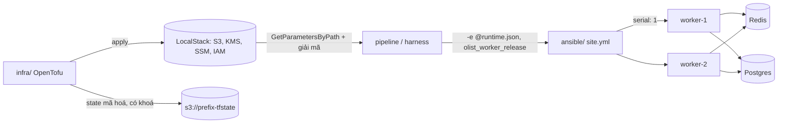

# M05: Hạ tầng bằng OpenTofu, cấu hình bằng Ansible

## Mục tiêu

Sau M04, Olist Shop có artifact và pipeline, nhưng "môi trường" vẫn là thứ ai đó dựng tay: bucket backup tạo bằng console,
mật khẩu database nằm trong tệp `.env` trên máy chủ, cấu hình mỗi host một kiểu. Milestone này đưa hai lớp đó vào code:

- **Hạ tầng** (OpenTofu, trên LocalStack): bucket backup có version, mã hoá bằng khoá KMS riêng, lifecycle; cây tham số SSM
  là **nguồn sự thật duy nhất** cho cấu hình runtime; instance role đúng quyền tối thiểu; state ở S3, có khoá, mã hoá phía
  client, và mật khẩu database **không bao giờ** vào state hay plan.
- **Cấu hình host** (Ansible, trên target SSH): một role triển khai worker theo **release** (thư mục bất biến cộng symlink
  `current`), đọc cấu hình từ đúng cây SSM ở trên, cuốn chiếu từng host, không in bí mật, chạy lại không đổi gì; và worker
  do role dựng phải **chạy thật**: hai host cùng tiêu thụ một hàng đợi Redis, ghi vào một Postgres.

Đây là bài tích hợp sau [module 08 Provisioning](../../modules/08-iac-provisioning/README.md) (state từ xa, khoá, mã hoá
state, IAM tối thiểu, validation) và [module 09 Configuration management](../../modules/09-config-management/README.md)
(role, handler, idempotency, `--check --diff`, rolling update). Module làm từng mảnh với dữ liệu giả; ở đây hai công cụ
nối vào nhau qua một hợp đồng (cây tham số SSM) và đầu ra cuối cùng là một tiến trình xử lý job thật.



## Việc cần làm

Bạn viết `capstone/project/infra/` (OpenTofu) và `capstone/project/ansible/` (playbook, inventory, role `olist_worker`).
Ứng dụng vẫn là [sample-app](../../sample-app/README.md).

Mọi quy tắc dưới đây đều được chấm. Không có quy tắc chấm nào nằm ngoài tệp này.

### 1. Cách test chạy

**Phần OpenTofu** chạy qua `testkit.TofuLab` (mục "OpenTofu và LocalStack" của `CONTENT_SPEC.md`): thư mục `infra/` được
chép sang thư mục tạm, mọi lệnh `tofu` chạy trong sandbox với `localstack-devops` (`127.0.0.1:14566`, không bao giờ ra AWS
thật), provider `hashicorp/aws` cài offline đúng **6.12.0**. Test:

1. Tạo trước bucket state `<prefix>-tfstate` (có versioning) bằng boto3, với `prefix` là `devops-ex-<8 hex>` của lần chạy.
2. Ghi `ci.auto.tfvars.json` = `{"environment": "staging", "database_host": "postgres", "redis_host": "redis"}`, đặt
   `TF_VAR_db_password` (chuỗi ngẫu nhiên có cả `@`, `:`, `/`, `#`, `%`) và `TF_VAR_state_passphrase` (≥ 16 ký tự) qua env.
3. `tofu init`, `tofu apply`, rồi kiểm theo mục 2. Kết thúc: `destroy` và quét sạch mọi tài nguyên mang `prefix`.

**Phần Ansible** chạy qua `testkit.AnsibleLab` với hai target `worker-1`, `worker-2` (container SSH `python:3.12.16-slim-trixie`,
có wheel của worker ở `/srv/wheels`, **không** có systemd chạy thật). Cùng network với hai target, test dựng `postgres`
(`postgres:16.15-alpine`, user, mật khẩu, database lấy từ SSM) và `redis` (`redis:7.4.12-alpine`); trong network đó tên
máy `postgres`, `redis` phân giải được. Test chép thư mục `ansible/` vào lab (bị từ chối nếu có plugin, `..`, `localhost`,
`delegate_to`... xem `CONTENT_SPEC.md`), chép code `olist_shop/` của sample-app vào `ansible/artifacts/olist_shop/` (vai
trò artifact của release), rồi **đóng vai pipeline**: đọc cả cây SSM của bạn bằng `GetParametersByPath` (có giải mã),
ghi `runtime.json` = `{"olist_worker_runtime": {"DB_HOST": ..., "DB_PASSWORD": ..., ...}}` cạnh `site.yml`. Ở production bạn
đọc cây này bằng instance role (hay lookup `amazon.aws.ssm_parameter`); lab không có collection và target không tới được
LocalStack nên harness đọc hộ. Lệnh chạy, từ thư mục `ansible/`:

```bash
ansible-playbook -i inventory site.yml -e @runtime.json -e olist_worker_release=<tag>
```

Thứ tự: một lần **thiếu** cả hai biến; lần đầu với release A kèm `--diff -v`; lần hai; `--check --diff`; chạy worker và đẩy
job (mục 4); lần nâng lên release B kèm `--diff -v`. Phần Ansible dùng cây SSM do `infra/` tạo, nên `infra/` hỏng thì phần
Ansible báo "sửa infra/ trước".

### 2. `infra/`: hạ tầng trên LocalStack

| Hạng mục | Quy tắc được chấm |
| --- | --- |
| Chất lượng | `tofu fmt -check -recursive` và `tofu validate` sạch. |
| Biến | `prefix`, `environment`, `database_host`, `redis_host` (không default), `log_level` (mặc định `INFO`, validation chỉ nhận `DEBUG`, `INFO`, `WARNING`, `ERROR`: `TRACE` phải lỗi `Invalid value for variable`), `db_password` (`sensitive = true`), `db_password_version` (số, mặc định 1), `state_passphrase`. |
| State | Backend `s3`: bucket `${var.prefix}-tfstate`, key `olist-shop/${var.environment}/platform.tfstate` (OpenTofu ≥ 1.8 nhận biến trong khối backend). Sau apply, không có `terraform.tfstate` ở local; object trên S3 được mã hoá phía client bằng khối `encryption` của OpenTofu (`pbkdf2` từ `var.state_passphrase`, `aes_gcm`, `enforced = true`, cho cả `state` lẫn `plan`): nội dung có `encrypted_data`, không có `resources`. |
| Khoá state | `use_lockfile = true`: khi test đặt sẵn `<key>.tflock` trên S3, `tofu plan -lock-timeout=0s` phải lỗi `Error acquiring the state lock`. |
| Mật khẩu | Mật khẩu database không xuất hiện trong `tofu state pull`, trong plan (`plan -out` rồi `show -json`), hay trong output của apply. Gợi ý: biến `ephemeral = true` cộng thuộc tính write-only `value_wo`/`value_wo_version` của `aws_ssm_parameter` (OpenTofu ≥ 1.11). |
| Khoá KMS | Output `kms_key_arn` là ARN khoá; bật xoay khoá tự động; alias `alias/<prefix>-staging-olist-shop` trỏ tới khoá đó. |
| Bucket backup | Tên `<prefix>-staging-backups`, output `backup_bucket`. Versioning `Enabled`; chặn đủ 4 cờ public access; mã hoá mặc định `aws:kms` bằng khoá của bạn (không phải `AES256` hay khoá `aws/s3`); lifecycle cho **cả** bucket (không lọc prefix hay tag) với `NoncurrentVersionExpiration` 30 ngày và `AbortIncompleteMultipartUpload`; tag `Project=olist-shop`, `Environment=staging`, `ManagedBy=opentofu` (gợi ý: `default_tags` của provider). |
| Cấu hình runtime | Output `parameter_path` đúng `/<prefix>/staging/olist-shop`. Dưới đường dẫn đó **đúng** sáu tham số: `DB_HOST` = `postgres`, `DB_NAME` = `olist`, `DB_USER` = `olist`, `REDIS_URL` = `redis://redis:6379/0`, `LOG_LEVEL` = `INFO` (cả năm là `String`), và `DB_PASSWORD` là `SecureString` chứa đúng mật khẩu truyền vào, mã hoá bằng khoá KMS của bạn (không phải khoá mặc định `aws/ssm`). |
| Instance role | Role `<prefix>-staging-olist-app`, output `app_role_arn`, chỉ `ec2.amazonaws.com` được assume. Tập quyền (hành động, tài nguyên) của mọi policy gắn vào role phải **đúng bằng**: `ssm:GetParameter` và `ssm:GetParameters` trên `arn:aws:ssm:us-east-1:<account>:parameter/<prefix>/staging/olist-shop/*`; `ssm:GetParametersByPath` trên `arn:aws:ssm:us-east-1:<account>:parameter/<prefix>/staging/olist-shop`; `kms:Decrypt` và `kms:GenerateDataKey` trên ARN khoá; `s3:PutObject` trên `arn:aws:s3:::<bucket backup>/*`. Không `*`, không `s3:DeleteObject` (host bị chiếm không xoá được backup). |
| Ổn định | Plan lần hai `No changes` (`-detailed-exitcode` trả 0). |
| Xoay mật khẩu | Với `db_password` mới và `db_password_version = 2`, plan chỉ có **một** thay đổi, `update` tại chỗ (tham số `DB_PASSWORD`); sau apply SSM trả mật khẩu mới, và mật khẩu mới cũng không vào state. |

Lifecycle của S3 trên provider 6.12.0 chờ khoảng một phút để "lan truyền" cấu hình, nên apply đầu mất chừng 1–2 phút.

### 3. `ansible/`: role `olist_worker`

Bố cục: `ansible/site.yml`, `ansible/inventory/hosts.yml` (nhóm `olist_workers` gồm `worker-1`, `worker-2`), role
`ansible/roles/olist_worker/` có `defaults/main.yml`, `tasks/main.yml`, `handlers/main.yml`, `meta/main.yml`,
`meta/argument_specs.yml`, `templates/worker.env.j2`, `templates/olist-worker.service.j2`.

| Hạng mục | Quy tắc được chấm |
| --- | --- |
| Giao diện | `meta/argument_specs.yml`, entry point `main`: `olist_worker_release` (`required: true`), `olist_worker_runtime` (`type: dict`, `required: true`) với `options` `DB_HOST`, `DB_NAME`, `DB_USER`, `DB_PASSWORD`, `REDIS_URL`, `LOG_LEVEL` đều `required: true`, riêng `DB_PASSWORD` có `no_log: true`. |
| Thiếu đầu vào | Chạy không có hai biến trên thì playbook lỗi, không task nào `changed`, trên host chưa có `/etc/olist-shop` hay `/opt/olist-shop`. |
| Cuốn chiếu | Play chạy từng host một (`serial: 1`): mọi task của `worker-1` xong trước task đầu tiên của `worker-2`. |
| Hội tụ | Lần đầu không lỗi trên cả hai host; handler `Restart olist-worker` được notify trên cả hai. |
| Release | User hệ thống `olist` (UID < 1000, shell `/usr/sbin/nologin`). Code ở `/opt/olist-shop/releases/<release>/olist_shop/` (tệp `0644 root:root`), `/opt/olist-shop/current` là symlink tới `/opt/olist-shop/releases/<release>`, virtualenv ở `/opt/olist-shop/.venv` cài từ `/srv/wheels` (không ra Internet). |
| Env file | `/etc/olist-shop/worker.env`, `0640 root:olist`, **đúng** bốn khoá: `DATABASE_URL`, `REDIS_URL`, `LOG_LEVEL`, `APP_VERSION`. `DATABASE_URL` dạng `postgresql+psycopg://<DB_USER>:<DB_PASSWORD>@<DB_HOST>:5432/<DB_NAME>` với user và mật khẩu **percent-encode** (mật khẩu có `@`, `:`, `/`, `#`, `%`; lưu ý filter `urlencode` của Jinja không mã hoá `/`); `APP_VERSION` là release. |
| Unit | `/etc/systemd/system/olist-worker.service`, `0644 root:root`, có các dòng `User=olist`, `Group=olist`, `EnvironmentFile=/etc/olist-shop/worker.env`, `WorkingDirectory=/opt/olist-shop/current`, `ExecStart=/opt/olist-shop/.venv/bin/python -m olist_shop.worker`, `Restart=on-failure`, `NoNewPrivileges=yes`, `ProtectSystem=strict`; `systemd-analyze verify` trong target trả 0. Task quản service gắn `when: ansible_facts.service_mgr == "systemd"` (giới hạn của lab, như module 09). |
| Không lộ bí mật | Output của lần thiếu đầu vào, lần đầu và lần nâng release (cả hai chạy `--diff -v`) không chứa mật khẩu database. |
| Idempotent | Lần hai và `--check --diff` đều `changed=0` trên cả hai host, không chạy handler. |
| Nâng release | Chạy với release B: handler chạy trên cả hai host, `current` trỏ `releases/B`, `releases/A` vẫn còn (rollback = chạy lại với `olist_worker_release=A`), `APP_VERSION` là B. |

### 4. Worker chạy thật theo unit

Target không có systemd, nên sau lần `--check`, test **đóng vai systemd**: trên mỗi host, đọc phần `[Service]` của unit, nạp
`EnvironmentFile` theo cú pháp của systemd (`KEY=value`, bỏ dòng `#`, bỏ một cặp nháy bao ngoài nếu có, không thay biến),
`chdir` vào `WorkingDirectory`, đổi sang `User`, rồi `exec` đúng `ExecStart`. Rồi test đẩy lần lượt 6 job
`recompute_revenue` vào list `olist:jobs` của Redis, chờ mỗi job được xử lý rồi mới đẩy job sau, và đòi:

- metrics của cả hai worker (`127.0.0.1:9101/metrics`) lên trong 60 giây (worker chỉ mở cổng metrics sau khi tạo được bảng
  trên Postgres, nên `DATABASE_URL` sai là trượt ở đây);
- tổng `jobs_processed_total` của hai worker bằng 6, và **mỗi** worker xử lý ít nhất một job (hai host, một hàng đợi);
- tiến trình worker chạy với UID khác 0; log của mỗi worker có `job done`.

### 5. Chạy thử bằng tay

Từ gốc repo, bật LocalStack riêng của track (mục "LocalStack riêng cho IaC" trong [setup/DEVOPS-TOOLS.md](../../../../setup/DEVOPS-TOOLS.md)),
tạo bucket state rồi apply:

```bash
docker compose -f setup/docker-compose.yml --profile devops up -d --wait localstack-devops
export AWS_ENDPOINT_URL=http://127.0.0.1:14566 AWS_ACCESS_KEY_ID=test AWS_SECRET_ACCESS_KEY=test AWS_REGION=us-east-1 \
  AWS_EC2_METADATA_DISABLED=true TF_VAR_prefix=olist-dev TF_VAR_environment=staging \
  TF_VAR_database_host=postgres TF_VAR_redis_host=redis
read -rs TF_VAR_db_password && read -rs TF_VAR_state_passphrase && export TF_VAR_db_password TF_VAR_state_passphrase
aws --endpoint-url "$AWS_ENDPOINT_URL" s3 mb s3://olist-dev-tfstate
cd tracks/devops/capstone/project/infra && nice -n 15 tofu init && nice -n 15 tofu apply
aws --endpoint-url "$AWS_ENDPOINT_URL" ssm get-parameters-by-path --path /olist-dev/staging/olist-shop --with-decryption \
  --query 'Parameters[].Name'
```

Không có `aws` CLI thì dùng `uv run python -c 'import boto3; ...'` với cùng endpoint. Kiểm role Ansible không cần target
thật: `ansible-playbook -i inventory site.yml --syntax-check` và `ansible-inventory -i inventory --graph`. Dọn:
`tofu destroy`, xoá bucket `olist-dev-tfstate`, rồi `docker compose -f setup/docker-compose.yml --profile devops stop localstack-devops`.

### 6. Chạy test

```bash
uv run pytest tracks/devops/capstone/project/tests -q -rs -k m05
```

Trên máy dùng chung, thêm `nice -n 15 ${DEVOPS_CPUSET:+taskset -c "$DEVOPS_CPUSET"}` trước `uv run`. Cần `tofu` ≥ 1.11 (cài
theo mục 0 của module 08), `ansible-playbook` ≥ 2.21 (mục 0 của module 09), bwrap, Docker, service `localstack-devops`
đang chạy, image `postgres:16.15-alpine`, `redis:7.4.12-alpine`; lần đầu cần mạng để tải provider và build image target
Ansible. Thiếu thứ nào thì test cần nó skip kèm lệnh cần chạy. Cả lượt mất khoảng 4–5 phút.

## Kết quả nộp

- `capstone/project/infra/` (gợi ý tách `versions.tf`, `backend.tf`, `variables.tf`, `main.tf`, `outputs.tf`)
- `capstone/project/ansible/` (`site.yml`, `inventory/hosts.yml`, `roles/olist_worker/...`)
- Mục "Hạ tầng và cấu hình" trong README của bạn: sơ đồ luồng tofu → SSM → Ansible → host; vì sao cấu hình runtime nằm ở
  SSM chứ không ở inventory hay `group_vars`; vì sao mật khẩu đi qua write-only (cái giá: OpenTofu không phát hiện drift
  của giá trị, xoay mật khẩu phải tăng version); runbook xoay mật khẩu database đầu-cuối (OpenTofu ghi SSM, Ansible ghi
  env file và restart worker, Postgres đổi mật khẩu) theo thứ tự không gây gián đoạn, biết rằng Postgres chỉ giữ một mật
  khẩu cho mỗi role; ở AWS thật thì `database_host`, `redis_host` đến từ đâu (RDS, ElastiCache) và module nào sẽ tách ra.

## Tiêu chí đạt

- [ ] `uv run pytest tracks/devops/capstone/project/tests -q -rs -k m05` pass, không skip.
- [ ] State ở S3, có khoá, mã hoá phía client; mật khẩu không vào state hay plan; plan lần hai không đổi.
- [ ] Bucket backup versioning, KMS của mình, lifecycle, chặn public; cây SSM đúng sáu tham số; instance role đúng quyền tối thiểu.
- [ ] Xoay mật khẩu chỉ cập nhật đúng một tham số.
- [ ] Role có `argument_specs`, thiếu đầu vào thì dừng trước khi đổi máy; cuốn chiếu từng host; không in bí mật; chạy lại `changed=0`.
- [ ] Release bất biến cộng symlink `current`, nâng release giữ bản cũ để rollback.
- [ ] Hai worker do role dựng xử lý chung một hàng đợi, chạy bằng user không phải root.
- [ ] (Tự đánh giá) Đã chạy vòng tay ở mục 5 và đọc được cây SSM bằng CLI.
- [ ] (Tự đánh giá) README có mục "Hạ tầng và cấu hình" như phần Kết quả nộp, kèm runbook xoay mật khẩu.
