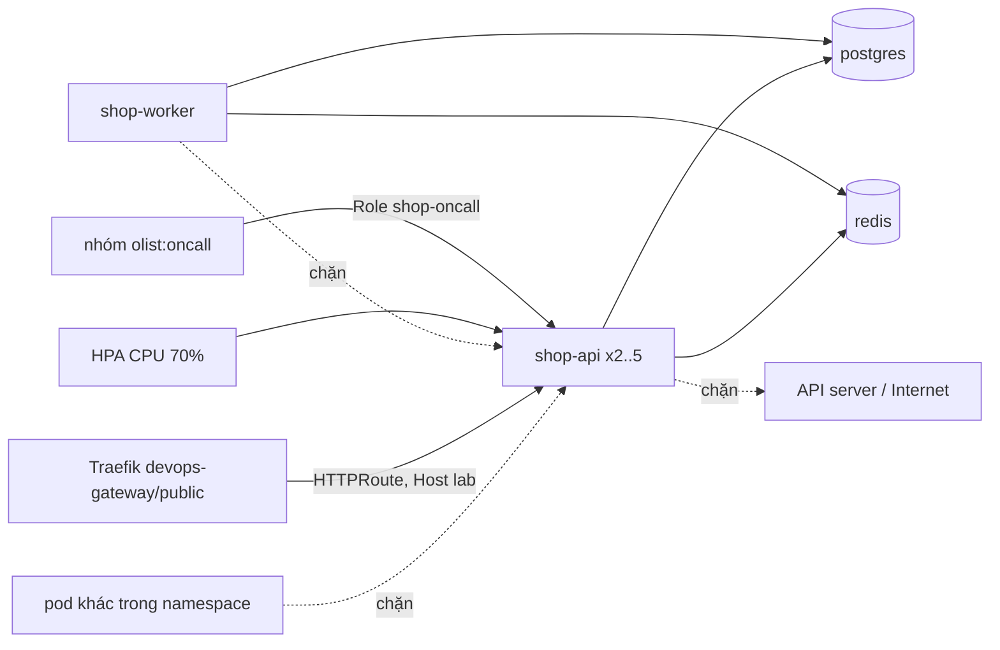

# M06: Lên kind bằng Helm chart, HPA, NetworkPolicy, RBAC

## Mục tiêu

Đến M05, Olist Shop chạy trên máy chủ do Ansible cấu hình. Milestone này đưa nó lên Kubernetes như một team platform sẽ
nhận: **một** Helm chart tự viết đóng gói cả `api` lẫn `worker`, cài được vào một namespace có Pod Security `restricted`,
và mang theo mọi thứ một service production cần mà người viết chart hay quên:

- danh tính riêng cho từng workload, không token, không quyền nào trên API server; một Role cho người trực sự cố, đọc được
  mọi thứ cần để chẩn đoán, scale được, nhưng không đọc Secret và không exec;
- mạng **mặc định chặn**: traffic vào `api` chỉ đi qua Gateway dùng chung, `api` và `worker` chỉ ra được DNS, Postgres, Redis;
- HPA theo CPU cộng PodDisruptionBudget cộng trải pod `api` ra các node, để một lần drain node hay một đợt tải không làm
  sập service;
- cấu hình đổi thì pod rollout, mật khẩu không nằm trong chart.

Đây là bài tích hợp sau [module 10 Kubernetes core](../../modules/10-kubernetes-core/README.md) (Deployment, Service,
probe, Gateway API) và [module 11 Kubernetes production](../../modules/11-kubernetes-production/README.md) (Helm, RBAC,
SecurityContext, NetworkPolicy, HPA, PDB, scheduling). Module làm từng mảnh với manifest riêng lẻ; ở đây mọi mảnh nằm trong
một chart, phải đúng **cùng lúc**: NetworkPolicy chặn sai một cổng là Gateway không tới được `api`, `requests.cpu` thiếu là
HPA mù, PDB chọn sai nhãn là drain không được bảo vệ.



## Việc cần làm

Bạn viết chart ở `capstone/project/chart/olist-shop/`. Ứng dụng là image `devops-track/olist-shop:1.0` (build từ
`setup/kind/olist-shop.Dockerfile`, cùng code sample-app, user `10001`) đã nạp sẵn vào hai worker của cluster; image M03 của bạn
dùng được ở cluster thật với registry, nhưng kind của lab không kéo image từ registry lúc chấm. Postgres, Redis và Secret
`olist-db` (khoá `DATABASE_URL`) **không** thuộc chart: ở production đó là dịch vụ managed (M05) và Secret do hệ thống quản lý
secret tạo (M07); test dựng sẵn chúng trong namespace từ `tests/fixtures/k8s-deps.yaml`, với pod mang nhãn
`app.kubernetes.io/name: postgres` và `app.kubernetes.io/name: redis`, Service `postgres:5432` và `redis:6379`.

Mọi quy tắc dưới đây đều được chấm. Không có quy tắc chấm nào nằm ngoài tệp này. Tên release khi chấm là `shop`.

### 1. Chart: đọc tĩnh

Test chạy `helm lint --strict` và `helm template shop <chart> --set route.host=shop.olist.test` offline (sandbox,
`KUBECONFIG=/dev/null`).

| Hạng mục | Quy tắc được chấm |
| --- | --- |
| Chart | `Chart.yaml` tên `olist-shop`, `version: 0.1.0`, `appVersion: "1.0"`; `helm lint --strict` sạch. |
| Object | Có ít nhất: Deployment `shop-api`, `shop-worker`; Service `shop-api` (cổng 8000); ConfigMap `shop-config`; ServiceAccount `shop-api`, `shop-worker`; HorizontalPodAutoscaler `shop-api`; PodDisruptionBudget `shop-api`; HTTPRoute `shop-api`; Role và RoleBinding `shop-oncall`. Không có Secret, ClusterRole, ClusterRoleBinding, Namespace. |
| Nhãn | Mọi object có `app.kubernetes.io/name: olist-shop`, `app.kubernetes.io/instance: shop`, `app.kubernetes.io/managed-by: Helm`, `helm.sh/chart: olist-shop-0.1.0`. Selector của Deployment (và Service `shop-api`) **chỉ** gồm `name`, `instance` và `app.kubernetes.io/component` (`api` hoặc `worker`). |
| Values | `--set image.tag=1.1` cho cả hai Deployment image `devops-track/olist-shop:1.1` và `APP_VERSION: "1.1"` trong ConfigMap; mặc định tag là `appVersion` (`1.0`). `route.host` thành `hostnames` duy nhất của HTTPRoute, `parentRefs` đúng `[{name: public, namespace: devops-gateway}]`. |
| Rollout theo cấu hình | ConfigMap có `LOG_LEVEL` từ `config.logLevel`; pod template của cả hai Deployment có annotation `checksum/config` đổi khi `config.logLevel` đổi. |
| Pod Security `restricted` | Mọi container: `runAsNonRoot: true` và `seccompProfile: RuntimeDefault` ở pod, `allowPrivilegeEscalation: false`, `capabilities.drop: [ALL]`, `readOnlyRootFilesystem: true` (cần `emptyDir` cho `/tmp`), `requests.cpu`, `requests.memory`, `limits.memory`. Chart chưa đạt mục này thì test **không cài** (khỏi chờ hết giờ) và mọi test trên cluster báo lý do. |
| Danh tính | `shop-api` dùng ServiceAccount `shop-api`, `shop-worker` dùng `shop-worker`; cả ServiceAccount lẫn pod đặt `automountServiceAccountToken: false`. `DATABASE_URL` lấy bằng `secretKeyRef` `olist-db`/`DATABASE_URL`. |
| Probe | `shop-api`: readiness `httpGet /readyz`, liveness `httpGet /healthz`. `shop-worker`: có liveness (gợi ý: metrics ở cổng `9101`), `terminationGracePeriodSeconds` từ 10. |
| Co giãn | Deployment `shop-api` **không** có `spec.replicas` (HPA quản). HPA `autoscaling/v2` trỏ `apps/v1` Deployment `shop-api`, `minReplicas: 2`, `maxReplicas: 5`, một metric CPU `Utilization` 70%. PDB `minAvailable: 1`, selector đúng nhãn pod `api`. `shop-api` có `topologySpreadConstraints` `maxSkew: 1`, `topologyKey: kubernetes.io/hostname`, `whenUnsatisfiable: DoNotSchedule`. |

### 2. Cài lên cluster

Test cài bằng `testkit.KubeLab(pod_security="restricted")`: namespace riêng `devops-ex-<id>`, token chỉ có quyền trong
namespace đó, policy của lab chặn Ingress/HTTPRoute sai Gateway hay sai host (mục "Kubernetes" của `CONTENT_SPEC.md`). Sau khi
`k8s-deps.yaml` (Postgres, Redis, Secret `olist-db`, và một Deployment `probe` không thuộc release) sẵn sàng, test chạy:

```bash
helm upgrade --install shop chart/olist-shop --namespace devops-ex-<id> --set route.host=<namespace>.olist.test --wait --timeout 240s
```

rồi kiểm:

| Hạng mục | Quy tắc được chấm |
| --- | --- |
| Sẵn sàng | Cài xong; trong 120 giây sau đó `shop-api` có ít nhất 2 pod ready, `shop-worker` ít nhất 1. Deployment không khai `replicas` thì lần cài đầu tạo 1 pod và `helm --wait` trả về ngay khi pod đó ready; HPA nâng lên `minReplicas` ở vòng đồng bộ kế tiếp (khoảng 15 giây). |
| Trải node | Hai pod `api` đang chạy nằm trên hai node khác nhau. |
| Qua Gateway | Từ pod `probe`, gọi `traefik.devops-gateway.svc.cluster.local` với header `Host: <namespace>.olist.test`: `/healthz` 200 với `version` `1.0`, `/readyz` 200; host khác không tới `api`; `POST /jobs/recompute` 202 và trong 60 giây log `shop-worker` có `job_id` đó kèm `job done`. |
| NetworkPolicy | Pod `probe` **không** mở được TCP tới ClusterIP của `shop-api:8000` (chỉ qua Gateway) hay tới pod worker cổng `9101`. Từ pod `api` và pod `worker`: tới `postgres:5432`, `redis:6379` qua tên Service được (DNS mở); tới API server (`kubernetes.default`, cổng 443) và `1.1.1.1:443` bị chặn. `worker` không tới được `shop-api:8000`. Kindnet của cluster thực thi NetworkPolicy. |
| HPA | Trong 180 giây HPA `shop-api` đọc được CPU (`status.currentMetrics`) và đang ở `currentReplicas: 2`. PDB `shop-api` có `expectedPods: 2`, `disruptionsAllowed: 1`. |
| Workload không có quyền | ServiceAccount `shop-api`, `shop-worker` không `get secrets`, `list pods`, `get configmaps`, `list services`, `create pods` (hỏi bằng `kubectl auth can-i --as`); không pod nào của release mount token ServiceAccount. |
| Trực sự cố | Một user bất kỳ trong nhóm `olist:oncall` (RoleBinding tới Group, không tới user cụ thể) **được**: `get`, `list`, `watch` pods; `get pods/log`; `list events`; `get`, `list` deployments; `list` replicasets; `patch deployments/scale`; `get` horizontalpodautoscalers. **Không được**: `get`, `list` secrets; `create pods/exec`, `pods/portforward`; `delete`, `create` pods; `patch`, `delete` deployments; `patch` horizontalpodautoscalers; `create` roles, rolebindings; `patch` configmaps. User ngoài nhóm không có quyền nào của Role này. |

### 3. Chạy thử bằng tay

Cluster `devops-lab`, Gateway dùng chung, metrics-server và image theo [setup/DEVOPS-TOOLS.md](../../../../setup/DEVOPS-TOOLS.md)
(mục "Cluster kind devops-lab" và các mục con). Làm trong một namespace có Pod Security `restricted` và nhãn `devops-ex` (Gateway
chỉ nhận HTTPRoute từ namespace có nhãn này):

```bash
export KUBECONFIG=~/.kube/devops-lab.yaml
kubectl create namespace olist-dev && kubectl label namespace olist-dev devops-ex=manual \
  pod-security.kubernetes.io/enforce=restricted
kubectl -n olist-dev apply -f tracks/devops/capstone/project/tests/fixtures/k8s-deps.yaml
helm lint --strict tracks/devops/capstone/project/chart/olist-shop
helm -n olist-dev upgrade --install shop tracks/devops/capstone/project/chart/olist-shop \
  --set route.host=olist-dev.olist.test --wait --timeout 240s
kubectl -n olist-dev exec deploy/probe -- python -c "import urllib.request as u; \
print(u.urlopen(u.Request('http://traefik.devops-gateway.svc.cluster.local/healthz', headers={'Host': 'olist-dev.olist.test'})).read())"
kubectl -n olist-dev get hpa,pdb,networkpolicy && kubectl -n olist-dev get pods -o wide
kubectl -n olist-dev auth can-i get secrets --as alice --as-group olist:oncall
```

Thử thêm: `kubectl drain` một worker (kèm `--ignore-daemonsets --delete-emptydir-data`) và xem PDB giữ một pod `api` sống;
`helm upgrade ... --set config.logLevel=DEBUG` rồi `helm rollback shop 1`. Dọn: `kubectl uncordon` worker nếu đã drain, rồi
`kubectl delete namespace olist-dev`, `unset KUBECONFIG`.

### 4. Chạy test

```bash
uv run pytest tracks/devops/capstone/project/tests -q -rs -k m06
```

Trên máy dùng chung, thêm `nice -n 15 ${DEVOPS_CPUSET:+taskset -c "$DEVOPS_CPUSET"}` trước `uv run`. Phần đọc tĩnh chỉ cần
`helm` ≥ 3.18 và bwrap. Phần trên cluster cần thêm kind, kubectl ≥ 1.33, cluster `devops-lab` đang chạy, Gateway dùng chung,
metrics-server và ba image `devops-track/olist-shop:1.0`, `postgres:16.15-alpine`, `redis:7.4.12-alpine` trong hai worker;
thiếu thứ nào thì test cần nó skip kèm lệnh cần chạy. Test không tạo hay xoá cluster, chỉ tạo rồi xoá namespace của nó.

## Kết quả nộp

- `capstone/project/chart/olist-shop/` (`Chart.yaml`, `values.yaml`, `templates/`, `.helmignore`)
- Mục "Kubernetes" trong README của bạn: sơ đồ object của chart; bảng luồng mạng được phép (nguồn, đích, cổng, vì sao) và
  cách bạn kiểm một luồng bị chặn; vì sao `worker` không có HPA theo CPU (độ dài hàng đợi là tín hiệu đúng: KEDA hay HPA với
  external metric, M08); `minReplicas`, `maxReplicas`, PDB và topology spread chọn theo con số nào (số node, RPS đo được);
  chart sẽ đổi gì khi lên EKS/GKE (StorageClass, IRSA/Workload Identity thay Secret tĩnh, Ingress controller, image từ
  registry theo digest của M04).

## Tiêu chí đạt

- [ ] `uv run pytest tracks/devops/capstone/project/tests -q -rs -k m06` pass, không skip.
- [ ] Một chart cho `api` và `worker`, `helm lint --strict` sạch, nhãn chuẩn, selector bất biến, values điều khiển image và host.
- [ ] Pod đạt Pod Security `restricted`, rootfs chỉ đọc, có requests/limits, ServiceAccount riêng không token.
- [ ] Traffic vào chỉ qua Gateway; egress chỉ DNS, Postgres, Redis; đã thấy kết nối bị chặn.
- [ ] HPA đọc được CPU, PDB bảo vệ `api`, hai pod `api` trên hai node.
- [ ] Role trực sự cố đủ để chẩn đoán và scale, không đọc Secret, không exec.
- [ ] (Tự đánh giá) Đã chạy vòng tay ở mục 3, kể cả drain một worker khi có tải nhẹ.
- [ ] (Tự đánh giá) README có mục "Kubernetes" như phần Kết quả nộp.
