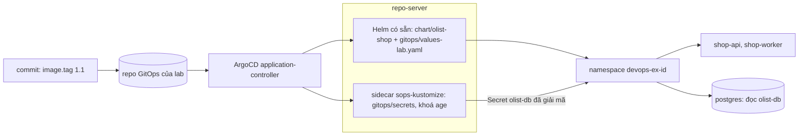

# M07: GitOps bằng ArgoCD, secret bằng SOPS

## Mục tiêu

Đến M06, Olist Shop lên cluster bằng `helm upgrade --install` chạy từ máy bạn: ai có kubeconfig là đổi được production, và câu hỏi
"cluster đang chạy commit nào" không có câu trả lời. Mật khẩu Postgres thì vẫn do "ai đó" tạo tay thành Secret `olist-db`. Milestone này
đưa Olist Shop về đúng tiêu chí của dự án: **mọi thay đổi lên cluster đi qua Git**, **không có secret dạng rõ trong repo**.

- Một repo GitOps chứa chart M06 của bạn và cấu hình môi trường lab; ArgoCD kéo repo đó về namespace của lab, tự sync, tự sửa drift.
- Secret `olist-db` nằm trong repo dưới dạng mã hoá SOPS + age cho hai người nhận: team (bạn) và ArgoCD; chỉ ArgoCD giải mã, lúc sync.
- Lên version là một commit đổi một dòng; rollback là `git revert` commit đó. Không ai chạy `helm` hay `kubectl apply` vào namespace.

Đây là bài tích hợp sau [module 12 GitOps & secrets](../../modules/12-gitops-secrets/README.md): mục 2 (Application, sync policy),
mục 4 (SOPS + age, `.sops.yaml`) và mục 7 (promote, rollback bằng `git revert`). Module dùng Kustomize cho từng mảnh; ở đây bạn ghép
**chart Helm** (ArgoCD render) với **Secret SOPS** (sidecar CMP giải mã) trong cùng một Application, trên chính chart M06.



## Việc cần làm

### Vì sao Application có nhiều nguồn

ArgoCD của lab ([setup/DEVOPS-TOOLS.md](../../../../setup/DEVOPS-TOOLS.md), mục "ArgoCD và git server dùng chung") render chart
Helm bằng Helm có sẵn trong repo-server, còn khoá age chỉ nằm trong sidecar CMP `sops-kustomize`, và sidecar này chỉ chạy
`sops --decrypt` rồi `kustomize build` (không Helm, không exec plugin, để repo của một lab không chạy được chương trình cạnh khoá).
Kustomize `helmCharts` cần `--enable-helm`, không bật. Nên **một nguồn không làm được cả hai việc**. Cách của bài là một Application
`spec.sources` (multi-source):

- nguồn chart: `path: chart/olist-shop`, render bằng Helm, values lấy từ `gitops/values-lab.yaml` trong **cùng repo** (qua một nguồn
  chỉ có `ref`, rồi `$<ref>/gitops/values-lab.yaml` trong `helm.valueFiles`);
- nguồn secret: `path: gitops/secrets`, `plugin: {name: sops-kustomize}`;
- cả hai nằm trong một Application nên sync, health, history, rollback là một đơn vị.

Hai Application riêng (một cho chart, một cho secret) cũng chạy được, nhưng thứ tự giữa chúng và việc "commit này đã lên chưa" phải
theo dõi ở hai chỗ; bài chấm theo một Application. So sánh thêm trong mục "Kết quả nộp".

### Bố cục

Bạn viết trong `capstone/project/gitops/` và dùng lại `capstone/project/chart/olist-shop/` của M06 (không sửa hợp đồng M06; test M06
vẫn phải pass). Khi chấm, test dựng **repo GitOps** gồm đúng hai thư mục: `chart/olist-shop/` (chép từ chart của bạn) và `gitops/`
(chép từ `project/gitops/`), rồi đẩy lên git server của lab bằng `KubeLab.gitops_repo`. Đó cũng là bố cục bạn dùng trong repo
portfolio.

| Tệp | Nội dung |
| --- | --- |
| `gitops/application.yaml` | Application `olist-shop` |
| `gitops/values-lab.yaml` | Values của môi trường lab, gồm version đang chạy |
| `gitops/.sops.yaml` | Quy tắc mã hoá |
| `gitops/seal-db.sh` | Tạo `gitops/secrets/olist-db.enc.yaml` từ mật khẩu đọc ở stdin |
| `gitops/secrets/kustomization.yaml` | Liệt kê `olist-db.enc.yaml` |

Postgres, Redis không thuộc repo (dịch vụ managed, như M06): test dựng chúng từ `tests/fixtures/k8s-deps.yaml` nhưng **bỏ Secret**
`olist-db` của fixture, nên Postgres chỉ khởi động được khi ArgoCD đã tạo Secret từ repo của bạn. Ứng dụng là image
`devops-track/olist-shop:1.0`; "bản mới" `1.1` trong lab là cùng image gắn thêm tag (ở cluster thật, đó là image mới do pipeline M04 đẩy
lên registry theo digest).

Mọi quy tắc dưới đây đều được chấm. Không có quy tắc chấm nào nằm ngoài tệp này.

### 1. Đọc tĩnh

| Hạng mục | Quy tắc được chấm |
| --- | --- |
| Tệp | Có đủ năm tệp ở bảng trên và `chart/olist-shop/Chart.yaml` của M06. |
| Application | Đúng một object `argoproj.io/v1alpha1` `Application` tên `olist-shop`, không ghi `metadata.namespace`. `spec.project: LAB_PROJECT`; `spec.destination` đúng `{server: https://kubernetes.default.svc, namespace: LAB_NAMESPACE}`. Dùng `spec.sources` (không `spec.source`); mọi nguồn `repoURL: LAB_REPO_URL`, `targetRevision: main`. Test thay ba placeholder bằng project, URL repo, namespace của lab rồi tạo Application bằng token của lab. |
| Nguồn | Đúng hai nguồn có `path` (thêm nguồn chỉ có `ref` được): `chart/olist-shop` render bằng khoá `helm` (không `plugin`, `kustomize`, `directory`) với `helm.releaseName: shop` và một mục `helm.valueFiles` là `gitops/values-lab.yaml` (tương đối) hay kết thúc bằng `/gitops/values-lab.yaml` (dạng `$values/gitops/values-lab.yaml`); `gitops/secrets` với `plugin.name: sops-kustomize`. Application không đặt `image` (trong `parameters`, `valuesObject`, `values`): version chỉ nằm ở `values-lab.yaml`. |
| Sync | `syncPolicy.automated` có `prune: true`, `selfHeal: true`. Không ghi `operation`, `status`. |
| Version trong git | `gitops/values-lab.yaml` có `image.tag: "1.0"` (chuỗi). `helm template shop chart/olist-shop -f gitops/values-lab.yaml` (offline, sandbox) cho `shop-api`, `shop-worker` đúng image `devops-track/olist-shop:1.0`, không có Secret; đổi riêng `image.tag` thành `"1.1"` thì cả hai thành `:1.1`. |
| `.sops.yaml` | Một `creation_rules` có `path_regex` khớp `secrets/olist-db.enc.yaml` (đường dẫn tính từ `gitops/`, nơi `seal-db.sh` chạy), `age` đúng hai recipient placeholder `TEAM_AGE_RECIPIENT` và `ARGOCD_AGE_RECIPIENT` (chuỗi phẩy hay danh sách), `encrypted_regex` khớp `data`, `stringData` và không khớp `apiVersion`, `kind`, `metadata`, `name`, `type`; không khoá `kms`, `gcp_kms`, `azure_kv`, `hc_vault*`, `pgp`, `key_groups`. Test thay placeholder bằng khoá thật trước khi chạy `seal-db.sh`. |
| Thư mục secret | `secrets/kustomization.yaml` có `olist-db.enc.yaml` trong `resources`, không `secretGenerator`, `configMapGenerator`, `helmCharts`, `components`, `generators`. `secrets/` chỉ có `kustomization.yaml` và `olist-db.enc.yaml`. Không tệp YAML nào trong `gitops/` chứa Secret có giá trị chưa mã hoá; không tệp nào trong `gitops/`, `chart/` chứa khoá riêng age (`AGE-SECRET-KEY-`). |

### 2. `seal-db.sh`

Test chép repo vào thư mục tạm, thay hai placeholder, xoá `secrets/olist-db.enc.yaml` cũ (nếu bạn có commit bản mã hoá cho khoá của
cluster bạn) rồi chạy, trong sandbox, với thư mục làm việc là `gitops/` và `SOPS_AGE_KEY_FILE` là khoá team do test sinh:

```bash
printf '%s\n' "<mật khẩu>" | bash seal-db.sh
```

Mật khẩu là chuỗi ngẫu nhiên chỉ gồm `A-Z a-z 0-9 _ -` (dùng thẳng trong URL). Quy tắc:

| Hạng mục | Quy tắc được chấm |
| --- | --- |
| Không lộ | Mật khẩu, base64 của nó và base64 của `DATABASE_URL` không xuất hiện trong stdout, stderr, hay bất kỳ tệp nào của repo sau khi chạy (kể cả tệp tạm quên xoá). Đọc mật khẩu từ stdin, không từ tham số (tham số hiện trong `ps` của mọi user). |
| Kết quả | Mã thoát 0, ghi `secrets/olist-db.enc.yaml`: `kind: Secret`, `metadata.name: olist-db` còn đọc được; dữ liệu có đúng bốn khoá `POSTGRES_USER`, `POSTGRES_DB`, `POSTGRES_PASSWORD`, `DATABASE_URL`, mọi giá trị là `ENC[AES256_GCM,...]`; `sops.age` có đúng hai recipient của `.sops.yaml`. |
| Giải mã | Cả khoá team lẫn khoá thứ hai (đóng vai ArgoCD) giải mã được; giá trị là `olist`, `olist`, mật khẩu đã nhập, `postgresql+psycopg://olist:<mật khẩu>@postgres:5432/olist`. Test so trong code, không in giá trị. |

### 3. ArgoCD trên cluster

Test mở `testkit.KubeLab(pod_security="restricted")`, chạy `seal-db.sh` với recipient thật của ArgoCD (`lab.sops_age_recipient`), áp
Postgres, Redis, pod `probe` (không Secret), đẩy repo bằng `lab.gitops_repo`, tạo Application rồi đi ba commit:

1. commit đầu: repo như bạn viết;
2. commit đổi version: test đổi đúng `image.tag` trong `gitops/values-lab.yaml` thành `"1.1"` (đọc rồi ghi lại YAML, các khoá khác giữ
   nguyên);
3. commit revert: `gitops/values-lab.yaml` trở lại đúng byte của commit đầu, như `git revert`.

Sau mỗi commit test chờ `lab.argocd_wait("olist-shop", timeout=300)` (Synced, Healthy, trên đúng commit vừa đẩy, không còn thao tác
sync đang chạy), rồi gọi `traefik.devops-gateway.svc.cluster.local` từ pod `probe` với `Host: <namespace>.olist.test` như M06.

| Hạng mục | Quy tắc được chấm |
| --- | --- |
| Sync đầu | Application Synced, Healthy trong 300 giây; `status.resources` có ít nhất Secret `olist-db`, Deployment `shop-api`, `shop-worker`, HTTPRoute `shop-api`, HPA `shop-api`, và không object nào ngoài namespace của lab. `route.host` là `<namespace>.olist.test` (gợi ý: `valuesObject` của nguồn chart với `LAB_NAMESPACE.olist.test`). `/readyz` qua Gateway 200, `/healthz` trả `version` `1.0` ở cả 6 lần gọi liên tiếp. |
| Secret do ArgoCD tạo | Secret `olist-db` có annotation `argocd.argoproj.io/tracking-id` (ArgoCD quản, không ai tạo tay); bốn khoá đúng giá trị đã mã hoá (so trong code, không in). |
| Không lộ qua ArgoCD | Mật khẩu, base64 của nó, base64 của `DATABASE_URL` không có trong `kubectl get application olist-shop -o json` hay `kubectl describe application olist-shop`. |
| Đổi version | Sau commit 2: image của `shop-api`, `shop-worker` là `devops-track/olist-shop:1.1`; trong 90 giây cả 6 lần gọi `/healthz` liên tiếp trả `1.1`; UID của hai Deployment không đổi (rolling update tại chỗ, không xoá rồi tạo lại); `shop-api` có ReplicaSet mới. |
| Revert | Sau commit 3: image về `:1.0`, `/healthz` trả `1.0`; UID không đổi; ReplicaSet đang chạy của `shop-api` **đúng là** ReplicaSet của commit đầu: render lại cùng values phải ra cùng pod template (giá trị đổi theo mỗi lần render như `randAlphaNum`, `now`, `uuidv4` trong template làm mọi sync ra template mới và Application không bao giờ ổn định). `status.history` của Application có đủ ba commit. |

Chart chưa đạt Pod Security `restricted` (phép kiểm của M06) hay phần đọc tĩnh còn lỗi thì test không deploy và mọi test trên cluster
báo lý do.

### 4. Chạy thử bằng tay

git server của lab chỉ nhận repo do testkit đẩy và repo-server không ra Internet, nên vòng tay đầy đủ (push lên remote của bạn, ArgoCD
kéo về) làm trên một cluster kind dùng một lần với ArgoCD bản đầy đủ, như hướng dẫn ở mục 0 của module 12. Phần làm được ngay trên máy:

```bash
P=tracks/devops/capstone/project && keys=$(mktemp -d) && age-keygen -o "$keys/team.txt" && age-keygen -o "$keys/argo.txt" &&
work=$(mktemp -d) && cp -r "$P/gitops" "$work/" && cd "$work/gitops" &&
sed -i "s/TEAM_AGE_RECIPIENT/$(age-keygen -y "$keys/team.txt")/; s/ARGOCD_AGE_RECIPIENT/$(age-keygen -y "$keys/argo.txt")/" .sops.yaml &&
openssl rand -hex 16 | SOPS_AGE_KEY_FILE="$keys/team.txt" bash seal-db.sh &&
SOPS_AGE_KEY_FILE="$keys/argo.txt" sops decrypt secrets/olist-db.enc.yaml | grep -c DATABASE_URL &&
cd - && helm template shop "$P/chart/olist-shop" -f "$P/gitops/values-lab.yaml" --set route.host=x.olist.test | grep image:
```

Xem ArgoCD làm việc trong lúc test chạy (kubeconfig admin, chỉ đọc):

```bash
KUBECONFIG=~/.kube/devops-lab.yaml kubectl get applications -A -w
KUBECONFIG=~/.kube/devops-lab.yaml kubectl get rs,pods -n <namespace devops-ex-...> -w
```

Dọn: `rm -rf "$keys" "$work"`.

### 5. Chạy test

```bash
uv run pytest tracks/devops/capstone/project/tests -q -rs -k m07
```

Trên máy dùng chung, thêm `nice -n 15 ${DEVOPS_CPUSET:+taskset -c "$DEVOPS_CPUSET"}` trước `uv run`. Phần đọc tĩnh cần `helm` ≥ 3.18,
`sops` ≥ 3.9, `age-keygen` ≥ 1.2 và bwrap. Phần trên cluster cần thêm cluster `devops-lab` đang chạy với Gateway, metrics-server, ArgoCD
cùng git server và khoá age (mục "ArgoCD và git server dùng chung"), và bốn image trong hai worker: `devops-track/olist-shop:1.0`,
`devops-track/olist-shop:1.1`, `postgres:16.15-alpine`, `redis:7.4.12-alpine`. Tag `1.1` tạo và nạp bằng:

```bash
docker tag devops-track/olist-shop:1.0 devops-track/olist-shop:1.1 &&
nice -n 15 kind load docker-image devops-track/olist-shop:1.1 --name devops-lab --nodes devops-lab-worker,devops-lab-worker2
```

(Docker dùng containerd image store thì nạp qua `docker save --platform` rồi `kind load image-archive` như mục "Image cho bài tập trên
cluster".) Thiếu thứ nào thì test cần nó skip kèm lệnh cần chạy. Một lần chạy đủ mất khoảng 2 phút.

## Kết quả nộp

- `capstone/project/gitops/` (`application.yaml`, `values-lab.yaml`, `.sops.yaml`, `seal-db.sh`, `secrets/kustomization.yaml`)
- Mục "GitOps" trong README của bạn: sơ đồ repo → ArgoCD → cluster; vì sao Application nhiều nguồn (hay hai Application, nếu bạn chọn
  khác ở repo thật) và cái giá; quy trình lên version và rollback bằng `git revert`, kèm thời gian đo được từ commit tới pod mới; ai giữ
  khoá age nào, cách thêm người vào team (`sops updatekeys`), cách xoay mật khẩu Postgres mà không gián đoạn (Secret đổi không tự
  restart pod; Postgres chỉ đọc `POSTGRES_PASSWORD` lần khởi tạo đầu); vì sao SOPS mà không Sealed Secrets, External Secrets hay Vault
  ở bài này, và khi nào bạn đổi.

## Tiêu chí đạt

- [ ] `uv run pytest tracks/devops/capstone/project/tests -q -rs -k m07` pass, không skip.
- [ ] ArgoCD sync chart M06 và Secret SOPS trong một Application, tự sync, prune, self-heal.
- [ ] Không có giá trị rõ của secret trong repo, output script hay trạng thái ArgoCD; khoá riêng không nằm trong repo.
- [ ] Lên version và rollback chỉ bằng commit; revert dùng lại đúng ReplicaSet cũ.
- [ ] M06 vẫn pass với cùng chart.
- [ ] (Tự đánh giá) Đã làm vòng tay ở mục 4 và quan sát ArgoCD rollout trong lúc test chạy.
- [ ] (Tự đánh giá) README có mục "GitOps" như phần Kết quả nộp.
