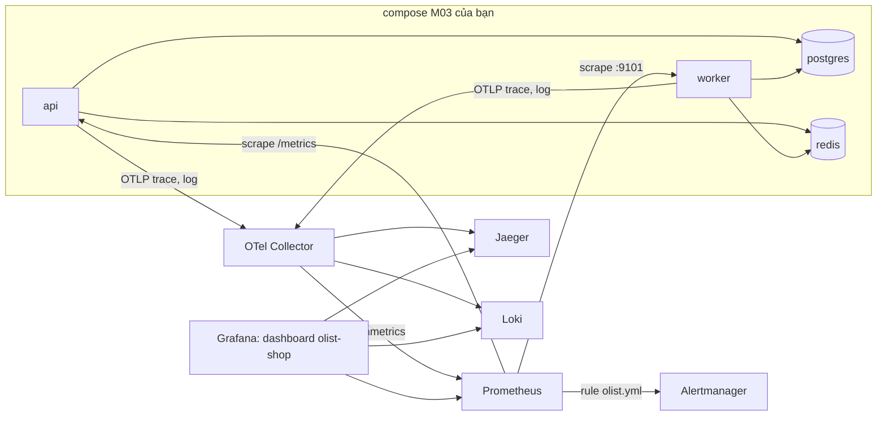

# M08: Observability: metrics, logs, traces, dashboard và alert

## Mục tiêu

Olist Shop đã có artifact (M03), pipeline (M04) và đường deploy qua Git (M07), nhưng khi worker chết lúc 3 giờ sáng thì không ai biết
cho tới khi khách hỏi vì sao doanh thu theo bang không cập nhật. Milestone này cho Olist Shop thứ mà một service production cần trước
ngày đầu on-call:

- **Metric RED** cho cả `api` lẫn `worker`, viết thành recording rule có tên ổn định, để dashboard và alert dùng chung một định nghĩa.
- **Log có `trace_id`** trong Loki và **trace có span DB** trong Jaeger, lần được một request từ API qua Redis tới worker.
- **Dashboard as code** provision vào Grafana, không ai bấm tay.
- **Alert rule có test** bằng `promtool`, route trong Alertmanager theo mức độ, và **một alert bắn thật** khi dừng worker.

Đây là bài tích hợp sau [module 13 Observability](../../modules/13-observability/README.md): mục 1 (RED), mục 2 (recording rule,
`promtool`), mục 3 (alert theo triệu chứng, Alertmanager), mục 4 (dashboard as code), mục 5 và 6 (Loki, OpenTelemetry, Jaeger). Module
làm từng mảnh cho riêng API; ở đây bạn làm cho cả hai tiến trình của **stack production M03**, và worker không có histogram
thời gian xử lý: duration của worker phải lấy từ trace (spanmetrics của Collector).



## Việc cần làm

Stack observability (Collector, Jaeger, Loki, Prometheus, Alertmanager, Grafana; image ghim digest) là của track, chạy bằng
`testkit.ObsStack`, cấu hình mặc định ở [`setup/observability/`](../../../../setup/observability/): Collector nhận OTLP gRPC ở
`otel-collector:4317`, chuyển trace sang Jaeger, log sang Loki và sinh `spanmetrics`; Prometheus scrape `api:8000` (job `olist-api`),
`worker:9101` (job `olist-worker`) và spanmetrics (job `otel-spanmetrics`) mỗi 5 giây, đọc rule ở `/etc/prometheus/rules/*.yml`;
Grafana có sẵn datasource uid `prometheus`, `loki`, `jaeger` và đọc dashboard ở `/etc/grafana/dashboards`. Ứng dụng (sample-app) đã có
sẵn instrument: chỉ bật trace và log OTLP khi biến `OTEL_EXPORTER_OTLP_ENDPOINT` khác rỗng.

Bạn viết:

| Tệp | Nội dung |
| --- | --- |
| `container/compose.yaml` (của M03) | Thêm `OTEL_EXPORTER_OTLP_ENDPOINT` cho `api`, `worker` |
| `observability/prometheus/rules/olist.yml` | Recording rule RED và alert rule |
| `observability/prometheus/olist.test.yml` | Unit test của rule cho `promtool test rules` |
| `observability/alertmanager/alertmanager.yml` | Route theo mức độ |
| `observability/grafana/dashboards/olist-shop.json` | Dashboard |

Tệp trong `observability/` thay tệp mặc định cùng đường dẫn của stack (xem hàng `ObsStack` trong mục "Track DevOps" của
`CONTENT_SPEC.md`); tệp test đặt ở `prometheus/`, **không** trong `prometheus/rules/` (Prometheus nạp mọi `*.yml` trong đó như rule).

**Cách test dựng stack.** Test build hai target `api`, `worker` từ `container/Dockerfile` của M03 (như M03), chép `container/compose.yaml`
của bạn thành `compose.yaml` của project và `observability/` của bạn vào cạnh nó, rồi dựng `ObsStack(lab, project=..., env=...)` với
`OLIST_API_IMAGE`, `OLIST_WORKER_IMAGE` là hai image vừa build, `POSTGRES_PASSWORD` ngẫu nhiên và
`OTEL_EXPORTER_OTLP_ENDPOINT=http://otel-collector:4317`. Compose của bạn và stack thành một project: cùng network, mọi cổng chuyển về
`127.0.0.1:<cổng trống>`, mỗi container tối đa 512 MB, `down -v` khi xong.

Mọi quy tắc dưới đây đều được chấm. Không có quy tắc chấm nào nằm ngoài tệp này.

### 1. Compose

| Hạng mục | Quy tắc được chấm |
| --- | --- |
| Bật telemetry bằng env | `api` và `worker` đặt `OTEL_EXPORTER_OTLP_ENDPOINT: ${OTEL_EXPORTER_OTLP_ENDPOINT:-}` (hay `${OTEL_EXPORTER_OTLP_ENDPOINT}`, `${OTEL_EXPORTER_OTLP_ENDPOINT-}`): cùng một compose chạy được khi có hay không có Collector, không ghi cứng địa chỉ. Mọi quy tắc M03 vẫn áp dụng (test M03 phải còn pass). |
| Không tự dựng stack | Compose không khai service `otel-collector`, `jaeger`, `loki`, `prometheus`, `alertmanager`, `grafana`. |

### 2. Recording rule RED

Sáu recording rule, mỗi rule ra **đúng một series không nhãn** (ngoài `__name__`): gom hết bằng `sum(...)`, `sum by (le)` trước
`histogram_quantile`. Cửa sổ là `[1m]`.

| Tên | Định nghĩa |
| --- | --- |
| `olist:api_requests:rate1m` | Request/giây của `http_requests_total{job="olist-api"}` |
| `olist:api_errors:ratio_rate1m` | Phần request có `status` 5xx trên tổng request của `job="olist-api"` (4xx không phải lỗi của server). Khi có traffic mà chưa có 5xx nào, giá trị là **0** chứ không mất series (series `status="5.."` chưa từng xuất hiện thì `sum` của nó rỗng; gợi ý: `or on() vector(0)`) |
| `olist:api_latency_seconds:p95_1m` | p95 của `http_request_duration_seconds_bucket{job="olist-api"}`, giây |
| `olist:worker_jobs:rate1m` | Job/giây worker xử lý, thành công cộng lỗi: `jobs_processed_total` cộng `jobs_failed_total` của `job="olist-worker"` |
| `olist:worker_errors:ratio_rate1m` | `jobs_failed_total` trên tổng job, `job="olist-worker"` |
| `olist:worker_duration_seconds:p95_1m` | p95 thời gian xử lý một job, **giây**, từ spanmetrics `traces_span_metrics_duration_milliseconds_bucket` với `service_name="olist-shop-worker"`, `span_name="process olist:jobs"` (đơn vị gốc là mili giây; span DB của worker và span của service khác không tính) |

Chỉ tính đúng job đã ghi: kịch bản chấm có thêm series của job khác (`olist-api-canary`, `olist-worker-canary`), span khác và target
`up` của service khác.

### 3. Alert rule

| Alert | Điều kiện | `for` | Nhãn |
| --- | --- | --- | --- |
| `OlistApiHighErrorRate` | `olist:api_errors:ratio_rate1m` lớn hơn 5% | `5m` | `severity: page`, `service: api` |
| `OlistApiSlow` | `olist:api_latency_seconds:p95_1m` lớn hơn 0,5 giây | `10m` | `severity: ticket`, `service: api` |
| `OlistWorkerDown` | Prometheus không scrape được worker: `up` của `job="olist-worker"` bằng 0, gom thành một series không nhãn (vd. `max(...)`) để nhãn của alert chỉ là nhãn bạn đặt | từ `15s` tới `1m` | `severity: page`, `service: worker` |

Mỗi alert có `annotations.summary` (thêm `runbook_url`, `description` tuỳ bạn). Đọc tĩnh và chấm bằng `promtool`:

| Hạng mục | Quy tắc được chấm |
| --- | --- |
| Hợp lệ | `promtool check rules prometheus/rules/olist.yml` sạch; đủ sáu recording rule, ba alert đúng nhãn ở bảng, có `summary`. |
| Đúng hợp đồng | Test chạy `promtool test rules` với **kịch bản riêng của test** (`tests/fixtures/m08/semantics.test.yml`) trên bản chép rule của bạn đã bỏ annotation và mọi nhãn ngoài `severity`, `service` của alert. Kịch bản kiểm giá trị của sáu recording rule trên dữ liệu có job, span, status gây nhiễu (so chính xác, nên đừng làm tròn), tỉ lệ lỗi bằng 0 khi chưa có 5xx, lỗi 10% bắn page sau 5 phút còn 4% thì không, p95 0,975 giây kéo dài bắn ticket sau 10 phút còn 0,4875 giây thì không, worker mất scrape 5 giây chưa bắn và 75 giây thì bắn, `up` của api bằng 0 không làm `OlistWorkerDown` bắn. |
| Test của bạn | `promtool test rules olist.test.yml` (thư mục làm việc `prometheus/`, nên `rule_files: [rules/olist.yml]`) pass. Mỗi alert có ít nhất một ca bắn (`exp_alerts` khác rỗng) và một ca không bắn (`exp_alerts: []`); mỗi recording rule có một `promql_expr_test` với `exp_samples`. |
| Test bắt được lỗi | Test chạy lại `olist.test.yml` của bạn trên 12 bản đột biến của tệp rule, mỗi bản một lỗi: mỗi alert thay biểu thức bằng `vector(1) < 0` (không bao giờ bắn) và bằng `vector(1)` (luôn bắn); mỗi recording rule nhân đôi giá trị. Bản nào test của bạn vẫn pass thì trượt. |

### 4. Alertmanager

`amtool check-config alertmanager.yml` sạch, và theo `amtool config routes test`:

- alert `severity=page` (gồm `OlistApiHighErrorRate`, `OlistWorkerDown`) tới đúng **một** receiver `olist-page`;
- alert `severity=ticket` (`OlistApiSlow`) tới đúng `olist-ticket`;
- alert khác, như `Watchdog` của stack (`severity=none`), alert không có `severity` hay `severity=Page` viết hoa, không tới `olist-page`
  hay `olist-ticket` (mức độ lạ không được đánh thức người trực).

Receiver không cần cấu hình gửi đi (bài không có Slack hay PagerDuty); tên receiver là thứ được chấm.

### 5. Dashboard

`observability/grafana/dashboards/olist-shop.json`, đọc tĩnh:

| Hạng mục | Quy tắc được chấm |
| --- | --- |
| Định danh | `uid: olist-shop`, `title` có chữ `Olist Shop`. |
| Panel RED | Mỗi recording rule ở mục 2 xuất hiện trong `expr` của ít nhất một target có datasource uid `prometheus` (panel nằm trong row được tính). Query Prometheus không dùng biến dashboard (chỉ macro `$__rate_interval`, `$__interval`, `$__range`). |
| Datasource | Ghi bằng uid đã provision (`prometheus`, `loki`), không `${DS_...}` hay biến. |
| Log | Có một panel `type: logs` với target datasource uid `loki`. |

### 6. Trên stack thật

Sau khi `/readyz` của api trả 200, test gửi request kèm `X-Request-ID` riêng rồi tạo traffic khoảng 20 giây (`/healthz`,
`/orders/<không có>`, `/stats/revenue-by-state`, vài `POST /jobs/recompute`):

| Hạng mục | Quy tắc được chấm |
| --- | --- |
| Log có trace_id | Trong 60 giây, Loki có log `{service_name="olist-shop-api"}` chứa request id đó và một `trace_id` 32 ký tự hex. Với một `POST /jobs/recompute`, log `job done` của `{service_name="olist-shop-worker"}` mang **cùng** `trace_id` với log của api cho request đó (context đi qua Redis). |
| Trace có span DB | Jaeger có trace đó cho `olist-shop-api`: một span gốc của api và ít nhất một span `db.system.name=postgresql` là con trực tiếp của nó. |
| RED có dữ liệu | Trong 120 giây cả sáu recording rule có dữ liệu trên Prometheus của stack, mỗi rule đúng một series chỉ có `__name__`; `olist:api_requests:rate1m` và `olist:worker_jobs:rate1m` lớn hơn 0. |
| Rule chạy được | `/api/v1/rules` của Prometheus có cả sáu recording rule và ba alert, mọi rule `health: ok`. |
| Dashboard | Grafana provision dashboard uid `olist-shop`; mọi query Prometheus của nó (thay macro bằng `1m`) trả dữ liệu. |
| Alert thật | Trước khi dừng worker, `OlistWorkerDown` không firing. `docker compose stop worker`: trong 150 giây Alertmanager có `OlistWorkerDown` active, receiver đúng `olist-page`. `docker compose start worker`: trong 120 giây alert hết firing trên Prometheus. |

### 7. Chạy thử bằng tay

Dựng stack giống test, từ gốc repo (`DEVOPS_CPUSET` theo [Ghim CPU](../../README.md#ghim-cpu-trên-máy-dùng-chung); image app build như
mục 4 của M03 với tag `olist-shop/api:local-1`, `olist-shop/worker:local-1`):

```bash
P="$PWD/tracks/devops/capstone/project" && S="$(mktemp -d)" &&
cp -r setup/observability/. "$S/" && cp -r "$P/observability/." "$S/" &&
OLIST_API_IMAGE=olist-shop/api:local-1 OLIST_WORKER_IMAGE=olist-shop/worker:local-1 \
POSTGRES_PASSWORD="$(openssl rand -hex 16)" OTEL_EXPORTER_OTLP_ENDPOINT=http://otel-collector:4317 \
  docker compose -p olist-obs --project-directory "$S" -f "$P/container/compose.yaml" -f setup/observability/compose.yaml \
  up -d --wait
```

Grafana ở `http://127.0.0.1:13300` (dashboard "Olist Shop" trong thư mục DevOps), Prometheus `:19090`, Alertmanager `:19093`, Jaeger
`:16686`. Gửi traffic vào `127.0.0.1:28000`, mở một dòng log lỗi trong panel logs, bấm `trace_id` để sang Jaeger. Dừng worker
(`docker compose -p olist-obs stop worker`), đếm thời gian tới khi alert hiện trong Alertmanager, rồi chạy lại. Dọn:
`docker compose -p olist-obs down -v && rm -rf "$S"`.

Rule và route kiểm không cần stack:

```bash
cd tracks/devops/capstone/project/observability &&
docker run --rm -v "$PWD/prometheus:/work:ro" -w /work --entrypoint promtool prom/prometheus:v3.5.0 test rules olist.test.yml &&
docker run --rm -v "$PWD/alertmanager:/work:ro" -w /work --entrypoint amtool prom/alertmanager:v0.34.1 \
  config routes test --config.file=alertmanager.yml severity=page alertname=OlistWorkerDown
```

### 8. Chạy test

```bash
uv run pytest tracks/devops/capstone/project/tests -q -rs -k m08
```

Trên máy dùng chung, thêm `nice -n 15 ${DEVOPS_CPUSET:+taskset -c "$DEVOPS_CPUSET"}` trước `uv run`. Test cần Docker (compose ≥ 2.24.4,
buildx driver `docker`), các image nền của Dockerfile M03, `postgres`, `redis` bạn chọn, và sáu image của stack observability (lệnh kéo
ở mục "Stack observability" của [setup/DEVOPS-TOOLS.md](../../../../setup/DEVOPS-TOOLS.md)); `promtool`, `amtool` chạy trong image của
stack, không cần cài. Thiếu thứ nào thì test cần nó skip kèm lệnh cần chạy; lần build đầu cần mạng (pip). Một lần chạy đủ mất khoảng
2 phút 30 giây và khoảng 700 MB RAM.

## Kết quả nộp

- `container/compose.yaml` đã thêm `OTEL_EXPORTER_OTLP_ENDPOINT`
- `observability/prometheus/rules/olist.yml`, `observability/prometheus/olist.test.yml`, `observability/alertmanager/alertmanager.yml`,
  `observability/grafana/dashboards/olist-shop.json`
- Mục "Observability" trong README của bạn: sơ đồ đường đi của metric, log, trace; bảng alert (điều kiện, `for`, mức độ, ai nhận,
  việc đầu tiên phải làm) và lý do chọn từng ngưỡng; vì sao duration của worker lấy từ trace và cái giá (sampling làm lệch số, spanmetrics
  mất khi Collector chết); ảnh dashboard lúc dừng worker kèm thời gian từ lúc dừng tới lúc alert tới Alertmanager; alert nào còn
  thiếu để đo độ dài hàng đợi `olist:jobs` (worker sống nhưng không kịp) và bạn sẽ thêm metric gì; cách nối các alert này với SLO
  ở M09.

## Tiêu chí đạt

- [ ] `uv run pytest tracks/devops/capstone/project/tests -q -rs -k m08` pass, không skip.
- [ ] RED của api và worker là recording rule có tên ổn định, dashboard và alert dùng chung.
- [ ] Từ một dòng log lỗi lần được trace có span DB, từ request đẩy job lần được log của worker.
- [ ] Alert rule có test bắt được lỗi, route theo mức độ, alert bắn thật khi dừng worker và tự hết khi chạy lại.
- [ ] M03 vẫn pass với compose đã sửa.
- [ ] (Tự đánh giá) Đã làm vòng tay ở mục 7 và đo thời gian phát hiện.
- [ ] (Tự đánh giá) README có mục "Observability" như phần Kết quả nộp.
