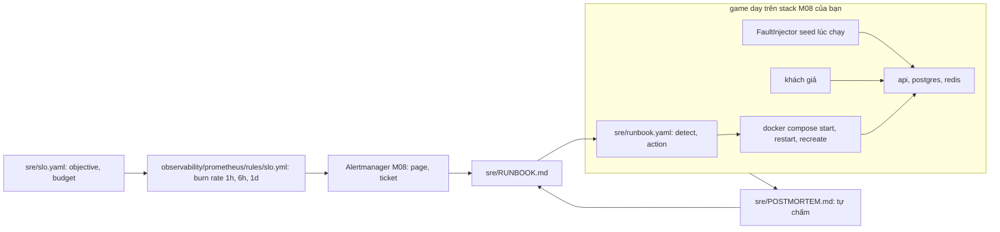

# M09: Đánh giá độc lập: SLO, game day, khôi phục và postmortem

## Mục tiêu

Olist Shop đã có mọi thứ một service production cần trên giấy: image đã quét (M03), pipeline (M04), hạ tầng bằng code (M05),
Kubernetes và GitOps (M06, M07), metric, log, trace và alert (M08). Câu hỏi cuối cùng không phải "có đủ công cụ chưa" mà là
**"khi có sự cố thật lúc không ai báo trước, hệ thống và bạn có đứng vững không"**. Milestone này là bài đánh giá độc lập của cả lộ trình:

- **SLO có cơ sở**: một SLO availability cho API viết thành tệp, error budget tính ra phút, lý do chọn con số.
- **Alert theo burn rate** nhiều cửa sổ, sinh từ chính objective đó, có test `promtool`, route qua Alertmanager của M08.
- **Runbook** người đọc được và máy chạy được: mỗi mục có triệu chứng, tác động, chẩn đoán, khôi phục, xác nhận, leo thang.
- **Game day**: một lỗi chọn ngẫu nhiên theo seed lấy từ thời gian chạy được bơm vào stack M08 **của bạn** đang có khách; runbook phải
  phát hiện, chọn đúng hành động và đưa hệ thống về trạng thái ổn định.
- **Postmortem không đổ lỗi** cho game day đó, và một vòng cải tiến runbook.

Đây là bài tích hợp sau [module 16 SRE & vận hành](../../modules/16-sre-operations/README.md): Basic 02 (SLO as code, burn rate),
Advanced 01 (game day, runbook, postmortem), Advanced 02 (error budget policy). Module làm từng mảnh trên stack dựng sẵn; ở đây mọi thứ
chạy trên **image, compose và observability của chính bạn** (M03, M08), SLO là của bạn, và bạn không biết lỗi nào sẽ tới.

Như M12 của track Data Engineer, phần lớn milestone **tự chấm theo rubric** ở cuối tệp. Test chỉ chấm phần chấm được bằng máy.



## Việc cần làm

### Luật chơi

- **Không đọc trước** `capstone/project/tests/test_m09.py`, lớp `FaultInjector` trong `testkit.py` hay lời giải trước game day. Test
  không giấu được gì với người đọc code; đây là bài tự giác, như M12 của track Data Engineer. Đọc trước thì game day chỉ còn là bài tra
  cứu và postmortem của bạn không còn giá trị.
- Bạn biết **blast radius**: lỗi chỉ chạm một trong ba service `api`, `postgres`, `redis` trong stack của test, là một lỗi hạ tầng
  thường gặp (ví dụ tiến trình chết hay mạng chậm; danh sách này không đầy đủ), và được hoàn tác khi test kết thúc. Bạn không biết lỗi nào, vào đâu.
- Seed lấy từ đồng hồ lúc chạy. Test chỉ in lỗi đã bơm **sau khi** hệ thống đã khôi phục; nếu không khôi phục được, test chỉ in seed.
  Chạy lại đúng sự cố đó bằng biến `M09_SEED=<seed>` (để kiểm runbook đã sửa), nhưng mỗi game day mới thì để seed ngẫu nhiên.

Bạn viết (cùng `container/` của M03 và `observability/` của M08, đã pass test của hai milestone đó):

| Tệp | Nội dung |
| --- | --- |
| `sre/slo.yaml` | SLO `api-availability` |
| `observability/prometheus/rules/slo.yml` | Recording rule tỉ lệ lỗi theo cửa sổ và alert burn rate |
| `observability/prometheus/slo.test.yml` | Unit test của `slo.yml` cho `promtool test rules` |
| `sre/runbook.yaml` | Phần máy chạy của runbook |
| `sre/RUNBOOK.md` | Runbook cho người trực |
| `sre/POSTMORTEM.md` | Postmortem của game day (tự chấm, không có test) |

Mọi quy tắc dưới đây đều được chấm. Không có quy tắc chấm nào nằm ngoài tệp này.

### 1. SLO: `sre/slo.yaml`

```yaml
service: olist-shop-api
slos:
  - name: api-availability
    objective: 99.5            # phần trăm, bạn chọn
    window: 30d
    error_budget_minutes: 216  # bạn tính
    sli: >
      ...
    rationale: >
      ...
```

| Hạng mục | Quy tắc được chấm |
| --- | --- |
| Hình dạng | `service` là chuỗi; `slos` là danh sách mapping, `name` không trùng; có SLO `name: api-availability`. Thêm SLO khác (latency, worker) tuỳ bạn, không chấm. |
| Objective | Số (không phải chuỗi `"99.5%"`) từ **99.0** tới **99.95**; `window: 30d`. |
| Budget | `error_budget_minutes` bằng `(1 - objective/100) × 30 × 24 × 60`, sai số 0,5 phút. |
| Lời văn | `sli` ít nhất 40 ký tự (request nào là tốt, đếm ở đâu), `rationale` ít nhất 120 ký tự; không còn `TODO`. Nội dung chấm bằng rubric. |

### 2. Burn-rate rule: `observability/prometheus/rules/slo.yml`

SLI của `api-availability` đếm trên metric của stack M08: `http_requests_total{job="olist-api", method, path, status}`.

- **Request xấu**: `status` 5xx. 4xx là lỗi của khách, không tính.
- **Request được tính**: mọi request của `job="olist-api"` trừ `path` `/metrics` (Prometheus scrape), `/healthz`, `/readyz` (health
  check). Series của job khác (ví dụ `olist-api-canary`) không tính.

Tệp này phải tự đủ (không dùng recording rule của `olist.yml`), vì test chạy `promtool` trên riêng nó. Prometheus của stack nạp nó cùng
`olist.yml`.

**Recording rule**, mỗi rule ra **đúng một series không nhãn** (ngoài `__name__`), bằng **0** khi có traffic mà chưa có 5xx (như
`olist:api_errors:ratio_rate1m` của M08), rỗng khi không có traffic:

| Tên | Cửa sổ |
| --- | --- |
| `olist:slo_api_errors:ratio_rate5m`, `..._rate30m`, `..._rate1h`, `..._rate2h`, `..._rate6h`, `..._rate1d` | `[5m]`, `[30m]`, `[1h]`, `[2h]`, `[6h]`, `[1d]` |

**Alert** `OlistApiErrorBudgetBurn`, đúng ba rule, với `budget = 1 - objective/100` lấy từ `slo.yaml` của bạn:

| `severity` | `long_window` | Điều kiện (cả hai cửa sổ cùng vượt) | Nghĩa |
| --- | --- | --- | --- |
| `page` | `1h` | tỉ lệ lỗi 1h **và** 5m > 14,4 × budget | 2% budget 30 ngày trong 1 giờ |
| `page` | `6h` | tỉ lệ lỗi 6h **và** 30m > 6 × budget | 5% budget trong 6 giờ |
| `ticket` | `1d` | tỉ lệ lỗi 1d **và** 2h > 3 × budget | 10% budget trong 1 ngày |

Mỗi rule: nhãn `severity`, `long_window` như bảng (thêm nhãn khác như `service: api` tuỳ bạn); `for` bỏ trống hoặc không quá `2m`; không
dùng `keep_firing_for`; `annotations.summary`; `annotations.runbook_url` kết thúc bằng `RUNBOOK.md#<mục>` với `## <mục>` là một tiêu
đề có thật trong `sre/RUNBOOK.md`.

| Hạng mục | Quy tắc được chấm |
| --- | --- |
| Hợp lệ | `promtool check rules prometheus/rules/slo.yml` sạch; đủ sáu recording rule, ba alert như trên. |
| Đúng objective | Test sinh 8 kịch bản `promtool test rules` **theo budget của bạn** và chạy trên bản chép `slo.yml` đã bỏ annotation và mọi nhãn alert ngoài `severity`, `long_window`. Mẫu mỗi phút, route tra đơn 1000 request/phút: (1) 70 phút lỗi 20 lần budget từ đầu, có thêm traffic `/metrics`, `/healthz`, `/readyz`: cả ba mức bắn ở phút 65, phút 110 (40 phút sau khi hết lỗi) chỉ còn `ticket`/`1d`; (2) 6 giờ khoẻ rồi 5 phút lỗi 20 lần budget: không bắn; (3) 25 giờ lỗi 4 lần budget: chỉ `ticket`/`1d`, 140 phút sau khi hết lỗi không còn gì; (4) 6 giờ khoẻ, 60 phút lỗi 20 lần budget rồi hết lỗi: phút thứ 10 chưa bắn, phút 55 chỉ `page`/`1h`, 12 phút sau khi hết lỗi không còn gì; (5) 7 giờ lỗi 10 lần budget: ở phút 420 chỉ `page`/`6h` và `ticket`/`1d` (mức 1h cần trên 14,4 lần); (6) 25 giờ lỗi nửa budget: không bắn; (7) 5xx chỉ ở `/readyz` và ở job `olist-api-canary`, route tra đơn chỉ có 200 và 404 (chưa từng có series 5xx): không bắn, sáu recording rule đều bằng 0; (8) không có traffic: không bắn. |
| Test của bạn | `promtool test rules slo.test.yml` (thư mục làm việc `prometheus/`, nên `rule_files: [rules/slo.yml]`) pass; có ca `OlistApiErrorBudgetBurn` bắn cho từng mức (`exp_labels` có `severity`, `long_window` của mức đó) và ít nhất một ca không bắn (`exp_alerts: []`). |
| Route | Theo `amtool config routes test` trên `alertmanager.yml` của M08, với đúng nhãn của từng rule: hai mức `page` tới `olist-page`, mức `ticket` tới `olist-ticket`. |

### 3. Runbook

**`sre/runbook.yaml`**: 4 tới 12 entry, mỗi entry đúng ba khoá:

```yaml
entries:
  - id: ten-entry                  # chữ thường, số, '-', tối đa 42 ký tự, không bắt đầu hay kết thúc bằng '-', không trùng
    detect:
      promql: <instant query, khớp khi kết quả khác rỗng>   # hoặc logql: '{service_name="olist-shop-api"} |= "..."'
    action:
      do: restart                  # start, restart hoặc recreate
      service: postgres            # api, worker, postgres hoặc redis
```

- `detect` không được trống hay còn chữ `TODO`.
- `promql`: instant query trên Prometheus của stack (scrape mỗi 5 giây: job `olist-api`, `olist-worker`, `otel-spanmetrics`, cùng
  recording rule của bạn); viết điều kiện bằng `> ngưỡng`, `== 0`. Test kiểm cú pháp bằng `promtool check rules`.
- `logql`: log query bắt đầu bằng `{` trên Loki (nhãn `service_name` là `olist-shop-api`, `olist-shop-worker`); khớp khi có ít nhất
  một dòng **kể từ mốc đánh giá** (lúc bơm lỗi hay lúc hành động gần nhất; lúc hệ thống bắt đầu khoẻ khi kiểm báo động giả).
- `action` chạy `docker compose start|restart <service>` hay `docker compose up -d --no-deps --force-recreate <service>` trên project
  của stack.

**`sre/RUNBOOK.md`**: mỗi entry một phần `## <id>`, và mục mà `runbook_url` của alert burn rate trỏ tới (ví dụ `## slo-burn`, không cần
là entry). Mỗi phần đó có sáu mục `### Triệu chứng`, `### Tác động`, `### Chẩn đoán`, `### Khôi phục`, `### Xác nhận`,
`### Leo thang`, mỗi mục ít nhất 40 ký tự. Với entry: mục Chẩn đoán chép nguyên truy vấn `detect`, mục Khôi phục nêu hành động dạng
`<do> <service>` (ví dụ `restart postgres`). Không còn `TODO`.

### 4. Game day: test làm gì

Test build hai target `api`, `worker` từ `container/Dockerfile` (như M03, M08), dựng compose M03 của bạn cùng `observability/` của bạn
bằng `testkit.ObsStack` (như M08: `POSTGRES_PASSWORD` ngẫu nhiên, `OTEL_EXPORTER_OTLP_ENDPOINT=http://otel-collector:4317`), in địa chỉ
Grafana, Prometheus, Alertmanager của stack (xem được trong lúc chạy với `-s`), rồi:

1. Chạy khách giả liên tục: tra đơn (`GET /orders/<id>`, 200 hoặc 404), `GET /readyz` (200), cứ bốn lượt một `POST /jobs/recompute`
   (202). Một request **đạt** khi đúng mã và trả lời dưới 0,5 giây (timeout 3 giây). **Khoẻ** nghĩa là mọi request trong 10 giây gần
   nhất đều đạt (ít nhất 8 tra đơn, 5 `/readyz`, 1 job).
2. Chờ khoẻ (tối đa 120 giây), thêm 60 giây (để lỗi lúc khởi động, nếu có, ra khỏi cửa sổ `[30s]`, `[1m]` của detect), rồi kiểm **trạng thái ổn định**: Prometheus đã nạp sáu recording rule và
   `OlistApiErrorBudgetBurn`, mọi rule `health: ok`; `olist:slo_api_errors:ratio_rate5m` ra đúng một series không nhãn;
   `OlistApiErrorBudgetBurn` không pending hay firing; **không entry nào** của `runbook.yaml` khớp (khớp lúc này là báo động giả, game
   day không chạy).
3. `testkit.FaultInjector` bơm **một** lỗi vào `api`, `postgres` hoặc `redis`, chọn theo seed.
4. Mỗi 2 giây, cho tới 240 giây sau khi bơm:
   - hệ thống khoẻ (10 giây liền tính từ hành động gần nhất, hay từ lúc bơm) thì dừng: **đã khôi phục**;
   - không thì đánh giá các entry **chưa chạy** theo thứ tự trong tệp; entry **đầu tiên** khớp được chạy hành động, mỗi entry tối đa một
     lần;
   - sau một hành động, test chờ ít nhất 20 giây, và chỉ đánh giá tiếp khi trong 10 giây gần nhất vẫn có request hỏng.
5. Sau khi khôi phục, worker phải xử lý thêm ít nhất 3 job trong 60 giây (`sum(jobs_processed_total{job="olist-worker"})` tăng).

| Hạng mục | Quy tắc được chấm |
| --- | --- |
| Rule chạy trên stack thật | Bước 2, phần rule. |
| Không báo động giả | Bước 2, phần runbook. |
| Khôi phục | Có request hỏng sau khi bơm (không có là lỗi môi trường); ít nhất một entry đã chạy; khoẻ lại trong 240 giây sau khi bơm; bước 5 đạt. |

Khi xong, test in seed, lỗi đã bơm, entry đã chạy kèm thời điểm, lúc khoẻ lại và số request hỏng trên tổng số, kèm lệnh chạy lại đúng
seed đó. Đó là dữ liệu cho postmortem.

### 5. Chạy test

```bash
uv run pytest tracks/devops/capstone/project/tests -q -rs -k "m09 and not live"
uv run pytest tracks/devops/capstone/project/tests -q -rs -s -k m09
M09_SEED=<seed> uv run pytest tracks/devops/capstone/project/tests -q -rs -s -k "m09 and live"
```

Lệnh đầu chỉ chấm tệp (SLO, rule, route, runbook), không dựng stack. Lệnh thứ hai chạy cả game day với seed mới; `-s` để thấy địa chỉ
dashboard và bản tóm tắt. Lệnh cuối chạy lại đúng một sự cố. Trên máy dùng chung, thêm `nice -n 15 ${DEVOPS_CPUSET:+taskset -c "$DEVOPS_CPUSET"}`
trước `uv run`.

Cần mọi thứ của M08 (Docker, compose ≥ 2.24.4, image nền của Dockerfile M03, `postgres` và `redis` bạn chọn, sáu image của stack
observability) cộng image `devops-track/netem:1.0` của `FaultInjector`, build theo mục "k6 và FaultInjector" của
[setup/DEVOPS-TOOLS.md](../../../../setup/DEVOPS-TOOLS.md#k6-và-faultinjector).
Thiếu thứ nào thì test cần nó skip kèm lệnh cần chạy. Một lần chạy đủ mất khoảng 3 phút khi image đã build (phần tệp khoảng 45 giây,
game day khoảng 2 phút), tới 6 phút khi runbook không khôi phục được, và khoảng 700 MB RAM.

### 6. Game day thật và postmortem (tự đánh giá)

Test là một game day thu nhỏ có trọng tài máy. Làm đúng quy trình quanh nó:

1. **Trước**: viết vào đầu `POSTMORTEM.md` (hay một tệp nháp) giả thuyết trạng thái ổn định bằng số (lấy từ khách giả và SLO),
   blast radius, điều kiện dừng (khi nào bạn Ctrl-C), vai trò (người chỉ huy, người thao tác, người ghi chép; làm một mình thì ghi rõ).
2. **Trong**: chạy lệnh thứ hai ở mục 5, mở Grafana theo địa chỉ test in ra, ghi timeline theo giờ đồng hồ: lúc dashboard đổi, alert
   nào pending hay firing, entry nào chạy. Không sửa tệp trong lúc chạy.
3. **Sau**: viết postmortem. Nếu fail, sửa runbook rồi chạy lại **đúng seed đó** tới khi pass; ghi cả vòng sửa vào postmortem. Rồi chạy
   ít nhất **hai game day nữa với seed mới**; mỗi lần thêm một dòng vào bảng game day ở cuối postmortem.

Khung `sre/POSTMORTEM.md`, giữ tiêu đề:

```markdown
# Postmortem: <tiêu đề ngắn>, game day seed <seed>

## 1. Tóm tắt
## 2. Tác động            <- request hỏng/tổng, thời lượng, phút error budget đã tiêu và % của budget 30 ngày
## 3. Timeline            <- bảng | HH:MM:SS | sự kiện |, từ lúc bơm tới lúc xác nhận khôi phục
## 4. Nguyên nhân và yếu tố góp phần
## 5. Phát hiện           <- tín hiệu nào thấy trước, entry nào chạy, alert nào bắn hay không bắn và vì sao
## 6. Điều làm tốt, điều chưa tốt, điều may mắn
## 7. Action item         <- bảng | việc | người phụ trách | hạn YYYY-MM-DD | loại (phòng ngừa, phát hiện, giảm nhẹ) |
## 8. Các game day        <- bảng | seed | lỗi | entry đã chạy | phát hiện sau | khoẻ lại sau | sửa gì sau lần này |
```

### 7. Tuỳ chọn: lên AWS thật

Không bao giờ được chấm và không cần cho test. Chỉ làm khi đã có tài khoản sandbox, đăng nhập SSO (module 14, mục 7), và đọc hết
mục này trước khi tạo tài nguyên đầu tiên.

**Phạm vi đề xuất**: một EC2 `t4g.small` (ARM, 2 GB RAM) chạy đúng compose production M03 cùng stack observability của M08, image
build cho `linux/arm64` (hay `t3.small` nếu giữ `amd64`), security group chỉ mở cổng 443 của Nginx (M02) cho IP của bạn, không mở
22 (dùng SSM Session Manager), đĩa gp3 20 GB, không NAT gateway, không load balancer. Viết bằng OpenTofu (dựa trên `infra/` của M05,
đổi provider sang AWS thật), tag `Project=olist-shop-m09`, `Owner`, `ExpiresOn`. Rồi chạy một game day tay: dừng Redis bằng
`docker compose stop redis` qua SSM, đo thời gian tới khi alert tới Alertmanager.

**Chi phí ước tính** (giá on-demand tham khảo ở `us-east-1`, đổi theo region và thời điểm; kiểm lại bằng AWS Pricing Calculator trước khi
apply):

| Tài nguyên | Giá tham khảo | Một buổi 4 giờ | Quên tắt 30 ngày |
| --- | --- | --- | --- |
| EC2 `t4g.small` | khoảng 0,017 USD/giờ | khoảng 0,07 USD | khoảng 12 USD |
| EBS gp3 20 GB | khoảng 0,08 USD/GB-tháng | dưới 0,01 USD | khoảng 1,6 USD |
| IPv4 public | khoảng 0,005 USD/giờ | khoảng 0,02 USD | khoảng 3,6 USD |
| Truyền dữ liệu ra Internet | vài MB dashboard | gần 0 | gần 0 |

**Budget alarm trước mọi tài nguyên** (ngưỡng thấp, email đã xác minh; dùng địa chỉ của bạn):

```bash
aws budgets create-budget --account-id "$(aws sts get-caller-identity --query Account --output text)" \
  --budget '{"BudgetName":"olist-m09","BudgetLimit":{"Amount":"5","Unit":"USD"},"TimeUnit":"MONTHLY","BudgetType":"COST"}' \
  --notifications-with-subscribers '[
    {"Notification":{"NotificationType":"ACTUAL","ComparisonOperator":"GREATER_THAN","Threshold":50,"ThresholdType":"PERCENTAGE"},
     "Subscribers":[{"SubscriptionType":"EMAIL","Address":"ban@example.com"}]},
    {"Notification":{"NotificationType":"FORECASTED","ComparisonOperator":"GREATER_THAN","Threshold":100,"ThresholdType":"PERCENTAGE"},
     "Subscribers":[{"SubscriptionType":"EMAIL","Address":"ban@example.com"}]}]'
```

Budget chỉ báo, chậm vài giờ, không tự tắt máy. **Dọn cùng ngày**:

```bash
tofu destroy
aws resourcegroupstaggingapi get-resources --tag-filters Key=Project,Values=olist-shop-m09 \
  --query 'ResourceTagMappingList[].ResourceARN'
aws ec2 describe-volumes --filters Name=tag:Project,Values=olist-shop-m09 --query 'Volumes[].VolumeId'
```

Hai lệnh sau phải ra danh sách rỗng (tài nguyên đã xoá có thể còn trong kết quả tag vài phút). Hôm sau mở Cost Explorer kiểm lại.
Giữ budget `olist-m09` tới cuối tháng. Bản local tương đương của phần này chính là mục 4–6.

## Kết quả nộp

- `sre/slo.yaml`, `observability/prometheus/rules/slo.yml`, `observability/prometheus/slo.test.yml`
- `sre/runbook.yaml`, `sre/RUNBOOK.md`
- `sre/POSTMORTEM.md` cho game day đầu tiên, có bảng ít nhất ba game day ở phần 8
- Mục "SRE" trong README của bạn: SLO và lý do chọn objective; bảng ba mức burn rate (ngưỡng, ai nhận, phản ứng); khoảng mù của SLI đo
  ở server (API chết thì không có request nào được đếm) và thứ che nó; error budget policy (khi budget còn dưới mức nào thì làm gì, ai
  quyết); kết quả các game day và thay đổi runbook sau mỗi lần
- (Tuỳ chọn) mục "AWS": sơ đồ, chi phí thật trong Cost Explorer, bằng chứng dọn

## Tiêu chí đạt

- [ ] `uv run pytest tracks/devops/capstone/project/tests -q -rs -s -k m09` pass, không skip, với seed ngẫu nhiên.
- [ ] Đã chạy ít nhất ba game day với seed mới, sau khi runbook đã ổn định thì cả ba pass.
- [ ] Tự chấm theo rubric dưới đây đạt từ **75/100** và không nhóm nào 0 điểm.

Mỗi nhóm chỉ nhận điểm khi có bằng chứng (tệp, số đo, ảnh dashboard, output của test), không chỉ có lời hứa:

| Nhóm | Điểm | Đạt đủ điểm khi |
| --- | --- | --- |
| SLO và error budget | 15 | Objective có lý do theo người dùng và khả năng thật của hạ tầng (không hứa 99,99% trên một Postgres); SLI loại đúng traffic không phải của khách; nêu được khoảng mù và thứ che nó; có error budget policy |
| Alert và runbook | 15 | Biết vì sao cần hai cửa sổ và vì sao ngưỡng 14,4/6/3; mỗi entry nhắm một thành phần, thứ tự có lý do (thành phần mà thứ khác phụ thuộc đứng trước); mục Leo thang có điều kiện dừng thử và người cần gọi |
| Chuẩn bị game day | 10 | Giả thuyết trạng thái ổn định bằng số, blast radius, điều kiện dừng, vai trò, viết trước khi chạy |
| Phát hiện và khôi phục | 20 | Entry đúng thành phần chạy **đầu tiên** (không phải đoán mò qua nhiều entry); khoẻ lại trong 3 phút kể từ lúc bơm; job bị kẹt trong sự cố được xử lý sau đó |
| Postmortem | 25 | Timeline khớp số test in ra; tác động có request hỏng và phút budget đã tiêu; nguyên nhân viết theo hệ thống, không theo người; ít nhất ba action item có người phụ trách, hạn và loại; không câu đổ lỗi |
| Vòng cải tiến | 15 | Ít nhất ba game day với seed mới; ghi thay đổi sau mỗi lần; một lần fail (nếu có) được sửa và kiểm lại bằng `M09_SEED` |

Đây là đánh giá nội bộ của lộ trình, không phải chứng chỉ. Nếu chưa đạt, ghi nhóm thiếu điểm, quay lại module liên quan (13 cho alert,
16 cho SLO và postmortem) rồi chạy lại game day.
