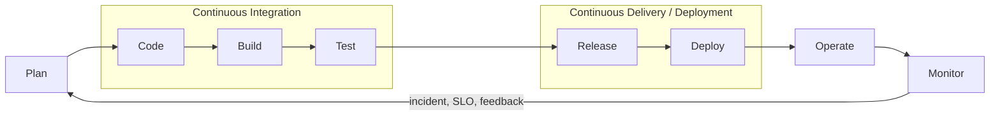
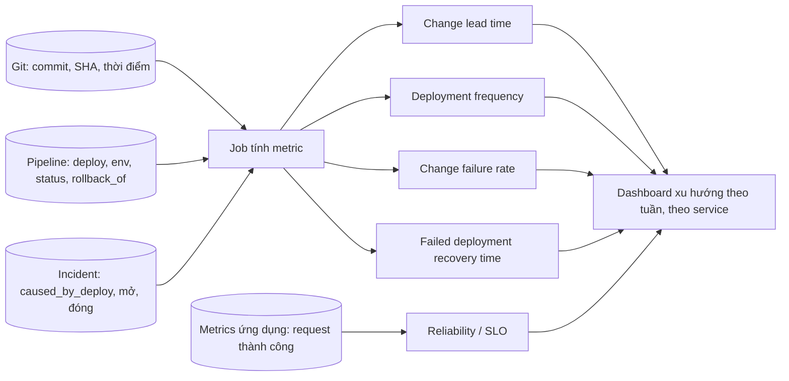
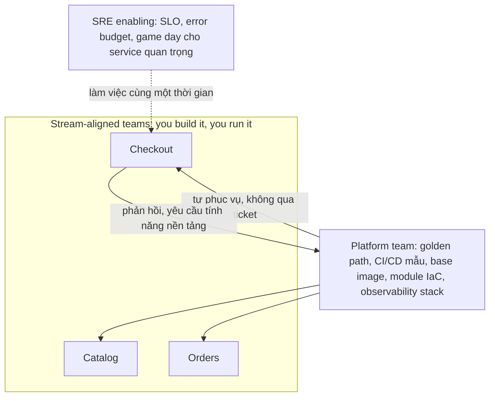
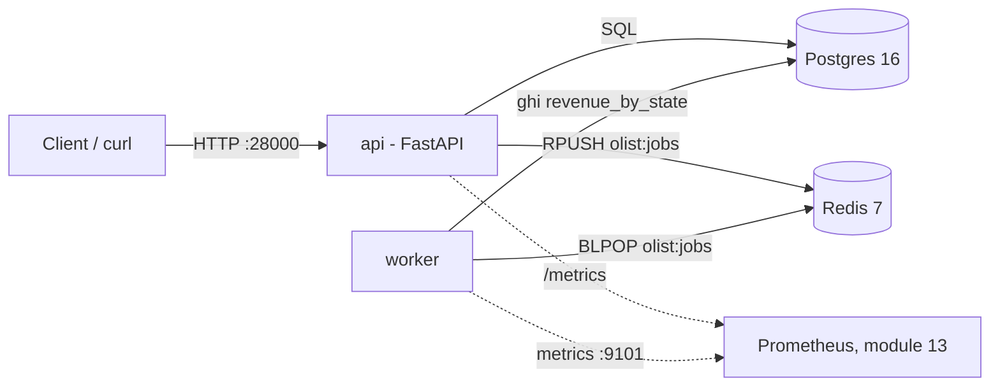

# Giới thiệu DevOps & SRE

Trước khi học một công cụ nào, cần trả lời một câu mà người phỏng vấn senior gần như luôn hỏi: **DevOps giải quyết vấn
đề gì, và làm sao biết mình đang giải quyết nó tốt hơn?** Một junior trả lời bằng danh sách công cụ (Docker, Jenkins,
Kubernetes). Một senior trả lời bằng luồng giá trị (thay đổi đi từ ý tưởng tới người dùng nhanh và an toàn thế nào), bằng
số đo (DORA metrics, SLO) và bằng cách tổ chức con người (ai sở hữu, ai trực, ai xây nền tảng). Công cụ đến sau, và
được chọn vì một ràng buộc cụ thể.

Ở track [Data Engineer, module 08 DevOps cho Data](../../../data-engineer/modules/08-devops-for-data/README.md) bạn đã
dùng Docker, CI/CD và Terraform ở mức "đủ cho pipeline dữ liệu". Track này đổi vai: bạn là người **vận hành** một dịch
vụ do team khác viết, chịu trách nhiệm cho việc nó chạy ổn định, deploy được nhiều lần mỗi ngày, và hồi phục nhanh khi
hỏng. Module 00 không cần cài công cụ nào; bài tập là Python thuần và trắc nghiệm.

Sau module này bạn sẽ:

- Giải thích DevOps qua CALMS, nhận ra các anti-pattern hay gặp khi "chuyển đổi DevOps".
- Định nghĩa chính xác và tự tính được bốn DORA key metrics cùng reliability, xếp mức theo báo cáo DORA, và biết các
  con số này bị bóp méo thế nào khi thành KPI.
- Phân biệt DevOps, SRE và Platform Engineering, và thiết kế được mô hình tổ chức cho một công ty đang lớn.
- Đọc vòng đời phần mềm như một value stream, tìm được nút thắt bằng số liệu.
- Có bản đồ công cụ của toàn bộ roadmap: mỗi nhóm thực hành công cụ nào, học ở module nào, và cách chọn công cụ.
- Biết Olist Shop, hệ thống bạn sẽ vận hành suốt lộ trình.

## 1. DevOps là gì, và CALMS

### Từ "wall of confusion" tới DevOps

Mô hình cũ chia hai phe với mục tiêu đối nghịch: **Dev** được thưởng khi ra tính năng (thay đổi nhiều), **Ops** được
thưởng khi hệ thống ổn định (thay đổi ít). Giữa hai phe là "bức tường": dev ném bản build qua ticket, ops nhận một thứ
họ không viết, không hiểu, rồi trực nó lúc 3 giờ sáng. Hệ quả ai làm lâu cũng gặp: release lớn và hiếm, mỗi release là
một sự kiện căng thẳng, lỗi bị đẩy qua lại, và "đóng băng thay đổi" trước mỗi dịp cao điểm.

DevOps (thuật ngữ từ khoảng 2009, Patrick Debois và phong trào DevOpsDays) là **cách làm việc** xoá bức tường đó: người
viết phần mềm và người vận hành nó cùng chịu trách nhiệm cho kết quả trên production, dùng tự động hoá để thay đổi nhỏ,
thường xuyên và an toàn. DevOps **không** là:

- Một chức danh hay một team. "DevOps team" nhận mọi ticket deploy chỉ là team Ops đổi tên, thêm một bức tường mới.
- Một bộ công cụ. Mua Kubernetes không làm lead time giảm nếu thay đổi vẫn chờ CAB họp mỗi tuần.
- "Dev làm luôn việc Ops". Mục tiêu là giảm chuyền tay, không phải dồn hết việc cho một người.

### CALMS

CALMS (Jez Humble mở rộng từ CAMS của John Willis và Damon Edwards) là khung năm trụ cột để đánh giá một tổ chức có
thực sự làm DevOps không. Mỗi trụ cột dưới đây kèm câu hỏi kiểm tra và anti-pattern hay gặp.

| Trụ cột | Nghĩa là | Câu hỏi kiểm tra | Anti-pattern |
| --- | --- | --- | --- |
| **Culture** | Chung mục tiêu, chung trách nhiệm, học từ lỗi | Dev có xem log production và trực service của mình không? Postmortem có ghi tên người gây lỗi không? | Đổi tên Ops thành DevOps; postmortem tìm người để phạt |
| **Automation** | Tự động hoá build, test, deploy, hạ tầng, rollback | Từ commit tới production có bước nào cần người gõ lệnh không? Rollback mất bao lâu? | Tự động hoá quy trình hỏng (pipeline 2 giờ nhưng vẫn chờ duyệt tay 3 ngày) |
| **Lean** | Batch nhỏ, giảm hàng đợi, giới hạn WIP, tối ưu luồng | Mỗi deploy có bao nhiêu thay đổi? Thay đổi nằm chờ ở đâu lâu nhất? | Release train gom 80 thay đổi; thêm vòng duyệt sau mỗi sự cố |
| **Measurement** | Đo luồng và độ ổn định để ra quyết định | Có DORA metrics và SLO không? Ai dùng chúng để quyết định gì? | Đo hoạt động (số ticket, số dòng code) thay vì kết quả; metric thành KPI xếp hạng |
| **Sharing** | Chia sẻ kiến thức, công cụ, trách nhiệm giữa các team | Một người nghỉ thì có việc nào không ai làm được? Runbook có cập nhật không? | Script deploy chỉ một người hiểu; mỗi team tự phát minh lại pipeline |

Thứ tự trong chữ viết tắt có lý do: **Culture đi trước Automation**. Tự động hoá trong một tổ chức vẫn ném việc qua
tường chỉ làm việc ném nhanh hơn.

### Quyết định thực tế: bắt đầu từ đâu

Khi vào một tổ chức mới, đừng bắt đầu bằng công cụ. Trình tự một DevOps/SRE senior thường đi:

1. **Đo hiện trạng** (tuần 1–2): lấy DORA metrics thô từ Git, pipeline, kênh incident; vẽ value stream một thay đổi
   điển hình (phần 2). Số liệu thô có sai số, nhưng đủ để thấy chỗ đau lớn nhất.
2. **Tìm chỗ rẻ nhất để giảm rủi ro**: thường là rollback tự động và test tự động cho luồng quan trọng nhất. Rollback
   rẻ làm mọi thay đổi khác bớt đáng sợ.
3. **Giảm batch size**: khi rollback rẻ và test đủ tin, rút ngắn chu kỳ release, nới quy trình duyệt cho thay đổi rủi
   ro thấp.
4. **Chuyển ownership dần**: team sản phẩm tự deploy và tự trực service của mình, trên nền platform chung.

Lỗi hay gặp:

- **"Big bang" chuyển đổi**: đổi cùng lúc tổ chức, công cụ, quy trình. Không biết thay đổi nào có tác dụng, và khi hỏng
  thì hỏng tất cả.
- **Coi DevOps là dự án có ngày kết thúc**: nó là cải tiến liên tục; đo lại mỗi quý.
- **Bỏ qua bảo mật và tuân thủ**: ở ngân hàng, y tế, "deploy 50 lần mỗi ngày" vẫn làm được, nhưng bằng chứng kiểm soát
  phải tự động (audit log, policy as code), không phải bỏ kiểm soát.

## 2. Vòng đời phần mềm và value stream

### Vòng lặp vô cực

Vòng đời phần mềm trong DevOps thường vẽ thành vòng lặp: kế hoạch, viết code, build, test, release, deploy, vận hành,
giám sát, rồi phản hồi về kế hoạch. Điểm quan trọng không phải tên các bước mà là **vòng lặp đóng**: số liệu từ
production (lỗi, độ trễ, hành vi người dùng) quay lại quyết định việc làm tiếp theo.



| Bước | Câu hỏi vận hành | Track dạy ở |
| --- | --- | --- |
| Plan | Thay đổi này nhỏ tới đâu? Có tắt được bằng feature flag không? | 03 (branching), 07 |
| Code | Có review, có hook chặn secret không? | 02, 03 |
| Build | Build có tái lập được, image có quét lỗ hổng không? | 06, 07 |
| Test | Test nào chạy trước merge, test nào trước deploy? | 02, 07 |
| Release, Deploy | Deploy kiểu gì (rolling, blue-green, canary)? Rollback mất bao lâu? | 07, 11, 12 |
| Operate | Cấu hình, hạ tầng, secret quản thế nào? | 08, 09, 12, 14 |
| Monitor | Biết hỏng trước người dùng không? SLO là gì? | 13, 16 |

### CI, Continuous Delivery, Continuous Deployment

Ba khái niệm hay bị dùng lẫn:

- **Continuous Integration**: mọi người merge vào nhánh chính ít nhất mỗi ngày, mỗi lần merge chạy build và test tự
  động. Nhánh sống ba tuần rồi merge không phải CI, dù có Jenkins.
- **Continuous Delivery**: mọi thay đổi trên nhánh chính luôn ở trạng thái **có thể** deploy lên production bằng một
  thao tác; quyết định deploy là quyết định kinh doanh.
- **Continuous Deployment**: mọi thay đổi qua pipeline tự động lên production, không có người bấm.

Không phải tổ chức nào cũng cần Continuous Deployment (ứng dụng mobile phải qua App Store; hệ thống y tế cần bước phê
duyệt). Nhưng Continuous Delivery gần như luôn đáng làm: khả năng deploy bất cứ lúc nào chính là khả năng sửa lỗi
bất cứ lúc nào.

### Value stream: thời gian thật sự mất ở đâu

Change lead time (phần 3) là một con số. Muốn cải thiện nó, phải tách nó thành từng stage và hỏi: thời gian nào là
**làm việc**, thời gian nào là **chờ**?

| Stage | Từ | Tới | Thường là |
| --- | --- | --- | --- |
| coding | commit đầu | mở PR | làm việc |
| review_wait | mở PR | review đầu tiên | chờ |
| review | review đầu | approve | làm việc |
| merge_wait | approve | merge | chờ |
| deploy_wait | merge | chạy trên production | chờ (release train, CAB, pipeline chậm) |

**Flow efficiency** là tỉ lệ thời gian làm việc trên tổng lead time:

$$
\text{flow efficiency} = \frac{\sum \text{thời gian active}}{\sum \text{lead time}}
$$

Ở team chưa tối ưu, con số này thường 10–15%: thay đổi đứng chờ gần 90% thời gian. Hàm ý quan trọng nhất: **làm code
nhanh hơn gần như không làm lead time ngắn hơn**; giảm thời gian chờ mới có tác dụng. Bài intermediate 02 tính các con
số này trên dữ liệu PR của Olist Shop.

Đánh đổi khi đo:

- **Median hay mean**: một PR lỡ release chờ 10 ngày kéo mean của `deploy_wait` lên gấp mười lần, che mất nút thắt
  thật ở `review_wait`. Dùng median (hoặc p85) để tìm nút thắt chung; outlier hỏi riêng.
- **Tỉ lệ gộp hay trung bình tỉ lệ**: chia tổng cho tổng phản ánh toàn bộ thời gian hệ thống; trung bình từng tỉ lệ cho
  hotfix 2 giờ trọng số bằng PR chờ hai tuần.
- **Đo theo PR hay theo commit**: DORA tính lead time theo commit; value stream theo PR dễ gắn với hành động hơn.

Lỗi hay gặp: đo tới lúc merge rồi dừng (bỏ sót `deploy_wait`, nơi release train giấu thời gian), và đưa PR chưa deploy
vào phép tính (lead time chưa kết thúc nên làm số đẹp giả).

## 3. DORA metrics: đo hiệu năng delivery

### Nguồn gốc

DORA (DevOps Research and Assessment) là chương trình nghiên cứu khảo sát hơn 39 000 người làm phần mềm từ năm 2014,
nay thuộc Google Cloud. Kết quả được tổng hợp trong sách **Accelerate** (Forsgren, Humble, Kim, 2018) và báo cáo
**Accelerate State of DevOps** hằng năm. Phát hiện cốt lõi lặp lại qua nhiều năm: **tốc độ và độ ổn định không đánh đổi
nhau**; team giỏi nhất vừa deploy thường xuyên vừa ít hỏng hơn, và hiệu năng delivery tương quan với kết quả kinh doanh.

### Định nghĩa chính xác

Theo [hướng dẫn của DORA](https://dora.dev/guides/dora-metrics-four-keys/):

| Metric | Nhóm | Định nghĩa | Đo từ |
| --- | --- | --- | --- |
| **Change lead time** | Throughput | Thời gian từ khi thay đổi được commit vào version control tới khi chạy trên production | Thời điểm commit (Git) và thời điểm deploy (pipeline) |
| **Deployment frequency** | Throughput | Số lần deploy production trong một khoảng thời gian, hoặc khoảng cách giữa các lần deploy | Log deploy của pipeline |
| **Failed deployment recovery time** | Throughput | Thời gian khôi phục sau một deploy hỏng cần can thiệp ngay | Log deploy (rollback) và hệ thống incident |
| **Change failure rate** | Instability | Tỉ lệ deploy cần can thiệp ngay sau khi lên production (rollback, hotfix, fix forward) | Deploy gắn với incident hoặc rollback |
| **Deployment rework rate** | Instability | Tỉ lệ deploy không theo kế hoạch, sinh ra do incident trên production | Deploy được đánh dấu là hotfix |

Lịch sử tên gọi, để đọc tài liệu cũ không nhầm ([DORA metrics history](https://dora.dev/insights/dora-metrics-history/)):

- Bốn key ban đầu là lead time, deployment frequency, **time to restore service** (hay MTTR) và change failure rate.
- Từ 2018 DORA đo thêm availability, năm 2021 mở rộng thành **reliability**: mức team giữ được cam kết về dịch vụ mình
  vận hành (availability, latency, performance). Báo cáo 2021 gọi nó là "metric thứ năm"; DORA sau đó nói rõ đây là
  thước đo **operational performance**, không phải delivery performance. Báo cáo 2022 phát hiện delivery tốt chỉ đem
  lại kết quả kinh doanh khi reliability cũng tốt.
- Năm 2023, time to restore service được định nghĩa lại thành **failed deployment recovery time**: chỉ tính sự cố do
  deploy gây ra. Sự cố do hạ tầng (đĩa đầy, nhà cung cấp cloud sập) thuộc reliability, không thuộc metric này.
- Năm 2024 thêm **deployment rework rate**, và gom năm metric thành hai nhóm throughput và instability.

Ở track này, "bốn key cộng reliability" nghĩa là: bốn metric delivery tính từ log deploy (bài intermediate 01), và
reliability đo bằng SLO (bài basic 01, module 13 và 16).

### Các quyết định đo lường

Định nghĩa trên giấy để lại nhiều chỗ mỗi team phải tự quyết. Quyết định sai làm số liệu đẹp mà sai:

- **Deploy nào được đếm?** Chỉ production. Rollback không phải một deploy mới (nó là hành động khôi phục); đếm nó làm
  team có nhiều sự cố trông như deploy nhiều. Pipeline dừng trước production (`failed`) không phải failed change: đó
  là pipeline làm đúng việc.
- **Thế nào là failed change?** Deploy bị rollback hoặc gây ít nhất một incident, đếm **theo deploy** (một deploy sinh
  năm alert vẫn là một). Incident không do thay đổi (Redis hết đĩa) không vào change failure rate.
- **Lead time kết thúc ở đâu?** Ở deploy sớm nhất mà commit thật sự chạy trên production, tức là không bị rollback.
  Commit nằm trong một deploy bị rollback rồi được deploy lại ba ngày sau có lead time tới lần sau.
- **Khôi phục tính từ đâu?** Từ lúc deploy hỏng xong, không phải từ lúc incident được mở: thời gian chưa phát hiện cũng
  là thời gian người dùng chịu lỗi. Tới sự kiện khôi phục cuối cùng (rollback xong, incident đóng).
- **Thời gian có múi giờ.** Git ghi `Z`, công cụ deploy ghi `+07:00`, cửa sổ báo cáo theo giờ địa phương. So chuỗi ngày
  là cách chắc chắn để đếm sai các deploy lúc nửa đêm.
- **Không có dữ liệu thì là "không có", không phải 0.** Tuần không deploy có change failure rate không xác định, không
  phải 0%.

Công thức chuẩn hoá:

$$
\text{change failure rate} = \frac{\text{số deploy được đếm đã bị rollback hoặc gây incident}}{\text{số deploy được đếm}}
$$

### Các mức hiệu năng theo báo cáo DORA 2024

Bảng dưới lấy từ [Accelerate State of DevOps Report 2024](https://dora.dev/research/2024/dora-report/), phần
"Performance levels". Các mức là kết quả **phân cụm** câu trả lời khảo sát, không phải ngưỡng do DORA đặt ra.

| Mức | Change lead time | Deployment frequency | Change failure rate | Failed deployment recovery time | Tỉ lệ người trả lời |
| --- | --- | --- | --- | --- | --- |
| Elite | Dưới 1 ngày | On demand (nhiều lần mỗi ngày) | 5% | Dưới 1 giờ | 19% |
| High | 1 ngày tới 1 tuần | Mỗi ngày tới mỗi tuần | 20% | Dưới 1 ngày | 22% |
| Medium | 1 tuần tới 1 tháng | Mỗi tuần tới mỗi tháng | 10% | Dưới 1 ngày | 35% |
| Low | 1 tới 6 tháng | Mỗi tháng tới mỗi 6 tháng | 40% | 1 tuần tới 1 tháng | 25% |

Đọc bảng như một senior:

- **Change failure rate của high (20%) cao hơn medium (10%)** không phải lỗi in: cụm high đổi lấy tốc độ bằng tỉ lệ hỏng
  cao hơn. Vì là cụm, khi xếp một metric đứng riêng hãy chọn cụm có giá trị gần nhất và ghi rõ cách chọn.
- Các mức thay đổi theo năm. Báo cáo 2022 không có cụm elite; báo cáo 2023 dùng bộ giá trị khác. Luôn ghi năm báo cáo
  khi so sánh.
- Từ báo cáo 2025 DORA bỏ bốn mức, chuyển sang các "team archetype" kết hợp delivery với các yếu tố khác (sức khoẻ team,
  sự ổn định công việc). Bảng 2024 là bảng bốn mức cuối cùng, vẫn được dùng rộng rãi làm mốc.

### Từ log tới dashboard



Điều kiện để đo được là dữ liệu có **khoá nối**: deploy ghi danh sách SHA, incident ghi deploy gây ra nó. Thiếu khoá
nối, mọi công cụ dashboard DORA đều phải đoán. Việc đầu tiên thường là sửa quy trình ghi dữ liệu (template incident có
trường `caused_by_deploy`, pipeline ghi SHA), không phải mua công cụ.

### Khi metric thành chỉ tiêu

Định luật Goodhart: khi một thước đo thành mục tiêu, nó không còn là thước đo tốt. Các cách DORA metrics bị bóp méo:

| Chỉ tiêu | Cách bị chơi | Hậu quả |
| --- | --- | --- |
| "Deploy hằng ngày" | Chia một thay đổi thành nhiều deploy, deploy cả khi không có gì mới | Frequency đẹp, lead time không đổi |
| "Change failure rate dưới 5%" | Không mở incident, gọi rollback là "điều chỉnh cấu hình" | Mất dữ liệu để học; sự cố bị giấu |
| "Recovery dưới 1 giờ" | Đóng incident sớm rồi mở incident mới | Số đẹp, người dùng vẫn chịu lỗi |
| Xếp hạng team theo metric | Team chọn việc dễ, tránh service rủi ro | Service khó nhất không ai muốn nhận |

Cách dùng đúng: một team so với chính nó theo thời gian; nhìn throughput và instability **cùng nhau**; số liệu để đặt
câu hỏi ("vì sao lead time tháng này tăng?"), không để thưởng phạt.

## 4. DevOps, SRE và Platform Engineering

### Ba khái niệm, ba tầng

- **DevOps** là triết lý và tập thực hành: phá bức tường, chung trách nhiệm, tự động hoá, đo lường.
- **SRE** (Site Reliability Engineering, Google từ 2003) là một cách **hiện thực** DevOps cụ thể, theo lời Ben Treynor
  Sloss: "what happens when you ask a software engineer to design an operations function". Google mô tả quan hệ là
  "class SRE implements interface DevOps".
- **Platform Engineering** là cách đưa DevOps lên quy mô nhiều team: một team xây **sản phẩm nội bộ** (internal developer
  platform) để các team sản phẩm tự phục vụ: tạo service mới, deploy, xem log, tạo database, mà không cần mở ticket.

| | DevOps | SRE | Platform Engineering |
| --- | --- | --- | --- |
| Là gì | Văn hoá và thực hành | Nghề và bộ thực hành kỹ thuật cho reliability | Team và sản phẩm nội bộ |
| Câu hỏi trung tâm | Làm sao giao giá trị nhanh và an toàn? | Dịch vụ cần tin cậy tới mức nào, và giữ mức đó thế nào? | Làm sao để 20 team không phải tự giải cùng một bài toán hạ tầng? |
| Công cụ tư duy | CALMS, value stream, DORA | SLI/SLO, error budget, toil, postmortem blameless | Golden path, self-service, platform as a product |
| Đo bằng | DORA metrics | SLO, error budget còn lại, tỉ lệ toil | Adoption, thời gian tạo service mới, khảo sát developer |
| Sai lầm hay gặp | Thành chức danh/team silo | Lập team SRE trực hộ mọi service | Thành team nhận ticket, hoặc xây platform không ai dùng |

### SRE trong một trang

Các thực hành cốt lõi của SRE (module 16 đi sâu):

- **SLI và SLO**: SLI là số đo chất lượng từ góc người dùng (tỉ lệ request thành công, tỉ lệ request dưới 300 ms); SLO
  là mục tiêu cho SLI (99,9% trong 30 ngày). 100% không bao giờ là mục tiêu đúng: người dùng không phân biệt được 99,99%
  với 100% vì mạng của họ còn kém hơn thế, và mỗi số 9 thêm vào đắt gấp nhiều lần.
- **Error budget**: phần được phép hỏng.

  $$
  \text{error budget} = (1 - \text{SLO}) \times \text{cửa sổ}
  $$

  SLO 99,9% trên 30 ngày cho 43 phút 12 giây. Còn budget thì release tính năng; hết budget thì **error budget policy**
  (ký trước với product) yêu cầu dồn sức cho reliability. Error budget biến cuộc tranh cãi "nhanh hay ổn định" thành
  một quy tắc đã thoả thuận.
- **Toil**: việc vận hành thủ công, lặp lại, tự động hoá được, không để lại giá trị lâu dài, tăng tuyến tính theo quy
  mô. Google giới hạn toil dưới 50% thời gian của SRE; phần còn lại là kỹ thuật để giảm toil.
- **Postmortem blameless**: tìm điều kiện hệ thống cho phép lỗi xảy ra, không tìm người để phạt; mỗi action item có
  người nhận và hạn.
- **Quyền trả lại pager**: ở Google, service liên tục vượt error budget có thể bị SRE trả lại cho team phát triển tự
  trực. SRE không phải nơi nhận mọi service.

### Tổ chức con người: Team Topologies

Sách **Team Topologies** (Skelton, Pais, 2019) cho bộ từ vựng hay dùng khi thiết kế tổ chức vận hành:

- **Stream-aligned team**: team sản phẩm, sở hữu một luồng giá trị từ code tới production, kể cả on-call.
- **Platform team**: cung cấp nền tảng tự phục vụ, giảm cognitive load cho stream-aligned team.
- **Enabling team**: chuyên gia (thường là SRE, bảo mật) làm việc cùng team khác một thời gian để nâng năng lực, rồi rút.
- **Complicated-subsystem team**: sở hữu một phần cần chuyên môn sâu (engine tìm kiếm, mô hình định giá).



### Quyết định: mô hình nào cho công ty nào

| Quy mô | Mô hình hợp lý | Vì sao |
| --- | --- | --- |
| Startup dưới 15 kỹ sư | Mọi người tự deploy và trực, 1–2 người giỏi hạ tầng làm "platform bán thời gian" | Team platform riêng là chi phí chưa đáng |
| 30–100 kỹ sư, nhiều team | Platform team nhỏ (4–6 người) + team sản phẩm tự vận hành; SRE nhỏ cho service đắt nhất | Đây là lúc mỗi team tự phát minh lại pipeline thành chi phí thật |
| Vài trăm kỹ sư trở lên | Nhiều platform team theo miền (compute, data, developer experience), SRE theo nhóm service, có error budget policy toàn công ty | Cần chuẩn hoá và chuyên môn sâu |
| Ngành bị quản lý chặt | Như trên, cộng policy as code và bằng chứng kiểm soát tự động | Tuân thủ mà không quay về CAB thủ công |

Vai trò "DevOps engineer" trên thị trường vì vậy rất khác nhau giữa các công ty: có nơi là platform engineer, có nơi là
SRE, có nơi là người viết pipeline và Terraform. Khi phỏng vấn, hỏi lại: "Ai trực on-call cho service ứng dụng? Team
sản phẩm có tự deploy không?" Câu trả lời cho bạn biết công ty đang ở mô hình nào.

## 5. Bản đồ công cụ của lộ trình

Roadmap.sh/devops có hơn 100 công cụ. Track này chọn **một công cụ để thực hành** cho mỗi nhóm, các công cụ còn lại nằm
trong bảng so sánh của module tương ứng. Lý do chọn: phổ biến trong tin tuyển dụng, chạy được hoàn toàn trên máy local,
mã nguồn mở, và kiến thức chuyển được sang công cụ khác cùng nhóm.

| Nhóm trên roadmap | Thực hành trong track | So sánh với | Module |
| --- | --- | --- | --- |
| Programming language, scripting | Bash, Python | Go, Node.js, Ruby, Rust, PowerShell | 02 |
| Operating system, terminal knowledge, editors | Ubuntu/Debian, systemd, `ps`/`top`/`vmstat`/`ss`, `grep`/`awk`/`sed`/`jq`, Vim | RHEL, SUSE, FreeBSD/OpenBSD/NetBSD, Windows; Nano, Emacs | 01 |
| Version control, VCS hosting | Git, GitHub | GitLab, Bitbucket | 03 |
| Networking & protocols, email | `dig`, `openssl`, SSH, Mailpit (SMTP) | FTP/SFTP, IMAP, POP3S; SPF, DKIM, DMARC phân tích offline | 04 |
| Web server, proxy, load balancer, firewall | Nginx | Caddy, Apache, Tomcat, IIS; nftables/ufw khái niệm | 05 |
| Containers | Docker, registry local, Trivy | LXC/LXD, Podman | 06 |
| CI/CD tools | GitHub Actions chạy bằng `act` | Jenkins, GitLab CI, CircleCI, TeamCity, Octopus Deploy | 07 |
| Artifact management | Registry local | Artifactory, Nexus, Cloudsmith | 07 |
| Provisioning (IaC) | OpenTofu + LocalStack | Terraform, AWS CDK, CloudFormation, Pulumi | 08 |
| Configuration management | Ansible | Chef, Puppet | 09 |
| Container orchestration | Kubernetes trên kind, Helm, Kustomize | EKS/GKE/AKS, ECS/Fargate, Docker Swarm | 10, 11 |
| GitOps | ArgoCD | FluxCD | 12 |
| Secret management | SOPS, Vault dev, Sealed Secrets | Secret manager của cloud | 12 |
| Infrastructure monitoring | Prometheus, Grafana | Zabbix, Datadog | 13 |
| Logs management | Loki | Elastic Stack, Graylog, Splunk, Papertrail | 13 |
| Application monitoring | OpenTelemetry, Jaeger | New Relic, Datadog APM | 13 |
| Cloud providers | AWS qua LocalStack (+ lab free tier tuỳ chọn) | Azure, GCP, DigitalOcean, Alibaba, Hetzner, Contabo, Heroku | 14 |
| Serverless | AWS Lambda | Cloudflare Workers, Azure Functions, GCP Functions, Vercel, Netlify | 14 |
| Service mesh | Linkerd | Istio, Consul, Envoy | 15 |
| Cloud design patterns | Retry, timeout, circuit breaker, bulkhead trên Olist Shop | Availability, data management, design & implementation, management & monitoring | 15 |
| Ngoài roadmap: SRE | SLO, error budget, incident, postmortem, chaos, capacity, FinOps | | 16 |

```mermaid
flowchart LR
    subgraph Nền tảng
        linux[01 Linux] --> script[02 Bash, Python] --> git[03 Git] --> net[04 Mạng] --> nginx[05 Nginx]
    end
    subgraph Đóng gói và giao
        docker[06 Docker] --> ci[07 GitHub Actions] --> tofu[08 OpenTofu] --> ansible[09 Ansible]
    end
    subgraph Chạy ở quy mô
        k8s[10-11 Kubernetes] --> argo[12 ArgoCD, SOPS]
    end
    subgraph Vận hành
        obs[13 Prometheus, Loki, OTel] --> cloud[14 AWS, Lambda] --> mesh[15 Linkerd] --> sre[16 SRE]
    end
    nginx --> docker
    ansible --> k8s
    argo --> obs
```



Thứ tự có lý do: không hiểu Linux, mạng và Nginx thì Kubernetes chỉ là YAML chép mạng; không có container và CI thì
GitOps không có gì để đồng bộ; không có observability thì SRE không có số liệu.

## 6. Chọn công cụ thế nào

### Bốn câu hỏi trước mọi lựa chọn

1. **Ai vận hành nó lúc 3 giờ sáng, và họ đã biết nó chưa?** Mỗi thành phần mới là thêm thứ phải nâng cấp, vá lỗi,
   sao lưu, trực on-call. Chi phí vận hành thường lớn hơn chi phí license.
2. **Ràng buộc cứng là gì?** Không được cài agent, phải on-prem, ngân sách, giấy phép mã nguồn mở, dữ liệu không rời
   khỏi quốc gia. Ràng buộc cứng loại phương án trước, sở thích chọn sau.
3. **Có khớp hệ sinh thái đang có không?** Code trên GitHub thì GitHub Actions rẻ hơn Jenkins; đã có Grafana thì Loki
   rẻ hơn Elastic Stack. Công cụ tốt nhất đứng riêng thường thua công cụ đủ tốt đã tích hợp.
4. **Quy mô bây giờ cần gì, và 12 tháng tới cần gì?** Không chọn cho quy mô 5 năm tới (sẽ đổi trước khi tới), cũng không
   chọn thứ phải thay sau 3 tháng.

### Đánh đổi lặp lại ở mọi nhóm công cụ

| Đánh đổi | Một phía | Phía kia | Hỏi |
| --- | --- | --- | --- |
| Tự host hay managed (SaaS) | Kiểm soát, dữ liệu tại chỗ, không phí theo dung lượng | Không phải vận hành, cập nhật tự động | Team có người trực công cụ này không? |
| Agent hay agentless | Tự sửa drift liên tục (Puppet) | Không cài gì lên máy (Ansible) | Có bao nhiêu máy, chính sách an ninh thế nào? |
| Push hay pull deploy | Đơn giản, dễ hiểu (CI chạy `kubectl apply`) | Phát hiện drift, không cần cấp quyền cluster cho CI (ArgoCD) | Ai được ghi vào production? |
| Tổng quát hay chuyên biệt | Một công cụ nhiều việc, ít thứ phải học | Mỗi công cụ làm tốt một việc | Cognitive load của team bao nhiêu? |
| Mã nguồn mở hay thương mại | Không khoá vendor, có cộng đồng | Hỗ trợ, tính năng doanh nghiệp | Ai sửa khi nó hỏng? Giấy phép có đổi không (Terraform sang BSL năm 2023)? |

### Lỗi hay gặp khi chọn công cụ

- **Resume-driven development**: chọn Kubernetes và service mesh cho ba service vì muốn ghi vào CV. Đúng trình tự là
  Compose trên VM tới khi có lý do cụ thể (nhiều team, cần autoscale), rồi mới lên Kubernetes.
- **Chọn công cụ để sửa vấn đề văn hoá**: Jira mới không làm hai team nói chuyện với nhau.
- **Không có lối thoát**: dùng tính năng độc quyền của một vendor ở mọi nơi. Khi được, giữ chuẩn mở ở ranh giới
  (OpenTelemetry cho instrument, OCI image, SQL chuẩn).
- **Đánh giá bằng demo thay vì bằng ngày tồi tệ nhất**: hỏi công cụ hành xử thế nào khi đĩa đầy, mạng chập chờn, phiên
  bản mới phá tương thích, và mất bao lâu để khôi phục.

Bài basic 02 luyện khung này trên 12 tình huống, mỗi tình huống thuộc một nhóm công cụ của bảng ở phần 5.

## 7. Olist Shop: hệ thống bạn sẽ vận hành

Mọi bài tập và capstone của track vận hành **Olist Shop**, một service nhỏ trong
[`tracks/devops/sample-app/`](../../sample-app/README.md), dựng trên bộ dữ liệu thương mại điện tử Olist bạn đã gặp ở
track Data Engineer. Hãy coi nó như service do một team khác viết và giao cho bạn: bạn **không** viết code ứng dụng,
bạn làm mọi thứ xung quanh nó.



| Thành phần | Interface ổn định | Ý nghĩa với người vận hành |
| --- | --- | --- |
| API | `/healthz` (liveness, không chạm DB), `/readyz` (readiness, kiểm DB và Redis, lỗi thì `503`) | Hai probe khác nhau: liveness sai thì bị restart oan, readiness sai thì nhận traffic khi chưa sẵn sàng |
| API | `/orders/{order_id}`, `/stats/revenue-by-state`, `POST /jobs/recompute` | Đường đọc, đường tính toán bất đồng bộ qua hàng đợi |
| API | `/metrics` (`http_requests_total`, `http_request_duration_seconds`) | Nguồn cho SLI theo request; nhãn `path` là route template để tránh nổ cardinality |
| Worker | Lấy job từ list Redis `olist:jobs`, thoát sạch khi nhận `SIGTERM` | Deploy và scale không làm mất job đang chạy |
| Log | JSON một dòng, có `request_id` lấy từ header `X-Request-ID` | Lần được một request qua Nginx, API và log |
| Cổng host | Postgres `25432`, Redis `26379`, API `28000` (đổi bằng biến môi trường), chỉ mở trên `127.0.0.1` | Không đụng project khác đang chạy trên máy, không lộ database ra mạng LAN |

Olist Shop lớn dần qua các module như một hệ thống thật: script vận hành (02), Nginx có TLS phía trước (05), image tối ưu
đã quét lỗ hổng (06), pipeline CI/CD (07), hạ tầng bằng OpenTofu và Ansible (08, 09), Helm chart trên kind (11), GitOps
(12), observability đủ ba trụ (13), rồi game day có sự cố bơm vào ở cuối (16). Chi tiết ở
[capstone](../../capstone/README.md).

Ngay ở module 00, hãy nhìn Olist Shop bằng câu hỏi của module này:

- **DORA**: mỗi deploy của API và worker cần ghi gì để tính được bốn metric? (SHA, môi trường, kết quả, `rollback_of`.)
  Bài intermediate 01 dùng chính log dạng đó.
- **Reliability**: SLI tốt cho Olist Shop là tỉ lệ request `/orders/{order_id}` trả không phải `5xx` và dưới 300 ms, đo
  từ `http_requests_total` và `http_request_duration_seconds`; ping `/healthz` không đủ vì nó không chạm DB.
- **Ownership**: trong capstone, bạn đóng cả ba vai: stream-aligned (sở hữu Olist Shop), platform (pipeline và cluster
  dùng chung), SRE (SLO và game day). Ghi lại lúc nào mình đang ở vai nào giúp trả lời câu phỏng vấn về tổ chức.

Chạy thử ngay (cần Docker, các lệnh ở README của sample-app). Compose ghim container theo `DEVOPS_CPUSET` nếu bạn đã
`export` một dải core; máy ít core thì `unset DEVOPS_CPUSET` để không ghim (xem
[Ghim CPU](../../README.md#ghim-cpu-trên-máy-dùng-chung)):

```bash
cd tracks/devops/sample-app
nice -n 15 docker compose up -d --build
curl -s localhost:28000/healthz
curl -s localhost:28000/readyz
docker compose down -v
```

## 8. Tài liệu tham khảo

- [roadmap.sh/devops](https://roadmap.sh/devops): roadmap gốc của track; bản PDF ở `roadmap/devops.pdf`.
- [DORA: Software delivery performance metrics](https://dora.dev/guides/dora-metrics-four-keys/): định nghĩa năm
  metric hiện hành.
- [DORA: A history of DORA's software delivery metrics](https://dora.dev/insights/dora-metrics-history/): đổi tên MTTR,
  reliability, rework rate.
- [Accelerate State of DevOps Report 2024](https://dora.dev/research/2024/dora-report/): bảng mức elite/high/medium/low
  dùng trong module.
- [Accelerate State of DevOps Report 2021](https://dora.dev/research/2021/dora-report/): reliability và operational
  performance.
- Nicole Forsgren, Jez Humble, Gene Kim, *Accelerate: The Science of Lean Software and DevOps* (IT Revolution, 2018).
- Gene Kim, Jez Humble, Patrick Debois, John Willis, Nicole Forsgren, *The DevOps Handbook*, 2nd ed. (IT Revolution, 2021).
- [Google, *Site Reliability Engineering*](https://sre.google/sre-book/table-of-contents/): đặc biệt các chương
  "Embracing Risk", "Service Level Objectives", "Eliminating Toil", "Postmortem Culture".
- [Google, *The Site Reliability Workbook*](https://sre.google/workbook/table-of-contents/): chương "How SRE Relates to
  DevOps" và "Implementing SLOs".
- Matthew Skelton, Manuel Pais, *Team Topologies* (IT Revolution, 2019); [teamtopologies.com](https://teamtopologies.com/).
- [DevOps Topologies](https://web.devopstopologies.com/): các mô hình tổ chức và anti-type như "DevOps team silo".
- [CNCF TAG App Delivery, Platforms White Paper](https://tag-app-delivery.cncf.io/whitepapers/platforms/): định nghĩa
  platform và platform as a product.
- [Atlassian: CALMS framework](https://www.atlassian.com/devops/frameworks/calms-framework): tổng quan năm trụ cột.
- Karen Martin, Mike Osterling, *Value Stream Mapping* (McGraw-Hill, 2013): flow efficiency và cách vẽ value stream.
