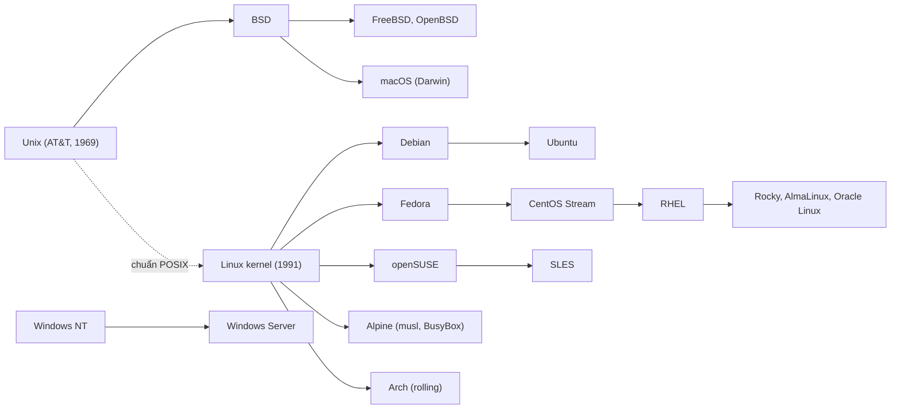
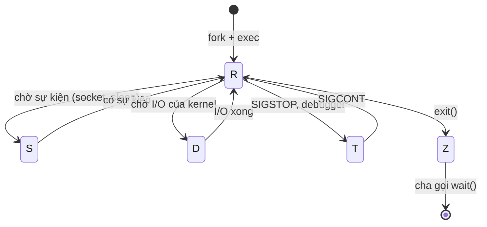
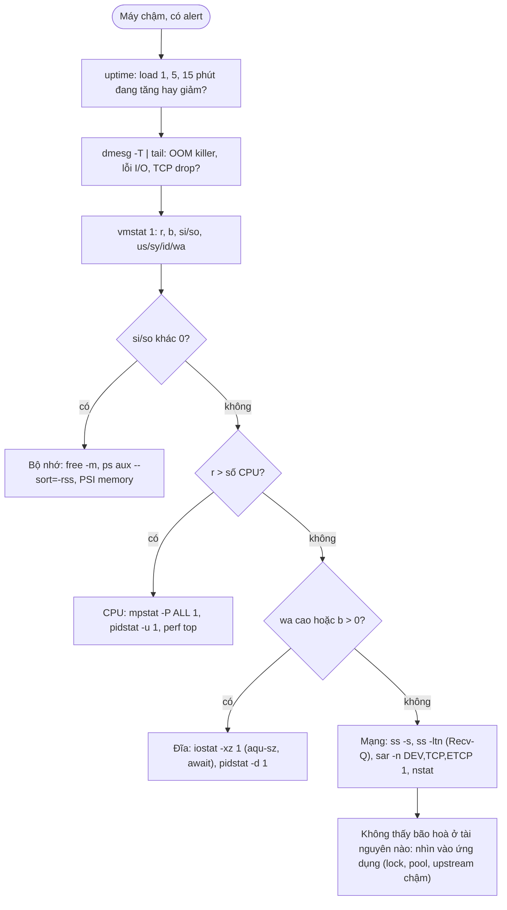
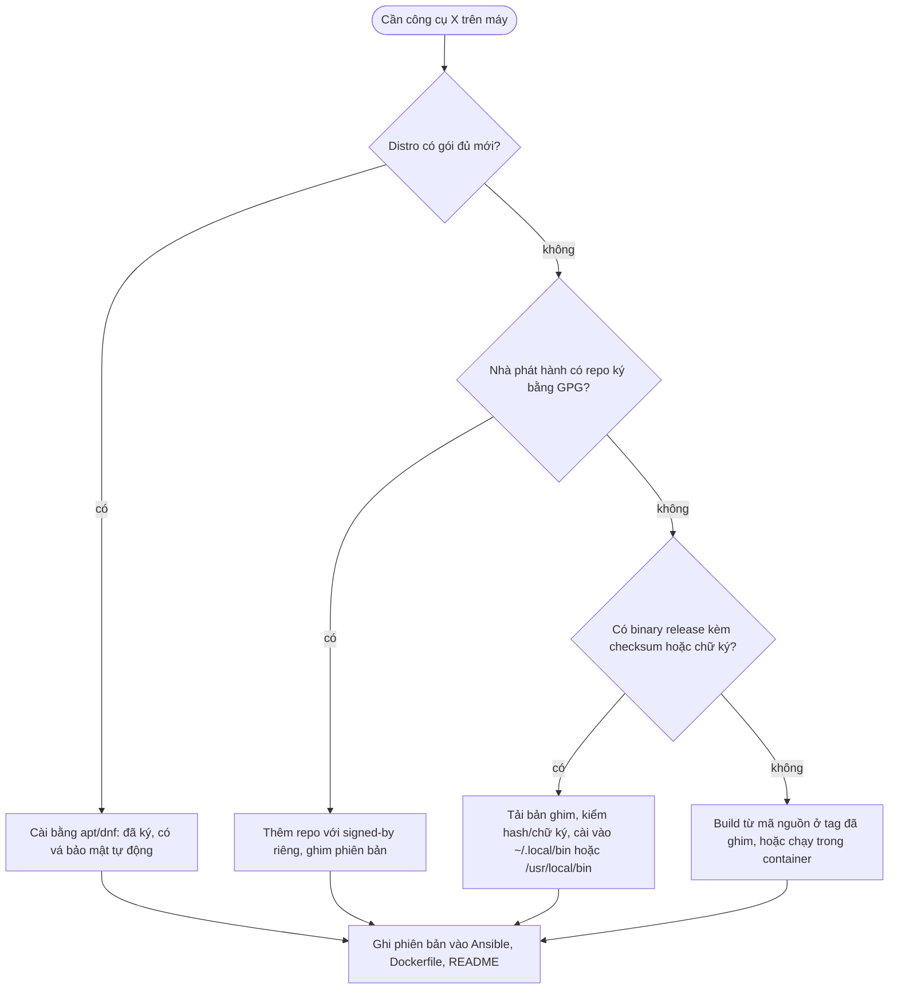

# Linux & terminal

Gần như mọi thứ bạn vận hành trong lộ trình này chạy trên Linux: VM, node Kubernetes, container (chung kernel với
host), runner CI. Khi dashboard đỏ lúc 3 giờ sáng, thứ bạn có là một terminal SSH vào máy đang hỏng. Người phỏng vấn
senior không hỏi "lệnh nào liệt kê tệp" mà hỏi "đĩa đầy nhưng `du` không thấy, bạn làm gì", "vì sao service không
dừng khi deploy", "máy chậm, 60 giây đầu bạn chạy gì".

Track [Data Engineer, module 01, phần Linux và Bash](../../../data-engineer/modules/01-foundations/README.md) đã dạy
lệnh thường dùng, pipe, script an toàn với `set -euo pipefail` và cron. Module này không nhắc lại phần đó mà đi tiếp
theo góc nhìn người vận hành: chọn hệ điều hành, quyền và filesystem, tiến trình và signal, systemd, chẩn đoán hiệu
năng, công cụ mạng, xử lý text khi điều tra sự cố, editor, và cài phần mềm sao cho kiểm chứng được.

Sau module này bạn sẽ:

- Chọn được distro cho một hệ thống cụ thể dựa trên vòng đời, mô hình vá, MAC và hỗ trợ, và nói được đánh đổi.
- Đọc và đặt quyền đúng (bit đặc biệt, `umask`, ACL, capability), hiểu inode đủ để giải thích "đĩa đầy mà không thấy
  tệp".
- Dừng tiến trình đúng cách, viết systemd unit có hardening và timer thay cron.
- Phân loại nút thắt CPU, bộ nhớ, đĩa, mạng bằng USE method từ `vmstat`, `iostat`, `ss`.
- Điều tra sự cố bằng pipeline `grep`/`awk`/`sed`/`sort`/`jq` và biết khi nào nên đổi sang công cụ khác.
- Cài một binary vào user space có kiểm checksum, và giải thích vì sao không pipe script tải về vào shell root.

## 0. Cài đặt

Module này cần ba công cụ ngoài những gì distro thường có sẵn. `systemd-analyze` (đi kèm systemd), `ps`, `vmstat`
(procps), `lsof` có sẵn trên Ubuntu và Fedora; `iostat` nằm trong gói `sysstat` nhưng bài tập chỉ đọc output đã chụp,
không cần cài.

| Công cụ | Phiên bản đã kiểm | Tối thiểu cho bài tập | Bài dùng |
| --- | --- | --- | --- |
| shellcheck | 0.11.0 (cài theo hướng dẫn dưới, Linux x86_64) | 0.9.0 | Basic 01 (chính là bài cài), kiểm script ở mọi bài Bash và module 02 |
| jq | 1.8.2 (tải và kiểm theo hướng dẫn dưới), 1.7.1 (gói apt của Ubuntu 24.04, `jq --version` in `jq-1.7`) | 1.6 | Intermediate 01, `curl ... \| jq` ở mọi module sau |
| systemd-analyze | 255 (Ubuntu 24.04) | 250 cho `security --offline` | Intermediate 02; thiếu thì test liên quan skip |
| bubblewrap (`bwrap`) | 0.11.0 (Pop!_OS 24.04), 0.9.0 là bản của Ubuntu 24.04 | 0.5.0 | Basic 02, Intermediate 01: test chạy script của bạn trong sandbox; thiếu thì các test đó skip |

### bubblewrap

Test của Basic 02 và Intermediate 01 chạy script của bạn trong sandbox bubblewrap: `/` chỉ đọc, chỉ thư mục tạm của
test ghi được, môi trường biến dựng lại từ đầu, để một lệnh `rm` hay `chmod` viết nhầm không chạm được tệp thật. Cài
bằng package manager (`sudo apt install bubblewrap`, Fedora: `sudo dnf install bubblewrap`), xác nhận và gỡ theo
[module 02, mục Cài đặt](../02-scripting/README.md#0-cài-đặt). Chưa có `bwrap` (hoặc kernel chặn user namespace) thì
các test đó **skip** kèm lý do, không bao giờ chạy script ngoài sandbox; skip không tính là đạt. Riêng Basic 03 chạy
ngoài sandbox vì phải gửi signal tới tiến trình thật, lý do ghi trong đề bài.

### shellcheck

shellcheck không phát hành tệp checksum riêng. Hash dưới đây là trường `digest` GitHub tự tính cho mỗi tệp của
release `v0.11.0`, đã đối chiếu với tệp tải thật. Ghim hash vào hướng dẫn (hay vào role Ansible, Dockerfile) để lần
cài sau so với một giá trị đã được review, không phải với thứ vừa tải cùng lúc.

| Tệp | SHA-256 |
| --- | --- |
| `shellcheck-v0.11.0.linux.x86_64.tar.xz` | `8c3be12b05d5c177a04c29e3c78ce89ac86f1595681cab149b65b97c4e227198` |
| `shellcheck-v0.11.0.linux.aarch64.tar.xz` | `12b331c1d2db6b9eb13cfca64306b1b157a86eb69db83023e261eaa7e7c14588` |
| `shellcheck-v0.11.0.linux.armv6hf.tar.xz` | `8afc50b302d5feeac9381ea114d563f0150d061520042b254d6eb715797c8223` |
| `shellcheck-v0.11.0.linux.riscv64.tar.xz` | `693c987777e7b524dd311d9b8c704885a39c889c9804bb1ef1fd29b48567b0b3` |
| `shellcheck-v0.11.0.darwin.x86_64.tar.xz` | `3c89db4edcab7cf1c27bff178882e0f6f27f7afdf54e859fa041fca10febe4c6` |
| `shellcheck-v0.11.0.darwin.aarch64.tar.xz` | `56affdd8de5527894dca6dc3d7e0a99a873b0f004d7aabc30ae407d3f48b0a79` |

Chọn dòng đúng máy (`uname -sm`: `Linux x86_64` là `linux.x86_64`; macOS `Darwin arm64` là `darwin.aarch64`), đặt
biến, rồi chạy từng khối:

```bash
SC_VERSION=0.11.0
SC_PLATFORM=linux.x86_64
SC_FILE="shellcheck-v${SC_VERSION}.${SC_PLATFORM}.tar.xz"
SC_SHA256=8c3be12b05d5c177a04c29e3c78ce89ac86f1595681cab149b65b97c4e227198
work="$(mktemp -d)" && cd "$work"
```

Đối chiếu hash đã ghim với `digest` GitHub công bố (tuỳ chọn, cần `jq`), rồi tải qua HTTPS:

```bash
curl -fsSL "https://api.github.com/repos/koalaman/shellcheck/releases/tags/v${SC_VERSION}" \
  | jq -r --arg f "$SC_FILE" '.assets[] | select(.name == $f) | .digest'
curl -fLO --proto '=https' "https://github.com/koalaman/shellcheck/releases/download/v${SC_VERSION}/${SC_FILE}"
```

Kiểm **trước** khi giải nén. Dòng `OK` là điều kiện để đi tiếp; `FAILED` thì xoá tệp và dừng:

```bash
echo "${SC_SHA256}  ${SC_FILE}" > "${SC_FILE}.sha256"
sha256sum -c "${SC_FILE}.sha256"
```

macOS không có `sha256sum`: dùng `shasum -a 256 -c "${SC_FILE}.sha256"`.

Giải nén và cài vào `~/.local/bin` (không cần `sudo`). Khối này kiểm lại checksum và nối mọi bước bằng `&&`, nên
dán cả khối mà hash sai thì dừng ngay ở bước kiểm, không giải nén, không cài:

```bash
sha256sum -c "${SC_FILE}.sha256" \
  && tar -xJf "${SC_FILE}" \
  && mkdir -p ~/.local/bin \
  && install -m 0755 "shellcheck-v${SC_VERSION}/shellcheck" ~/.local/bin/shellcheck
```

Xác nhận. Kết quả kiểm trên máy xây khoá (Ubuntu 24.04, x86_64):

```text
$ sha256sum -c shellcheck-v0.11.0.linux.x86_64.tar.xz.sha256
shellcheck-v0.11.0.linux.x86_64.tar.xz: OK
$ which shellcheck
/home/<user>/.local/bin/shellcheck
$ shellcheck --version
ShellCheck - shell script analysis tool
version: 0.11.0
license: GNU General Public License, version 3
website: https://www.shellcheck.net
```

`which` không ra `~/.local/bin/shellcheck` thì thư mục đó chưa nằm trong `PATH` hoặc một bản khác đứng trước (xem
`which -a shellcheck`). Thêm `export PATH="$HOME/.local/bin:$PATH"` vào `~/.bashrc` (Ubuntu tự thêm qua `~/.profile`
khi thư mục tồn tại lúc đăng nhập), mở shell mới hoặc gõ `hash -r`. Bài Basic 01 yêu cầu ghi lại đúng các lệnh trên
cùng hash của binary đã cài; làm bài đó ngay khi cài. Dọn thư mục tạm: `cd ~ && rm -rf "$work"`.

Gỡ:

```bash
rm -f ~/.local/bin/shellcheck
hash -r
```

Cài bằng package manager (`sudo apt install shellcheck`, `sudo dnf install ShellCheck`, `brew install shellcheck`)
cũng đúng cách, vì gói đã được ký và kiểm bởi distro. Đánh đổi là phiên bản: Ubuntu 24.04 có 0.9.0, đủ cho bài tập
nhưng thiếu các kiểm tra mới; Ubuntu 22.04 có 0.8.0, dưới mức tối thiểu.

### jq

jq phát hành sẵn `sha256sum.txt` và binary tĩnh không cần giải nén. Máy đã có `jq --version` từ 1.6 trở lên (gói
apt) thì không cần cài thêm.

```bash
JQ_VERSION=1.8.2
JQ_ASSET=jq-linux-amd64
JQ_SHA256=b1c22172dd303f3be49e935aa56aa48a8b7a46e0bc838b4997d3bb451495870f
work="$(mktemp -d)" && cd "$work"
curl -fLO --proto '=https' "https://github.com/jqlang/jq/releases/download/jq-${JQ_VERSION}/${JQ_ASSET}"
curl -fLO --proto '=https' "https://github.com/jqlang/jq/releases/download/jq-${JQ_VERSION}/sha256sum.txt"
sha256sum -c --ignore-missing sha256sum.txt \
  && echo "${JQ_SHA256}  ${JQ_ASSET}" | sha256sum -c \
  && mkdir -p ~/.local/bin \
  && install -m 0755 "${JQ_ASSET}" ~/.local/bin/jq \
  && jq --version
```

Bốn bước cuối nối bằng `&&`: một trong hai lần kiểm in `FAILED` thì chuỗi dừng, binary không được cài. Khi đó xoá thư
mục tạm và tải lại; sai lần nữa thì dừng hẳn và báo, đừng bỏ bước kiểm.

Kết quả trên máy xây khoá: hai dòng `jq-linux-amd64: OK`, rồi `jq-1.8.2`. Lệnh `sha256sum -c` đầu so với tệp hash của
chính release (chống tải hỏng); lệnh thứ hai so với hash đã ghim trong hướng dẫn (chống release bị tráo sau khi khoá
được viết). Máy ARM dùng `jq-linux-arm64` (hash `8b85c817833814ddca00a144c33705546355afccf0cf39b188f3cdb48b852309`),
macOS Apple Silicon dùng `jq-macos-arm64` (`2d75340ba57a4b4b4c8708a21c2dc8e958a48aaa8bba13b27f77f6e4c0eca07e`). jq
còn phát hành `jq-attestation.json` để kiểm nguồn gốc bản build bằng `gh attestation verify`.

Gỡ: `rm -f ~/.local/bin/jq && hash -r`. Bản `~/.local/bin/jq` che bản apt trong `PATH`; gỡ là quay về bản apt.

## 1. Hệ điều hành và distro

### Linux là kernel, distro là sản phẩm

Linux chỉ là kernel. Thứ bạn cài lên máy là một **distribution**: kernel cộng userland (GNU coreutils hoặc BusyBox,
glibc hoặc musl), package manager, chính sách phát hành, thời gian hỗ trợ, cấu hình bảo mật mặc định, và một tổ chức
chịu trách nhiệm vá lỗi. Khi chọn distro cho production, bạn chọn **chuỗi cung ứng bản vá** trong nhiều năm, không
phải chọn giao diện.



### So sánh các họ distro cho server

| Họ | Ví dụ | Package | Mô hình phát hành | Vòng đời | MAC mặc định | Dùng khi |
| --- | --- | --- | --- | --- | --- | --- |
| Debian | Debian 13 | `apt`/`.deb` | Bản ổn định khoảng 2 năm một lần | Khoảng 3 năm + 2 năm LTS | AppArmor | Muốn ổn định, nhẹ, cộng đồng, không cần hợp đồng hỗ trợ |
| Ubuntu | 24.04 LTS, 26.04 LTS | `apt`/`.deb`, snap | LTS 2 năm một lần (tháng 4 năm chẵn) | 5 năm chuẩn, 10 năm với Ubuntu Pro | AppArmor | Cloud (image mặc định của nhiều nhà cung cấp), tài liệu nhiều, team đông người quen |
| RHEL | RHEL 9, 10 | `dnf`/`.rpm` | Bản lớn khoảng 3 năm, bản nhỏ 6 tháng | 10 năm (thêm ELS) | SELinux enforcing | Phần mềm doanh nghiệp chỉ chứng nhận RHEL, cần hỗ trợ có hợp đồng, compliance |
| Bản tương thích RHEL | Rocky, AlmaLinux, Oracle Linux | `dnf`/`.rpm` | Theo RHEL, trễ vài ngày | Theo RHEL | SELinux enforcing | Muốn hệ sinh thái RHEL không trả license |
| CentOS Stream | Stream 9, 10 | `dnf` | Nhánh phát triển đi **trước** RHEL | Khoảng 5 năm | SELinux | Kiểm thử trước bản RHEL kế tiếp; không thay cho CentOS Linux cũ |
| SUSE | SLES 15, openSUSE Leap | `zypper`/`.rpm` | Service pack | 10–13 năm (SLES) | AppArmor (SELinux từ SLES 16) | Châu Âu, SAP, khách hàng đã dùng SUSE |
| Alpine | Alpine 3.x | `apk` | 6 tháng | 2 năm | Không | Base image container nhỏ; ít dùng làm VM |

Hai mốc lịch sử người phỏng vấn hay hỏi: **CentOS Linux 8 hết hỗ trợ cuối 2021** (sớm 8 năm so với kế hoạch) và
**CentOS 7 hết hỗ trợ 30/06/2024**. Hàng nghìn công ty phải chuyển gấp, từ đó sinh ra Rocky và AlmaLinux. Bài học: vòng
đời ghi trên giấy cũng có thể đổi; tiêu chí "ai trả tiền cho người vá lỗi" quan trọng như con số năm.

### Các quyết định thật

- **Vòng đời so với độ mới.** LTS cho bạn 5–10 năm không phải nâng bản lớn, đổi lại kernel và thư viện cũ dần. Ứng
  dụng cần Python, Node mới thì cài qua container hoặc `uv`, không nâng cả hệ điều hành.
- **MAC: SELinux hay AppArmor.** SELinux gán nhãn cho mọi tệp và tiến trình, chặt và khó; AppArmor dùng profile theo
  đường dẫn, dễ đọc hơn. Câu trả lời sai duy nhất là tắt nó đi khi gặp lỗi `Permission denied` lạ: đọc
  `ausearch -m avc` hoặc `journalctl | grep apparmor` trước.
- **Vá kernel không reboot.** Canonical Livepatch (Ubuntu Pro), kpatch (RHEL), TuxCare cho các bản còn lại. Có ích
  khi reboot đắt, nhưng không thay được reboot định kỳ: livepatch chỉ vá được một phần lỗ hổng.
- **Base image container khác OS của host.** Host chạy Ubuntu, container chạy `python:3.12-slim` (Debian) là bình
  thường. Alpine nhỏ nhưng dùng musl: wheel Python cần build lại, DNS resolver khác glibc, hiệu năng malloc khác. Bàn
  kỹ ở module 06.
- **Một distro cho cả đội.** Mỗi distro thêm vào là thêm một bộ role cấu hình, một luồng vá, một bộ benchmark bảo mật.
  Team nhỏ nên dùng một họ, trừ khi ràng buộc cứng buộc khác.

### Package manager

| Việc | Debian/Ubuntu | RHEL/Rocky | SUSE | Alpine |
| --- | --- | --- | --- | --- |
| Cập nhật chỉ mục | `apt update` | (tự làm) | `zypper refresh` | `apk update` |
| Cài | `apt install nginx` | `dnf install nginx` | `zypper install nginx` | `apk add nginx` |
| Tìm gói chứa tệp | `dpkg -S /usr/bin/ss` | `rpm -qf /usr/bin/ss` | `rpm -qf` | `apk info --who-owns` |
| Liệt kê tệp của gói | `dpkg -L iproute2` | `rpm -ql iproute` | `rpm -ql` | `apk info -L` |
| Giữ phiên bản | `apt-mark hold` | `dnf versionlock` | `zypper addlock` | `apk add pkg=1.2.3-r0` |
| Vá bảo mật tự động | `unattended-upgrades` | `dnf-automatic` | `zypper patch` theo lịch | Không có sẵn |

Repo bên thứ ba (Docker, PostgreSQL, HashiCorp) thêm bằng khoá ký gắn riêng cho repo đó (`signed-by=` trong tệp
`.sources` của apt), không dùng `apt-key add` đã bị bỏ, vì `apt-key` tin khoá đó cho **mọi** repo.

### BSD và Windows Server

- **FreeBSD** là một hệ điều hành hoàn chỉnh (kernel và userland cùng một dự án), mạnh ở mạng và lưu trữ: ZFS gốc,
  jails (tiền thân của container), firewall `pf`. Netflix phục vụ phần lớn video từ CDN chạy FreeBSD; pfSense,
  TrueNAS dựa trên nó. Lệnh khác GNU ở nhiều chỗ nhỏ (`sed -i ''`, `find` không có `-printf`), cùng lý do script viết
  trên Linux hỏng trên macOS.
- **Windows Server** vẫn là nền của Active Directory, .NET Framework cũ, IIS, SQL Server. DevOps gặp nó qua runner CI
  Windows, node Windows trong Kubernetes, và PowerShell cho tự động hoá (module 02). WSL2 chạy kernel Linux thật trong
  VM nhẹ, đủ cho mọi bài của khoá này nếu bật systemd.

## 2. Filesystem và quyền

### Cây thư mục và vị trí đúng cho mỗi thứ

| Đường dẫn | Chứa gì | Quy tắc của người vận hành |
| --- | --- | --- |
| `/etc` | Cấu hình hệ thống | Quản lý bằng công cụ cấu hình (Ansible), không sửa tay trên production |
| `/usr/bin`, `/usr/lib` | Phần mềm của package manager | Không ghi tay vào đây |
| `/usr/local`, `/opt` | Phần mềm cài ngoài package manager | `/opt/<ứng dụng>` cho ứng dụng của bạn, `/usr/local/bin` cho binary dùng chung |
| `~/.local/bin` | Binary của riêng một user | Cài công cụ cá nhân không cần `sudo` |
| `/var/lib/<app>` | Trạng thái lâu dài của service | `StateDirectory=` trong systemd tạo sẵn |
| `/var/log` | Log | Có xoay vòng; nên là phân vùng riêng để log đầy không làm đầy `/` |
| `/run` | Trạng thái lúc chạy (PID file, socket) | tmpfs, mất khi reboot |
| `/tmp`, `/var/tmp` | Tệp tạm | `/tmp` có thể là tmpfs; mount `nosuid,nodev` |
| `/proc`, `/sys` | Giao diện tới kernel | `/proc/<pid>/` cho mọi thông tin của một tiến trình |

### Inode, link và vì sao `df` khác `du`

Tên tệp chỉ là một mục trong thư mục trỏ tới **inode**; inode giữ metadata (chủ, quyền, kích thước, vị trí block).
Dữ liệu chỉ được giải phóng khi inode không còn tên nào trỏ tới (link count 0) **và** không còn tiến trình nào mở nó.

- **Hard link** là thêm một tên cho cùng inode, chỉ trong cùng filesystem. **Symlink** là một tệp chứa đường dẫn, có
  thể trỏ ra ngoài, có thể "treo" khi đích biến mất.
- `rm` xoá tên. Tệp log đang được tiến trình ghi mà bị `rm` thì `du` (đi theo cây thư mục) không thấy nữa, nhưng `df`
  (hỏi filesystem còn bao nhiêu block) vẫn thấy đầy. Tìm bằng `lsof +L1` hoặc `ls -l /proc/*/fd | grep deleted`.
- Đổi tên (`mv` trong cùng filesystem) giữ nguyên inode, nên tiến trình đang ghi tiếp tục ghi vào tệp đã đổi tên. Đây
  là gốc của mọi rắc rối với log rotation.
- Hết **inode** cũng là đĩa đầy: hàng triệu tệp nhỏ (session, cache) làm `df -i` 100% trong khi `df -h` còn trống.

### Quyền: DAC, bit đặc biệt, umask

```text
-rwxr-x---  1 olist olist  2048 Oct 28 10:00 backup.sh
 │  │  │
 │  │  └── other: không có quyền
 │  └───── group olist: đọc, chạy
 └──────── user olist: đọc, ghi, chạy
```

| Ký hiệu | Số | Trên tệp | Trên thư mục |
| --- | --- | --- | --- |
| `r` | 4 | Đọc nội dung | Liệt kê tên tệp |
| `w` | 2 | Sửa nội dung | Tạo, xoá, đổi tên tệp bên trong (kể cả tệp không phải của bạn) |
| `x` | 1 | Chạy | Đi vào (`cd`), truy cập tệp bên trong nếu biết tên |
| setuid `s` | 4000 | Chạy với UID của chủ tệp | Bị bỏ qua |
| setgid `s` | 2000 | Chạy với GID của group | Tệp mới thừa kế group của thư mục |
| sticky `t` | 1000 | Không dùng | Chỉ chủ tệp được xoá tệp (như `/tmp`) |

- **`umask`** là các bit bị **bỏ đi** khi tạo tệp: `umask 022` cho tệp `644` và thư mục `755`; `027` cho `640`/`750`.
  Đặt cho service bằng `UMask=` trong systemd. `chmod -R 777` "cho chạy được" là dấu hiệu chưa hiểu vấn đề: sửa
  owner hoặc group đúng thay vì mở cho mọi người.
- **ACL** (`setfacl -m u:deploy:rx /opt/olist-shop`) cấp quyền cho thêm user hoặc group mà không đổi owner. Có dấu `+`
  cuối chuỗi quyền trong `ls -l`. Dùng tiết kiệm: người sau thường không nghĩ tới việc đọc `getfacl`.
- **Capability** chia quyền root thành mảnh: cho Nginx bind cổng 80 bằng `CAP_NET_BIND_SERVICE` thay vì chạy root.
  Xem bằng `getcap`, cấp trong systemd bằng `AmbientCapabilities=`.
- **MAC** (SELinux, AppArmor) nằm trên DAC: dù quyền tệp cho phép, policy vẫn có thể chặn. `ls -Z` xem nhãn SELinux.

### Filesystem

| Filesystem | Mạnh ở | Lưu ý |
| --- | --- | --- |
| ext4 | Mặc định Debian/Ubuntu, ổn định, công cụ phục hồi tốt | Không co nhỏ được khi đang mount; số inode cố định lúc tạo |
| XFS | Mặc định RHEL, tốt với tệp lớn và song song (database) | Không co nhỏ được |
| Btrfs | Snapshot, nén, checksum dữ liệu | RAID5/6 chưa ổn định; hiệu năng ghi ngẫu nhiên kém hơn cho database |
| ZFS | Snapshot, checksum, nén, RAID mềm tốt nhất | Giấy phép tách khỏi kernel; tốn RAM cho cache |
| tmpfs | Trong RAM, nhanh | Mất khi reboot, tính vào bộ nhớ |

Tuỳ chọn mount có giá trị bảo mật: `noexec` (không chạy binary), `nosuid` (bỏ qua setuid), `nodev` cho `/tmp`,
`/var/tmp`, `/home`; `noatime` giảm ghi cho đĩa dữ liệu.

## 3. Tiến trình, signal và systemd

### Vòng đời một tiến trình

Mọi tiến trình (trừ PID 1) sinh ra bằng `fork()` (sao chép tiến trình cha, kể cả các file descriptor đang mở) rồi
thường `exec()` (thay bằng chương trình khác, giữ PID). Khi chết, tiến trình thành **zombie** tới khi cha gọi `wait()`
để đọc exit status. Cha chết trước thì con thành **orphan** và được PID 1 (hoặc một subreaper) nhận nuôi.



- `D` (uninterruptible) không nhận cả `SIGKILL` tới khi I/O xong; nhiều tiến trình `D` là dấu hiệu storage (NFS, đĩa
  hỏng) có vấn đề. Load average của Linux **tính cả** tiến trình `D`, nên load cao mà CPU rảnh thường là I/O.
- Zombie không tốn CPU hay RAM, chỉ giữ một PID. Hàng nghìn zombie nghĩa là tiến trình cha có lỗi; `kill -9` zombie
  không có tác dụng.
- Trong container, ứng dụng của bạn **là** PID 1: kernel không áp hành vi mặc định của signal cho PID 1 (`SIGTERM`
  không giết nó nếu nó không tự xử lý), và nó phải tự thu dọn zombie. Dùng `docker run --init` hoặc `tini`.

### Signal

| Signal | Số | Mặc định | Dùng khi |
| --- | --- | --- | --- |
| `SIGHUP` | 1 | Kết thúc | Quy ước: đọc lại cấu hình, mở lại tệp log (Nginx, rsyslog) |
| `SIGINT` | 2 | Kết thúc | Ctrl+C |
| `SIGQUIT` | 3 | Kết thúc + core dump | Ctrl+\; Nginx dùng để dừng êm |
| `SIGKILL` | 9 | Kết thúc, không bắt được | Đường cuối, không cho dọn dẹp |
| `SIGUSR1/2` | 10/12 | Kết thúc | Tuỳ ứng dụng (Nginx mở lại log bằng `USR1`) |
| `SIGPIPE` | 13 | Kết thúc | Ghi vào pipe không còn người đọc (`cmd \| head`) |
| `SIGTERM` | 15 | Kết thúc | Yêu cầu dừng lịch sự: systemd, Docker, Kubernetes đều gửi nó trước |
| `SIGCHLD` | 17 | Bỏ qua | Báo cha rằng con đã đổi trạng thái |
| `SIGSTOP`/`SIGCONT` | 19/18 | Dừng/tiếp | Tạm dừng không bắt được |

**Graceful shutdown** là hợp đồng giữa ứng dụng và nền tảng: nhận `SIGTERM`, ngừng nhận việc mới, làm xong hoặc trả
lại việc đang dở, đóng kết nối, thoát trong thời gian cho phép; hết hạn thì bị `SIGKILL`. Lỗi hay gặp nhất là chạy ứng
dụng qua shell (`sh -c "python app.py"`): shell nhận `SIGTERM` mà không chuyển cho con, nên lần dừng nào cũng chờ hết
hạn. Dùng `exec` trong script khởi động.

Lệnh hằng ngày: `ps -eo pid,ppid,user,stat,etime,cmd --forest`, `pgrep -af worker`, `pkill -TERM -f olist_shop`
(cẩn thận: `-f` khớp cả dòng lệnh, dễ trúng tiến trình khác), `kill -0 <pid>` (kiểm tồn tại và quyền),
`/proc/<pid>/status`, `/proc/<pid>/fd`, `/proc/<pid>/environ`.

### systemd

systemd là PID 1 trên gần như mọi distro hiện đại: khởi động, giám sát và dừng service, quản lý log (journald), lịch
(timer), mount, socket, và đặt mỗi service vào một **cgroup** riêng để giới hạn tài nguyên và dừng sạch cả cây tiến
trình con.

| Loại unit | Ví dụ | Dùng cho |
| --- | --- | --- |
| `.service` | `olist-worker.service` | Một tiến trình hoặc một lệnh chạy một lần |
| `.timer` | `olist-backup.timer` | Lịch chạy một service, thay cron |
| `.socket` | `sshd.socket` | Socket activation: systemd giữ cổng, khởi động service khi có kết nối |
| `.target` | `multi-user.target` | Nhóm unit, thay runlevel |
| `.mount`, `.path` | `var-backups.mount` | Mount, theo dõi tệp |

Ba cặp khái niệm hay nhầm:

- **`Wants=`/`Requires=`** là phụ thuộc (kéo unit kia lên); **`After=`/`Before=`** là thứ tự. Chỉ `After=` mà không
  `Wants=` thì không kéo gì lên; chỉ `Wants=` mà không `After=` thì hai unit khởi động song song.
- **`network.target`** chỉ nghĩa là bộ quản lý mạng (systemd-networkd, NetworkManager...) đã được khởi động, không
  bảo đảm interface nào đã có IP hay route (systemd.special(7)); thứ tự với nó chủ yếu có ý nghĩa lúc **tắt máy**:
  service `After=network.target` được dừng trước khi mạng bị gỡ. **`network-online.target`** chờ tới khi mạng được
  coi là đã cấu hình xong, nhưng làm chậm khởi động. Chỉ dùng `After=` và `Wants=network-online.target` khi service
  thật sự cần mạng **ngay lúc khởi động**: mount NFS, hay worker Olist Shop nối Postgres và Redis ở máy khác ngay khi
  chạy. Service chỉ lắng nghe cổng (Nginx, sshd) thì `After=network.target` là đủ.
- **`Type=simple`** coi service "đã chạy" ngay khi fork; **`exec`** chờ `exec()` thành công (báo lỗi sớm khi sai
  đường dẫn); **`notify`** chờ ứng dụng gọi `sd_notify(READY=1)`; **`oneshot`** cho lệnh chạy xong rồi thoát.

Unit tốt cho production có: user riêng, bí mật trong `EnvironmentFile=` hoặc `LoadCredential=`,
`Restart=on-failure` với `RestartSec=` và giới hạn `StartLimitBurst=`, `TimeoutStopSec=` khớp thời gian dọn dẹp, giới
hạn tài nguyên (`MemoryMax=`, `TasksMax=`), và sandbox (`ProtectSystem=strict`, `NoNewPrivileges=yes`,
`PrivateTmp=yes`...). `systemd-analyze security <unit>` chấm điểm exposure từ 0 (chặt) tới 10 (không sandbox);
bài Intermediate 02 yêu cầu từ 3.0 trở xuống.

```bash
systemctl status olist-worker
systemctl cat olist-worker
systemctl edit olist-worker
systemctl daemon-reload && systemctl restart olist-worker
journalctl -u olist-worker -f
journalctl -u olist-worker --since "10 min ago" -p warning
journalctl -b -1 -p err
systemctl list-timers
systemctl --failed
systemd-cgtop
```

`systemctl edit` tạo drop-in `/etc/systemd/system/<unit>.d/override.conf`, sống sót khi package nâng cấp unit gốc.
Không sửa thẳng tệp trong `/usr/lib/systemd/system`.

| | cron | systemd timer |
| --- | --- | --- |
| Chạy bù khi máy tắt đúng giờ | Không (trừ anacron) | `Persistent=true` |
| Log | Tự chuyển hướng, thường mất | journald, `journalctl -u` |
| Chạy chồng khi lần trước chưa xong | Có, phải tự khoá (`flock`) | Không: service đang chạy thì timer không khởi động lần nữa |
| Giới hạn tài nguyên, sandbox | Không | Như mọi service |
| Rải giờ chạy | Tự viết `sleep $RANDOM` | `RandomizedDelaySec=` |
| Đơn giản | Một dòng | Hai tệp |

Cron vẫn ổn cho việc nhỏ trên máy không có systemd (container, Alpine). Trên Kubernetes, việc tương đương là `CronJob`
(module 10).

| Trình quản lý tiến trình | Ở đâu | Ghi chú |
| --- | --- | --- |
| systemd | Gần như mọi distro server | Đủ thứ, đồng thời là PID 1 |
| OpenRC, runit, s6 | Alpine, Gentoo, Void, một số container | Nhỏ, đơn giản, ít tính năng sandbox |
| supervisord | Container chạy nhiều tiến trình, máy cũ | Viết bằng Python, không phải PID 1; dấu hiệu container làm quá nhiều việc |
| Docker restart policy, Kubernetes | Container | Nền tảng thay systemd làm việc giám sát và restart |

## 4. Chẩn đoán hiệu năng

### USE method

Brendan Gregg đề xuất: với **mỗi tài nguyên** (CPU, bộ nhớ, đĩa, mạng, và cả tài nguyên phần mềm như connection
pool), kiểm ba thứ: **Utilization** (bận bao nhiêu phần trăm thời gian), **Saturation** (có việc phải xếp hàng chờ
không), **Errors** (có lỗi không). Utilization cao chưa chắc là vấn đề; saturation mới là thứ làm request chậm. Đi
hết danh sách thay vì nhảy vào công cụ quen tay giúp bạn không bỏ sót.



Đây là bản rút gọn của "Linux performance analysis in 60 seconds" của Netflix: `uptime`, `dmesg | tail`, `vmstat 1`,
`mpstat -P ALL 1`, `pidstat 1`, `iostat -xz 1`, `free -m`, `sar -n DEV 1`, `sar -n TCP,ETCP 1`, `top`.

### Đọc đúng các con số

- **Mẫu đầu tiên là từ lúc khởi động.** Dòng đầu của `vmstat 1` và báo cáo đầu của `iostat -x 1` là trung bình từ boot;
  chỉ đọc từ mẫu thứ hai.
- **Load average** trên Linux là số tiến trình đang chạy, chờ CPU **hoặc** ở trạng thái `D`, trung bình trượt 1, 5,
  15 phút. So với số CPU (`nproc`): load 8 trên máy 16 CPU là rảnh, trên máy 2 CPU là quá tải hoặc I/O nghẽn.
- **`free` thấp không phải vấn đề.** Linux dùng RAM trống làm page cache; cột cần đọc là `available`. Vấn đề là khi
  có `si`/`so` (swap in/out) liên tục, hoặc OOM killer xuất hiện trong `dmesg`.
- **`%util` của đĩa** chỉ nói thiết bị có ít nhất một request trong bao nhiêu phần trăm thời gian. Với SSD NVMe, RAID,
  device-mapper xử lý song song, 100% vẫn có thể còn dư; đọc thêm `aqu-sz` (độ dài hàng đợi) và `r_await`/`w_await`.
- **`wa` (iowait)** là thời gian CPU rảnh **trong khi** có I/O chờ; CPU bận việc khác thì `wa` thấp dù đĩa nghẽn.
- **`st` (steal)** khác 0 trên VM nghĩa là hypervisor đang cho máy khác dùng CPU của bạn (noisy neighbour, hoặc hết
  credit của instance burstable).
- **PSI** (`/proc/pressure/cpu`, `memory`, `io`, kernel 4.20+) cho thẳng tỉ lệ thời gian tác vụ phải chờ từng tài
  nguyên, là số đo saturation gọn nhất hiện có.

### Công cụ

| Công cụ | Cho biết | Khi nào dùng |
| --- | --- | --- |
| `top` | Tổng quan CPU, bộ nhớ, tiến trình | Có sẵn mọi nơi; nhấn `1` xem từng CPU, `M` sắp theo bộ nhớ |
| `htop`, `btop` | Như `top`, dễ nhìn, cây tiến trình | Máy của bạn; trên server thường phải cài |
| `atop` | Ghi lịch sử tài nguyên theo tiến trình | Điều tra sự cố đã qua ("đêm qua 2 giờ ai ăn RAM") |
| `vmstat` | CPU, bộ nhớ, swap, I/O tổng | Phút đầu tiên |
| `iostat -x` (sysstat) | Từng đĩa: IOPS, throughput, await, hàng đợi | Nghi đĩa |
| `mpstat`, `pidstat` | Từng CPU, từng tiến trình theo thời gian | Một CPU bị ghim 100%, tìm tiến trình |
| `sar` (sysstat) | Lịch sử mọi thứ, lưu sẵn mỗi 10 phút | So hôm nay với hôm qua |
| `perf`, `bpftrace`, BCC | Hàm nào tốn CPU, syscall nào chậm | Khi đã biết tài nguyên, cần biết vì sao |
| node_exporter + Prometheus | Mọi số trên, theo thời gian, có alert | Thường trực (module 13) |

Công cụ dòng lệnh để điều tra **tại chỗ**; monitoring để biết **trước** và nhìn **lại**. Một senior dùng cả hai và
biết số trên dashboard đến từ đâu (node_exporter đọc đúng `/proc/stat`, `/proc/meminfo`, `/proc/diskstats`).

## 5. Công cụ mạng

Module 04 đi sâu giao thức. Ở đây là bộ công cụ để trả lời "kết nối từ A tới B hỏng ở tầng nào".

| Việc | Lệnh hiện đại (iproute2...) | Lệnh cũ (net-tools) |
| --- | --- | --- |
| Địa chỉ IP | `ip -br addr` | `ifconfig` |
| Bảng route, route cho một đích | `ip route`, `ip route get 10.0.2.5` | `route -n` |
| Socket đang mở, cổng đang nghe | `ss -tulpn`, `ss -tan state established` | `netstat -tulpn` |
| ARP/neighbor | `ip neigh` | `arp -a` |
| Thống kê lỗi interface | `ip -s link` | `ifconfig` |

net-tools không còn được phát triển và không có trên nhiều image tối giản; học `ip` và `ss`.

Thứ tự kiểm khi "không gọi được API":

1. **DNS**: `dig +short api.olist.local`, `getent hosts api.olist.local` (đi qua `/etc/hosts` và NSS như ứng dụng,
   khác `dig`).
2. **Route và firewall**: `ip route get <ip>`, `ping` (ICMP có thể bị chặn, không ping được chưa chắc là hỏng),
   `mtr -rwc 20 <host>` (traceroute liên tục, thấy chặng mất gói).
3. **TCP**: `nc -vz <host> 8000` hoặc `timeout 3 bash -c '</dev/tcp/<host>/8000'`. `Connection refused` là có máy
   nhưng không ai nghe cổng (hoặc bị REJECT); treo tới timeout là gói bị DROP ở đâu đó.
4. **TLS**: `openssl s_client -connect host:443 -servername host` (module 04).
5. **HTTP**: `curl -v`, và đo từng pha:

```bash
curl -s -o /dev/null -w 'dns=%{time_namelookup} connect=%{time_connect} tls=%{time_appconnect} ttfb=%{time_starttransfer} total=%{time_total} code=%{http_code}\n' https://example.com/
```

`ttfb` lớn trong khi `connect` nhỏ nghĩa là server xử lý chậm, không phải mạng.

6. **Gói tin**: `sudo tcpdump -ni any 'tcp port 8000 and host 10.0.0.2' -c 50 -w /tmp/cap.pcap` rồi mở bằng
   Wireshark. Bắt có bộ lọc và giới hạn số gói trên production.

Trạng thái TCP hay gặp trong `ss`: `TIME-WAIT` nằm ở phía **chủ động đóng**, tồn tại 60 giây, nhiều là bình thường
với client không dùng keep-alive hoặc connection pool. `CLOSE-WAIT` nghĩa là phía kia đã đóng mà ứng dụng của bạn chưa
gọi `close()`: luôn là lỗi ứng dụng, không tự hết. Với socket `LISTEN`, `Recv-Q` là số kết nối đang chờ `accept()` và
`Send-Q` là backlog tối đa; `Recv-Q` chạm `Send-Q` nghĩa là kết nối mới bị bỏ.

## 6. Xử lý text và editor

### Pipeline khi điều tra sự cố

Phần cơ bản (pipe, redirect, `cut`, `sort | uniq -c`) đã có ở track DE. Người vận hành dùng thêm:

```bash
grep -c ' 502 ' access.log
grep -E '" 5[0-9]{2} ' access.log | awk '{print $7}' | sed 's/?.*//' | sort | uniq -c | sort -rn | head
awk -F'"' '{split($3, s, " "); c[s[1]]++} END {for (k in c) print k, c[k]}' access.log
sed -n '/10:12:00/,/10:18:00/p' access.log | wc -l
journalctl -u olist-worker -o json --since today | jq -r 'select(.PRIORITY <= "3") | .MESSAGE' | sort | uniq -c
kubectl get pods -A -o json | jq -r '.items[] | select(.status.phase != "Running") | "\(.metadata.namespace)/\(.metadata.name)"'
curl -s localhost:28000/metrics | grep -v '^#' | sort -k2 -gr | head
```

| Công cụ | Mạnh ở | Yếu ở |
| --- | --- | --- |
| `grep` (`-E`, `-F`, `-v`, `-c`, `-o`, `-r`) | Lọc dòng cực nhanh | Không hiểu cột |
| `ripgrep` (`rg`) | Tìm trong cây mã nguồn, bỏ qua `.gitignore` | Không có sẵn trên server |
| `sed` | Thay thế, cắt khoảng dòng | Logic nhiều bước khó đọc; `-i` khác nhau giữa GNU và BSD |
| `awk` | Cột, đếm, tổng, nhóm theo khoá | Không hiểu CSV có dấu phẩy trong ngoặc, JSON |
| `sort`, `uniq`, `cut`, `tr`, `wc`, `xargs` | Ghép với nhau | `uniq` chỉ gộp dòng **liền nhau**: luôn `sort` trước |
| `jq` | JSON: lọc, chọn trường, nhóm, đổi dạng | Cú pháp riêng phải học |
| `yq` | YAML (Kubernetes, compose) với cú pháp kiểu `jq` | Hai dự án khác nhau cùng tên `yq`, cú pháp khác |
| Python, DuckDB | Logic phức tạp, dữ liệu lớn, join | Chậm hơn khi chỉ cần một lần lọc |

Những điều tách senior khỏi junior khi viết pipeline:

- **Đặt `LC_ALL=C`** cho `sort`, `grep`, `awk` trên log: thứ tự theo byte giống nhau mọi máy, và nhanh hơn nhiều lần so
  với so sánh theo locale UTF-8.
- **Tách theo cấu trúc, không theo vị trí ngẫu nhiên.** Access log combined tách theo `"` an toàn hơn theo khoảng
  trắng; IPv6 có dấu `:` nên không cắt giờ theo `:`.
- **`sort -n` cho số, `sort -h` cho `1K 2M 3G`, `sort -g` cho số thực, nhiều khoá bằng `-k1,1nr -k2,2`.**
- **`set -o pipefail`** trong script, nếu không lỗi ở đầu pipeline bị nuốt.
- **`grep` trên tệp nén**: `zgrep`, `zcat`, `gzip -dc`; không giải nén log 20 GB ra đĩa đang đầy.
- **Biết khi nào dừng**: lặp lại hằng ngày, cần join hai nguồn, hoặc log nhiều GB thì chuyển sang Python, DuckDB hay hệ
  thống log tập trung (Loki, module 13).

`jq` cần nhớ: `.field`, `.a.b`, `.[]`, `select(cond)`, `map(f)`, `-r` (chuỗi không ngoặc kép), `-c` (một dòng),
`--arg name value` (truyền biến an toàn, đừng nối chuỗi vào filter), `-s` (gom các dòng JSON thành mảng),
`group_by(.k) | map({k: .[0].k, n: length})`, `split`, `test("regex")`, `to_entries`, `@tsv`/`@csv`.

### Editor

Trên server bạn không chọn được editor: thứ chắc chắn có là `vi` (thường là Vim tối giản), đôi khi `nano`. Người vận
hành cần sửa được tệp cấu hình bằng Vim mà không phải tìm cách thoát.

| Editor | Điểm mạnh | Điểm yếu | Khi nào |
| --- | --- | --- | --- |
| Vim / `vi` | Có trên mọi máy Unix, nhanh khi đã quen, `vimdiff` | Có modes, đường cong học dốc | Sửa trên server, qua SSH |
| Nano | Phím tắt hiện ngay dưới màn hình | Ít tính năng; không có trên image tối giản | Sửa nhanh khi không quen Vim |
| Emacs | Mở rộng vô hạn, TRAMP sửa tệp từ xa qua SSH | Nặng, hiếm khi có sẵn trên server | Môi trường làm việc cá nhân |
| VS Code Remote-SSH | Editor đầy đủ trên máy từ xa | Cài agent lên server, không dùng cho production | Máy dev, VM lab |

Vim tối thiểu: `i` vào chế độ chèn, `Esc` ra; `:w` lưu, `:q` thoát, `:wq` hoặc `ZZ` lưu và thoát, `:q!` thoát không
lưu; `/từ` tìm, `n` tìm tiếp; `dd` xoá dòng, `u` hoàn tác; `:%s/cũ/mới/g` thay thế; `:set number`; `:set paste` trước
khi dán để không bị tự thụt lề.

Sửa tệp cấu hình quan trọng qua công cụ có kiểm tra: `visudo` (kiểm cú pháp `sudoers` trước khi lưu, sai là mất
`sudo`), `sudoedit` (sửa bằng editor của bạn với quyền user thường, chỉ ghi lại bằng root), `crontab -e`,
`systemctl edit`. Đặt editor mặc định bằng biến `EDITOR` và `VISUAL`. Trên production thật, sửa tay là ngoại lệ: thay
đổi đi qua Git và công cụ cấu hình (module 09) để có review và lịch sử.

## 7. Cài phần mềm sao cho kiểm chứng được

### Thứ tự ưu tiên



Có một cách cài không nằm trong sơ đồ: tải một script cài đặt qua `curl` hoặc `wget` rồi pipe thẳng vào shell chạy
bằng root. Khoá này cấm nó, và validator nội dung chặn mọi hướng dẫn như vậy, vì:

- Script chạy với quyền root trước khi bạn đọc nó; server trả nội dung khác nhau theo User-Agent được.
- Kết nối đứt giữa chừng thì shell chạy nửa script.
- Không có phiên bản, không có hash, chạy lại tuần sau ra máy khác: không tái lập, không audit được.

Nhà cung cấp chỉ phát hành script cài đặt thì tải về tệp, đọc, kiểm hash hoặc chữ ký nếu có, rồi mới chạy, và ưu tiên
tuỳ chọn cài vào thư mục của user.

### Checksum, chữ ký và attestation

| Cơ chế | Chứng minh | Không chứng minh | Ví dụ |
| --- | --- | --- | --- |
| Checksum SHA-256 ghim sẵn | Tệp giống hệt tệp lúc hash được ghim | Tệp lúc đó đã sạch | Bảng hash ở `## 0. Cài đặt` |
| Checksum tải cùng release | Tệp không hỏng khi tải | Release không bị tráo (kẻ tráo tệp tráo luôn hash) | `sha256sum.txt` của jq |
| Chữ ký GPG | Tệp do người giữ khoá phát hành | Khoá không bị lộ, mã nguồn sạch | Repo apt, Ubuntu ISO |
| Sigstore/cosign, GitHub attestation | Tệp được build bởi pipeline nào, từ commit nào | Mã nguồn sạch | `gh attestation verify`, image Kubernetes |

Ghim hash vào repo cấu hình và review như code. Khi nâng phiên bản, thay hash trong cùng một commit để reviewer thấy.
Module 07 và 12 mở rộng phần này sang image container, SBOM và chữ ký trong CI.

### Đặt binary ở đâu, và `PATH`

- `~/.local/bin`: công cụ của một user, không cần `sudo`, không ảnh hưởng user khác. Đúng cho máy dev và lab.
- `/usr/local/bin`: công cụ dùng chung cho mọi user, cài ngoài package manager; quản lý bằng Ansible.
- `/opt/<app>/`: ứng dụng có nhiều tệp (bản release của Olist Shop, virtualenv).
- Không ghi vào `/usr/bin`: package manager sở hữu nó và sẽ ghi đè.

Shell tìm lệnh theo thứ tự trong `PATH` và cache kết quả. `type -a shellcheck` hoặc `which -a shellcheck` liệt kê
mọi bản; `hash -r` xoá cache sau khi cài hoặc gỡ. Lỗi kinh điển: cài bản mới vào `~/.local/bin` nhưng `/usr/bin` đứng
trước trong `PATH`, nên vẫn chạy bản cũ; test của bài Basic 01 bắt đúng lỗi này bằng cách so hash của tệp `which` trả
về.

## 8. Tài liệu tham khảo

- [roadmap.sh/devops](https://roadmap.sh/devops): mục OS, Terminal Knowledge, Process/Performance/Network monitoring,
  Text manipulation, Editors.
- [Filesystem Hierarchy Standard 3.0](https://refspecs.linuxfoundation.org/FHS_3.0/fhs/index.html).
- [Ubuntu release cycle](https://ubuntu.com/about/release-cycle), [Red Hat Enterprise Linux life cycle](https://access.redhat.com/support/policy/updates/errata),
  [Debian releases](https://www.debian.org/releases/), [CentOS: end of life](https://www.redhat.com/en/topics/linux/centos-linux-eol).
- Michael Kerrisk, *The Linux Programming Interface* (No Starch Press, 2010): tiến trình, signal, file descriptor, inode.
- [man7.org: signal(7)](https://man7.org/linux/man-pages/man7/signal.7.html), [proc(5)](https://man7.org/linux/man-pages/man5/proc.5.html),
  [capabilities(7)](https://man7.org/linux/man-pages/man7/capabilities.7.html).
- [systemd.service(5)](https://www.freedesktop.org/software/systemd/man/latest/systemd.service.html),
  [systemd.exec(5)](https://www.freedesktop.org/software/systemd/man/latest/systemd.exec.html),
  [systemd.timer(5)](https://www.freedesktop.org/software/systemd/man/latest/systemd.timer.html),
  [systemd-analyze(1)](https://www.freedesktop.org/software/systemd/man/latest/systemd-analyze.html).
- Brendan Gregg, [The USE Method](https://www.brendangregg.com/usemethod.html) và *Systems Performance*, 2nd ed.
  (Addison-Wesley, 2020).
- Netflix Technology Blog, [Linux Performance Analysis in 60,000 Milliseconds](https://netflixtechblog.com/linux-performance-analysis-in-60-000-milliseconds-accc10403c55).
- [Linux kernel: PSI, Pressure Stall Information](https://docs.kernel.org/accounting/psi.html).
- [iproute2 và ss(8)](https://man7.org/linux/man-pages/man8/ss.8.html), [tcpdump(1)](https://www.tcpdump.org/manpages/tcpdump.1.html).
- [GNU Awk User's Guide](https://www.gnu.org/software/gawk/manual/gawk.html), [jq manual](https://jqlang.org/manual/).
- [ShellCheck](https://www.shellcheck.net/) và [releases](https://github.com/koalaman/shellcheck/releases);
  [jq releases](https://github.com/jqlang/jq/releases).
- [GitHub: release asset digests](https://github.blog/changelog/2025-06-03-releases-now-expose-digests-for-release-assets/),
  [Sigstore](https://www.sigstore.dev/), [GitHub artifact attestations](https://docs.github.com/en/actions/security-for-github-actions/using-artifact-attestations).
- [CIS Benchmarks](https://www.cisecurity.org/cis-benchmarks) cho Ubuntu, RHEL, Rocky.
- Vim: `vimtutor` (có sẵn khi cài Vim), [Vim documentation](https://vimhelp.org/).
