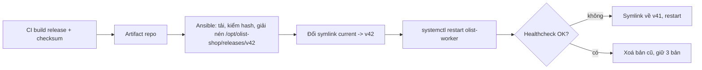

# Câu hỏi phỏng vấn: Linux & terminal

## Gõ `ls` và nhấn Enter. Chuyện gì xảy ra từ lúc đó tới lúc bạn thấy kết quả?

Câu hỏi mở để xem ứng viên đi sâu được tới đâu. Một câu trả lời tốt đi qua các tầng:

1. **Terminal và shell**: terminal emulator gửi các ký tự qua pseudo-terminal (pty); shell (Bash) đọc dòng, mở rộng
   alias, biến, glob (`*`), rồi tìm `ls`: alias, hàm, builtin, cuối cùng là các thư mục trong `PATH` (có cache, xoá
   bằng `hash -r`).
2. **Tạo tiến trình**: shell gọi `fork()` để sao chép chính nó, tiến trình con gọi `execve("/usr/bin/ls", ...)`. Kernel
   đọc header ELF, nạp dynamic linker, linker nạp `libc` và các thư viện khác.
3. **Làm việc**: `ls` gọi `openat()` thư mục, `getdents64()` đọc các mục (tên trỏ tới inode), `statx()` từng tệp nếu
   cần thông tin như `-l`, và `write()` ra stdout (fd 1, chính là pty).
4. **Kết thúc**: `ls` gọi `exit()`, thành zombie trong chốc lát; shell (đang `wait()`) nhận exit status, đặt `$?`, in
   prompt mới.

Ứng viên senior nhắc thêm cách kiểm chứng: `strace -f ls` thấy từng syscall, `type -a ls` thấy shell chọn bản nào.
Biết chuỗi này giúp giải thích các lỗi thật: "command not found" mà tệp có (sai `PATH` hoặc thiếu dynamic linker
trong container Alpine), "Permission denied" khi chạy script (thiếu `x` hoặc mount `noexec`).

## Bạn chọn distro nào cho server production của một công ty mới? Giải thích quyết định.

Không có tên distro đúng; có cách quyết định đúng. Tôi đi theo các câu hỏi:

| Câu hỏi | Vì sao quan trọng |
| --- | --- |
| Phần mềm nào phải chạy, nhà cung cấp chứng nhận distro nào? | Ràng buộc cứng: hỗ trợ của Oracle, SAP, phần mềm ngân hàng thường chỉ nhận RHEL hoặc SLES |
| Cần bao nhiêu năm không phải nâng bản lớn? | Ubuntu LTS 5 năm (10 với Pro), RHEL và bản tương thích 10 năm, Debian khoảng 5 năm tính cả LTS |
| Compliance (PCI DSS, ISO 27001) đòi gì? | Vá kịp thời, MAC, CIS benchmark: các distro lớn đều có, nhưng công cụ chứng minh (OpenSCAP) mạnh nhất ở họ RHEL |
| Team quen gì, công cụ tự động hoá có sẵn cho gì? | Chi phí chuyển đổi và rủi ro vận hành lúc 3 giờ sáng |
| Có ngân sách cho hỗ trợ có hợp đồng không? | RHEL, SLES, Ubuntu Pro bán hỗ trợ và livepatch; Rocky, Alma, Debian thì không (hoặc qua bên thứ ba) |

Công ty mới, chạy trên cloud, không ràng buộc chứng nhận: Ubuntu LTS là lựa chọn ít rủi ro (image mặc định của nhà
cung cấp cloud, tài liệu nhiều, tuyển người dễ). Có ràng buộc RHEL: Rocky hoặc AlmaLinux, chuyển sang RHEL khi cần hợp
đồng. Dù chọn gì, chỉ một họ distro cho cả đội, và nhắc bài học CentOS: vòng đời trên giấy cũng có thể đổi, nên hỏi
"ai được trả tiền để vá lỗi trong 5 năm tới".

## Đĩa báo đầy 100% nhưng `du` chỉ thấy một nửa. Bạn làm gì?

Đây là câu sự cố kinh điển. Trình tự:

1. **Xác nhận và khoanh vùng**: `df -h` (filesystem nào), `df -i` (có phải hết inode không), `du -xsh /mount` (tổng
   theo cây thư mục, `-x` để không đi sang filesystem khác).
2. **Giả thuyết hàng đầu khi `df` lớn hơn `du` nhiều**: tệp đã bị xoá tên nhưng tiến trình vẫn mở. Kiểm bằng
   `lsof -nP +L1 /mount` (link count 0), hoặc `find /proc/[0-9]*/fd -lname '*(deleted)'` khi không có `lsof`. Cộng cột
   size theo **inode duy nhất**: tiến trình con thừa hưởng file descriptor nên cùng tệp hiện nhiều dòng.
3. **Giả thuyết khác**: tệp nằm dưới một mount point (mount đè lên thư mục đã có dữ liệu, `du` không thấy phần bị che;
   kiểm bằng bind mount `/` ra chỗ khác), block dành cho root (ext4 giữ 5%), snapshot của Btrfs/ZFS/LVM.
4. **Giải phóng an toàn**: cắt tệp qua `: > /proc/<pid>/fd/<n>` (trả chỗ ngay, không dừng tiến trình, mất nội dung),
   hoặc làm tiến trình mở lại tệp (`SIGHUP`, `USR1` với Nginx) hoặc restart trong giờ phù hợp. Không `rm` thêm gì.
5. **Kiểm lại** `df`, khôi phục phần bị ảnh hưởng (backup bị fail, upload lỗi).
6. **Nguyên nhân gốc** thường là log rotation đổi tên tệp mà không báo ứng dụng mở lại tệp mới. Phòng ngừa: log ra
   stdout/journald, `postrotate` gửi signal, alert khi `df` và `du` lệch, alert dự báo đầy thay vì ngưỡng 100%.

## Giải thích sự khác nhau giữa `SIGTERM`, `SIGKILL` và `SIGHUP`. Vì sao `docker stop` của bạn luôn mất đúng 10 giây?

- `SIGTERM` (15): yêu cầu dừng, ứng dụng bắt được để dọn dẹp. Mọi nền tảng gửi nó trước.
- `SIGKILL` (9): kernel giết ngay, không bắt được, không dọn dẹp: mất job đang dở, không nhả lock, không flush buffer.
  Không có tác dụng với zombie (đã chết) và phải chờ với tiến trình ở trạng thái `D`.
- `SIGHUP` (1): ban đầu là "terminal đã đóng"; với daemon, quy ước là đọc lại cấu hình hoặc mở lại tệp log.

`docker stop` gửi `SIGTERM`, chờ 10 giây, rồi `SIGKILL`. Luôn mất đúng 10 giây nghĩa là tiến trình không bao giờ phản
ứng với `SIGTERM`. Ba nguyên nhân hay gặp:

1. Ứng dụng chạy qua shell (`CMD python app.py` dạng shell form, hoặc script không `exec`): PID 1 là `sh`, nó không
   chuyển signal cho con.
2. Ứng dụng là PID 1 và không cài handler: kernel không áp hành vi mặc định "kết thúc" cho PID 1 trong namespace, nên
   `SIGTERM` bị bỏ qua.
3. Ứng dụng có handler nhưng chờ một việc không có timeout (kết nối DB treo).

Sửa: dạng exec (`CMD ["python", "app.py"]`), `exec` trong entrypoint, `--init`/tini, và handler có thời hạn. Cùng mẫu
này ở systemd (`TimeoutStopSec=`) và Kubernetes (`terminationGracePeriodSeconds`).

## Zombie và orphan process là gì? Có nên lo khi thấy zombie không?

**Zombie** là tiến trình đã kết thúc nhưng tiến trình cha chưa gọi `wait()` để đọc exit status; nó chỉ còn một mục
trong bảng tiến trình (PID và exit status), không tốn CPU hay RAM. **Orphan** là tiến trình còn chạy mà cha đã chết;
kernel giao nó cho PID 1 (hoặc tiến trình đánh dấu subreaper), và PID 1 có trách nhiệm `wait()` cho nó.

Vài zombie thoáng qua là bình thường. Nên lo khi số zombie tăng dần: cha có lỗi không thu dọn con, và đến lúc hết PID
(`pid_max`, hoặc `TasksMax=` của cgroup) thì không tạo được tiến trình mới. Xử lý: tìm cha bằng
`ps -eo pid,ppid,stat,cmd | awk '$3 ~ /^Z/'`, sửa hoặc restart cha; zombie biến mất khi cha chết (PID 1 nhận và thu
dọn). `kill -9` zombie vô ích. Trong container, đây là lý do cần một init nhỏ (tini, `docker run --init`) khi ứng dụng
sinh tiến trình con.

## Load average là 12. Máy có quá tải không?

Chưa đủ thông tin. Load average trên Linux là số tác vụ đang chạy, chờ CPU **hoặc** ở trạng thái `D` (chờ I/O không
ngắt được), trung bình trượt 1, 5 và 15 phút. Cần hỏi:

- **Bao nhiêu CPU?** Load 12 trên 32 CPU là thoải mái, trên 4 CPU là có 8 tác vụ xếp hàng.
- **Đang tăng hay giảm?** So ba con số: 1 phút cao hơn 15 phút nghĩa là đang xấu đi.
- **CPU hay I/O?** `vmstat 1`: cột `r` cao và `id` thấp là CPU; cột `b` cao và `wa` cao, CPU rảnh, là I/O hoặc NFS treo.
  Load cao mà CPU 90% rảnh gần như luôn là tiến trình `D`.

Sau đó tôi theo USE method: utilization, saturation, errors cho từng tài nguyên, và trên kernel mới đọc PSI
(`/proc/pressure/*`), cho thẳng phần trăm thời gian tác vụ phải chờ từng tài nguyên. Load average là một tín hiệu để
bắt đầu hỏi, không phải để alert: alert theo latency và error rate của dịch vụ (SLO), không theo load.

## Máy production chậm. Bạn làm gì trong 60 giây đầu tiên?

Tôi chạy một bộ lệnh cố định để không bỏ sót, theo checklist của Netflix:

| Lệnh | Tìm gì |
| --- | --- |
| `uptime` | Load đang tăng hay giảm |
| `dmesg -T \| tail` | OOM killer, lỗi I/O, TCP drop, lỗi phần cứng |
| `vmstat 1` | `r` so với số CPU, `si`/`so` (swap), `wa`, `st` (steal trên VM) |
| `mpstat -P ALL 1` | Một CPU bị ghim 100% (ứng dụng đơn luồng) |
| `pidstat 1` | Tiến trình nào ăn CPU |
| `iostat -xz 1` | Đĩa nào có hàng đợi (`aqu-sz`) và `await` cao |
| `free -m` | Cột `available`, không phải `free` |
| `sar -n DEV 1`, `sar -n TCP,ETCP 1` | Throughput mạng, retransmit |
| `top` | Kiểm lại tổng quan |

Bỏ dòng đầu của `vmstat`/`iostat` (trung bình từ khi khởi động). Song song, tôi nhìn dashboard để biết "chậm" là từ
lúc nào và có trùng một deploy không: thay đổi gần nhất là nghi phạm số một. Nếu không tài nguyên nào bão hoà, vấn đề
nằm ở ứng dụng hoặc phụ thuộc (lock, connection pool cạn, upstream chậm), và bước tiếp theo là trace hoặc profile.

## `free -m` cho thấy chỉ còn 200 MB trống trên máy 16 GB. Có cần thêm RAM không?

Thường là không. Linux dùng RAM trống làm **page cache** cho tệp; cache được trả lại ngay khi ứng dụng cần. Cột cần
đọc là `available` (ước lượng bộ nhớ dùng được mà không phải swap). Dấu hiệu thật sự thiếu bộ nhớ:

- `si`/`so` trong `vmstat` khác 0 liên tục (đang swap trong lúc chạy, không phải swap còn sót từ trước).
- OOM killer trong `dmesg` hoặc `journalctl -k`, tiến trình bị giết với exit code 137.
- PSI memory (`/proc/pressure/memory`) có `some`/`full` đáng kể.
- Major page fault cao (`sar -B`), latency tăng theo.

Nếu thiếu thật, trước khi thêm RAM tôi xem tiến trình nào giữ nhiều nhất (`ps aux --sort=-rss`, `smem`), có rò rỉ
không (RSS tăng đều theo thời gian), và giới hạn từng service bằng `MemoryMax=` để một service rò không kéo sập cả máy.
Tắt swap hoàn toàn hay không là một quyết định: không swap thì OOM đến sớm và rõ ràng; có swap nhỏ thì có đệm nhưng có
thể chậm kéo dài thay vì lỗi rõ.

## Vì sao dùng systemd timer thay cho cron? Khi nào vẫn dùng cron?

Đây là câu "vì sao chọn công cụ này". Timer thắng cron ở những điểm quan trọng với production:

- **Chạy bù**: `Persistent=true` chạy job ngay khi máy lên nếu đã lỡ lịch; cron bỏ qua.
- **Không chạy chồng**: service đang chạy thì timer không khởi động lần nữa; với cron phải tự `flock`.
- **Log**: output vào journald, `journalctl -u backup` thấy ngay; cron mặc định gửi mail hoặc mất.
- **Môi trường và bảo mật**: chạy như mọi service, có user riêng, `EnvironmentFile=`, sandbox, giới hạn tài nguyên,
  `Nice=`/`IOSchedulingClass=` cho job nặng.
- **Rải lịch**: `RandomizedDelaySec=` tránh 200 máy cùng đập vào database lúc 02:00.
- **Theo dõi**: `systemctl list-timers` thấy lần chạy trước và kế tiếp; job fail thì unit `failed`, gắn được
  `OnFailure=` để alert.

Cron vẫn hợp lý khi: máy không có systemd (container, Alpine, một số hệ nhúng), job cá nhân đơn giản của một user,
hoặc tổ chức đã có công cụ quản lý cron tập trung. Ở tầng Kubernetes, câu hỏi tương đương là `CronJob` (có
`concurrencyPolicy`, `startingDeadlineSeconds` giải đúng các vấn đề trên), và ở tầng pipeline dữ liệu là Airflow.

## Vì sao không nên cài phần mềm bằng cách pipe script tải về vào `sudo bash`? Bạn cài thế nào?

Ba lý do kỹ thuật, không chỉ "nguy hiểm":

1. **Không đọc trước được**: script chạy với quyền root ngay khi tải. Server có thể trả nội dung khác cho trình duyệt
   và cho `curl` (phát hiện theo User-Agent hoặc timing của pipe).
2. **Chạy nửa chừng**: mạng đứt giữa chừng, shell vẫn chạy phần đã nhận; một dòng `rm -rf /opt/tool` bị cắt còn
   `rm -rf /`.
3. **Không tái lập, không audit**: không có phiên bản, không có hash; chạy lại tuần sau ra máy khác, và không trả lời
   được "máy này đang chạy bản nào".

Tôi cài theo thứ tự: package của distro (đã ký); repo của nhà phát hành với khoá ký riêng (`signed-by=`); binary
release ở phiên bản ghim, kiểm SHA-256 với hash đã ghim trong repo cấu hình (hoặc chữ ký cosign/GPG, attestation), cài
vào `~/.local/bin` hoặc `/usr/local/bin` không cần root khi có thể; cuối cùng build từ nguồn ở tag ghim. Mọi phiên
bản và hash nằm trong Ansible hoặc Dockerfile, đi qua review. Checksum tải cùng chỗ với tệp chỉ chống tải hỏng; hash
ghim từ trước mới chống tráo tệp.

## `chmod 777` giải quyết được lỗi "Permission denied" của ứng dụng. Có vấn đề gì không?

Có. `777` cho mọi user trên máy quyền đọc, ghi, chạy. Với thư mục, quyền ghi nghĩa là **xoá và thay** được tệp của
người khác: một service khác bị chiếm quyền thay được script mà service của bạn sẽ chạy. Không có sticky bit (`1777`
như `/tmp`) thì không có gì chặn.

Cách làm đúng là tìm vì sao bị từ chối:

1. Tiến trình chạy bằng user và group nào (`ps -o user,group`, `User=` trong unit)?
2. Chuỗi thư mục cha có `x` cho user đó không (`namei -l /opt/olist-shop/data/file`)? Thiếu `x` ở một thư mục cha là
   lỗi rất hay gặp.
3. Có ACL không (`getfacl`)? Có MAC chặn không (`ausearch -m avc` với SELinux, `journalctl | grep apparmor`)? Mount có
   `noexec` không?

Rồi sửa đúng chỗ: đổi owner hoặc group, thêm user vào group, `setgid` trên thư mục dùng chung, `umask` của service
(`UMask=0027`), hoặc policy SELinux đúng (`semanage fcontext` + `restorecon`). Thường nguyên nhân gốc là một `umask`
sai trong script deploy hoặc Dockerfile.

## Thiết kế cách vận hành một worker Python trên 5 VM không dùng container: cài đặt, chạy, log, cập nhật, quyền.

Câu thiết kế. Tôi trình bày theo vòng đời:



- **Cài đặt**: mỗi release là một thư mục bất biến `/opt/olist-shop/releases/<version>` có virtualenv riêng; symlink
  `current` trỏ tới bản đang chạy. Rollback là đổi symlink. Không `git pull` trên server.
- **Chạy**: systemd unit với `User=olist`, `EnvironmentFile=/etc/olist-shop/worker.env` (`0640 root:olist`),
  `Restart=on-failure` có `StartLimitBurst`, `TimeoutStopSec=` khớp thời gian trả job, `MemoryMax=`, hardening tới
  exposure dưới 3 theo `systemd-analyze security`.
- **Log**: ra stdout, journald giữ cục bộ có giới hạn (`SystemMaxUse=`), chuyển về hệ thống log tập trung. Không tự
  xoay tệp log trong ứng dụng.
- **Cập nhật**: rolling từng máy (hoặc từng nhóm) qua Ansible `serial:`, healthcheck sau mỗi máy, dừng khi lỗi. Bản
  vá hệ điều hành theo lịch, reboot từng máy một.
- **Quyền và truy cập**: SSH chỉ qua bastion, key cá nhân, không user chung; worker không có shell đăng nhập; mọi thay
  đổi cấu hình qua Git và Ansible.
- **Quan sát**: `/metrics` cho Prometheus, alert theo độ dài hàng đợi job và tỉ lệ lỗi, không theo CPU.

Đánh đổi cần nói: không có container thì phụ thuộc hệ thống (phiên bản Python, thư viện C) gắn với distro; virtualenv
mỗi release và ghim phiên bản Python (`uv python install`) giảm rủi ro này. Khi số máy và số service tăng, đây là lúc
cân nhắc container và orchestrator.

## Một service gọi `api.internal:8000` thỉnh thoảng bị timeout. Bạn khoanh vùng thế nào?

Đi từ dưới lên, mỗi bước loại một tầng:

1. **DNS**: `dig api.internal`, `getent hosts api.internal` (đi qua NSS như ứng dụng). Kiểm TTL và số bản ghi: một IP
   chết trong round robin DNS cho đúng triệu chứng "thỉnh thoảng".
2. **TCP**: `nc -vz` hoặc `curl -w` tách `time_namelookup`, `time_connect`, `time_starttransfer`. Connect chậm là mạng
   hoặc server không kịp `accept()`; connect nhanh mà TTFB chậm là ứng dụng.
3. **Phía server**: `ss -ltn` xem `Recv-Q` của socket LISTEN chạm backlog chưa (kết nối mới bị bỏ, client thấy
   timeout hoặc retransmit SYN); `ss -tan state close-wait` (ứng dụng rò socket); `nstat` xem `ListenOverflows`,
   `TcpRetransSegs`.
4. **Phía client**: cạn connection pool, cạn port tạm (`TIME-WAIT` hàng chục nghìn), conntrack đầy (`dmesg`:
   `nf_conntrack: table full, dropping packet`).
5. **Gói tin**: `tcpdump` có bộ lọc ở cả hai đầu, so thời điểm SYN đi và SYN-ACK về.

"Thỉnh thoảng" gợi ý thứ gì đó theo tỉ lệ hoặc theo tải: một backend trong nhiều backend hỏng, hàng đợi đầy giờ cao
điểm, MTU sai chỉ với gói lớn, hoặc một timeout cấu hình thấp hơn p99 latency.

## Bạn cần đếm số request lỗi 5xx theo endpoint từ 20 GB access log nén trên server. Bạn làm thế nào, và khi nào bạn không làm vậy?

Trên server, không giải nén ra đĩa:

```bash
zcat access.log.*.gz | LC_ALL=C awk -F'"' '{split($3, s, " "); if (s[1] ~ /^5/) {split($2, r, " "); sub(/\?.*/, "", r[2]); print r[2]}}' | LC_ALL=C sort | uniq -c | sort -rn | head
```

Những điểm tôi nói thêm: tách theo dấu `"` vì request line và User-Agent có dấu cách; bỏ query string để gộp
endpoint; `LC_ALL=C` nhanh hơn nhiều lần với `sort`; chạy với `nice -n 15 ionice -c3` để không giành tài nguyên với
dịch vụ đang chạy trên chính máy đó; dùng `pigz -dc` nếu có để giải nén song song.

Không làm vậy khi: đây là câu hỏi lặp lại hằng ngày (đưa log vào Loki hoặc Elasticsearch, hoặc tạo metric từ Nginx
và hỏi Prometheus); cần join với dữ liệu khác (DuckDB đọc thẳng CSV/JSON nén, SQL dễ review hơn awk); hoặc log nằm
trên nhiều máy (đó là lý do có log tập trung). Pipeline shell là công cụ của 10 phút đầu sự cố, không phải hệ thống
báo cáo.

## Vim, Nano hay Emacs? Bạn sửa cấu hình trên server thế nào?

Trên server, tôi dùng thứ có sẵn: `vi`/Vim có trên gần như mọi máy Unix, kể cả image tối giản và môi trường cứu hộ,
nên một người vận hành phải sửa được tệp bằng Vim (chế độ chèn, lưu, thoát, tìm, thay thế, `:set paste`). Nano dễ
cho người mới nhưng không phải lúc nào cũng có. Emacs mạnh cho môi trường cá nhân, sửa từ xa qua TRAMP mà không cài
gì lên server. Máy dev của tôi dùng gì cũng được.

Câu hỏi đúng hơn là "có nên sửa tay trên server không". Câu trả lời của tôi: chỉ khi khẩn cấp, và sau đó đưa thay đổi
vào Git và công cụ cấu hình ngay, nếu không lần Ansible chạy tới sẽ ghi đè và lỗi quay lại. Khi buộc phải sửa tay, dùng
công cụ có kiểm tra: `visudo`, `sudoedit`, `systemctl edit` (drop-in), `nginx -t` trước khi reload, giữ bản sao
trước khi sửa, và ghi lại vào kênh sự cố.
